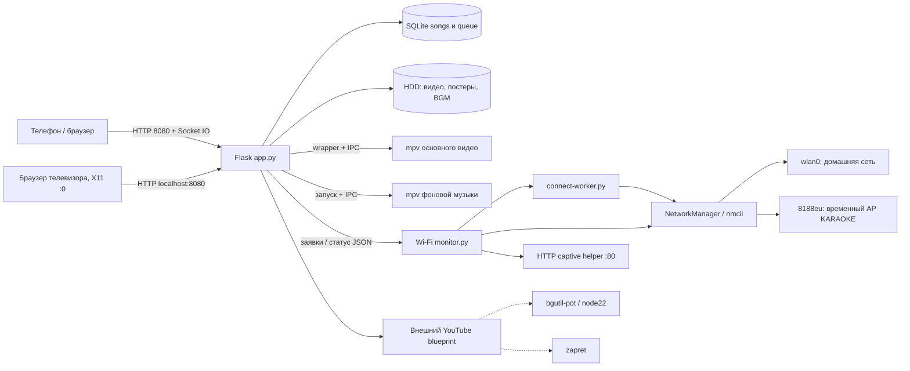

# Архитектура и оборудование

## Устройство

X96Q v5.1 TV Box, Allwinner H616, ARM64, около 2 ГБ RAM. Armbian unofficial 24.11.0-trunk, Debian Bookworm, ядро `6.6.44-current-sunxi64`. Образ собран из sicXnull/armbian-build, BOARD=x96q-v5-1, LINUXFAMILY=sunxi64. Совместимость DT: hechuang,x96-q; allwinner,sun50i-h616. Конфигурация ядра и DT относятся к нестандартному образу; общая инструкция Armbian не гарантирует загрузку этой платы.

Корень `/` находился на `/dev/mmcblk2p1` ext4, eMMC около 14,7 GiB. Это встроенная память: сценарий «вынуть системную SD-карту» к показанной конфигурации неприменим. HDD WDC WD2500BEVS около 232,9 GiB, раздел `/dev/sda1` ext4, основной mount `/mnt/usb_disk`. Его содержимое также было доступно через bind mount `/root/karaoke/karaoke_media`.

Встроенный Wi-Fi wlan0: xradio_wlan, SDIO 0020:2281. Он используется для домашней сети. USB Wi-Fi: RTL8188EUS 0bda:8179, известное имя wlxf0b040f7f699; custom driver 8188eu. Он используется только для временной точки настройки. Ethernet end0 существовал, но был unavailable. На месте нет второго USB Wi-Fi.

## Состав работающей системы

Пунктир означает зависимость общего проекта, точный внутренний вызов из отсутствующего YouTube-модуля не установлен. Установка документации не останавливает эти службы.

## Процессы и границы

Основной сервер — `karaoke-server.service`, рабочий каталог `/root/karaoke`, запуск `/usr/bin/python3 app.py`, TCP 8080 на всех IPv4-адресах. Flask-SocketIO работает в режиме threading. HTML основной страницы встроен в строку `HTML` в app.py; CSS и JavaScript находятся в той же строке. Нет отдельного npm-проекта для этой страницы.

Контроллер Wi-Fi — отдельная служба `karaoke-wifi-monitor.service`. Она запускает worker для одной операции. Таким образом перезапуск веб-приложения не должен уничтожать текущую настройку Wi-Fi. Контроллер владеет политикой включения AP; старый auto-manager отключён, два независимых владельца AP одновременно недопустимы.

`rtl8188eu-bind.service` — oneshot. После успешного выхода он может отображаться inactive/dead: проверяйте Result=success и ExecMainStatus=0, а не только is-active.

Основной mpv получает команды через `/tmp/mpvsocket`, BGM — `/tmp/bgm_mpvsocket`. `/usr/local/bin/play_karaoke.sh` управляет окном видео и возвратом браузера в X11, DISPLAY=:0. Из исторического снимка нельзя утверждать, какой именно браузер сейчас открыт на ТВ: сохранённый karaoke-browser.service с NetSurf был disabled, wrapper ищет окно через wmctrl.

## Сеть и порты

| Назначение | Адрес/порт | Условие |
|---|---|---|
| SSH | TCP 22 | По актуальному адресу приставки |
| Основной веб-интерфейс | TCP 8080 | Локальная и домашняя сеть, AP при активности |
| Временная точка | 192.168.100.1/24 | Только при сценарии настройки |
| Captive HTTP | 192.168.100.1:80 | Только пока AP активна |
| DHCP/DNS AP | NetworkManager shared/dnsmasq | Управляется NetworkManager |
| bgutil-pot | 127.0.0.1:4416 | По выведенному ExecStart |
| Сторонний Python listener | 127.0.0.1:9090 | Ранее наблюдался; назначение не установлено |

192.168.1.102 — зафиксированный адрес домашнего подключения, а не обещанный постоянный адрес. Правый QR строится из текущего адреса и не зашивает его навсегда. HTTP нужен для локального устройства; проект не настроен как публичный интернет-сервис.
