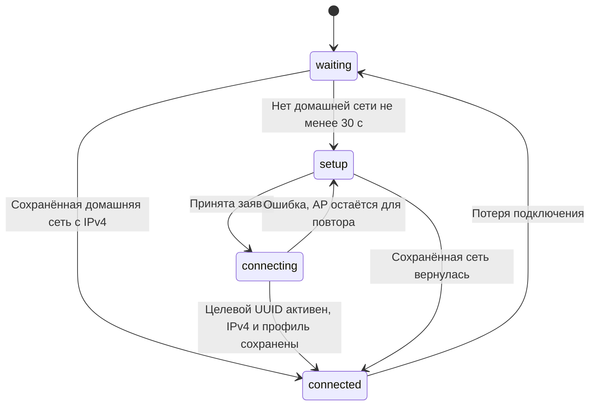

# Wi-Fi и два QR-кода

## Пользовательский сценарий

Домашняя сеть доступна: встроенный wlan0 подключается к сохранённому профилю, получает IPv4, AP не нужна. Справа сверху на телевизоре под Wi-Fi и шестерёнкой показывается QR главной страницы с текущим адресом. Телефон для управления находится в той же домашней сети.

Домашняя сеть отсутствует: примерно через 30 секунд контроллер включает USB AP KARAOKE. Слева сверху показываются два шага: найти KARAOKE и ввести 12345678; после подключения навести камеру на QR и открыть настройку домашнего Wi-Fi. QR содержит URL, а не Wi-Fi credentials. Само сканирование этого QR не подключает телефон к сети.

Пользователь выбирает SSID, вводит пароль, получает статус операции. После подтверждённого сохранённого подключения с IPv4 точка остаётся на 10 секунд для ответа, затем выключается. Телефон переключают на домашнюю сеть и сканируют правый QR для управления.

## Критерий подключения

NetworkManager.station(): GENERAL.STATE=100, профиль wifi/infrastructure, интерфейс wlan0 либо незаданный, это не AP UUID и не SSID KARAOKE, есть пригодный IPv4, профиль сохранён на диске. Доступность интернета не проверяется: отсутствие WAN не должно убирать работающую домашнюю LAN и мешать офлайн-караоке.

## Политика контроллера

Реальный status.mode — waiting/setup/connecting/connected; status.error может присутствовать независимо. `setup_needed` вычисляется как AP активна и домашняя сеть отсутствует. AP может быть кратковременно активна при connected в период grace; это нормально.

Policy.decide(): при подключении сбрасывает missing_since и запоминает home_since. Для остановки AP требует домашнее подключение минимум 2 секунды, отсутствие busy и завершённый grace_until. При отсутствии подключения сбрасывает home_since и запускает AP после 30 секунд. Цикл tick() раз в 2 с означает, что точный момент включения зависит от продолжительности команд и границы цикла.

## Приём и выполнение заявки

1. HTTP проверяет фактический request.remote_addr. Разрешены loopback, собственный домашний IP для TV и клиенты 192.168.100.0/24 при активной AP. Заголовки X-Forwarded-For для этого не принимаются.
2. Проверяются SSID (1–32 UTF-8 байта), запрет CR/LF/NUL, пароль WPA (8–63 байта либо 64 HEX) или пустой пароль открытой сети. SSID KARAOKE не выбирают как домашнюю сеть.
3. Контроллер должен быть здоров: version=2, без ошибки, updated_at не старше 12 секунд. Вторая параллельная заявка отвергается.
4. Записываются private request, job status=queued и active-job. Возвращается HTTP 202 с job_id. Заявки не выполняются в Flask-потоке.
5. Контроллер сначала обеспечивает AP, затем запускает connect-worker.py с конкретным job_id; собственный deadline около 180 с.
6. Worker берёт operation lock, читает и удаляет файл с паролем. Создаёт временный save=no профиль KARAOKE_HOME_<job_id> с детерминированным UUID, ifname wlan0, infrastructure, autoconnect=no.
7. Активирует только этот профиль (`nmcli --wait 40`, таймаут процесса 50 с), проверяет именно его UUID и IPv4.
8. Делает профиль постоянным: autoconnect=yes, priority=50; проверяет наличие на диске и повторно активный UUID.
9. success → grace 10 с. failed → AP доступна; при возврате старой сети grace 60 с для повтора. Неуспешный временный кандидат удаляется только при совпадении его UUID и полного имени.

После перезапуска контроллер сверяет boot_id, deadline, lock и конкретный argv worker. Он не посылает сигнал произвольному повторно использованному PID. Прерванная операция становится failed либо признаётся завершённой, если именно её сохранённый профиль с IPv4 активен. Слишком старая queued-заявка (>120 с) не запускается заново.

## Сброс

POST reset требует настоящий JSON boolean confirmed=true. Сначала USB AP, потом удаление только подходящих домашних station-профилей, затем возврат device autoconnect. USB/AP-профили исключаются. Это намеренное удаление настроек, а не инструмент безобидного теста.

## Сканирование

Только wlan0, с `--rescan yes`; USB AP не сканируют. operation lock не допускает rescan одновременно с подключением. split_nmcli() корректно разбирает экранированные двоеточия и слеши SSID. Одинаковые SSID объединяются, преимущество у in-use и более сильного сигнала. Сеть KARAOKE скрыта из списка домашних.

## QR настройки

Статический PNG /wifi/setup-qr.png, payload `http://192.168.100.1:8080/wifi/setup`, SHA256 5f7a2c3b9f4281fbba4560da80d737bed5f4a7bb94abc1f424b171d834978671. Изменять IP AP надо согласованно в профиле NetworkManager, network.py, captive.py, dnsmasq и PNG; одной замены текста недостаточно.

## QR управления

control_qr.control_url() принимает только свежее controller_ok=true, connected=true и корректный IPv4. Не разрешены unspecified/loopback/link-local/multicast/reserved и 0.x. URL — http://<ip>:8080/. Кэш хранит только последний URL/PNG, защищён threading.Lock. При потере здоровья/сети кэш инвалидируется.

QR version=3, correction M, border=4, матрица вместе с полями 37×37, масштаб 6 → PNG 222×222. PNG строится stdlib struct/zlib без Pillow. Компактное отображение 185 px соответствует 5 px на модуль, без дробного масштабирования. Отдельный endpoint проверяет ожидаемый ip, чтобы не показать картинку от устаревшего адреса; Cache-Control=no-store и X-Control-URL возвращают актуальную цель. На узких экранах <=820 px домашняя карточка скрывается.

Встроенный JS проверяет статус примерно каждые 3 с, скрывает устаревшую карточку, защищает обновление изображения от гонки ответов. Основной старый интерфейс переопределяет fetch: новый код использует независимый XMLHttpRequest, где это необходимо. После обновления app.py надо перезагрузить страницу ТВ, иначе старый DOM останется на экране.

## Captive portal

NetworkManager shared dnsmasq получает address=/#/192.168.100.1 и local=/#/ для офлайн DNS. CaptivePortal слушает только 192.168.100.1:80, отвечает GET/HEAD HTTP 302 на страницу настройки. Порт 8080 не перехватывается. Неудачный bind не убивает другой процесс: публикуется ошибка helper, ручной URL остаётся запасным путём. Всплывающее окно зависит от Android/iOS/Windows и не гарантируется. HTTPS-перехвата нет.
