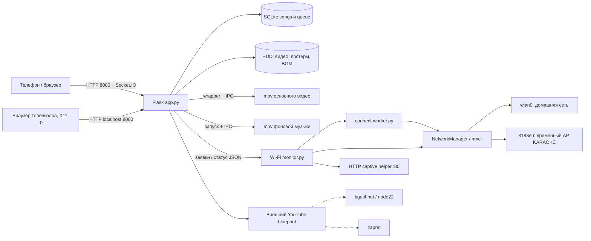
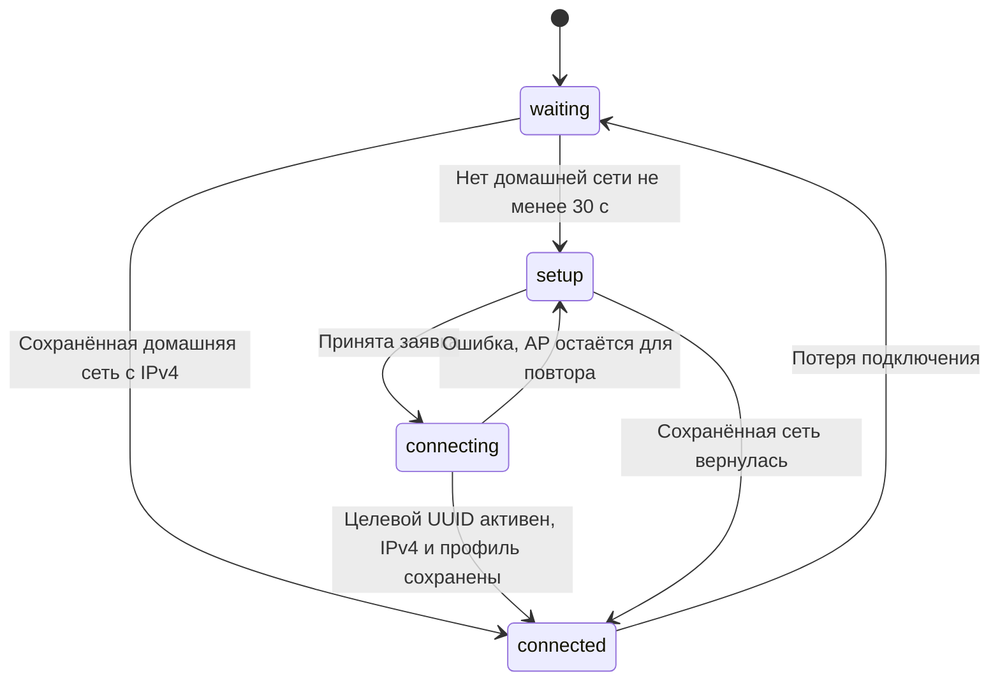

# KARAOKE — полный комплект документации и исходников

Дата: 15 октября 2026 года.

Этот единый текст можно сохранить через «Копировать содержимое файла» в UTF-8. Он содержит все руководства и доступные текстовые исходники/установщики/тесты. Полный ZIP дополнительно содержит двоичные изображения, архивы и исследовательские модули. Это не полный образ устройства и не дословный экспорт всей переписки.

**Подтверждено: USB AP и QR V5. Подготовлено, установка не подтверждена: оптимизатор и аналоговый звук.**

## Содержание

- 00_НАЧАТЬ_ЗДЕСЬ
- 01_АРХИТЕКТУРА_И_ОБОРУДОВАНИЕ
- 02_ВЕРСИИ_И_ИСТОРИЯ
- 03_ФАЙЛЫ_И_ДАННЫЕ
- 04_WIFI_И_QR_АЛГОРИТМЫ
- 05_ДРАЙВЕРЫ_И_ЗАГРУЗКА
- 06_МЕДИАТЕКА_И_ОПТИМИЗАЦИЯ
- 07_ЗВУК_И_ПЛЕЕРЫ
- 08_HTTP_API_И_СОБЫТИЯ
- 09_ЭКСПЛУАТАЦИЯ_И_ДИАГНОСТИКА
- 10_УСТАНОВКА_ОТКАТ_И_БЭКАП
- 11_РАЗРАБОТКА_И_ПРОВЕРКИ
- 12_ПЕРЕДАЧА_ПРОЕКТА_И_ПРОБЕЛЫ
- 13_СПРАВОЧНИК_ФУНКЦИЙ_PYTHON
- 14_СПРАВОЧНИК_МАРШРУТОВ
- 15_КОНСТАНТЫ_SQL_И_ИМПОРТЫ
- 16_ИНВЕНТАРИЗАЦИЯ_ФАЙЛОВ
- 17_СПРАВОЧНИК_JAVASCRIPT_И_UI
- 18_НАЗНАЧЕНИЕ_КАЖДОГО_ФАЙЛА

## Часть I. Документация


---

# Проект KARAOKE на X96Q: начало работы

Срез проекта: 15 октября 2026 года. Документация предназначена владельцу, разработчику и новому помощнику в другом аккаунте. Основание: доступные исходники, установщики, манифесты, журналы исследования и подтверждения пользователя. Онлайн-доступа к приставке при подготовке этого пакета нет.

## Что находится в комплекте

- `docs/`: руководства, схемы, алгоритмы, справочник HTTP, Python и JavaScript, описание хранения и восстановления.
- `sources/karaoke-wifi-integration/`: исходный снимок, последовательные обновления, установщики и тесты. Исходные исторические README сохранены, даже если в них остались устаревшие статусы.
- `sources/rtl8188eus-research/`: подготовка сборки USB-драйвера, привязка, постоянная установка, контрольные сведения.
- `sources/xradio-research/`: исследовательские патчи и модули встроенного Wi-Fi; это история эксперимента, не рекомендуемая установка.
- `versions/device-confirmed-v5/`: реконструированный набор известных файлов версии V5, которую пользователь подтвердил. Это не полный образ файловой системы приставки.
- `versions/prepared-media-audio-v1/`: известные файлы подготовленного следующего обновления. Его установка на приставке пока не подтверждена.
- `evidence/`: исходные текстовые вложения, конфигурация ядра, исходный архив пользователя и сводка переписки.
- `tools/`: проверка целостности, сбор дополнительных данных с приставки и извлечение исходников из единого документа.
- `MANIFEST.json`, `SHA256SUMS`: перечень и хэши всех файлов комплекта.
- `ПОЛНАЯ_ДОКУМЕНТАЦИЯ_И_ИСХОДНИКИ.md`: переносимый единый текст с руководствами и исходниками; его можно скопировать из боковой панели через «Копировать содержимое файла». Двоичные модули и изображения находятся в ZIP и не воспроизводятся текстом.

## Самое важное о состоянии

| Возможность | Состояние | Основание |
|---|---|---|
| Караоке с локального HDD, основная веб-страница | Работало на приставке | Многократные ответы HTTP 200 и проверки пользователя |
| USB RTL8188EUS на драйвере 8188eu, режим AP | Установлено, проверено после перезагрузки | Пользователь сообщил «Работает всё», показал драйвер и адреса |
| Встроенный wlan0 как клиент домашней сети | Работало | Профиль ZZZZ, адрес 192.168.1.102 в последнем подтверждённом выводе |
| Автоматическая точка настройки и левый QR V4 | Подтверждено пользователем | После обновления страницы ТВ сценарий работал |
| Правый QR для управления в домашней сети V5 | Подтверждено пользователем, задача закрыта | «Все работает с этим вопросом закончили» |
| Проверка/исправление медиатеки | Подготовлено и проверено в облаке | Код и установщик выданы, результата установки на приставку нет |
| Отключение HDMI с выводом на аналог | Подготовлено и проверено программно | Карты определены; реальное звучание не проверено |
| Полный загрузочный образ eMMC | Отсутствует среди доступных материалов | Были файловые резервные копии, не полный образ |

Порядок чтения: `01` → `02` → `03` → нужная подсистема → `09` для эксплуатации → `10` для развёртывания → `12` для передачи проекта. Справочники `13`–`16` созданы статическим анализом, без запуска приложения.

## Пределы полноты

Документация подробно описывает всё доступное. Отдельные действующие файлы приставки — YouTube-менеджер, модуль карантина, часть HTML, фактические базы и медиа — не были загружены в эту среду. Они перечислены в разделе о недостающих материалах. Их поведение нельзя полностью восстановить по одному импорту. Для завершения инвентаризации предоставлен скрипт сбора снимка. Сам пакет не меняет приставку и ничего на ней не устанавливает.


---

# Архитектура и оборудование

## Устройство

X96Q v5.1 TV Box, Allwinner H616, ARM64, около 2 ГБ RAM. Armbian unofficial 24.11.0-trunk, Debian Bookworm, ядро `6.6.44-current-sunxi64`. Образ собран из sicXnull/armbian-build, BOARD=x96q-v5-1, LINUXFAMILY=sunxi64. Совместимость DT: hechuang,x96-q; allwinner,sun50i-h616. Конфигурация ядра и DT относятся к нестандартному образу; общая инструкция Armbian не гарантирует загрузку этой платы.

Корень `/` находился на `/dev/mmcblk2p1` ext4, eMMC около 14,7 GiB. Это встроенная память: сценарий «вынуть системную SD-карту» к показанной конфигурации неприменим. HDD WDC WD2500BEVS около 232,9 GiB, раздел `/dev/sda1` ext4, основной mount `/mnt/usb_disk`. Его содержимое также было доступно через bind mount `/root/karaoke/karaoke_media`.

Встроенный Wi-Fi wlan0: xradio_wlan, SDIO 0020:2281. Он используется для домашней сети. USB Wi-Fi: RTL8188EUS 0bda:8179, известное имя wlxf0b040f7f699; custom driver 8188eu. Он используется только для временной точки настройки. Ethernet end0 существовал, но был unavailable. На месте нет второго USB Wi-Fi.

## Состав работающей системы



Пунктир означает зависимость общего проекта, точный внутренний вызов из отсутствующего YouTube-модуля не установлен. Установка документации не останавливает эти службы.

## Процессы и границы

Основной сервер — `karaoke-server.service`, рабочий каталог `/root/karaoke`, запуск `/usr/bin/python3 app.py`, TCP 8080 на всех IPv4-адресах. Flask-SocketIO работает в режиме threading. HTML основной страницы встроен в строку `HTML` в app.py; CSS и JavaScript находятся в той же строке. Нет отдельного npm-проекта для этой страницы.

Контроллер Wi-Fi — отдельная служба `karaoke-wifi-monitor.service`. Она запускает worker для одной операции. Таким образом перезапуск веб-приложения не должен уничтожать текущую настройку Wi-Fi. Контроллер владеет политикой включения AP; старый auto-manager отключён, два независимых владельца AP одновременно недопустимы.

`rtl8188eu-bind.service` — oneshot. После успешного выхода он может отображаться inactive/dead: проверяйте Result=success и ExecMainStatus=0, а не только is-active.

Основной mpv получает команды через `/tmp/mpvsocket`, BGM — `/tmp/bgm_mpvsocket`. `/usr/local/bin/play_karaoke.sh` управляет окном видео и возвратом браузера в X11, DISPLAY=:0. Из исторического снимка нельзя утверждать, какой именно браузер сейчас открыт на ТВ: сохранённый karaoke-browser.service с NetSurf был disabled, wrapper ищет окно через wmctrl.

## Сеть и порты

| Назначение | Адрес/порт | Условие |
|---|---|---|
| SSH | TCP 22 | По актуальному адресу приставки |
| Основной веб-интерфейс | TCP 8080 | Локальная и домашняя сеть, AP при активности |
| Временная точка | 192.168.100.1/24 | Только при сценарии настройки |
| Captive HTTP | 192.168.100.1:80 | Только пока AP активна |
| DHCP/DNS AP | NetworkManager shared/dnsmasq | Управляется NetworkManager |
| bgutil-pot | 127.0.0.1:4416 | По выведенному ExecStart |
| Сторонний Python listener | 127.0.0.1:9090 | Ранее наблюдался; назначение не установлено |

192.168.1.102 — зафиксированный адрес домашнего подключения, а не обещанный постоянный адрес. Правый QR строится из текущего адреса и не зашивает его навсегда. HTTP нужен для локального устройства; проект не настроен как публичный интернет-сервис.


---

# Версии, изменения и источники истины

## Слои кода

| Путь в комплекте | Что это | Как использовать |
|---|---|---|
| sources/karaoke-wifi-integration/current | Присланный исходный снимок до новых сценариев | Сравнение с историей, не актуальная установка |
| deploy/kit, deploy/paste-part-*.sh | Замороженное базовое обновление Wi-Fi V2 | Только если исходная версия соответствует манифесту |
| ui-v3 | Карточка с видимым QR вместо одной кнопки | Исторический шаг |
| ui-v4 | Ручное подключение к AP, затем URL QR | Подтверждённый сценарий настройки |
| ui-v5 | Правый QR домашнего управления | Последняя подтверждённая UI-версия |
| media-audio-v1 | Добавление проверки видео и аналогового звука | Подготовлено, установка не подтверждена |
| updated | Рабочая подготовленная версия со всеми новыми изменениями | Не считать дословной копией сейчас работающей приставки |

Относительные пути таблицы после первой строки указаны внутри sources/karaoke-wifi-integration.

## Идентификация app.py

| Версия | SHA256 |
|---|---|
| V4 | e168e929236a770953bac8e15aef6288662dccbb5bf6935f237c3b4ab13af642 |
| V5 | 8731353016f544c7f46cbf96e0d45dce7f6c52c1239d5777f92ff7f2abf441ba |
| Подготовленная media-audio-v1 | 54fb907fd6eb0ed108863ce747c61e496bbb198850ac65bc140ff54eaaaea29d |

На приставке выполните `sha256sum /root/karaoke/app.py`. Совпадение показывает точную известную версию файла. Несовпадение не означает повреждение: могли быть последующие изменения. В этом случае сначала сравнение, затем новый целевой патч; подменять ожидаемый хэш в установщике нельзя.

## USB-драйвер

Нативная сборка пользователя: `/root/rtl8188eus-build-xs4977k0/8188eu-test.ko`, SHA256 d1c545d580901e3bd85504d7c970a729383aaf75b3217724a4940c3b4e353bc3. Постоянное расположение — `/lib/modules/6.6.44-current-sunxi64/updates/drivers/net/wireless/8188eu.ko`.

В комплекте есть облачные GCC11/GCC12 модули как исследовательские артефакты. Они не являются тем самым нативно собранным файлом с указанным хэшем. Сам файл нативной сборки остался на приставке и в текущей облачной среде отсутствует. Перед переносом его надо отдельно сохранить.

## Приоритет подтверждений

1. Новый фактический вывод с приставки и подтверждение пользователя.
2. Проверенные хэши и манифесты версии.
3. Код соответствующего снимка.
4. Старые README и промежуточные записи исследования.

`build-evidence.json` обновлялся по этапам: вложенный home_control_qr_revision подтверждает V5; некоторые более старые поля overall_wifi_goal ещё говорят «V5 pending». Новая документация разрешает это расхождение по последнему подтверждению пользователя. Архивные README не переписаны, чтобы сохранить историю.

## Что не переносится автоматически

Смена аккаунта ChatGPT не меняет приставку. Непушенные файлы облачной среды Codex не появятся в новом аккаунте от одного подключения GitHub. Репозиторий /workspace/- в доступной среде не содержит рабочие файлы проекта: фактическая разработка находится в отдельных каталогах, которые и включены в этот комплект. Документы и снимки не следует принимать за готовый полный Git-репозиторий или образ ОС.


---

# Карта файлов и хранения

## Рабочие пути приставки

| Путь | Назначение | Жизненный цикл |
|---|---|---|
| /root/karaoke/app.py | Flask, встроенный интерфейс, очередь, плееры, HTTP | Меняется проверенным установщиком |
| /root/karaoke/wifi/network.py | API заявок и обёртка nmcli | Общий код сервера и контроллера |
| /root/karaoke/wifi/monitor.py | Единственный владелец политики AP | Постоянная служба, цикл 2 с |
| /root/karaoke/wifi/connect-worker.py | Одно подключение/сброс | Дочерний процесс контроллера |
| /root/karaoke/wifi/captive.py | Вспомогательный HTTP redirect | Работает только при активной AP |
| /root/karaoke/wifi/setup.html | Мобильная форма Wi-Fi | Отдельная страница |
| /root/karaoke/wifi/setup-qr.png | Статический QR URL настройки | Постоянный адрес AP |
| /root/karaoke/wifi/control_qr.py | Проверка IP, локальное создание PNG | Динамический домашний QR |
| /root/karaoke/wifi/vendor/qrcode | Матрица QR и лицензия | Вендоренная библиотека без Pillow |
| /root/karaoke/karaoke_media_optimizer.py | Сканирование и выбранные исправления | Только подготовленная версия |
| /root/karaoke/karaoke_audio_output.py | Выбор ALSA и проверка двух mpv | Только подготовленная версия |
| /root/karaoke/media_optimizer.html | Отчёт, выбор, просмотр, подтверждение | Только подготовленная версия |
| /root/karaoke/.bgm_settings.json | Громкость BGM/видео, enabled | Настройки пользователя |
| /root/karaoke/.audio_output.json | mode=hdmi или analog | Создаётся новой функцией |
| /data/karaoke/db/karaoke.db | Фактическая SQLite приложения | Не путать со старой копией в /root/karaoke |
| /mnt/usb_disk/karaoke_media | Плоский каталог видео | Основное содержимое HDD |
| /mnt/usb_disk/posters | Постеры исполнителей | Изображения jpg/jpeg/png/webp |
| /mnt/usb_disk/fonsound | Фоновая музыка | MP3 |
| /mnt/usb_disk/.karaoke-optimization | Журналы, отчёты, оригиналы | Исключён из индексируемой медиатеки |
| /usr/local/bin/play_karaoke.sh | Запуск mpv и X11 | Системный wrapper вне приложения |
| /usr/local/libexec/rtl8188eu-bind.py | Привязка конкретного USB устройства | Вызывается systemd/udev |
| /etc/NetworkManager/system-connections | Сохранённые сети и пароли | Частные файлы NetworkManager |
| /var/lib/karaoke-wifi | Статус и приватные задания | Каталоги 0700, JSON 0600 |
| /var/log/karaoke/server.log, error.log | Журналы сервера | Настроено в unit |
| /boot/armbianEnv.txt, overlay-user | Параметры загрузки и overlay | Не менять ради UI-функций |

`wifi/auto-manager.py` и `wifi/restore-wifi.sh` сохранены для истории. Старую автоматическую службу не включают параллельно с новым monitor.py. Наличие файла не означает, что он выполняется.

## SQLite

Схема из init_db() основного приложения:

```sql
CREATE TABLE IF NOT EXISTS songs (
  id INTEGER PRIMARY KEY AUTOINCREMENT,
  artist TEXT NOT NULL,
  title TEXT NOT NULL,
  file TEXT NOT NULL UNIQUE,
  plays INTEGER DEFAULT 0
);
CREATE TABLE IF NOT EXISTS queue (
  id INTEGER PRIMARY KEY AUTOINCREMENT,
  song_id INTEGER NOT NULL,
  added_at TIMESTAMP DEFAULT CURRENT_TIMESTAMP,
  FOREIGN KEY (song_id) REFERENCES songs(id)
);
```

queue.song_id ссылается на songs.id. Порядок — added_at ASC, id ASC. В показанном get_db() нет PRAGMA foreign_keys=ON, поэтому нельзя полагаться на автоматическое каскадирование: приложение вручную изменяет зависимые записи. Оптимизатор сохраняет ID при переименовании, переносит plays и ссылки очереди при архивировании точной копии. Возможные таблицы внешних модулей здесь не описаны: их исходников нет.

## Индексация

refresh_database() перечисляет видео с расширениями mp4/avi/mkv/mov, разбирает исполнителя и название, добавляет отсутствующие записи, обновляет метаданные, удаляет записи отсутствующих файлов и связанные элементы очереди. Он не должен запускаться при отсутствующем HDD: иначе можно принять временное отсутствие диска за удаление всех песен. В подготовленной версии это защищено проверкой mount и блокировкой MediaOptimizer.

Фоновый watcher смотрит снимок (имя, размер, mtime_ns) каждые 8 с; после стабилизации ещё около 8 с обновляет базу и уведомляет интерфейс. Сканирование плоское: рекурсивная библиотека каталогов не реализована.

## Служебное состояние Wi-Fi

status.json — последняя опубликованная картина, version=2; jobs/<job_id>.json — публичные статусы; requests/<job_id>.json — временные данные с паролем; active-job.json — указатель текущей операции. admission.lock защищает приём заявки; /run/karaoke-wifi-connect.lock защищает сетевую операцию. Пароль удаляется из request-файла перед nmcli и не включается в публичный job JSON.

Часы wall-clock используются для updated_at и устаревания записи, monotonic — для локальных задержек; boot_id предотвращает трактовку monotonic-значений прошлого запуска как актуальных.


---

# Wi-Fi и два QR-кода

## Пользовательский сценарий

Домашняя сеть доступна: встроенный wlan0 подключается к сохранённому профилю, получает IPv4, AP не нужна. Справа сверху на телевизоре под Wi-Fi и шестерёнкой показывается QR главной страницы с текущим адресом. Телефон для управления находится в той же домашней сети.

Домашняя сеть отсутствует: примерно через 30 секунд контроллер включает USB AP KARAOKE. Слева сверху показываются два шага: найти KARAOKE и ввести 12345678; после подключения навести камеру на QR и открыть настройку домашнего Wi-Fi. QR содержит URL, а не Wi-Fi credentials. Само сканирование этого QR не подключает телефон к сети.

Пользователь выбирает SSID, вводит пароль, получает статус операции. После подтверждённого сохранённого подключения с IPv4 точка остаётся на 10 секунд для ответа, затем выключается. Телефон переключают на домашнюю сеть и сканируют правый QR для управления.

## Критерий подключения

NetworkManager.station(): GENERAL.STATE=100, профиль wifi/infrastructure, интерфейс wlan0 либо незаданный, это не AP UUID и не SSID KARAOKE, есть пригодный IPv4, профиль сохранён на диске. Доступность интернета не проверяется: отсутствие WAN не должно убирать работающую домашнюю LAN и мешать офлайн-караоке.

## Политика контроллера



Реальный status.mode — waiting/setup/connecting/connected; status.error может присутствовать независимо. `setup_needed` вычисляется как AP активна и домашняя сеть отсутствует. AP может быть кратковременно активна при connected в период grace; это нормально.

Policy.decide(): при подключении сбрасывает missing_since и запоминает home_since. Для остановки AP требует домашнее подключение минимум 2 секунды, отсутствие busy и завершённый grace_until. При отсутствии подключения сбрасывает home_since и запускает AP после 30 секунд. Цикл tick() раз в 2 с означает, что точный момент включения зависит от продолжительности команд и границы цикла.

## Приём и выполнение заявки

1. HTTP проверяет фактический request.remote_addr. Разрешены loopback, собственный домашний IP для TV и клиенты 192.168.100.0/24 при активной AP. Заголовки X-Forwarded-For для этого не принимаются.
2. Проверяются SSID (1–32 UTF-8 байта), запрет CR/LF/NUL, пароль WPA (8–63 байта либо 64 HEX) или пустой пароль открытой сети. SSID KARAOKE не выбирают как домашнюю сеть.
3. Контроллер должен быть здоров: version=2, без ошибки, updated_at не старше 12 секунд. Вторая параллельная заявка отвергается.
4. Записываются private request, job status=queued и active-job. Возвращается HTTP 202 с job_id. Заявки не выполняются в Flask-потоке.
5. Контроллер сначала обеспечивает AP, затем запускает connect-worker.py с конкретным job_id; собственный deadline около 180 с.
6. Worker берёт operation lock, читает и удаляет файл с паролем. Создаёт временный save=no профиль KARAOKE_HOME_<job_id> с детерминированным UUID, ifname wlan0, infrastructure, autoconnect=no.
7. Активирует только этот профиль (`nmcli --wait 40`, таймаут процесса 50 с), проверяет именно его UUID и IPv4.
8. Делает профиль постоянным: autoconnect=yes, priority=50; проверяет наличие на диске и повторно активный UUID.
9. success → grace 10 с. failed → AP доступна; при возврате старой сети grace 60 с для повтора. Неуспешный временный кандидат удаляется только при совпадении его UUID и полного имени.

После перезапуска контроллер сверяет boot_id, deadline, lock и конкретный argv worker. Он не посылает сигнал произвольному повторно использованному PID. Прерванная операция становится failed либо признаётся завершённой, если именно её сохранённый профиль с IPv4 активен. Слишком старая queued-заявка (>120 с) не запускается заново.

## Сброс

POST reset требует настоящий JSON boolean confirmed=true. Сначала USB AP, потом удаление только подходящих домашних station-профилей, затем возврат device autoconnect. USB/AP-профили исключаются. Это намеренное удаление настроек, а не инструмент безобидного теста.

## Сканирование

Только wlan0, с `--rescan yes`; USB AP не сканируют. operation lock не допускает rescan одновременно с подключением. split_nmcli() корректно разбирает экранированные двоеточия и слеши SSID. Одинаковые SSID объединяются, преимущество у in-use и более сильного сигнала. Сеть KARAOKE скрыта из списка домашних.

## QR настройки

Статический PNG /wifi/setup-qr.png, payload `http://192.168.100.1:8080/wifi/setup`, SHA256 5f7a2c3b9f4281fbba4560da80d737bed5f4a7bb94abc1f424b171d834978671. Изменять IP AP надо согласованно в профиле NetworkManager, network.py, captive.py, dnsmasq и PNG; одной замены текста недостаточно.

## QR управления

control_qr.control_url() принимает только свежее controller_ok=true, connected=true и корректный IPv4. Не разрешены unspecified/loopback/link-local/multicast/reserved и 0.x. URL — http://<ip>:8080/. Кэш хранит только последний URL/PNG, защищён threading.Lock. При потере здоровья/сети кэш инвалидируется.

QR version=3, correction M, border=4, матрица вместе с полями 37×37, масштаб 6 → PNG 222×222. PNG строится stdlib struct/zlib без Pillow. Компактное отображение 185 px соответствует 5 px на модуль, без дробного масштабирования. Отдельный endpoint проверяет ожидаемый ip, чтобы не показать картинку от устаревшего адреса; Cache-Control=no-store и X-Control-URL возвращают актуальную цель. На узких экранах <=820 px домашняя карточка скрывается.

Встроенный JS проверяет статус примерно каждые 3 с, скрывает устаревшую карточку, защищает обновление изображения от гонки ответов. Основной старый интерфейс переопределяет fetch: новый код использует независимый XMLHttpRequest, где это необходимо. После обновления app.py надо перезагрузить страницу ТВ, иначе старый DOM останется на экране.

## Captive portal

NetworkManager shared dnsmasq получает address=/#/192.168.100.1 и local=/#/ для офлайн DNS. CaptivePortal слушает только 192.168.100.1:80, отвечает GET/HEAD HTTP 302 на страницу настройки. Порт 8080 не перехватывается. Неудачный bind не убивает другой процесс: публикуется ошибка helper, ручной URL остаётся запасным путём. Всплывающее окно зависит от Android/iOS/Windows и не гарантируется. HTTPS-перехвата нет.


---

# Драйверы Wi-Fi и загрузка

## Почему выбран USB

XRadio позволял ассоциацию и DHCP после экспериментального исправления, но стабильной передачи данных AP добиться не удалось. Windows и Samsung имели проблемы ARP и TCP при хорошем сигнале. Локальный сервер отвечал быстро. Это достаточное основание сменить рабочую архитектуру, но не доказательство одной окончательной внутренней причины всех сбоев.

В исследовании найдено опасное опубликование vif до инициализации vif_lock и последующая повторная инициализация. Исходный .text модуля сопоставили с реконструированным baseline. Также обнаружена неинициализированная переменная arg в suspend/resume indication. Эти находки различаются по степени проверки: часть патча использовалась в эксперименте, дальнейший source candidate не установлен; подтверждённого полного исправления XRadio AP нет. Подробности и ограничения сохранены в sources/xradio-research/README.md.

## RTL8188EUS

Исходный rtl8xxxu показывал managed/monitor без AP для этого чипа. Использован aircrack-ng/rtl8188eus, commit af3bf004458f76b7aec33e9ba552cd382ed1f5c3, module 8188eu, поддержка USB 0bda:8179 и AP. Репозиторий legacy/deprecated; это осознанный выбор под существующее устройство и ядро, не универсальная рекомендация для новых адаптеров.

build_for_x96q.py только собирает. Не устанавливает модуль, не меняет blacklist/сеть/ядро. Он проверяет aarch64, точный kernel release, SHA256 конфигурации, инструменты и минимум 2,8 GB свободного места, скачивает три закреплённых архива, проверяет хэши и пути, применяет 424 патча Armbian sunxi-6.6, делает modules_prepare. После olddefconfig сравнивает критические ABI-настройки и отказывается продолжать при изменении. Используется сохранённый проверенный набор export symbols, strict modpost остаётся обязательным.

Исходные архивы Linux/Armbian/driver больших размеров в этом пакете не находятся. Скрипт содержит URLs и ожидаемые SHA256, поддерживает --cache. Нужна сеть или заранее сохранённый кеш. Таблица точных входов и констант автоматически добавлена в справочник констант.

Конфигурация ядра: SHA256 ebc09f1d3dba1ebc61323b0c91cbb95e1ec34f3000a0fbf88bffb724f2083123. CONFIG_MODVERSIONS=n, CONFIG_MODULE_SIG=n, SMP=y; совпадение vermagic необходимо, но само по себе недостаточно для ABI-совместимости. Запрещено обходить проверки force loading.

## Постоянная привязка

rtl8188eu-bind.py ищет конкретное USB vendor/product, не полагается на сканируемый MAC. Проверяет kernel и ровно одно устройство, lock сериализует запуски. Если уже 8188eu — не перепривязывает. Если rtl8xxxu либо устройство свободно — проверяет установленный модуль и его SHA, загружает новым modprobe, отвязывает только это USB interface и привязывает новый драйвер. Неудача пытается вернуть rtl8xxxu. Встроенный SDIO wlan0 не затрагивается.

Unit идёт после NetworkManager, oneshot без RemainAfterExit. Udev rule может повторно вызвать службу при подключении USB. Правило запускает systemd, а не долгую работу внутри udev worker. Power config отключает rtw_power_mgnt, rtw_ips_mode, rtw_enusbss.

Проверка без изменений:

```bash
uname -r
modinfo -n 8188eu
modinfo -F vermagic 8188eu
readlink -f /sys/class/net/wlxf0b040f7f699/device/driver
systemctl show rtl8188eu-bind.service -p Result -p ExecMainStatus
journalctl -b -u rtl8188eu-bind.service --no-pager -n 60
```

UUID AP 67e9bd92-5f2a-4bab-9645-4afe89fcfc97 принадлежит конкретной установке. При создании профиля на другой приставке он может отличаться; код/профиль должны согласовываться. Имя сетевого интерфейса тоже может измениться: runtime-контроллер ищет USB динамически по ID, хотя диагностические примеры используют известное имя.

## Обновление ядра

Новый kernel не обслуживается автоматически собранным 8188eu. Binder намеренно остановится при несовпадении release. Нужны новое соответствующее дерево сборки, модуль, проверка ABI/экспорта и отдельный аппаратный тест. Обновление общего пакета linux-image на custom TV box без плана возврата может затронуть загрузку, DT, HDMI и Wi-Fi. Данный комплект не обновляет ядро и не содержит универсальный установщик ОС.


---

# Медиатека, воспроизведение и оптимизация

Статус оптимизатора: подготовлен; аппаратная установка не подтверждена. Описание ниже соответствует версии media-audio-v1.

## Обычное воспроизведение

Поиск /search?q= фильтрует title/artist и исключает карантин. /play получает имя, проверяет basename и существование, затем play_video_file() использует живой mpv по IPC либо запускает wrapper. Сохранённая громкость передаётся плееру. Поколение запуска предотвращает обработку устаревшего завершения как конца новой песни. После естественного завершения публикуется song_ended и продвигается очередь; ручной stop учитывается отдельно. Socket.IO синхронизирует состояние экранов.

BGM — отдельный mpv с MP3 playlist и собственным IPC. Нельзя завершать все mpv ради остановки одного видео. Регулировки громкости разделены, а файл .bgm_settings.json хранит volume, enabled и video_volume.

## Требования пользователя

Все видео привести к 1920×1080, включая исходники меньшего размера; fps не выше 24; пропорции сохранить, изображение не обрезать. Перед исправлением показать конкретные недостатки и дать выбор. Название должно содержать исполнителя и песню. Дубли нельзя определять только по похожему названию.

## Сканирование

start_scan() убеждается в корректном mount, отсутствии активной операции и наличии ffprobe. Создаёт UUID задания, папку отчёта и поток. Сканируется плоское содержимое медиа. Symlink не обрабатывается как обычный безопасный файл; ошибка видна в отчёте. Контроль identity=(dev, inode, size, mtime_ns) обнаруживает изменения во время чтения.

Для каждого файла проверяются имя, ffprobe streams/format, разрешение, rotation, sample aspect ratio, field_order, fps по avg_frame_rate/r_frame_rate. Если заголовки дают <=24, дополнительно анализируются packet PTS: средняя частота может скрывать VFR-всплески. Неизвестная cadence помечается как причина предложить фиксированные 24 FPS. Автоматический probe не равнозначен полному декодированию всего видео: глубокую порчу каждого кадра он гарантированно не выявляет.

Название — «Исполнитель - Название.ext», допускаются разделители с пробелами '-'/'–'/'—'; внутренний дефис исполнителя сохраняется. safe_name запрещает скрытые имена, управляющие символы, пути и недопустимые символы, ограничивает имя 240 байтами. Текущий scan показывает строки даже для неизвестных расширений, чтобы предложить MKV, если ffprobe обнаружил поддерживаемое видео.

Файлы группируются по размеру; только группы кандидатов хэшируются целиком SHA256. Совпадение полного хэша означает точную копию. Нормализованные похожие artist/title отмечаются как возможные версии, не удаляются. Хэши чувствительны к любому изменению контейнера: одинаковое видео с другими метаданными не будет считаться точным побайтовым дублем.

## Пользовательские действия и API

Ничего не выбрано по умолчанию. Отчёт позволяет отметить переименование, transcode либо duplicate_keep. Затем отдельный просмотр списка и финальное подтверждение. apply требует тот же актуальный job_id, state=ready и confirmed=true. Пример структуры (это пример, не команда для отправки):

```json
{"job_id":"<из завершённого отчёта>","confirmed":true,"actions":[
  {"file_id":"f0","rename_to":"Исполнитель - Песня.mp4"},
  {"file_id":"f1","transcode":true},
  {"file_id":"f3","duplicate_keep":"f2"}
]}
```

Оставляемую копию нельзя одновременно изменять/удалять в том же запуске. Новые имена не перезаписывают существующие. Расширение нельзя менять простым rename, только преобразованием. Исправления требуют остановленного основного видео, но не очистки очереди. Во время repair блокируются старт видео, загрузка/удаление медиа, опасные операции библиотеки и изменение очереди; read/status, звук и BGM остаются доступны. Внешние blueprint mutations также проходят guard.

## Преобразование

```text
источник → коррекция SAR → пропорциональный scale → pad до 1920×1080
         → setsar=1 → fps=24 → H.264/yuv420p, CRF20, preset veryfast
```

При interlaced добавляется yadif. Контейнер выхода MKV. Используется libx264, 2 потока, nice=10 при наличии. Возможность h264_v4l2m2m наблюдалась в системе, но подготовленный код не обещает и не включает аппаратное кодирование. Звуковые дорожки копируются; map=0, metadata и chapters сохраняются. MP4 mov_text конвертируется в ASS, о чём сказано в отчёте. Допускается один видеопоток и только известные video/audio/subtitle/attachment типы. Сложный неподдерживаемый набор отмечается для ручной обработки.

Код проверяет свободное место не меньше max(256 MiB, 2×size источника), затем во время работы минимум 64 MiB. Это эвристика, не гарантия размера результата: маленькое видео после upscale может вырасти. На файл установлен предел 12 часов. Отмена останавливает текущий ffmpeg; вывод и журнал лежат на HDD, а не на eMMC. Процент рассчитывается по out_time_us и duration, не является точным временем до конца.

Готовый файл повторно проверяется: 1920×1080, h264, fps <=24.001 с допуском представления, совпадение количества audio/subtitle/attachment, отличие duration не больше 1 с. Проверки не доказывают идентичное звучание/оформление всех сторонних кодеков; сложные случаи требуют просмотра пользователем.

## Транзакция одного исправления

До изменения проверяются mount, identity и полный SHA256; создаётся независимая копия оригинала на HDD и снимок затрагиваемых строк songs/queue. В journal.json записывается phase=prepared. Новый результат размещается, выполняются fsync файлов и каталогов, изменение SQLite, commit; затем durable phase=committed и finalize, после чего phase=done. При отказе undo восстанавливает исходные файлы и метаданные. Если файлы изменил внешний процесс, автоматический откат останавливается, чтобы не перезаписать чужое содержимое.

При rename сохраняются songs.id и plays. При архивировании дубля plays суммируется в оставляемую запись, queue.song_id перенаправляются на неё, позиции очереди сохраняются. Оригинал дубля остаётся в резерве, а не уничтожается навсегда.

При старте MediaOptimizer.load() читает current.json и восстанавливает журналы до refresh_database: prepared → undo; committed → finalize. Незавершённое задание становится failed с понятным сообщением, требуется новая проверка. Уже завершённые исправления отменой или рестартом не откатываются.

Состояния задания: scanning → ready → repairing → done; также failed и cancelled. Отмена не восстанавливает все ранее завершённые действия. Нет автоматической кнопки массового удаления старых оригиналов: их хранение и внешний бэкап надо контролировать отдельно.


---

# Звук: HDMI и аналог

Статус переключателя: подготовлен, слышимый результат на приставке ещё не проверен.

## Установленная диагностика

ALSA card audiocodec, PCM0 — аналог, LINEOUT включён; LINEOUT volume 31/31, digital volume 60/63. Card HDMI, PCM0 — HDMI. В /etc/asound.conf по умолчанию card 1, device 0; wrapper явно использовал alsa/plughw:1,0. Поэтому по показанной конфигурации плеер направлял звук на HDMI. Микшер HDMI показывал только loopback debug, не обычный аппаратный переключатель mute.

Новая кнопка не пытается управлять телевизором и не меняет глобальную конфигурацию ALSA. Она выбирает выход mpv:

| Режим | Устройство |
|---|---|
| hdmi | alsa/dmix:CARD=HDMI,DEV=0 |
| analog | alsa/dmix:CARD=audiocodec,DEV=0 |

Стабильные ID карты лучше числового индекса, который может поменяться при загрузке. dmix позволяет основному видео и BGM делить одну карту. Переключатель выбирает один выход для обоих плееров; режим одновременного HDMI+аналог не реализован. Это важно: надпись «отключить HDMI» здесь означает маршрутизацию на аналог, а не отдельный аппаратный mute поверх существующего двойного выхода.

## Алгоритм

1. API принимает только объект с единственным полем analog_only и настоящим boolean.
2. Под threading.RLock проверяется наличие целевой карты в /proc/asound/card*/id.
3. Для каждого существующего IPC socket читается предыдущий audio-device и idle-active.
4. set_property audio-device, затем readback. Для активного плеера дополнительно current-ao=alsa и audio-out-params, чтобы изменение свойства без реального открытия ALSA не считалось успехом.
5. Если любой шаг не удался, ранее переключённые плееры возвращаются в прежний режим. Ошибка возврата сообщается отдельно.
6. Только после успешных переключений атомарно сохраняется .audio_output.json с fsync.
7. player_args() и wrapper --device используют сохранённый выбор для будущих запусков. wait_ready() сериализует появление IPC с изменением выхода.

Если плееры не запущены, сохраняется выбор будущего запуска. status.verified в этом случае не означает, что пользователь уже слышал звук. По умолчанию при отсутствующей/невалидной настройке выбирается HDMI.

## Проверка после установки

Остановить текущую песню перед установкой. После обновления открыть настройки, включить «только аналог», запустить знакомое видео и BGM по отдельности, проверить аналоговый усилитель и отсутствие HDMI-звука. Вернуть HDMI и проверить обратное переключение, затем новый запуск и перезагрузку. Не повышать громкость до максимума только для диагностики. Проект не устанавливает наличие правильного AV-кабеля/распиновки/усилителя: это проверяется на месте.

Чтение статуса:

```bash
curl --noproxy '*' --max-time 5 -fsS http://127.0.0.1:8080/api/audio/output
cat /proc/asound/cards
aplay -l
```

До установки нового пакета endpoint /api/audio/output может возвращать 404: это не ошибка старой версии.


---

# HTTP API и события

Полный перечень маршрутов с исходными строками приведён в автосправочнике 14. Здесь описаны основные контракты. Маршруты YouTube и карантина неполны, потому что файлы внешних blueprint отсутствуют. Страница основного приложения содержит старые и новые участки JavaScript; название функции в UI не гарантирует, что существует отдельная одноимённая Flask route.

## Wi-Fi

| Метод / URL | Вход | Выход / назначение |
|---|---|---|
| GET /api/karaoke-wifi-monitor | Нет | Полный status, controller_ok, busy, setup_url |
| GET /api/network_status | Нет | status, ip, ssid для старого UI |
| GET /api/wifi/status | Нет | connection, ip, connected, ap_active |
| GET /api/wifi/scan | Нет | networks: ssid, signal, security, in_use |
| POST /api/wifi/connect | JSON ssid,password | 202 ok,job_id; 400/403/409/503 при отказе |
| POST /api/wifi/portal-connect | Тот же JSON | Дополнительно требует активную AP |
| GET /api/wifi/job/<job_id> | 32 HEX job_id | type,status,message,ssid,ip,updated_at без пароля |
| POST /api/wifi/reset | {"confirmed":true} | 202 job_id либо отказ |
| GET /wifi/setup | Нет | Страница настройки |
| GET /wifi/setup-qr.png | Нет | PNG статического URL |
| GET /wifi/control-qr.png?ip=<ожидаемый ip> | query ip необязателен | PNG и X-Control-URL; 409 если адрес/статус устарел |

Статусы Wi-Fi job: queued, connecting, success, failed. У job status — состояние операции, а у monitor mode — состояние контроллера: это разные поля.

## Караоке и очередь

/play POST {file}; /search GET ?q=; /top_artists GET; /increment GET ?file=; /queue/add POST {song_id}; /queue/list GET; /queue/next GET; /queue/remove/<queue_id> DELETE; /queue/move POST {queue_id,direction:-1|1}; /queue/clear POST. /api/stop, /api/pause, /api/next — старые управляющие GET endpoints.

/queue/next извлекает элемент из очереди и возвращает song; /api/next — отдельная команда управления плеером. Их нельзя считать двумя названиями одной операции. Некоторые старые endpoints при ошибках возвращают JSON с error и HTTP 200; клиент должен проверять тело, а не только статус.

Файлы: /upload POST multipart file, /refresh_after_upload POST, /upload_poster POST, /upload_bgm POST, /api/files/list GET, /api/files/delete POST, /settings/refresh_db POST. /api/format_hdd POST — существующая разрушительная операция очистки; не использовать как проверку исправности. Точные поля файлового API смотрите в функции по ссылке справочника, прежде чем писать клиент.

Звук/BGM: /api/bgm/start, stop, volume, toggle, status; /api/video/volume. Здесь старые GET изменяют состояние; это не образец REST для нового внешнего сервиса.

## Новые endpoints подготовленного пакета

| Метод / URL | Вход | Выход |
|---|---|---|
| GET /video-optimization | Нет | HTML интерфейс |
| GET /api/media-optimizer/status | Нет | ok, job или null |
| POST /api/media-optimizer/scan | Нет | 202 ok,job_id |
| POST /api/media-optimizer/apply | job_id,actions,confirmed:true | 202 ok,job_id |
| POST /api/media-optimizer/cancel | Нет | ok; запрос остановки текущей работы |
| GET /api/audio/output | Нет | ok,mode,analog_only,available,players,verified,error |
| POST /api/audio/output | {"analog_only":true|false} | Тот же status либо 400/409 |

Примеры status row для оптимизации: id, name, size, issues[{kind,message}], proposed_name, video{width,height,fps,codec}, duplicates[file_id], possible_duplicates[names], can_transcode. Внутренние поля с префиксом '_' из публичного статуса исключаются. status.job содержит id,state,stage,current,total,processed,message,rows,results,error,cancel_requested.

## Socket.IO

Сервер принимает connect/disconnect и search_sync, рассылает обновления состояния/очереди, plays_update, song_started, song_ended и db_update. Автосправочник содержит все строковые события emit/on, найденные статически. UI может обновляться по Socket.IO и отдельным периодическим HTTP; устаревший браузер после обновления надо перезагрузить.

## Граница доступа

Wi-Fi mutations имеют проверку peer address. Это не общая аутентификация всего приложения: в основном Flask-коде нет единой авторизации пользователей для всех действий. Flask-SocketIO настроен с cors_allowed_origins='*'. Документация не утверждает, что приложение безопасно публиковать в интернете. Развёртывание в доверенной локальной сети и сетевую доступность надо рассматривать отдельно от наличия QR.


---

# Эксплуатация и диагностика

## Обычное включение

Приставка загружается, binder выбирает USB-драйвер, NetworkManager пробует сохранённую домашнюю сеть. При успехе справа появляется QR управления. Если сохранённая сеть недоступна, через задержку появляется KARAOKE и левый QR настройки. Интернет не обязателен для локальной медиатеки.

Если QR «старый», сначала обновите страницу ТВ (F5) и проверьте отдаваемый HTML, а не переустанавливайте драйвер. Эта проблема уже возникала: файл и API были верные, но телевизор держал старую страницу.

## Куда вставлять команды

В Windows PowerShell выполняют ssh/scp, Get-FileHash, Get-Clipboard, пути C:\\Users\\.... Внутри SSH на приставке — bash/nmcli/systemctl и пути /root/.... Строки приглашения `PS C:\\...>` и `root@x96q-v5-1:~#` не являются частью команды. Они не должны попадать в копируемый блок. Не копируйте поясняющий текст вместе с командами.

## Чтение состояния без изменения системы

На приставке:

```bash
printf 'SSH: %s\n' "$SSH_CONNECTION"
uname -r
uptime
nmcli device status
ip -br -4 addr
ip route
findmnt -no SOURCE,FSTYPE /
findmnt /mnt/usb_disk
lsblk -o NAME,SIZE,TYPE,FSTYPE,MOUNTPOINTS,MODEL
df -h / /mnt/usb_disk
systemctl is-active karaoke-server.service karaoke-wifi-monitor.service bgutil-pot.service zapret.service
systemctl show rtl8188eu-bind.service -p Result -p ExecMainStatus
sha256sum /root/karaoke/app.py
curl --noproxy '*' --connect-timeout 3 --max-time 8 -sS http://127.0.0.1:8080/api/karaoke-wifi-monitor
```

С клиента в PowerShell (сначала убедиться, что подключён к нужной сети):

```powershell
ipconfig
netsh wlan show interfaces
Find-NetRoute -RemoteIPAddress 192.168.100.1
curl.exe --noproxy "*" --connect-timeout 3 --max-time 8 -v http://192.168.100.1:8080/api/karaoke-wifi-monitor
```

Если телефон уже в домашней сети, используйте адрес правого QR вместо 192.168.100.1. `--noproxy` исключает HTTP proxy, но не обязательно системный VPN/TUN; маршрут проверяется отдельно.

## Быстрая таблица неисправностей

| Симптом | Что проверить | Как понимать |
|---|---|---|
| Нет KARAOKE при работающей домашней сети | connected=true, ap_active=false | Нормальная работа |
| Нет KARAOKE при отсутствии домашней сети | controller_ok, binder, USB ID, journal | Отличить ошибку контроллера от отсутствия адаптера |
| Телефон получил IP, но страница не открывается | Локальный curl, route клиента, ARP, station dump | DHCP не доказывает исправную двустороннюю передачу |
| Локальный curl быстрый, клиент зависает | Канал, драйвер, соседняя запись, VPN, packets | Не обвинять Flask без данных |
| QR ведёт на старый IP | controller status, control-qr?ip, обновление ТВ | Домашний адрес мог измениться |
| Статус controller_ok=false | timestamp <=12 с, error, служба | UI не должен показывать QR по устаревшему состоянию |
| Binder inactive/dead | Result и ExecMainStatus | oneshot может быть успешно завершён |
| Оптимизатор возвращает 404 | SHA app.py и версия | Пакет мог ещё не быть установлен |
| Медиатека пуста | HDD mount до refresh | Не обновлять базу на отсутствующем диске |
| Внутренний диск заполнен | df и крупные архивы в /root | Не удалять медиа/базу наугад |
| Аналог молчит | Выбранный режим, ALSA card, физический кабель | status.verified не заменяет прослушивание |

## Журналы

```bash
journalctl -b -u karaoke-wifi-monitor.service --no-pager -n 100
journalctl -b -u rtl8188eu-bind.service --no-pager -n 60
journalctl -b -u karaoke-server.service --no-pager -n 60
tail -n 80 /var/log/karaoke/error.log
journalctl -b -k --no-pager | grep -Ei '8188|xradio|mmc|timeout|oops|stall|usb' | tail -n 100
```

Unit приложения направляет stdout/stderr в файлы append; поэтому journalctl сервера может показывать только сообщения systemd. Для сетевого захвата используйте ограниченный timeout и правильный USB interface. Не захватывайте весь трафик без нужды и не публикуйте файлы профилей с паролями.

## Правила изменений

Перед перезапуском серверного кода остановить песню. До любых сетевых изменений проверить SSH_CONNECTION и путь до клиента: выключение интерфейса, несущего SSH, может оборвать доступ. Таймер возврата полезен, но не гарантирует восстановление при зависании ядра, сбое питания или невозможности загрузки. Не останавливать NetworkManager целиком для замены одного USB-драйвера. Не применять pkill ко всем плеерам. Для UI-обновления не требуется трогать zapret, bgutil или ядро.

Старые экспериментальные таймеры могли вернуть wlan0 к домашней сети и убрать AP. Посмотреть их можно через `systemctl list-timers --all --no-pager`; запускать исторические rescue/test scripts повторно без понимания версии нельзя.


---

# Развёртывание, откат и резервные копии

## Перед обновлением

1. Определить фактическую версию app.py по SHA256 и наличие нужных зависимостей.
2. Сохранить текущие код, wrapper, конфигурацию, согласованную рабочую SQLite-базу; важные видео копировать отдельно.
3. Убедиться в HDD mount и свободном месте.
4. Проверить `systemctl show karaoke-server.service -p ExecStartPre --value`: эффективное поле должно быть пустым. Drop-in 20-disable-init.conf очищает старый init_karaoke.sh, который мог скачивать и перезаписывать приложение/менять медиа-ссылки.
5. Остановить текущую песню. Сверить, что нет незавершённой операции Wi-Fi/repair.
6. Использовать установщик под точный baseline, не копировать весь updated поверх вслепую.

Старые установщики V2/V3/V4/V5 не следует последовательно запускать на уже работающей V5. Они сохранены для истории и воспроизведения соответствующего этапа. Для нового изменения нужен новый целевой пакет.

## Подготовленный media-audio-v1

Полная передаваемая команда лежит `sources/karaoke-wifi-integration/media-audio-v1/paste-update.sh`. Внутри сжатый набор исходников, SHA256, проверка распаковки и запуск install.py в независимой systemd-задаче. Блок предназначен для SSH на приставке, не для PowerShell. Сохранённые аргументы установщика содержат привязку к конкретной базе и версии.

Он проверяет V5, неизменность файлов Wi-Fi, остановку плеера, доступность ffmpeg/кодировщика, отключённый ExecStartPre. Создаёт частный backup app.py, wrapper и SQLite backup API. Под marker .media-audio-installing (защита новых mutations до 300 с) ставит новые helpers, wrapper и app.py атомарными заменами. Перезапускает только karaoke-server и проверяет главную, страницу оптимизации, API, наличие звуковых карт и controller_ok, сверяет неизменные Wi-Fi hashes.

Ожидаемая строка успеха: MEDIA AUDIO INSTALLED. Затем F5 на ТВ. Установка не запускает сканирование/исправление видео автоматически. В актуальной истории подтверждение этой строки пользователем отсутствует.

При ошибке health установщик восстанавливает код. Путь частной резервной папки печатается при запуске; он случайный, заранее подставить фиктивный XXXXXX нельзя. Standalone rollback.py принимает --rollback <эта_же_папка>. Откат кода не заменяет живую базу старой копией и не отменяет ранее подтверждённые исправления видео. Их оригиналы и journals хранятся отдельно на HDD.

## Известные реальные пути возврата

USB-драйвер:

```bash
bash /root/karaoke-usb-install-gtz30b4s/rollback.sh
```

Базовый сценарий Wi-Fi:

```bash
python3 /root/karaoke-wifi-backup-9t4n98fz/rollback.py --rollback /root/karaoke-wifi-backup-9t4n98fz
```

Обновление URL QR V4:

```bash
python3 /root/karaoke-qr-link-backup-wtq_7b8_/rollback.py --rollback /root/karaoke-qr-link-backup-wtq_7b8_
```

Это команды изменения системы, не диагностические команды. Они относятся к разным слоям и не являются универсальной «кнопкой восстановить всё». Для V5 и нового пакета фактический путь резервной папки в доступном выводе не показан. Сначала надо найти именно напечатанный установщиком путь и проверить его содержимое. При откате сети выполнять работу через сохранённый независимый доступ.

## Что уже было сохранено

| Архив/файл | SHA256 | Подтверждение |
|---|---|---|
| karaoke-app-backup-1wqPpb.tar.gz | 9a69e10a21bb404592ec787b20e99f45c222da8e11cf16c1554057feb4f49797 | Создание; скачивание было в приложенном выводе |
| x96q-settings-QyViuT.tar.gz | 37cb6d7beaf4867ab2787b5f70021cb440d449ce0ca3e2c53a1be0cea1b16e61 | Windows хэш совпал |
| x96q-tools-rCVNGs.tar.gz | b2a317cee19d8f04551da99112ffca48727f0497dedcaa65a685517b7e1e2cf7 | Windows хэш совпал |
| karaoke-db-backup-7q2jdett.db | 1884c9ef1cdf531b0fc83cae3fd386716d6e4b5bd48be0d9a2e35c2b413a6f7d | integrity_check ok, Windows хэш совпал |
| исходный xradio_wlan.ko | 87f8bb37c1e4509a761477bfa701a0733a0caa894a3160acf0a192680da403e3 | Сохранён вместе с config и NM profiles |

Старая 20 KiB база /root/karaoke/karaoke.db не является установленной из кода рабочей базой /data/karaoke/db/karaoke.db. Нужна свежая отдельная согласованная копия фактического DB_NAME. Размер файла и совпавший хэш не доказывают, что скопирован правильный путь.

Инструменты архива: /opt/zapret около 3,9 MB, /opt/bgutil-pot-2.0.2 около 254 MB, /opt/node22 около 201 MB. Архив получился около 124 MB. Эти установленные каталоги и Windows-бэкапы не находятся в облачном пакете документации — здесь только их описание и контрольные значения.

## Как делать новые файловые копии

В tools/collect_device_snapshot.sh дан проверяемый скрипт. Он создаёт снимок на смонтированном HDD, копирует приложение без медиа, системные файлы по явному списку, согласованную SQLite-копию и доступные модули Wi-Fi, сохраняет версии/журналы. Он не перезапускает службы и не меняет сеть. Запустить его надо отдельно на приставке; автоматического запуска при чтении документа нет.

Он помогает собрать недостающие исходники, но не копирует всю видеотеку и не создаёт загрузочный образ eMMC. Профили NetworkManager могут содержать домашние пароли; полный снимок держать в частном хранилище. Для копирования на Windows выполнить scp из PowerShell с фактическим путём напечатанного архива и проверить Get-FileHash.

## Восстановление на аналогичной приставке

Нужна загружающаяся совместимая ОС/ядро/DT, mount HDD, соответствующие пакеты Python/Flask/SocketIO/mpv/ffmpeg/X11 и внешние службы. Затем вернуть приложение и настоящую DB, настроить unit/drop-ins, проверить mount до индексации, отдельно поставить подходящий USB-драйвер и NM profiles, запустить и пройти функциональную проверку. Имена карт, USB interface, IP, UUID и kernel release на другой плате проверяются заново. Нельзя обещать восстановление одной распаковкой в / поверх другой ОС.

Если ОС не загружается, файлы app.py и backup.sh не помогут запустить ядро. Если ОС загружается и работает консоль, ТВ+клавиатура могут дать локальный доступ, но это зависит от исправности видео/ввода/ОС. Для отказа загрузки нужен независимый проверенный загрузочный носитель/образ и способ восстановления именно этой платы; в материалах такой комплект не подтверждён.


---

# Разработка, проверки и сопровождение

## Что необходимо

Для статической проверки — Python 3.11+; для изолированных route tests — Flask, для интерфейса Node.js; для реальных media tests — ffmpeg/ffprobe с libx264; для браузерных — Playwright и Chromium. Вендоренный QR production-код не требует Pillow/pypng. Приложению на устройстве нужны также Flask-SocketIO, mpv, nmcli/NetworkManager, X11-инструменты и недостающие внешние модули.

Нет единого lockfile всех зависимостей устройства. Версии установленных пакетов сохранены только в пользовательских архивах/диагностике, которые не заменяют актуальную инвентаризацию. Временная облачная папка /tmp/karaoke-wifi-flask-test не переносится в другой аккаунт; перед повторными тестами установить зависимости в отдельное окружение. Не записывать случайные версии в требования как проверенные.

## Почему нельзя просто import app

app.py создаёт каталоги, регистрирует внешние модули и содержит запуск медиа; некоторые инициализации происходят при импорте. В облаке нет HDD, ALSA, X11 и полного окружения приставки. Запуск Python app.py не является безопасной проверкой документации. Тесты используют AST-извлечение отдельных функций, временную файловую систему, подмену system calls или локальный helper; настоящие ffmpeg тесты работают с временными тестовыми видео.

## Сохранённые проверки

| Подсистема | Проверки и известный результат |
|---|---|
| Wi-Fi backend | 18 safety tests на момент базового обновления |
| HTTP маршруты Wi-Fi | 12 изолированных Flask tests |
| Captive HTTP / DNS | 7 HTTP и 2 DNS теста |
| V5 QR | 19 helper/route, 18 installer/rollback, JS race/state; Chromium и независимое декодирование |
| Media/audio | 32 feature/integration/installer; real ffmpeg, 2 audio, ASS+font attachment, crash/cancel/collision/mount/audio rollback |
| Регрессии интерфейса | 3 JS harness для Wi-Fi/QR и Chromium выбора/review/apply/error/cancel/mobile/audio |

Это результаты предыдущего этапа разработки. При сборке документации они не выдаются за новый полный прогон на приставке. Проверка целостности пакета отдельно описана в отчёте tools/verify_package.py.

## Команды повторного запуска после подготовки окружения

Из sources/karaoke-wifi-integration:

```bash
python3 -m unittest discover -s updated/wifi -p 'test_network.py' -v
python3 -m unittest discover -s frontend-tests -p 'test_routes.py' -v
node frontend-tests/test_setup_jobs.js
node frontend-tests/test_indicator.js
node control-qr-tests/test_control_card.js
python3 -m unittest discover -s control-qr-tests -p 'test_*.py' -v
python3 -m unittest discover -s media-audio-tests -p 'test_*.py' -v
python3 media-audio-tests/check_browser.py
```

Реальный браузерный скрипт в сохранённой версии указывает executable_path=/usr/bin/chromium и требует Python Playwright. При другой ОС адаптировать путь осознанно. DNS-тест использовал отдельный извлечённый dnsmasq binary; без него полноценный DNS-тест не считается выполненным. Некоторые тесты установщика используют временные пути и mocks: это не аппаратный reboot test.

package.py пересоздаёт архивы; это mutation артефактов, не обычная проверка чтения. После изменения источников пересобрать пакет и проверить новые манифесты. Старый ожидаемый app_before относится к устройству, его нельзя механически заменить на текущий source hash без анализа совместимости патча.

## Порядок изменения кода

Прочитать docs/02 и сравнить фактическую версию. Сохранить baseline. Изменять минимальный затронутый модуль, писать проверки реального поведения, а не дублировать код тестом. Для Wi-Fi проверить сохранение AP до окончательного success; для QR — актуальность адреса и refresh; для media — identity/hash/queue/count/recovery; для audio — оба mpv и возврат при частичном отказе. Составить новый установщик с частной копией и понятной командой отката. Не включать исследовательские kernel patches в UI-релиз.

## Лицензии

sources/.../updated/wifi/vendor/qrcode/LICENSE и VENDORING.md относятся к адаптированному python-qrcode 8.2 (BSD-3-Clause с сохранёнными upstream attribution). Не удалять их при копировании. Скрипт сборки драйвера скачивает закреплённые upstream источники; условия лицензии драйвера/ядра сохраняются в соответствующих upstream архивах. Пакет документации не объявляет все исходники своей новой единой лицензией.


---

# Передача проекта в другой аккаунт или разработчику

## Как открыть комплект

Если ZIP скачивается, распаковать в отдельный каталог, открыть docs/00 и выполнить `python3 tools/verify_package.py .` из корня распаковки (в Windows обычно `py -3 tools/verify_package.py .`). Исходники не запускаются этой проверкой.

Если ссылки открывают боковую панель, а Download отсутствует, открыть единый Markdown и выбрать «⋯ → Копировать содержимое файла». Сохранить через Блокнот UTF-8 как KARAOKE_DOCUMENTATION.md. Это текстовый вариант с кодами; он полезен для нового чата даже без распаковки. В комплекте есть extract_sources.py, который умеет извлекать помеченные текстовые исходники из единого документа в новый каталог, сверяя SHA256. Двоичные файлы, не встроенные текстом, он не восстанавливает.

Из PowerShell можно сохранить уже скопированное содержимое одной командой:

```powershell
$karaokeDocsDir = Join-Path $env:USERPROFILE 'OneDrive\Документы\KARAOKE SERVER\DOCUMENTATION'
New-Item -ItemType Directory -Force -Path $karaokeDocsDir | Out-Null
$karaokeDocsPath = Join-Path $karaokeDocsDir 'KARAOKE_DOCUMENTATION.md'
[System.IO.File]::WriteAllText($karaokeDocsPath, (Get-Clipboard -Raw), [System.Text.UTF8Encoding]::new($false))
Get-Item $karaokeDocsPath | Select-Object FullName, Length
```

Эта команда выполняется на Windows, не в SSH. Перед ней действительно скопировать содержимое документа, а не URL или путь. Файл начинается заголовком «KARAOKE — полный комплект документации и исходников».

## Стартовый запрос для нового помощника

> Изучи docs/00 и docs/12, затем карту файлов и версии. Это KARAOKE на X96Q v5.1, kernel 6.6.44-current-sunxi64. USB RTL8188EUS/8188eu и два QR-сценария пользователь подтвердил. Media/audio пакет только подготовлен, установка не подтверждена. Не импортируй app.py в облаке и не считай updated точной копией устройства. Сначала сравни фактические hashes. Не затрагивай zapret, bgutil, HDD, рабочую сеть и ExecStartPre override ради UI-изменений. Объясняй, какие команды вводятся в PowerShell, какие в SSH. Разбирайся по исходникам, а отсутствующие модули запроси/собери отдельным снимком.

Документация сохраняет технический контекст, но не переносит чат как живую историю, аккаунтные права GitHub и облачную среду автоматически.

## Чего сейчас нет в облачной копии

| Материал | Почему нужен | Где искать |
|---|---|---|
| karaoke_youtube_manager.py | Реализация YouTube blueprint | /root/karaoke на приставке |
| karaoke_quarantine.py | Карантин и его hooks | /root/karaoke |
| youtube_manager.html, youtube_search.html и другие внешние страницы | Полный UI загрузок/поиска | /root/karaoke, проверить фактически |
| poster_manager.html и внешние poster helpers | Полная реализация постеров | /root/karaoke, импорты внутри routes |
| socket.io.min.js | Клиентский runtime Socket.IO | /root/karaoke |
| Фактический play_karaoke.sh | Текущий wrapper, возможно изменён | /usr/local/bin |
| Рабочая /data/karaoke/db/karaoke.db | Настоящие песни/plays/queue | Согласованная свежая SQLite-копия |
| Нативный 8188eu.ko с d1c545... | Точный установленный модуль | /lib/modules/.../updates/... или /root/rtl8188eus-build-xs4977k0 |
| Действующие unit/drop-ins и NM profiles | Фактическая конфигурация | /etc/systemd/system, /etc/NetworkManager |
| /opt/zapret, bgutil, node22 | Зависимости YouTube | Приставка или Windows tools backup |
| Постеры, BGM, видео | Пользовательские данные | Внешний HDD |
| Полный загрузочный образ и recovery носитель | Восстановление отказа ОС | Не подтверждены |
| Исходные Linux/Armbian/driver tarballs сборки | Полностью офлайн повторная сборка | Сохранённые URLs/hashes, кеш приставки |

Конкретные недостающие Python imports также перечислены в автосправочнике. Этот список не означает, что файлы отсутствуют на самой приставке: их нет именно в переданном облачном снимке.

## Что сделать первым после переноса

1. Сверить целостность комплекта.
2. Прочитать подтверждённый V5 и prepared media/audio как разные версии.
3. Получить свежий read-only diagnostic и snapshot, если нужна точная копия устройства.
4. Уточнить факт установки последнего пакета по SHA app.py и журналу, без повторного запуска установки вслепую.
5. Только после этого продолжать новые изменения.

## Что пакет не обещает

Он не содержит полный дословный чат, загрузочный образ eMMC, все медиа, секреты из недоступных архивов, доступ к домашней LAN или автоматическое восстановление аккаунтов. Подробная документация объясняет эти границы, чтобы следующий разработчик не принял исторический снимок за актуальную установленную систему.


---

# Справочник функций Python

Сгенерирован AST-анализом сохранённых файлов. Номера строк относятся именно к указанному снимку. Описание из docstring/аннотации, затем статически найденные вызовы; это не доказательство выполнения ветви и не полный runtime call graph. Вложенные callbacks перечислены с областями видимости. Полный код — по пути и в едином документе.

## versions/prepared-media-audio-v1/app.py

### load_bgm_settings()

Источник: `versions/prepared-media-audio-v1/app.py:41`; тело до строки 47.

Реализация приведена в исходнике; назначение определяется именем, контекстом класса и вызываемыми операциями.

Статические вызовы (включая вложенные callbacks): `json.load`, `open`.

### save_bgm_settings()

Источник: `versions/prepared-media-audio-v1/app.py:54`; тело до строки 60.

Реализация приведена в исходнике; назначение определяется именем, контекстом класса и вызываемыми операциями.

Статические вызовы (включая вложенные callbacks): `json.dump`, `open`.

### bgm_get_tracks()

Источник: `versions/prepared-media-audio-v1/app.py:62`; тело до строки 65.

Реализация приведена в исходнике; назначение определяется именем, контекстом класса и вызываемыми операциями.

Статические вызовы (включая вложенные callbacks): `f.endswith`, `os.listdir`, `os.path.exists`, `sorted`.

### bgm_start()

Источник: `versions/prepared-media-audio-v1/app.py:67`; тело до строки 87.

Создаёт плейлист MP3 и отдельный mpv для фоновой музыки.

Статические вызовы (включая вложенные callbacks): `audio_output.player_args`, `bgm_get_tracks`, `bgm_stop`, `open`, `os.path.abspath`, `os.path.join`, `os.remove`, `pf.write`, `str`, `subprocess.Popen`.

### bgm_stop()

Источник: `versions/prepared-media-audio-v1/app.py:89`; тело до строки 106.

Реализация приведена в исходнике; назначение определяется именем, контекстом класса и вызываемыми операциями.

Статические вызовы (включая вложенные callbacks): `bgm_process.terminate`, `bgm_process.wait`, `os.remove`, `subprocess.run`.

### bgm_set_volume(vol)

Источник: `versions/prepared-media-audio-v1/app.py:108`; тело до строки 126.

Реализация приведена в исходнике; назначение определяется именем, контекстом класса и вызываемыми операциями.

Статические вызовы (включая вложенные callbacks): `_sock.socket`, `bgm_start`, `encode`, `int`, `s.close`, `s.connect`, `s.recv`, `s.sendall`, `s.settimeout`, `save_bgm_settings`, `str`.

### video_set_volume(vol)

Источник: `versions/prepared-media-audio-v1/app.py:128`; тело до строки 143.

Реализация приведена в исходнике; назначение определяется именем, контекстом класса и вызываемыми операциями.

Статические вызовы (включая вложенные callbacks): `_sock.socket`, `cmd.encode`, `int`, `s.close`, `s.connect`, `s.recv`, `s.sendall`, `s.settimeout`, `save_bgm_settings`, `str`.

### _maintenance_player_active()

Источник: `versions/prepared-media-audio-v1/app.py:157`; тело до строки 167.

Реализация приведена в исходнике; назначение определяется именем, контекстом класса и вызываемыми операциями.

Статические вызовы (включая вложенные callbacks): `audio_output.ipc`, `get`, `globals`, `os.path.exists`.

### _media_changed()

Источник: `versions/prepared-media-audio-v1/app.py:169`; тело до строки 171.

Реализация приведена в исходнике; назначение определяется именем, контекстом класса и вызываемыми операциями.

Статические вызовы (включая вложенные callbacks): `broadcast_state`, `socketio.emit`.

### _media_refresh_guard(function)

Источник: `versions/prepared-media-audio-v1/app.py:177`; тело до строки 188.

Не допускает refresh во время восстановления/repair.

Статические вызовы (включая вложенные callbacks): `RuntimeError`, `function`, `media_optimizer.load`, `wraps`.

### _media_refresh_guard.guarded(*args, **kwargs)

Источник: `versions/prepared-media-audio-v1/app.py:179`; тело до строки 187.

Реализация приведена в исходнике; назначение определяется именем, контекстом класса и вызываемыми операциями.

Декораторы: `wraps(function)`.

Статические вызовы (включая вложенные callbacks): `RuntimeError`, `function`, `media_optimizer.load`, `wraps`.

### _media_play_guard(function)

Источник: `versions/prepared-media-audio-v1/app.py:190`; тело до строки 201.

Согласует старт видео с maintenance и блокировкой аудио.

Статические вызовы (включая вложенные callbacks): `RuntimeError`, `audio_output.wait_ready`, `function`, `platform.system`, `wraps`.

### _media_play_guard.guarded(*args, **kwargs)

Источник: `versions/prepared-media-audio-v1/app.py:192`; тело до строки 200.

Реализация приведена в исходнике; назначение определяется именем, контекстом класса и вызываемыми операциями.

Декораторы: `wraps(function)`.

Статические вызовы (включая вложенные callbacks): `RuntimeError`, `audio_output.wait_ready`, `function`, `platform.system`, `wraps`.

### _audio_start_guard(function)

Источник: `versions/prepared-media-audio-v1/app.py:203`; тело до строки 211.

Реализация приведена в исходнике; назначение определяется именем, контекстом класса и вызываемыми операциями.

Статические вызовы (включая вложенные callbacks): `audio_output.wait_ready`, `function`, `get`, `globals`, `wraps`.

### _audio_start_guard.guarded(*args, **kwargs)

Источник: `versions/prepared-media-audio-v1/app.py:205`; тело до строки 210.

Реализация приведена в исходнике; назначение определяется именем, контекстом класса и вызываемыми операциями.

Декораторы: `wraps(function)`.

Статические вызовы (включая вложенные callbacks): `audio_output.wait_ready`, `function`, `get`, `globals`, `wraps`.

### _media_queue_guard(function)

Источник: `versions/prepared-media-audio-v1/app.py:213`; тело до строки 220.

Реализация приведена в исходнике; назначение определяется именем, контекстом класса и вызываемыми операциями.

Статические вызовы (включая вложенные callbacks): `function`, `wraps`.

### _media_queue_guard.guarded(*args, **kwargs)

Источник: `versions/prepared-media-audio-v1/app.py:215`; тело до строки 219.

Реализация приведена в исходнике; назначение определяется именем, контекстом класса и вызываемыми операциями.

Декораторы: `wraps(function)`.

Статические вызовы (включая вложенные callbacks): `function`, `wraps`.

### get_db()

Источник: `versions/prepared-media-audio-v1/app.py:236`; тело до строки 239.

Открывает рабочую SQLite-базу, включает Row для доступа по имени.

Статические вызовы (включая вложенные callbacks): `sqlite3.connect`.

### init_db()

Источник: `versions/prepared-media-audio-v1/app.py:241`; тело до строки 248.

Создаёт таблицы songs/queue при отсутствии.

Статические вызовы (включая вложенные callbacks): `c.execute`, `conn.close`, `conn.commit`, `conn.cursor`, `get_db`, `logger.info`.

### get_network_status()

Источник: `versions/prepared-media-audio-v1/app.py:250`; тело до строки 256.

Реализация приведена в исходнике; назначение определяется именем, контекстом класса и вызываемыми операциями.

Статические вызовы (включая вложенные callbacks): `state.get`, `wifi_network.read_status`.

### allowed_file(filename)

Источник: `versions/prepared-media-audio-v1/app.py:259`; тело до строки 266.

Реализация приведена в исходнике; назначение определяется именем, контекстом класса и вызываемыми операциями.

Статические вызовы (включая вложенные callbacks): `filename.rsplit`, `len`, `lower`.

### parse_filename(filename)

Источник: `versions/prepared-media-audio-v1/app.py:268`; тело до строки 276.

Разбирает «исполнитель - название» с legacy fallback.

Статические вызовы (включая вложенные callbacks): `name.split`, `os.path.splitext`, `strip`.

### find_poster(artist)

Источник: `versions/prepared-media-audio-v1/app.py:278`; тело до строки 291.

Реализация приведена в исходнике; назначение определяется именем, контекстом класса и вызываемыми операциями.

Статические вызовы (включая вложенные callbacks): `artist.replace`, `os.path.exists`, `os.path.join`, `search_names.add`.

### safe_filename(filename)

Источник: `versions/prepared-media-audio-v1/app.py:293`; тело до строки 299.

Реализация приведена в исходнике; назначение определяется именем, контекстом класса и вызываемыми операциями.

Статические вызовы (включая вложенные callbacks): `re.sub`.

### file_hash_quick(path, chunk_size=1024 * 1024)

Источник: `versions/prepared-media-audio-v1/app.py:301`; тело до строки 315.

Реализация приведена в исходнике; назначение определяется именем, контекстом класса и вызываемыми операциями.

Статические вызовы (включая вложенные callbacks): `f.read`, `f.seek`, `h.hexdigest`, `h.update`, `hashlib.md5`, `max`, `open`, `os.path.getsize`, `str`.

### refresh_database()

Источник: `versions/prepared-media-audio-v1/app.py:318`; тело до строки 360.

Сверяет плоский каталог с songs/queue, требует mount и maintenance guard.

Декораторы: `_media_refresh_guard`.

Статические вызовы (включая вложенные callbacks): `RuntimeError`, `allowed_file`, `c.execute`, `c.fetchall`, `conn.close`, `conn.commit`, `conn.cursor`, `fetchone`, `get_db`, `logger.error`, `logger.info`, `os.listdir`, `os.path.exists`, `os.path.isdir`, `os.path.isfile`, `os.path.ismount`, `os.path.join`, `parse_filename`, `quarantine_mentions`.

### find_player()

Источник: `versions/prepared-media-audio-v1/app.py:362`; тело до строки 372.

Реализация приведена в исходнике; назначение определяется именем, контекстом класса и вызываемыми операциями.

Статические вызовы (включая вложенные callbacks): `platform.system`, `subprocess.run`.

### kill_existing_players()

Источник: `versions/prepared-media-audio-v1/app.py:374`; тело до строки 380.

Останавливаем только караоке mpv, не затрагивая BGM.

Статические вызовы (включая вложенные callbacks): `os.path.exists`, `range`, `send_mpv_command`, `time.sleep`.

### get_media_stats()

Источник: `versions/prepared-media-audio-v1/app.py:386`; тело до строки 423.

Подсчитывает количество файлов и общий размер в папках медиа

Статические вызовы (включая вложенные callbacks): `os.listdir`, `os.path.exists`, `os.path.getsize`, `os.path.isfile`, `os.path.join`.

### play_video_file(path)

Источник: `versions/prepared-media-audio-v1/app.py:434`; тело до строки 501.

IPC loadfile в существующий mpv либо запуск wrapper; обрабатывает завершение.

Декораторы: `_media_play_guard`.

Статические вызовы (включая вложенные callbacks): `_advance_queue_after_end`, `_player_state.update`, `app.app_context`, `cmd.encode`, `find_player`, `json.dumps`, `logger.exception`, `os.environ.copy`, `os.path.exists`, `os.remove`, `os.startfile`, `p.wait`, `platform.system`, `s.close`, `s.connect`, `s.recv`, `s.sendall`, `s.settimeout`, `socket.socket`, `socketio.emit`, `start`, `subprocess.Popen`, `subprocess.run`, `threading.Thread`, `vol_cmd.encode`.

### play_video_file._wait_and_notify(p, generation)

Источник: `versions/prepared-media-audio-v1/app.py:485`; тело до строки 500.

Реализация приведена в исходнике; назначение определяется именем, контекстом класса и вызываемыми операциями.

Статические вызовы (включая вложенные callbacks): `_advance_queue_after_end`, `_player_state.update`, `app.app_context`, `logger.exception`, `os.remove`, `p.wait`, `socketio.emit`.

### broadcast_state(event='state_update')

Источник: `versions/prepared-media-audio-v1/app.py:504`; тело до строки 516.

Реализация приведена в исходнике; назначение определяется именем, контекстом класса и вызываемыми операциями.

Статические вызовы (включая вложенные callbacks): `c.execute`, `c.fetchall`, `conn.close`, `conn.cursor`, `get_db`, `logger.error`, `queue.append`, `socketio.emit`.

### _media_request_guard()

Источник: `versions/prepared-media-audio-v1/app.py:2452`; тело до строки 2479.

Блокирует изменения во время установки/repair и удерживает maintenance lock на запрос.

Декораторы: `app.before_request`.

Статические вызовы (включая вложенные callbacks): `jsonify`, `media_optimizer.load`, `media_optimizer.lock.acquire`, `media_optimizer.lock.release`, `os.path.getmtime`, `split`, `str`, `time.time`.

### _media_release_guard(error=None)

Источник: `versions/prepared-media-audio-v1/app.py:2482`; тело до строки 2484.

Реализация приведена в исходнике; назначение определяется именем, контекстом класса и вызываемыми операциями.

Декораторы: `app.teardown_request`.

Статические вызовы (включая вложенные callbacks): `g.pop`, `media_optimizer.lock.release`.

### poster_manager_page()

Источник: `versions/prepared-media-audio-v1/app.py:2488`; тело до строки 2489.

Реализация приведена в исходнике; назначение определяется именем, контекстом класса и вызываемыми операциями.

Декораторы: `app.route('/poster-manager')`.

Статические вызовы (включая вложенные callbacks): `app.route`, `send_from_directory`.

### index()

Источник: `versions/prepared-media-audio-v1/app.py:2492`; тело до строки 2493.

Реализация приведена в исходнике; назначение определяется именем, контекстом класса и вызываемыми операциями.

Декораторы: `app.route('/')`.

Статические вызовы (включая вложенные callbacks): `app.route`, `render_template_string`.

### top_artists()

Источник: `versions/prepared-media-audio-v1/app.py:2496`; тело до строки 2507.

Реализация приведена в исходнике; назначение определяется именем, контекстом класса и вызываемыми операциями.

Декораторы: `app.route('/top_artists')`.

Статические вызовы (включая вложенные callbacks): `app.route`, `artists.append`, `c.execute`, `c.fetchall`, `conn.close`, `conn.cursor`, `find_poster`, `get_db`, `jsonify`, `quarantine_blocked`.

### search()

Источник: `versions/prepared-media-audio-v1/app.py:2510`; тело до строки 2531.

Реализация приведена в исходнике; назначение определяется именем, контекстом класса и вызываемыми операциями.

Декораторы: `app.route('/search')`.

Статические вызовы (включая вложенные callbacks): `app.route`, `artist.lower`, `c.execute`, `c.fetchall`, `conn.close`, `conn.cursor`, `get_db`, `jsonify`, `lower`, `quarantine_mentions`, `request.args.get`, `songs.append`, `strip`, `title.lower`.

### play()

Источник: `versions/prepared-media-audio-v1/app.py:2534`; тело до строки 2551.

Реализация приведена в исходнике; назначение определяется именем, контекстом класса и вызываемыми операциями.

Декораторы: `app.route('/play', methods=['POST'])`.

Статические вызовы (включая вложенные callbacks): `announce_song`, `app.route`, `isinstance`, `jsonify`, `os.path.basename`, `os.path.exists`, `os.path.join`, `parse_filename`, `play_video_file`, `quarantine_mentions`, `request.json.get`, `str`.

### increment()

Источник: `versions/prepared-media-audio-v1/app.py:2554`; тело до строки 2564.

Реализация приведена в исходнике; назначение определяется именем, контекстом класса и вызываемыми операциями.

Декораторы: `app.route('/increment')`.

Статические вызовы (включая вложенные callbacks): `app.route`, `c.execute`, `conn.close`, `conn.commit`, `conn.cursor`, `get_db`, `jsonify`, `request.args.get`, `socketio.emit`.

### queue_add()

Источник: `versions/prepared-media-audio-v1/app.py:2567`; тело до строки 2581.

Реализация приведена в исходнике; назначение определяется именем, контекстом класса и вызываемыми операциями.

Декораторы: `app.route('/queue/add', methods=['POST'])`.

Статические вызовы (включая вложенные callbacks): `app.route`, `broadcast_state`, `c.execute`, `conn.close`, `conn.commit`, `conn.cursor`, `fetchone`, `get_db`, `jsonify`, `quarantine_blocked`, `request.json.get`.

### queue_list()

Источник: `versions/prepared-media-audio-v1/app.py:2584`; тело до строки 2608.

Реализация приведена в исходнике; назначение определяется именем, контекстом класса и вызываемыми операциями.

Декораторы: `app.route('/queue/list')`.

Статические вызовы (включая вложенные callbacks): `app.route`, `c.execute`, `c.fetchall`, `conn.close`, `conn.cursor`, `get_db`, `jsonify`, `queue.append`.

### queue_next()

Источник: `versions/prepared-media-audio-v1/app.py:2611`; тело до строки 2630.

Реализация приведена в исходнике; назначение определяется именем, контекстом класса и вызываемыми операциями.

Декораторы: `app.route('/queue/next')`.

Статические вызовы (включая вложенные callbacks): `app.route`, `broadcast_state`, `c.execute`, `c.fetchone`, `conn.close`, `conn.commit`, `conn.cursor`, `get_db`, `jsonify`, `socketio.emit`.

### queue_remove(queue_id)

Источник: `versions/prepared-media-audio-v1/app.py:2633`; тело до строки 2640.

Реализация приведена в исходнике; назначение определяется именем, контекстом класса и вызываемыми операциями.

Декораторы: `app.route('/queue/remove/<int:queue_id>', methods=['DELETE'])`.

Статические вызовы (включая вложенные callbacks): `app.route`, `broadcast_state`, `c.execute`, `conn.close`, `conn.commit`, `conn.cursor`, `get_db`, `jsonify`.

### queue_move()

Источник: `versions/prepared-media-audio-v1/app.py:2643`; тело до строки 2673.

Реализация приведена в исходнике; назначение определяется именем, контекстом класса и вызываемыми операциями.

Декораторы: `app.route('/queue/move', methods=['POST'])`.

Статические вызовы (включая вложенные callbacks): `app.route`, `broadcast_state`, `c.execute`, `c.fetchall`, `conn.close`, `conn.commit`, `conn.cursor`, `data.get`, `enumerate`, `format`, `get_db`, `jsonify`, `len`, `request.get_json`.

### queue_clear()

Источник: `versions/prepared-media-audio-v1/app.py:2676`; тело до строки 2683.

Реализация приведена в исходнике; назначение определяется именем, контекстом класса и вызываемыми операциями.

Декораторы: `app.route('/queue/clear', methods=['POST'])`.

Статические вызовы (включая вложенные callbacks): `app.route`, `broadcast_state`, `c.execute`, `conn.close`, `conn.commit`, `conn.cursor`, `get_db`, `jsonify`.

### send_mpv_command(command)

Источник: `versions/prepared-media-audio-v1/app.py:2685`; тело до строки 2714.

Реализация приведена в исходнике; назначение определяется именем, контекстом класса и вызываемыми операциями.

Статические вызовы (включая вложенные callbacks): `cmd.encode`, `json.dumps`, `os.path.exists`, `os.remove`, `s.close`, `s.connect`, `s.recv`, `s.sendall`, `s.settimeout`, `sock_mod.socket`, `subprocess.run`.

### api_stop()

Источник: `versions/prepared-media-audio-v1/app.py:2717`; тело до строки 2732.

Реализация приведена в исходнике; назначение определяется именем, контекстом класса и вызываемыми операциями.

Декораторы: `app.route('/api/stop')`.

Статические вызовы (включая вложенные callbacks): `_player_state.update`, `app.route`, `jsonify`, `logger.warning`, `os.remove`, `send_mpv_command`, `socketio.emit`, `time.sleep`.

### api_pause()

Источник: `versions/prepared-media-audio-v1/app.py:2735`; тело до строки 2740.

Реализация приведена в исходнике; назначение определяется именем, контекстом класса и вызываемыми операциями.

Декораторы: `app.route('/api/pause')`.

Статические вызовы (включая вложенные callbacks): `app.route`, `jsonify`, `send_mpv_command`, `socketio.emit`.

### _advance_queue_after_end()

Источник: `versions/prepared-media-audio-v1/app.py:2743`; тело до строки 2759.

Продвигает очередь после завершения песни с maintenance guard.

Декораторы: `_media_queue_guard`.

Статические вызовы (включая вложенные callbacks): `announce_song`, `broadcast_state`, `conn.close`, `conn.commit`, `conn.execute`, `fetchone`, `get_db`, `os.path.isfile`, `os.path.join`, `play_video_file`.

### api_next()

Источник: `versions/prepared-media-audio-v1/app.py:2762`; тело до строки 2788.

Реализация приведена в исходнике; назначение определяется именем, контекстом класса и вызываемыми операциями.

Декораторы: `app.route('/api/next')`.

Статические вызовы (включая вложенные callbacks): `announce_song`, `app.route`, `broadcast_state`, `c.execute`, `c.fetchone`, `conn.close`, `conn.commit`, `conn.cursor`, `get_db`, `jsonify`, `os.path.exists`, `os.path.join`, `play_video_file`, `send_mpv_command`.

### upload()

Источник: `versions/prepared-media-audio-v1/app.py:2791`; тело до строки 2825.

Реализация приведена в исходнике; назначение определяется именем, контекстом класса и вызываемыми операциями.

Декораторы: `app.route('/upload', methods=['POST'])`.

Статические вызовы (включая вложенные callbacks): `_time.time`, `allowed_file`, `app.route`, `c.execute`, `conn.close`, `conn.commit`, `conn.cursor`, `file.save`, `get_db`, `jsonify`, `logger.info`, `os.path.getsize`, `os.path.join`, `parse_filename`, `quarantine_mentions`, `safe_filename`, `socketio.emit`, `str`.

### refresh_after_upload()

Источник: `versions/prepared-media-audio-v1/app.py:2828`; тело до строки 2830.

Реализация приведена в исходнике; назначение определяется именем, контекстом класса и вызываемыми операциями.

Декораторы: `app.route('/refresh_after_upload', methods=['POST'])`.

Статические вызовы (включая вложенные callbacks): `app.route`, `jsonify`, `refresh_database`.

### upload_poster()

Источник: `versions/prepared-media-audio-v1/app.py:2833`; тело до строки 2858.

Реализация приведена в исходнике; назначение определяется именем, контекстом класса и вызываемыми операциями.

Декораторы: `app.route('/upload_poster', methods=['POST'])`.

Статические вызовы (включая вложенные callbacks): `app.route`, `ext.lower`, `file.save`, `file_hash_quick`, `jsonify`, `logger.info`, `lstrip`, `name.strip`, `os.path.exists`, `os.path.join`, `os.path.splitext`, `os.remove`, `safe_filename`, `socketio.emit`.

### fonsound_list()

Источник: `versions/prepared-media-audio-v1/app.py:2861`; тело до строки 2865.

Реализация приведена в исходнике; назначение определяется именем, контекстом класса и вызываемыми операциями.

Декораторы: `app.route('/fonsound_list')`.

Статические вызовы (включая вложенные callbacks): `app.route`, `endswith`, `f.lower`, `jsonify`, `os.listdir`, `os.path.exists`, `sorted`.

### serve_fonsound(filename)

Источник: `versions/prepared-media-audio-v1/app.py:2868`; тело до строки 2869.

Реализация приведена в исходнике; назначение определяется именем, контекстом класса и вызываемыми операциями.

Декораторы: `app.route('/fonsound/<path:filename>')`.

Статические вызовы (включая вложенные callbacks): `app.route`, `send_from_directory`.

### api_bgm_start()

Источник: `versions/prepared-media-audio-v1/app.py:2873`; тело до строки 2875.

Реализация приведена в исходнике; назначение определяется именем, контекстом класса и вызываемыми операциями.

Декораторы: `app.route('/api/bgm/start')`.

Статические вызовы (включая вложенные callbacks): `app.route`, `bgm_get_tracks`, `bgm_start`, `jsonify`, `len`.

### api_bgm_stop()

Источник: `versions/prepared-media-audio-v1/app.py:2878`; тело до строки 2880.

Реализация приведена в исходнике; назначение определяется именем, контекстом класса и вызываемыми операциями.

Декораторы: `app.route('/api/bgm/stop')`.

Статические вызовы (включая вложенные callbacks): `app.route`, `bgm_stop`, `jsonify`.

### api_bgm_volume()

Источник: `versions/prepared-media-audio-v1/app.py:2883`; тело до строки 2886.

Реализация приведена в исходнике; назначение определяется именем, контекстом класса и вызываемыми операциями.

Декораторы: `app.route('/api/bgm/volume')`.

Статические вызовы (включая вложенные callbacks): `app.route`, `bgm_set_volume`, `int`, `jsonify`, `request.args.get`.

### api_bgm_toggle()

Источник: `versions/prepared-media-audio-v1/app.py:2889`; тело до строки 2897.

Реализация приведена в исходнике; назначение определяется именем, контекстом класса и вызываемыми операциями.

Декораторы: `app.route('/api/bgm/toggle')`.

Статические вызовы (включая вложенные callbacks): `app.route`, `bgm_start`, `bgm_stop`, `jsonify`, `request.args.get`, `save_bgm_settings`.

### api_bgm_status()

Источник: `versions/prepared-media-audio-v1/app.py:2900`; тело до строки 2907.

Реализация приведена в исходнике; назначение определяется именем, контекстом класса и вызываемыми операциями.

Декораторы: `app.route('/api/bgm/status')`.

Статические вызовы (включая вложенные callbacks): `app.route`, `bgm_get_tracks`, `jsonify`, `len`.

### api_video_volume()

Источник: `versions/prepared-media-audio-v1/app.py:2910`; тело до строки 2913.

Реализация приведена в исходнике; назначение определяется именем, контекстом класса и вызываемыми операциями.

Декораторы: `app.route('/api/video/volume')`.

Статические вызовы (включая вложенные callbacks): `app.route`, `int`, `jsonify`, `request.args.get`, `video_set_volume`.

### api_files_list()

Источник: `versions/prepared-media-audio-v1/app.py:2916`; тело до строки 2952.

Реализация приведена в исходнике; назначение определяется именем, контекстом класса и вызываемыми операциями.

Декораторы: `app.route('/api/files/list')`.

Статические вызовы (включая вложенные callbacks): `app.route`, `c.execute`, `c.fetchone`, `conn.close`, `conn.cursor`, `f.lower`, `f.rsplit`, `files.append`, `files.sort`, `get_db`, `int`, `jsonify`, `len`, `lower`, `os.listdir`, `os.path.isfile`, `os.path.join`, `os.stat`, `request.args.get`, `round`.

### api_files_delete()

Источник: `versions/prepared-media-audio-v1/app.py:2955`; тело до строки 2989.

Реализация приведена в исходнике; назначение определяется именем, контекстом класса и вызываемыми операциями.

Декораторы: `app.route('/api/files/delete', methods=['POST'])`.

Статические вызовы (включая вложенные callbacks): `app.route`, `broadcast_state`, `c.execute`, `c.fetchone`, `conn.close`, `conn.commit`, `conn.cursor`, `data.get`, `filename.rsplit`, `get_db`, `jsonify`, `logger.info`, `lower`, `os.path.exists`, `os.path.join`, `os.remove`, `request.get_json`, `socketio.emit`.

### upload_bgm()

Источник: `versions/prepared-media-audio-v1/app.py:2992`; тело до строки 3005.

Реализация приведена в исходнике; назначение определяется именем, контекстом класса и вызываемыми операциями.

Декораторы: `app.route('/upload_bgm', methods=['POST'])`.

Статические вызовы (включая вложенные callbacks): `app.route`, `ext.lower`, `file.save`, `jsonify`, `logger.info`, `os.path.join`, `os.path.splitext`, `safe_filename`.

### karaoke_wifi_monitor_status()

Источник: `versions/prepared-media-audio-v1/app.py:3010`; тело до строки 3011.

Реализация приведена в исходнике; назначение определяется именем, контекстом класса и вызываемыми операциями.

Декораторы: `app.route('/api/karaoke-wifi-monitor')`.

Статические вызовы (включая вложенные callbacks): `app.route`, `jsonify`, `wifi_network.read_status`.

### _wifi_control_allowed()

Источник: `versions/prepared-media-audio-v1/app.py:3014`; тело до строки 3026.

Реализация приведена в исходнике; назначение определяется именем, контекстом класса и вызываемыми операциями.

Статические вызовы (включая вложенные callbacks): `bool`, `ipaddress.ip_address`, `ipaddress.ip_network`, `state.get`, `str`, `wifi_network.read_status`.

### _wifi_job_response(operation)

Источник: `versions/prepared-media-audio-v1/app.py:3029`; тело до строки 3040.

Реализация приведена в исходнике; назначение определяется именем, контекстом класса и вызываемыми операциями.

Статические вызовы (включая вложенные callbacks): `jsonify`, `logger.exception`, `operation`, `str`.

### _wifi_connect_request(portal_only=False)

Источник: `versions/prepared-media-audio-v1/app.py:3043`; тело до строки 3052.

Реализация приведена в исходнике; назначение определяется именем, контекстом класса и вызываемыми операциями.

Статические вызовы (включая вложенные callbacks): `_wifi_control_allowed`, `_wifi_job_response`, `data.get`, `get`, `isinstance`, `jsonify`, `request.get_json`, `wifi_network.read_status`, `wifi_network.submit_connection`.

### karaoke_portal_connect()

Источник: `versions/prepared-media-audio-v1/app.py:3056`; тело до строки 3057.

Реализация приведена в исходнике; назначение определяется именем, контекстом класса и вызываемыми операциями.

Декораторы: `app.route('/api/wifi/portal-connect', methods=['POST'])`.

Статические вызовы (включая вложенные callbacks): `_wifi_connect_request`, `app.route`.

### karaoke_wifi_job(job_id)

Источник: `versions/prepared-media-audio-v1/app.py:3061`; тело до строки 3067.

Реализация приведена в исходнике; назначение определяется именем, контекстом класса и вызываемыми операциями.

Декораторы: `app.route('/api/wifi/job/<job_id>')`.

Статические вызовы (включая вложенные callbacks): `app.route`, `jsonify`, `str`, `wifi_network.read_job`.

### karaoke_wifi_reset()

Источник: `versions/prepared-media-audio-v1/app.py:3071`; тело до строки 3078.

Реализация приведена в исходнике; назначение определяется именем, контекстом класса и вызываемыми операциями.

Декораторы: `app.route('/api/wifi/reset', methods=['POST'])`.

Статические вызовы (включая вложенные callbacks): `_wifi_control_allowed`, `_wifi_job_response`, `app.route`, `data.get`, `isinstance`, `jsonify`, `request.get_json`, `wifi_network.request_reset`.

### karaoke_wifi_setup_page()

Источник: `versions/prepared-media-audio-v1/app.py:3082`; тело до строки 3083.

Реализация приведена в исходнике; назначение определяется именем, контекстом класса и вызываемыми операциями.

Декораторы: `app.route('/wifi/setup')`.

Статические вызовы (включая вложенные callbacks): `app.route`, `send_from_directory`.

### karaoke_wifi_setup_qr()

Источник: `versions/prepared-media-audio-v1/app.py:3087`; тело до строки 3088.

Реализация приведена в исходнике; назначение определяется именем, контекстом класса и вызываемыми операциями.

Декораторы: `app.route('/wifi/setup-qr.png')`.

Статические вызовы (включая вложенные callbacks): `app.route`, `send_from_directory`.

### karaoke_control_qr()

Источник: `versions/prepared-media-audio-v1/app.py:3092`; тело до строки 3102.

Реализация приведена в исходнике; назначение определяется именем, контекстом класса и вызываемыми операциями.

Декораторы: `app.route('/wifi/control-qr.png')`.

Статические вызовы (включая вложенные callbacks): `Response`, `app.route`, `jsonify`, `request.args.get`, `str`, `wifi_control_qr.control_image`.

### api_network_status()

Источник: `versions/prepared-media-audio-v1/app.py:3106`; тело до строки 3107.

Реализация приведена в исходнике; назначение определяется именем, контекстом класса и вызываемыми операциями.

Декораторы: `app.route('/api/network_status')`.

Статические вызовы (включая вложенные callbacks): `app.route`, `get_network_status`, `jsonify`.

### settings_info()

Источник: `versions/prepared-media-audio-v1/app.py:3110`; тело до строки 3130.

Реализация приведена в исходнике; назначение определяется именем, контекстом класса и вызываемыми операциями.

Декораторы: `app.route('/settings/info')`.

Статические вызовы (включая вложенные callbacks): `app.route`, `jsonify`, `len`, `os.listdir`, `os.path.isfile`, `os.path.join`, `round`, `shutil.disk_usage`.

### api_format_hdd()

Источник: `versions/prepared-media-audio-v1/app.py:3133`; тело до строки 3167.

Реализация приведена в исходнике; назначение определяется именем, контекстом класса и вызываемыми операциями.

Декораторы: `app.route('/api/format_hdd', methods=['POST'])`.

Статические вызовы (включая вложенные callbacks): `app.route`, `d.endswith`, `f.readlines`, `f.writelines`, `glob.glob`, `jsonify`, `lines.append`, `open`, `os.makedirs`, `str`, `subprocess.run`, `usb_disks.append`, `uuid_result.stdout.strip`.

### settings_refresh_db()

Источник: `versions/prepared-media-audio-v1/app.py:3170`; тело до строки 3174.

Реализация приведена в исходнике; назначение определяется именем, контекстом класса и вызываемыми операциями.

Декораторы: `app.route('/settings/refresh_db', methods=['POST'])`.

Статические вызовы (включая вложенные callbacks): `app.route`, `broadcast_state`, `jsonify`, `refresh_database`, `socketio.emit`.

### poster_missing()

Источник: `versions/prepared-media-audio-v1/app.py:3179`; тело до строки 3185.

Реализация приведена в исходнике; назначение определяется именем, контекстом класса и вызываемыми операциями.

Декораторы: `app.route('/api/posters/missing')`.

Статические вызовы (включая вложенные callbacks): `app.route`, `conn.close`, `conn.execute`, `fetchall`, `find_poster`, `get_db`, `jsonify`, `len`.

### poster_search()

Источник: `versions/prepared-media-audio-v1/app.py:3188`; тело до строки 3200.

Реализация приведена в исходнике; назначение определяется именем, контекстом класса и вызываемыми операциями.

Декораторы: `app.route('/api/posters/search')`.

Статические вызовы (включая вложенные callbacks): `app.route`, `isinstance`, `jsonify`, `len`, `logger.warning`, `request.args.get`, `search_all`, `str`, `strip`.

### poster_yandex_preview(token)

Источник: `versions/prepared-media-audio-v1/app.py:3203`; тело до строки 3210.

Реализация приведена в исходнике; назначение определяется именем, контекстом класса и вызываемыми операциями.

Декораторы: `app.route('/api/posters/yandex-preview/<token>')`.

Статические вызовы (включая вложенные callbacks): `Response`, `app.route`, `logger.warning`, `yandex_preview`.

### poster_download()

Источник: `versions/prepared-media-audio-v1/app.py:3213`; тело до строки 3233.

Реализация приведена в исходнике; назначение определяется именем, контекстом класса и вызываемыми операциями.

Декораторы: `app.route('/api/posters/download', methods=['POST'])`.

Статические вызовы (включая вложенные callbacks): `app.route`, `conn.close`, `conn.execute`, `data.get`, `fetchone`, `get_db`, `jsonify`, `len`, `logger.exception`, `request.get_json`, `save`, `socketio.emit`, `str`, `strip`.

### serve_poster(filename)

Источник: `versions/prepared-media-audio-v1/app.py:3236`; тело до строки 3237.

Реализация приведена в исходнике; назначение определяется именем, контекстом класса и вызываемыми операциями.

Декораторы: `app.route('/posters/<path:filename>')`.

Статические вызовы (включая вложенные callbacks): `app.route`, `send_from_directory`.

### current_shared_state()

Источник: `versions/prepared-media-audio-v1/app.py:3244`; тело до строки 3250.

Реализация приведена в исходнике; назначение определяется именем, контекстом класса и вызываемыми операциями.

Статические вызовы (включая вложенные callbacks): `conn.close`, `conn.execute`, `dict`, `fetchall`, `get_db`.

### announce_song(file)

Источник: `versions/prepared-media-audio-v1/app.py:3252`; тело до строки 3259.

Реализация приведена в исходнике; назначение определяется именем, контекстом класса и вызываемыми операциями.

Статические вызовы (включая вложенные callbacks): `_player_state.update`, `conn.close`, `conn.execute`, `dict`, `fetchone`, `get_db`, `socketio.emit`.

### ws_connect()

Источник: `versions/prepared-media-audio-v1/app.py:3264`; тело до строки 3266.

Реализация приведена в исходнике; назначение определяется именем, контекстом класса и вызываемыми операциями.

Декораторы: `socketio.on('connect')`.

Статические вызовы (включая вложенные callbacks): `current_shared_state`, `emit`, `logger.info`, `socketio.on`.

### ws_disconnect()

Источник: `versions/prepared-media-audio-v1/app.py:3269`; тело до строки 3270.

Реализация приведена в исходнике; назначение определяется именем, контекстом класса и вызываемыми операциями.

Декораторы: `socketio.on('disconnect')`.

Статические вызовы (включая вложенные callbacks): `logger.info`, `socketio.on`.

### ws_search_sync(data)

Источник: `versions/prepared-media-audio-v1/app.py:3273`; тело до строки 3278.

Реализация приведена в исходнике; назначение определяется именем, контекстом класса и вызываемыми операциями.

Декораторы: `socketio.on('search_sync')`.

Статические вызовы (включая вложенные callbacks): `emit`, `get`, `socketio.on`, `str`.

### serve_socket_io()

Источник: `versions/prepared-media-audio-v1/app.py:3282`; тело до строки 3283.

Реализация приведена в исходнике; назначение определяется именем, контекстом класса и вызываемыми операциями.

Декораторы: `app.route('/socket.io.min.js')`.

Статические вызовы (включая вложенные callbacks): `app.route`, `send_from_directory`.

### wifi_scan()

Источник: `versions/prepared-media-audio-v1/app.py:3288`; тело до строки 3295.

Реализация приведена в исходнике; назначение определяется именем, контекстом класса и вызываемыми операциями.

Декораторы: `app.route('/api/wifi/scan')`.

Статические вызовы (включая вложенные callbacks): `app.route`, `jsonify`, `logger.exception`, `str`, `wifi_network.scan_networks`.

### wifi_connect()

Источник: `versions/prepared-media-audio-v1/app.py:3299`; тело до строки 3300.

Реализация приведена в исходнике; назначение определяется именем, контекстом класса и вызываемыми операциями.

Декораторы: `app.route('/api/wifi/connect', methods=['POST'])`.

Статические вызовы (включая вложенные callbacks): `_wifi_connect_request`, `app.route`.

### wifi_status()

Источник: `versions/prepared-media-audio-v1/app.py:3304`; тело до строки 3309.

Реализация приведена в исходнике; назначение определяется именем, контекстом класса и вызываемыми операциями.

Декораторы: `app.route('/api/wifi/status')`.

Статические вызовы (включая вложенные callbacks): `app.route`, `bool`, `jsonify`, `state.get`, `wifi_network.read_status`.

### bgm_startup_fix()

Источник: `versions/prepared-media-audio-v1/app.py:3312`; тело до строки 3330.

Перезапуск первого трека + установка сохранённой громкости через 3 сек

Статические вызовы (включая вложенные callbacks): `_sock.socket`, `logger.info`, `logger.warning`, `s.close`, `s.connect`, `s.recv`, `s.sendall`, `s.settimeout`, `str`, `time.sleep`, `vol_cmd.encode`.

### get_stats()

Источник: `versions/prepared-media-audio-v1/app.py:3334`; тело до строки 3342.

Реализация приведена в исходнике; назначение определяется именем, контекстом класса и вызываемыми операциями.

Декораторы: `app.route('/api/stats', methods=['GET'])`.

Статические вызовы (включая вложенные callbacks): `app.route`, `get_media_stats`, `jsonify`, `round`.

### _media_snapshot()

Источник: `versions/prepared-media-audio-v1/app.py:3348`; тело до строки 3357.

Реализация приведена в исходнике; назначение определяется именем, контекстом класса и вызываемыми операциями.

Статические вызовы (включая вложенные callbacks): `allowed_file`, `e.is_file`, `e.stat`, `logger.warning`, `os.path.ismount`, `os.scandir`, `sorted`, `tuple`.

### _media_watcher()

Источник: `versions/prepared-media-audio-v1/app.py:3359`; тело до строки 3377.

Реализация приведена в исходнике; назначение определяется именем, контекстом класса и вызываемыми операциями.

Статические вызовы (включая вложенные callbacks): `_media_snapshot`, `any`, `broadcast_state`, `logger.exception`, `refresh_database`, `result.values`, `socketio.emit`, `time.monotonic`, `time.sleep`.

## versions/prepared-media-audio-v1/karaoke_media_optimizer.py

### Класс Cancelled

Источник: `versions/prepared-media-audio-v1/karaoke_media_optimizer.py:22`. 

### safe_name(name)

Источник: `versions/prepared-media-audio-v1/karaoke_media_optimizer.py:26`; тело до строки 32.

Реализация приведена в исходнике; назначение определяется именем, контекстом класса и вызываемыми операциями.

Статические вызовы (включая вложенные callbacks): `ValueError`, `any`, `isinstance`, `len`, `name.startswith`, `name.strip`, `ord`, `os.fsencode`.

### names(name)

Источник: `versions/prepared-media-audio-v1/karaoke_media_optimizer.py:35`; тело до строки 44.

Реализация приведена в исходнике; назначение определяется именем, контекстом класса и вызываемыми операциями.

Статические вызовы (включая вложенные callbacks): `Path`, `join`, `len`, `part.split`, `re.split`.

### identity(path)

Источник: `versions/prepared-media-audio-v1/karaoke_media_optimizer.py:47`; тело до строки 51.

Реализация приведена в исходнике; назначение определяется именем, контекстом класса и вызываемыми операциями.

Статические вызовы (включая вложенные callbacks): `RuntimeError`, `path.is_file`, `path.is_symlink`, `path.stat`.

### digest(path, cancelled=lambda: False)

Источник: `versions/prepared-media-audio-v1/karaoke_media_optimizer.py:54`; тело до строки 67.

Полный SHA256 с отменой и проверкой identity до/после чтения.

Статические вызовы (включая вложенные callbacks): `Cancelled`, `RuntimeError`, `cancelled`, `h.hexdigest`, `h.update`, `hashlib.sha256`, `identity`, `path.open`, `stream.read`.

### rate(value)

Источник: `versions/prepared-media-audio-v1/karaoke_media_optimizer.py:70`; тело до строки 75.

Реализация приведена в исходнике; назначение определяется именем, контекстом класса и вызываемыми операциями.

Статические вызовы (включая вложенные callbacks): `Fraction`, `str`.

### sync_directory(path)

Источник: `versions/prepared-media-audio-v1/karaoke_media_optimizer.py:78`; тело до строки 83.

Реализация приведена в исходнике; назначение определяется именем, контекстом класса и вызываемыми операциями.

Статические вызовы (включая вложенные callbacks): `os.close`, `os.fsync`, `os.open`.

### probe(path)

Источник: `versions/prepared-media-audio-v1/karaoke_media_optimizer.py:86`; тело до строки 133.

ffprobe streams/format/PTS; разрешение, fps, SAR, rotation, поддерживаемость.

Статические вызовы (включая вложенные callbacks): `Fraction`, `RuntimeError`, `all`, `data.get`, `float`, `get`, `int`, `item.get`, `json.loads`, `len`, `line.split`, `line.strip`, `max`, `min`, `packets.stdout.decode`, `proc.stderr.decode`, `rate`, `round`, `s.get`, `set`, `sorted`, `splitlines`, `str`, `subprocess.run`, `sum`, `v.get`, `zip`.

### Класс MediaOptimizer

Источник: `versions/prepared-media-audio-v1/karaoke_media_optimizer.py:136`. 

### MediaOptimizer.__init__(self, root, db_path, mount_root='/mnt/usb_disk', is_playing=lambda: False, changed=lambda: None)

Источник: `versions/prepared-media-audio-v1/karaoke_media_optimizer.py:137`; тело до строки 146.

Реализация приведена в исходнике; назначение определяется именем, контекстом класса и вызываемыми операциями.

Статические вызовы (включая вложенные callbacks): `Path`, `threading.Event`, `threading.RLock`.

### MediaOptimizer.repairing(self)

Источник: `versions/prepared-media-audio-v1/karaoke_media_optimizer.py:149`; тело до строки 150.

Реализация приведена в исходнике; назначение определяется именем, контекстом класса и вызываемыми операциями.

Декораторы: `property`.

Статические вызовы (включая вложенные callbacks): `bool`.

### MediaOptimizer.check_mount(self)

Источник: `versions/prepared-media-audio-v1/karaoke_media_optimizer.py:152`; тело до строки 159.

Реализация приведена в исходнике; назначение определяется именем, контекстом класса и вызываемыми операциями.

Статические вызовы (включая вложенные callbacks): `RuntimeError`, `os.path.ismount`, `self.mount.is_symlink`, `self.mount.resolve`, `self.mount.stat`, `self.root.is_dir`, `self.root.is_symlink`, `self.root.resolve`, `self.root.stat`, `self.storage.is_symlink`.

### MediaOptimizer.write_json(self, path, data)

Источник: `versions/prepared-media-audio-v1/karaoke_media_optimizer.py:161`; тело до строки 173.

Реализация приведена в исходнике; назначение определяется именем, контекстом класса и вызываемыми операциями.

Статические вызовы (включая вложенные callbacks): `json.dump`, `os.close`, `os.fsync`, `os.open`, `os.replace`, `path.with_name`, `self.check_mount`, `stream.fileno`, `stream.flush`, `temporary.open`.

### MediaOptimizer.connect(self)

Источник: `versions/prepared-media-audio-v1/karaoke_media_optimizer.py:175`; тело до строки 178.

Реализация приведена в исходнике; назначение определяется именем, контекстом класса и вызываемыми операциями.

Статические вызовы (включая вложенные callbacks): `self.db_path.as_uri`, `sqlite3.connect`.

### MediaOptimizer.path(self, name)

Источник: `versions/prepared-media-audio-v1/karaoke_media_optimizer.py:180`; тело до строки 183.

Реализация приведена в исходнике; назначение определяется именем, контекстом класса и вызываемыми операциями.

Статические вызовы (включая вложенные callbacks): `ValueError`, `isinstance`.

### MediaOptimizer.load(self)

Источник: `versions/prepared-media-audio-v1/karaoke_media_optimizer.py:185`; тело до строки 213.

Проверяет HDD, читает job и восстанавливает journals перед refresh.

Статические вызовы (включая вложенные callbacks): `RuntimeError`, `any`, `current.exists`, `current.read_text`, `exists`, `folder.glob`, `journal.read_text`, `json.loads`, `re.fullmatch`, `read_text`, `self.check_mount`, `self.finalize`, `self.job.update`, `self.persist`, `self.storage.exists`, `self.storage.iterdir`, `self.storage.mkdir`, `self.undo`, `sorted`, `write_text`.

### MediaOptimizer.persist(self)

Источник: `versions/prepared-media-audio-v1/karaoke_media_optimizer.py:215`; тело до строки 217.

Реализация приведена в исходнике; назначение определяется именем, контекстом класса и вызываемыми операциями.

Статические вызовы (включая вложенные callbacks): `self.write_json`.

### MediaOptimizer.status(self)

Источник: `versions/prepared-media-audio-v1/karaoke_media_optimizer.py:219`; тело до строки 228.

Реализация приведена в исходнике; назначение определяется именем, контекстом класса и вызываемыми операциями.

Статические вызовы (включая вложенные callbacks): `copy.deepcopy`, `key.startswith`, `list`, `self.load`.

### MediaOptimizer.progress(self, **changes)

Источник: `versions/prepared-media-audio-v1/karaoke_media_optimizer.py:230`; тело до строки 233.

Реализация приведена в исходнике; назначение определяется именем, контекстом класса и вызываемыми операциями.

Статические вызовы (включая вложенные callbacks): `self.job.update`, `self.persist`.

### MediaOptimizer.check_cancel(self)

Источник: `versions/prepared-media-audio-v1/karaoke_media_optimizer.py:235`; тело до строки 237.

Реализация приведена в исходнике; назначение определяется именем, контекстом класса и вызываемыми операциями.

Статические вызовы (включая вложенные callbacks): `Cancelled`, `self.cancel_event.is_set`.

### MediaOptimizer.launch(self, target)

Источник: `versions/prepared-media-audio-v1/karaoke_media_optimizer.py:239`; тело до строки 252.

Реализация приведена в исходнике; назначение определяется именем, контекстом класса и вызываемыми операциями.

Статические вызовы (включая вложенные callbacks): `self.cancel_event.clear`, `self.job.update`, `self.progress`, `self.thread.start`, `str`, `target`, `threading.Thread`.

### MediaOptimizer.launch.worker()

Источник: `versions/prepared-media-audio-v1/karaoke_media_optimizer.py:240`; тело до строки 249.

Реализация приведена в исходнике; назначение определяется именем, контекстом класса и вызываемыми операциями.

Статические вызовы (включая вложенные callbacks): `self.job.update`, `self.progress`, `str`, `target`.

### MediaOptimizer.start_scan(self)

Источник: `versions/prepared-media-audio-v1/karaoke_media_optimizer.py:254`; тело до строки 270.

Реализация приведена в исходнике; назначение определяется именем, контекстом класса и вызываемыми операциями.

Статические вызовы (включая вложенные callbacks): `RuntimeError`, `dict`, `mkdir`, `self.check_mount`, `self.launch`, `self.load`, `self.persist`, `self.write_json`, `shutil.which`, `uuid.uuid4`.

### MediaOptimizer.scan(self)

Источник: `versions/prepared-media-audio-v1/karaoke_media_optimizer.py:272`; тело до строки 358.

Проверяет имена и видео, точные/возможные дубли, формирует read-only отчёт.

Статические вызовы (включая вложенные callbacks): `RuntimeError`, `any`, `append`, `by_hash.setdefault`, `by_hash.values`, `casefold`, `dict`, `digest`, `enumerate`, `identity`, `issue`, `join`, `len`, `names`, `p.is_file`, `p.is_symlink`, `p.name.casefold`, `path.suffix.lower`, `probe`, `rows.append`, `s.get`, `safe_name`, `self.check_cancel`, `self.check_mount`, `self.path`, `self.progress`, `self.root.iterdir`, `similar.setdefault`, `similar.values`, `sizes.setdefault`, `sizes.values`, `sorted`, `str`, `unicodedata.normalize`.

### MediaOptimizer.cancel(self)

Источник: `versions/prepared-media-audio-v1/karaoke_media_optimizer.py:360`; тело до строки 366.

Реализация приведена в исходнике; назначение определяется именем, контекстом класса и вызываемыми операциями.

Статические вызовы (включая вложенные callbacks): `self.cancel_event.set`, `self.persist`.

### MediaOptimizer.idle(self)

Источник: `versions/prepared-media-audio-v1/karaoke_media_optimizer.py:368`; тело до строки 370.

Реализация приведена в исходнике; назначение определяется именем, контекстом класса и вызываемыми операциями.

Статические вызовы (включая вложенные callbacks): `RuntimeError`, `self.is_playing`.

### MediaOptimizer.apply(self, job_id, actions, confirmed)

Источник: `versions/prepared-media-audio-v1/karaoke_media_optimizer.py:372`; тело до строки 423.

Проверяет явный выбор/подтверждение и запускает исправление.

Статические вызовы (включая вложенные callbacks): `Path`, `RuntimeError`, `ValueError`, `a.get`, `action.get`, `any`, `copy.deepcopy`, `dict`, `exists`, `isinstance`, `len`, `names`, `rows.get`, `safe_name`, `seen.add`, `selected.append`, `self.check_mount`, `self.idle`, `self.launch`, `self.load`, `self.progress`, `self.repair`, `set`, `shutil.which`, `suffix.lower`, `targets.add`.

### MediaOptimizer.check_row(self, row)

Источник: `versions/prepared-media-audio-v1/karaoke_media_optimizer.py:425`; тело до строки 433.

Реализация приведена в исходнике; назначение определяется именем, контекстом класса и вызываемыми операциями.

Статические вызовы (включая вложенные callbacks): `RuntimeError`, `digest`, `identity`, `row.get`, `self.check_mount`, `self.path`.

### MediaOptimizer.encode(self, source, destination, info)

Источник: `versions/prepared-media-audio-v1/karaoke_media_optimizer.py:435`; тело до строки 503.

ffmpeg H264 FullHD24, сохранение дорожек, контроль результата/места.

Статические вызовы (включая вложенные callbacks): `RuntimeError`, `abs`, `decode`, `filters.append`, `int`, `join`, `max`, `min`, `open`, `probe`, `process.kill`, `process.poll`, `process.terminate`, `process.wait`, `progress_file.exists`, `progress_file.open`, `progress_file.stat`, `re.findall`, `s.get`, `self.check_cancel`, `self.check_mount`, `self.progress`, `shutil.disk_usage`, `shutil.which`, `source.stat`, `str`, `stream.get`, `stream.read`, `stream.seek`, `subprocess.Popen`, `sum`, `time.monotonic`, `time.sleep`.

### MediaOptimizer.finalize(self, folder, entry, verify=True)

Источник: `versions/prepared-media-audio-v1/karaoke_media_optimizer.py:505`; тело до строки 517.

Заканчивает подтверждённую замену, фиксирует done.

Статические вызовы (включая вложенные callbacks): `RuntimeError`, `digest`, `entry.get`, `identity`, `self.check_mount`, `self.path`, `self.write_json`, `source.exists`, `source.unlink`, `str`, `sync_directory`, `target.exists`.

### MediaOptimizer.undo(self, folder, entry)

Источник: `versions/prepared-media-audio-v1/karaoke_media_optimizer.py:519`; тело до строки 550.

Восстанавливает затронутые файлы/записи по проверенному журналу.

Статические вызовы (включая вложенные callbacks): `RuntimeError`, `backup.exists`, `closing`, `db.commit`, `db.execute`, `digest`, `entry.get`, `os.fsync`, `os.replace`, `path.exists`, `self.check_mount`, `self.connect`, `self.path`, `self.write_json`, `shutil.copyfile`, `str`, `stream.fileno`, `sync_directory`, `target.exists`, `target.unlink`, `temporary.open`, `temporary.unlink`, `tuple`.

### MediaOptimizer.commit(self, row, action, folder, source_sha, encoded=None)

Источник: `versions/prepared-media-audio-v1/karaoke_media_optimizer.py:552`; тело до строки 643.

Оригинал, журнал, согласованная файловая/SQLite транзакция.

Статические вызовы (включая вложенные callbacks): `RuntimeError`, `action.get`, `backup.open`, `closing`, `db.commit`, `db.execute`, `db.rollback`, `dict`, `digest`, `dst.fileno`, `dst.flush`, `dst.write`, `fetchone`, `identity`, `names`, `os.fsync`, `os.link`, `os.replace`, `os.sync`, `self.check_cancel`, `self.check_row`, `self.connect`, `self.finalize`, `self.idle`, `self.path`, `self.undo`, `self.write_json`, `shutil.disk_usage`, `source.open`, `source.stat`, `src.read`, `str`, `stream.fileno`, `sync_directory`, `target.exists`, `target.open`.

### MediaOptimizer.repair(self, actions)

Источник: `versions/prepared-media-audio-v1/karaoke_media_optimizer.py:645`; тело до строки 679.

Реализация приведена в исходнике; назначение определяется именем, контекстом класса и вызываемыми операциями.

Статические вызовы (включая вложенные callbacks): `action.get`, `append`, `dict`, `encoded.exists`, `encoded.unlink`, `enumerate`, `folder.mkdir`, `len`, `self.changed`, `self.check_cancel`, `self.check_mount`, `self.check_row`, `self.commit`, `self.encode`, `self.persist`, `self.progress`, `str`, `sum`.

### create_blueprint(manager)

Источник: `versions/prepared-media-audio-v1/karaoke_media_optimizer.py:682`; тело до строки 718.

Реализация приведена в исходнике; назначение определяется именем, контекстом класса и вызываемыми операциями.

Статические вызовы (включая вложенные callbacks): `Blueprint`, `Path`, `ValueError`, `body.get`, `bp.route`, `call`, `isinstance`, `jsonify`, `manager.apply`, `manager.cancel`, `manager.start_scan`, `manager.status`, `operation`, `request.get_json`, `send_from_directory`, `str`.

### create_blueprint.page()

Источник: `versions/prepared-media-audio-v1/karaoke_media_optimizer.py:687`; тело до строки 688.

Реализация приведена в исходнике; назначение определяется именем, контекстом класса и вызываемыми операциями.

Декораторы: `bp.route('/video-optimization')`.

Статические вызовы (включая вложенные callbacks): `Path`, `bp.route`, `send_from_directory`.

### create_blueprint.call(operation)

Источник: `versions/prepared-media-audio-v1/karaoke_media_optimizer.py:690`; тело до строки 696.

Реализация приведена в исходнике; назначение определяется именем, контекстом класса и вызываемыми операциями.

Статические вызовы (включая вложенные callbacks): `jsonify`, `operation`, `str`.

### create_blueprint.status()

Источник: `versions/prepared-media-audio-v1/karaoke_media_optimizer.py:699`; тело до строки 700.

Реализация приведена в исходнике; назначение определяется именем, контекстом класса и вызываемыми операциями.

Декораторы: `bp.route('/api/media-optimizer/status')`.

Статические вызовы (включая вложенные callbacks): `bp.route`, `call`, `jsonify`, `manager.status`.

### create_blueprint.scan()

Источник: `versions/prepared-media-audio-v1/karaoke_media_optimizer.py:703`; тело до строки 704.

Реализация приведена в исходнике; назначение определяется именем, контекстом класса и вызываемыми операциями.

Декораторы: `bp.route('/api/media-optimizer/scan', methods=['POST'])`.

Статические вызовы (включая вложенные callbacks): `bp.route`, `call`, `jsonify`, `manager.start_scan`.

### create_blueprint.cancel()

Источник: `versions/prepared-media-audio-v1/karaoke_media_optimizer.py:707`; тело до строки 708.

Реализация приведена в исходнике; назначение определяется именем, контекстом класса и вызываемыми операциями.

Декораторы: `bp.route('/api/media-optimizer/cancel', methods=['POST'])`.

Статические вызовы (включая вложенные callbacks): `bp.route`, `call`, `jsonify`, `manager.cancel`.

### create_blueprint.apply()

Источник: `versions/prepared-media-audio-v1/karaoke_media_optimizer.py:711`; тело до строки 717.

Реализация приведена в исходнике; назначение определяется именем, контекстом класса и вызываемыми операциями.

Декораторы: `bp.route('/api/media-optimizer/apply', methods=['POST'])`.

Статические вызовы (включая вложенные callbacks): `ValueError`, `body.get`, `bp.route`, `call`, `isinstance`, `jsonify`, `manager.apply`, `request.get_json`.

### create_blueprint.apply.operation()

Источник: `versions/prepared-media-audio-v1/karaoke_media_optimizer.py:712`; тело до строки 716.

Реализация приведена в исходнике; назначение определяется именем, контекстом класса и вызываемыми операциями.

Статические вызовы (включая вложенные callbacks): `ValueError`, `body.get`, `isinstance`, `jsonify`, `manager.apply`, `request.get_json`.

## versions/prepared-media-audio-v1/karaoke_audio_output.py

### selected_mode()

Источник: `versions/prepared-media-audio-v1/karaoke_audio_output.py:19`; тело до строки 26.

Реализация приведена в исходнике; назначение определяется именем, контекстом класса и вызываемыми операциями.

Статические вызовы (включая вложенные callbacks): `SETTINGS.read_text`, `get`, `json.loads`.

### player_args()

Источник: `versions/prepared-media-audio-v1/karaoke_audio_output.py:29`; тело до строки 30.

Аргументы ALSA по сохранённому стабильному ID карты.

Статические вызовы (включая вложенные callbacks): `selected_mode`.

### wait_ready(path, timeout=3)

Источник: `versions/prepared-media-audio-v1/karaoke_audio_output.py:33`; тело до строки 43.

Согласует запуск нового mpv с сохранённым выбором выхода.

Статические вызовы (включая вложенные callbacks): `ipc`, `selected_mode`, `time.monotonic`, `time.sleep`.

### cards()

Источник: `versions/prepared-media-audio-v1/karaoke_audio_output.py:46`; тело до строки 47.

Реализация приведена в исходнике; назначение определяется именем, контекстом класса и вызываемыми операциями.

Статические вызовы (включая вложенные callbacks): `Path`, `glob`, `p.read_text`, `strip`.

### ipc(path, command)

Источник: `versions/prepared-media-audio-v1/karaoke_audio_output.py:50`; тело до строки 65.

mpv JSON IPC с request_id и контролем ответа.

Статические вызовы (включая вложенные callbacks): `RuntimeError`, `client.connect`, `client.makefile`, `client.sendall`, `client.settimeout`, `encode`, `json.dumps`, `json.loads`, `range`, `reader.readline`, `response.get`, `socket.socket`, `str`.

### save_mode(mode)

Источник: `versions/prepared-media-audio-v1/karaoke_audio_output.py:68`; тело до строки 78.

Реализация приведена в исходнике; назначение определяется именем, контекстом класса и вызываемыми операциями.

Статические вызовы (включая вложенные callbacks): `json.dump`, `os.fdopen`, `os.fsync`, `os.path.exists`, `os.replace`, `os.unlink`, `stream.fileno`, `stream.flush`, `tempfile.mkstemp`.

### status()

Источник: `versions/prepared-media-audio-v1/karaoke_audio_output.py:81`; тело до строки 99.

Реализация приведена в исходнике; назначение определяется именем, контекстом класса и вызываемыми операциями.

Статические вызовы (включая вложенные callbacks): `all`, `cards`, `errors.append`, `ipc`, `issubset`, `join`, `os.path.exists`, `players.append`, `selected_mode`, `str`.

### set_analog_only(value)

Источник: `versions/prepared-media-audio-v1/karaoke_audio_output.py:102`; тело до строки 137.

Переключает оба mpv, проверяет реальные выходы, откатывает частичный отказ.

Статические вызовы (включая вложенные callbacks): `RuntimeError`, `ValueError`, `cards`, `changed.append`, `ipc`, `join`, `os.path.exists`, `reversed`, `rollback_errors.append`, `save_mode`, `status`, `str`, `type`.

### create_blueprint()

Источник: `versions/prepared-media-audio-v1/karaoke_audio_output.py:140`; тело до строки 162.

Реализация приведена в исходнике; назначение определяется именем, контекстом класса и вызываемыми операциями.

Статические вызовы (включая вложенные callbacks): `Blueprint`, `ValueError`, `bp.route`, `isinstance`, `jsonify`, `request.get_json`, `set`, `set_analog_only`, `status`, `str`.

### create_blueprint.get_output()

Источник: `versions/prepared-media-audio-v1/karaoke_audio_output.py:145`; тело до строки 149.

Реализация приведена в исходнике; назначение определяется именем, контекстом класса и вызываемыми операциями.

Декораторы: `bp.route('/api/audio/output')`.

Статические вызовы (включая вложенные callbacks): `bp.route`, `jsonify`, `status`, `str`.

### create_blueprint.set_output()

Источник: `versions/prepared-media-audio-v1/karaoke_audio_output.py:152`; тело до строки 161.

Реализация приведена в исходнике; назначение определяется именем, контекстом класса и вызываемыми операциями.

Декораторы: `bp.route('/api/audio/output', methods=['POST'])`.

Статические вызовы (включая вложенные callbacks): `ValueError`, `bp.route`, `isinstance`, `jsonify`, `request.get_json`, `set`, `set_analog_only`, `str`.

## versions/prepared-media-audio-v1/wifi/__init__.py

## versions/prepared-media-audio-v1/wifi/auto-manager.py

### run(args, timeout=20)

Источник: `versions/prepared-media-audio-v1/wifi/auto-manager.py:16`; тело до строки 25.

Реализация приведена в исходнике; назначение определяется именем, контекстом класса и вызываемыми операциями.

Статические вызовы (включая вложенные callbacks): `subprocess.run`.

### connection()

Источник: `versions/prepared-media-audio-v1/wifi/auto-manager.py:27`; тело до строки 32.

Реализация приведена в исходнике; назначение определяется именем, контекстом класса и вызываемыми операциями.

Статические вызовы (включая вложенные callbacks): `r.stdout.strip`, `run`.

### log(message)

Источник: `versions/prepared-media-audio-v1/wifi/auto-manager.py:34`; тело до строки 39.

Реализация приведена в исходнике; назначение определяется именем, контекстом класса и вызываемыми операциями.

Статические вызовы (включая вложенные callbacks): `f.write`, `open`, `time.strftime`.

### status(mode, network='')

Источник: `versions/prepared-media-audio-v1/wifi/auto-manager.py:41`; тело до строки 49.

Реализация приведена в исходнике; назначение определяется именем, контекстом класса и вызываемыми операциями.

Статические вызовы (включая вложенные callbacks): `int`, `json.dump`, `open`, `os.replace`, `time.time`.

## versions/prepared-media-audio-v1/wifi/captive.py

### Класс _PortalServer

Источник: `versions/prepared-media-audio-v1/wifi/captive.py:17`. 

### Класс CaptivePortal

Источник: `versions/prepared-media-audio-v1/wifi/captive.py:23`. Idempotent, non-blocking start and graceful stop of an AP-only listener.

### CaptivePortal.__init__(self, bind_address='192.168.100.1', port=80, target_url='http://192.168.100.1:8080/wifi/setup')

Источник: `versions/prepared-media-audio-v1/wifi/captive.py:26`; тело до строки 43.

Реализация приведена в исходнике; назначение определяется именем, контекстом класса и вызываемыми операциями.

Статические вызовы (включая вложенные callbacks): `ValueError`, `any`, `ipaddress.IPv4Address`, `isinstance`, `str`, `threading.Lock`, `urlsplit`.

### CaptivePortal.running(self)

Источник: `versions/prepared-media-audio-v1/wifi/captive.py:46`; тело до строки 48.

Реализация приведена в исходнике; назначение определяется именем, контекстом класса и вызываемыми операциями.

Декораторы: `property`.

Статические вызовы (включая вложенные callbacks): `self._thread.is_alive`.

### CaptivePortal.bound_port(self)

Источник: `versions/prepared-media-audio-v1/wifi/captive.py:51`; тело до строки 54.

The actual listener port (useful for port=0 in isolated tests).

Декораторы: `property`.

### CaptivePortal.start(self)

Источник: `versions/prepared-media-audio-v1/wifi/captive.py:56`; тело до строки 122.

Return True while listening, or False with last_error on failure.

Статические вызовы (включая вложенные callbacks): `_PortalServer`, `encode`, `html.escape`, `len`, `self._redirect`, `self._server.server_close`, `self._thread.is_alive`, `self.end_headers`, `self.request.settimeout`, `self.send_header`, `self.send_response`, `self.wfile.write`, `server.server_close`, `setup`, `str`, `super`, `thread.start`, `threading.Thread`, `type`.

### Класс CaptivePortal.start.Handler

Источник: `versions/prepared-media-audio-v1/wifi/captive.py:73`. 

### CaptivePortal.start.Handler.setup(self)

Источник: `versions/prepared-media-audio-v1/wifi/captive.py:76`; тело до строки 78.

Реализация приведена в исходнике; назначение определяется именем, контекстом класса и вызываемыми операциями.

Статические вызовы (включая вложенные callbacks): `self.request.settimeout`, `setup`, `super`.

### CaptivePortal.start.Handler._redirect(self, head_only=False)

Источник: `versions/prepared-media-audio-v1/wifi/captive.py:80`; тело до строки 94.

Реализация приведена в исходнике; назначение определяется именем, контекстом класса и вызываемыми операциями.

Статические вызовы (включая вложенные callbacks): `len`, `self.end_headers`, `self.send_header`, `self.send_response`, `self.wfile.write`, `str`.

### CaptivePortal.start.Handler.do_GET(self)

Источник: `versions/prepared-media-audio-v1/wifi/captive.py:96`; тело до строки 97.

Реализация приведена в исходнике; назначение определяется именем, контекстом класса и вызываемыми операциями.

Статические вызовы (включая вложенные callbacks): `self._redirect`.

### CaptivePortal.start.Handler.do_HEAD(self)

Источник: `versions/prepared-media-audio-v1/wifi/captive.py:99`; тело до строки 100.

Реализация приведена в исходнике; назначение определяется именем, контекстом класса и вызываемыми операциями.

Статические вызовы (включая вложенные callbacks): `self._redirect`.

### CaptivePortal.start.Handler.log_message(self, format, *args)

Источник: `versions/prepared-media-audio-v1/wifi/captive.py:102`; тело до строки 104.

Реализация приведена в исходнике; назначение определяется именем, контекстом класса и вызываемыми операциями.

### CaptivePortal.stop(self)

Источник: `versions/prepared-media-audio-v1/wifi/captive.py:124`; тело до строки 135.

Stop accepting requests and release the bound port; safe to repeat.

Статические вызовы (включая вложенные callbacks): `server.server_close`, `server.shutdown`, `thread.is_alive`, `thread.join`, `threading.current_thread`.

## versions/prepared-media-audio-v1/wifi/connect-worker.py

### finish(job_id, status, message, **extra)

Источник: `versions/prepared-media-audio-v1/wifi/connect-worker.py:11`; тело до строки 13.

Реализация приведена в исходнике; назначение определяется именем, контекстом класса и вызываемыми операциями.

Статические вызовы (включая вложенные callbacks): `net.boot_id`, `net.update_job`, `time.monotonic`.

### connect(manager, job_id, request)

Источник: `versions/prepared-media-audio-v1/wifi/connect-worker.py:16`; тело до строки 51.

Реализация приведена в исходнике; назначение определяется именем, контекстом класса и вызываемыми операциями.

Статические вызовы (включая вложенные callbacks): `RuntimeError`, `arguments.extend`, `finish`, `manager.run`, `manager.station`, `net.candidate_name`, `net.candidate_uuid`, `net.cleanup_candidate`, `net.profile_saved`, `net.update_job`, `request.pop`.

### reset(manager, job_id, request)

Источник: `versions/prepared-media-audio-v1/wifi/connect-worker.py:54`; тело до строки 69.

Реализация приведена в исходнике; назначение определяется именем, контекстом класса и вызываемыми операциями.

Статические вызовы (включая вложенные callbacks): `ValueError`, `finish`, `manager.device`, `manager.home_profiles`, `manager.run`, `request.get`.

### perform(job_id, manager=None)

Источник: `versions/prepared-media-audio-v1/wifi/connect-worker.py:72`; тело до строки 96.

Реализация приведена в исходнике; назначение определяется именем, контекстом класса и вызываемыми операциями.

Статические вызовы (включая вложенные callbacks): `RuntimeError`, `ValueError`, `connect`, `finish`, `isinstance`, `manager.usb`, `net.NetworkManager`, `net.boot_id`, `net.file_lock`, `net.load_json`, `net.update_job`, `net.valid_job_id`, `os.getpid`, `request.get`, `request.pop`, `request_path.unlink`, `reset`, `time.monotonic`.

### interrupted(signum, frame)

Источник: `versions/prepared-media-audio-v1/wifi/connect-worker.py:99`; тело до строки 100.

Реализация приведена в исходнике; назначение определяется именем, контекстом класса и вызываемыми операциями.

Статические вызовы (включая вложенные callbacks): `InterruptedError`.

## versions/prepared-media-audio-v1/wifi/control_qr.py

### _invalidate()

Источник: `versions/prepared-media-audio-v1/wifi/control_qr.py:15`; тело до строки 19.

Реализация приведена в исходнике; назначение определяется именем, контекстом класса и вызываемыми операциями.

### control_url(state=None)

Источник: `versions/prepared-media-audio-v1/wifi/control_qr.py:22`; тело до строки 38.

Возвращает URL только при здоровом контроллере и допустимом домашнем IPv4.

Статические вызовы (включая вложенные callbacks): `RuntimeError`, `_invalidate`, `int`, `ipaddress.IPv4Address`, `isinstance`, `network.read_status`, `state.get`, `str`.

### _chunk(kind, data)

Источник: `versions/prepared-media-audio-v1/wifi/control_qr.py:41`; тело до строки 43.

Реализация приведена в исходнике; назначение определяется именем, контекстом класса и вызываемыми операциями.

Статические вызовы (включая вложенные callbacks): `len`, `struct.pack`, `zlib.crc32`.

### _png(url)

Источник: `versions/prepared-media-audio-v1/wifi/control_qr.py:46`; тело до строки 65.

Реализация приведена в исходнике; назначение определяется именем, контекстом класса и вызываемыми операциями.

Статические вызовы (включая вложенные callbacks): `QRCode`, `_chunk`, `bytes`, `code.add_data`, `code.get_matrix`, `code.make`, `join`, `len`, `range`, `rows.extend`, `struct.pack`, `sum`, `zlib.compress`.

### control_image(state=None, expected_ip=None)

Источник: `versions/prepared-media-audio-v1/wifi/control_qr.py:68`; тело до строки 78.

Генерирует/кэширует PNG по URL; отвергает устаревший expected_ip.

Статические вызовы (включая вложенные callbacks): `RuntimeError`, `_png`, `control_url`, `str`.

### get_control_qr(state=None, expected_ip=None)

Источник: `versions/prepared-media-audio-v1/wifi/control_qr.py:81`; тело до строки 82.

Реализация приведена в исходнике; назначение определяется именем, контекстом класса и вызываемыми операциями.

Статические вызовы (включая вложенные callbacks): `control_image`.

## versions/prepared-media-audio-v1/wifi/monitor.py

### Класс Policy

Источник: `versions/prepared-media-audio-v1/wifi/monitor.py:14`. 

### Policy.__init__(self)

Источник: `versions/prepared-media-audio-v1/wifi/monitor.py:15`; тело до строки 18.

Реализация приведена в исходнике; назначение определяется именем, контекстом класса и вызываемыми операциями.

### Policy.decide(self, now, connected, ap_active, busy=False, grace_until=0)

Источник: `versions/prepared-media-audio-v1/wifi/monitor.py:20`; тело до строки 35.

Чистая политика 30 с отсутствия, grace и стабильного home подключения.

Статические вызовы (включая вложенные callbacks): `int`, `max`.

### Класс Controller

Источник: `versions/prepared-media-audio-v1/wifi/monitor.py:38`. 

### Controller.__init__(self, manager=None, portal=None)

Источник: `versions/prepared-media-audio-v1/wifi/monitor.py:39`; тело до строки 45.

Реализация приведена в исходнике; назначение определяется именем, контекстом класса и вызываемыми операциями.

Статические вызовы (включая вложенные callbacks): `CaptivePortal`, `Policy`, `net.NetworkManager`.

### Controller.fail_job(self, job, message)

Источник: `versions/prepared-media-audio-v1/wifi/monitor.py:47`; тело до строки 50.

Реализация приведена в исходнике; назначение определяется именем, контекстом класса и вызываемыми операциями.

Статические вызовы (включая вложенные callbacks): `net.boot_id`, `net.update_job`, `time.monotonic`, `unlink`.

### Controller.recover_job(self, job)

Источник: `versions/prepared-media-audio-v1/wifi/monitor.py:52`; тело до строки 63.

Реализация приведена в исходнике; назначение определяется именем, контекстом класса и вызываемыми операциями.

Статические вызовы (включая вложенные callbacks): `net.boot_id`, `net.candidate_name`, `net.candidate_uuid`, `net.cleanup_candidate`, `net.update_job`, `self.fail_job`, `self.manager.property`, `self.manager.start_ap`, `self.manager.station`, `time.monotonic`.

### Controller.reconcile(self)

Источник: `versions/prepared-media-audio-v1/wifi/monitor.py:65`; тело до строки 107.

Согласует job/worker/lock/boot, восстанавливает прерванные операции.

Статические вызовы (включая вложенные callbacks): `Path`, `arguments.read_bytes`, `encode`, `float`, `job.get`, `net.boot_id`, `net.current_job`, `net.operation_busy`, `net.update_job`, `os.kill`, `self.fail_job`, `self.manager.start_ap`, `self.recover_job`, `self.worker.poll`, `split`, `str`, `subprocess.Popen`, `time.monotonic`, `time.time`, `with_name`.

### Controller.tick(self)

Источник: `versions/prepared-media-audio-v1/wifi/monitor.py:109`; тело до строки 143.

Один цикл роли USB, работы, политики, captive и публикации status.

Статические вызовы (включая вложенные callbacks): `bool`, `dict`, `int`, `job.get`, `net.boot_id`, `net.operation_busy`, `net.write_json`, `self.last_state.pop`, `self.manager.ensure_usb_role`, `self.manager.start_ap`, `self.manager.station`, `self.manager.stop_ap`, `self.manager.usb`, `self.policy.decide`, `self.portal.start`, `self.portal.stop`, `self.reconcile`, `time.monotonic`, `time.time`.

### main()

Источник: `versions/prepared-media-audio-v1/wifi/monitor.py:146`; тело до строки 159.

Реализация приведена в исходнике; назначение определяется именем, контекстом класса и вызываемыми операциями.

Статические вызовы (включая вложенные callbacks): `Controller`, `controller.portal.stop`, `controller.tick`, `net.prepare_state`, `signal.signal`, `time.sleep`.

### main.stop(signum, frame)

Источник: `versions/prepared-media-audio-v1/wifi/monitor.py:149`; тело до строки 150.

Реализация приведена в исходнике; назначение определяется именем, контекстом класса и вызываемыми операциями.

## versions/prepared-media-audio-v1/wifi/network.py

### prepare_state()

Источник: `versions/prepared-media-audio-v1/wifi/network.py:26`; тело до строки 29.

Реализация приведена в исходнике; назначение определяется именем, контекстом класса и вызываемыми операциями.

Статические вызовы (включая вложенные callbacks): `directory.chmod`, `directory.mkdir`.

### write_json(path, data)

Источник: `versions/prepared-media-audio-v1/wifi/network.py:32`; тело до строки 42.

Реализация приведена в исходнике; назначение определяется именем, контекстом класса и вызываемыми операциями.

Статические вызовы (включая вложенные callbacks): `Path`, `json.dump`, `os.fdopen`, `os.open`, `os.replace`, `path.with_name`, `target.write`, `temporary.unlink`, `uuid.uuid4`.

### load_json(path, default=None)

Источник: `versions/prepared-media-audio-v1/wifi/network.py:45`; тело до строки 49.

Реализация приведена в исходнике; назначение определяется именем, контекстом класса и вызываемыми операциями.

Статические вызовы (включая вложенные callbacks): `Path`, `json.loads`, `read_text`.

### file_lock(path, blocking=True)

Источник: `versions/prepared-media-audio-v1/wifi/network.py:53`; тело до строки 57.

Реализация приведена в исходнике; назначение определяется именем, контекстом класса и вызываемыми операциями.

Декораторы: `contextmanager`.

Статические вызовы (включая вложенные callbacks): `fcntl.flock`, `os.fdopen`, `os.open`.

### operation_busy()

Источник: `versions/prepared-media-audio-v1/wifi/network.py:60`; тело до строки 65.

Реализация приведена в исходнике; назначение определяется именем, контекстом класса и вызываемыми операциями.

Статические вызовы (включая вложенные callbacks): `file_lock`.

### boot_id()

Источник: `versions/prepared-media-audio-v1/wifi/network.py:68`; тело до строки 69.

Реализация приведена в исходнике; назначение определяется именем, контекстом класса и вызываемыми операциями.

Статические вызовы (включая вложенные callbacks): `Path`, `read_text`, `strip`.

### valid_job_id(job_id)

Источник: `versions/prepared-media-audio-v1/wifi/network.py:72`; тело до строки 75.

Реализация приведена в исходнике; назначение определяется именем, контекстом класса и вызываемыми операциями.

Статические вызовы (включая вложенные callbacks): `ValueError`, `isinstance`, `re.fullmatch`.

### read_job(job_id)

Источник: `versions/prepared-media-audio-v1/wifi/network.py:78`; тело до строки 85.

Реализация приведена в исходнике; назначение определяется именем, контекстом класса и вызываемыми операциями.

Статические вызовы (включая вложенные callbacks): `ValueError`, `isinstance`, `job.get`, `load_json`, `valid_job_id`.

### current_job()

Источник: `versions/prepared-media-audio-v1/wifi/network.py:88`; тело до строки 94.

Реализация приведена в исходнике; назначение определяется именем, контекстом класса и вызываемыми операциями.

Статические вызовы (включая вложенные callbacks): `isinstance`, `job.get`, `load_json`, `pointer.get`, `re.fullmatch`.

### update_job(job_id, **changes)

Источник: `versions/prepared-media-audio-v1/wifi/network.py:97`; тело до строки 102.

Реализация приведена в исходнике; назначение определяется именем, контекстом класса и вызываемыми операциями.

Статические вызовы (включая вложенные callbacks): `int`, `job.update`, `load_json`, `time.time`, `valid_job_id`, `write_json`.

### read_status()

Источник: `versions/prepared-media-audio-v1/wifi/network.py:105`; тело до строки 127.

Дополняет статус, проверяет heartbeat <=12 с и вычисляет busy.

Статические вызовы (включая вложенные callbacks): `bool`, `current_job`, `dict`, `isinstance`, `job.get`, `load_json`, `state.get`, `state.setdefault`, `state.update`, `time.time`.

### admission_lock()

Источник: `versions/prepared-media-audio-v1/wifi/network.py:131`; тело до строки 136.

Реализация приведена в исходнике; назначение определяется именем, контекстом класса и вызываемыми операциями.

Декораторы: `contextmanager`.

Статические вызовы (включая вложенные callbacks): `RuntimeError`, `file_lock`.

### _submit(kind, **private)

Источник: `versions/prepared-media-audio-v1/wifi/network.py:139`; тело до строки 162.

Реализация приведена в исходнике; назначение определяется именем, контекстом класса и вызываемыми операциями.

Статические вызовы (включая вложенные callbacks): `RuntimeError`, `admission_lock`, `boot_id`, `current_job`, `dict`, `int`, `job_path.unlink`, `prepare_state`, `previous.get`, `read_status`, `request_path.unlink`, `time.time`, `uuid.uuid4`, `write_json`.

### submit_connection(ssid, password)

Источник: `versions/prepared-media-audio-v1/wifi/network.py:165`; тело до строки 181.

Проверяет SSID/пароль и создаёт приватную заявку подключения.

Статические вызовы (включая вложенные callbacks): `ValueError`, `_submit`, `any`, `isinstance`, `len`, `password.encode`, `re.fullmatch`, `ssid.encode`.

### request_reset(confirmed)

Источник: `versions/prepared-media-audio-v1/wifi/network.py:184`; тело до строки 187.

Требует explicit confirmed=true, создаёт заявку сброса.

Статические вызовы (включая вложенные callbacks): `ValueError`, `_submit`.

### split_nmcli(line)

Источник: `versions/prepared-media-audio-v1/wifi/network.py:190`; тело до строки 207.

Split escaped nmcli terse output, preserving colons/backslashes in SSIDs.

Статические вызовы (включая вложенные callbacks): `current.append`, `fields.append`, `join`.

### usb_interface()

Источник: `versions/prepared-media-audio-v1/wifi/network.py:210`; тело до строки 225.

Реализация приведена в исходнике; назначение определяется именем, контекстом класса и вызываемыми операциями.

Статические вызовы (включая вложенные callbacks): `Path`, `RuntimeError`, `glob`, `len`, `link.resolve`, `lower`, `matches.extend`, `read_text`, `resolve`, `strip`, `tuple`.

### profile_saved(profile_uuid)

Источник: `versions/prepared-media-audio-v1/wifi/network.py:228`; тело до строки 241.

Реализация приведена в исходнике; назначение определяется именем, контекстом класса и вызываемыми операциями.

Статические вызовы (включая вложенные callbacks): `Path`, `configparser.RawConfigParser`, `glob`, `parser.get`, `parser.read`, `path.is_file`.

### candidate_uuid(job_id)

Источник: `versions/prepared-media-audio-v1/wifi/network.py:244`; тело до строки 245.

Реализация приведена в исходнике; назначение определяется именем, контекстом класса и вызываемыми операциями.

Статические вызовы (включая вложенные callbacks): `str`, `uuid.UUID`, `valid_job_id`.

### candidate_name(job_id)

Источник: `versions/prepared-media-audio-v1/wifi/network.py:248`; тело до строки 249.

Реализация приведена в исходнике; назначение определяется именем, контекстом класса и вызываемыми операциями.

Статические вызовы (включая вложенные callbacks): `valid_job_id`.

### cleanup_candidate(manager, job_id)

Источник: `versions/prepared-media-audio-v1/wifi/network.py:252`; тело до строки 261.

Delete only the deterministic UUID and full profile ID owned by this job.

Статические вызовы (включая вложенные callbacks): `candidate_name`, `candidate_uuid`, `manager.property`, `manager.run`.

### Класс NetworkManager

Источник: `versions/prepared-media-audio-v1/wifi/network.py:264`. 

### NetworkManager.__init__(self)

Источник: `versions/prepared-media-audio-v1/wifi/network.py:265`; тело до строки 266.

Реализация приведена в исходнике; назначение определяется именем, контекстом класса и вызываемыми операциями.

### NetworkManager.run(self, *arguments, timeout=15)

Источник: `versions/prepared-media-audio-v1/wifi/network.py:268`; тело до строки 276.

Реализация приведена в исходнике; назначение определяется именем, контекстом класса и вызываемыми операциями.

Статические вызовы (включая вложенные callbacks): `RuntimeError`, `subprocess.run`.

### NetworkManager.property(self, profile_uuid, key)

Источник: `versions/prepared-media-audio-v1/wifi/network.py:278`; тело до строки 280.

Реализация приведена в исходнике; назначение определяется именем, контекстом класса и вызываемыми операциями.

Статические вызовы (включая вложенные callbacks): `rstrip`, `self.run`.

### NetworkManager.profile(self, profile_uuid)

Источник: `versions/prepared-media-audio-v1/wifi/network.py:282`; тело до строки 290.

Реализация приведена в исходнике; назначение определяется именем, контекстом класса и вызываемыми операциями.

Статические вызовы (включая вложенные callbacks): `self.property`.

### NetworkManager.device(self, interface)

Источник: `versions/prepared-media-audio-v1/wifi/network.py:292`; тело до строки 308.

Реализация приведена в исходнике; назначение определяется именем, контекстом класса и вызываемыми операциями.

Статические вызовы (включая вложенные callbacks): `addresses.append`, `dict`, `fields.get`, `fields.items`, `ipaddress.ip_interface`, `key.startswith`, `line.split`, `output.splitlines`, `self.run`, `split`, `str`.

### NetworkManager.station(self, require_saved=True)

Источник: `versions/prepared-media-audio-v1/wifi/network.py:310`; тело до строки 321.

Проверяет сохранённый station profile, активный UUID и IPv4.

Статические вызовы (включая вложенные callbacks): `bool`, `profile_saved`, `self.device`, `self.profile`, `state.update`.

### NetworkManager.usb(self)

Источник: `versions/prepared-media-audio-v1/wifi/network.py:323`; тело до строки 328.

Реализация приведена в исходнике; назначение определяется именем, контекстом класса и вызываемыми операциями.

Статические вызовы (включая вложенные callbacks): `bool`, `self.device`, `state.update`, `usb_interface`.

### NetworkManager.ensure_usb_role(self)

Источник: `versions/prepared-media-audio-v1/wifi/network.py:330`; тело до строки 336.

Исключает автоматический station-role на USB, не вмешиваясь во wlan0.

Статические вызовы (включая вложенные callbacks): `self.run`, `self.usb`.

### NetworkManager.start_ap(self)

Источник: `versions/prepared-media-audio-v1/wifi/network.py:338`; тело до строки 346.

Активирует только заданный AP UUID на найденном USB.

Статические вызовы (включая вложенные callbacks): `RuntimeError`, `self.ensure_usb_role`, `self.run`, `self.usb`.

### NetworkManager.stop_ap(self)

Источник: `versions/prepared-media-audio-v1/wifi/network.py:348`; тело до строки 351.

Реализация приведена в исходнике; назначение определяется именем, контекстом класса и вызываемыми операциями.

Статические вызовы (включая вложенные callbacks): `self.run`, `self.usb`.

### NetworkManager.home_profiles(self)

Источник: `versions/prepared-media-audio-v1/wifi/network.py:353`; тело до строки 366.

Реализация приведена в исходнике; назначение определяется именем, контекстом класса и вызываемыми операциями.

Статические вызовы (включая вложенные callbacks): `len`, `output.splitlines`, `profiles.append`, `self.profile`, `self.run`, `split_nmcli`.

### scan_networks()

Источник: `versions/prepared-media-audio-v1/wifi/network.py:369`; тело до строки 389.

Сканирует только wlan0 под operation lock и нормализует список SSID.

Статические вызовы (включая вложенные callbacks): `NetworkManager`, `RuntimeError`, `file_lock`, `int`, `len`, `networks.get`, `networks.values`, `output.splitlines`, `run`, `signal.isdigit`, `sorted`, `split_nmcli`.

## sources/rtl8188eus-research/build_for_x96q.py

### sha(path)

Источник: `sources/rtl8188eus-research/build_for_x96q.py:26`; тело до строки 28.

Реализация приведена в исходнике; назначение определяется именем, контекстом класса и вызываемыми операциями.

Статические вызовы (включая вложенные callbacks): `Path`, `hashlib.file_digest`, `hexdigest`, `open`.

### config_values(path)

Источник: `sources/rtl8188eus-research/build_for_x96q.py:31`; тело до строки 39.

Реализация приведена в исходнике; назначение определяется именем, контекстом класса и вызываемыми операциями.

Статические вызовы (включая вложенные callbacks): `Path`, `line.endswith`, `line.split`, `line.startswith`, `read_text`, `splitlines`.

### main()

Источник: `sources/rtl8188eus-research/build_for_x96q.py:42`; тело до строки 153.

Реализация приведена в исходнике; назначение определяется именем, контекстом класса и вызываемыми операциями.

Статические вызовы (включая вложенные callbacks): `Path`, `RuntimeError`, `archive.open`, `argparse.ArgumentParser`, `cached.is_file`, `compiler_values.update`, `config_values`, `flags.append`, `gzip.decompress`, `lab.chmod`, `line.strip`, `log.flush`, `log.write`, `module.chmod`, `name.startswith`, `open`, `original.get`, `original.keys`, `parser.add_argument`, `parser.parse_args`, `path.is_absolute`, `platform.machine`, `platform.release`, `prepared.get`, `prepared.keys`, `print`, `read_text`, `repr`, `resolve`, `run`, `sha`, `shutil.copyfile`, `shutil.copyfileobj`, `shutil.disk_usage`, `shutil.which`, `split`, `splitlines`, `str`, `strip`, `subprocess.check_output`, `subprocess.run`, `symbol_file.read_bytes`, `tarfile.open`, `tempfile.mkdtemp`, `urllib.request.urlopen`, `with_name`, `write_bytes`.

### main.run(command, cwd=lab)

Источник: `sources/rtl8188eus-research/build_for_x96q.py:66`; тело до строки 69.

Реализация приведена в исходнике; назначение определяется именем, контекстом класса и вызываемыми операциями.

Статические вызовы (включая вложенные callbacks): `log.flush`, `log.write`, `repr`, `subprocess.run`.

## sources/rtl8188eus-research/trial_bind_usb.py

### command(arguments, *, check=True, timeout=15)

Источник: `sources/rtl8188eus-research/trial_bind_usb.py:30`; тело до строки 36.

Реализация приведена в исходнике; назначение определяется именем, контекстом класса и вызываемыми операциями.

Статические вызовы (включая вложенные callbacks): `RuntimeError`, `repr`, `subprocess.run`.

### bound_driver(usb_path)

Источник: `sources/rtl8188eus-research/trial_bind_usb.py:39`; тело до строки 43.

Реализация приведена в исходнике; назначение определяется именем, контекстом класса и вызываемыми операциями.

Статические вызовы (включая вложенные callbacks): `resolve`.

### check_usb_identity(usb_path)

Источник: `sources/rtl8188eus-research/trial_bind_usb.py:46`; тело до строки 49.

Реализация приведена в исходнике; назначение определяется именем, контекстом класса и вызываемыми операциями.

Статические вызовы (включая вложенные callbacks): `RuntimeError`, `lower`, `read_text`, `strip`.

### check_ssh_route(client)

Источник: `sources/rtl8188eus-research/trial_bind_usb.py:52`; тело до строки 62.

Реализация приведена в исходнике; назначение определяется именем, контекстом класса и вызываемыми операциями.

Статические вызовы (включая вложенные callbacks): `RuntimeError`, `address.get`, `any`, `command`, `interface.get`, `json.loads`, `route.get`.

### wait_for_usb_interface(usb_path, timeout=12)

Источник: `sources/rtl8188eus-research/trial_bind_usb.py:65`; тело до строки 74.

Реализация приведена в исходнике; назначение определяется именем, контекстом класса и вызываемыми операциями.

Статические вызовы (включая вложенные callbacks): `RuntimeError`, `glob`, `len`, `repr`, `sorted`, `time.monotonic`, `time.sleep`.

### suppress_usb_autoconnect(usb_path)

Источник: `sources/rtl8188eus-research/trial_bind_usb.py:77`; тело до строки 104.

Реализация приведена в исходнике; назначение определяется именем, контекстом класса и вызываемыми операциями.

Статические вызовы (включая вложенные callbacks): `RuntimeError`, `command`, `int`, `state_result.stdout.strip`, `state_text.split`, `str`, `time.monotonic`, `time.sleep`, `wait_for_usb_interface`.

### main()

Источник: `sources/rtl8188eus-research/trial_bind_usb.py:171`; тело до строки 275.

Реализация приведена в исходнике; назначение определяется именем, контекстом класса и вызываемыми операциями.

Статические вызовы (включая вложенные callbacks): `Path`, `RuntimeError`, `argparse.ArgumentParser`, `bound_driver`, `check_ssh_route`, `check_usb_identity`, `command`, `exists`, `info.splitlines`, `int`, `ipaddress.ip_address`, `is_dir`, `join`, `json.dumps`, `lab.chmod`, `len`, `line.strip`, `modes.append`, `old_state.split`, `os.environ.get`, `os.geteuid`, `parser.add_argument`, `parser.parse_args`, `platform.machine`, `platform.release`, `print`, `re.fullmatch`, `read_text`, `repr`, `resolve`, `rollback.chmod`, `rollback.write_text`, `shutil.which`, `split`, `stdout.strip`, `str`, `strip`, `subprocess.run`, `suppress_usb_autoconnect`, `tempfile.mkdtemp`, `uuid.uuid4`, `wait_for_usb_interface`, `write_text`.

## sources/rtl8188eus-research/permanent/install_on_x96q.py

### run(*args, check=True, timeout=30)

Источник: `sources/rtl8188eus-research/permanent/install_on_x96q.py:39`; тело до строки 44.

Реализация приведена в исходнике; назначение определяется именем, контекстом класса и вызываемыми операциями.

Статические вызовы (включая вложенные callbacks): `RuntimeError`, `subprocess.run`.

### setting(key, uuid=PROFILE)

Источник: `sources/rtl8188eus-research/permanent/install_on_x96q.py:47`; тело до строки 49.

Реализация приведена в исходнике; назначение определяется именем, контекстом класса и вызываемыми операциями.

Статические вызовы (включая вложенные callbacks): `run`, `stdout.rstrip`.

### profile_files(uuid)

Источник: `sources/rtl8188eus-research/permanent/install_on_x96q.py:52`; тело до строки 65.

Реализация приведена в исходнике; назначение определяется именем, контекстом класса и вызываемыми операциями.

Статические вызовы (включая вложенные callbacks): `Path`, `configparser.RawConfigParser`, `file.is_file`, `found.append`, `glob`, `parser.get`, `parser.read`.

### check_ssh()

Источник: `sources/rtl8188eus-research/permanent/install_on_x96q.py:68`; тело до строки 75.

Реализация приведена в исходнике; назначение определяется именем, контекстом класса и вызываемыми операциями.

Статические вызовы (включая вложенные callbacks): `RuntimeError`, `any`, `json.loads`, `len`, `os.environ.get`, `route.get`, `run`, `split`.

### modify(values)

Источник: `sources/rtl8188eus-research/permanent/install_on_x96q.py:78`; тело до строки 82.

Реализация приведена в исходнике; назначение определяется именем, контекстом класса и вызываемыми операциями.

Статические вызовы (включая вложенные callbacks): `arguments.extend`, `run`, `values.items`.

### main()

Источник: `sources/rtl8188eus-research/permanent/install_on_x96q.py:85`; тело до строки 188.

Реализация приведена в исходнике; назначение определяется именем, контекстом класса и вызываемыми операциями.

Статические вызовы (включая вложенные callbacks): `CHANGES.items`, `MODULE.resolve`, `Path`, `RuntimeError`, `SOURCE.read_bytes`, `a.get`, `action`, `any`, `backup.chmod`, `check_ssh`, `chmod`, `cleanup`, `created.append`, `d.get`, `device.resolve`, `hashlib.sha256`, `hexdigest`, `json.dumps`, `json.loads`, `len`, `modify`, `os.geteuid`, `os.sync`, `path.unlink`, `platform.machine`, `platform.release`, `print`, `profile_files`, `read_text`, `resolve`, `reversed`, `rollback.chmod`, `run`, `selected.resolve`, `setting`, `shutil.copyfile`, `source.is_file`, `stdout.strip`, `str`, `strip`, `target.chmod`, `target.exists`, `target.is_symlink`, `target.parent.mkdir`, `tempfile.mkdtemp`, `tuple`, `write_text`.

### main.cleanup(label, action)

Источник: `sources/rtl8188eus-research/permanent/install_on_x96q.py:172`; тело до строки 176.

Реализация приведена в исходнике; назначение определяется именем, контекстом класса и вызываемыми операциями.

Статические вызовы (включая вложенные callbacks): `action`, `print`.

## sources/rtl8188eus-research/permanent/rtl8188eu-bind.py

### run(*arguments)

Источник: `sources/rtl8188eus-research/permanent/rtl8188eu-bind.py:17`; тело до строки 18.

Реализация приведена в исходнике; назначение определяется именем, контекстом класса и вызываемыми операциями.

Статические вызовы (включая вложенные callbacks): `subprocess.run`.

### identity(path)

Источник: `sources/rtl8188eus-research/permanent/rtl8188eu-bind.py:21`; тело до строки 23.

Реализация приведена в исходнике; назначение определяется именем, контекстом класса и вызываемыми операциями.

Статические вызовы (включая вложенные callbacks): `lower`, `read_text`, `strip`, `tuple`.

### target()

Источник: `sources/rtl8188eus-research/permanent/rtl8188eu-bind.py:26`; тело до строки 37.

Реализация приведена в исходнике; назначение определяется именем, контекстом класса и вызываемыми операциями.

Статические вызовы (включая вложенные callbacks): `RuntimeError`, `USB_BUS.glob`, `identity`, `len`, `link.resolve`, `matches.append`.

### driver(path)

Источник: `sources/rtl8188eus-research/permanent/rtl8188eu-bind.py:40`; тело до строки 44.

Реализация приведена в исходнике; назначение определяется именем, контекстом класса и вызываемыми операциями.

Статические вызовы (включая вложенные callbacks): `resolve`.

### bind(path, name)

Источник: `sources/rtl8188eus-research/permanent/rtl8188eu-bind.py:47`; тело до строки 50.

Реализация приведена в исходнике; назначение определяется именем, контекстом класса и вызываемыми операциями.

Статические вызовы (включая вложенные callbacks): `RuntimeError`, `identity`, `write_text`.

### unbind(path, name)

Источник: `sources/rtl8188eus-research/permanent/rtl8188eu-bind.py:53`; тело до строки 56.

Реализация приведена в исходнике; назначение определяется именем, контекстом класса и вызываемыми операциями.

Статические вызовы (включая вложенные callbacks): `RuntimeError`, `driver`, `identity`, `write_text`.

### report(path)

Источник: `sources/rtl8188eus-research/permanent/rtl8188eu-bind.py:59`; тело до строки 64.

Реализация приведена в исходнике; назначение определяется именем, контекстом класса и вызываемыми операциями.

Статические вызовы (включая вложенные callbacks): `RuntimeError`, `driver`, `glob`, `len`, `print`, `run`, `sorted`.

### restore_old(path)

Источник: `sources/rtl8188eus-research/permanent/rtl8188eu-bind.py:67`; тело до строки 86.

Реализация приведена в исходнике; назначение определяется именем, контекстом класса и вызываемыми операциями.

Статические вызовы (включая вложенные callbacks): `RuntimeError`, `bind`, `driver`, `identity`, `print`, `run`, `unbind`.

### main()

Источник: `sources/rtl8188eus-research/permanent/rtl8188eu-bind.py:89`; тело до строки 123.

Реализация приведена в исходнике; назначение определяется именем, контекстом класса и вызываемыми операциями.

Статические вызовы (включая вложенные callbacks): `Path`, `RuntimeError`, `bind`, `driver`, `fcntl.flock`, `hashlib.file_digest`, `hexdigest`, `module.open`, `open`, `platform.machine`, `platform.release`, `print`, `report`, `repr`, `restore_old`, `run`, `target`, `unbind`.

## sources/karaoke-wifi-integration/media-audio-v1/install.py

### sha(data)

Источник: `sources/karaoke-wifi-integration/media-audio-v1/install.py:25`; тело до строки 26.

Реализация приведена в исходнике; назначение определяется именем, контекстом класса и вызываемыми операциями.

Статические вызовы (включая вложенные callbacks): `hashlib.sha256`, `hexdigest`.

### run(*args)

Источник: `sources/karaoke-wifi-integration/media-audio-v1/install.py:29`; тело до строки 30.

Реализация приведена в исходнике; назначение определяется именем, контекстом класса и вызываемыми операциями.

Статические вызовы (включая вложенные callbacks): `subprocess.run`.

### restart()

Источник: `sources/karaoke-wifi-integration/media-audio-v1/install.py:33`; тело до строки 36.

Рестарт только сервера после проверки пустого эффективного ExecStartPre.

Статические вызовы (включая вложенные callbacks): `RuntimeError`, `run`, `strip`, `subprocess.check_output`.

### atomic(path, data, mode)

Источник: `sources/karaoke-wifi-integration/media-audio-v1/install.py:39`; тело до строки 50.

Реализация приведена в исходнике; назначение определяется именем, контекстом класса и вызываемыми операциями.

Статические вызовы (включая вложенные callbacks): `os.fchmod`, `os.fdopen`, `os.fsync`, `os.path.exists`, `os.replace`, `os.unlink`, `stream.fileno`, `stream.flush`, `stream.write`, `tempfile.mkstemp`.

### get(path)

Источник: `sources/karaoke-wifi-integration/media-audio-v1/install.py:53`; тело до строки 56.

Реализация приведена в исходнике; назначение определяется именем, контекстом класса и вызываемыми операциями.

Статические вызовы (включая вложенные callbacks): `opener.open`, `response.read`, `urllib.request.ProxyHandler`, `urllib.request.build_opener`.

### player_idle()

Источник: `sources/karaoke-wifi-integration/media-audio-v1/install.py:59`; тело до строки 74.

Реализация приведена в исходнике; назначение определяется именем, контекстом класса и вызываемыми операциями.

Статические вызовы (включая вложенные callbacks): `RuntimeError`, `client.connect`, `client.makefile`, `client.sendall`, `client.settimeout`, `json.loads`, `range`, `socket.socket`, `stream.readline`, `value.get`.

### unchanged(manifest)

Источник: `sources/karaoke-wifi-integration/media-audio-v1/install.py:77`; тело до строки 81.

Реализация приведена в исходнике; назначение определяется именем, контекстом класса и вызываемыми операциями.

Статические вызовы (включая вложенные callbacks): `RuntimeError`, `items`, `path.is_symlink`, `path.read_bytes`, `sha`.

### health(manifest)

Источник: `sources/karaoke-wifi-integration/media-audio-v1/install.py:84`; тело до строки 95.

Установочная проверка HTML/API/карт/Wi-Fi, без старта изменений видео.

Статические вызовы (включая вложенные callbacks): `RuntimeError`, `audio.get`, `get`, `json.loads`, `report.get`, `unchanged`, `wifi.get`.

### media_idle()

Источник: `sources/karaoke-wifi-integration/media-audio-v1/install.py:98`; тело до строки 113.

Реализация приведена в исходнике; назначение определяется именем, контекстом класса и вызываемыми операциями.

Статические вызовы (включая вложенные callbacks): `Path`, `RuntimeError`, `exists`, `json.loads`, `path.read_text`, `re.fullmatch`, `read_text`, `report.parent.glob`, `report.read_text`, `storage.exists`.

### restore(folder, manifest)

Источник: `sources/karaoke-wifi-integration/media-audio-v1/install.py:116`; тело до строки 123.

Реализация приведена в исходнике; назначение определяется именем, контекстом класса и вызываемыми операциями.

Статические вызовы (включая вложенные callbacks): `atomic`, `os.sync`, `print`, `read_bytes`, `restart`, `stat`, `unlink`.

### main()

Источник: `sources/karaoke-wifi-integration/media-audio-v1/install.py:126`; тело до строки 232.

Реализация приведена в исходнике; назначение определяется именем, контекстом класса и вызываемыми операциями.

Статические вызовы (включая вложенные callbacks): `DB.as_uri`, `MARKER.touch`, `MARKER.unlink`, `Path`, `RuntimeError`, `WRAPPER.read_bytes`, `WRAPPER.stat`, `ast.parse`, `atomic`, `data.items`, `exists`, `fetchall`, `folder.chmod`, `get`, `health`, `importlib.import_module`, `is_symlink`, `items`, `json.loads`, `len`, `media_idle`, `name.endswith`, `network.admission_lock`, `network.operation_busy`, `network.read_status`, `os.geteuid`, `os.path.ismount`, `os.sync`, `patch`, `patch_wrapper`, `path.is_symlink`, `player_idle`, `print`, `range`, `read_bytes`, `read_text`, `resolve`, `restart`, `restore`, `run`, `set`, `sha`, `shutil.copy2`, `shutil.which`, `source.backup`, `sqlite3.connect`, `stat`, `str`, `strip`, `subprocess.check_output`, `subprocess.run`, `sys.path.insert`, `target.execute`, `tempfile.mkdtemp`, `time.sleep`, `unchanged`.

## sources/karaoke-wifi-integration/media-audio-v1/parts.py

### replace_once(text, before, after)

Источник: `sources/karaoke-wifi-integration/media-audio-v1/parts.py:168`; тело до строки 171.

Реализация приведена в исходнике; назначение определяется именем, контекстом класса и вызываемыми операциями.

Статические вызовы (включая вложенные callbacks): `RuntimeError`, `text.count`, `text.replace`.

### patch(data)

Источник: `sources/karaoke-wifi-integration/media-audio-v1/parts.py:174`; тело до строки 199.

Реализация приведена в исходнике; назначение определяется именем, контекстом класса и вызываемыми операциями.

Статические вызовы (включая вложенные callbacks): `data.decode`, `replace_once`, `source.encode`.

### patch_wrapper(data)

Источник: `sources/karaoke-wifi-integration/media-audio-v1/parts.py:202`; тело до строки 207.

Реализация приведена в исходнике; назначение определяется именем, контекстом класса и вызываемыми операциями.

Статические вызовы (включая вложенные callbacks): `data.decode`, `replace_once`, `source.encode`.


---

# Полный статический перечень HTTP routes и Socket.IO

Методы GET по умолчанию; Flask также обслуживает HEAD/OPTIONS по своим правилам. Два отдельных GET/POST одной route перечислены отдельно. Внешние отсутствующие blueprints не раскрыты.

| Метод | URL / событие | Файл:строка | Обработчик |
|---|---|---|---|
| GET | `/poster-manager` | `versions/prepared-media-audio-v1/app.py:2488` | `poster_manager_page` |
| GET | `/` | `versions/prepared-media-audio-v1/app.py:2492` | `index` |
| GET | `/top_artists` | `versions/prepared-media-audio-v1/app.py:2496` | `top_artists` |
| GET | `/search` | `versions/prepared-media-audio-v1/app.py:2510` | `search` |
| POST | `/play` | `versions/prepared-media-audio-v1/app.py:2534` | `play` |
| GET | `/increment` | `versions/prepared-media-audio-v1/app.py:2554` | `increment` |
| POST | `/queue/add` | `versions/prepared-media-audio-v1/app.py:2567` | `queue_add` |
| GET | `/queue/list` | `versions/prepared-media-audio-v1/app.py:2584` | `queue_list` |
| GET | `/queue/next` | `versions/prepared-media-audio-v1/app.py:2611` | `queue_next` |
| DELETE | `/queue/remove/<int:queue_id>` | `versions/prepared-media-audio-v1/app.py:2633` | `queue_remove` |
| POST | `/queue/move` | `versions/prepared-media-audio-v1/app.py:2643` | `queue_move` |
| POST | `/queue/clear` | `versions/prepared-media-audio-v1/app.py:2676` | `queue_clear` |
| GET | `/api/stop` | `versions/prepared-media-audio-v1/app.py:2717` | `api_stop` |
| GET | `/api/pause` | `versions/prepared-media-audio-v1/app.py:2735` | `api_pause` |
| GET | `/api/next` | `versions/prepared-media-audio-v1/app.py:2762` | `api_next` |
| POST | `/upload` | `versions/prepared-media-audio-v1/app.py:2791` | `upload` |
| POST | `/refresh_after_upload` | `versions/prepared-media-audio-v1/app.py:2828` | `refresh_after_upload` |
| POST | `/upload_poster` | `versions/prepared-media-audio-v1/app.py:2833` | `upload_poster` |
| GET | `/fonsound_list` | `versions/prepared-media-audio-v1/app.py:2861` | `fonsound_list` |
| GET | `/fonsound/<path:filename>` | `versions/prepared-media-audio-v1/app.py:2868` | `serve_fonsound` |
| GET | `/api/bgm/start` | `versions/prepared-media-audio-v1/app.py:2873` | `api_bgm_start` |
| GET | `/api/bgm/stop` | `versions/prepared-media-audio-v1/app.py:2878` | `api_bgm_stop` |
| GET | `/api/bgm/volume` | `versions/prepared-media-audio-v1/app.py:2883` | `api_bgm_volume` |
| GET | `/api/bgm/toggle` | `versions/prepared-media-audio-v1/app.py:2889` | `api_bgm_toggle` |
| GET | `/api/bgm/status` | `versions/prepared-media-audio-v1/app.py:2900` | `api_bgm_status` |
| GET | `/api/video/volume` | `versions/prepared-media-audio-v1/app.py:2910` | `api_video_volume` |
| GET | `/api/files/list` | `versions/prepared-media-audio-v1/app.py:2916` | `api_files_list` |
| POST | `/api/files/delete` | `versions/prepared-media-audio-v1/app.py:2955` | `api_files_delete` |
| POST | `/upload_bgm` | `versions/prepared-media-audio-v1/app.py:2992` | `upload_bgm` |
| GET | `/api/karaoke-wifi-monitor` | `versions/prepared-media-audio-v1/app.py:3010` | `karaoke_wifi_monitor_status` |
| POST | `/api/wifi/portal-connect` | `versions/prepared-media-audio-v1/app.py:3056` | `karaoke_portal_connect` |
| GET | `/api/wifi/job/<job_id>` | `versions/prepared-media-audio-v1/app.py:3061` | `karaoke_wifi_job` |
| POST | `/api/wifi/reset` | `versions/prepared-media-audio-v1/app.py:3071` | `karaoke_wifi_reset` |
| GET | `/wifi/setup` | `versions/prepared-media-audio-v1/app.py:3082` | `karaoke_wifi_setup_page` |
| GET | `/wifi/setup-qr.png` | `versions/prepared-media-audio-v1/app.py:3087` | `karaoke_wifi_setup_qr` |
| GET | `/wifi/control-qr.png` | `versions/prepared-media-audio-v1/app.py:3092` | `karaoke_control_qr` |
| GET | `/api/network_status` | `versions/prepared-media-audio-v1/app.py:3106` | `api_network_status` |
| GET | `/settings/info` | `versions/prepared-media-audio-v1/app.py:3110` | `settings_info` |
| POST | `/api/format_hdd` | `versions/prepared-media-audio-v1/app.py:3133` | `api_format_hdd` |
| POST | `/settings/refresh_db` | `versions/prepared-media-audio-v1/app.py:3170` | `settings_refresh_db` |
| GET | `/api/posters/missing` | `versions/prepared-media-audio-v1/app.py:3179` | `poster_missing` |
| GET | `/api/posters/search` | `versions/prepared-media-audio-v1/app.py:3188` | `poster_search` |
| GET | `/api/posters/yandex-preview/<token>` | `versions/prepared-media-audio-v1/app.py:3203` | `poster_yandex_preview` |
| POST | `/api/posters/download` | `versions/prepared-media-audio-v1/app.py:3213` | `poster_download` |
| GET | `/posters/<path:filename>` | `versions/prepared-media-audio-v1/app.py:3236` | `serve_poster` |
| Socket.IO on | `connect` | `versions/prepared-media-audio-v1/app.py:3264` | `ws_connect` |
| Socket.IO on | `disconnect` | `versions/prepared-media-audio-v1/app.py:3269` | `ws_disconnect` |
| Socket.IO on | `search_sync` | `versions/prepared-media-audio-v1/app.py:3273` | `ws_search_sync` |
| GET | `/socket.io.min.js` | `versions/prepared-media-audio-v1/app.py:3282` | `serve_socket_io` |
| GET | `/api/wifi/scan` | `versions/prepared-media-audio-v1/app.py:3288` | `wifi_scan` |
| POST | `/api/wifi/connect` | `versions/prepared-media-audio-v1/app.py:3299` | `wifi_connect` |
| GET | `/api/wifi/status` | `versions/prepared-media-audio-v1/app.py:3304` | `wifi_status` |
| GET | `/api/stats` | `versions/prepared-media-audio-v1/app.py:3334` | `get_stats` |
| GET | `/video-optimization` | `versions/prepared-media-audio-v1/karaoke_media_optimizer.py:687` | `create_blueprint.page` |
| GET | `/api/media-optimizer/status` | `versions/prepared-media-audio-v1/karaoke_media_optimizer.py:699` | `create_blueprint.status` |
| POST | `/api/media-optimizer/scan` | `versions/prepared-media-audio-v1/karaoke_media_optimizer.py:703` | `create_blueprint.scan` |
| POST | `/api/media-optimizer/cancel` | `versions/prepared-media-audio-v1/karaoke_media_optimizer.py:707` | `create_blueprint.cancel` |
| POST | `/api/media-optimizer/apply` | `versions/prepared-media-audio-v1/karaoke_media_optimizer.py:711` | `create_blueprint.apply` |
| GET | `/api/audio/output` | `versions/prepared-media-audio-v1/karaoke_audio_output.py:145` | `create_blueprint.get_output` |
| POST | `/api/audio/output` | `versions/prepared-media-audio-v1/karaoke_audio_output.py:152` | `create_blueprint.set_output` |

## Статически найденные отправляемые события

- `versions/prepared-media-audio-v1/app.py:170`: `db_update`.
- `versions/prepared-media-audio-v1/app.py:494`: `song_ended`.
- `versions/prepared-media-audio-v1/app.py:2563`: `plays_update`.
- `versions/prepared-media-audio-v1/app.py:2628`: `song_started`.
- `versions/prepared-media-audio-v1/app.py:2730`: `song_stopped`.
- `versions/prepared-media-audio-v1/app.py:2731`: `player_cmd`.
- `versions/prepared-media-audio-v1/app.py:2739`: `player_cmd`.
- `versions/prepared-media-audio-v1/app.py:2824`: `db_update`.
- `versions/prepared-media-audio-v1/app.py:2857`: `posters_update`.
- `versions/prepared-media-audio-v1/app.py:3172`: `db_update`.
- `versions/prepared-media-audio-v1/app.py:3227`: `db_update`.
- `versions/prepared-media-audio-v1/app.py:3259`: `song_started`.
- `versions/prepared-media-audio-v1/app.py:3266`: `full_state`.
- `versions/prepared-media-audio-v1/app.py:3278`: `search_sync`.
- `versions/prepared-media-audio-v1/app.py:3374`: `db_update`.


---

# Константы, SQL и зависимости

Содержимое получено статически, код не импортирован. Литералы показывают параметры данной версии, не фактическое состояние устройства.

## versions/prepared-media-audio-v1/app.py

```python
UPLOAD_FOLDER = '/mnt/usb_disk/karaoke_media'
```

```python
POSTER_FOLDER = '/mnt/usb_disk/posters'
```

```python
FONSOUND_FOLDER = '/mnt/usb_disk/fonsound'
```

```python
BGM_SETTINGS_FILE = '/root/karaoke/.bgm_settings.json'
```

```python
DB_DIR = "/data/karaoke/db"
```

```python
DB_NAME = os.path.join(DB_DIR, "karaoke.db")
```

```python
ALLOWED_EXTENSIONS = {'mp4', 'avi', 'mkv', 'mov'}
```

```python
POSTER_EXTENSIONS = {'jpg', 'jpeg', 'png', 'webp'}
```

**Импорты:** `flask`, `flask_socketio`, `functools`, `glob`, `hashlib`, `ipaddress`, `json`, `karaoke_audio_output`, `karaoke_media_optimizer`, `karaoke_quarantine`, `karaoke_youtube_manager`, `logging`, `os`, `platform`, `poster_auto`, `re`, `shutil`, `signal`, `socket`, `sqlite3`, `subprocess`, `threading`, `time`, `wifi`.

**Строки SQL, встречающиеся в файле:**

```sql
CREATE TABLE IF NOT EXISTS songs (id INTEGER PRIMARY KEY AUTOINCREMENT, artist TEXT NOT NULL, title TEXT NOT NULL, file TEXT NOT NULL UNIQUE, plays INTEGER DEFAULT 0);
CREATE TABLE IF NOT EXISTS queue (id INTEGER PRIMARY KEY AUTOINCREMENT, song_id INTEGER NOT NULL, added_at TIMESTAMP DEFAULT CURRENT_TIMESTAMP, FOREIGN KEY (song_id) REFERENCES songs(id));
SELECT id, file FROM songs;
SELECT file, COUNT(*) as cnt, MIN(id) as keep_id FROM songs GROUP BY file HAVING cnt > 1;
SELECT artist, SUM(plays) AS total_plays FROM songs GROUP BY artist ORDER BY total_plays DESC, artist LIMIT 30;
SELECT * FROM songs ORDER BY plays DESC, artist, title;
UPDATE songs SET plays = plays + 1 WHERE file = ?;
INSERT INTO queue (song_id) VALUES (?);
SELECT q.id AS queue_id, s.id AS song_id, s.artist, s.title, s.file
        FROM queue q
        JOIN songs s ON q.song_id = s.id
        ORDER BY q.added_at ASC, q.id ASC;
SELECT q.id AS queue_id, s.id AS song_id, s.artist, s.title, s.file
        FROM queue q
        JOIN songs s ON q.song_id = s.id
        ORDER BY q.added_at ASC, q.id ASC
        LIMIT 1;
DELETE FROM queue WHERE id = ?;
SELECT id FROM queue ORDER BY added_at ASC, id ASC;
DELETE FROM queue;
SELECT q.id AS queue_id, s.file
        FROM queue q
        JOIN songs s ON q.song_id = s.id
        ORDER BY q.added_at ASC, q.id ASC
        LIMIT 1;
DELETE FROM songs WHERE file = ? AND id != ?;
SELECT q.id AS queue_id, s.id AS song_id, s.artist, s.title, s.file FROM queue q JOIN songs s ON q.song_id = s.id ORDER BY q.added_at ASC, q.id ASC;
UPDATE queue SET added_at = ? WHERE id = ?;
INSERT OR REPLACE INTO songs (artist, title, file, plays) VALUES (?, ?, ?, 0);
SELECT id FROM songs WHERE file = ?;
DELETE FROM queue WHERE song_id = ?;
DELETE FROM songs WHERE id = ?;
SELECT artist FROM songs WHERE id=?;
DELETE FROM queue WHERE id=?;
SELECT q.id FROM queue q JOIN songs s ON q.song_id = s.id WHERE s.file = ?;
SELECT DISTINCT artist FROM songs WHERE artist != '' ORDER BY artist;
SELECT 1 FROM songs WHERE artist = ? LIMIT 1;
INSERT INTO songs (artist,title,file,plays) VALUES(?,?,?,0);
SELECT q.id AS queue_id, s.file FROM queue q
                              JOIN songs s ON q.song_id=s.id
                              ORDER BY q.added_at, q.id LIMIT 1;
SELECT q.id AS queue_id, s.id AS song_id, s.artist, s.title, s.file FROM queue q JOIN songs s ON q.song_id=s.id ORDER BY q.added_at, q.id;
SELECT artist, title FROM songs WHERE file=? LIMIT 1;
SELECT artist,title FROM songs WHERE file=?;
UPDATE songs SET artist=?,title=? WHERE file=?
```

## versions/prepared-media-audio-v1/karaoke_media_optimizer.py

```python
ACTIVE = {'scanning', 'repairing'}
```

```python
EXTENSIONS = {'.mp4', '.mkv', '.avi', '.mov'}
```

**Импорты:** `contextlib`, `copy`, `flask`, `fractions`, `hashlib`, `json`, `os`, `pathlib`, `re`, `shutil`, `sqlite3`, `subprocess`, `threading`, `time`, `unicodedata`, `uuid`.

**Строки SQL, встречающиеся в файле:**

```sql
BEGIN IMMEDIATE;
DELETE FROM songs WHERE id=?;
INSERT OR REPLACE INTO songs(id,artist,title,file,plays) VALUES(?,?,?,?,?);
UPDATE queue SET song_id=? WHERE id=?;
SELECT * FROM songs WHERE file=?;
SELECT id,song_id FROM queue WHERE song_id=?;
UPDATE songs SET plays=plays+? WHERE id=?;
UPDATE queue SET song_id=? WHERE song_id=?;
UPDATE songs SET file=?,artist=?,title=? WHERE id=?;
INSERT INTO songs(artist,title,file,plays) VALUES(?,?,?,0)
```

## versions/prepared-media-audio-v1/karaoke_audio_output.py

```python
DEVICES = {'hdmi': 'alsa/dmix:CARD=HDMI,DEV=0',
           'analog': 'alsa/dmix:CARD=audiocodec,DEV=0'}
```

```python
SETTINGS = Path('/root/karaoke/.audio_output.json')
```

```python
SOCKETS = ('/tmp/mpvsocket', '/tmp/bgm_mpvsocket')
```

**Импорты:** `flask`, `json`, `os`, `pathlib`, `socket`, `sys`, `tempfile`, `threading`, `time`.

## versions/prepared-media-audio-v1/wifi/__init__.py

**Импорты:** .

## versions/prepared-media-audio-v1/wifi/auto-manager.py

```python
STATUS = '/var/lib/karaoke-wifi/auto-status.json'
```

```python
LOG = '/var/log/karaoke-wifi-auto.log'
```

```python
AP = 'KARAOKE_SYSTEM'
```

```python
WAIT = 30
```

**Импорты:** `json`, `os`, `subprocess`, `time`.

## versions/prepared-media-audio-v1/wifi/captive.py

**Импорты:** `html`, `http.server`, `ipaddress`, `threading`, `urllib.parse`.

## versions/prepared-media-audio-v1/wifi/connect-worker.py

**Импорты:** `network`, `os`, `signal`, `sys`, `time`.

## versions/prepared-media-audio-v1/wifi/control_qr.py

```python
_CACHE_LOCK = threading.Lock()
```

**Импорты:** `.`, `.vendor.qrcode`, `ipaddress`, `struct`, `threading`, `zlib`.

## versions/prepared-media-audio-v1/wifi/monitor.py

**Импорты:** `captive`, `network`, `os`, `pathlib`, `signal`, `subprocess`, `sys`, `time`.

## versions/prepared-media-audio-v1/wifi/network.py

```python
STATE_DIR = Path('/var/lib/karaoke-wifi')
```

```python
OPERATION_LOCK = Path('/run/karaoke-wifi-connect.lock')
```

```python
STATION = 'wlan0'
```

```python
AP_UUID = '67e9bd92-5f2a-4bab-9645-4afe89fcfc97'
```

```python
AP_SSID = 'KARAOKE'
```

```python
AP_IP = '192.168.100.1'
```

```python
SETUP_URL = 'http://192.168.100.1:8080/wifi/setup'
```

```python
WIFI_QR = SETUP_URL
```

```python
ENV = dict(os.environ, LC_ALL='C')
```

```python
FINAL_STATES = {'success', 'failed'}
```

**Импорты:** `configparser`, `contextlib`, `fcntl`, `ipaddress`, `json`, `os`, `pathlib`, `re`, `subprocess`, `time`, `uuid`.

**Строки SQL, встречающиеся в файле:**

```sql
Delete only the deterministic UUID and full profile ID owned by this job.
```

## sources/rtl8188eus-research/build_for_x96q.py

```python
RELEASE = "6.6.44-current-sunxi64"
```

```python
CONFIG_HASH = "ebc09f1d3dba1ebc61323b0c91cbb95e1ec34f3000a0fbf88bffb724f2083123"
```

```python
INPUTS = [
    ("linux.tar.gz", "https://codeload.github.com/gregkh/linux/tar.gz/refs/tags/v6.6.44",
     "83f258ff86d40ee6c4d67ff78002309bbb824a5d7e0ad1fa793a1e00a7707cd3", "linux-6.6.44"),
    ("armbian.tar.gz", "https://codeload.github.com/sicXnull/armbian-build/tar.gz/de1a1959827c3a274d5b7d52c474e4dd373ae3ef",
     "3a7ca94c7fcb365fc22e80bfef29245c2d1e0037d37a1bcab918d0f54449a6b0", "armbian-build-de1a1959827c3a274d5b7d52c474e4dd373ae3ef"),
    ("driver.tar.gz", "https://codeload.github.com/aircrack-ng/rtl8188eus/tar.gz/af3bf004458f76b7aec33e9ba552cd382ed1f5c3",
     "7789a8d6e5f212e31a92bee1c9da41ceab1173e910503591d02762a0e95e7349", "rtl8188eus-af3bf004458f76b7aec33e9ba552cd382ed1f5c3"),
]
```

**Импорты:** `argparse`, `gzip`, `hashlib`, `os`, `pathlib`, `platform`, `shutil`, `subprocess`, `tarfile`, `tempfile`, `urllib.request`.

## sources/rtl8188eus-research/trial_bind_usb.py

```python
RELEASE = "6.6.44-current-sunxi64"
```

```python
SSH_ADDRESS = "192.168.1.102"
```

```python
BUILTIN_INTERFACE = "wlan0"
```

```python
OLD_DRIVER = "rtl8xxxu"
```

```python
NEW_DRIVER = "8188eu"
```

```python
USB_DRIVERS = Path("/sys/bus/usb/drivers")
```

```python
ENV = dict(os.environ, LC_ALL="C")
```

```python
ROLLBACK_PROGRAM = r'''"""Restore only the USB interface captured by the trial."""
import fcntl
import json
import os
from pathlib import Path
import subprocess
import time

HERE = Path(__file__).resolve().parent
STATE = json.loads((HERE / "state.json").read_text())

def driver(path):
    try:
        return (path / "driver").resolve(strict=True).name
    except FileNotFoundError:
        return None

def restore():
    path = (Path("/sys/bus/usb/devices") / STATE["usb_interface"]).resolve(strict=True)
    if ((path.parent / "idVendor").read_text().strip().lower(),
            (path.parent / "idProduct").read_text().strip().lower()) != ("0bda", "8179"):
        raise RuntimeError("USB identity changed; refusing to touch another device")
    current = driver(path)
    if current == "8188eu":
        Path("/sys/bus/usb/drivers/8188eu/unbind").write_text(STATE["usb_interface"] + "\n")
    elif current not in (None, "rtl8xxxu"):
        raise RuntimeError("Unexpected USB driver: " + repr(current))
    # Vendor disconnect resets the USB device, which may already restore binding.
    current = driver(path)
    if current is None:
        try:
            Path("/sys/bus/usb/drivers/rtl8xxxu/bind").write_text(STATE["usb_interface"] + "\n")
        except OSError:
            if driver(path) != "rtl8xxxu":
                raise
    if driver(path) != "rtl8xxxu":
        raise RuntimeError("USB did not return to rtl8xxxu")
    deadline = time.monotonic() + 10
    while time.monotonic() < deadline:
        names = sorted(item.name for item in (path / "net").glob("*"))
        if len(names) == 1:
            result = subprocess.run(
                ["nmcli", "--wait", "2", "device", "set", names[0],
                 "autoconnect", STATE["old_autoconnect"]],
                capture_output=True, text=True, timeout=4,
                env=dict(os.environ, LC_ALL="C"))
            if result.returncode == 0:
                print("USB restored:", names[0], "driver rtl8xxxu", flush=True)
                return
        time.sleep(0.1)
    raise RuntimeError("USB driver restored, but its NetworkManager flag was not restored")

with (HERE / "rollback.lock").open("a") as lock:
    fcntl.flock(lock, fcntl.LOCK_EX)
    with (HERE / "rollback.log").open("a", buffering=1) as log:
        try:
            restore()
            log.write("USB rollback completed\n")
        except Exception as error:
            log.write("USB rollback failed: " + repr(error) + "\n")
            raise
'''
```

**Импорты:** `argparse`, `ipaddress`, `json`, `os`, `pathlib`, `platform`, `re`, `shutil`, `subprocess`, `sys`, `tempfile`, `time`, `uuid`.

## sources/rtl8188eus-research/permanent/install_on_x96q.py

```python
RELEASE = "6.6.44-current-sunxi64"
```

```python
SHA256 = "d1c545d580901e3bd85504d7c970a729383aaf75b3217724a4940c3b4e353bc3"
```

```python
USB = "wlxf0b040f7f699"
```

```python
PROFILE = "67e9bd92-5f2a-4bab-9645-4afe89fcfc97"
```

```python
TIMER = "rtl8188eus-rollback-ca123d7e5cc7.timer"
```

```python
SOURCE = Path("/root/rtl8188eus-build-xs4977k0/8188eu-test.ko")
```

```python
MODULE = Path("/lib/modules") / RELEASE / "updates/drivers/net/wireless/8188eu.ko"
```

```python
HERE = Path(__file__).resolve().parent
```

```python
ENV = dict(os.environ, LC_ALL="C")
```

```python
FILES = [
    (HERE / "rtl8188eu-bind.py", Path("/usr/local/libexec/rtl8188eu-bind.py"), 0o755),
    (HERE / "rtl8188eu-bind.service", Path("/etc/systemd/system/rtl8188eu-bind.service"), 0o644),
    (HERE / "8188eu-power.conf", Path("/etc/modprobe.d/8188eu-power.conf"), 0o644),
    (HERE / "80-rtl8188eu-bind.rules", Path("/etc/udev/rules.d/80-rtl8188eu-bind.rules"), 0o644),
    (SOURCE, MODULE, 0o644),
]
```

```python
CHANGES = {
    "connection.id": "KARAOKE_USB_AP",
    "connection.autoconnect": "yes",
    "connection.autoconnect-priority": "100",
    "802-11-wireless.ssid": "KARAOKE",
    "802-11-wireless.cloned-mac-address": "permanent",
    "802-11-wireless-security.psk": "12345678",
    "ipv4.addresses": "192.168.100.1/24",
}
```

**Импорты:** `configparser`, `hashlib`, `json`, `os`, `pathlib`, `platform`, `shutil`, `subprocess`, `tempfile`.

## sources/rtl8188eus-research/permanent/rtl8188eu-bind.py

```python
RELEASE = "6.6.44-current-sunxi64"
```

```python
MODULE_SHA256 = "d1c545d580901e3bd85504d7c970a729383aaf75b3217724a4940c3b4e353bc3"
```

```python
USB_BUS = Path("/sys/bus/usb/devices")
```

```python
DRIVERS = Path("/sys/bus/usb/drivers")
```

**Импорты:** `fcntl`, `hashlib`, `pathlib`, `platform`, `subprocess`, `sys`.

**Строки SQL, встречающиеся в файле:**

```sql
Select 8188eu for the single 0bda:8179 USB adapter; leave NM profiles alone.
```

## sources/karaoke-wifi-integration/media-audio-v1/install.py

```python
ROOT = Path('/root/karaoke')
```

```python
WRAPPER = Path('/usr/local/bin/play_karaoke.sh')
```

```python
DB = Path('/data/karaoke/db/karaoke.db')
```

```python
MARKER = ROOT / '.media-audio-installing'
```

```python
SERVICE = 'karaoke-server.service'
```

**Импорты:** `ast`, `hashlib`, `importlib`, `json`, `os`, `parts`, `pathlib`, `re`, `shutil`, `socket`, `sqlite3`, `subprocess`, `sys`, `tempfile`, `time`, `urllib.request`.

## sources/karaoke-wifi-integration/media-audio-v1/parts.py

```python
BOOTSTRAP = '''
# KARAOKE_MEDIA_AUDIO_V1
from functools import wraps
from flask import g
import karaoke_audio_output as audio_output
from karaoke_media_optimizer import MediaOptimizer, create_blueprint as media_blueprint

def _maintenance_player_active():
    if globals().get('_player_state', {}).get('playing'):
        return True
    if os.path.exists('/tmp/mpvsocket'):
        try:
            return audio_output.ipc('/tmp/mpvsocket', ['get_property', 'idle-active']) is not True
        except (FileNotFoundError, ConnectionRefusedError):
            return False
        except (OSError, ValueError, RuntimeError):
            return True
    return False

def _media_changed():
    socketio.emit('db_update', {'optimized': True})
    broadcast_state('queue_update')

media_optimizer = MediaOptimizer(UPLOAD_FOLDER, DB_NAME,
    is_playing=_maintenance_player_active, changed=_media_changed)
media_optimizer.recovery_error = ''

def _media_refresh_guard(function):
    @wraps(function)
    def guarded(*args, **kwargs):
        with media_optimizer.lock:
            if media_optimizer.recovery_error:
                raise RuntimeError(media_optimizer.recovery_error)
            if not media_optimizer.loaded:
                media_optimizer.load()
            if media_optimizer.repairing:
                return {'added': 0, 'removed': 0, 'duplicates_fixed': 0}
            return function(*args, **kwargs)
    return guarded

def _media_play_guard(function):
    @wraps(function)
    def guarded(*args, **kwargs):
        with media_optimizer.lock:
            if media_optimizer.repairing or media_optimizer.recovery_error:
                raise RuntimeError('Идёт исправление медиатеки. Дождитесь завершения.')
            with audio_output.lock:
                result = function(*args, **kwargs)
                if platform.system() != 'Windows':
                    audio_output.wait_ready('/tmp/mpvsocket')
                return result
    return guarded

def _audio_start_guard(function):
    @wraps(function)
    def guarded(*args, **kwargs):
        with audio_output.lock:
            result = function(*args, **kwargs)
            if globals().get('bgm_process') is not None:
                audio_output.wait_ready('/tmp/bgm_mpvsocket')
            return result
    return guarded

def _media_queue_guard(function):
    @wraps(function)
    def guarded(*args, **kwargs):
        with media_optimizer.lock:
            if media_optimizer.repairing or media_optimizer.recovery_error:
                return None
            return function(*args, **kwargs)
    return guarded

bgm_start = _audio_start_guard(bgm_start)
'''
```

```python
REGISTRATION = '''
app.register_blueprint(media_blueprint(media_optimizer))
app.register_blueprint(audio_output.create_blueprint())

@app.before_request
def _media_request_guard():
    mutations = {'play', 'upload', 'api_files_delete', 'refresh_after_upload',
                 'settings_refresh_db', 'queue_add', 'queue_next', 'queue_remove', 'queue_move',
                 'queue_clear', 'api_next', 'api_format_hdd'}
    external = request.method not in ('GET', 'HEAD', 'OPTIONS') and (
        '.' in (request.endpoint or '') and (request.endpoint or '').split('.')[0] not in {'media_optimizer', 'audio_output'})
    changing = request.endpoint in mutations or external or (
        request.method == 'POST' and (request.endpoint or '').split('.')[0] in {'media_optimizer', 'audio_output'})
    try:
        installing = 0 <= time.time() - os.path.getmtime('/root/karaoke/.media-audio-installing') < 300
    except OSError:
        installing = False
    if installing and changing:
        return jsonify({'error': 'Идёт обновление программы. Повторите через несколько секунд.'}), 409
    if request.endpoint not in mutations and not external:
        return None
    media_optimizer.lock.acquire()
    try:
        if not media_optimizer.loaded:
            media_optimizer.load()
    except Exception as exc:
        media_optimizer.lock.release()
        return jsonify({'error': str(exc)}), 409
    if media_optimizer.repairing or media_optimizer.recovery_error:
        media_optimizer.lock.release()
        return jsonify({'error': media_optimizer.recovery_error or
                        'Идёт исправление медиатеки. Дождитесь завершения.'}), 409
    g.media_optimization_lock = True

@app.teardown_request
def _media_release_guard(error=None):
    if g.pop('media_optimization_lock', False):
        media_optimizer.lock.release()
'''
```

```python
AUDIO_HTML = '''      <div class="bgm-section" id="audio-output-area">
        <h3>Вывод звука</h3>
        <p id="audio-output-status" style="color:#cbd5e1">Проверяем выход звука…</p>
        <button class="btn" type="button" id="audio-output-toggle" onclick="toggleAudioOutput()" disabled>Отключить HDMI — только аналоговый выход</button>
        <p style="color:#aaa;font-size:13px">Настройка действует на видео и фоновую музыку.</p>
      </div>
'''
```

```python
AUDIO_JS = '''    /* KARAOKE_AUDIO_OUTPUT_V1 */
    var audioOutputBusy = false, audioOutputState = null;
    function audioOutputRequest(value) {
      if (audioOutputBusy) return;
      audioOutputBusy = true;
      var button = document.getElementById('audio-output-toggle');
      var status = document.getElementById('audio-output-status');
      button.disabled = true;
      var xhr = new XMLHttpRequest();
      var finished = false;
      function done(message, data) {
        if (finished) return;
        finished = true; audioOutputBusy = false;
        if (data) audioOutputState = data;
        if (message) { status.textContent = message; status.style.color = '#f87171'; }
        else {
          status.textContent = data.analog_only ? 'Звук только на аналоговом выходе. HDMI отключён.' : 'Звук на HDMI.';
          if (!data.verified) status.textContent += ' ' + (data.error || 'Выход работающего плеера отличается от сохранённой настройки.');
          status.style.color = data.verified ? '#4ade80' : '#fbbf24';
        }
        button.disabled = !audioOutputState || !audioOutputState.available;
        button.textContent = audioOutputState && audioOutputState.analog_only ? 'Включить звук HDMI' : 'Отключить HDMI — только аналоговый выход';
      }
      xhr.open(value === null ? 'GET' : 'POST', '/api/audio/output', true);
      xhr.timeout = 20000;
      xhr.onload = function() {
        try {
          var data = JSON.parse(xhr.responseText);
          if (xhr.status !== 200 || !data.ok) { done(data.error || 'Не удалось переключить выход.'); return; }
          done(null, data);
        } catch(e) { done('Не удалось прочитать состояние звука.'); }
      };
      xhr.onerror = xhr.ontimeout = function() { done('Нет ответа от приставки. Откройте настройки ещё раз для проверки.'); };
      if (value !== null) xhr.setRequestHeader('Content-Type', 'application/json');
      try { xhr.send(value === null ? null : JSON.stringify({analog_only: value})); }
      catch(e) { done('Не удалось отправить запрос.'); }
    }
    function toggleAudioOutput() {
      if (audioOutputState && !audioOutputBusy) audioOutputRequest(!audioOutputState.analog_only);
    }
'''
```

**Импорты:** .


---

# Инвентаризация файлов

Каждый файл ниже включён в sources или versions. SHA256 сверяется через MANIFEST.json и tools/verify_package.py. Наличие исследовательского бинарника не означает его пригодность к установке.

| Путь | Байт | SHA256 |
|---|---:|---|
| `sources/karaoke-wifi-integration/README.md` | 8337 | `da2e630d4a61168ffeefa3233a9f9c2253b738a1f16df3e449ed29a913aecf9b` |
| `sources/karaoke-wifi-integration/captive-support/README.md` | 5184 | `5a783a3d2043f694eccc78d524cd1b3f9476118d379ec459825bf3ff19f23bea` |
| `sources/karaoke-wifi-integration/captive-support/karaoke-setup.conf` | 269 | `cc1e721d857a831572e331ccb2c5b53c132c3897551bac6282c061a4dc574a0e` |
| `sources/karaoke-wifi-integration/captive-support/setup-qr-matrix.txt` | 1406 | `72a339837e88d13263ae71853299ac7a8fa59484fe0f2e8a2fbcc8010522ebea` |
| `sources/karaoke-wifi-integration/captive-support/setup-qr-payload.txt` | 37 | `f47825954ede7018e2f25c06f78ae74d96aa71a6951ca5ed522d5414f04ef55e` |
| `sources/karaoke-wifi-integration/captive-support/test_captive.py` | 3814 | `ded073dbb4b4c31be77858fec034dfd05ff519e9a37637e67bd6eea1bd73b493` |
| `sources/karaoke-wifi-integration/captive-support/test_dnsmasq.py` | 3626 | `7755c2df355efc64baef1100b9da4821e7eac85736b8b18e3a13790673357e8d` |
| `sources/karaoke-wifi-integration/control-qr-tests/test_control_card.js` | 5518 | `2dde6819ec0f80f9df080188c97f690fe88fc44105aa30a3785339b8ec0ecdd1` |
| `sources/karaoke-wifi-integration/control-qr-tests/test_control_qr.py` | 4258 | `f878715db5bb3535349ebdc91d7db457d7700fed5f3616e54074a00e4ab13345` |
| `sources/karaoke-wifi-integration/control-qr-tests/test_control_route.py` | 5942 | `c960fe406bbf489063e0f02c97df3d306d07732c6594b9caae802a127d123271` |
| `sources/karaoke-wifi-integration/current/app.py` | 132769 | `0ed8de0ea9189af1d801393f2832ded3a5d504c2a083d0bd620256cfe32d88b8` |
| `sources/karaoke-wifi-integration/current/karaoke-wifi-services-t8GOTO.txt` | 8044 | `0466075430565f4cdd0a7465c7e51db7cf447fa9c65d1823a73bdf5b7d02ee47` |
| `sources/karaoke-wifi-integration/current/wifi/auto-manager.py` | 2412 | `9049663cefa87b50e1fa8543f938c0e5f3fe25abeac33955576c6c1ec1618ee7` |
| `sources/karaoke-wifi-integration/current/wifi/connect-worker.py` | 2862 | `022153f9c6eb21f9c90b664af29f27abb2f68b340daef08a5d6184a0b990c4a4` |
| `sources/karaoke-wifi-integration/current/wifi/monitor.py` | 1804 | `8412fbcc49b92dd3d63f4f460b67093b4254d6ca03056592435d79e9164aabd0` |
| `sources/karaoke-wifi-integration/current/wifi/restore-wifi.sh` | 808 | `519700c4d2f8bf4d4075e84ec36bd510feb8dfb0670cc1c681bc4230b39e8fa0` |
| `sources/karaoke-wifi-integration/current/wifi/setup.html` | 6937 | `36da627ae9e01cac2b6b3060962e0956c4160d025f1efe942c502134ac4f2292` |
| `sources/karaoke-wifi-integration/deploy/30-usb-fallback.conf` | 65 | `0eb6fe62f42fd929120b063887a82856c761a7d07ce9db792c4669e40e1cc797` |
| `sources/karaoke-wifi-integration/deploy/inline_bootstrap.py` | 31558 | `31d1ecf17a3b4ac842ccaa096d827333ada73488c2fa284b813d63f9b6130d82` |
| `sources/karaoke-wifi-integration/deploy/inline_bootstrap.template.py` | 1995 | `51240767f8b63e14a8b102749b8aae66a20b947b23e2d2f4ad20ded67c5f06a1` |
| `sources/karaoke-wifi-integration/deploy/install.py` | 12033 | `c75e15e838b4544b49b19c9cb7efc2ef5b2bb39ed5fc2267c3dd031d7b81530f` |
| `sources/karaoke-wifi-integration/deploy/karaoke-wifi-update.tar.gz` | 26704 | `8c20c7a46c250738b556182efcaa3691a1927d1aba7633f8ce9242a4069cfaf9` |
| `sources/karaoke-wifi-integration/deploy/karaoke-wifi-update.tar.gz.base64` | 35965 | `49a49e321876b7890380531627ab14d40f490134f6f74fff7e11ae8d46e9a2c2` |
| `sources/karaoke-wifi-integration/deploy/karaoke-wifi-update.tar.gz.sha256` | 93 | `8fe1deabc61434474884d0954bcc00cc404b89a5713281f2b9abeeef232bfdfc` |
| `sources/karaoke-wifi-integration/deploy/karaoke-wifi-update.tar.xz` | 23432 | `868abf1a5736c622848da8ad7fe48fe0ad94449319db1e08258175acb2d950a3` |
| `sources/karaoke-wifi-integration/deploy/karaoke-wifi-update.tar.xz.base85` | 29583 | `ffbd15b4d4a009f7ba7b67f25860b0dee92be94d5e0ebb237cdd64ba8fb6ac1d` |
| `sources/karaoke-wifi-integration/deploy/karaoke-wifi-update.tar.xz.sha256` | 93 | `9ddfc9820f6e9615df5e7983e4857dc84bcc57e66502a056dd4f62dabf2ae1be` |
| `sources/karaoke-wifi-integration/deploy/kit/app.patch` | 23888 | `0d2265e0e2ff06e345efdb5f2ad7dc59773819674a7c73ff4cc3df8a0aaa13ea` |
| `sources/karaoke-wifi-integration/deploy/kit/install.py` | 12033 | `c75e15e838b4544b49b19c9cb7efc2ef5b2bb39ed5fc2267c3dd031d7b81530f` |
| `sources/karaoke-wifi-integration/deploy/kit/manifest.json` | 2796 | `d6ac8434477886dac8de63c734e11152d16e9d47d7c0824da15e17d5ec733a5d` |
| `sources/karaoke-wifi-integration/deploy/kit/payload/etc/NetworkManager/dnsmasq-shared.d/99-karaoke-setup.conf` | 269 | `cc1e721d857a831572e331ccb2c5b53c132c3897551bac6282c061a4dc574a0e` |
| `sources/karaoke-wifi-integration/deploy/kit/payload/etc/systemd/system/karaoke-wifi-monitor.service.d/30-usb-fallback.conf` | 65 | `0eb6fe62f42fd929120b063887a82856c761a7d07ce9db792c4669e40e1cc797` |
| `sources/karaoke-wifi-integration/deploy/kit/payload/root/karaoke/wifi/__init__.py` | 40 | `f80db2e87cb6866c8d5fdc1ceddecf7b8c8bfc96005f869cda1797e340347054` |
| `sources/karaoke-wifi-integration/deploy/kit/payload/root/karaoke/wifi/captive.py` | 5516 | `22a78b28fd24e4f0de0615d17befb3123f01b10cdd585e7fd7fbc0a29ff9f8fe` |
| `sources/karaoke-wifi-integration/deploy/kit/payload/root/karaoke/wifi/connect-worker.py` | 5737 | `db1a0fb4dccb436e174aee286c6232a33e1689058e99413ec12fc5d1fad4a4b2` |
| `sources/karaoke-wifi-integration/deploy/kit/payload/root/karaoke/wifi/monitor.py` | 7681 | `f9dc60af652f4b89655197fd884857e06a29dd5a8b75581028caca61de1a27a4` |
| `sources/karaoke-wifi-integration/deploy/kit/payload/root/karaoke/wifi/network.py` | 16112 | `b524ee1adcc3c438631016090b092cad7fb7b1a8ed630535f02f3b3687a73a33` |
| `sources/karaoke-wifi-integration/deploy/kit/payload/root/karaoke/wifi/setup-qr.png` | 487 | `08e0a2fd23a6f83c3e8197d154a4cd9e9b31e6efc22d854b54571734729242df` |
| `sources/karaoke-wifi-integration/deploy/kit/payload/root/karaoke/wifi/setup.html` | 16245 | `58e6f2efaa367d25e557a7125d63a9424dace1229f99c3153b6de0c3ed45b42c` |
| `sources/karaoke-wifi-integration/deploy/package.py` | 3823 | `1531a914f7beca50b92e1db6907495400d18e50e9e63d652a4ddbe1c8434a0ef` |
| `sources/karaoke-wifi-integration/deploy/paste-part-1.sh` | 10948 | `9e4a0a94aee4b759f1f9a3894798d9f9da7ea342434c4b564d96cab30e640bf5` |
| `sources/karaoke-wifi-integration/deploy/paste-part-2.sh` | 10948 | `23c3dd5aa41f2fdaf3573c444ae1efb75e9f5b4ff7a0b3b1c66757dedce14cc5` |
| `sources/karaoke-wifi-integration/deploy/paste-part-3.sh` | 12440 | `1a31012d22e6a34bab2a0d87ec5b52e11046c51145c29d73f1f50130cb99a470` |
| `sources/karaoke-wifi-integration/deploy/patch-check/app.py` | 129303 | `85a1765e0896f3725929d61333e989d426b5672b1f82d8a2accc259aed288395` |
| `sources/karaoke-wifi-integration/deploy/prepare_inline_parts.py` | 2586 | `3a1edd0983ea46512bf5f15b194fc4f320fe9df21781da0a58caf6b14dd7e740` |
| `sources/karaoke-wifi-integration/deploy/restore_test_connection.py` | 1658 | `11edd310504f826adbb083c46d3d5bc81cca1b94815ac7a82037973d740f9d24` |
| `sources/karaoke-wifi-integration/deploy/start_fallback_test.sh` | 3767 | `ce7ec4b836d775fc54a5a7b4c0feda5c33d2882bc31ca9365b25945123b32d7d` |
| `sources/karaoke-wifi-integration/deploy/start_fallback_test.template.py` | 2106 | `b0edf48a8945f3bbc2a0bf99a9c9c09ebb282462f19084fcb10b5b0e1f234f6d` |
| `sources/karaoke-wifi-integration/deploy/start_fallback_test_3min.sh` | 4345 | `17052a4e5f5c3d5ab10efa6a53efc607fe9af5e94fcf80154548b89282a7a55e` |
| `sources/karaoke-wifi-integration/deploy/test_fallback_restore.py` | 7889 | `d6f41a99cb01c129eeffc0be6b0032fe90d9fd7a13f09706477162f4916150b8` |
| `sources/karaoke-wifi-integration/deploy/test_install_review.py` | 8819 | `a9355ede545cf0e646c74b8ae31266727a2e25f5a75efeb50cb84cbbca4f4785` |
| `sources/karaoke-wifi-integration/frontend-tests/test_indicator.js` | 2044 | `db85f174c867e9f80e295b7574ede45bf50473733f6f08b288a510303b48d282` |
| `sources/karaoke-wifi-integration/frontend-tests/test_routes.py` | 7157 | `347f136015c92007231642bccda21d73eea75a101d45b07f34a11cb22ed34b39` |
| `sources/karaoke-wifi-integration/frontend-tests/test_setup_jobs.js` | 4037 | `7e570d08cf73dbcf36f4433dc7322434cb127e36630b616ec189c09c100a09db` |
| `sources/karaoke-wifi-integration/media-audio-tests/check_browser.py` | 5426 | `0563593c16f0077a941cf9896dc90671efb925ad55d52488f01502b1e9cee01e` |
| `sources/karaoke-wifi-integration/media-audio-tests/test_app_integration.py` | 4379 | `d1baf329c522228303ec1b59a8f4263277174a0927a9b33c81a183315cfc44c2` |
| `sources/karaoke-wifi-integration/media-audio-tests/test_features.py` | 18161 | `3ef85d533b297090d111a49f781f7da18251d952e093615a2084633dd37d2fcc` |
| `sources/karaoke-wifi-integration/media-audio-tests/test_install.py` | 8863 | `ada9b0da55a072109170f77a2b4969f5cce71c0da7e2275b99938aae5a0eb7e8` |
| `sources/karaoke-wifi-integration/media-audio-v1/README.md` | 4340 | `7562097392a1779ce37adccd6b5c6c9c766dd811b548c92075c5a13470df53bb` |
| `sources/karaoke-wifi-integration/media-audio-v1/app-after.py` | 143141 | `54fb907fd6eb0ed108863ce747c61e496bbb198850ac65bc140ff54eaaaea29d` |
| `sources/karaoke-wifi-integration/media-audio-v1/app-before.py` | 134517 | `8731353016f544c7f46cbf96e0d45dce7f6c52c1239d5777f92ff7f2abf441ba` |
| `sources/karaoke-wifi-integration/media-audio-v1/install.py` | 11735 | `9c9d56f784989557dcb53733f5a7106563628a9be6d9be99a9a39ecae234630b` |
| `sources/karaoke-wifi-integration/media-audio-v1/manifest.json` | 873 | `f9f37d8a054b30a9b302b5c83008a6ee2cc841bd171eae175281f88658db0011` |
| `sources/karaoke-wifi-integration/media-audio-v1/media-audio-v1.tar.xz` | 23960 | `31231c9a2a96d1784c01394a3dd67916320b74acc3ffbf926b4732d2d772ad98` |
| `sources/karaoke-wifi-integration/media-audio-v1/package.py` | 3807 | `83f6a358593bf5c0fd348c517005064d0373b370f3dcbdf4d22c7df89a3ec6f0` |
| `sources/karaoke-wifi-integration/media-audio-v1/parts.py` | 12074 | `0453eaf4712a9ca991934cea30fc05f37f9427acc05e21e19ce47fc5fc9b674b` |
| `sources/karaoke-wifi-integration/media-audio-v1/paste-update.sh` | 33573 | `c037fd692d993bb5a0eba20acc342fbb362e132a77cc41c3bf31eee7cc858ca0` |
| `sources/karaoke-wifi-integration/ui-v3/app-after.py` | 129610 | `224d490bd8eeb4ca8f0a65799aeeeeb9f4479e8b4f578c46a629f4fea0fec148` |
| `sources/karaoke-wifi-integration/ui-v3/app-before.py` | 129303 | `85a1765e0896f3725929d61333e989d426b5672b1f82d8a2accc259aed288395` |
| `sources/karaoke-wifi-integration/ui-v3/apply_on_x96q.py` | 6369 | `282eb19c2bbe48f8888d90776a5cc5676b8322e6be96e27c256815fe941f46ca` |
| `sources/karaoke-wifi-integration/ui-v3/paste-update.sh` | 4644 | `eabed397a827577f9b7a239cd0b876dd67c68ff17a347f9e2bc9e720702d1f41` |
| `sources/karaoke-wifi-integration/ui-v3/payload.sha256` | 65 | `2683a901c30dfd1de140598583d560b4240e6a7e6bd41b1bb2ce4cb018e21a2a` |
| `sources/karaoke-wifi-integration/ui-v4/after/app.py` | 129661 | `e168e929236a770953bac8e15aef6288662dccbb5bf6935f237c3b4ab13af642` |
| `sources/karaoke-wifi-integration/ui-v4/after/wifi/network.py` | 16086 | `3238e2b0601464333a5555c574ff3e9f7bf8e6a0e7e3fbab5820ee1278b3d7ca` |
| `sources/karaoke-wifi-integration/ui-v4/after/wifi/setup-qr.png` | 775 | `5f7a2c3b9f4281fbba4560da80d737bed5f4a7bb94abc1f424b171d834978671` |
| `sources/karaoke-wifi-integration/ui-v4/app-before.py` | 129610 | `224d490bd8eeb4ca8f0a65799aeeeeb9f4479e8b4f578c46a629f4fea0fec148` |
| `sources/karaoke-wifi-integration/ui-v4/apply.template.py` | 7630 | `2c1117ea0eb2f4a9fafd572bbc35d718cb0362b372c4d1756a929be3d12a7b25` |
| `sources/karaoke-wifi-integration/ui-v4/apply_on_x96q.py` | 9855 | `f408ce34919b8a5105bb248d8d0514452a3fb97cd76b8c347e4d22d8dd5bd8da` |
| `sources/karaoke-wifi-integration/ui-v4/network-before.py` | 16112 | `b524ee1adcc3c438631016090b092cad7fb7b1a8ed630535f02f3b3687a73a33` |
| `sources/karaoke-wifi-integration/ui-v4/paste-update.sh` | 6701 | `2aa55cee551a014839440b6f892982e918c5be247793a9432d18c908410e8ac0` |
| `sources/karaoke-wifi-integration/ui-v4/qr-from-paste.png` | 775 | `5f7a2c3b9f4281fbba4560da80d737bed5f4a7bb94abc1f424b171d834978671` |
| `sources/karaoke-wifi-integration/ui-v4/setup-qr-before.png` | 487 | `08e0a2fd23a6f83c3e8197d154a4cd9e9b31e6efc22d854b54571734729242df` |
| `sources/karaoke-wifi-integration/ui-v4/setup-qr-url.base64` | 1037 | `31d3a79c3c2c5c1843e95313d6d0a01a369f49d24b610ee704268de3a5ac6d49` |
| `sources/karaoke-wifi-integration/ui-v4/setup-qr-url.payload.txt` | 37 | `f47825954ede7018e2f25c06f78ae74d96aa71a6951ca5ed522d5414f04ef55e` |
| `sources/karaoke-wifi-integration/ui-v4/setup-qr-url.png` | 775 | `5f7a2c3b9f4281fbba4560da80d737bed5f4a7bb94abc1f424b171d834978671` |
| `sources/karaoke-wifi-integration/ui-v5/app-after.py` | 134517 | `8731353016f544c7f46cbf96e0d45dce7f6c52c1239d5777f92ff7f2abf441ba` |
| `sources/karaoke-wifi-integration/ui-v5/app-before.py` | 129661 | `e168e929236a770953bac8e15aef6288662dccbb5bf6935f237c3b4ab13af642` |
| `sources/karaoke-wifi-integration/ui-v5/control-qr-v5.tar.xz` | 15728 | `6bc37731f7726d4943ac9b49cd228aa48bb742c22aae7ae733afea51688d4d06` |
| `sources/karaoke-wifi-integration/ui-v5/install_on_x96q.py` | 10470 | `3482d3fc9192181204c50b4b6b5b92e9c2c0d28db58a408a72f907ae88b9bc8d` |
| `sources/karaoke-wifi-integration/ui-v5/manifest.json` | 1336 | `3934fbd766c5c7aeb7dda48d2cbc32c1b6a437a23fe9c3c08fdf26b7e9a8e6dc` |
| `sources/karaoke-wifi-integration/ui-v5/package.py` | 3927 | `5aaac9678dfa5d1866d35eb61be5d67d0d62c6fd111ce1212f191b7c8bbce98f` |
| `sources/karaoke-wifi-integration/ui-v5/parts.py` | 8261 | `8882c57aebc485bfef1556f092e547ba575cbec1b414bcbca876362ebaf57c44` |
| `sources/karaoke-wifi-integration/ui-v5/paste-update.sh` | 22563 | `f8162b9154e15cc3582dc6d8de83946a196e5b3c9503d3bc56601fe7969d7899` |
| `sources/karaoke-wifi-integration/ui-v5/test_install.py` | 14109 | `d0ad6ef8985780514fc1676a23a81ad3f0ed487fd081029b080d34fc74ba6291` |
| `sources/karaoke-wifi-integration/updated/app.py` | 143141 | `54fb907fd6eb0ed108863ce747c61e496bbb198850ac65bc140ff54eaaaea29d` |
| `sources/karaoke-wifi-integration/updated/karaoke_audio_output.py` | 6772 | `ecd9a9dc06ee180d3bfe714ab5fd06e81236c2f372104683bfe5be349c624f7f` |
| `sources/karaoke-wifi-integration/updated/karaoke_media_optimizer.py` | 39249 | `1ca67ea98f2a558618a7f96d949d90c4312ccf6b1a3c757c44c405b291f5d449` |
| `sources/karaoke-wifi-integration/updated/media_optimizer.html` | 26022 | `6f1c8912965da5969c4cea5bde555d655e4c65a3c35bd68dbd59c0f2cb8a5e36` |
| `sources/karaoke-wifi-integration/updated/service/karaoke-wifi-monitor.service` | 496 | `7f277488f9d3c52666093a3c0eb708c33328dbc3bdf8d3e99c012fcfad6f24cd` |
| `sources/karaoke-wifi-integration/updated/wifi/__init__.py` | 40 | `f80db2e87cb6866c8d5fdc1ceddecf7b8c8bfc96005f869cda1797e340347054` |
| `sources/karaoke-wifi-integration/updated/wifi/auto-manager.py` | 2412 | `9049663cefa87b50e1fa8543f938c0e5f3fe25abeac33955576c6c1ec1618ee7` |
| `sources/karaoke-wifi-integration/updated/wifi/captive.py` | 5516 | `22a78b28fd24e4f0de0615d17befb3123f01b10cdd585e7fd7fbc0a29ff9f8fe` |
| `sources/karaoke-wifi-integration/updated/wifi/connect-worker.py` | 5737 | `db1a0fb4dccb436e174aee286c6232a33e1689058e99413ec12fc5d1fad4a4b2` |
| `sources/karaoke-wifi-integration/updated/wifi/control_qr.py` | 3061 | `b3b494f70f7736e338cc3a7fe6ff462a03fe6ceb5585f43e643d0d03bf75ed0d` |
| `sources/karaoke-wifi-integration/updated/wifi/monitor.py` | 7681 | `f9dc60af652f4b89655197fd884857e06a29dd5a8b75581028caca61de1a27a4` |
| `sources/karaoke-wifi-integration/updated/wifi/network.py` | 16086 | `3238e2b0601464333a5555c574ff3e9f7bf8e6a0e7e3fbab5820ee1278b3d7ca` |
| `sources/karaoke-wifi-integration/updated/wifi/restore-wifi.sh` | 808 | `519700c4d2f8bf4d4075e84ec36bd510feb8dfb0670cc1c681bc4230b39e8fa0` |
| `sources/karaoke-wifi-integration/updated/wifi/setup-qr.png` | 775 | `5f7a2c3b9f4281fbba4560da80d737bed5f4a7bb94abc1f424b171d834978671` |
| `sources/karaoke-wifi-integration/updated/wifi/setup.html` | 16245 | `58e6f2efaa367d25e557a7125d63a9424dace1229f99c3153b6de0c3ed45b42c` |
| `sources/karaoke-wifi-integration/updated/wifi/test_network.py` | 14148 | `693343110d993abb04246e0af4736ebc18ca690c1b18ba3113096837fb7a9d14` |
| `sources/karaoke-wifi-integration/updated/wifi/vendor/__init__.py` | 69 | `900516405bc07c9d40391a187364f8e8a6846a00fcfe977cc89fd7563bc440fc` |
| `sources/karaoke-wifi-integration/updated/wifi/vendor/qrcode/LICENSE` | 2143 | `40dfb903c94ee3f789500131311186548ecba5cefd3557623d7700e2522ab994` |
| `sources/karaoke-wifi-integration/updated/wifi/vendor/qrcode/LUT.py` | 1310 | `b8d1b700e9415b4b07d1576304ac8c73bafb746b2d56b7a39c191d09de06c30c` |
| `sources/karaoke-wifi-integration/updated/wifi/vendor/qrcode/VENDORING.md` | 667 | `b540814bb6a395ff5e875d16fc5a65c072a935ff94ea8c8345a7b1a33f6d7f2a` |
| `sources/karaoke-wifi-integration/updated/wifi/vendor/qrcode/__init__.py` | 120 | `368200331f6a024be2383f1e8ad52c0b286e793b2aa479d58441cb709d3bf29c` |
| `sources/karaoke-wifi-integration/updated/wifi/vendor/qrcode/base.py` | 6102 | `411b0d5df1136226164b71e0875d46402908a949e1674a9cb04dd441298fb0b6` |
| `sources/karaoke-wifi-integration/updated/wifi/vendor/qrcode/constants.py` | 136 | `5adb8124e498581142bc11ea819a89280a3bc299847aa5da69266d7437737bae` |
| `sources/karaoke-wifi-integration/updated/wifi/vendor/qrcode/exceptions.py` | 101 | `1e5492524e69b513565e2211c0c968d30c3e07ea95b1337e6ef9209ec3756ec6` |
| `sources/karaoke-wifi-integration/updated/wifi/vendor/qrcode/main.py` | 9138 | `585def6e17fd8c01493a236ada7560eee87251d14e3e21ddf733a89125ef5f56` |
| `sources/karaoke-wifi-integration/updated/wifi/vendor/qrcode/util.py` | 13800 | `83f2816c011285c64322de01bf497e9669ab937ad759c3b776ec5e6a99eb7ed6` |
| `sources/rtl8188eus-research/8188eu-test-gcc11.ko` | 1967080 | `270aa60554936fecb684f69ceb81fb3798047e3e81306dc4851761aca7012f8f` |
| `sources/rtl8188eus-research/8188eu-test-gcc12.ko` | 1980416 | `57dd914bfb91b51697488bdb7313b5e888bb3809cbd93d645d88511a0760eabd` |
| `sources/rtl8188eus-research/README.md` | 1587 | `420e459848b3f9ac6224bc0805f8a6ec262ee20e44988138f8b6cdc39bae110e` |
| `sources/rtl8188eus-research/build-evidence.json` | 10045 | `9ea389ad9ad0d6be4b15c242530beacc0372f405126f0003faa8aece3c56e7e2` |
| `sources/rtl8188eus-research/build-kit.base64` | 8527 | `bedf1baece4e7ca6a31040e3b239c068047404f482f3190cb17fa10527860bb9` |
| `sources/rtl8188eus-research/build-kit.tar.gz` | 6310 | `25beeb26ae75af5cf1c0b54dda2761fccef85d8d1391258b817b1eed65c0a947` |
| `sources/rtl8188eus-research/build_for_x96q.py` | 7438 | `64a7c215fbad1f614feeae9021601cf632f23b5ff6a624038ead56f9a9f93aa6` |
| `sources/rtl8188eus-research/driver-symbols.sha256` | 65 | `4c8a426e693f2860dcae2409e26fe6ef7178a309363ee199a56414fa3955ff5f` |
| `sources/rtl8188eus-research/driver-symbols.symvers.gz` | 2634 | `44fbb3ed22a438947c96f75aca649be9b47fc0806e2b594f86c8216bab96697a` |
| `sources/rtl8188eus-research/permanent/80-rtl8188eu-bind.rules` | 251 | `d1b7fc9e315596db565917f8cebe2b6096f27da953ddb725aac88ee2e76f0fe0` |
| `sources/rtl8188eus-research/permanent/8188eu-power.conf` | 117 | `02ed573c0dc2ddc6dc7dbaaed2d4121bd3315b076400a042fd2094ea79cd548f` |
| `sources/rtl8188eus-research/permanent/README.md` | 5007 | `086da183213233a469dd309bcd1d8746cb747c08e7ae492b903b9d82b2aade78` |
| `sources/rtl8188eus-research/permanent/install-kit.base64` | 7478 | `083e9d37cf5215871c2e2431288092ff638510060ab883bfec0770cf92e68144` |
| `sources/rtl8188eus-research/permanent/install-kit.sha256` | 65 | `61914753846cd6cad62a2e4aada9f5d790c33a90c8c6f8b5e7422d8836a72776` |
| `sources/rtl8188eus-research/permanent/install-kit.tar.gz` | 5535 | `603ff959e14b3b9b22f74686806f76249aca4130d2a4893a3d8fb0e5aa4c2c67` |
| `sources/rtl8188eus-research/permanent/install_on_x96q.py` | 9714 | `ceddc70994e9208884f9e30ccd3b4718b5675b0fe704a52741ca19dd2476eca8` |
| `sources/rtl8188eus-research/permanent/rollback.sh` | 1472 | `0cd01d087b10db9566cc8b0832e13c88ce0cbb77b2c6b645a1ea62c71b495a29` |
| `sources/rtl8188eus-research/permanent/rtl8188eu-bind.py` | 4585 | `5906c6fcc966b6edd1dc1a5b287dfc8aa611a1950e555b43eb14268b614ce579` |
| `sources/rtl8188eus-research/permanent/rtl8188eu-bind.service` | 273 | `2b5ef85eea78106be47a4f367b585398dced182d61b252b1d0c6a1db7eb94bd2` |
| `sources/rtl8188eus-research/trial-bind.base64` | 5342 | `71d2fc9dec4fc9233016e25c44c4d3517039b7bab2381d572dd46c53bf8ee90c` |
| `sources/rtl8188eus-research/trial-bind.sha256` | 65 | `56bd4266134562548a53b95be725a36db7417a3a97861b62c9a71ab518e3521d` |
| `sources/rtl8188eus-research/trial_bind_usb.py` | 12738 | `911129b71fde3bf2bc69fd51d54868f8519f82824770bbbee1d2b9e1d00ff940` |
| `sources/xradio-research/README.md` | 4978 | `81d104146f4b26df9980ce9765319bc4962667d8a5e1f8b1e93d3e8d184e16f0` |
| `sources/xradio-research/ap-suspend-build.log` | 173 | `4742c028aa7f7146f07aa0b6e1e064b0a125e550acf75a72e8b827c98170ee76` |
| `sources/xradio-research/baseline-build.log` | 768 | `4b3cb6514adadc376a3dd18fb5ade108a96d2935e9240e02fdbbe1f97b666e26` |
| `sources/xradio-research/candidate-build.log` | 786 | `c2622dead9dfb00641c0e7639b41a3907c9811b0c7bcfc9c215d8a2b169bb3a9` |
| `sources/xradio-research/candidate-module-build.log` | 1458 | `4813f8a5f7b9510ec890c349d5108d0d3d673e8795b47378fb9ea869f71d32cb` |
| `sources/xradio-research/config-diff.txt` | 654 | `faf3eab42285690d4bd6f9f02c1683e4e6aa9c150a1257c103838febdaa9ad30` |
| `sources/xradio-research/xradio-ap-suspend-candidate.patch` | 233 | `d8918f125b8bd9fa4503fba3d7cd7c011af423cd47027be0674a5e782081362c` |
| `sources/xradio-research/xradio-vif-lock-candidate.patch` | 1177 | `64556c731e4b312e1a03537124e9d91b1d21440dcc9e7e90f74b31694d127ef6` |
| `sources/xradio-research/xradio_wlan-experimental.ko` | 246352 | `17f3c1e29ea3df9139d64ee6f52f6707de240337bf181feece1be75662513f70` |
| `sources/xradio-research/xradio_wlan-test-v2.ko` | 247088 | `58814248ec0f48bc82b6519a1990de6e98b08b688bc9d55b84ce36dd283cbdd9` |
| `versions/device-confirmed-v5/SNAPSHOT_STATUS.md` | 564 | `7c84f564bb9568aaeece76d5aa1910bcdba00a29e083de09c746a202647f39c7` |
| `versions/device-confirmed-v5/app.py` | 134517 | `8731353016f544c7f46cbf96e0d45dce7f6c52c1239d5777f92ff7f2abf441ba` |
| `versions/device-confirmed-v5/service/karaoke-wifi-monitor.service` | 496 | `7f277488f9d3c52666093a3c0eb708c33328dbc3bdf8d3e99c012fcfad6f24cd` |
| `versions/device-confirmed-v5/wifi/__init__.py` | 40 | `f80db2e87cb6866c8d5fdc1ceddecf7b8c8bfc96005f869cda1797e340347054` |
| `versions/device-confirmed-v5/wifi/auto-manager.py` | 2412 | `9049663cefa87b50e1fa8543f938c0e5f3fe25abeac33955576c6c1ec1618ee7` |
| `versions/device-confirmed-v5/wifi/captive.py` | 5516 | `22a78b28fd24e4f0de0615d17befb3123f01b10cdd585e7fd7fbc0a29ff9f8fe` |
| `versions/device-confirmed-v5/wifi/connect-worker.py` | 5737 | `db1a0fb4dccb436e174aee286c6232a33e1689058e99413ec12fc5d1fad4a4b2` |
| `versions/device-confirmed-v5/wifi/control_qr.py` | 3061 | `b3b494f70f7736e338cc3a7fe6ff462a03fe6ceb5585f43e643d0d03bf75ed0d` |
| `versions/device-confirmed-v5/wifi/monitor.py` | 7681 | `f9dc60af652f4b89655197fd884857e06a29dd5a8b75581028caca61de1a27a4` |
| `versions/device-confirmed-v5/wifi/network.py` | 16086 | `3238e2b0601464333a5555c574ff3e9f7bf8e6a0e7e3fbab5820ee1278b3d7ca` |
| `versions/device-confirmed-v5/wifi/restore-wifi.sh` | 808 | `519700c4d2f8bf4d4075e84ec36bd510feb8dfb0670cc1c681bc4230b39e8fa0` |
| `versions/device-confirmed-v5/wifi/setup-qr.png` | 775 | `5f7a2c3b9f4281fbba4560da80d737bed5f4a7bb94abc1f424b171d834978671` |
| `versions/device-confirmed-v5/wifi/setup.html` | 16245 | `58e6f2efaa367d25e557a7125d63a9424dace1229f99c3153b6de0c3ed45b42c` |
| `versions/device-confirmed-v5/wifi/vendor/__init__.py` | 69 | `900516405bc07c9d40391a187364f8e8a6846a00fcfe977cc89fd7563bc440fc` |
| `versions/device-confirmed-v5/wifi/vendor/qrcode/LICENSE` | 2143 | `40dfb903c94ee3f789500131311186548ecba5cefd3557623d7700e2522ab994` |
| `versions/device-confirmed-v5/wifi/vendor/qrcode/LUT.py` | 1310 | `b8d1b700e9415b4b07d1576304ac8c73bafb746b2d56b7a39c191d09de06c30c` |
| `versions/device-confirmed-v5/wifi/vendor/qrcode/VENDORING.md` | 667 | `b540814bb6a395ff5e875d16fc5a65c072a935ff94ea8c8345a7b1a33f6d7f2a` |
| `versions/device-confirmed-v5/wifi/vendor/qrcode/__init__.py` | 120 | `368200331f6a024be2383f1e8ad52c0b286e793b2aa479d58441cb709d3bf29c` |
| `versions/device-confirmed-v5/wifi/vendor/qrcode/base.py` | 6102 | `411b0d5df1136226164b71e0875d46402908a949e1674a9cb04dd441298fb0b6` |
| `versions/device-confirmed-v5/wifi/vendor/qrcode/constants.py` | 136 | `5adb8124e498581142bc11ea819a89280a3bc299847aa5da69266d7437737bae` |
| `versions/device-confirmed-v5/wifi/vendor/qrcode/exceptions.py` | 101 | `1e5492524e69b513565e2211c0c968d30c3e07ea95b1337e6ef9209ec3756ec6` |
| `versions/device-confirmed-v5/wifi/vendor/qrcode/main.py` | 9138 | `585def6e17fd8c01493a236ada7560eee87251d14e3e21ddf733a89125ef5f56` |
| `versions/device-confirmed-v5/wifi/vendor/qrcode/util.py` | 13800 | `83f2816c011285c64322de01bf497e9669ab937ad759c3b776ec5e6a99eb7ed6` |
| `versions/prepared-media-audio-v1/SNAPSHOT_STATUS.md` | 341 | `2b9b3881319a17fdf1db9605425581e2fe426e863ae1f24d880dddf576c69028` |
| `versions/prepared-media-audio-v1/app.py` | 143141 | `54fb907fd6eb0ed108863ce747c61e496bbb198850ac65bc140ff54eaaaea29d` |
| `versions/prepared-media-audio-v1/karaoke_audio_output.py` | 6772 | `ecd9a9dc06ee180d3bfe714ab5fd06e81236c2f372104683bfe5be349c624f7f` |
| `versions/prepared-media-audio-v1/karaoke_media_optimizer.py` | 39249 | `1ca67ea98f2a558618a7f96d949d90c4312ccf6b1a3c757c44c405b291f5d449` |
| `versions/prepared-media-audio-v1/media_optimizer.html` | 26022 | `6f1c8912965da5969c4cea5bde555d655e4c65a3c35bd68dbd59c0f2cb8a5e36` |
| `versions/prepared-media-audio-v1/service/karaoke-wifi-monitor.service` | 496 | `7f277488f9d3c52666093a3c0eb708c33328dbc3bdf8d3e99c012fcfad6f24cd` |
| `versions/prepared-media-audio-v1/wifi/__init__.py` | 40 | `f80db2e87cb6866c8d5fdc1ceddecf7b8c8bfc96005f869cda1797e340347054` |
| `versions/prepared-media-audio-v1/wifi/auto-manager.py` | 2412 | `9049663cefa87b50e1fa8543f938c0e5f3fe25abeac33955576c6c1ec1618ee7` |
| `versions/prepared-media-audio-v1/wifi/captive.py` | 5516 | `22a78b28fd24e4f0de0615d17befb3123f01b10cdd585e7fd7fbc0a29ff9f8fe` |
| `versions/prepared-media-audio-v1/wifi/connect-worker.py` | 5737 | `db1a0fb4dccb436e174aee286c6232a33e1689058e99413ec12fc5d1fad4a4b2` |
| `versions/prepared-media-audio-v1/wifi/control_qr.py` | 3061 | `b3b494f70f7736e338cc3a7fe6ff462a03fe6ceb5585f43e643d0d03bf75ed0d` |
| `versions/prepared-media-audio-v1/wifi/monitor.py` | 7681 | `f9dc60af652f4b89655197fd884857e06a29dd5a8b75581028caca61de1a27a4` |
| `versions/prepared-media-audio-v1/wifi/network.py` | 16086 | `3238e2b0601464333a5555c574ff3e9f7bf8e6a0e7e3fbab5820ee1278b3d7ca` |
| `versions/prepared-media-audio-v1/wifi/restore-wifi.sh` | 808 | `519700c4d2f8bf4d4075e84ec36bd510feb8dfb0670cc1c681bc4230b39e8fa0` |
| `versions/prepared-media-audio-v1/wifi/setup-qr.png` | 775 | `5f7a2c3b9f4281fbba4560da80d737bed5f4a7bb94abc1f424b171d834978671` |
| `versions/prepared-media-audio-v1/wifi/setup.html` | 16245 | `58e6f2efaa367d25e557a7125d63a9424dace1229f99c3153b6de0c3ed45b42c` |
| `versions/prepared-media-audio-v1/wifi/vendor/__init__.py` | 69 | `900516405bc07c9d40391a187364f8e8a6846a00fcfe977cc89fd7563bc440fc` |
| `versions/prepared-media-audio-v1/wifi/vendor/qrcode/LICENSE` | 2143 | `40dfb903c94ee3f789500131311186548ecba5cefd3557623d7700e2522ab994` |
| `versions/prepared-media-audio-v1/wifi/vendor/qrcode/LUT.py` | 1310 | `b8d1b700e9415b4b07d1576304ac8c73bafb746b2d56b7a39c191d09de06c30c` |
| `versions/prepared-media-audio-v1/wifi/vendor/qrcode/VENDORING.md` | 667 | `b540814bb6a395ff5e875d16fc5a65c072a935ff94ea8c8345a7b1a33f6d7f2a` |
| `versions/prepared-media-audio-v1/wifi/vendor/qrcode/__init__.py` | 120 | `368200331f6a024be2383f1e8ad52c0b286e793b2aa479d58441cb709d3bf29c` |
| `versions/prepared-media-audio-v1/wifi/vendor/qrcode/base.py` | 6102 | `411b0d5df1136226164b71e0875d46402908a949e1674a9cb04dd441298fb0b6` |
| `versions/prepared-media-audio-v1/wifi/vendor/qrcode/constants.py` | 136 | `5adb8124e498581142bc11ea819a89280a3bc299847aa5da69266d7437737bae` |
| `versions/prepared-media-audio-v1/wifi/vendor/qrcode/exceptions.py` | 101 | `1e5492524e69b513565e2211c0c968d30c3e07ea95b1337e6ef9209ec3756ec6` |
| `versions/prepared-media-audio-v1/wifi/vendor/qrcode/main.py` | 9138 | `585def6e17fd8c01493a236ada7560eee87251d14e3e21ddf733a89125ef5f56` |
| `versions/prepared-media-audio-v1/wifi/vendor/qrcode/util.py` | 13800 | `83f2816c011285c64322de01bf497e9669ab937ad759c3b776ec5e6a99eb7ed6` |


---

# Справочник JavaScript и элементов интерфейса

Статический текстовый индекс: именованные function объявления, присваивания arrow callbacks и id элементов. Не заменяет полноценный JS parser; анонимные функции привязаны к окружающему исходнику. Строки относятся к Python-файлу для встроенного HTML и к HTML для отдельных страниц.

## versions/prepared-media-audio-v1/app.py

### Именованные функции

- Строка 1391: `fetchSync(u,o)`.
- Строка 1393: `fetch(url, opts)`.
- Строка 1399: `Chain(val, err)`.
- Строка 1409: `escapeHtml(str)`.
- Строка 1415: `scanWiFi()`.
- Строка 1418: `selectWiFi(ssid)`.
- Строка 1421: `connectWiFi()`.
- Строка 1424: `loadWiFiStatus()`.
- Строка 1441: `switchTab(tab, context)`.
- Строка 1453: `scrollSlider(delta)`.
- Строка 1454: `loadPosters()`.
- Строка 1471: `filterByArtist(artist)`.
- Строка 1475: `searchSongs()`.
- Строка 1485: `searchSongsLegacy()`.
- Строка 1521: `playSong(file)`.
- Строка 1532: `playFromQueue()`.
- Строка 1542: `addToQueue(songId, btn)`.
- Строка 1549: `loadQueue()`.
- Строка 1576: `moveQueue(queueId, direction)`.
- Строка 1580: `removeFromQueue(queueId)`.
- Строка 1584: `clearQueue()`.
- Строка 1589: `uploadFiles(url, input, statusId)`.
- Строка 1598: `uploadNext()`.
- Строка 1660: `handleVideo(input)`.
- Строка 1664: `handlePoster(input)`.
- Строка 1669: `handleBgm(input)`.
- Строка 1689: `updateWifiStatus()`.
- Строка 1698: `pauseBgm()`.
- Строка 1699: `resumeBgm()`.
- Строка 1700: `toggleBgm()`.
- Строка 1704: `setBgmVolume(val)`.
- Строка 1709: `setVideoVolume(val)`.
- Строка 1718: `fmSwitchTab(type)`.
- Строка 1726: `fmSearch()`.
- Строка 1734: `fmLoadList(clear)`.
- Строка 1751: `fmLoadMore()`.
- Строка 1752: `fmDelete(btn)`.
- Строка 1776: `audioOutputRequest(value)`.
- Строка 1784: `done(message, data)`.
- Строка 1811: `toggleAudioOutput()`.
- Строка 1815: `loadBgmTracks()`.
- Строка 1845: `loadSettings()`.
- Строка 1854: `formatHDD()`.
- Строка 1874: `refreshDB()`.
- Строка 1884: `stopVideo()`.
- Строка 1891: `pauseVideo()`.
- Строка 1894: `nextVideo()`.
- Строка 1905: `posterApiRequest(url, opts)`.
- Строка 1930: `posterScanMissing()`.
- Строка 1945: `posterSearchImages()`.
- Строка 1974: `posterDownloadImage(artist, url, button)`.
- Строка 2028: `renderQueueSync(queue)`.
- Строка 2045: `searchSongsSync()`.
- Строка 2150: `oskShow(inputId, label)`.
- Строка 2192: `oskHide()`.
- Строка 2197: `oskUpdatePreview()`.
- Строка 2204: `oskRenderKeys()`.
- Строка 2251: `oskType(ch)`.
- Строка 2263: `oskBackspace()`.
- Строка 2270: `oskEnter()`.
- Строка 2281: `oskToggleShift()`.
- Строка 2286: `oskToggleLang()`.
- Строка 2297: `updateStats()`.
- Строка 2353: `hideKaraokeControlQr()`.
- Строка 2361: `updateKaraokeControlQr(state)`.
- Строка 2400: `openKaraokeWifiSetup()`.
- Строка 2405: `closeKaraokeWifiSetup()`.
- Строка 2415: `checkKaraokeWifi()`.

### DOM id

- Строка 1192: `karaoke-wifi-setup-indicator`.
- Строка 1197: `karaoke-wifi-setup-open`.
- Строка 1199: `karaoke-wifi-dialog`.
- Строка 1203: `karaoke-wifi-frame`.
- Строка 1207: `karaoke-header`.
- Строка 1210: `wifi-icon`.
- Строка 1218: `settings-btn`.
- Строка 1226: `karaoke-control-qr`.
- Строка 1228: `karaoke-control-qr-image`.
- Строка 1233: `karaoke-control-qr-address`.
- Строка 1241: `poster-slider`.
- Строка 1246: `search`.
- Строка 1251: `song-list`.
- Строка 1258: `queue-list`.
- Строка 1268: `now-playing`.
- Строка 1269: `settingsModal`.
- Строка 1274: `stat-songs`.
- Строка 1275: `stat-posters`.
- Строка 1276: `stat-size`.
- Строка 1277: `stat-total`.
- Строка 1289: `wifi-current`.
- Строка 1296: `tab-video-settings`.
- Строка 1297: `tab-poster-settings`.
- Строка 1298: `tab-bgm-settings`.
- Строка 1300: `video-upload-settings`.
- Строка 1302: `video-input-settings`.
- Строка 1305: `poster-upload-settings`.
- Строка 1307: `poster-input-settings`.
- Строка 1310: `bgm-upload-settings`.
- Строка 1312: `bgm-input-settings`.
- Строка 1314: `bgm-upload-status`.
- Строка 1316: `status-settings`.
- Строка 1318: `auto-posters-area`.
- Строка 1322: `poster-auto-status`.
- Строка 1323: `poster-auto-artist`.
- Строка 1325: `poster-auto-results`.
- Строка 1332: `bgm-toggle`.
- Строка 1338: `bgm-vol-label`.
- Строка 1340: `bgm-volume`.
- Строка 1346: `video-vol-label`.
- Строка 1348: `video-volume`.
- Строка 1350: `audio-output-area`.
- Строка 1352: `audio-output-status`.
- Строка 1353: `audio-output-toggle`.
- Строка 1359: `fm-tab-video`.
- Строка 1360: `fm-tab-poster`.
- Строка 1361: `fm-tab-bgm`.
- Строка 1363: `fm-search`.
- Строка 1364: `fm-list`.
- Строка 1366: `fm-more-btn`.
- Строка 1371: `net-status-text`.
- Строка 1372: `net-ip-text`.
- Строка 1373: `net-ssid-text`.
- Строка 1613: `ubar-`.
- Строка 1614: `uprog-`.
- Строка 2333: `osk-overlay`.
- Строка 2334: `osk-bar`.
- Строка 2336: `osk-target-name`.
- Строка 2337: `osk-input-preview`.
- Строка 2340: `osk-lang-btn`.
- Строка 2341: `osk-close`.
- Строка 2344: `osk-keys`.
## versions/prepared-media-audio-v1/media_optimizer.html

### Именованные функции

- Строка 128: `el(id)`.
- Строка 129: `text(node, value)`.
- Строка 130: `show(node, visible)`.
- Строка 131: `empty(node)`.
- Строка 132: `node(tag, value, cls)`.
- Строка 138: `hasOwn(obj, key)`.
- Строка 139: `rowMap()`.
- Строка 144: `selected(row)`.
- Строка 149: `busy()`.
- Строка 150: `mutable()`.
- Строка 151: `problem(row)`.
- Строка 152: `formatIssue(row)`.
- Строка 157: `bytes(size)`.
- Строка 161: `issueText(row)`.
- Строка 166: `setError(message)`.
- Строка 167: `request(method, path, body, callback)`.
- Строка 169: `finish(error, data)`.
- Строка 185: `actions(validate)`.
- Строка 212: `updateSelection()`.
- Строка 218: `clearReview()`.
- Строка 219: `addCheck(parent, label, checked, disabled, change)`.
- Строка 226: `renderRow(row, map)`.
- Строка 275: `renderRows()`.
- Строка 287: `renderResults()`.
- Строка 300: `renderStatus(force)`.
- Строка 325: `poll()`.
- Строка 337: `command(path, payload)`.

### DOM id

- Строка 69: `status-title`.
- Строка 70: `job-message`.
- Строка 71: `current`.
- Строка 72: `progress-wrap`.
- Строка 72: `progress-fill`.
- Строка 73: `progress-text`.
- Строка 74: `cancel-note`.
- Строка 76: `scan`.
- Строка 77: `cancel`.
- Строка 78: `retry`.
- Строка 82: `error`.
- Строка 84: `report`.
- Строка 85: `report-title`.
- Строка 86: `report-summary`.
- Строка 89: `filter`.
- Строка 90: `show-all`.
- Строка 93: `review`.
- Строка 94: `clear`.
- Строка 95: `selection-count`.
- Строка 97: `files`.
- Строка 99: `previous`.
- Строка 100: `page-label`.
- Строка 101: `next`.
- Строка 105: `review-panel`.
- Строка 106: `review-title`.
- Строка 107: `review-summary`.
- Строка 108: `review-files`.
- Строка 111: `apply`.
- Строка 112: `back-to-report`.
- Строка 116: `results-panel`.
- Строка 118: `results`.
## versions/prepared-media-audio-v1/wifi/setup.html

### Именованные функции

- Строка 69: `api(method, url, data, done, timeout)`.
- Строка 90: `setStatus(message, kind)`.
- Строка 96: `setBusy(busy)`.
- Строка 102: `loadNetworks()`.
- Строка 132: `loadStatus()`.
- Строка 152: `pollJob(jobId)`.
- Строка 194: `startJob(url, payload)`.
- Строка 215: `connectWifi()`.
- Строка 226: `resetWifi()`.
- Строка 231: `togglePassword()`.
- Строка 237: `keyboardInsert(text)`.
- Строка 244: `keyboardBackspace()`.
- Строка 252: `renderKeyboard()`.
- Строка 272: `control(label, callback)`.
- Строка 282: `toggleKeyboard()`.

### DOM id

- Строка 38: `connect-form`.
- Строка 40: `ssid`.
- Строка 41: `scanBtn`.
- Строка 43: `manualSsid`.
- Строка 45: `password`.
- Строка 46: `showPassword`.
- Строка 47: `keyboard-toggle`.
- Строка 48: `keyboard`.
- Строка 49: `connectBtn`.
- Строка 51: `status`.
- Строка 56: `resetBtn`.


---

# Назначение каждого файла исходного комплекта

Таблица дополняет точные размеры/хэши из 16. Описание относится к сохранённой роли файла; исторические варианты не означают текущую установку.

| Файл | Назначение |
|---|---|
| `sources/karaoke-wifi-integration/README.md` | Историческое руководство; актуальный статус уточняется docs/00 и docs/02. |
| `sources/karaoke-wifi-integration/captive-support/README.md` | Историческое руководство; актуальный статус уточняется docs/00 и docs/02. |
| `sources/karaoke-wifi-integration/captive-support/karaoke-setup.conf` | Конфигурационный фрагмент; installed destination определяется manifest/installer. |
| `sources/karaoke-wifi-integration/captive-support/setup-qr-matrix.txt` | Сохранённый вывод/параметры/матрица QR; назначение по имени и соседним файлам. |
| `sources/karaoke-wifi-integration/captive-support/setup-qr-payload.txt` | Сохранённый вывод/параметры/матрица QR; назначение по имени и соседним файлам. |
| `sources/karaoke-wifi-integration/captive-support/test_captive.py` | Изолированные регрессионные или браузерные проверки; не production-файл. |
| `sources/karaoke-wifi-integration/captive-support/test_dnsmasq.py` | Изолированные регрессионные или браузерные проверки; не production-файл. |
| `sources/karaoke-wifi-integration/control-qr-tests/test_control_card.js` | Изолированные регрессионные или браузерные проверки; не production-файл. |
| `sources/karaoke-wifi-integration/control-qr-tests/test_control_qr.py` | Изолированные регрессионные или браузерные проверки; не production-файл. |
| `sources/karaoke-wifi-integration/control-qr-tests/test_control_route.py` | Изолированные регрессионные или браузерные проверки; не production-файл. |
| `sources/karaoke-wifi-integration/current/app.py` | Исходный пользовательский снимок до обновлений; исторический baseline. |
| `sources/karaoke-wifi-integration/current/karaoke-wifi-services-t8GOTO.txt` | Исходный пользовательский снимок до обновлений; исторический baseline. |
| `sources/karaoke-wifi-integration/current/wifi/auto-manager.py` | Исходный пользовательский снимок до обновлений; исторический baseline. |
| `sources/karaoke-wifi-integration/current/wifi/connect-worker.py` | Исходный пользовательский снимок до обновлений; исторический baseline. |
| `sources/karaoke-wifi-integration/current/wifi/monitor.py` | Исходный пользовательский снимок до обновлений; исторический baseline. |
| `sources/karaoke-wifi-integration/current/wifi/restore-wifi.sh` | Исходный пользовательский снимок до обновлений; исторический baseline. |
| `sources/karaoke-wifi-integration/current/wifi/setup.html` | Исходный пользовательский снимок до обновлений; исторический baseline. |
| `sources/karaoke-wifi-integration/deploy/30-usb-fallback.conf` | Конфигурационный фрагмент; installed destination определяется manifest/installer. |
| `sources/karaoke-wifi-integration/deploy/inline_bootstrap.py` | Сопутствующий артефакт соответствующего этапа; точное содержимое включено в sources. |
| `sources/karaoke-wifi-integration/deploy/inline_bootstrap.template.py` | Исходные фрагменты/шаблон проверяемого преобразования и сборки обновления. |
| `sources/karaoke-wifi-integration/deploy/install.py` | Целевой установщик данного этапа, prechecks/backup/health/rollback; не универсальный deploy. |
| `sources/karaoke-wifi-integration/deploy/karaoke-wifi-update.tar.gz` | Сжатый комплект/артефакт данного этапа, не распаковывать поверх системы вслепую. |
| `sources/karaoke-wifi-integration/deploy/karaoke-wifi-update.tar.gz.base64` | Транспортная текстовая кодировка соответствующего сжатого комплекта. |
| `sources/karaoke-wifi-integration/deploy/karaoke-wifi-update.tar.gz.sha256` | Ожидаемый SHA256 связанного артефакта. |
| `sources/karaoke-wifi-integration/deploy/karaoke-wifi-update.tar.xz` | Сжатый комплект/артефакт данного этапа, не распаковывать поверх системы вслепую. |
| `sources/karaoke-wifi-integration/deploy/karaoke-wifi-update.tar.xz.base85` | Транспортная текстовая кодировка соответствующего сжатого комплекта. |
| `sources/karaoke-wifi-integration/deploy/karaoke-wifi-update.tar.xz.sha256` | Ожидаемый SHA256 связанного артефакта. |
| `sources/karaoke-wifi-integration/deploy/kit/app.patch` | Текстовый diff; исследовательские XRadio patches не считать готовым доказанным исправлением. |
| `sources/karaoke-wifi-integration/deploy/kit/install.py` | Целевой установщик данного этапа, prechecks/backup/health/rollback; не универсальный deploy. |
| `sources/karaoke-wifi-integration/deploy/kit/manifest.json` | Ожидаемые hashes baseline/payload/неизменных файлов для конкретного обновления. |
| `sources/karaoke-wifi-integration/deploy/kit/payload/etc/NetworkManager/dnsmasq-shared.d/99-karaoke-setup.conf` | Конфигурационный фрагмент; installed destination определяется manifest/installer. |
| `sources/karaoke-wifi-integration/deploy/kit/payload/etc/systemd/system/karaoke-wifi-monitor.service.d/30-usb-fallback.conf` | Конфигурационный фрагмент; installed destination определяется manifest/installer. |
| `sources/karaoke-wifi-integration/deploy/kit/payload/root/karaoke/wifi/__init__.py` | Маркер инициализации Python package. |
| `sources/karaoke-wifi-integration/deploy/kit/payload/root/karaoke/wifi/captive.py` | Встроенный временный HTTP redirect listener для AP. |
| `sources/karaoke-wifi-integration/deploy/kit/payload/root/karaoke/wifi/connect-worker.py` | Выполнение одной операции подключения/сброса; контроллер запускает по job_id. |
| `sources/karaoke-wifi-integration/deploy/kit/payload/root/karaoke/wifi/monitor.py` | Постоянный контроллер AP fallback; в current — ранний monitor-only, в updated — новая политика. |
| `sources/karaoke-wifi-integration/deploy/kit/payload/root/karaoke/wifi/network.py` | Общие private jobs, locks, nmcli, station/AP и scan; не самостоятельная служба. |
| `sources/karaoke-wifi-integration/deploy/kit/payload/root/karaoke/wifi/setup-qr.png` | QR изображение соответствующей версии; payload проверять отдельно. |
| `sources/karaoke-wifi-integration/deploy/kit/payload/root/karaoke/wifi/setup.html` | Мобильная страница выбора домашней сети; версия по каталогу. |
| `sources/karaoke-wifi-integration/deploy/package.py` | Пересборка архива/манифеста/передаваемой команды, выполняет запись артефактов. |
| `sources/karaoke-wifi-integration/deploy/paste-part-1.sh` | Готовый SSH-блок с закодированным комплектом; содержит исполняемый установщик. |
| `sources/karaoke-wifi-integration/deploy/paste-part-2.sh` | Готовый SSH-блок с закодированным комплектом; содержит исполняемый установщик. |
| `sources/karaoke-wifi-integration/deploy/paste-part-3.sh` | Готовый SSH-блок с закодированным комплектом; содержит исполняемый установщик. |
| `sources/karaoke-wifi-integration/deploy/patch-check/app.py` | Основной Flask-сервер, встроенный HTML/CSS/JS, SQLite, очередь и плееры; версия по каталогу. |
| `sources/karaoke-wifi-integration/deploy/prepare_inline_parts.py` | Сопутствующий артефакт соответствующего этапа; точное содержимое включено в sources. |
| `sources/karaoke-wifi-integration/deploy/restore_test_connection.py` | Возврат исходной домашней сети после теста с проверкой текущего профиля. |
| `sources/karaoke-wifi-integration/deploy/start_fallback_test.sh` | Исторический сценарий ограниченного по времени теста fallback; может менять сеть. |
| `sources/karaoke-wifi-integration/deploy/start_fallback_test.template.py` | Исторический сценарий ограниченного по времени теста fallback; может менять сеть. |
| `sources/karaoke-wifi-integration/deploy/start_fallback_test_3min.sh` | Исторический сценарий ограниченного по времени теста fallback; может менять сеть. |
| `sources/karaoke-wifi-integration/deploy/test_fallback_restore.py` | Изолированные регрессионные или браузерные проверки; не production-файл. |
| `sources/karaoke-wifi-integration/deploy/test_install_review.py` | Изолированные регрессионные или браузерные проверки; не production-файл. |
| `sources/karaoke-wifi-integration/frontend-tests/test_indicator.js` | Изолированные регрессионные или браузерные проверки; не production-файл. |
| `sources/karaoke-wifi-integration/frontend-tests/test_routes.py` | Изолированные регрессионные или браузерные проверки; не production-файл. |
| `sources/karaoke-wifi-integration/frontend-tests/test_setup_jobs.js` | Изолированные регрессионные или браузерные проверки; не production-файл. |
| `sources/karaoke-wifi-integration/media-audio-tests/check_browser.py` | Изолированные регрессионные или браузерные проверки; не production-файл. |
| `sources/karaoke-wifi-integration/media-audio-tests/test_app_integration.py` | Изолированные регрессионные или браузерные проверки; не production-файл. |
| `sources/karaoke-wifi-integration/media-audio-tests/test_features.py` | Изолированные регрессионные или браузерные проверки; не production-файл. |
| `sources/karaoke-wifi-integration/media-audio-tests/test_install.py` | Изолированные регрессионные или браузерные проверки; не production-файл. |
| `sources/karaoke-wifi-integration/media-audio-v1/README.md` | Историческое руководство; актуальный статус уточняется docs/00 и docs/02. |
| `sources/karaoke-wifi-integration/media-audio-v1/app-after.py` | Точная версия app.py до/после конкретного обновления; по пути видна версия. |
| `sources/karaoke-wifi-integration/media-audio-v1/app-before.py` | Точная версия app.py до/после конкретного обновления; по пути видна версия. |
| `sources/karaoke-wifi-integration/media-audio-v1/install.py` | Целевой установщик данного этапа, prechecks/backup/health/rollback; не универсальный deploy. |
| `sources/karaoke-wifi-integration/media-audio-v1/manifest.json` | Ожидаемые hashes baseline/payload/неизменных файлов для конкретного обновления. |
| `sources/karaoke-wifi-integration/media-audio-v1/media-audio-v1.tar.xz` | Сжатый комплект/артефакт данного этапа, не распаковывать поверх системы вслепую. |
| `sources/karaoke-wifi-integration/media-audio-v1/package.py` | Пересборка архива/манифеста/передаваемой команды, выполняет запись артефактов. |
| `sources/karaoke-wifi-integration/media-audio-v1/parts.py` | Исходные фрагменты/шаблон проверяемого преобразования и сборки обновления. |
| `sources/karaoke-wifi-integration/media-audio-v1/paste-update.sh` | Готовый SSH-блок с закодированным комплектом; содержит исполняемый установщик. |
| `sources/karaoke-wifi-integration/ui-v3/app-after.py` | Точная версия app.py до/после конкретного обновления; по пути видна версия. |
| `sources/karaoke-wifi-integration/ui-v3/app-before.py` | Точная версия app.py до/после конкретного обновления; по пути видна версия. |
| `sources/karaoke-wifi-integration/ui-v3/apply_on_x96q.py` | Целевой установщик данного этапа, prechecks/backup/health/rollback; не универсальный deploy. |
| `sources/karaoke-wifi-integration/ui-v3/paste-update.sh` | Готовый SSH-блок с закодированным комплектом; содержит исполняемый установщик. |
| `sources/karaoke-wifi-integration/ui-v3/payload.sha256` | Ожидаемый SHA256 связанного артефакта. |
| `sources/karaoke-wifi-integration/ui-v4/after/app.py` | Основной Flask-сервер, встроенный HTML/CSS/JS, SQLite, очередь и плееры; версия по каталогу. |
| `sources/karaoke-wifi-integration/ui-v4/after/wifi/network.py` | Общие private jobs, locks, nmcli, station/AP и scan; не самостоятельная служба. |
| `sources/karaoke-wifi-integration/ui-v4/after/wifi/setup-qr.png` | QR изображение соответствующей версии; payload проверять отдельно. |
| `sources/karaoke-wifi-integration/ui-v4/app-before.py` | Точная версия app.py до/после конкретного обновления; по пути видна версия. |
| `sources/karaoke-wifi-integration/ui-v4/apply.template.py` | Исходные фрагменты/шаблон проверяемого преобразования и сборки обновления. |
| `sources/karaoke-wifi-integration/ui-v4/apply_on_x96q.py` | Целевой установщик данного этапа, prechecks/backup/health/rollback; не универсальный deploy. |
| `sources/karaoke-wifi-integration/ui-v4/network-before.py` | Сопутствующий артефакт соответствующего этапа; точное содержимое включено в sources. |
| `sources/karaoke-wifi-integration/ui-v4/paste-update.sh` | Готовый SSH-блок с закодированным комплектом; содержит исполняемый установщик. |
| `sources/karaoke-wifi-integration/ui-v4/qr-from-paste.png` | QR изображение соответствующей версии; payload проверять отдельно. |
| `sources/karaoke-wifi-integration/ui-v4/setup-qr-before.png` | QR изображение соответствующей версии; payload проверять отдельно. |
| `sources/karaoke-wifi-integration/ui-v4/setup-qr-url.base64` | Транспортная текстовая кодировка соответствующего сжатого комплекта. |
| `sources/karaoke-wifi-integration/ui-v4/setup-qr-url.payload.txt` | Сохранённый вывод/параметры/матрица QR; назначение по имени и соседним файлам. |
| `sources/karaoke-wifi-integration/ui-v4/setup-qr-url.png` | QR изображение соответствующей версии; payload проверять отдельно. |
| `sources/karaoke-wifi-integration/ui-v5/app-after.py` | Точная версия app.py до/после конкретного обновления; по пути видна версия. |
| `sources/karaoke-wifi-integration/ui-v5/app-before.py` | Точная версия app.py до/после конкретного обновления; по пути видна версия. |
| `sources/karaoke-wifi-integration/ui-v5/control-qr-v5.tar.xz` | Сжатый комплект/артефакт данного этапа, не распаковывать поверх системы вслепую. |
| `sources/karaoke-wifi-integration/ui-v5/install_on_x96q.py` | Целевой установщик данного этапа, prechecks/backup/health/rollback; не универсальный deploy. |
| `sources/karaoke-wifi-integration/ui-v5/manifest.json` | Ожидаемые hashes baseline/payload/неизменных файлов для конкретного обновления. |
| `sources/karaoke-wifi-integration/ui-v5/package.py` | Пересборка архива/манифеста/передаваемой команды, выполняет запись артефактов. |
| `sources/karaoke-wifi-integration/ui-v5/parts.py` | Исходные фрагменты/шаблон проверяемого преобразования и сборки обновления. |
| `sources/karaoke-wifi-integration/ui-v5/paste-update.sh` | Готовый SSH-блок с закодированным комплектом; содержит исполняемый установщик. |
| `sources/karaoke-wifi-integration/ui-v5/test_install.py` | Изолированные регрессионные или браузерные проверки; не production-файл. |
| `sources/karaoke-wifi-integration/updated/app.py` | Основной Flask-сервер, встроенный HTML/CSS/JS, SQLite, очередь и плееры; версия по каталогу. |
| `sources/karaoke-wifi-integration/updated/karaoke_audio_output.py` | Подготовленное переключение ALSA выхода обоих mpv и сохранение режима. |
| `sources/karaoke-wifi-integration/updated/karaoke_media_optimizer.py` | Подготовленный backend проверки/исправлений, HDD journals, SQLite consistency. |
| `sources/karaoke-wifi-integration/updated/media_optimizer.html` | Интерфейс отчёта, явного выбора, просмотра, подтверждения и отмены. |
| `sources/karaoke-wifi-integration/updated/service/karaoke-wifi-monitor.service` | Unit systemd: порядок запуска, ExecStart и изоляция; сверять effective unit на устройстве. |
| `sources/karaoke-wifi-integration/updated/wifi/__init__.py` | Маркер инициализации Python package. |
| `sources/karaoke-wifi-integration/updated/wifi/auto-manager.py` | Устаревший автоматический менеджер; не включать параллельно с новым controller. |
| `sources/karaoke-wifi-integration/updated/wifi/captive.py` | Встроенный временный HTTP redirect listener для AP. |
| `sources/karaoke-wifi-integration/updated/wifi/connect-worker.py` | Выполнение одной операции подключения/сброса; контроллер запускает по job_id. |
| `sources/karaoke-wifi-integration/updated/wifi/control_qr.py` | Динамический домашний URL QR, валидация IP и PNG cache. |
| `sources/karaoke-wifi-integration/updated/wifi/monitor.py` | Постоянный контроллер AP fallback; в current — ранний monitor-only, в updated — новая политика. |
| `sources/karaoke-wifi-integration/updated/wifi/network.py` | Общие private jobs, locks, nmcli, station/AP и scan; не самостоятельная служба. |
| `sources/karaoke-wifi-integration/updated/wifi/restore-wifi.sh` | Историческая аварийная команда возврата домашней сети; перед запуском сверить UUID. |
| `sources/karaoke-wifi-integration/updated/wifi/setup-qr.png` | QR изображение соответствующей версии; payload проверять отдельно. |
| `sources/karaoke-wifi-integration/updated/wifi/setup.html` | Мобильная страница выбора домашней сети; версия по каталогу. |
| `sources/karaoke-wifi-integration/updated/wifi/test_network.py` | Изолированные регрессионные или браузерные проверки; не production-файл. |
| `sources/karaoke-wifi-integration/updated/wifi/vendor/__init__.py` | Маркер инициализации Python package. |
| `sources/karaoke-wifi-integration/updated/wifi/vendor/qrcode/LICENSE` | Вендоренный QR encoder / таблицы / лицензия; подробности VENDORING.md. |
| `sources/karaoke-wifi-integration/updated/wifi/vendor/qrcode/LUT.py` | Вендоренный QR encoder / таблицы / лицензия; подробности VENDORING.md. |
| `sources/karaoke-wifi-integration/updated/wifi/vendor/qrcode/VENDORING.md` | Вендоренный QR encoder / таблицы / лицензия; подробности VENDORING.md. |
| `sources/karaoke-wifi-integration/updated/wifi/vendor/qrcode/__init__.py` | Вендоренный QR encoder / таблицы / лицензия; подробности VENDORING.md. |
| `sources/karaoke-wifi-integration/updated/wifi/vendor/qrcode/base.py` | Вендоренный QR encoder / таблицы / лицензия; подробности VENDORING.md. |
| `sources/karaoke-wifi-integration/updated/wifi/vendor/qrcode/constants.py` | Вендоренный QR encoder / таблицы / лицензия; подробности VENDORING.md. |
| `sources/karaoke-wifi-integration/updated/wifi/vendor/qrcode/exceptions.py` | Вендоренный QR encoder / таблицы / лицензия; подробности VENDORING.md. |
| `sources/karaoke-wifi-integration/updated/wifi/vendor/qrcode/main.py` | Вендоренный QR encoder / таблицы / лицензия; подробности VENDORING.md. |
| `sources/karaoke-wifi-integration/updated/wifi/vendor/qrcode/util.py` | Вендоренный QR encoder / таблицы / лицензия; подробности VENDORING.md. |
| `sources/rtl8188eus-research/8188eu-test-gcc11.ko` | Скомпилированный ARM64 исследовательский модуль; не равен подтверждённому нативному 8188eu, если hash другой. |
| `sources/rtl8188eus-research/8188eu-test-gcc12.ko` | Скомпилированный ARM64 исследовательский модуль; не равен подтверждённому нативному 8188eu, если hash другой. |
| `sources/rtl8188eus-research/README.md` | Историческое руководство; актуальный статус уточняется docs/00 и docs/02. |
| `sources/rtl8188eus-research/build-evidence.json` | Хронологические подтверждения; отдельные старые поля могут иметь промежуточный статус. |
| `sources/rtl8188eus-research/build-kit.base64` | Транспортная текстовая кодировка соответствующего сжатого комплекта. |
| `sources/rtl8188eus-research/build-kit.tar.gz` | Сжатый комплект/артефакт данного этапа, не распаковывать поверх системы вслепую. |
| `sources/rtl8188eus-research/build_for_x96q.py` | Сборка USB-модуля с pinned входами/ABI guards; не устанавливает. |
| `sources/rtl8188eus-research/driver-symbols.sha256` | Ожидаемый SHA256 связанного артефакта. |
| `sources/rtl8188eus-research/driver-symbols.symvers.gz` | Набор экспортных symbols для подготовленной сборки, проверяется companion SHA256. |
| `sources/rtl8188eus-research/permanent/80-rtl8188eu-bind.rules` | Udev hotplug запускает systemd binder для совпадающего USB устройства. |
| `sources/rtl8188eus-research/permanent/8188eu-power.conf` | Параметры USB-драйвера: отключение энергосбережения. |
| `sources/rtl8188eus-research/permanent/README.md` | Историческое руководство; актуальный статус уточняется docs/00 и docs/02. |
| `sources/rtl8188eus-research/permanent/install-kit.base64` | Транспортная текстовая кодировка соответствующего сжатого комплекта. |
| `sources/rtl8188eus-research/permanent/install-kit.sha256` | Ожидаемый SHA256 связанного артефакта. |
| `sources/rtl8188eus-research/permanent/install-kit.tar.gz` | Сжатый комплект/артефакт данного этапа, не распаковывать поверх системы вслепую. |
| `sources/rtl8188eus-research/permanent/install_on_x96q.py` | Целевой установщик данного этапа, prechecks/backup/health/rollback; не универсальный deploy. |
| `sources/rtl8188eus-research/permanent/rollback.sh` | Откат конкретной установки USB; изменяет привязку/установленные файлы по контексту. |
| `sources/rtl8188eus-research/permanent/rtl8188eu-bind.py` | Привязка только USB 0bda:8179 к 8188eu, контроль модуля и возврат при ошибке. |
| `sources/rtl8188eus-research/permanent/rtl8188eu-bind.service` | Unit systemd: порядок запуска, ExecStart и изоляция; сверять effective unit на устройстве. |
| `sources/rtl8188eus-research/trial-bind.base64` | Транспортная текстовая кодировка соответствующего сжатого комплекта. |
| `sources/rtl8188eus-research/trial-bind.sha256` | Ожидаемый SHA256 связанного артефакта. |
| `sources/rtl8188eus-research/trial_bind_usb.py` | Первоначальный временный тест привязки USB с rollback timer. |
| `sources/xradio-research/README.md` | Историческое руководство; актуальный статус уточняется docs/00 и docs/02. |
| `sources/xradio-research/ap-suspend-build.log` | Исторический build log для исследования; не новый запуск. |
| `sources/xradio-research/baseline-build.log` | Исторический build log для исследования; не новый запуск. |
| `sources/xradio-research/candidate-build.log` | Исторический build log для исследования; не новый запуск. |
| `sources/xradio-research/candidate-module-build.log` | Исторический build log для исследования; не новый запуск. |
| `sources/xradio-research/config-diff.txt` | Сохранённый вывод/параметры/матрица QR; назначение по имени и соседним файлам. |
| `sources/xradio-research/xradio-ap-suspend-candidate.patch` | Текстовый diff; исследовательские XRadio patches не считать готовым доказанным исправлением. |
| `sources/xradio-research/xradio-vif-lock-candidate.patch` | Текстовый diff; исследовательские XRadio patches не считать готовым доказанным исправлением. |
| `sources/xradio-research/xradio_wlan-experimental.ko` | Скомпилированный ARM64 исследовательский модуль; не равен подтверждённому нативному 8188eu, если hash другой. |
| `sources/xradio-research/xradio_wlan-test-v2.ko` | Скомпилированный ARM64 исследовательский модуль; не равен подтверждённому нативному 8188eu, если hash другой. |


---

## Часть II. Полные текстовые исходники

Помеченные блоки пригодны для извлечения tools/extract_sources.py. Путь и SHA256 относятся к точным сохранённым файлам. Не запускать исторические установщики без проверки baseline. Файлы с бинарными байтами перечислены отдельно.


### sources/karaoke-wifi-integration/README.md

<!-- KARAOKE_SOURCE {"path": "sources/karaoke-wifi-integration/README.md", "sha256": "da2e630d4a61168ffeefa3233a9f9c2253b738a1f16df3e449ed29a913aecf9b", "size": 8337, "ends_with_newline": true, "mode": 384} -->
````markdown
# X96Q: QR and temporary USB setup AP

The USB driver and permanent KARAOKE AP are already installed and were verified
after a real device reboot by the user. This update adds the original requested
onboarding behaviour. The base update was installed successfully on the device:
`UPDATE COMPLETE`, saved home `ZZZZ` at `192.168.1.102`, AP and QR off as expected.
Backup: `/root/karaoke-wifi-backup-9t4n98fz`. Full phone/QR flow is still pending.

The user subsequently confirmed that the automatic top-left setup control
appeared, but did not see the desired QR. `ui-v3/` prepared a small separate UI
patch: ordinary card with explicit 222x222 QR outside a button and the exact
camera/link instruction. It preserves network policy and was visually
confirmed on the TV during the three-minute test. `ui-v3/paste-update.sh` carries its
checked installer directly through SSH, without a downloadable artifact.
The already-delivered base archive and its three transfer parts remain frozen.

Latest requested flow: first manually join **KARAOKE** with **12345678**, then
scan a URL QR to open `http://192.168.100.1:8080/wifi/setup`. `ui-v4/` prepares
this revision, including the updated instruction order, URL PNG and matching
API metadata. It accepts both the V2 and V3 installed app, backs up all three
files and restarts only karaoke-server. The new QR was independently decoded
to the exact URL. Device V4 installation, all three file hashes and served
HTML/API are confirmed. Backup: `/root/karaoke-qr-link-backup-wtq_7b8_`.
The user refreshed the TV page and confirmed that the V4 scenario works.

The next requested revision, `ui-v5/`, is prepared and cloud-tested but not yet
installed on the device. It removes the old remote-control text under the title
and puts a local, dynamic home-control QR below the Wi-Fi/settings icons. The
link is `http://<current home IPv4>:8080/`; the card hides without a confirmed
home connection and on phone-sized screens. The existing left setup card,
setup URL, network controller, driver and media handling are unchanged.
The encoder is vendored with its license and uses only Python's standard
library, so installation needs no package download. PNGs are generated locally.

`ui-v5/paste-update.sh` is the complete SSH paste command. It includes a checked
compressed kit, stages and verifies new helper files before replacing app.py,
creates a private backup with standalone rollback, and restarts only
karaoke-server. Run during a playback pause, then refresh the TV page (F5).
V5 verification: 19 helper/isolated route tests, a JS state/race harness,
18 installer/rollback tests, existing 12 route and 2 UI harnesses; real
Chromium layout at 1920, 1280, 821 and mobile widths. OpenCV independently
decoded native and screen-rendered QR images at 222px and 185px.

## Intended behaviour

- Builtin `wlan0` connects to saved home Wi-Fi. Association with a saved profile
  and usable IPv4 counts as connected; Internet access is not a requirement.
- After 30 seconds without home Wi-Fi, USB `wlxf0b040f7f699` starts the existing
  `KARAOKE_USB_AP` profile: SSID `KARAOKE`, password `12345678`,
  `192.168.100.1/24`. The karaoke screen shows the setup-page URL QR top left.
- First join KARAOKE manually, then scan the QR for
  `http://192.168.100.1:8080/wifi/setup`. Captive HTTP/DNS can also open
  the page automatically on supporting phones; the printed URL is the fallback.
- Selecting a home network creates a separate temporary station profile.
  The USB AP remains up until that exact station profile has IPv4 and is saved.
  Success gives a 10-second response grace before the AP is stopped.
- Incorrect credentials keep the AP available for retry. If an old saved home
  network returns after failure, the AP has a 60-second retry grace.
- A reset requires explicit confirmation. The AP is started before home
  profiles are removed. USB station profiles and AP profiles are excluded.
- Main port-8080 karaoke playback/control remains available offline. Only the
  AP-specific port-80 captive helper redirects requests to Wi-Fi setup.

## What is changed

`current/` is the uploaded source snapshot and remains unchanged. `updated/`
contains application/UI Wi-Fi changes and four backend Python files. Only
manifest-listed production files are installed; backend tests, old auto-manager
and restore helpers are excluded. Old auto-manager and rescue timer stay
disabled. Existing driver, binder, NetworkManager service, init-script override,
zapret, bgutil, database and HDD content are not changed.

The installer requires home-network SSH to `192.168.1.102` with the client route
through `wlan0`. It checks source hashes, verifies the effective disabled
`ExecStartPre`, rejects active old Wi-Fi experiments, stages and checks an
`app.py` patch, writes a private backup and standalone rollback, and prevents
concurrent setup submissions. It restarts **only karaoke-server and the Wi-Fi
monitor**, so apply during a playback pause. It rolls back on failed controller
health or QR checks. After success the existing working home Wi-Fi means AP and
QR are off, as intended. Refresh the TV karaoke page once to load the new UI.

The printed recovery command is:

```
python3 /root/karaoke-wifi-backup-XXXXXX/rollback.py --rollback /root/karaoke-wifi-backup-XXXXXX
```

Use the actual directory printed by the installer. This is separate from the
already-installed USB driver's recovery script and does not remove that driver.

## Cloud validation and reproduction

Production code adds no Python dependencies on the device. Cloud validation
requires Python, Node, patch and Flask for isolated route tests. Existing test
dependencies were retained in `/tmp/karaoke-wifi-flask-test` and the extracted
Debian dnsmasq test binary in `/tmp/karaoke-dnsmasq-test/extracted`.

```
cd /workspace/karaoke-wifi-integration/updated/wifi
python3 -m unittest -v test_network.py
cd /workspace/karaoke-wifi-integration
PYTHONPATH=/tmp/karaoke-wifi-flask-test python3 -m unittest discover -s frontend-tests -p test_routes.py -v
node frontend-tests/test_setup_jobs.js
node frontend-tests/test_indicator.js
python3 -m unittest discover -s captive-support -p test_captive.py -v
LD_LIBRARY_PATH=/tmp/karaoke-dnsmasq-test/extracted/usr/lib/x86_64-linux-gnu DNSMASQ_BINARY=/tmp/karaoke-dnsmasq-test/extracted/usr/sbin/dnsmasq python3 -m unittest discover -s captive-support -p test_dnsmasq.py -v
python3 deploy/package.py
```

Completed: 18 backend safety tests, 12 isolated Flask route tests, two Node
frontend flow harnesses, seven real HTTP helper tests and two real DNS tests.
The QR PNG was independently decoded to the exact Wi-Fi payload. The real
unified patch round-trip and production Python AST parsing pass. Installer
normal and failure/rollback paths were independently checked with isolated
filesystem/mocked system calls. No full `app.py` import or media startup runs
in cloud tests. Hardware radio behaviour and phone popup are still untested
for this update.

`deploy/package.py` produces checksum files beside `karaoke-wifi-update.tar.gz`
and the more compact `tar.xz`/base85 alternative. Repackage after any source
change; the installer checks exact uploaded source and final hashes.

## Remaining device validation

1. Apply from home-network SSH in a playback pause. Expect UPDATE COMPLETE,
   home IPv4 retained, and AP off. Refresh TV page; QR should be hidden.
2. Arm an independent recovery timer for the original home UUID, then
   `nmcli device disconnect wlan0`. This suppresses automatic station retry
   without deleting saved profiles. SSH disconnects; after about 30 seconds
   expect AP plus QR and access through `192.168.100.1`.
3. Scan QR on phone, confirm setup page/manual URL and offline karaoke.
   Try an incorrect password: the AP must remain and retry must work.
4. Connect correct home credentials: target profile saved, success IP shown,
   AP off after grace, QR hidden, home SSH restored. Recovery timer must only
   reconnect the original profile if no saved home IPv4 is active.
5. Reboot with home Wi-Fi present and verify it reconnects with AP/QR off.
   A separate boot without saved SSID in range verifies the boot fallback.

Do not use the reset button as a substitute for the reversible loss-of-Wi-Fi
test. Reset intentionally forgets saved station profiles.
````
<!-- /KARAOKE_SOURCE -->

### sources/karaoke-wifi-integration/captive-support/README.md

<!-- KARAOKE_SOURCE {"path": "sources/karaoke-wifi-integration/captive-support/README.md", "sha256": "5a783a3d2043f694eccc78d524cd1b3f9476118d379ec459825bf3ff19f23bea", "size": 5184, "ends_with_newline": true, "mode": 384} -->
````markdown
# Offline QR and captive-portal support

`updated/wifi/captive.py` uses only Python's standard library. The controller
imports `CaptivePortal` from `captive`, creates it once, and calls `start()` only
while the USB setup AP owns `192.168.100.1`. `start()` returns a boolean and is
idempotent; `last_error` reports an occupied port or unavailable address. `stop()`
releases the port without touching NetworkManager, USB drivers, host DNS,
firewall rules, or unrelated HTTP servers. It can also be repeated safely.
`running` reports its listener thread; `bound_port` exists for isolated tests.

Defaults: `bind_address="192.168.100.1"`, `port=80`,
`target_url="http://192.168.100.1:8080/wifi/setup"`. It refuses wildcard binds.
All GET and HEAD requests produce a non-cacheable HTTP 302 to the setup URL.
This handles Android `/generate_204`, Apple `/hotspot-detect.html`, Windows
`/connecttest.txt` and `/ncsi.txt`, plus other HTTP paths. It does not intercept
HTTPS or serve files. Another listener's port is never taken over.

## NetworkManager's shared DNS

NetworkManager **1.42.4** sources were read directly:

- https://github.com/NetworkManager/NetworkManager/blob/1.42.4/src/core/dnsmasq/nm-dnsmasq-manager.c
- line 23: `#define CONFDIR NMCONFDIR "/dnsmasq-shared.d"`.
- line 135: `--conf-file=/dev/null`; the regular system dnsmasq configuration is
  deliberately not loaded by this shared-mode process.
- lines 139–140: `--bind-interfaces`, `--except-interface=lo`.
- line 151: `--listen-address=` is the shared interface's IPv4 address.
- lines 205–207: if that directory exists, append `--conf-dir=` plus CONFDIR.

For Debian's standard NMCONFDIR `/etc/NetworkManager`, the install destination is
`/etc/NetworkManager/dnsmasq-shared.d/karaoke-setup.conf`. Create the directory and
copy `karaoke-setup.conf` **before the next setup-AP activation**, which starts a
fresh shared dnsmasq. A global NetworkManager restart is unnecessary.

This is scoped to NetworkManager's **shared** DNS processes, not normal upstream
Wi-Fi DNS or `/etc/resolv.conf`. It applies to all shared profiles on the box;
the karaoke controller must own the only active shared AP while this file is
installed. Do not overwrite other files in that directory. The installer should
back up a same-name preexisting file and restore/remove only its own file on
rollback.

`address=/#/192.168.100.1` is the documented all-domain answer. `local=/#/` avoids
upstream AAAA/other record queries introduced by dnsmasq 2.86 and keeps setup
usable without Internet. dnsmasq 2.90 documentation confirms both behaviours:
https://github.com/imp/dnsmasq/blob/v2.90/man/dnsmasq.8 (lines 573–600).

No global DNS service or firewall mutation is needed. Shared-mode DHCP's
default gateway and DNS address remain the setup AP address. A phone using
mandatory private DNS, VPN, another network, or different connectivity detection
may not display a captive popup automatically.

## QR asset and device behaviour

`updated/wifi/setup-qr.png` is a static 296×296 PNG with an 8-pixel module and
4-module quiet zone. Generated offline with pinned `qrcode==8.2`, error correction
M, version 3. Its complete payload is:

```
http://192.168.100.1:8080/wifi/setup
```

It was independently decoded from the PNG with
`opencv-python-headless==4.12.0.88` and matched the exact payload. Generator and
decoder run only in the cloud build workspace, not on the box; the device needs
no QR dependency or Internet image service.

The latest two-step flow explicitly tells the user to first join KARAOKE
manually using password 12345678, then scan this URL QR to open Wi-Fi setup.
The QR now contains the page URL, not a network-join payload. The optional
captive popup may open setup as soon as the phone joins; otherwise the URL QR
and printed address work independently of captive detection.

The new PNG is 775 bytes, SHA256
`5f7a2c3b9f4281fbba4560da80d737bed5f4a7bb94abc1f424b171d834978671`.
It was independently decoded with OpenCV to the exact setup URL. The device
requires no QR generation package. V4 deployment/phone confirmation is pending.

## Validation

```
python3 -m unittest discover -s captive-support -p 'test_captive.py' -v
```

Seven tests passed: probe/unknown path redirects, HEAD body handling, repeated
start/stop and release of the port, occupied-port no-steal, unsupported methods,
12 concurrent probes, rejected wildcard bind and header injection. Tests bind
only loopback on a random unprivileged port.

The config also passed `dnsmasq --test` using Debian bookworm
`dnsmasq-base=2.90-4~deb12u2`, extracted into `/tmp`; no package was installed and
host services remained unchanged. Two real DNS tests passed with that binary
listening only on a random unprivileged loopback port: all Android/Apple/Windows
probe hostnames resolve to 192.168.100.1 and AAAA receives offline NOERROR/NODATA.
Reproduce with an available binary:

```
DNSMASQ_BINARY=/path/to/dnsmasq python3 -m unittest discover \
  -s captive-support -p 'test_dnsmasq.py' -v
```

These tests verify software behaviour, not a physical phone's popup or actual
USB Wi-Fi performance; those need the user's on-device trial after installation.
````
<!-- /KARAOKE_SOURCE -->

### sources/karaoke-wifi-integration/captive-support/karaoke-setup.conf

<!-- KARAOKE_SOURCE {"path": "sources/karaoke-wifi-integration/captive-support/karaoke-setup.conf", "sha256": "cc1e721d857a831572e331ccb2c5b53c132c3897551bac6282c061a4dc574a0e", "size": 269, "ends_with_newline": true, "mode": 384} -->
````text
# NetworkManager's shared-mode dnsmasq only; the normal home Wi-Fi is unchanged.
# CaptivePortal listens on 192.168.100.1:80 only while setup AP is active.
address=/#/192.168.100.1
# dnsmasq >= 2.86 otherwise forwards AAAA queries; keep setup usable offline.
local=/#/
````
<!-- /KARAOKE_SOURCE -->

### sources/karaoke-wifi-integration/captive-support/setup-qr-matrix.txt

<!-- KARAOKE_SOURCE {"path": "sources/karaoke-wifi-integration/captive-support/setup-qr-matrix.txt", "sha256": "72a339837e88d13263ae71853299ac7a8fa59484fe0f2e8a2fbcc8010522ebea", "size": 1406, "ends_with_newline": true, "mode": 384} -->
````text
0000000000000000000000000000000000000
0000000000000000000000000000000000000
0000000000000000000000000000000000000
0000000000000000000000000000000000000
0000111111100011011100001011111110000
0000100000101011100101100010000010000
0000101110101111001010100010111010000
0000101110101101001101100010111010000
0000101110100110011100001010111010000
0000100000100010011010101010000010000
0000111111101010101010101011111110000
0000000000001100010000010000000000000
0000100000101001001101111110011100000
0000011011011010101000011100100010000
0000001011110010100001101111010000000
0000010110011001001110101010100010000
0000100000101011011010111010100010000
0000000011001101111000001001101000000
0000101001110011111111101111001000000
0000000111001011011110011100011110000
0000111000111011101011110001010110000
0000110001000111100100001000110000000
0000111101100010111101010110111010000
0000100011010011001100111100100110000
0000100110101010000011111111111000000
0000000000001101110110001000100110000
0000111111100101011100001010101000000
0000100000100111110000011000110100000
0000101110100011110000111111101110000
0000101110100101000100010100110010000
0000101110100010110111000001111100000
0000100000100001000100101010111010000
0000111111101110001111110110110000000
0000000000000000000000000000000000000
0000000000000000000000000000000000000
0000000000000000000000000000000000000
0000000000000000000000000000000000000
````
<!-- /KARAOKE_SOURCE -->

### sources/karaoke-wifi-integration/captive-support/setup-qr-payload.txt

<!-- KARAOKE_SOURCE {"path": "sources/karaoke-wifi-integration/captive-support/setup-qr-payload.txt", "sha256": "f47825954ede7018e2f25c06f78ae74d96aa71a6951ca5ed522d5414f04ef55e", "size": 37, "ends_with_newline": true, "mode": 384} -->
````text
http://192.168.100.1:8080/wifi/setup
````
<!-- /KARAOKE_SOURCE -->

### sources/karaoke-wifi-integration/captive-support/test_captive.py

<!-- KARAOKE_SOURCE {"path": "sources/karaoke-wifi-integration/captive-support/test_captive.py", "sha256": "ded073dbb4b4c31be77858fec034dfd05ff519e9a37637e67bd6eea1bd73b493", "size": 3814, "ends_with_newline": true, "mode": 384} -->
````python
"""Meaningful HTTP tests without modifying network interfaces or host services."""
import http.client
from contextlib import closing
import importlib.util
import socket
import threading
import unittest
from pathlib import Path

MODULE = Path(__file__).resolve().parents[1] / "updated/wifi/captive.py"
spec = importlib.util.spec_from_file_location("karaoke_captive", MODULE)
captive = importlib.util.module_from_spec(spec)
spec.loader.exec_module(captive)


class CaptiveTests(unittest.TestCase):
    def setUp(self):
        self.portal = captive.CaptivePortal(bind_address="127.0.0.1", port=0)
        self.assertTrue(self.portal.start(), self.portal.last_error)

    def tearDown(self):
        self.portal.stop()

    def request(self, path, method="GET"):
        with closing(http.client.HTTPConnection("127.0.0.1", self.portal.bound_port,
                                                timeout=2)) as client:
            client.request(method, path)
            response = client.getresponse()
            return response.status, dict(response.getheaders()), response.read()

    def test_probe_redirects(self):
        for path in ("/", "/generate_204", "/gen_204", "/hotspot-detect.html",
                     "/library/test/success.html", "/connecttest.txt",
                     "/ncsi.txt", "/unknown?foo=bar",
                     "http://connectivitycheck.gstatic.com/generate_204"):
            with self.subTest(path=path):
                status, headers, body = self.request(path)
                self.assertEqual(status, 302)
                self.assertEqual(headers["Location"], self.portal.target_url)
                self.assertEqual(headers["Cache-Control"], "no-store, max-age=0")
                self.assertIn(b"http://192.168.100.1:8080/wifi/setup", body)

    def test_head_redirect_has_no_body(self):
        status, headers, body = self.request("/generate_204", "HEAD")
        self.assertEqual(status, 302)
        self.assertGreater(int(headers["Content-Length"]), 0)
        self.assertEqual(body, b"")

    def test_start_stop_are_idempotent_and_release_port(self):
        port = self.portal.bound_port
        self.assertTrue(self.portal.start())
        self.assertEqual(self.portal.bound_port, port)
        self.assertTrue(self.portal.running)
        self.portal.stop()
        self.portal.stop()
        self.assertFalse(self.portal.running)
        with socket.socket() as probe:
            probe.setsockopt(socket.SOL_SOCKET, socket.SO_REUSEADDR, 1)
            probe.bind(("127.0.0.1", port))
        self.assertTrue(self.portal.start())

    def test_collision_does_not_stop_other_server(self):
        contender = captive.CaptivePortal(bind_address="127.0.0.1",
                                          port=self.portal.bound_port)
        self.assertFalse(contender.start())
        self.assertIn("OSError", contender.last_error)
        self.assertFalse(contender.running)
        self.assertEqual(self.request("/")[0], 302)
        contender.stop()

    def test_unsupported_method_does_not_accept_payload(self):
        self.assertEqual(self.request("/", "POST")[0], 501)

    def test_concurrent_probes(self):
        results = []
        threads = [threading.Thread(target=lambda: results.append(
            self.request("/generate_204")[0])) for _ in range(12)]
        for thread in threads:
            thread.start()
        for thread in threads:
            thread.join()
        self.assertEqual(results, [302] * 12)

    def test_rejects_wildcard_bind_and_header_injection(self):
        with self.assertRaises(ValueError):
            captive.CaptivePortal(bind_address="0.0.0.0")
        with self.assertRaises(ValueError):
            captive.CaptivePortal(target_url="http://localhost/\r\nEvil: x")


if __name__ == "__main__":
    unittest.main()
````
<!-- /KARAOKE_SOURCE -->

### sources/karaoke-wifi-integration/captive-support/test_dnsmasq.py

<!-- KARAOKE_SOURCE {"path": "sources/karaoke-wifi-integration/captive-support/test_dnsmasq.py", "sha256": "7755c2df355efc64baef1100b9da4821e7eac85736b8b18e3a13790673357e8d", "size": 3626, "ends_with_newline": true, "mode": 384} -->
````python
"""Optional isolated DNS integration test; no daemon installation required.

Set DNSMASQ_BINARY to an existing binary. It listens only on loopback on a
random unprivileged port and exits in tearDownClass. Host DNS is not changed.
"""
import os
from pathlib import Path
import random
import socket
import struct
import subprocess
import tempfile
import time
import unittest


@unittest.skipUnless(os.environ.get("DNSMASQ_BINARY"), "Set DNSMASQ_BINARY")
class SharedDnsConfigTests(unittest.TestCase):
    @classmethod
    def setUpClass(cls):
        binary = os.environ["DNSMASQ_BINARY"]
        cls.directory = tempfile.TemporaryDirectory(prefix="karaoke-dns-test-")
        config = Path(cls.directory.name) / "config"
        source = Path(__file__).with_name("karaoke-setup.conf").read_text()
        config.write_text(source + "\nno-resolv\nno-hosts\n")
        subprocess.run([binary, "--test", "--conf-file=" + str(config)],
                       check=True, capture_output=True)
        with socket.socket(socket.AF_INET, socket.SOCK_DGRAM) as reserve:
            reserve.bind(("127.0.0.1", 0))
            cls.port = reserve.getsockname()[1]
        cls.process = subprocess.Popen([
            binary, "--keep-in-foreground", "--conf-file=" + str(config),
            "--port=" + str(cls.port), "--listen-address=127.0.0.1",
            "--bind-interfaces", "--pid-file=" + str(Path(cls.directory.name) / "pid")],
            stdout=subprocess.PIPE, stderr=subprocess.PIPE)
        deadline = time.monotonic() + 3
        while True:
            if cls.process.poll() is not None:
                raise RuntimeError(cls.process.stderr.read().decode())
            try:
                cls.query("connectivitycheck.gstatic.com", 1)
                break
            except socket.timeout:
                if time.monotonic() >= deadline:
                    cls.process.terminate()
                    cls.process.communicate(timeout=2)
                    raise

    @classmethod
    def tearDownClass(cls):
        cls.process.terminate()
        cls.process.communicate(timeout=2)
        cls.directory.cleanup()

    @classmethod
    def query(cls, hostname, rrtype):
        query_id = random.randrange(65536)
        labels = b"".join(bytes([len(label)]) + label.encode("ascii")
                          for label in hostname.split(".")) + b"\0"
        message = struct.pack("!6H", query_id, 0x0100, 1, 0, 0, 0)
        message += labels + struct.pack("!HH", rrtype, 1)
        with socket.socket(socket.AF_INET, socket.SOCK_DGRAM) as client:
            client.settimeout(0.25)
            client.sendto(message, ("127.0.0.1", cls.port))
            response, _ = client.recvfrom(2048)
        assert struct.unpack_from("!H", response)[0] == query_id
        return response

    def test_probe_hosts_resolve_to_setup_ipv4(self):
        for host in ("connectivitycheck.gstatic.com", "captive.apple.com",
                     "www.msftconnecttest.com", "an-unknown-name.invalid"):
            with self.subTest(host=host):
                response = self.query(host, 1)
                self.assertEqual(struct.unpack_from("!H", response, 6)[0], 1)
                self.assertEqual(response[-4:], socket.inet_aton("192.168.100.1"))

    def test_ipv6_query_returns_nodata_offline(self):
        response = self.query("connectivitycheck.gstatic.com", 28)
        flags = struct.unpack_from("!H", response, 2)[0]
        self.assertEqual(flags & 15, 0)  # NOERROR, not SERVFAIL or NXDOMAIN.
        self.assertEqual(struct.unpack_from("!H", response, 6)[0], 0)


if __name__ == "__main__":
    unittest.main()
````
<!-- /KARAOKE_SOURCE -->

### sources/karaoke-wifi-integration/control-qr-tests/test_control_card.js

<!-- KARAOKE_SOURCE {"path": "sources/karaoke-wifi-integration/control-qr-tests/test_control_card.js", "sha256": "2dde6819ec0f80f9df080188c97f690fe88fc44105aa30a3785339b8ec0ecdd1", "size": 5518, "ends_with_newline": true, "mode": 384} -->
````text
// Exercise the JavaScript actually rendered by Python, including escape decoding.
const assert = require('assert');
const child = require('child_process');
const fs = require('fs');
const path = require('path');
const vm = require('vm');
const app = path.join(__dirname, '..', 'updated', 'app.py');
const html = JSON.parse(child.execFileSync('python3', ['-c', `
import ast,json,sys
tree=ast.parse(open(sys.argv[1]).read())
node=next(n for n in tree.body if isinstance(n,ast.Assign) and any(isinstance(t,ast.Name) and t.id=='HTML' for t in n.targets))
print(json.dumps(ast.literal_eval(node.value)))
`, app], {encoding: 'utf8'}));
const script = html.split('<script>\n  /* KARAOKE_CONTROL_QR_V5 */')[1].split('  </script>')[0];
assert(script, 'Extract the actual control/status JavaScript');
assert(!html.includes('remote-info'), 'Remove the old control banner and all references');

const elements = {};
function element(id) {
  const value = {id, style: {}, className: '', textContent: '', parentNode: null};
  elements[id] = value;
  return value;
}
const header = element('karaoke-header');
header.className = 'karaoke-header';
const card = element('karaoke-control-qr');
const address = element('karaoke-control-qr-address');
const initialImage = element('karaoke-control-qr-image');
const imageParent = {
  replaceChild(next, previous) {
    assert.strictEqual(previous, elements['karaoke-control-qr-image']);
    elements[next.id] = next;
    next.parentNode = this;
    previous.parentNode = null;
  }
};
initialImage.parentNode = imageParent;
const indicator = element('karaoke-wifi-setup-indicator');
element('karaoke-wifi-setup-open');
const frame = element('karaoke-wifi-frame');
frame.getAttribute = function(name) { return this[name] || ''; };
element('karaoke-wifi-dialog');
const images = [];
const pending = [];
let tick;
class XHR {
  open(method, url, async) {
    assert.strictEqual(method, 'GET');
    assert.strictEqual(url, '/api/karaoke-wifi-monitor');
    assert.strictEqual(async, true);
  }
  send() { pending.push(this); }
}
const context = {
  document: {
    getElementById: id => elements[id],
    createElement(tag) {
      assert.strictEqual(tag, 'img');
      const image = {style: {}, parentNode: null};
      images.push(image);
      return image;
    }
  },
  window: {innerWidth: 1920},
  XMLHttpRequest: XHR,
  setInterval(fn, ms) { assert.strictEqual(ms, 3000); tick = fn; },
  JSON, Number, encodeURIComponent,
  loadWiFiStatus() {}
};
vm.createContext(context);
vm.runInContext(script, context);
function home(ip = '192.168.1.102') {
  return {controller_ok: true, connected: true, ip, setup_needed: false, ap_active: false};
}
function complete(state, status = 200) {
  assert.strictEqual(pending.length, 1);
  const request = pending.shift();
  request.status = status;
  request.responseText = typeof state === 'string' ? state : JSON.stringify(state);
  request.onload();
  request.onloadend();
}
function poll(state, status = 200) { tick(); complete(state, status); }
function shown(ip) {
  assert.strictEqual(card.style.display, 'block');
  assert.strictEqual(header.className, 'karaoke-header control-qr-visible');
  assert.strictEqual(address.textContent, 'http://' + ip + ':8080/');
}
function hidden() {
  assert.strictEqual(card.style.display, 'none');
  assert.strictEqual(header.className, 'karaoke-header');
}

complete(home());
shown('192.168.1.102');
assert.strictEqual(images.length, 1);
assert.strictEqual(images[0].src, '/wifi/control-qr.png?ip=192.168.1.102');
assert.strictEqual(images[0].width, 222);
assert.strictEqual(images[0].height, 222);
assert.strictEqual(images[0].onload, undefined, 'Legacy browser visibility does not depend on img.onload');
assert.strictEqual(indicator.style.display, 'none');
tick(); tick();
assert.strictEqual(pending.length, 1, 'Reuse one pending status request');
complete(home());
assert.strictEqual(images.length, 1, 'Unchanged IP does not reload the image');

const oldImage = images[0];
poll(home('10.20.30.40'));
shown('10.20.30.40');
oldImage.onerror();
shown('10.20.30.40');
assert.strictEqual(images.length, 2);
images[1].onerror();
hidden();
poll(home('10.20.30.40'));
shown('10.20.30.40');
assert.strictEqual(images.length, 3, 'Failed image is retried on the next state poll');

const activeImage = images[2];
poll({controller_ok: true, connected: false, setup_needed: true, ap_active: true});
hidden();
assert.strictEqual(indicator.style.display, 'block', 'Existing offline setup card stays available');
activeImage.onerror();
hidden();

for (const bad of [null, {}, home('127.0.0.1'), home('169.254.1.2'), home('0.1.2.3'),
  home('224.1.2.3'), home('192.168.1.999'), home('192.168.1.1<script>'), home('1.2.3'),
  {...home(), controller_ok: false}, {...home(), connected: false}, {...home(), ip: 123}]) {
  poll(home());
  shown('192.168.1.102');
  poll(bad);
  hidden();
}
for (const failure of ['http', 'json', 'network', 'timeout']) {
  poll(home());
  shown('192.168.1.102');
  tick();
  if (failure === 'http') complete(home(), 503);
  else if (failure === 'json') complete('not-json');
  else {
    const request = pending.shift();
    request[failure === 'network' ? 'onerror' : 'ontimeout']();
    request.onloadend();
  }
  hidden();
}
context.window.innerWidth = 390;
poll(home());
hidden();
context.window.innerWidth = 1920;
poll(home());
shown('192.168.1.102');
console.log('Control QR: URL changes, image failure/retry races, disconnects, stale/error states, mobile, and shared polling passed.');
````
<!-- /KARAOKE_SOURCE -->

### sources/karaoke-wifi-integration/control-qr-tests/test_control_qr.py

<!-- KARAOKE_SOURCE {"path": "sources/karaoke-wifi-integration/control-qr-tests/test_control_qr.py", "sha256": "f878715db5bb3535349ebdc91d7db457d7700fed5f3616e54074a00e4ab13345", "size": 4258, "ends_with_newline": true, "mode": 384} -->
````python
"""Run with PYTHONPATH=../updated; QR decode checks use cloud-only OpenCV."""
import struct
import unittest
from unittest import mock

from wifi import control_qr


def state(ip='192.168.1.102', **changes):
    value = {'controller_ok': True, 'connected': True, 'ip': ip}
    value.update(changes)
    return value


class ControlQRTests(unittest.TestCase):
    def tearDown(self):
        control_qr._invalidate()

    def test_reads_controller_status_when_not_passed(self):
        with mock.patch.object(control_qr.network, 'read_status', return_value=state()) as read:
            self.assertEqual(control_qr.control_url(), 'http://192.168.1.102:8080/')
            read.assert_called_once_with()

    def test_accepts_private_shared_and_public_lan_addresses(self):
        for ip in ('192.168.1.102', '10.0.1.2', '172.31.10.11', '100.64.1.2',
                   '8.8.8.8', '223.255.255.254'):
            with self.subTest(ip=ip):
                self.assertEqual(control_qr.control_url(state(ip)), 'http://' + ip + ':8080/')

    def test_disconnected_stale_or_missing_state_rejected(self):
        for value in (None, {}, [], state(connected=False), state(controller_ok=False),
                      state(connected='yes'), state(controller_ok=1)):
            with self.subTest(state=value):
                with mock.patch.object(control_qr.network, 'read_status', return_value=value):
                    with self.assertRaises(RuntimeError):
                        control_qr.control_image(value)

    def test_rejects_unusable_and_malformed_addresses(self):
        for ip in ('0.0.0.0', '0.1.2.3', '127.0.0.1', '169.254.1.2',
                   '224.0.0.1', '255.255.255.255', '::1', '192.168.1.1/24',
                   '192.168.1.1\n', 'example.com', '', None, 3232235878):
            with self.subTest(ip=ip):
                with self.assertRaises(RuntimeError):
                    control_qr.control_image(state(ip))

    def test_cache_reuses_image_until_address_changes(self):
        with mock.patch.object(control_qr, '_png', wraps=control_qr._png) as render:
            first = control_qr.control_image(state())
            self.assertIs(control_qr.control_image(state())[0], first[0])
            changed = control_qr.control_image(state('192.168.1.103'))
            self.assertNotEqual(changed, first)
            self.assertEqual(render.call_count, 2)

    def test_disconnect_invalidates_cache(self):
        with mock.patch.object(control_qr, '_png', wraps=control_qr._png) as render:
            control_qr.control_image(state())
            with self.assertRaises(RuntimeError):
                control_qr.control_image(state(connected=False))
            control_qr.control_image(state())
            self.assertEqual(render.call_count, 2)

    def test_query_address_must_match_current_home_ip(self):
        with self.assertRaises(RuntimeError):
            control_qr.control_image(state(), expected_ip='192.168.1.99')
        png, url = control_qr.control_image(state(), expected_ip='192.168.1.102')
        self.assertTrue(png.startswith(b'\x89PNG\r\n\x1a\n'))
        self.assertEqual(url, 'http://192.168.1.102:8080/')

    def test_native_image_is_222_square_one_bit_grayscale(self):
        png, _ = control_qr.control_image(state())
        self.assertEqual(struct.unpack('>IIBBBBB', png[16:29]), (222, 222, 1, 0, 0, 0, 0))

    def test_alias_preserves_contract(self):
        self.assertEqual(control_qr.get_control_qr(state()), control_qr.control_image(state()))

    def test_decodes_actual_png_after_home_address_changes(self):
        try:
            import cv2
            import numpy
        except ImportError:
            self.skipTest('OpenCV is a cloud-only independent decoder')
        for ip in ('192.168.1.102', '10.0.0.42', '100.64.1.5', '8.8.8.8', '223.255.255.254'):
            with self.subTest(ip=ip):
                png, url = control_qr.control_image(state(ip))
                image = cv2.imdecode(numpy.frombuffer(png, dtype=numpy.uint8), cv2.IMREAD_GRAYSCALE)
                payload, points, _ = cv2.QRCodeDetector().detectAndDecode(image)
                self.assertIsNotNone(points)
                self.assertEqual(payload, url)


if __name__ == '__main__':
    unittest.main()
````
<!-- /KARAOKE_SOURCE -->

### sources/karaoke-wifi-integration/control-qr-tests/test_control_route.py

<!-- KARAOKE_SOURCE {"path": "sources/karaoke-wifi-integration/control-qr-tests/test_control_route.py", "sha256": "c960fe406bbf489063e0f02c97df3d306d07732c6594b9caae802a127d123271", "size": 5942, "ends_with_newline": true, "mode": 384} -->
````python
"""Exercise only the control-QR route AST, never app.py media initialization."""
import ast
from pathlib import Path
import subprocess
import sys
import unittest
from unittest import mock

from flask import Flask, jsonify, request
from wifi import control_qr

ROOT = Path(__file__).resolve().parents[1]


class ControlRouteTests(unittest.TestCase):
    def setUp(self):
        self.state = {'controller_ok': True, 'connected': True, 'ip': '192.168.1.102'}
        self.status = mock.patch.object(control_qr.network, 'read_status',
                                        side_effect=lambda: self.state.copy())
        self.status.start()
        self.addCleanup(self.status.stop)
        self.addCleanup(control_qr._invalidate)
        self.app = Flask(__name__)
        self.app.testing = True
        source = ast.parse((ROOT / 'updated/app.py').read_text())
        nodes = [item for item in source.body if isinstance(item, ast.FunctionDef)
                 and item.name == 'karaoke_control_qr']
        self.assertEqual(len(nodes), 1)
        namespace = {'app': self.app, 'request': request, 'jsonify': jsonify,
                     'wifi_control_qr': control_qr}
        exec(compile(ast.Module(body=nodes, type_ignores=[]), '<control-qr-route-only>',
                     'exec'), namespace)
        self.client = self.app.test_client()

    def test_current_ip_returns_real_png_and_canonical_control_url(self):
        response = self.client.get('/wifi/control-qr.png?ip=192.168.1.102')
        self.assertEqual(response.status_code, 200)
        self.assertEqual(response.mimetype, 'image/png')
        self.assertTrue(response.data.startswith(b'\x89PNG\r\n\x1a\n'))
        self.assertEqual(response.headers['X-Control-URL'], 'http://192.168.1.102:8080/')
        self.assertIn('no-store', response.headers['Cache-Control'])
        self.assertEqual(response.headers['X-Content-Type-Options'], 'nosniff')
        self.assertEqual(response.data, control_qr.control_image(self.state)[0])

    def test_stale_expected_ip_has_409_and_no_store(self):
        response = self.client.get('/wifi/control-qr.png?ip=192.168.1.50')
        self.assertEqual(response.status_code, 409)
        self.assertIn('Адрес домашней сети изменился', response.json['error'])
        self.assertEqual(response.headers['Cache-Control'], 'no-store')
        self.assertNotIn('X-Control-URL', response.headers)

    def test_disconnected_home_has_409_instead_of_stale_image(self):
        self.client.get('/wifi/control-qr.png?ip=192.168.1.102')
        self.state['connected'] = False
        response = self.client.get('/wifi/control-qr.png?ip=192.168.1.102')
        self.assertEqual(response.status_code, 409)
        self.assertEqual(response.mimetype, 'application/json')
        self.assertIn('no-store', response.headers['Cache-Control'])

    def test_stale_controller_and_invalid_home_ip_have_409(self):
        for changes in ({'controller_ok': False}, {'ip': '127.0.0.1'},
                        {'ip': '169.254.1.2'}, {'ip': '::1'}):
            with self.subTest(changes=changes):
                previous = self.state.copy()
                self.state.update(changes)
                response = self.client.get('/wifi/control-qr.png')
                self.assertEqual(response.status_code, 409)
                self.assertIn('no-store', response.headers['Cache-Control'])
                self.state = previous

    def test_change_of_home_address_yields_new_qr_and_url(self):
        original = self.client.get('/wifi/control-qr.png?ip=192.168.1.102')
        self.state['ip'] = '10.0.0.22'
        stale = self.client.get('/wifi/control-qr.png?ip=192.168.1.102')
        changed = self.client.get('/wifi/control-qr.png?ip=10.0.0.22')
        self.assertEqual(stale.status_code, 409)
        self.assertEqual(changed.status_code, 200)
        self.assertEqual(changed.headers['X-Control-URL'], 'http://10.0.0.22:8080/')
        self.assertNotEqual(original.data, changed.data)

    def test_optional_ip_query_uses_current_status(self):
        self.state['ip'] = '100.64.1.2'
        response = self.client.get('/wifi/control-qr.png')
        self.assertEqual(response.status_code, 200)
        self.assertEqual(response.headers['X-Control-URL'], 'http://100.64.1.2:8080/')

    def test_unsafe_expected_ip_query_cannot_set_response_headers(self):
        response = self.client.get('/wifi/control-qr.png?ip=192.168.1.102%0D%0AX-Test:%20x')
        self.assertEqual(response.status_code, 409)
        self.assertNotIn('X-Test', response.headers)

    def test_head_has_same_type_and_control_url_without_body(self):
        response = self.client.head('/wifi/control-qr.png?ip=192.168.1.102')
        self.assertEqual(response.status_code, 200)
        self.assertEqual(response.mimetype, 'image/png')
        self.assertEqual(response.data, b'')
        self.assertEqual(response.headers['X-Control-URL'], 'http://192.168.1.102:8080/')

    def test_helper_generates_without_site_packages(self):
        # -S and -I hide installed qrcode/Pillow/OpenCV; only the vendored encoder
        # and Python standard library are reachable in this clean child process.
        source = (
            'import sys; sys.path.insert(0, ' + repr(str(ROOT / 'updated')) + '); '
            'from wifi.control_qr import control_image; '
            "png,url=control_image({'controller_ok':True,'connected':True,'ip':'192.168.1.102'}); "
            "assert png[:8]==b'\\x89PNG\\r\\n\\x1a\\n'; "
            "assert url=='http://192.168.1.102:8080/'; print('stdlib-only QR generation OK')"
        )
        result = subprocess.run([sys.executable, '-I', '-S', '-c', source],
                                text=True, capture_output=True, timeout=15)
        self.assertEqual(result.returncode, 0, result.stderr)
        self.assertIn('stdlib-only QR generation OK', result.stdout)


if __name__ == '__main__':
    unittest.main()
````
<!-- /KARAOKE_SOURCE -->

### sources/karaoke-wifi-integration/current/app.py

<!-- KARAOKE_SOURCE {"path": "sources/karaoke-wifi-integration/current/app.py", "sha256": "0ed8de0ea9189af1d801393f2832ded3a5d504c2a083d0bd620256cfe32d88b8", "size": 132769, "ends_with_newline": true, "mode": 384} -->
````python
import json
import os
import shutil
import time
import threading

_manual_stop = False
import re
import sqlite3
import hashlib
import logging
import socket
import subprocess
import platform
from flask import Flask, render_template_string, request, send_from_directory, jsonify
from flask_socketio import SocketIO, emit


UPLOAD_FOLDER = '/mnt/usb_disk/karaoke_media'
POSTER_FOLDER = '/mnt/usb_disk/posters'
FONSOUND_FOLDER = '/mnt/usb_disk/fonsound'


# === Серверный BGM-плеер (mpv) ===
import subprocess, signal, json as _json
bgm_process = None
bgm_enabled = True
BGM_SETTINGS_FILE = '/root/karaoke/.bgm_settings.json'

def load_bgm_settings():
    try:
        import json
        with open(BGM_SETTINGS_FILE, 'r') as f:
            return json.load(f)
    except:
        return {'volume': 25, 'enabled': True, 'video_volume': 80}

_bgm_settings = load_bgm_settings()
bgm_volume = _bgm_settings.get('volume', 25)
bgm_enabled = _bgm_settings.get('enabled', True)
video_volume = _bgm_settings.get('video_volume', 80)

def save_bgm_settings():
    try:
        import json
        with open(BGM_SETTINGS_FILE, 'w') as f:
            json.dump({'volume': bgm_volume, 'enabled': bgm_enabled, 'video_volume': video_volume}, f)
    except:
        pass

def bgm_get_tracks():
    if not os.path.exists(FONSOUND_FOLDER):
        return []
    return sorted([f for f in os.listdir(FONSOUND_FOLDER) if f.endswith('.mp3')])

def bgm_start():
    global bgm_process
    bgm_stop()
    tracks = bgm_get_tracks()
    if not tracks or not bgm_enabled:
        return
    playlist_file = '/tmp/bgm_playlist.txt'
    fonsound_abs = os.path.abspath(FONSOUND_FOLDER)
    with open(playlist_file, 'w') as pf:
        for t in tracks:
            pf.write(os.path.join(fonsound_abs, t) + '\n')
    try:
        os.remove('/tmp/bgm_mpvsocket')
    except:
        pass
    bgm_process = subprocess.Popen(
        ['mpv', '--no-video', '--loop-playlist', '--volume=' + str(bgm_volume),
         '--playlist=' + playlist_file, '--really-quiet',
         '--input-ipc-server=/tmp/bgm_mpvsocket'],
        stdout=subprocess.DEVNULL, stderr=subprocess.DEVNULL
    )

def bgm_stop():
    global bgm_process
    if bgm_process:
        try:
            bgm_process.terminate()
            bgm_process.wait(timeout=3)
        except:
            pass
        bgm_process = None
    # Запасной вариант: убиваем все mpv с нашим плейлистом
    try:
        subprocess.run(['pkill', '-9', '-f', 'bgm_playlist'], capture_output=True, timeout=2)
    except:
        pass
    try:
        os.remove('/tmp/bgm_mpvsocket')
    except:
        pass

def bgm_set_volume(vol):
    global bgm_volume
    bgm_volume = int(vol)
    save_bgm_settings()
    if bgm_process:
        # Пытаемся через IPC-сокет BGM (без перезапуска)
        try:
            import socket as _sock
            s = _sock.socket(_sock.AF_UNIX, _sock.SOCK_STREAM)
            s.settimeout(1)
            s.connect('/tmp/bgm_mpvsocket')
            s.sendall(('{"command":["set_property","volume",' + str(int(vol)) + ']}\n').encode())
            s.recv(1024)
            s.close()
            return
        except:
            pass
        # Запасной вариант: перезапуск с новой громкостью
        bgm_start()

def video_set_volume(vol):
    global video_volume
    video_volume = int(vol)
    save_bgm_settings()
    # Меняем громкость видео-плеера через IPC-сокет
    try:
        import socket as _sock
        s = _sock.socket(_sock.AF_UNIX, _sock.SOCK_STREAM)
        s.settimeout(2)
        s.connect('/tmp/mpvsocket')
        cmd = '{"command":["set_property","volume",' + str(int(vol)) + ']}\n'
        s.sendall(cmd.encode())
        s.recv(1024)
        s.close()
    except Exception:
        pass
import os
DB_DIR = "/data/karaoke/db"
os.makedirs(DB_DIR, exist_ok=True)
DB_NAME = os.path.join(DB_DIR, "karaoke.db")
ALLOWED_EXTENSIONS = {'mp4', 'avi', 'mkv', 'mov'}
POSTER_EXTENSIONS = {'jpg', 'jpeg', 'png', 'webp'}

logging.basicConfig(level=logging.INFO, format='%(asctime)s - %(levelname)s - %(message)s')
logger = logging.getLogger(__name__)

app = Flask(__name__)
socketio = SocketIO(app, cors_allowed_origins='*', async_mode='threading')
app.config['UPLOAD_FOLDER'] = UPLOAD_FOLDER
app.config['MAX_CONTENT_LENGTH'] = 500 * 1024 * 1024

os.makedirs(UPLOAD_FOLDER, exist_ok=True)
os.makedirs(POSTER_FOLDER, exist_ok=True)
os.makedirs(FONSOUND_FOLDER, exist_ok=True)

def get_db():
    conn = sqlite3.connect(DB_NAME)
    conn.row_factory = sqlite3.Row
    return conn

def init_db():
    conn = get_db()
    c = conn.cursor()
    c.execute("CREATE TABLE IF NOT EXISTS songs (id INTEGER PRIMARY KEY AUTOINCREMENT, artist TEXT NOT NULL, title TEXT NOT NULL, file TEXT NOT NULL UNIQUE, plays INTEGER DEFAULT 0)")
    c.execute("CREATE TABLE IF NOT EXISTS queue (id INTEGER PRIMARY KEY AUTOINCREMENT, song_id INTEGER NOT NULL, added_at TIMESTAMP DEFAULT CURRENT_TIMESTAMP, FOREIGN KEY (song_id) REFERENCES songs(id))")
    conn.commit()
    conn.close()
    logger.info("Database initialized.")

def get_network_status():
    try:
        s = socket.socket(socket.AF_INET, socket.SOCK_DGRAM)
        s.connect(("8.8.8.8", 80))
        ip_address = s.getsockname()[0]
        s.close()
        ssid = "Wired/Unknown"
        try:
            system = platform.system()
            if system == "Windows":
                out = subprocess.check_output(["netsh", "wlan", "show", "interfaces"]).decode('cp866', errors='ignore')
                for line in out.split('\n'):
                    if "SSID" in line and ":" in line:
                        val = line.split(":", 1)[1].strip()
                        if val:
                            ssid = val
                            break
            elif system == "Linux":
                out = subprocess.check_output(["iwgetid", "-r"], stderr=subprocess.DEVNULL).decode().strip()
                ssid = out if out else "Wi-Fi Connected"
        except Exception:
            ssid = "Connected (SSID hidden)"
        return {"status": "connected", "ip": ip_address, "ssid": ssid}
    except Exception:
        return {"status": "disconnected", "ip": "0.0.0.0", "ssid": "No Network"}

def allowed_file(filename):
    if not filename or '.' not in filename:
        return False
    parts = filename.rsplit('.', 1)
    if len(parts) < 2:
        return False
    ext = parts[1].lower()
    return ext in ALLOWED_EXTENSIONS

def parse_filename(filename):
    name = os.path.splitext(filename)[0]
    if '-' in name:
        parts = name.split('-', 1)
        return parts[0].strip(), parts[1].strip()
    return "Unknown", name

def find_poster(artist):
    if not artist:
        return None
    search_names = {artist}
    if '_' in artist:
        search_names.add(artist.replace('_', ' '))
    if ' ' in artist:
        search_names.add(artist.replace(' ', '_'))
    for name in search_names:
        for ext in POSTER_EXTENSIONS:
            path = os.path.join(POSTER_FOLDER, name + '.' + ext)
            if os.path.exists(path):
                return name + '.' + ext
    return None

def safe_filename(filename):
    if not filename:
        return ''
    clean = re.sub(r'[/:*?"<>|]', '_', filename)
    if not clean:
        clean = 'file_unknown'
    return clean

def file_hash_quick(path, chunk_size=1024*1024):
    try:
        size = os.path.getsize(path)
        h = hashlib.md5()
        with open(path, 'rb') as f:
            data = f.read(chunk_size)
            if data:
                h.update(data)
            f.seek(max(0, size - chunk_size))
            data = f.read(chunk_size)
            if data:
                h.update(data)
        return h.hexdigest() + '_' + str(size)
    except Exception:
        return ''

def refresh_database():
    if not os.path.ismount('/mnt/usb_disk') or not os.path.isdir(UPLOAD_FOLDER):
        raise RuntimeError('HDD не смонтирован: база не изменена')
    conn = get_db()
    c = conn.cursor()
    added = 0
    removed = 0
    duplicates_fixed = 0
    for fname in os.listdir(UPLOAD_FOLDER):
        if not allowed_file(fname):
            continue
        full_path = os.path.join(UPLOAD_FOLDER, fname)
        if not os.path.isfile(full_path):
            continue
        artist, title = parse_filename(fname)
        if quarantine_mentions(fname):
            continue
        try:
            c.execute('INSERT OR IGNORE INTO songs (artist, title, file, plays) VALUES (?, ?, ?, 0)', (artist, title, fname))
            if c.rowcount > 0:
                added += 1
        except Exception as e:
            logger.error(f"Error adding {fname}: {e}")
    c.execute('SELECT id, file FROM songs')
    rows = c.fetchall()
    for row in rows:
        file_path = os.path.join(UPLOAD_FOLDER, row['file'])
        if not os.path.exists(file_path):
            c.execute('DELETE FROM queue WHERE song_id = ?', (row['id'],))
            c.execute('DELETE FROM songs WHERE id = ?', (row['id'],))
            removed += 1
    c.execute('SELECT file, COUNT(*) as cnt, MIN(id) as keep_id FROM songs GROUP BY file HAVING cnt > 1')
    dup_rows = c.fetchall()
    for row in dup_rows:
        c.execute('DELETE FROM songs WHERE file = ? AND id != ?', (row['file'], row['keep_id']))
        duplicates_fixed += (row['cnt'] - 1)
    conn.commit()
    conn.close()
    logger.info(f'DB refreshed: {added} added, {removed} removed, {duplicates_fixed} duplicates fixed')
    return {'added': added, 'removed': removed, 'duplicates_fixed': duplicates_fixed}

def find_player():
    if platform.system() == "Windows":
        for cmd in ['mpv', 'ffplay']:
            try:
                subprocess.run([cmd, '--version'], capture_output=True, timeout=3)
                return cmd
            except Exception:
                pass
        return None
    else:
        return 'mpv'

def kill_existing_players():
    """Останавливаем только караоке mpv, не затрагивая BGM."""
    send_mpv_command(["quit"])
    for _ in range(10):
        if not os.path.exists('/tmp/mpvsocket'):
            break
        time.sleep(0.05)


def get_media_stats():
    """Подсчитывает количество файлов и общий размер в папках медиа"""
    folders = {
        'tracks': UPLOAD_FOLDER,
        'posters': POSTER_FOLDER,
        'bgm': FONSOUND_FOLDER
    }
    
    stats = {
        'tracks_count': 0,
        'posters_count': 0,
        'total_size_bytes': 0
    }

    # Считаем треки
    if os.path.exists(folders['tracks']):
        for f in os.listdir(folders['tracks']):
            path = os.path.join(folders['tracks'], f)
            if os.path.isfile(path):
                stats['tracks_count'] += 1
                stats['total_size_bytes'] += os.path.getsize(path)

    # Считаем постеры
    if os.path.exists(folders['posters']):
        for f in os.listdir(folders['posters']):
            path = os.path.join(folders['posters'], f)
            if os.path.isfile(path):
                stats['posters_count'] += 1
                stats['total_size_bytes'] += os.path.getsize(path)

    # Считаем фоновую музыку
    if os.path.exists(folders['bgm']):
        for f in os.listdir(folders['bgm']):
            path = os.path.join(folders['bgm'], f)
            if os.path.isfile(path):
                stats['total_size_bytes'] += os.path.getsize(path)

    return stats


_play_generation = [0]

def play_video_file(path):
    _play_generation[0] += 1
    player = find_player()
    if platform.system() == "Windows":
        if player == 'mpv':
            subprocess.run(['mpv', '--fullscreen', '--no-keep-open', path], timeout=None)
        elif player == 'ffplay':
            subprocess.run(['ffplay', '-autoexit', '-fs', path], timeout=None)
        else:
            os.startfile(path)
    else:
        env = os.environ.copy()
        env['DISPLAY'] = ':0'
        env['XAUTHORITY'] = '/root/.Xauthority'
        if player == 'ffplay':
            subprocess.Popen(['ffplay', '-autoexit', path], env=env)
        else:
            # Проверяем — может mpv уже запущен и живой?
            mpv_running = False
            if os.path.exists('/tmp/mpvsocket'):
                try:
                    result = subprocess.run(['pgrep', '-x', 'mpv'], capture_output=True, timeout=2)
                    if result.returncode == 0:
                        import socket, json
                        s = socket.socket(socket.AF_UNIX, socket.SOCK_STREAM)
                        s.settimeout(2)
                        s.connect('/tmp/mpvsocket')
                        cmd = json.dumps({"command": ["loadfile", path]}) + "\n"
                        # Ставим сохранённую громкость
                        vol_cmd = json.dumps({"command": ["set_property", "volume", video_volume]}) + "\n"
                        s.sendall(vol_cmd.encode())
                        try:
                            s.recv(4096)
                        except Exception:
                            pass
                        s.sendall(cmd.encode())
                        try:
                            s.recv(4096)
                        except Exception:
                            pass
                        s.close()
                        mpv_running = True
                    else:
                        os.remove('/tmp/mpvsocket')
                except Exception:
                    mpv_running = False

            if not mpv_running:
                # Первый запуск — запускаем wrapper
                proc = subprocess.Popen(['/usr/local/bin/play_karaoke.sh', path], env=env)
                current_generation = _play_generation[0]
                def _wait_and_notify(p, generation):
                    global _manual_stop
                    p.wait()
                    try:
                        os.remove('/tmp/mpvsocket')
                    except FileNotFoundError:
                        pass
                    if not _manual_stop and generation == _play_generation[0]:
                        _player_state.update(playing=False, paused=False, file='', artist='', title='')
                        socketio.emit('song_ended', {})
                        try:
                            with app.app_context():
                                _advance_queue_after_end()
                        except Exception:
                            logger.exception('Automatic queue advance failed')
                    _manual_stop = False
                threading.Thread(target=_wait_and_notify, args=(proc, current_generation), daemon=True).start()


def broadcast_state(event='state_update'):
    try:
        conn = get_db()
        c = conn.cursor()
        c.execute('SELECT q.id AS queue_id, s.id AS song_id, s.artist, s.title, s.file FROM queue q JOIN songs s ON q.song_id = s.id ORDER BY q.added_at ASC, q.id ASC')
        rows = c.fetchall()
        conn.close()
        queue = []
        for r in rows:
            queue.append({'queue_id': r['queue_id'], 'song_id': r['song_id'], 'artist': r['artist'], 'title': r['title'], 'file': r['file']})
        socketio.emit(event, {'queue': queue})
    except Exception as e:
        logger.error(f"broadcast_state error: {e}")


HTML = """<!DOCTYPE html>
<html lang="ru">
<head>
  <meta charset="utf-8">
  <meta name="viewport" content="width=device-width, initial-scale=1, viewport-fit=cover">
  <title>Караоке</title>
  <link href="https://fonts.googleapis.com/css2?family=Pacifico&display=swap" rel="stylesheet">
  <style>
    html, body { cursor: pointer !important; }
    body { margin: 0; padding: 0; background: #1a2a40; color: white; font-family: sans-serif; height: 100vh; overflow: hidden; display: flex; flex-direction: column; }
    h1 { font-family: 'Pacifico', cursive; font-size: 126px; text-align: center; margin: 8px 0; color: #ff0000; font-weight: bold; text-shadow: 0 0 15px rgba(255,0,0,0.5), 0 0 30px rgba(255,0,0,0.2); letter-spacing: 20px; position: relative; }
    .top-right-tools { position: absolute; right: 20px; top: 15px; display: flex; gap: 15px; align-items: center; z-index: 100; }
    .icon-btn { cursor: pointer; transition: transform 0.2s, color 0.2s; position: relative; }
    .icon-btn:hover { transform: scale(1.15); }
    #settings-btn { color: white; }
    .slider-section { padding: 0 20px 10px; position: relative; }
    .slider-wrap { position: relative; display: flex; align-items: center; gap: 8px; }
    .slider { display: flex; gap: 12px; overflow-x: auto; scroll-behavior: smooth; padding: 8px 4px; scrollbar-width: none; flex: 1; }
    .slider::-webkit-scrollbar { display: none; }
    .poster-card { flex: 0 0 110px; width: 110px; height: 110px; border-radius: 12px; overflow: hidden; cursor: pointer; position: relative; background: rgba(255,255,255,0.1); border: 2px solid transparent; transition: transform 0.2s, border-color 0.2s; }
    .poster-card:hover { transform: scale(1.08); border-color: #4facfe; }
    .poster-card img { width: 100%; height: 100%; object-fit: cover; display: block; }
    .poster-card .poster-name { position: absolute; bottom: 0; left: 0; right: 0; background: rgba(0,0,0,0.7); padding: 4px 6px; font-size: 11px; text-align: center; white-space: nowrap; overflow: hidden; text-overflow: ellipsis; }
    .poster-card .poster-plays { position: absolute; top: 4px; right: 4px; background: rgba(0,0,0,0.7); padding: 2px 6px; border-radius: 8px; font-size: 11px; color: #4facfe; }
    .poster-placeholder { width: 100%; height: 100%; display: flex; align-items: center; justify-content: center; font-size: 36px; color: rgba(255,255,255,0.4); }
    .slider-btn { flex: 0 0 36px; width: 36px; height: 36px; border-radius: 50%; border: none; background: rgba(255,255,255,0.15); color: white; font-size: 18px; cursor: pointer; display: flex; align-items: center; justify-content: center; }
    .slider-btn:hover { background: rgba(255,255,255,0.3); }
    .controls { padding: 8px 20px; display: flex; gap: 10px; }
    input[type="text"] { flex: 1; padding: 12px; border-radius: 8px; border: none; background: rgba(255,255,255,0.2); color: white; font-size: 16px; outline: none; }
    input[type="text"]::placeholder { color: rgba(255,255,255,0.5); }
    .main-area { flex: 1; display: flex; gap: 0; overflow: hidden; padding: 10px 20px; }
    .left-panel { flex: 1; display: flex; flex-direction: column; overflow: hidden; }
    .right-panel { flex: 0 0 480px; display: flex; flex-direction: column; overflow: hidden; margin-left: 10px; background: rgba(0,0,0,0.15); border-radius: 10px; }
    .panel-header { font-size: 18px; font-weight: bold; padding: 10px 14px; color: #4facfe; border-bottom: 1px solid rgba(255,255,255,0.1); display: flex; justify-content: space-between; align-items: center; }
    .list { flex: 1; overflow-y: auto; display: flex; flex-direction: column; gap: 6px; padding: 10px; }
    .item { background: rgba(255,255,255,0.08); padding: 10px 14px; border-radius: 8px; display: flex; align-items: center; gap: 8px; cursor: pointer; font-size: 16px; transition: background 0.15s; }
    .item:hover { background: rgba(255,255,255,0.2); }
    .item .play-icon { color: #4facfe; font-size: 16px; flex: 0 0 auto; }
    .artist { font-weight: bold; color: #fff; }
    .dash { color: #4facfe; font-weight: bold; }
    .title { opacity: 0.9; }
    .plays { margin-left: auto; font-size: 13px; color: #aaa; }
    .queue-btn { flex: 0 0 auto; background: rgba(79,172,254,0.2); border: 1px solid #4facfe; color: #4facfe; border-radius: 6px; padding: 4px 10px; cursor: pointer; font-size: 13px; font-weight: bold; transition: background 0.15s; }
    .queue-btn:hover { background: rgba(79,172,254,0.4); }
    .queue-btn.added { background: #10b981; border-color: #10b981; color: white; }
    .hint { padding: 12px; color: #888; text-align: center; }
    .queue-item { background: rgba(255,255,255,0.06); padding: 10px 12px; border-radius: 8px; display: flex; align-items: center; gap: 8px; font-size: 15px; transition: background 0.15s; }
    .queue-item:hover { background: rgba(255,255,255,0.15); }
    .queue-item .q-num { flex: 0 0 24px; width: 24px; height: 24px; border-radius: 50%; background: #4facfe; color: white; display: flex; align-items: center; justify-content: center; font-size: 12px; font-weight: bold; }
    .queue-item .q-text { flex: 1; overflow: hidden; white-space: nowrap; text-overflow: ellipsis; }
    .queue-item .q-artist { font-weight: bold; }
    .queue-item .q-remove { flex: 0 0 auto; background: rgba(239,68,68,0.2); border: 1px solid #ef4444; color: #ef4444; border-radius: 6px; padding: 2px 8px; cursor: pointer; font-size: 13px; transition: background 0.15s; }
    .queue-item .q-remove:hover { background: rgba(239,68,68,0.5); }
    .queue-item .q-move { flex: 0 0 auto; background: rgba(79,172,254,0.15); border: 1px solid rgba(79,172,254,0.4); color: #4facfe; border-radius: 6px; padding: 2px 6px; cursor: pointer; font-size: 14px; line-height: 1; transition: background 0.15s; }
    .queue-item .q-move:hover { background: rgba(79,172,254,0.4); }
    .queue-item .q-move:disabled { opacity: 0.3; cursor: default; }
    .fm-list { max-height: 400px; overflow-y: auto; border-radius: 8px; background: rgba(0,0,0,0.2); }
    .fm-item { display: flex; align-items: center; padding: 8px 10px; border-bottom: 1px solid #333; gap: 10px; }
    .fm-item:hover { background: rgba(255,255,255,0.05); }
    .fm-item-icon { flex: 0 0 28px; font-size: 18px; text-align: center; }
    .fm-item-name { flex: 1; overflow: hidden; text-overflow: ellipsis; white-space: nowrap; font-size: 13px; }
    .fm-item-size { flex: 0 0 55px; font-size: 11px; color: #888; text-align: right; }
    .fm-item-del { flex: 0 0 auto; background: rgba(239,68,68,0.2); border: 1px solid #ef4444; color: #ef4444; border-radius: 6px; padding: 4px 8px; cursor: pointer; font-size: 13px; transition: background 0.15s; }
    .fm-item-del:hover { background: rgba(239,68,68,0.5); }
    .fm-queue-badge { flex: 0 0 auto; font-size: 10px; color: #f59e0b; background: rgba(245,158,11,0.15); border-radius: 4px; padding: 2px 6px; }
    .queue-empty { padding: 20px; color: #888; text-align: center; font-size: 14px; }
    .queue-clear-btn { background: rgba(239,68,68,0.15); border: 1px solid #ef4444; color: #ef4444; border-radius: 6px; padding: 4px 10px; cursor: pointer; font-size: 13px; font-weight: bold; }
    .queue-clear-btn:hover { background: rgba(239,68,68,0.3); }
    #remote-info { text-align: center; padding: 6px 12px; background: rgba(79,172,254,0.1); border: 1px solid rgba(79,172,254,0.25); border-radius: 8px; margin: 0 auto 8px; font-size: 15px; color: #8ec5fc; max-width: 600px; }
    #remote-info b { color: #4facfe; }
    #now-playing { position: fixed; bottom: 12px; right: 20px; background: rgba(0,0,0,0.8); padding: 8px 16px; border-radius: 8px; font-size: 14px; color: #4ade80; display: none; z-index: 200; }
    .upload-tabs { display: flex; gap: 10px; justify-content: center; margin-bottom: 12px; }
    .upload-tab { padding: 8px 16px; border-radius: 8px; cursor: pointer; font-size: 14px; background: rgba(255,255,255,0.1); }
    .upload-tab.active { background: #4facfe; color: white; font-weight: bold; }
    .btn { padding: 12px 20px; background: #4facfe; border: none; border-radius: 8px; cursor: pointer; font-weight: bold; color: white; }
    .btn:hover { background: #3a9cf0; }
    #refresh-btn { background: #10b981; display: block; margin: 0 auto; text-align: center; }
    #refresh-btn:hover { background: #0e9e72; }
    .modal { display: none; position: fixed; z-index: 1000; left: 0; top: 0; width: 100%; height: 100%; background-color: rgba(0,0,0,0.8); }
    .modal-content { background-color: #1e293b; margin: 5% auto; padding: 25px; border-radius: 12px; width: 520px; max-width: 90%; max-height: 85vh; overflow-y: auto; }
    .close { float: right; font-size: 28px; font-weight: bold; cursor: pointer; color: #aaa; }
    .close:hover { color: #fff; }
    .stats-grid { display: grid; grid-template-columns: 1fr 1fr; gap: 10px; margin-bottom: 20px; }
    .stat-card { background: #334155; padding: 12px; border-radius: 8px; text-align: center; }
    .network-section { margin-top: 20px; padding-top: 20px; border-top: 1px solid #475569; }
    .network-info { display: flex; justify-content: space-between; margin: 8px 0; }
    .ip-addr { font-family: monospace; color: #64b5f6; font-weight: bold; }
    .wifi-settings-area { margin-top: 20px; padding-top: 20px; border-top: 1px solid #333; }
    .wifi-settings-area h3 { margin-top: 0; color: #fff; margin-bottom: 12px; }
    .wifi-current { font-size: 13px; color: #8ec5fc; margin-bottom: 10px; }
    .wifi-list { max-height: 200px; overflow-y: auto; border: 1px solid #333; border-radius: 8px; margin-bottom: 10px; }
    .wifi-item { display: flex; align-items: center; justify-content: space-between; padding: 8px 12px; border-bottom: 1px solid #222; cursor: pointer; }
    .wifi-item:hover { background: rgba(79,172,254,0.1); }
    .wifi-item.active { background: rgba(16,185,129,0.1); }
    .wifi-ssid { font-weight: 500; color: #fff; font-size: 14px; }
    .wifi-info { font-size: 12px; color: #888; }
    .wifi-signal { font-size: 12px; color: #4facfe; min-width: 40px; text-align: right; }
    .wifi-input { width: 100%; padding: 8px 12px; background: #0f172a; border: 1px solid #333; border-radius: 6px; color: #fff; font-size: 14px; margin-bottom: 8px; box-sizing: border-box; }
    .wifi-btn { padding: 8px 20px; background: #3b82f6; color: #fff; border: none; border-radius: 6px; cursor: pointer; font-size: 14px; }
    .wifi-btn:hover { background: #2563eb; }
    .wifi-msg { font-size: 13px; margin-top: 8px; padding: 8px; border-radius: 6px; display: none; }
    .wifi-msg.ok { background: rgba(16,185,129,0.1); color: #4ade80; display: block; }
    .wifi-msg.err { background: rgba(239,68,68,0.1); color: #f87171; display: block; }

    .upload-settings-area { margin-top: 20px; padding-top: 20px; border-top: 1px solid #333; }
    .upload-settings-area h3 { margin-top: 0; color: #fff; }
    .upload-btn-wrap { text-align: center; margin-top: 10px; }
    .bgm-section { margin-top: 20px; padding-top: 20px; border-top: 1px solid #475569; }
    .bgm-row { display: flex; align-items: center; justify-content: space-between; margin: 10px 0; }
    .toggle-switch { position: relative; width: 50px; height: 26px; }
    .toggle-switch input { opacity: 0; width: 0; height: 0; }
    .toggle-slider { position: absolute; cursor: pointer; top: 0; left: 0; right: 0; bottom: 0; background: #555; border-radius: 26px; transition: 0.3s; }
    .toggle-slider:before { content: ""; position: absolute; height: 20px; width: 20px; left: 3px; bottom: 3px; background: white; border-radius: 50%; transition: 0.3s; }
    .toggle-switch input:checked + .toggle-slider { background: #10b981; }
    .toggle-switch input:checked + .toggle-slider:before { transform: translateX(24px); }
    .volume-slider { width: 100%; margin-top: 8px; }
    .player-controls { display: flex; gap: 8px; padding: 10px; border-top: 1px solid rgba(255,255,255,0.1); }
    .ctrl-btn { flex: 1; padding: 10px 6px; border-radius: 8px; border: none; cursor: pointer; font-size: 14px; font-weight: bold; color: white; transition: opacity 0.15s; }
    .ctrl-btn:hover { opacity: 0.85; }
    .stop-btn { background: #ef4444; }
    .pause-btn { background: #f59e0b; }
    .next-btn { background: #4facfe; }

    /* ===== Экранная клавиатура ===== */
    #osk-overlay {
      display: none;
      position: fixed;
      bottom: 12px;
      right: 12px;
      left: auto;
      width: min(720px, calc(100vw - 24px));
      max-width: calc(100vw - 24px);
      box-sizing: border-box;
      border-radius: 12px;
      background: rgba(15,20,35,0.98);
      padding: 8px 10px 14px;
      z-index: 9999;
      box-shadow: 0 -4px 20px rgba(0,0,0,0.5);
      border-top: 2px solid rgba(79,172,254,0.3);
    }
    #osk-bar { display: flex; justify-content: space-between; align-items: center; margin-bottom: 6px; }
    #osk-target-name { color: #64748b; font-size: 13px; }
    #osk-close { background: rgba(239,68,68,0.2); border: 1px solid #ef4444; color: #ef4444; border-radius: 6px; padding: 4px 14px; cursor: pointer; font-size: 14px; }
    #osk-lang-btn { background: rgba(79,172,254,0.2); border: 1px solid #4facfe; color: #4facfe; border-radius: 6px; padding: 4px 14px; cursor: pointer; font-size: 14px; margin-left: 6px; }
    #osk-input-preview { color: #e2e8f0; font-size: 15px; padding: 4px 8px; min-height: 24px; max-width: 60%; overflow: hidden; text-overflow: ellipsis; white-space: nowrap; }
    .osk-row { display: flex; justify-content: center; gap: 5px; margin-bottom: 5px; }
    .osk-key {
      min-width: 38px; height: 44px;
      background: rgba(255,255,255,0.1);
      border: 1px solid rgba(255,255,255,0.15);
      border-radius: 6px;
      color: #e2e8f0; font-size: 16px;
      display: flex; align-items: center; justify-content: center;
      cursor: pointer; user-select: none;
      transition: background 0.1s;
      flex: 0 0 auto;
    }
    #osk-overlay .osk-row {
      flex-wrap: nowrap;
    }
    #osk-overlay .osk-key {
      min-width: 0;
      flex-shrink: 1;
    }
    #osk-overlay .osk-key.wide { min-width: 50px; }
    #osk-overlay .osk-key.extra-wide { min-width: 95px; }
    #osk-overlay .osk-key.space { min-width: 120px; }
    .osk-key:active { background: rgba(79,172,254,0.5); }
    .osk-key.wide { min-width: 70px; }
    .osk-key.extra-wide { min-width: 140px; }
    .osk-key.space { min-width: 200px; }
    .osk-key.shift { background: rgba(139,92,246,0.2); border-color: #8b5cf6; }
    .osk-key.shift.active { background: rgba(139,92,246,0.5); }
    .osk-key.special { background: rgba(255,255,255,0.05); font-size: 14px; }
    .osk-key.enter { background: rgba(34,197,94,0.2); border-color: #22c55e; }
    .osk-key.backspace { background: rgba(239,68,68,0.15); border-color: #ef4444; }
  

    /* KARAOKE_KEYBOARD_FULLWIDTH_V2 */

    #osk-overlay .osk-row {
      display: flex !important;
      width: 100% !important;
      justify-content: stretch !important;
      flex-wrap: nowrap !important;
      gap: 5px !important;
    }

    #osk-overlay .osk-row .osk-key {
      flex: 1 1 0px !important;
      width: 0 !important;
      min-width: 0 !important;
      max-width: none !important;
      height: 48px !important;
      box-sizing: border-box !important;
      font-size: 18px !important;
    }

    #osk-overlay .osk-row .osk-key.wide {
      flex-grow: 1.5 !important;
    }

    #osk-overlay .osk-row .osk-key.extra-wide {
      flex-grow: 2 !important;
    }

    #osk-overlay .osk-row .osk-key.space {
      flex-grow: 3 !important;
    }


    /* KARAOKE_KEYBOARD_HEIGHT_V3 */

    #osk-overlay {
      bottom: 24px !important;
      max-height: calc(100vh - 36px);
      overflow-y: auto;
    }

    #osk-overlay .osk-row {
      margin-bottom: 8px !important;
    }

    #osk-overlay .osk-row .osk-key {
      height: 62px !important;
      font-size: 21px !important;
    }

    .footer { flex: 0 0 auto; text-align: center; padding: 6px 0; font-size: 12px; color: rgba(255,255,255,0.4); background: rgba(0,0,0,0.3); }
  
    .upload-status-row { padding: 4px 0; font-size: 13px; display: flex; align-items: center; gap: 6px; }
    .upload-name { color: rgba(255,255,255,0.8); flex: 1; overflow: hidden; text-overflow: ellipsis; white-space: nowrap; }
    .upload-progress { color: #4facfe; min-width: 40px; text-align: right; }
    .upload-bar { width: 80px; height: 6px; background: rgba(255,255,255,0.15); border-radius: 3px; overflow: hidden; }
    .upload-bar-fill { height: 100%; background: #4facfe; border-radius: 3px; transition: width 0.3s; width: 0%; }
  
    /* KARAOKE_WIFI_SETUP_INDICATOR_V1 */
    #karaoke-wifi-setup-indicator {
      display: none;
      position: fixed;
      top: 12px;
      left: 12px;
      z-index: 8000;
      width: 145px;
      box-sizing: border-box;
      padding: 10px;
      border-radius: 12px;
      background: rgba(15, 23, 42, 0.96);
      border: 1px solid rgba(96, 165, 250, 0.6);
      box-shadow: 0 4px 18px rgba(0,0,0,0.4);
      color: white;
      text-align: center;
      font-family: sans-serif;
      cursor: pointer;
    }
    #karaoke-wifi-setup-indicator .wifi-symbol {
      font-size: 30px;
      line-height: 36px;
      color: #60a5fa;
    }
    #karaoke-wifi-setup-indicator .wifi-label {
      font-size: 13px;
      font-weight: bold;
      margin-top: 4px;
    }
    #karaoke-wifi-setup-indicator .wifi-note {
      font-size: 10px;
      color: #cbd5e1;
      margin-top: 5px;
      line-height: 1.4;
    }


    /* ===== KARAOKE_RESPONSIVE_UI_V1 =====
       Тот же дизайн и функции. Меняется только компоновка под размер экрана. */
    /* Планшеты / небольшие ноутбуки */
    @media (max-width: 1180px) {
      *, *::before, *::after { box-sizing: border-box; }
      h1 {
        font-size: clamp(58px, 10vw, 100px);
        letter-spacing: clamp(6px, 1.2vw, 16px);
        margin: 4px 0;
      }

      .main-area {
        padding: 8px 12px;
      }

      .slider-section {
        padding-left: 12px;
        padding-right: 12px;
      }

      .controls {
        padding-left: 12px;
        padding-right: 12px;
      }

      .right-panel {
        flex-basis: 38vw;
        min-width: 330px;
      }

      .poster-card {
        flex-basis: 96px;
        width: 96px;
        height: 96px;
      }
    }

    /* Телефон / планшет в портретной ориентации */
    @media (max-width: 820px) {
      body {
        height: 100vh;
        min-height: 100vh;
        height: 100dvh;
        min-height: 100dvh;
        overflow: hidden;
      }

      h1 {
        font-size: clamp(48px, 13vw, 78px);
        letter-spacing: clamp(3px, 1vw, 8px);
        line-height: 1.08;
        margin: 4px 0 2px;
      }

      .top-right-tools {
        right: 10px;
        top: 8px;
        gap: 12px;
      }

      .top-right-tools svg {
        width: 22px;
        height: 22px;
      }

      #remote-info {
        font-size: 12px;
        padding: 5px 8px;
        margin: 0 10px 5px;
        max-width: none;
      }

      .slider-section {
        padding: 0 8px 5px;
      }

      .slider-wrap {
        gap: 4px;
      }

      .slider {
        gap: 8px;
        padding: 5px 2px;
        -webkit-overflow-scrolling: touch;
      }

      /* На сенсорном экране слайдер листается пальцем */
      .slider-btn {
        display: none;
      }

      .poster-card {
        flex: 0 0 76px;
        width: 76px;
        height: 76px;
        border-radius: 10px;
      }

      .poster-card .poster-name {
        font-size: 9px;
        padding: 3px 4px;
      }

      .poster-card .poster-plays {
        font-size: 9px;
        padding: 2px 5px;
      }

      .controls {
        padding: 5px 8px;
      }

      input[type="text"],
      input[type="password"] {
        min-height: 44px;
        font-size: 16px;
      }

      .main-area {
        padding: 4px 8px 7px;
        flex-direction: column;
        gap: 7px;
        min-height: 0;
      }

      .left-panel {
        flex: 1 1 56%;
        min-height: 0;
        background: rgba(0,0,0,0.08);
        border-radius: 10px;
      }

      .right-panel {
        flex: 1 1 44%;
        min-height: 0;
        width: 100%;
        min-width: 0;
        margin-left: 0;
      }

      .panel-header {
        font-size: 16px;
        padding: 8px 10px;
      }

      .list {
        gap: 5px;
        padding: 7px;
        -webkit-overflow-scrolling: touch;
      }

      .item {
        padding: 9px 10px;
        font-size: 14px;
        gap: 5px;
      }

      .item .plays {
        display: none;
      }

      .queue-btn {
        padding: 6px 9px;
        font-size: 12px;
        min-height: 32px;
      }

      .queue-item {
        padding: 8px;
        font-size: 13px;
        gap: 5px;
      }

      .queue-item .q-num {
        flex-basis: 22px;
        width: 22px;
        height: 22px;
      }

      .queue-item .q-move,
      .queue-item .q-remove {
        min-height: 30px;
        min-width: 30px;
      }

      .player-controls {
        padding: 7px;
        gap: 6px;
      }

      .ctrl-btn {
        padding: 10px 4px;
        font-size: 13px;
        min-height: 42px;
      }

      .modal-content {
        width: calc(100% - 18px);
        max-width: none;
        margin: 9px auto;
        padding: 16px;
        max-height: calc(100vh - 18px);
        max-height: calc(100dvh - 18px);
      }

      .stats-grid {
        grid-template-columns: 1fr 1fr;
      }

      .upload-tabs {
        gap: 5px;
        flex-wrap: wrap;
      }

      .upload-tab {
        padding: 8px 10px;
        font-size: 12px;
      }

      .wifi-btn,
      .btn {
        min-height: 42px;
      }

      #now-playing {
        left: 8px;
        right: 8px;
        bottom: 8px;
        text-align: center;
        font-size: 12px;
      }

      .footer {
        font-size: 10px;
        padding: 3px 0;
      }

      /* На телефоне/планшете используем системную клавиатуру устройства.
         Встроенная экранная клавиатура нужна телевизору/приставке. */
      @media (pointer: coarse) {
        #osk-overlay {
          display: none !important;
        }
      }
    }

    /* Узкий телефон */
    @media (max-width: 540px) {
      h1 {
        font-size: clamp(40px, 12vw, 60px);
      }

      #remote-info {
        display: none;
      }

      .slider-section {
        padding-bottom: 2px;
      }

      .poster-card {
        flex-basis: 66px;
        width: 66px;
        height: 66px;
      }

      .main-area {
        gap: 5px;
      }

      .left-panel {
        flex-basis: 58%;
      }

      .right-panel {
        flex-basis: 42%;
      }

      .item {
        flex-wrap: wrap;
        align-items: center;
        padding: 8px;
      }

      .item .play-icon {
        font-size: 13px;
      }

      .item .artist {
        max-width: calc(100% - 40px);
        overflow: hidden;
        text-overflow: ellipsis;
        white-space: nowrap;
      }

      .item .dash {
        display: none;
      }

      .item .title {
        order: 3;
        flex: 1 1 calc(100% - 98px);
        margin-left: 21px;
        font-size: 12px;
        overflow: hidden;
        text-overflow: ellipsis;
        white-space: nowrap;
      }

      .queue-btn {
        order: 4;
        flex: 0 0 auto;
        margin-left: auto;
      }

      .panel-header {
        font-size: 14px;
      }

      .queue-clear-btn {
        padding: 5px 8px;
        font-size: 11px;
        min-height: 30px;
      }

      .queue-item .q-text {
        font-size: 12px;
      }

      .queue-item .q-move {
        padding: 2px 5px;
      }

      .queue-item .q-remove {
        padding: 2px 6px;
      }

      .ctrl-btn {
        font-size: 12px;
      }

      .stats-grid {
        gap: 6px;
      }

      .stat-card {
        padding: 9px 5px;
      }

      .network-info {
        gap: 8px;
        flex-wrap: wrap;
      }
    }

    /* Планшет в альбомной ориентации — привычные две колонки */
    @media (min-width: 821px) and (max-width: 1180px) and (orientation: landscape) {
      .main-area {
        flex-direction: row;
      }

      .right-panel {
        min-width: 320px;
      }
    }

  </style>
</head>
<body>
  <!-- KARAOKE_WIFI_SETUP_INDICATOR_V1 -->
  <div id="karaoke-wifi-setup-indicator"
       title="Открыть настройки Wi-Fi">
    <div class="wifi-symbol">&#128246;</div>
    <div class="wifi-label">Настроить Wi-Fi</div>
    <div class="wifi-note">
      Нет подключения.
      Нажмите для настройки мышкой.
    </div>
  </div>

  <h1>Караоке
    <div class="top-right-tools">
      <div id="wifi-icon" class="icon-btn" title="Network Status">
        <svg width="24" height="24" viewBox="0 0 24 24" fill="none" stroke="currentColor" stroke-width="2" stroke-linecap="round" stroke-linejoin="round">
          <path d="M5 12.55a11 11 0 0 1 14.08 0"></path>
          <path d="M1.42 9a16 16 0 0 1 21.16 0"></path>
          <path d="M8.53 16.11a6 6 0 0 1 6.95 0"></path>
          <line x1="12" y1="20" x2="12.01" y2="20"></line>
        </svg>
      </div>
      <div id="settings-btn" class="icon-btn" title="Settings">
        <svg width="24" height="24" viewBox="0 0 24 24" fill="none" stroke="currentColor" stroke-width="2" stroke-linecap="round" stroke-linejoin="round">
          <circle cx="12" cy="12" r="3"></circle>
          <path d="M19.4 15a1.65 1.65 0 0 0 .33 1.82l.06.06a2 2 0 0 1 0 2.83 2 2 0 0 1-2.83 0l-.06-.06a1.65 1.65 0 0 0-1.82-.33 1.65 1.65 0 0 0-1 1.51V21a2 2 0 0 1-2 2 2 2 0 0 1-2-2v-.09A1.65 1.65 0 0 0 9 19.4a1.65 1.65 0 0 0-1.82.33l-.06.06a2 2 0 0 1-2.83 0 2 2 0 0 1 0-2.83l.06-.06a1.65 1.65 0 0 0 .33-1.82 1.65 1.65 0 0 0-1.51-1H3a2 2 0 0 1-2-2 2 2 0 0 1 2-2h.09A1.65 1.65 0 0 0 4.6 9a1.65 1.65 0 0 0-.33-1.82l-.06-.06a2 2 0 0 1 0-2.83 2 2 0 0 1 2.83 0l.06.06a1.65 1.65 0 0 0 1.82.33H9a1.65 1.65 0 0 0 1-1.51V3a2 2 0 0 1 2-2 2 2 0 0 1 2 2v.09a1.65 1.65 0 0 0 1 1.51 1.65 1.65 0 0 0 1.82-.33l.06-.06a2 2 0 0 1 2.83 0 2 2 0 0 1 0 2.83l-.06.06a1.65 1.65 0 0 0-.33 1.82V9a1.65 1.65 0 0 0 1.51 1H21a2 2 0 0 1 2 2 2 2 0 0 1-2 2h-.09a1.65 1.65 0 0 0-1.51 1z"></path>
        </svg>
      </div>
    </div>
  </h1>
  <div id="remote-info">Загрузка...</div>
  <div class="slider-section">
    <div class="slider-wrap">
      <button class="slider-btn" onclick="scrollSlider(-300)">&#9664;</button>
      <div class="slider" id="poster-slider"></div>
      <button class="slider-btn" onclick="scrollSlider(300)">&#9654;</button>
    </div>
  </div>
  <div class="controls">
    <input type="text" id="search" placeholder="Поиск артиста или песни..." onclick="oskShow('search', 'Поиск')" oninput="searchSongs()">
  </div>
  <div class="main-area">
    <div class="left-panel">
      <div class="panel-header">Список песен</div>
      <div class="list" id="song-list"></div>
    </div>
    <div class="right-panel">
      <div class="panel-header">
        <span>Очередь</span>
        <button class="queue-clear-btn" onclick="clearQueue()">Очистить</button>
      </div>
      <div class="list" id="queue-list">
        <div class="queue-empty">Очередь пуста</div>
      </div>
      <div class="player-controls">
        <button class="ctrl-btn stop-btn" onclick="stopVideo()">&#9209; Стоп</button>
        <button class="ctrl-btn pause-btn" onclick="pauseVideo()">&#9208; Пауза</button>
        <button class="ctrl-btn next-btn" onclick="nextVideo()">&#9197; Далее</button>
      </div>
    </div>
  </div>
  <div id="now-playing">Идет воспроизведение видео...</div>
  <div id="settingsModal" class="modal">
    <div class="modal-content">
      <span class="close" onclick="document.getElementById('settingsModal').style.display='none'">&times;</span>
      <h2>Настройки</h2>
      <div class="stats-grid">
        <div class="stat-card"><div style="font-size: 2rem; color: #3b82f6;" id="stat-songs">0</div><div>Треков</div></div>
        <div class="stat-card"><div style="font-size: 2rem; color: #f59e0b;" id="stat-posters">0</div><div>Постеров</div></div>
        <div class="stat-card"><div style="font-size: 2rem; color: #10b981;" id="stat-size">0 GB</div><div>Занято</div></div>
        <div class="stat-card"><div style="font-size: 2rem; color: #8b5cf6;" id="stat-total">0 GB</div><div>HDD</div></div>
      </div>
      <hr style="border-color: #333; margin: 20px 0;">
      <div style="color:#aaa;margin:10px 0">Медиатека обновляется автоматически.</div>
      <a class="btn" href="/quarantine" style="display:inline-block;margin:6px;text-decoration:none">🚫 Карантин исполнителей</a>
      <a class="btn" href="/youtube-search" style="display:inline-block;margin:6px;text-decoration:none">🔎 Найти караоке на YouTube</a>
      <a class="btn" href="/youtube-manager" style="display:inline-block;margin:6px;text-decoration:none">▶ Загрузка с YouTube</a>
      <a class="btn" href="/poster-manager" style="display:inline-block;margin:6px;text-decoration:none">▣ Управление постерами</a>

      <div class="wifi-settings-area">
        <h3>WiFi</h3>
        <div class="wifi-current" id="wifi-current">Текущая сеть: ...</div>
        <button class="btn" onclick="scanWiFi()" id="wifi-scan-btn" style="margin-bottom:10px;">Обновить список</button>
        <div class="wifi-list" id="wifi-list"></div>
        <input type="text" id="wifi-ssid-input" class="wifi-input" placeholder="Имя сети (SSID)" style="display:none;">
        <input type="password" id="wifi-pass-input" class="wifi-input" placeholder="Пароль" onclick="oskShow('wifi-pass-input', 'Пароль WiFi')">
        <button class="wifi-btn" onclick="connectWiFi()">Подключиться</button>
        <div class="wifi-msg" id="wifi-msg"></div>
      </div>

      <div class="upload-settings-area">
        <h3>Загрузка файлов</h3>
        <div class="upload-tabs">
          <div class="upload-tab active" id="tab-video-settings" onclick="switchTab('video', 'settings')">Загрузить видео</div>
          <div class="upload-tab" id="tab-poster-settings" onclick="switchTab('poster', 'settings')">Загрузить постер</div>
          <div class="upload-tab" id="tab-bgm-settings" onclick="switchTab('bgm', 'settings')">Загрузить музыку</div>
        </div>
        <div id="video-upload-settings">
          <p>Формат имени: Артист - Название.mp4</p>
          <input type="file" multiple id="video-input-settings" accept=".mp4,.mkv,.avi,.mov" style="display:none;" onchange="handleVideo(this)">
          <div class="upload-btn-wrap"><button class="btn" onclick="document.getElementById('video-input-settings').click()">Выбрать видео</button></div>
        </div>
        <div id="poster-upload-settings" style="display:none;">
          <p>Формат имени: Артист.jpg</p>
          <input type="file" multiple id="poster-input-settings" accept=".jpg,.jpeg,.png,.webp" style="display:none;" onchange="handlePoster(this)">
          <div class="upload-btn-wrap"><button class="btn" onclick="document.getElementById('poster-input-settings').click()">Выбрать постер</button></div>
        </div>
        <div id="bgm-upload-settings" style="display:none;">
          <p>Формат: MP3. Будет добавлен в фоновый плейлист.</p>
          <input type="file" multiple id="bgm-input-settings" accept=".mp3" style="display:none;" onchange="handleBgm(this)">
          <div class="upload-btn-wrap"><button class="btn" onclick="document.getElementById('bgm-input-settings').click()">Выбрать MP3</button></div>
          <div id="bgm-upload-status" style="margin-top:8px;"></div>
        </div>
        <div id="status-settings"></div>
      </div>
      <div class="upload-settings-area" id="auto-posters-area">
        <h3>Автоматическая загрузка постеров</h3>
        <p style="color:#aaa">Поиск фотографий исполнителей в Wikimedia Commons. Перед сохранением выберите подходящий снимок.</p>
        <button class="btn" onclick="posterScanMissing()">Найти артистов без постеров</button>
        <div id="poster-auto-status" style="margin:10px 0;color:#9ed9ff"></div>
        <select id="poster-auto-artist" style="max-width:100%;padding:9px;background:#222;color:white;border:1px solid #555;border-radius:7px"></select>
        <button class="btn" onclick="posterSearchImages()">Подобрать изображения</button>
        <div id="poster-auto-results" style="display:flex;gap:12px;flex-wrap:wrap;margin-top:12px"></div>
      </div>
      <div class="bgm-section">
        <h3>Фоновая музыка</h3>
        <div class="bgm-row">
          <span>Включить фоновую музыку</span>
          <label class="toggle-switch">
            <input type="checkbox" id="bgm-toggle" checked onchange="toggleBgm()">
            <span class="toggle-slider"></span>
          </label>
        </div>
        <div class="bgm-row">
          <span>Громкость</span>
          <span id="bgm-vol-label">25%</span>
        </div>
        <input type="range" class="volume-slider" id="bgm-volume" min="0" max="100" value="25" oninput="setBgmVolume(this.value)">
      </div>
      <div class="bgm-section">
        <h3>Громкость видео</h3>
        <div class="bgm-row">
          <span>Громкость</span>
          <span id="video-vol-label">80%</span>
        </div>
        <input type="range" class="volume-slider" id="video-volume" min="0" max="100" value="80" oninput="setVideoVolume(this.value)">
      </div>
      <div class="bgm-section">
        <h3>Управление файлами</h3>
        <div class="upload-tabs">
          <div class="upload-tab active" id="fm-tab-video" onclick="fmSwitchTab('video')">Видео</div>
          <div class="upload-tab" id="fm-tab-poster" onclick="fmSwitchTab('poster')">Постеры</div>
          <div class="upload-tab" id="fm-tab-bgm" onclick="fmSwitchTab('bgm')">Музыка</div>
        </div>
        <input type="text" id="fm-search" class="wifi-input" placeholder="Поиск..." oninput="fmSearch()" style="margin:8px 0; width:100%; box-sizing:border-box;">
        <div id="fm-list" class="fm-list"></div>
        <div style="text-align:center; padding:8px;">
          <button class="btn" id="fm-more-btn" onclick="fmLoadMore()" style="display:none;">Загрузить еще</button>
        </div>
      </div>
      <div class="network-section">
        <h3>Сеть</h3>
        <div class="network-info"><span>Статус:</span> <span id="net-status-text" style="font-weight:bold;">...</span></div>
        <div class="network-info"><span>IP:</span> <span id="net-ip-text" class="ip-addr">0.0.0.0</span></div>
        <div class="network-info"><span>SSID:</span> <span id="net-ssid-text">Unknown</span></div>
      </div>
    </div>
  </div>
  <script>
    // --- ES5 Polyfills for old WebKit (surf) ---
    if (!String.prototype.includes) { String.prototype.includes = function(s, i) { return this.indexOf(s, i||0) !== -1; }; }
    if (!String.prototype.repeat) { String.prototype.repeat = function(n) { var r = ''; for (var i = 0; i < n; i++) r += this; return r; }; }
    if (!String.prototype.startsWith) { String.prototype.startsWith = function(s, i) { return this.indexOf(s, i||0) === (i||0); }; }
    if (!String.prototype.endsWith) { String.prototype.endsWith = function(s) { return this.indexOf(s, this.length - s.length) !== -1; }; }
    if (!Array.prototype.includes) { Array.prototype.includes = function(v) { return this.indexOf(v) !== -1; }; }
    if (!Array.prototype.find) { Array.prototype.find = function(f) { for (var i = 0; i < this.length; i++) if (f(this[i], i, this)) return this[i]; return undefined; }; }
    if (!Array.prototype.findIndex) { Array.prototype.findIndex = function(f) { for (var i = 0; i < this.length; i++) if (f(this[i], i, this)) return i; return -1; }; }
    if (!Array.from) { Array.from = function(a) { var r = []; for (var i = 0; i < a.length; i++) r.push(a[i]); return r; }; }
    // --- End polyfills ---


function fetchSync(u,o){var x=new XMLHttpRequest();x.open((o&&o.method)||"GET",u,false);if(o&&o.headers)for(var k in o.headers)x.setRequestHeader(k,o.headers[k]);x.send(o&&o.body||null);try{return JSON.parse(x.responseText)}catch(e){return x.responseText}}

    function fetch(url, opts) {
      var x = new XMLHttpRequest();
      x.open((opts && opts.method) || 'GET', url, false);
      if (opts && opts.headers) for (var k in opts.headers) x.setRequestHeader(k, opts.headers[k]);
      x.send(opts && opts.body || null);
      var resp = { json: function() { try { return JSON.parse(x.responseText); } catch(e) { return {}; } }, text: function() { return x.responseText; }, status: x.status };
      function Chain(val, err) {
        this.then = function(cb) { if (err) return this; try { return new Chain(cb(val), false); } catch(e) { return new Chain(e, true); } };
        this.catch = function(cb) { if (err) { try { return new Chain(cb(val), false); } catch(e2) { return new Chain(e2, true); } } return this; };
      }
      return new Chain(resp, false);
    }
    var videoPlaying = false;
    var bgmEnabled = true;
    var bgmVolume = 25;

    function escapeHtml(str) {
      if (!str) return '';
      return str.replace(/&/g,'&amp;').replace(/</g,'&lt;').replace(/>/g,'&gt;').replace(/"/g,'&quot;').replace(/'/g,'&#39;');
    }

      // ===== WiFi =====
      function scanWiFi() {
        document.getElementById('wifi-list').innerHTML = '<div style="padding:12px;color:#888;">Сканирование...</div>';
        fetch('/api/wifi/scan').then(function(r) { return r.json(); }).then(function(d) {
          if (d.error) {
            document.getElementById('wifi-list').innerHTML = '<div style="padding:12px;color:#f87171;">' + d.error + '</div>';
            return;
          }
          var html = '';
          d.networks.forEach(function(n) {
            var bars = '';
            if (n.signal >= 80) bars = '\u2582\u2584\u2586\u2588';
            else if (n.signal >= 60) bars = '\u2582\u2584\u2586';
            else if (n.signal >= 40) bars = '\u2582\u2584';
            else bars = '\u2582';
            var active = n.in_use === 'yes' ? ' active' : '';
            var tag = n.in_use === 'yes' ? ' <span style="color:#4ade80;font-size:11px;">\u2713</span>' : '';
            var safeSsid = n.ssid.replace(/"/g, '&quot;');
            html += '<div class="wifi-item' + active + '" data-ssid="' + safeSsid + '" onclick="selectWiFi(this.dataset.ssid)">';
            html += '<div><div class="wifi-ssid">' + n.ssid + tag + '</div><div class="wifi-info">' + n.security + '</div></div>';
            html += '<div class="wifi-signal">' + bars + ' ' + n.signal + '%</div>';
            html += '</div>';
          });
          if (!html) html = '<div style="padding:12px;color:#888;">Сети не найдены</div>';
          document.getElementById('wifi-list').innerHTML = html;
        }).catch(function(e) {
          document.getElementById('wifi-list').innerHTML = '<div style="padding:12px;color:#f87171;">Ошибка сканирования</div>';
        });
      }
      function selectWiFi(ssid) {
        document.getElementById('wifi-ssid-input').value = ssid;
        document.getElementById('wifi-ssid-input').style.display = 'block';
        document.getElementById('wifi-pass-input').focus(); oskShow('wifi-pass-input', 'Пароль WiFi');
      }
      function connectWiFi() {
        var ssid = document.getElementById('wifi-ssid-input').value;
        var pass = document.getElementById('wifi-pass-input').value;
        var msg = document.getElementById('wifi-msg');
        msg.className = 'wifi-msg';
        msg.textContent = 'Подключение...';
        msg.classList.add('ok');
        fetch('/api/wifi/connect', {
          method: 'POST',
          headers: {'Content-Type':'application/json'},
          body: JSON.stringify({ssid: ssid, password: pass})
        }).then(function(r) { return r.json(); }).then(function(d) {
          msg.className = 'wifi-msg';
          if (d.ok) {
            msg.textContent = '\u2713 ' + d.message;
            msg.classList.add('ok');
            loadWiFiStatus();
          } else {
            msg.textContent = '\u2717 ' + (d.error || 'Ошибка');
            msg.classList.add('err');
          }
        }).catch(function(e) {
          msg.className = 'wifi-msg err';
          msg.textContent = '\u2717 Ошибка подключения';
        });
      }
      function loadWiFiStatus() {
        fetch('/api/wifi/status').then(function(r) { return r.json(); }).then(function(d) {
          if (d.connection) {
            document.getElementById('wifi-current').innerHTML = 'Текущая сеть: <b>' + d.connection + '</b>' + (d.ip ? ' (' + d.ip + ')' : '');
          }
        }).catch(function() {});
      }
      loadWiFiStatus();

    function switchTab(tab, context) {
      var names = ['video', 'poster', 'bgm'];
      for (var i = 0; i < names.length; i++) {
        var name = names[i];
        var button = document.getElementById('tab-' + name + '-settings');
        var panel = document.getElementById(name + '-upload-settings');
        if (button) button.classList.toggle('active', tab === name);
        if (panel) panel.style.display = tab === name ? 'block' : 'none';
      }
      var status = document.getElementById('status-settings');
      if (status) status.innerHTML = '';
    }
    function scrollSlider(delta) { document.getElementById('poster-slider').scrollBy({ left: delta, behavior: 'smooth' }); }
    function loadPosters() {
      var res = fetchSync('/top_artists');
      var artists = res;
      var slider = document.getElementById('poster-slider');
      slider.innerHTML = '';
      artists.forEach(function(a) {
        var card = document.createElement('div');
        card.className = 'poster-card';
        card.onclick = function() { return filterByArtist(a.artist); };
        if (a.poster) {
          card.innerHTML = '' + '<div class="poster-plays">' + a.total_plays + '</div>' + '<div class="poster-name">' + escapeHtml(a.artist) + '</div>';
        } else {
          card.innerHTML = '<div class="poster-placeholder">&#127908;</div>' + '<div class="poster-plays">' + a.total_plays + '</div>' + '<div class="poster-name">' + escapeHtml(a.artist) + '</div>';
        }
        slider.appendChild(card);
      });
    }
    function filterByArtist(artist) { document.getElementById('search').value = artist; searchSongs(); }
    var menuSearchTimer = null;
    var menuSearchRequest = 0;

    function searchSongs() {
      var q = document.getElementById('search').value;
      if (socket && socket.connected) socket.emit('search_sync', {q:q});
      clearTimeout(menuSearchTimer);
      menuSearchTimer = setTimeout(function() {
        searchSongsSync();
      }, 250);
      return;
    }

    function searchSongsLegacy() {
      var q = document.getElementById('search').value;
      if (socket && socket.connected) socket.emit('search_sync', {q:q});
      var list = document.getElementById('song-list');
      list.innerHTML = '<div class="hint">...</div>';
      try {
        var res = fetchSync('/search?q=' + encodeURIComponent(q));
        var songs = res;
        list.innerHTML = '';
        if (songs.length === 0) { list.innerHTML = `<div class="hint">Ничего не найдено. <a href="/youtube-search?q=${encodeURIComponent(q)}">Найти караоке на YouTube и скачать</a></div>`; return; }
        songs.sort(function(a, b) {
          var an = (a.artist || '').toLowerCase();
          var bn = (b.artist || '').toLowerCase();
          if (an < bn) return -1;
          if (an > bn) return 1;
          var at = (a.title || '').toLowerCase();
          var bt = (b.title || '').toLowerCase();
          if (at < bt) return -1;
          if (at > bt) return 1;
          return 0;
        });
        songs.forEach(function(s) {
          var el = document.createElement('div');
          el.className = 'item';
          el.innerHTML = 
            '<span class="play-icon">&#9654;</span>' +
            '<span class="artist">' + escapeHtml(s.artist) + '</span>' +
            '<span class="dash"> \u2014 </span>' +
            '<span class="title">' + escapeHtml(s.title) + '</span>' +
            '<span class="plays">' + s.plays + '</span>' +
            '<button class="queue-btn" onclick="event.stopPropagation(); addToQueue(' + s.id + ', this)">\u271A В очередь</button>';
          el.onclick = function() { return playSong(s.file); };
          list.appendChild(el);
        });
      } catch (e) { list.innerHTML = '<div class="hint" style="color:#ff5a5a;">Error</div>'; }
    }
    function playSong(file) {
      videoPlaying = true;
      pauseBgm();
      document.getElementById('now-playing').style.display = 'block';
      try {
        fetchSync('/play', { method: 'POST', headers: {'Content-Type':'application/json'}, body: JSON.stringify({file: file}) });
      } catch (e) {}
      fetchSync('/increment?file=' + encodeURIComponent(file));
      searchSongs();
      loadPosters();
    }
    function playFromQueue() {
      var res = fetchSync('/queue/next');
      var data = res;
      loadQueue();
      if (data.song) {
        playSong(data.song.file);
      } else {
        resumeBgm();
      }
    }
    function addToQueue(songId, btn) {
      fetchSync('/queue/add', { method: 'POST', headers: {'Content-Type':'application/json'}, body: JSON.stringify({song_id: songId}) });
      btn.classList.add('added');
      btn.innerText = '\u2714 В очереди';
      setTimeout(function() { btn.classList.remove('added'); btn.innerText = '\u271A В очередь'; }, 1500);
      loadQueue();
    }
    function loadQueue() {
      try {
        var dbg = document.getElementById('debug-log');
        if (dbg) dbg.textContent = 'loadQueue ' + new Date().toLocaleTimeString();
        var res = fetchSync('/queue/list?_t=' + Date.now());
        var queue = res;
        if (dbg) dbg.textContent += ' got ' + queue.length + ' items';
      var container = document.getElementById('queue-list');
      container.innerHTML = '';
      if (queue.length === 0) {
        container.innerHTML = '<div class="queue-empty">Очередь пуста</div>';
        return;
      }
      queue.forEach(function(q, i) {
        var el = document.createElement('div');
        el.className = 'queue-item';
        el.innerHTML = 
          '<div class="q-num">' + (i + 1) + '</div>' +
          '<div class="q-text"><span class="q-artist">' + escapeHtml(q.artist) + '</span> \u2014 ' + escapeHtml(q.title) + '</div>' +
          '<button class="q-move" onclick="event.stopPropagation(); moveQueue(' + q.queue_id + ', -1)"' + (i === 0 ? ' disabled' : '') + '>\u25B2</button>' +
          '<button class="q-move" onclick="event.stopPropagation(); moveQueue(' + q.queue_id + ', 1)"' + (i === queue.length - 1 ? ' disabled' : '') + '>\u25BC</button>' +
          '<button class="q-remove" onclick="event.stopPropagation(); removeFromQueue(' + q.queue_id + ')">\u2715</button>';
        el.onclick = function() { return playSong(q.file); };
        container.appendChild(el);
      });
      } catch(e) {}
    }
    function moveQueue(queueId, direction) {
      fetchSync('/queue/move', { method: 'POST', headers: {'Content-Type': 'application/json'}, body: JSON.stringify({queue_id: queueId, direction: direction}) });
      loadQueue();
    }
    function removeFromQueue(queueId) {
      fetchSync('/queue/remove/' + queueId, { method: 'DELETE' });
      loadQueue();
    }
    function clearQueue() {
      fetchSync('/queue/clear', { method: 'POST' });
      loadQueue();
    }

    function uploadFiles(url, input, statusId) {
      var files = input.files;
      if (!files || files.length === 0) return;
      var status = document.getElementById(statusId);
      if (!status) return;
      status.innerHTML = '';
      var total = files.length;
      var idx = 0;

      function uploadNext() {
        if (idx >= total) {
          input.value = '';
          fetch('/refresh_after_upload', { method: 'POST' }).then(function() {
            searchSongs(); loadPosters(); loadSettings(); loadBgmTracks();
          });
          return;
        }
        var file = files[idx];
        var cur = idx;
        idx++;

        var row = document.createElement('div');
        row.className = 'upload-status-row';
        row.innerHTML = '<span class="upload-name">' + escapeHtml(file.name) + '</span>' +
          '<div class="upload-bar"><div class="upload-bar-fill" id="ubar-' + cur + '"></div></div>' +
          '<span class="upload-progress" id="uprog-' + cur + '">0%</span>';
        status.appendChild(row);

        var formData = new FormData();
        formData.append('file', file);

        var x = new XMLHttpRequest();
        x.open('POST', url, true);

        x.upload.onprogress = function(e) {
          if (e.lengthComputable) {
            var pct = Math.round(e.loaded / e.total * 100);
            var bar = document.getElementById('ubar-' + cur);
            var lbl = document.getElementById('uprog-' + cur);
            if (bar) bar.style.width = pct + '%';
            if (lbl) lbl.textContent = pct + '%';
          }
        };

        x.onload = function() {
          var lbl = document.getElementById('uprog-' + cur);
          try {
            var data = JSON.parse(x.responseText);
            if (data.error) {
              if (lbl) lbl.innerHTML = '<span style="color:#f87171;">\u2717</span>';
              row.querySelector('.upload-name').innerHTML += ' <span style="color:#f87171;">' + data.error + '</span>';
            } else {
              if (lbl) lbl.innerHTML = '<span style="color:#4ade80;">\u2713</span>';
            }
          } catch(e) {
            if (lbl) lbl.innerHTML = '<span style="color:#f87171;">\u2717</span>';
          }
          uploadNext();
        };

        x.onerror = function() {
          var lbl = document.getElementById('uprog-' + cur);
          if (lbl) lbl.innerHTML = '<span style="color:#f87171;">\u2717</span>';
          uploadNext();
        };

        x.send(formData);
      }
      uploadNext();
    }

    function handleVideo(input) {
      var statusId = input.id.indexOf('settings') !== -1 ? 'status-settings' : 'status';
      uploadFiles('/upload', input, statusId);
    }
    function handlePoster(input) {
      var statusId = input.id.indexOf('settings') !== -1 ? 'status-settings' : 'status';
      uploadFiles('/upload_poster', input, statusId);
    }

    function handleBgm(input) {
      var file = input.files[0];
      if (!file) return;
      var status = document.getElementById('bgm-upload-status');
      status.innerHTML = '<span style="color:#4facfe;">Загрузка...</span>';
      var formData = new FormData();
      formData.append('file', file);
      fetch('/upload_bgm', { method: 'POST', body: formData }).then(function(r) { return r.json(); }).then(function(data) {
        if (data.error) {
          status.innerHTML = '<span style="color:#f87171;">' + data.error + '</span>';
        } else {
          status.innerHTML = '<span style="color:#4ade80;">\u2713 ' + data.filename + ' добавлен</span>';
          loadBgmTracks();
        }
      }).catch(function(e) {
        status.innerHTML = '<span style="color:#f87171;">Ошибка загрузки</span>';
      });
      input.value = '';
    }

    function updateWifiStatus() {
      try {
        var res = fetchSync('/api/network_status');
        var data = res;
        var icon = document.getElementById('wifi-icon');
        if (data.status === 'connected') { icon.style.color = '#4ade80'; icon.title = data.ssid + ' / ' + data.ip; }
        else { icon.style.color = '#ef4444'; icon.title = 'No network'; }
      } catch (e) {}
    }
    function pauseBgm() { fetchSync('/api/bgm/stop?_t=' + Date.now()); }
    function resumeBgm() { if (bgmEnabled && !videoPlaying) { fetchSync('/api/bgm/start'); } }
    function toggleBgm() {
      bgmEnabled = document.getElementById('bgm-toggle').checked;
      fetchSync('/api/bgm/toggle?enabled=' + bgmEnabled);
    }
    function setBgmVolume(val) {
      bgmVolume = parseInt(val);
      document.getElementById('bgm-vol-label').textContent = val + '%';
      fetchSync('/api/bgm/volume?vol=' + val);
    }
    function setVideoVolume(val) {
      document.getElementById('video-vol-label').textContent = val + '%';
      fetchSync('/api/video/volume?vol=' + val);
    }
    var fmType = 'video';
    var fmPage = 1;
    var fmPerPage = 50;
    var fmSearchQ = '';
    var fmSearchTimer;
    function fmSwitchTab(type) {
      fmType = type; fmPage = 1;
      document.querySelectorAll('[id^="fm-tab-"]').forEach(function(t) { t.classList.remove('active'); });
      document.getElementById('fm-tab-' + type).classList.add('active');
      document.getElementById('fm-search').value = '';
      fmSearchQ = '';
      fmLoadList(true);
    }
    function fmSearch() {
      clearTimeout(fmSearchTimer);
      fmSearchTimer = setTimeout(function() {
        fmSearchQ = document.getElementById('fm-search').value.toLowerCase();
        fmPage = 1;
        fmLoadList(true);
      }, 300);
    }
    function fmLoadList(clear) {
      fetch('/api/files/list?type=' + fmType + '&page=' + fmPage + '&per_page=' + fmPerPage + '&q=' + encodeURIComponent(fmSearchQ))
        .then(function(r) { return r.json(); })
        .then(function(data) {
          if (data.error) { document.getElementById('fm-list').innerHTML = '<div style="padding:10px;color:#f87171;">' + data.error + '</div>'; return; }
          if (clear) document.getElementById('fm-list').innerHTML = '';
          var icon = fmType === 'video' ? '▶' : fmType === 'poster' ? '■' : '♫';
          var html = '';
          data.files.forEach(function(f) {
            var queueBadge = f.in_queue ? '<span class="fm-queue-badge">\u0432 \u043e\u0447\u0435\u0440\u0435\u0434\u0438</span>' : '';
            html += '<div class="fm-item" data-name="' + encodeURIComponent(f.name) + '"><span class="fm-item-icon">' + icon + '</span><span class="fm-item-name">' + f.name + '</span>' + queueBadge + '<span class="fm-item-size">' + (f.size < 1048576 ? Math.max(1, Math.round(f.size / 1024)) + ' КБ' : (f.size / 1048576).toFixed(1) + ' МБ') + '</span><button class="fm-item-del" onclick="fmDelete(this)">\u2715</button></div>';
          });
          document.getElementById('fm-list').insertAdjacentHTML('beforeend', html);
          document.getElementById('fm-more-btn').style.display = (data.page < data.pages) ? '' : 'none';
        })
        .catch(function(e) { document.getElementById('fm-list').innerHTML = '<div style="padding:10px;color:#f87171;">\u041e\u0448\u0438\u0431\u043a\u0430 \u0437\u0430\u0433\u0440\u0443\u0437\u043a\u0438</div>'; });
    }
    function fmLoadMore() { fmPage++; fmLoadList(false); }
    function fmDelete(btn) {
      var item = btn.closest('.fm-item');
      var name = decodeURIComponent(item.dataset.name);
      if (!confirm('\u0423\u0434\u0430\u043b\u0438\u0442\u044c \u0444\u0430\u0439\u043b: ' + name + '?')) return;
      fetch('/api/files/delete', {
        method: 'POST',
        headers: {'Content-Type': 'application/json'},
        body: JSON.stringify({type: fmType, name: name})
      })
        .then(function(r) { return r.json(); })
        .then(function(data) {
          if (data.ok) {
            fmPage = 1; fmLoadList(true);
            fetch('/settings/info').then(function(r) { return r.json(); }).then(function(d) {
              document.getElementById('stat-songs').textContent = d.song_count;
              document.getElementById('stat-posters').textContent = d.poster_count;
              document.getElementById('stat-size').textContent = (d.disk_used_mb < 1024 ? d.disk_used_mb + ' MB' : d.disk_used_gb.toFixed(2) + ' GB');
              document.getElementById('stat-total').textContent = d.disk_total_gb + ' GB';
            });
          } else { alert('\u041e\u0448\u0438\u0431\u043a\u0430: ' + (data.error || 'unknown')); }
        });
    }
    function loadBgmTracks() {
      try {
        var res = fetchSync('/api/bgm/status');
        var data = res;
        document.getElementById('bgm-toggle').checked = data.enabled;
        document.getElementById('bgm-volume').value = data.volume;
        document.getElementById('bgm-vol-label').textContent = data.volume + '%';
        bgmEnabled = data.enabled;
        bgmVolume = data.volume;
        if (data.video_volume !== undefined) {
          document.getElementById('video-volume').value = data.video_volume;
          document.getElementById('video-vol-label').textContent = data.video_volume + '%';
        }
      } catch (e) {}
    }
    updateWifiStatus(); setInterval(updateWifiStatus, 10000);
    document.getElementById('settings-btn').addEventListener('click', function() {
      document.getElementById('settingsModal').style.display = 'block';
      fmSwitchTab('video');
      scanWiFi();
      loadWiFiStatus();
      loadSettings();
      try {
        var res = fetchSync('/api/network_status'); var data = res;
        document.getElementById('net-status-text').innerText = data.status === 'connected' ? 'OK' : 'OFF';
        document.getElementById('net-ip-text').innerText = data.ip;
        document.getElementById('net-ssid-text').innerText = data.ssid;
        document.getElementById('net-status-text').style.color = data.status === 'connected' ? '#4ade80' : '#ef4444';
      } catch (e) {}
    });
    function loadSettings() {
      try {
        var res = fetchSync('/settings/info'); var data = res;
        document.getElementById('stat-songs').textContent = data.song_count;
        document.getElementById('stat-posters').textContent = data.poster_count;
        document.getElementById('stat-size').textContent = (data.disk_used_mb < 1024 ? data.disk_used_mb + ' MB' : data.disk_used_gb.toFixed(2) + ' GB');
        document.getElementById('stat-total').textContent = data.disk_total_gb + ' GB';
      } catch (e) {}
    }
    function formatHDD() {
      if (!confirm('ВНИМАНИЕ! Все данные на HDD будут удалены! Продолжить?')) return;
      if (!confirm('Точно? Это действие необратимо!')) return;
      document.getElementById('format-hdd-btn').textContent = 'Форматирование...';
      document.getElementById('format-hdd-btn').disabled = true;
      try {
        var res = fetchSync('/api/format_hdd', { method: 'POST' });
        var data = res;
        if (data.ok) {
          alert('HDD отформатирован!');
          loadSettings();
        } else {
          alert('Ошибка: ' + (data.error || 'unknown'));
        }
      } catch (e) {
        alert('Ошибка: ' + e.message);
      }
      document.getElementById('format-hdd-btn').textContent = 'Форматировать HDD';
      document.getElementById('format-hdd-btn').disabled = false;
    }
    function refreshDB() {
      var btn = document.getElementById('refresh-btn'); var orig = btn.innerText;
      btn.innerText = '...'; btn.disabled = true;
      try {
        var res = fetchSync('/settings/refresh_db', { method: 'POST' }); var data = res;
        alert('OK: +' + data.added + ' -' + data.removed + ' dup:' + data.duplicates_fixed);
        searchSongs(); loadPosters(); loadSettings();
      } catch (e) { alert('Error'); }
      finally { btn.innerText = orig; btn.disabled = false; }
    }
    function stopVideo() {
      fetchSync('/api/stop?_t=' + Date.now());
      videoPlaying = false;
      document.getElementById('now-playing').style.display = 'none';
      resumeBgm();
      loadQueue();
    }
    function pauseVideo() {
      fetchSync('/api/pause?_t=' + Date.now());
    }
    function nextVideo() {
      var xhr = new XMLHttpRequest();
      xhr.open('GET', '/api/next?_t=' + Date.now(), true);
      xhr.onload = function() { loadQueue(); };
      xhr.send();
    }
    // Показываем IP для удалённого управления
    fetch('/api/network_status').then(function(r) { return r.json(); }).then(function(d) {
      if (d.status === 'connected' && d.ip) {
        document.getElementById('remote-info').innerHTML = '\u2709\ufe0f Для управления наберите в браузере: <b>http://' + d.ip + ':8080</b>';
      } else {
        document.getElementById('remote-info').innerHTML = '\u2709\ufe0f Для управления наберите в браузере: <b>http://IP-ПРИСТАВКИ:8080</b>';
      }
    }).catch(function() {
      document.getElementById('remote-info').innerHTML = '\u2709\ufe0f Для управления наберите в браузере: <b>http://IP-ПРИСТАВКИ:8080</b>';
    });
    loadBgmTracks();
    loadPosters();
    searchSongs();
    loadQueue();
    // Независимый HTTP-клиент: старый интерфейс переопределяет window.fetch.
    function posterApiRequest(url, opts) {
      return new Promise(function(resolve, reject) {
        var xhr = new XMLHttpRequest();
        xhr.open((opts && opts.method) || 'GET', url, true);
        xhr.timeout = 20000;
        if (opts && opts.headers) {
          for (var key in opts.headers) {
            if (Object.prototype.hasOwnProperty.call(opts.headers, key)) xhr.setRequestHeader(key, opts.headers[key]);
          }
        }
        xhr.onload = function() {
          var data;
          try { data = JSON.parse(xhr.responseText); }
          catch (e) { reject(new Error('Некорректный ответ сервера')); return; }
          if (xhr.status < 200 || xhr.status >= 300) {
            reject(new Error(data.error || 'HTTP ' + xhr.status)); return;
          }
          resolve(data);
        };
        xhr.onerror = function() { reject(new Error('Нет соединения с сервером')); };
        xhr.ontimeout = function() { reject(new Error('Время ожидания истекло')); };
        xhr.send((opts && opts.body) || null);
      });
    }
    // Поиск и подтверждение постеров. Скачивание начинается только после выбора.
    async function posterScanMissing() {
      const status = document.getElementById('poster-auto-status');
      const select = document.getElementById('poster-auto-artist');
      status.textContent = 'Проверяем медиатеку...';
      try {
        const data = await posterApiRequest('/api/posters/missing');
        select.replaceChildren();
        data.missing.forEach(name => {
          const option = document.createElement('option');
          option.value = name; option.textContent = name;
          select.appendChild(option);
        });
        status.textContent = `Исполнителей: ${data.total}. Без постеров: ${data.missing_count}.`;
      } catch (err) { status.textContent = err.message; }
    }
    async function posterSearchImages() {
      const artist = document.getElementById('poster-auto-artist').value;
      const status = document.getElementById('poster-auto-status');
      const results = document.getElementById('poster-auto-results');
      results.replaceChildren();
      if (!artist) { status.textContent = 'Сначала найдите артистов без постеров.'; return; }
      status.textContent = `Ищем изображения: ${artist}...`;
      try {
        const data = await posterApiRequest('/api/posters/search?artist=' + encodeURIComponent(artist));
        status.textContent = data.candidates.length ? `Найдено вариантов: ${data.candidates.length}. Проверьте, что на фото нужный артист.` : 'Wikimedia Commons не вернула подходящих изображений. Можно загрузить постер вручную во вкладке «Загрузить постер».';
        data.candidates.forEach(item => {
          const card = document.createElement('div');
          card.style.cssText = 'width:140px;background:#242424;border-radius:9px;padding:8px';
          const img = document.createElement('img');
          img.src = item.preview; img.alt = item.title;
          img.style.cssText = 'width:124px;height:124px;object-fit:cover;border-radius:7px';
          const license = document.createElement('div');
          license.textContent = item.license || 'Лицензия не указана';
          license.style.cssText = 'font-size:11px;color:#aaa;min-height:30px';
          const link = document.createElement('a');
          link.href = item.description_url; link.target = '_blank'; link.rel = 'noopener noreferrer';
          link.textContent = 'Источник и лицензия'; link.style.cssText = 'font-size:11px;color:#9ed9ff;display:block';
          const button = document.createElement('button');
          button.className = 'btn'; button.textContent = 'Сохранить';
          button.onclick = () => posterDownloadImage(artist, item.url, button);
          card.append(img, license, link, button); results.appendChild(card);
        });
      } catch (err) { status.textContent = err.message; }
    }
    async function posterDownloadImage(artist, url, button) {
      const status = document.getElementById('poster-auto-status');
      button.disabled = true; button.textContent = 'Загрузка...';
      try {
        const data = await posterApiRequest('/api/posters/download', {method:'POST',headers:{'Content-Type':'application/json'},body:JSON.stringify({artist,url})});
        status.textContent = 'Постер сохранён: ' + data.filename;
        button.textContent = 'Готово';
        if (typeof loadPosters === 'function') loadPosters();
      } catch (err) { status.textContent = err.message; button.textContent = 'Повторить'; button.disabled = false; }
    }
  </script>

  <script src="/socket.io.min.js"></script>
  <script>

    var socket = null;
    try {
      socket = io();
      socket.on('connect', function() { console.log('WS connected'); });
      socket.on('full_state', function(data) {
        if (!data) return;
        if (data.queue) renderQueueSync(data.queue);
        if (data.search !== undefined) { document.getElementById('search').value = data.search; searchSongsSync(); }
        if (data.player) {
          videoPlaying = !!data.player.playing;
          var np = document.getElementById('now-playing');
          np.style.display = videoPlaying ? 'block' : 'none';
          if (videoPlaying) np.textContent = 'Играет: ' + (data.player.artist || '') + ' — ' + (data.player.title || '') + (data.player.paused ? ' (пауза)' : '');
        }
      });
      socket.on('disconnect', function() { console.log('WS disconnected'); });
      socket.on('queue_update', function(data) { if (data && data.queue) { renderQueueSync(data.queue); } });
      socket.on('search_sync', function(data) { if (data && data.q !== undefined) { document.getElementById('search').value = data.q; searchSongsSync(); } });
      socket.on('song_started', function(data) {
        document.getElementById('now-playing').textContent = '\u0418\u0433\u0440\u0430\u0435\u0442: ' + (data.artist || '') + ' \u2014 ' + (data.title || '');
        document.getElementById('now-playing').style.display = 'block';
        videoPlaying = true;
      });
      socket.on('song_ended', function(data) {
        videoPlaying = false; document.getElementById('now-playing').style.display = 'none';
      });
      socket.on('song_stopped', function(data) {
        document.getElementById('now-playing').style.display = 'none';
        videoPlaying = false;
      });
      socket.on('db_update', function(data) { searchSongsSync(); loadPosters(); loadSettings(); });
      socket.on('posters_update', function(data) { loadPosters(); });
      socket.on('plays_update', function(data) { searchSongsSync(); loadPosters(); });
      socket.on('player_cmd', function(data) {
        if (data.cmd === 'pause') { var np = document.getElementById('now-playing'); np.textContent = np.textContent.replace(/ \(пауза\)$/, ''); if (data.paused) np.textContent += ' (пауза)'; }
        if (data.cmd === 'stop') { videoPlaying = false; document.getElementById('now-playing').style.display = 'none'; }
      });
    } catch(e) { console.log('Socket.IO init error:', e); }

    function renderQueueSync(queue) {
      var container = document.getElementById('queue-list');
      container.innerHTML = '';
      if (!queue || queue.length === 0) { container.innerHTML = '<div class="queue-empty">\u041e\u0447\u0435\u0440\u0435\u0434\u044c \u043f\u0443\u0441\u0442\u0430</div>'; return; }
      queue.forEach(function(q, i) {
        var el = document.createElement('div');
        el.className = 'queue-item';
        el.innerHTML = '<div class="q-num">' + (i + 1) + '</div>' +
          '<div class="q-text"><span class="q-artist">' + escapeHtml(q.artist) + '</span> \u2014 ' + escapeHtml(q.title) + '</div>' +
          '<button class="q-move" onclick="event.stopPropagation(); moveQueue(' + q.queue_id + ', -1)"' + (i === 0 ? ' disabled' : '') + '>\u25B2</button>' +
          '<button class="q-move" onclick="event.stopPropagation(); moveQueue(' + q.queue_id + ', 1)"' + (i === queue.length - 1 ? ' disabled' : '') + '>\u25BC</button>' +
          '<button class="q-remove" onclick="event.stopPropagation(); removeFromQueue(' + q.queue_id + ')">\u2715</button>';
        el.onclick = function() { return playSong(q.file); };
        container.appendChild(el);
      });
    }

    function searchSongsSync() {
      var q = document.getElementById('search').value;
      var requestId = ++menuSearchRequest;

      var xhr = new XMLHttpRequest();
      xhr.open('GET', '/search?q=' + encodeURIComponent(q), true);

      xhr.onreadystatechange = function() {
        if (xhr.readyState !== 4 || requestId !== menuSearchRequest) return;

        var list = document.getElementById('song-list');
        if (xhr.status !== 200) {
          list.innerHTML = '<div class="hint">Ошибка поиска</div>';
          return;
        }

        var songs;
        try {
          songs = JSON.parse(xhr.responseText);
        } catch (e) {
          return;
        }

        list.innerHTML = '';

        if (!songs.length) {
          list.innerHTML =
            '<div class="hint">Ничего не найдено. ' +
            '<a href="/youtube-search?q=' + encodeURIComponent(q) +
            '">Найти караоке на YouTube и скачать</a></div>';
          return;
        }

        songs.sort(function(a, b) {
          var an = (a.artist || '').toLowerCase();
          var bn = (b.artist || '').toLowerCase();
          if (an < bn) return -1;
          if (an > bn) return 1;

          var at = (a.title || '').toLowerCase();
          var bt = (b.title || '').toLowerCase();
          return at < bt ? -1 : at > bt ? 1 : 0;
        });

        var fragment = document.createDocumentFragment();

        songs.forEach(function(song) {
          var el = document.createElement('div');
          el.className = 'item';

          el.innerHTML =
            '<span class="play-icon">&#9654;</span>' +
            '<span class="artist">' + escapeHtml(song.artist) + '</span>' +
            '<span class="dash"> — </span>' +
            '<span class="title">' + escapeHtml(song.title) + '</span>' +
            '<span class="plays">' + song.plays + '</span>' +
            '<button class="queue-btn" onclick="event.stopPropagation(); addToQueue(' +
            song.id + ', this)">✚ В очередь</button>';

          el.onclick = function() { playSong(song.file); };
          fragment.appendChild(el);
        });

        list.appendChild(fragment);
      };

      xhr.send();
    }

    document.addEventListener('DOMContentLoaded', function() {
      var searchInput = document.getElementById('search');
      if (searchInput) {

      }
    });

    // ===== Экранная клавиатура =====
    var oskTarget = null;
    var oskLang = 'ru';
    var oskShift = false;
    var oskLayouts = {
      ru: [
        ['й','ц','у','к','е','н','г','ш','щ','з','х','ъ'],
        ['ф','ы','в','а','п','р','о','л','д','ж','э'],
        ['я','ч','с','м','и','т','ь','б','ю'],
      ],
      en: [
        ['q','w','e','r','t','y','u','i','o','p','[',']'],
        ['a','s','d','f','g','h','j','k','l',';','#'],
        ['z','x','c','v','b','n','m',',','.','/'],
      ]
    };
    var oskShiftLayouts = {
      ru: [
        ['Й','Ц','У','К','Е','Н','Г','Ш','Щ','З','Х','Ъ'],
        ['Ф','Ы','В','А','П','Р','О','Л','Д','Ж','Э'],
        ['Я','Ч','С','М','И','Т','Ь','Б','Ю'],
      ],
      en: [
        ['Q','W','E','R','T','Y','U','I','O','P','{','}'],
        ['A','S','D','F','G','H','J','K','L',':','~'],
        ['Z','X','C','V','B','N','M','<','>','?'],
      ]
    };

    function oskShow(inputId, label) {
      /* KARAOKE_RESPONSIVE_NATIVE_KEYBOARD_V1 */
      if (window.matchMedia &&
          window.matchMedia('(max-width: 820px)').matches &&
          window.matchMedia('(pointer: coarse)').matches) {
        var nativeTarget = document.getElementById(inputId);
        if (nativeTarget) nativeTarget.focus();
        return;
      }

      oskTarget = document.getElementById(inputId);
      if (!oskTarget) return;
      document.getElementById('osk-target-name').textContent = label || 'Ввод текста';
      var overlay = document.getElementById('osk-overlay');
      overlay.style.display = 'block';
      overlay.style.position = 'fixed';
      overlay.style.bottom = 'auto';
      var rect = oskTarget.getBoundingClientRect();
      var height = overlay.getBoundingClientRect().height;
      if (rect.bottom + height > window.innerHeight) {
        window.scrollBy(0, rect.bottom + height - window.innerHeight + 12);
        rect = oskTarget.getBoundingClientRect();
      }
      overlay.style.top = Math.max(0, rect.bottom + 5) + 'px';
      overlay.style.maxHeight = Math.max(120, window.innerHeight - Math.max(0, rect.bottom + 5) - 8) + 'px';
      overlay.style.overflowY = 'auto';
      oskUpdatePreview();
      oskRenderKeys();
      requestAnimationFrame(function(){
        var rect = oskTarget.getBoundingClientRect();
        var height = Math.min(overlay.scrollHeight, window.innerHeight * 0.65);
        if (rect.bottom + height + 12 > window.innerHeight) {
          var scrollArea = oskTarget.closest('.modal, .content, .panel');
          if (scrollArea && scrollArea.scrollHeight > scrollArea.clientHeight) scrollArea.scrollTop += rect.bottom + height + 12 - window.innerHeight;
          else window.scrollBy(0, rect.bottom + height + 12 - window.innerHeight);
          rect = oskTarget.getBoundingClientRect();
        }
        overlay.style.top = Math.max(0, rect.bottom + 6) + 'px';
        overlay.style.maxHeight = Math.max(120, window.innerHeight - Math.max(0, rect.bottom + 6) - 8) + 'px';
      });
    }

    function oskHide() {
      document.getElementById('osk-overlay').style.display = 'none';
      oskTarget = null;
    }

    function oskUpdatePreview() {
      if (!oskTarget) return;
      var val = oskTarget.value || '';
      if (oskTarget.type === 'password') val = '\u25CF'.repeat(val.length);
      document.getElementById('osk-input-preview').textContent = val;
    }

    function oskRenderKeys() {
      var layout = oskShift ? oskShiftLayouts[oskLang] : oskLayouts[oskLang];
      var shiftClass = oskShift ? " active" : "";
      var html = "";
      var digits = oskShift ? "!@#$%^&*()" : "1234567890";
      html += "<div class='osk-row'>";
      for (var i = 0; i < digits.length; i++) {
        html += "<div class='osk-key' data-key='" + digits[i] + "'>" + digits[i] + "</div>";
      }
      html += "<div class='osk-key backspace' data-key='BACKSPACE'>&#9003;</div>";
      html += "</div>";
      for (var r = 0; r < layout.length; r++) {
        html += "<div class='osk-row'>";
        if (r === 2) {
          html += "<div class='osk-key shift" + shiftClass + "' data-key='SHIFT'>&#8593;</div>";
        }
        for (var c = 0; c < layout[r].length; c++) {
          var ch = layout[r][c];
          html += "<div class='osk-key' data-key='" + ch + "'>" + ch + "</div>";
        }
        if (r === 2) {
          html += "<div class='osk-key shift" + shiftClass + "' data-key='SHIFT'>&#8593;</div>";
        }
        html += "</div>";
      }
      html += "<div class='osk-row'>";
      html += "<div class='osk-key wide special' data-key='-'>-</div>";
      html += "<div class='osk-key wide special' data-key='_'>_</div>";
      html += "<div class='osk-key space' data-key=' '>Пробел</div>";
      html += "<div class='osk-key wide special' data-key='.'><b>.</b></div>";
      html += "<div class='osk-key wide special' data-key='@'>@</div>";
      html += "<div class='osk-key enter' data-key='ENTER'>&#9166;</div>";
      html += "</div>";
      var container = document.getElementById("osk-keys");
      container.innerHTML = html;
      var keys = container.querySelectorAll(".osk-key");
      for (var k = 0; k < keys.length; k++) {
        keys[k].onclick = function() {
          var key = this.getAttribute("data-key");
          if (key === "BACKSPACE") { oskBackspace(); }
          else if (key === "SHIFT") { oskToggleShift(); }
          else if (key === "ENTER") { oskEnter(); }
          else { oskType(key); }
        };
      }
    }

    function oskType(ch) {
      if (!oskTarget) return;
      if (oskShift && oskTarget.type !== 'password') {
        oskTarget.value += ch;
        oskToggleShift();
      } else {
        oskTarget.value += ch;
      }
      oskTarget.dispatchEvent(new Event('input', {bubbles: true}));
      oskUpdatePreview();
    }

    function oskBackspace() {
      if (!oskTarget) return;
      oskTarget.value = oskTarget.value.slice(0, -1);
      oskTarget.dispatchEvent(new Event('input', {bubbles: true}));
      oskUpdatePreview();
    }

    function oskEnter() {
      if (!oskTarget) return;
      if (oskTarget.id === 'wifi-pass-input') {
        connectWiFi();
        oskHide();
      } else {
        oskTarget.dispatchEvent(new KeyboardEvent('keydown', {key: 'Enter', bubbles: true}));
      }
      oskUpdatePreview();
    }

    function oskToggleShift() {
      oskShift = !oskShift;
      oskRenderKeys();
    }

    function oskToggleLang() {
      oskLang = oskLang === 'ru' ? 'en' : 'ru';
      document.getElementById('osk-lang-btn').textContent = oskLang.toUpperCase();
      oskShift = false;
      oskRenderKeys();
    }


  </script>

<script>
async function updateStats() {
    try {
        const response = await fetch('/api/stats');
        const data = await response.json();
        
        // Обновляем "Треков"
        const tracksEl = document.querySelector('[data-stat="tracks"]');
        if (tracksEl) tracksEl.innerText = data.tracks;
        
        // Обновляем "Постеров"
        const postersEl = document.querySelector('[data-stat="posters"]');
        if (postersEl) postersEl.innerText = data.posters;
        
        // Обновляем "Занято"
        const usedEl = document.querySelector('[data-stat="used_gb"]');
        if (usedEl) {
            usedEl.innerText = (data.used_gb < 1 ? (data.used_gb * 1024).toFixed(1) + ' MB' : data.used_gb.toFixed(2) + ' GB');
            // Меняем цвет в зависимости от заполнения (опционально)
            if (data.used_gb > 200) usedEl.style.color = '#ef4444';
            else usedEl.style.color = '#10b981';
        }
    } catch (error) {
        console.error('Ошибка получения статистики:', error);
    }
}

// Запускаем при загрузке страницы
document.addEventListener('DOMContentLoaded', updateStats);

// Обновляем каждые 5 минут
setInterval(updateStats, 300000);
</script>


  <!-- ===== Экранная клавиатура ===== -->
  <div id="osk-overlay">
    <div id="osk-bar">
      <div style="display:flex; align-items:center; gap:8px;">
        <span id="osk-target-name">Ввод текста</span>
        <span id="osk-input-preview"></span>
      </div>
      <div>
        <button id="osk-lang-btn" onclick="oskToggleLang()">RU</button>
        <button id="osk-close" onclick="oskHide()">&#10006; Закрыть</button>
      </div>
    </div>
    <div id="osk-keys"></div>
  </div>

  <div class="footer">Professional karaoke server. Made by Roman Potashov</div>

  <script>
  /* KARAOKE_WIFI_SETUP_INDICATOR_V1 */
  (function() {
    var indicator = document.getElementById(
      'karaoke-wifi-setup-indicator'
    );

    if (!indicator) return;

    indicator.onclick = function() {
      var button = document.getElementById('settings-btn');
      if (button) button.click();
    };

    function checkKaraokeWifi() {
      var xhr = new XMLHttpRequest();
      xhr.open('GET', '/api/karaoke-wifi-monitor', true);
      xhr.timeout = 4000;

      xhr.onreadystatechange = function() {
        if (xhr.readyState !== 4) return;
        if (xhr.status !== 200) return;

        try {
          var state = JSON.parse(xhr.responseText);
          indicator.style.display =
            state.setup_needed ? 'block' : 'none';
        } catch (e) {}
      };

      try {
        xhr.send(null);
      } catch (e) {}
    }

    checkKaraokeWifi();
    setInterval(checkKaraokeWifi, 3000);
  })();
  </script>

</body>
</html>"""

# YOUTUBE_MANAGER_X96Q_V1
from karaoke_youtube_manager import bp as youtube_bp
app.register_blueprint(youtube_bp)
from karaoke_quarantine import bp as quarantine_bp, init as quarantine_init, blocked as quarantine_blocked, mentions as quarantine_mentions
app.register_blueprint(quarantine_bp)
app.config['QUARANTINE_PLAYER_STATE'] = lambda: dict(_player_state)

@app.route('/poster-manager')
def poster_manager_page():
    return send_from_directory('/root/karaoke', 'poster_manager.html')

@app.route('/')
def index():
    return render_template_string(HTML)

@app.route('/top_artists')
def top_artists():
    conn = get_db()
    c = conn.cursor()
    c.execute('SELECT artist, SUM(plays) AS total_plays FROM songs GROUP BY artist ORDER BY total_plays DESC, artist LIMIT 30')
    artists = []
    for r in c.fetchall():
        if quarantine_blocked(r['artist']):
            continue
        poster = find_poster(r['artist'])
        artists.append({'artist': r['artist'], 'total_plays': r['total_plays'], 'poster': poster})
    conn.close()
    return jsonify(artists)

@app.route('/search')
def search():
    q = request.args.get('q', '').strip().lower()
    conn = get_db()
    c = conn.cursor()
    c.execute('SELECT * FROM songs ORDER BY plays DESC, artist, title')
    rows = c.fetchall()
    conn.close()
    songs = []
    for r in rows:
        artist = r['artist'] or ''
        title = r['title'] or ''

        # Сначала быстрый поиск по названию и исполнителю.
        if q and q not in artist.lower() and q not in title.lower():
            continue

        # Проверка карантина сохраняется для каждого результата.
        if quarantine_mentions(r['file'] or ''):
            continue

        songs.append({'id': r['id'], 'artist': artist, 'title': title, 'file': r['file'], 'plays': r['plays']})
    return jsonify(songs)

@app.route('/play', methods=['POST'])
def play():
    fname = request.json.get('file')
    if not fname:
        return jsonify({'error': 'No file'})
    if not isinstance(fname, str) or os.path.basename(fname) != fname:
        return jsonify({'error': 'Недопустимое имя файла'}), 400
    artist, _ = parse_filename(fname)
    if quarantine_mentions(fname):
        return jsonify({'error': 'Исполнитель в карантине'}), 403
    path = os.path.join(UPLOAD_FOLDER, fname)
    if not os.path.exists(path):
        return jsonify({'error': 'File not found'})
    try:
        play_video_file(path)
        announce_song(fname)
        return jsonify({'ok': True})
    except Exception as e:
        return jsonify({'error': str(e)})

@app.route('/increment')
def increment():
    file = request.args.get('file', '')
    if not file:
        return jsonify({'error': 'No file'})
    conn = get_db()
    c = conn.cursor()
    c.execute('UPDATE songs SET plays = plays + 1 WHERE file = ?', (file,))
    conn.commit()
    conn.close()
    socketio.emit('plays_update', {'file': file})
    return jsonify({'ok': True})

@app.route('/queue/add', methods=['POST'])
def queue_add():
    song_id = request.json.get('song_id')
    if not song_id:
        return jsonify({'error': 'No song_id'})
    conn = get_db()
    c = conn.cursor()
    song = c.execute('SELECT artist FROM songs WHERE id=?', (song_id,)).fetchone()
    if not song or quarantine_blocked(song['artist']):
        conn.close()
        return jsonify({'error': 'Песня отсутствует или исполнитель в карантине'}), 403
    c.execute('INSERT INTO queue (song_id) VALUES (?)', (song_id,))
    conn.commit()
    conn.close()
    broadcast_state('queue_update')
    return jsonify({'ok': True})

@app.route('/queue/list')
def queue_list():
    conn = get_db()
    c = conn.cursor()
    c.execute('''
        SELECT q.id AS queue_id, s.id AS song_id, s.artist, s.title, s.file
        FROM queue q
        JOIN songs s ON q.song_id = s.id
        ORDER BY q.added_at ASC, q.id ASC
    ''')
    rows = c.fetchall()
    conn.close()
    queue = []
    for r in rows:
        queue.append({
            'queue_id': r['queue_id'],
            'song_id': r['song_id'],
            'artist': r['artist'],
            'title': r['title'],
            'file': r['file']
        })
    resp = jsonify(queue)
    resp.headers['Cache-Control'] = 'no-cache, no-store, must-revalidate'
    resp.headers['Pragma'] = 'no-cache'
    resp.headers['Expires'] = '0'
    return resp

@app.route('/queue/next')
def queue_next():
    conn = get_db()
    c = conn.cursor()
    c.execute('''
        SELECT q.id AS queue_id, s.id AS song_id, s.artist, s.title, s.file
        FROM queue q
        JOIN songs s ON q.song_id = s.id
        ORDER BY q.added_at ASC, q.id ASC
        LIMIT 1
    ''')
    row = c.fetchone()
    if row:
        c.execute('DELETE FROM queue WHERE id = ?', (row['queue_id'],))
        conn.commit()
    conn.close()
    broadcast_state('queue_update')
    if row:
        socketio.emit('song_started', {'file': row['file'], 'artist': row['artist'], 'title': row['title']})
        return jsonify({'song': {'file': row['file'], 'artist': row['artist'], 'title': row['title']}})
    return jsonify({'song': None})

@app.route('/queue/remove/<int:queue_id>', methods=['DELETE'])
def queue_remove(queue_id):
    conn = get_db()
    c = conn.cursor()
    c.execute('DELETE FROM queue WHERE id = ?', (queue_id,))
    conn.commit()
    conn.close()
    broadcast_state('queue_update')
    return jsonify({'ok': True})

@app.route('/queue/move', methods=['POST'])
def queue_move():
    data = request.get_json(force=True)
    queue_id = data.get('queue_id')
    direction = data.get('direction', 0)
    if not queue_id or direction not in (-1, 1):
        return jsonify({'error': 'bad params'})
    conn = get_db()
    c = conn.cursor()
    c.execute('SELECT id FROM queue ORDER BY added_at ASC, id ASC')
    rows = c.fetchall()
    ids = [r['id'] for r in rows]
    idx = None
    for i, rid in enumerate(ids):
        if rid == queue_id:
            idx = i
            break
    if idx is None:
        conn.close()
        return jsonify({'error': 'not in queue'})
    new_idx = idx + direction
    if new_idx < 0 or new_idx >= len(ids):
        conn.close()
        return jsonify({'error': 'out of range'})
    ids[idx], ids[new_idx] = ids[new_idx], ids[idx]
    for i, rid in enumerate(ids):
        ts = '2000-01-01 00:00:00.{:09d}'.format(i)
        c.execute('UPDATE queue SET added_at = ? WHERE id = ?', (ts, rid))
    conn.commit()
    conn.close()
    broadcast_state('queue_update')
    return jsonify({'ok': True})

@app.route('/queue/clear', methods=['POST'])
def queue_clear():
    conn = get_db()
    c = conn.cursor()
    c.execute('DELETE FROM queue')
    conn.commit()
    conn.close()
    broadcast_state('queue_update')
    return jsonify({'ok': True})

def send_mpv_command(command):
    if not os.path.exists('/tmp/mpvsocket'):
        return False
    # Проверяем, что mpv реально живой
    try:
        result = subprocess.run(['pgrep', '-x', 'mpv'], capture_output=True, timeout=2)
        if result.returncode != 0:
            os.remove('/tmp/mpvsocket')
            return False
    except Exception:
        pass
    try:
        import socket as sock_mod, json
        s = sock_mod.socket(sock_mod.AF_UNIX, sock_mod.SOCK_STREAM)
        s.settimeout(2)
        s.connect('/tmp/mpvsocket')
        cmd = json.dumps({"command": command}) + "\n"
        s.sendall(cmd.encode())
        try:
            s.recv(4096)
        except Exception:
            pass
        s.close()
        return True
    except Exception:
        try:
            os.remove('/tmp/mpvsocket')
        except FileNotFoundError:
            pass
        return False

@app.route('/api/stop')
def api_stop():
    global _manual_stop
    _manual_stop = True
    ok = send_mpv_command(["quit"])
    if not ok:
        logger.warning('Караоке mpv не ответил на quit; BGM не трогаем')
    time.sleep(0.5)
    try:
        os.remove('/tmp/mpvsocket')
    except FileNotFoundError:
        pass
    # Фоновый mpv не трогаем: отдельный IPC-сокет /tmp/bgm_mpvsocket.
    _player_state.update(playing=False, paused=False, file='', artist='', title='')
    socketio.emit("song_stopped", {})
    socketio.emit("player_cmd", {"cmd": "stop"})
    return jsonify({'ok': True})

@app.route('/api/pause')
def api_pause():
    ok = send_mpv_command(["cycle", "pause"])
    if ok:
        _player_state["paused"] = not _player_state["paused"]
    socketio.emit("player_cmd", {"cmd": "pause", "paused": _player_state["paused"]})
    return jsonify({'ok': ok})

def _advance_queue_after_end():
    conn = get_db()
    try:
        row = conn.execute('''SELECT q.id AS queue_id, s.file FROM queue q
                              JOIN songs s ON q.song_id=s.id
                              ORDER BY q.added_at, q.id LIMIT 1''').fetchone()
        if row:
            conn.execute('DELETE FROM queue WHERE id=?', (row['queue_id'],))
            conn.commit()
    finally:
        conn.close()
    broadcast_state('queue_update')
    if row:
        path = os.path.join(UPLOAD_FOLDER, row['file'])
        if os.path.isfile(path):
            play_video_file(path)
            announce_song(row['file'])

@app.route('/api/next')
def api_next():
    conn = get_db()
    c = conn.cursor()
    c.execute('''
        SELECT q.id AS queue_id, s.file
        FROM queue q
        JOIN songs s ON q.song_id = s.id
        ORDER BY q.added_at ASC, q.id ASC
        LIMIT 1
    ''')
    row = c.fetchone()
    if row:
        c.execute('DELETE FROM queue WHERE id = ?', (row['queue_id'],))
        conn.commit()
    conn.close()
    if row:
        path = os.path.join(UPLOAD_FOLDER, row['file'])
        if os.path.exists(path):
            play_video_file(path)
    else:
        global _manual_stop
        _manual_stop = True
        send_mpv_command(["quit"])
    broadcast_state('queue_update')
    if row:
        announce_song(row['file'])
    return jsonify({'ok': True, 'has_next': row is not None})

@app.route('/upload', methods=['POST'])
def upload():
    import time as _time
    t0 = _time.time()
    if 'file' not in request.files:
        return jsonify({'error': 'No file'})
    file = request.files['file']
    if file.filename == '':
        return jsonify({'error': 'Empty filename'})
    if not allowed_file(file.filename):
        return jsonify({'error': 'Bad extension'})
    safe_name = safe_filename(file.filename)
    upload_artist, _ = parse_filename(safe_name)
    if quarantine_mentions(safe_name):
        return jsonify({'error': 'Исполнитель в карантине'}), 403
    full_path = os.path.join(UPLOAD_FOLDER, safe_name)
    logger.info(f'Upload video: orig="{file.filename}" -> saved="{safe_name}"')
    t1 = _time.time()
    file.save(full_path)
    t2 = _time.time()
    logger.info(f'Upload timing: total_received={t1-t0:.2f}s, save_to_disk={t2-t1:.2f}s, size={os.path.getsize(full_path)//1024}KB')
    artist, title = parse_filename(safe_name)
    if not artist or not title:
        artist = 'Unknown'
        title = safe_name
    conn = get_db()
    c = conn.cursor()
    try:
        c.execute('INSERT OR REPLACE INTO songs (artist, title, file, plays) VALUES (?, ?, ?, 0)', (artist, title, safe_name))
        conn.commit()
    except Exception as e:
        return jsonify({'error': str(e)})
    finally:
        conn.close()
    socketio.emit('db_update', {'added': safe_name})
    return jsonify({'artist': artist, 'title': title, 'file': safe_name})

@app.route('/refresh_after_upload', methods=['POST'])
def refresh_after_upload():
    refresh_database()
    return jsonify({'ok': True})

@app.route('/upload_poster', methods=['POST'])
def upload_poster():
    if 'file' not in request.files:
        return jsonify({'error': 'No file'})
    file = request.files['file']
    if file.filename == '':
        return jsonify({'error': 'Empty filename'})
    name, ext = os.path.splitext(file.filename)
    if ext.lower().lstrip('.') not in POSTER_EXTENSIONS:
        return jsonify({'error': 'Bad extension'})
    artist = name.strip()
    if not artist:
        return jsonify({'error': 'No artist name'})
    safe_name = safe_filename(artist + ext)
    full_path = os.path.join(POSTER_FOLDER, safe_name)
    logger.info(f'Upload poster: orig="{file.filename}" -> saved="{safe_name}"')
    if os.path.exists(full_path):
        file.save(full_path + '.tmp')
        existing_hash = file_hash_quick(full_path)
        new_hash = file_hash_quick(full_path + '.tmp')
        os.remove(full_path + '.tmp')
        if existing_hash == new_hash and existing_hash:
            return jsonify({'error': 'Duplicate poster'})
    file.save(full_path)
    artist_name, _ = os.path.splitext(safe_name)
    socketio.emit('posters_update', {'artist': artist_name})
    return jsonify({'artist': artist_name})

@app.route('/fonsound_list')
def fonsound_list():
    files = []
    if os.path.exists(FONSOUND_FOLDER):
        files = sorted([f for f in os.listdir(FONSOUND_FOLDER) if f.lower().endswith('.mp3')])
    return jsonify(files)

@app.route('/fonsound/<path:filename>')
def serve_fonsound(filename):
    return send_from_directory(FONSOUND_FOLDER, filename)


@app.route('/api/bgm/start')
def api_bgm_start():
    bgm_start()
    return jsonify({'ok': True, 'tracks': len(bgm_get_tracks())})

@app.route('/api/bgm/stop')
def api_bgm_stop():
    bgm_stop()
    return jsonify({'ok': True})

@app.route('/api/bgm/volume')
def api_bgm_volume():
    vol = request.args.get('vol', 25)
    bgm_set_volume(int(vol))
    return jsonify({'ok': True, 'volume': bgm_volume})

@app.route('/api/bgm/toggle')
def api_bgm_toggle():
    global bgm_enabled
    bgm_enabled = request.args.get('enabled', 'true') == 'true'
    save_bgm_settings()
    if bgm_enabled:
        bgm_start()
    else:
        bgm_stop()
    return jsonify({'ok': True, 'enabled': bgm_enabled})

@app.route('/api/bgm/status')
def api_bgm_status():
    return jsonify({
        'enabled': bgm_enabled,
        'volume': bgm_volume,
        'playing': bgm_process is not None,
        'tracks': len(bgm_get_tracks()),
        'video_volume': video_volume
    })

@app.route('/api/video/volume')
def api_video_volume():
    vol = request.args.get('vol', '80')
    video_set_volume(int(vol))
    return jsonify({'ok': True, 'volume': video_volume})

@app.route('/api/files/list')
def api_files_list():
    ftype = request.args.get('type', 'video')
    page = int(request.args.get('page', 1))
    per_page = int(request.args.get('per_page', 50))
    q = request.args.get('q', '').lower()
    if ftype == 'video':
        folder, exts = UPLOAD_FOLDER, {'mp4', 'avi', 'mkv', 'mov'}
    elif ftype == 'poster':
        folder, exts = POSTER_FOLDER, {'jpg', 'jpeg', 'png', 'webp'}
    elif ftype == 'bgm':
        folder, exts = FONSOUND_FOLDER, {'mp3'}
    else:
        return jsonify({'error': 'bad type'})
    files = []
    for f in os.listdir(folder):
        full = os.path.join(folder, f)
        if not os.path.isfile(full):
            continue
        ext = f.rsplit('.', 1)[-1].lower() if '.' in f else ''
        if ext not in exts:
            continue
        if q and q not in f.lower():
            continue
        st = os.stat(full)
        files.append({'name': f, 'size': st.st_size, 'size_mb': round(st.st_size / 1048576, 1), 'date': int(st.st_mtime)})
    files.sort(key=lambda x: x['name'].lower())
    total = len(files)
    start = (page - 1) * per_page
    page_files = files[start:start + per_page]
    if ftype == 'video':
        conn = get_db()
        c = conn.cursor()
        for f in page_files:
            c.execute("SELECT q.id FROM queue q JOIN songs s ON q.song_id = s.id WHERE s.file = ?", (f['name'],))
            f['in_queue'] = c.fetchone() is not None
        conn.close()
    return jsonify({'files': page_files, 'total': total, 'page': page, 'per_page': per_page, 'pages': (total + per_page - 1) // per_page})

@app.route('/api/files/delete', methods=['POST'])
def api_files_delete():
    data = request.get_json(force=True)
    ftype = data.get('type')
    filename = data.get('name')
    if not filename or '/' in filename or '..' in filename:
        return jsonify({'error': 'bad filename'})
    if ftype == 'video':
        folder, exts = UPLOAD_FOLDER, {'mp4', 'avi', 'mkv', 'mov'}
    elif ftype == 'poster':
        folder, exts = POSTER_FOLDER, {'jpg', 'jpeg', 'png', 'webp'}
    elif ftype == 'bgm':
        folder, exts = FONSOUND_FOLDER, {'mp3'}
    else:
        return jsonify({'error': 'bad type'})
    ext = filename.rsplit('.', 1)[-1].lower() if '.' in filename else ''
    if ext not in exts:
        return jsonify({'error': 'bad extension'})
    full_path = os.path.join(folder, filename)
    if not os.path.exists(full_path):
        return jsonify({'error': 'not found'})
    if ftype == 'video':
        conn = get_db()
        c = conn.cursor()
        c.execute("SELECT id FROM songs WHERE file = ?", (filename,))
        row = c.fetchone()
        if row:
            c.execute("DELETE FROM queue WHERE song_id = ?", (row['id'],))
            c.execute("DELETE FROM songs WHERE id = ?", (row['id'],))
            conn.commit()
        conn.close()
    os.remove(full_path)
    logger.info('Deleted file: %s/%s' % (folder, filename))
    socketio.emit('posters_update' if ftype == 'poster' else 'db_update', {'deleted': filename})
    if ftype == 'video': broadcast_state('queue_update')
    return jsonify({'ok': True})

@app.route('/upload_bgm', methods=['POST'])
def upload_bgm():
    if 'file' not in request.files:
        return jsonify({'error': 'No file'})
    file = request.files['file']
    if file.filename == '':
        return jsonify({'error': 'Empty filename'})
    name, ext = os.path.splitext(file.filename)
    if ext.lower() != '.mp3':
        return jsonify({'error': 'Only MP3 allowed'})
    safe_name = safe_filename(file.filename)
    full_path = os.path.join(FONSOUND_FOLDER, safe_name)
    logger.info(f'Upload BGM: orig="{file.filename}" -> saved="{safe_name}"')
    file.save(full_path)
    return jsonify({'filename': safe_name})


# KARAOKE_WIFI_SETUP_INDICATOR_V1
@app.route('/api/karaoke-wifi-monitor')
def karaoke_wifi_monitor_status():
    import json
    from pathlib import Path
    try:
        path = Path('/var/lib/karaoke-wifi/status.json')
        data = json.loads(path.read_text())
        import time
        if time.time() - data.get('updated_at', 0) > 10:
            return jsonify({'setup_needed': False,
                            'error': 'monitor_stale'})
        return jsonify({
            'connected': bool(data.get('connected', False)),
            'setup_needed': bool(data.get('setup_needed', False)),
            'mode': data.get('mode', 'unknown')
        })
    except Exception:
        return jsonify({'setup_needed': False,
                        'error': 'monitor_unavailable'})


# KARAOKE_WIFI_SETUP_PAGE_V1

# KARAOKE_PORTAL_CONNECT_V1
@app.route('/api/wifi/portal-connect', methods=['POST'])
def karaoke_portal_connect():
    import json as _json
    import uuid as _uuid

    state = subprocess.run(
        ['nmcli', '-g', 'GENERAL.CONNECTION',
         'device', 'show', 'wlan0'],
        capture_output=True, text=True, timeout=10
    )

    if state.stdout.strip() != 'KARAOKE_SYSTEM':
        return jsonify({
            'ok': False,
            'error': 'Подключение разрешено только через KARAOKE_SYSTEM'
        }), 409

    data = request.get_json(silent=True) or {}
    ssid = data.get('ssid', '')
    password = data.get('password', '')

    if not isinstance(ssid, str) or not isinstance(password, str):
        return jsonify({'ok': False, 'error': 'Неверные данные'}), 400

    ssid = ssid.strip()

    if not ssid or len(ssid.encode('utf-8')) > 32:
        return jsonify({'ok': False, 'error': 'Неверное имя сети'}), 400

    if ssid == 'KARAOKE_SYSTEM':
        return jsonify({'ok': False, 'error': 'Выберите домашнюю сеть'}), 400

    if len(password) > 128:
        return jsonify({'ok': False, 'error': 'Слишком длинный пароль'}), 400

    folder = '/root/karaoke/wifi'
    job = folder + '/job-' + _uuid.uuid4().hex + '.json'

    fd = os.open(job, os.O_WRONLY | os.O_CREAT | os.O_EXCL, 0o600)
    try:
        with os.fdopen(fd, 'w') as f:
            _json.dump({'ssid': ssid, 'password': password}, f)

        subprocess.Popen(
            ['/usr/bin/python3', folder + '/connect-worker.py', job],
            stdin=subprocess.DEVNULL,
            stdout=subprocess.DEVNULL,
            stderr=subprocess.DEVNULL,
            start_new_session=True
        )
    except Exception:
        try:
            os.unlink(job)
        except OSError:
            pass
        return jsonify({'ok': False, 'error': 'Ошибка запуска'}), 500

    return jsonify({
        'ok': True,
        'message': 'Подключение запущено'
    })


@app.route('/wifi/setup')
def karaoke_wifi_setup_page():
    return send_from_directory('/root/karaoke/wifi', 'setup.html')


@app.route('/api/network_status')
def api_network_status():
    return jsonify(get_network_status())

@app.route('/settings/info')
def settings_info():
    media_files = [f for f in os.listdir(UPLOAD_FOLDER) if os.path.isfile(os.path.join(UPLOAD_FOLDER, f))]
    poster_files = [f for f in os.listdir(POSTER_FOLDER) if os.path.isfile(os.path.join(POSTER_FOLDER, f))]
    try:
        du = shutil.disk_usage('/mnt/usb_disk')
        disk_used_gb = round(du.used / (1024**3), 4)
        disk_used_mb = round(du.used / (1024**2), 1)
        disk_total_gb = round(du.total / (1024**3), 1)
    except:
        disk_used_gb = 0
        disk_used_mb = 0
        disk_total_gb = 0
    return jsonify({
        'upload_folder': UPLOAD_FOLDER,
        'poster_folder': POSTER_FOLDER,
        'song_count': len(media_files),
        'poster_count': len(poster_files),
        'disk_used_gb': disk_used_gb,
        'disk_used_mb': disk_used_mb,
        'disk_total_gb': disk_total_gb,
    })

@app.route('/api/format_hdd', methods=['POST'])
def api_format_hdd():
    try:
        import glob
        # Найти USB-диск (не mmcblk)
        usb_disks = []
        for d in glob.glob('/dev/sd*1'):
            if not d.endswith('1'):
                continue
            # Проверить что это не системный диск
            if 'mmcblk' in d:
                continue
            usb_disks.append(d)
        if not usb_disks:
            return jsonify({'error': 'USB HDD not found'})
        disk_part = usb_disks[0]
        subprocess.run(['umount', '/mnt/hdd'], capture_output=True, timeout=10)
        subprocess.run(['mkfs.ext4', '-F', disk_part], capture_output=True, timeout=120)
        subprocess.run(['mount', disk_part, '/mnt/hdd'], capture_output=True, timeout=10)
        os.makedirs('/mnt/hdd/karaoke_media', exist_ok=True)
        os.makedirs('/mnt/hdd/posters', exist_ok=True)
        os.makedirs('/mnt/hdd/fonsound', exist_ok=True)
        # Обновить fstab по UUID
        uuid_result = subprocess.run(['blkid', '-s', 'UUID', '-o', 'value', disk_part], capture_output=True, text=True)
        uuid_val = uuid_result.stdout.strip()
        with open('/etc/fstab', 'r') as f:
            lines = [l for l in f.readlines() if '/mnt/hdd' not in l]
        if uuid_val:
            lines.append(f'UUID={uuid_val} /mnt/hdd ext4 defaults,nofail 0 2\n')
        else:
            lines.append(f'{disk_part} /mnt/hdd ext4 defaults,nofail 0 2\n')
        with open('/etc/fstab', 'w') as f:
            f.writelines(lines)
        return jsonify({'ok': True})
    except Exception as e:
        return jsonify({'error': str(e)})

@app.route('/settings/refresh_db', methods=['POST'])
def settings_refresh_db():
    res = refresh_database()
    socketio.emit('db_update', res)
    broadcast_state('queue_update')
    return jsonify(res)

# === Автоматическое пополнение постеров (Wikimedia Commons) ===
# Для работы нужен Pillow: python3 -m pip install Pillow
@app.route('/api/posters/missing')
def poster_missing():
    conn = get_db()
    rows = conn.execute("SELECT DISTINCT artist FROM songs WHERE artist != '' ORDER BY artist").fetchall()
    conn.close()
    names = [r['artist'] for r in rows]
    missing = [name for name in names if not find_poster(name)]
    return jsonify({'total': len(names), 'missing': missing, 'missing_count': len(missing)})

@app.route('/api/posters/search')
def poster_search():
    artist = request.args.get('artist', '').strip()
    if not artist or len(artist) > 100:
        return jsonify({'error': 'Укажите исполнителя (до 100 символов)'}), 400
    try:
        from poster_auto import search_all
        return jsonify({'artist': artist, **search_all(artist)})
    except Exception as exc:
        from poster_auto import PosterRateLimited
        logger.warning('Поиск постера: %s', exc)
        if isinstance(exc, PosterRateLimited):
            return jsonify({'error': str(exc)}), 429
        return jsonify({'error': 'Источник изображений временно недоступен. Попробуйте позже.'}), 503

@app.route('/api/posters/yandex-preview/<token>')
def poster_yandex_preview(token):
    try:
        from poster_auto import yandex_preview
        from flask import Response
        return Response(yandex_preview(token), mimetype='image/jpeg', headers={'Cache-Control': 'private, max-age=900', 'X-Content-Type-Options':'nosniff'})
    except Exception as exc:
        logger.warning('Миниатюра Яндекс: %s', exc)
        return ('Изображение недоступно', 404)

@app.route('/api/posters/download', methods=['POST'])
def poster_download():
    data = request.get_json(silent=True) or {}
    artist = str(data.get('artist', '')).strip()
    url = str(data.get('url', ''))
    if not artist or len(artist) > 120:
        return jsonify({'error': 'Некорректное имя артиста'}), 400
    conn = get_db()
    known = conn.execute('SELECT 1 FROM songs WHERE artist = ? LIMIT 1', (artist,)).fetchone()
    conn.close()
    if not known:
        return jsonify({'error': 'Исполнитель отсутствует в медиатеке'}), 400
    try:
        from poster_auto import save
        filename = save(artist, url, POSTER_FOLDER, '/mnt/usb_disk', overwrite=False)
        socketio.emit('db_update', {'posters_updated': True})
        return jsonify({'ok': True, 'filename': filename})
    except (ValueError, RuntimeError, FileExistsError) as exc:
        return jsonify({'error': str(exc)}), 400
    except Exception as exc:
        logger.exception('Ошибка сохранения постера: %s', exc)
        return jsonify({'error': 'Ошибка загрузки постера'}), 500

@app.route('/posters/<path:filename>')
def serve_poster(filename):
    return send_from_directory(POSTER_FOLDER, filename)


# === Shared UI state ===
_shared_search = ''
_player_state = {'playing': False, 'paused': False, 'file': '', 'artist': '', 'title': ''}

def current_shared_state():
    conn = get_db()
    try:
        rows = conn.execute('SELECT q.id AS queue_id, s.id AS song_id, s.artist, s.title, s.file FROM queue q JOIN songs s ON q.song_id=s.id ORDER BY q.added_at, q.id').fetchall()
        return {'queue': [dict(r) for r in rows], 'search': _shared_search, 'player': dict(_player_state)}
    finally:
        conn.close()

def announce_song(file):
    conn = get_db()
    try:
        row = conn.execute('SELECT artist, title FROM songs WHERE file=? LIMIT 1', (file,)).fetchone()
    finally:
        conn.close()
    _player_state.update(playing=True, paused=False, file=file, artist=row['artist'] if row else '', title=row['title'] if row else '')
    socketio.emit('song_started', dict(_player_state))

# === WebSocket handlers ===

@socketio.on('connect')
def ws_connect():
    logger.info('WebSocket client connected')
    emit('full_state', current_shared_state())

@socketio.on('disconnect')
def ws_disconnect():
    logger.info('WebSocket client disconnected')

@socketio.on('search_sync')
def ws_search_sync(data):
    
    global _shared_search
    q = str((data or {}).get('q', ''))[:150]
    _shared_search = q
    emit('search_sync', {'q': q}, broadcast=True, include_self=False)


@app.route('/socket.io.min.js')
def serve_socket_io():
    return send_from_directory('/root/karaoke', 'socket.io.min.js')


# ===== WiFi Management API =====
@app.route('/api/wifi/scan')
def wifi_scan():
    try:
        result = subprocess.run(['nmcli', '-t', '-f', 'SSID,SIGNAL,SECURITY,IN-USE', 'device', 'wifi', 'list', '--rescan', 'yes'],
                                capture_output=True, text=True, timeout=15)
        networks = []
        seen = set()
        for line in result.stdout.strip().split('\n'):
            parts = line.split(':')
            if len(parts) >= 4:
                ssid = parts[0].strip()
                if not ssid or ssid == '--' or ssid in seen:
                    continue
                seen.add(ssid)
                signal = int(parts[1]) if parts[1].isdigit() else 0
                security = parts[2] if parts[2] else 'Open'
                in_use = 'yes' if parts[3] == '*' else 'no'
                networks.append({'ssid': ssid, 'signal': signal, 'security': security, 'in_use': in_use})
        networks.sort(key=lambda x: x['signal'], reverse=True)
        return jsonify({'networks': networks})
    except Exception as e:
        return jsonify({'error': str(e)}), 500

@app.route('/api/wifi/connect', methods=['POST'])
def wifi_connect():
    data = request.get_json()
    ssid = data.get('ssid', '').strip()
    password = data.get('password', '').strip()
    if not ssid:
        return jsonify({'error': 'SSID required'}), 400
    try:
        cmd = ['nmcli', 'device', 'wifi', 'connect', ssid]
        if password:
            cmd += ['password', password]
        result = subprocess.run(cmd, capture_output=True, text=True, timeout=30)
        if result.returncode == 0:
            return jsonify({'ok': True, 'message': 'Connected to ' + ssid})
        else:
            return jsonify({'ok': False, 'error': result.stderr.strip() or 'Connection failed'}), 500
    except Exception as e:
        return jsonify({'ok': False, 'error': str(e)}), 500

@app.route('/api/wifi/status')
def wifi_status():
    try:
        result = subprocess.run(['nmcli', '-t', '-f', 'GENERAL.CONNECTION,IP4.ADDRESS', 'device', 'show', 'wlan0'],
                                capture_output=True, text=True, timeout=10)
        info = {}
        for line in result.stdout.strip().split('\n'):
            if ':' in line:
                k, v = line.split(':', 1)
                info[k] = v
        conn = info.get('GENERAL.CONNECTION', '')
        ip_raw = info.get('IP4.ADDRESS', '')
        ip = ip_raw.split('/')[0] if ip_raw else ''
        return jsonify({'connection': conn, 'ip': ip})
    except Exception as e:
        return jsonify({'connection': '', 'ip': ''})

def bgm_startup_fix():
    """Перезапуск первого трека + установка сохранённой громкости через 3 сек"""
    time.sleep(3)
    try:
        import socket as _sock
        s = _sock.socket(_sock.AF_UNIX, _sock.SOCK_STREAM)
        s.settimeout(2)
        s.connect('/tmp/bgm_mpvsocket')
        # Перезапускаем трек с начала
        s.sendall(b'{"command":["set_property","time-pos",0]}\n')
        s.recv(1024)
        # Явно ставим сохранённую громкость
        vol_cmd = '{"command":["set_property","volume",' + str(bgm_volume) + ']}\n'
        s.sendall(vol_cmd.encode())
        s.recv(1024)
        s.close()
        logger.info("BGM track restarted, volume set to " + str(bgm_volume))
    except Exception as e:
        logger.warning("BGM restart failed: " + str(e))


@app.route('/api/stats', methods=['GET'])
def get_stats():
    stats = get_media_stats()
    gb_size = stats['total_size_bytes'] / (1024 ** 3)
    
    return jsonify({
        'tracks': stats['tracks_count'],
        'posters': stats['posters_count'],
        'used_gb': round(gb_size, 4)
    })


def _media_snapshot():
    if not os.path.ismount('/mnt/usb_disk'):
        return None
    try:
        return tuple(sorted((e.name, e.stat().st_size, e.stat().st_mtime_ns)
                            for e in os.scandir(UPLOAD_FOLDER)
                            if e.is_file() and allowed_file(e.name)))
    except OSError as exc:
        logger.warning('Media scan unavailable: %s', exc)
        return None

def _media_watcher():
    previous = _media_snapshot()
    pending = None
    while True:
        time.sleep(8)
        current = _media_snapshot()
        if current is None:
            continue  # never erase DB when HDD is absent
        if current != previous:
            previous, pending = current, time.monotonic()
        elif pending is not None and time.monotonic() - pending >= 8:
            pending = None
            try:
                result = refresh_database()
                if any(result.values()):
                    socketio.emit('db_update', result)
                    broadcast_state('queue_update')
            except Exception:
                logger.exception('Automatic media database refresh failed')

if __name__ == '__main__':
    init_db()
    quarantine_init()
    if os.path.ismount('/mnt/usb_disk'):
        refresh_database()
    else:
        logger.warning('HDD is not mounted: skip startup DB refresh')
    threading.Thread(target=_media_watcher, daemon=True).start()
    bgm_start()
    threading.Thread(target=bgm_startup_fix, daemon=True).start()
    logger.info("Server started on http://0.0.0.0:8080")
    socketio.run(app, host='0.0.0.0', port=8080, debug=False, allow_unsafe_werkzeug=True)
````
<!-- /KARAOKE_SOURCE -->

### sources/karaoke-wifi-integration/current/karaoke-wifi-services-t8GOTO.txt

<!-- KARAOKE_SOURCE {"path": "sources/karaoke-wifi-integration/current/karaoke-wifi-services-t8GOTO.txt", "sha256": "0466075430565f4cdd0a7465c7e51db7cf447fa9c65d1823a73bdf5b7d02ee47", "size": 8044, "ends_with_newline": true, "mode": 384} -->
````text
UNIT FILE                         STATE    PRESET
karaoke-ap-http-check.service     static   -
karaoke-ap-start.service          static   -
karaoke-browser.service           disabled enabled
karaoke-final-auto-rescue.service static   -
karaoke-final-auto-test.service   static   -
karaoke-full-diagnostic.service   static   -
karaoke-full-rescue.service       static   -
karaoke-http-diagnostic.service   static   -
karaoke-packet-rescue.service     static   -
karaoke-packet-test.service       static   -
karaoke-server.service            enabled  enabled
karaoke-wifi-auto.service         disabled enabled
karaoke-wifi-monitor.service      enabled  enabled
karaoke-wifi-rescue.service       static   -
rtl8188eu-bind.service            enabled  enabled
karaoke-ap-http-check.timer       static   -
karaoke-ap-start.timer            static   -
karaoke-final-auto-rescue.timer   static   -
karaoke-final-auto-test.timer     static   -
karaoke-full-diagnostic.timer     static   -
karaoke-full-rescue.timer         static   -
karaoke-packet-rescue.timer       static   -
karaoke-packet-test.timer         static   -
karaoke-wifi-rescue.timer         disabled enabled

24 unit files listed.
  UNIT                         LOAD   ACTIVE   SUB     DESCRIPTION
  karaoke-server.service       loaded active   running Karaoke Server
  karaoke-wifi-monitor.service loaded active   running Karaoke Wi-Fi Connection Monitor
  rtl8188eu-bind.service       loaded inactive dead    Select 8188eu for the RTL8188EU USB Wi-Fi adapter

LOAD   = Reflects whether the unit definition was properly loaded.
ACTIVE = The high-level unit activation state, i.e. generalization of SUB.
SUB    = The low-level unit activation state, values depend on unit type.
3 loaded units listed.
To show all installed unit files use 'systemctl list-unit-files'.
# /etc/systemd/system/karaoke-ap-http-check.service
[Unit]
Description=Karaoke AP HTTP diagnostic
After=NetworkManager.service

[Service]
Type=oneshot
ExecStart=/root/karaoke/wifi/ap-http-check.sh
TimeoutStartSec=90
# /etc/systemd/system/karaoke-ap-start.service
[Unit]
Description=Karaoke AP test start
After=NetworkManager.service
Requires=NetworkManager.service

[Service]
Type=oneshot
ExecStart=/root/karaoke/wifi/ap-test.sh
TimeoutStartSec=60
# /etc/systemd/system/karaoke-browser.service
[Unit]
Description=Karaoke Browser (NetSurf)
After=network.target lightdm.service karaoke-server.service

[Service]
Type=simple
User=root
Environment="DISPLAY=:0" "XAUTHORITY=/run/lightdm/root/:0"
ExecStartPre=/bin/sleep 15
ExecStart=/usr/bin/netsurf-gtk http://127.0.0.1:8080
Restart=on-failure
RestartSec=5

[Install]
WantedBy=graphical.target
# /etc/systemd/system/karaoke-final-auto-rescue.service
[Unit]
Description=Restore ZZZZ after Wi-Fi test

[Service]
Type=oneshot
ExecStart=/root/karaoke/wifi/restore-wifi.sh
TimeoutStartSec=90
# /etc/systemd/system/karaoke-final-auto-test.service
[Unit]
Description=Karaoke automatic Wi-Fi fallback test
After=NetworkManager.service

[Service]
Type=oneshot
ExecStart=/root/karaoke/wifi/final-auto-test.sh
TimeoutStartSec=100
# /etc/systemd/system/karaoke-full-diagnostic.service
[Unit]
Description=Karaoke full network diagnostic
After=NetworkManager.service karaoke-http-diagnostic.service

[Service]
Type=oneshot
ExecStart=/root/karaoke/wifi/diagnostic-20261013_183123/run.sh
TimeoutStartSec=180
# /etc/systemd/system/karaoke-full-rescue.service
[Unit]
Description=Karaoke emergency Wi-Fi restore

[Service]
Type=oneshot
ExecStart=/root/karaoke/wifi/diagnostic-20261013_183123/rescue.sh
TimeoutStartSec=120
# /etc/systemd/system/karaoke-http-diagnostic.service
[Unit]
Description=Karaoke temporary HTTP diagnostic

[Service]
Type=simple
ExecStart=/usr/bin/python3 /root/karaoke/wifi/diagnostic-20261013_183123/http-test.py
Restart=on-failure
# /etc/systemd/system/karaoke-packet-rescue.service
[Unit]
Description=Restore Wi-Fi after packet capture

[Service]
Type=oneshot
ExecStart=/root/karaoke/wifi/restore-wifi.sh
TimeoutStartSec=100
# /etc/systemd/system/karaoke-packet-test.service
[Unit]
Description=Karaoke packet capture test
After=NetworkManager.service

[Service]
Type=oneshot
ExecStart=/root/karaoke/wifi/packet-test-20261013_183748/capture.sh
TimeoutStartSec=160
# /etc/systemd/system/karaoke-server.service
[Unit]
Description=Karaoke Server
After=network.target

[Service]
User=root
WorkingDirectory=/root/karaoke/
Environment="FLASK_ENV=production"
ExecStartPre=/root/karaoke/init_karaoke.sh
ExecStart=/usr/bin/python3 app.py
Restart=always
RestartSec=5
StandardOutput=append:/var/log/karaoke/server.log
StandardError=append:/var/log/karaoke/error.log

[Install]
WantedBy=multi-user.target

# /etc/systemd/system/karaoke-server.service.d/10-fix-user.conf
[Service]
User=root

# /etc/systemd/system/karaoke-server.service.d/20-disable-init.conf
[Service]
# Original init script can download from network, rewrite app.py and alter media links.
# Disable it until it has been audited and rewritten safely.
ExecStartPre=
# /etc/systemd/system/karaoke-wifi-auto.service
[Unit]
Description=Karaoke automatic Wi-Fi fallback
After=NetworkManager.service
Requires=NetworkManager.service

[Service]
Type=simple
ExecStart=/usr/bin/python3 /root/karaoke/wifi/auto-manager.py
Restart=always
RestartSec=5

[Install]
WantedBy=multi-user.target
# /etc/systemd/system/karaoke-wifi-monitor.service
[Unit]
Description=Karaoke Wi-Fi Connection Monitor
After=NetworkManager.service
Wants=NetworkManager.service

[Service]
Type=simple
ExecStart=/usr/bin/python3 -u /root/karaoke/wifi/monitor.py
Restart=always
RestartSec=3
User=root
NoNewPrivileges=true
ProtectSystem=full
ReadWritePaths=/var/lib/karaoke-wifi

[Install]
WantedBy=multi-user.target
# /etc/systemd/system/karaoke-wifi-rescue.service
[Unit]
Description=Karaoke Wi-Fi emergency recovery
After=NetworkManager.service
Requires=NetworkManager.service

[Service]
Type=oneshot
ExecStart=/root/karaoke/wifi/restore-wifi.sh
TimeoutStartSec=90
# /etc/systemd/system/karaoke-ap-http-check.timer
[Unit]
Description=Run karaoke AP HTTP diagnostic

[Timer]
OnActiveSec=10s
AccuracySec=1s
Unit=karaoke-ap-http-check.service
Persistent=false
# /etc/systemd/system/karaoke-ap-start.timer
[Unit]
Description=Start karaoke AP after 10 seconds

[Timer]
OnActiveSec=10s
AccuracySec=1s
Unit=karaoke-ap-start.service
Persistent=false
# /etc/systemd/system/karaoke-final-auto-rescue.timer
[Unit]
Description=Emergency restore after Wi-Fi test

[Timer]
OnActiveSec=3min
AccuracySec=1s
Unit=karaoke-final-auto-rescue.service
Persistent=false
# /etc/systemd/system/karaoke-final-auto-test.timer
[Unit]
Description=Start karaoke automatic Wi-Fi test

[Timer]
OnActiveSec=10s
AccuracySec=1s
Unit=karaoke-final-auto-test.service
Persistent=false
# /etc/systemd/system/karaoke-full-diagnostic.timer
[Unit]
Description=Start karaoke network diagnostic

[Timer]
OnActiveSec=10s
AccuracySec=1s
Unit=karaoke-full-diagnostic.service
Persistent=false
# /etc/systemd/system/karaoke-full-rescue.timer
[Unit]
Description=Karaoke emergency Wi-Fi restore timer

[Timer]
OnActiveSec=4min
AccuracySec=1s
Unit=karaoke-full-rescue.service
Persistent=false
# /etc/systemd/system/karaoke-packet-rescue.timer
[Unit]
Description=Emergency restore Wi-Fi

[Timer]
OnActiveSec=3min
AccuracySec=1s
Unit=karaoke-packet-rescue.service
Persistent=false
# /etc/systemd/system/karaoke-packet-test.timer
[Unit]
Description=Start packet capture

[Timer]
OnActiveSec=10s
AccuracySec=1s
Unit=karaoke-packet-test.service
Persistent=false
# /etc/systemd/system/karaoke-wifi-rescue.timer
[Unit]
Description=Karaoke Wi-Fi recovery safety timer

[Timer]
OnActiveSec=2min
AccuracySec=1s
Unit=karaoke-wifi-rescue.service
Persistent=false

[Install]
WantedBy=timers.target
# /etc/systemd/system/rtl8188eu-bind.service
[Unit]
Description=Select 8188eu for the RTL8188EU USB Wi-Fi adapter
Wants=NetworkManager.service
After=NetworkManager.service

[Service]
Type=oneshot
ExecStart=/usr/bin/python3 /usr/local/libexec/rtl8188eu-bind.py
TimeoutStartSec=90s

[Install]
WantedBy=multi-user.target
````
<!-- /KARAOKE_SOURCE -->

### sources/karaoke-wifi-integration/current/wifi/auto-manager.py

<!-- KARAOKE_SOURCE {"path": "sources/karaoke-wifi-integration/current/wifi/auto-manager.py", "sha256": "9049663cefa87b50e1fa8543f938c0e5f3fe25abeac33955576c6c1ec1618ee7", "size": 2412, "ends_with_newline": true, "mode": 384} -->
````python
#!/usr/bin/env python3

import json
import os
import subprocess
import time

STATUS = '/var/lib/karaoke-wifi/auto-status.json'
LOG = '/var/log/karaoke-wifi-auto.log'

AP = 'KARAOKE_SYSTEM'
WAIT = 30

os.makedirs('/var/lib/karaoke-wifi', exist_ok=True)

def run(args, timeout=20):
    try:
        return subprocess.run(
            args,
            capture_output=True,
            text=True,
            timeout=timeout
        )
    except Exception:
        return None

def connection():
    r = run([
        'nmcli', '-g', 'GENERAL.CONNECTION',
        'device', 'show', 'wlan0'
    ])
    return r.stdout.strip() if r and r.returncode == 0 else ''

def log(message):
    with open(LOG, 'a') as f:
        f.write(
            time.strftime('%Y-%m-%d %H:%M:%S ') +
            message + '\n'
        )

def status(mode, network=''):
    tmp = STATUS + '.tmp'
    with open(tmp, 'w') as f:
        json.dump({
            'mode': mode,
            'network': network,
            'updated_at': int(time.time())
        }, f)
    os.replace(tmp, STATUS)

log('Контроллер запущен')

missing_since = None

while True:
    try:
        network = connection()

        if network and network != AP and network != '--':
            missing_since = None
            status('connected', network)

        elif network == AP:
            missing_since = None
            status('setup', AP)

        else:
            if missing_since is None:
                missing_since = time.monotonic()
                log('Wi-Fi отсутствует. Ожидание 30 секунд')

            elapsed = time.monotonic() - missing_since

            if elapsed >= WAIT:
                log('Запуск KARAOKE_SYSTEM')

                result = run([
                    'nmcli', '-w', '30',
                    'connection', 'up', AP,
                    'ifname', 'wlan0'
                ], 40)

                if result and result.returncode == 0:
                    log('Точка доступа включена')
                    status('setup', AP)
                    missing_since = None
                else:
                    log('Ошибка запуска точки доступа')
                    missing_since = time.monotonic()

        time.sleep(3)

    except Exception as exc:
        log('Ошибка контроллера: ' + str(exc))
        time.sleep(5)
````
<!-- /KARAOKE_SOURCE -->

### sources/karaoke-wifi-integration/current/wifi/connect-worker.py

<!-- KARAOKE_SOURCE {"path": "sources/karaoke-wifi-integration/current/wifi/connect-worker.py", "sha256": "022153f9c6eb21f9c90b664af29f27abb2f68b340daef08a5d6184a0b990c4a4", "size": 2862, "ends_with_newline": true, "mode": 384} -->
````python
#!/usr/bin/env python3
import json
import os
import subprocess
import sys
import time

# KARAOKE_CONNECT_LOCK_V3
import fcntl

LOCK_PATH = '/run/karaoke-wifi-connect.lock'
lock_fd = os.open(LOCK_PATH, os.O_CREAT | os.O_RDWR, 0o600)

try:
    fcntl.flock(lock_fd, fcntl.LOCK_EX | fcntl.LOCK_NB)
except BlockingIOError:
    print('Другое подключение уже выполняется.')
    sys.exit(1)

JOB = sys.argv[1]
LOG = '/root/karaoke/wifi/connect-result.log'

def run(args, timeout=40):
    try:
        return subprocess.run(
            args, capture_output=True, text=True,
            timeout=timeout
        )
    except Exception as exc:
        return type('Result', (), {
            'returncode': 1,
            'stderr': str(exc)
        })()

def current():
    result = run([
        'nmcli', '-g', 'GENERAL.CONNECTION',
        'device', 'show', 'wlan0'
    ], 10)
    return result.stdout.strip() if hasattr(result, 'stdout') else ''

def log(message):
    with open(LOG, 'a') as f:
        f.write(time.strftime('%Y-%m-%d %H:%M:%S ') + message + '\n')

try:
    with open(JOB) as f:
        data = json.load(f)
finally:
    try:
        os.unlink(JOB)
    except OSError:
        pass

ssid = data['ssid']
password = data['password']

# Даём браузеру получить ответ до отключения AP.
time.sleep(4)

if current() != 'KARAOKE_SYSTEM':
    log('Отмена: точка доступа уже не активна')
    sys.exit(1)

log('Начало подключения к выбранной сети')

cmd = ['nmcli', '-w', '35', 'device', 'wifi', 'connect', ssid]

if password:
    cmd.extend(['password', password])

cmd.extend(['ifname', 'wlan0'])

result = run(cmd, 45)

# KARAOKE_CONNECT_SAFETY_V2
ip_result = run([
    'nmcli', '-g', 'IP4.ADDRESS',
    'device', 'show', 'wlan0'
], 10)

has_ip = (
    hasattr(ip_result, 'stdout')
    and bool(ip_result.stdout.strip())
)

if result.returncode == 0 and current() == ssid and has_ip:
    log('УСПЕХ: подключение к выбранной сети')
    sys.exit(0)

log('ОШИБКА подключения. Возвращаем точку доступа')

# Не записываем stderr: некоторые сообщения могут содержать
# данные о подключении.
restore = run([
    'nmcli', '-w', '30',
    'connection', 'up', 'KARAOKE_SYSTEM',
    'ifname', 'wlan0'
], 40)

if restore.returncode == 0 and current() == 'KARAOKE_SYSTEM':
    log('Точка доступа KARAOKE_SYSTEM восстановлена')
    sys.exit(1)

log('Не удалось восстановить AP. Пробуем ZZZZ')

run([
    'nmcli', '-w', '25',
    'connection', 'up', 'ZZZZ',
    'ifname', 'wlan0'
], 35)

log('Аварийная попытка возврата завершена')
````
<!-- /KARAOKE_SOURCE -->

### sources/karaoke-wifi-integration/current/wifi/monitor.py

<!-- KARAOKE_SOURCE {"path": "sources/karaoke-wifi-integration/current/wifi/monitor.py", "sha256": "8412fbcc49b92dd3d63f4f460b67093b4254d6ca03056592435d79e9164aabd0", "size": 1804, "ends_with_newline": true, "mode": 384} -->
````python
#!/usr/bin/env python3
import json
import os
import subprocess
import time

STATE_FILE = "/var/lib/karaoke-wifi/status.json"
INTERFACE = "wlan0"
TIMEOUT = 30
INTERVAL = 2

missing_since = None

def get_connection():
    try:
        result = subprocess.run(
            ["nmcli", "-t", "-f",
             "GENERAL.STATE,GENERAL.CONNECTION",
             "device", "show", INTERFACE],
            capture_output=True,
            text=True,
            timeout=5,
            check=False
        )

        if result.returncode != 0:
            return False, ""

        fields = {}
        for line in result.stdout.splitlines():
            if ":" in line:
                key, value = line.split(":", 1)
                fields[key] = value

        connected = fields.get("GENERAL.STATE", "").split()[0] == "100"
        name = fields.get("GENERAL.CONNECTION", "")

        if name == "KARAOKE_SYSTEM":
            connected = False

        return connected, name

    except Exception:
        return False, ""

def save_state(data):
    temporary = STATE_FILE + ".tmp"
    with open(temporary, "w") as f:
        json.dump(data, f, ensure_ascii=False)
    os.replace(temporary, STATE_FILE)

while True:
    now = time.monotonic()
    connected, network = get_connection()

    if connected:
        missing_since = None
        elapsed = 0
    else:
        if missing_since is None:
            missing_since = now
        elapsed = now - missing_since

    setup_needed = not connected and elapsed >= TIMEOUT

    save_state({
        "connected": connected,
        "network": network if connected else "",
        "seconds_without_wifi": int(elapsed),
        "setup_needed": setup_needed,
        "mode": "monitor_only",
        "updated_at": int(time.time())
    })

    time.sleep(INTERVAL)
````
<!-- /KARAOKE_SOURCE -->

### sources/karaoke-wifi-integration/current/wifi/restore-wifi.sh

<!-- KARAOKE_SOURCE {"path": "sources/karaoke-wifi-integration/current/wifi/restore-wifi.sh", "sha256": "519700c4d2f8bf4d4075e84ec36bd510feb8dfb0670cc1c681bc4230b39e8fa0", "size": 808, "ends_with_newline": true, "mode": 384} -->
````bash
#!/bin/bash
set -u

LOG=/var/log/karaoke-wifi-restore.log

{
    echo "===== $(date -Is) ====="
    echo "Запущено восстановление Wi-Fi."

    nmcli connection down KARAOKE_SYSTEM 2>/dev/null || true

    sleep 2

    if nmcli -w 25 connection up ZZZZ ifname wlan0; then
        echo "Подключение ZZZZ восстановлено."
    else
        echo "Не удалось подключиться к ZZZZ."
        echo "Пробуем автоматическое подключение сохранённых сетей."

        nmcli device set wlan0 autoconnect yes || true
        nmcli device connect wlan0 || true
    fi

    nmcli -f GENERAL.STATE,GENERAL.CONNECTION device show wlan0

    echo "Восстановление завершено."
} >> "$LOG" 2>&1
````
<!-- /KARAOKE_SOURCE -->

### sources/karaoke-wifi-integration/current/wifi/setup.html

<!-- KARAOKE_SOURCE {"path": "sources/karaoke-wifi-integration/current/wifi/setup.html", "sha256": "36da627ae9e01cac2b6b3060962e0956c4160d025f1efe942c502134ac4f2292", "size": 6937, "ends_with_newline": true, "mode": 384} -->
````html
<!DOCTYPE html>
<html lang="ru">
<head>
<meta charset="utf-8">
<meta name="viewport"
      content="width=device-width,initial-scale=1">
<title>KARAOKE SYSTEM — Wi-Fi</title>

<style>
* { box-sizing: border-box; }

body {
    margin: 0;
    min-height: 100vh;
    padding: 24px 16px;
    background: #101827;
    color: white;
    font-family: Arial, sans-serif;
}

.container {
    max-width: 440px;
    margin: 30px auto;
}

.logo {
    text-align: center;
    color: #60a5fa;
    font-size: 13px;
    font-weight: bold;
    letter-spacing: 3px;
}

h1 {
    text-align: center;
    margin: 18px 0 8px;
    font-size: 27px;
}

.subtitle {
    text-align: center;
    color: #94a3b8;
    font-size: 14px;
    line-height: 1.5;
    margin-bottom: 28px;
}

.card {
    background: #1e293b;
    border: 1px solid #334155;
    border-radius: 18px;
    padding: 22px;
}

label {
    display: block;
    font-size: 13px;
    color: #cbd5e1;
    margin-bottom: 9px;
}

select, input {
    width: 100%;
    padding: 14px;
    border: 1px solid #475569;
    border-radius: 10px;
    background: #0f172a;
    color: white;
    font-size: 16px;
    margin-bottom: 20px;
}

button {
    width: 100%;
    border: none;
    border-radius: 10px;
    padding: 15px;
    background: #2563eb;
    color: white;
    font-size: 16px;
    font-weight: bold;
    cursor: pointer;
}

button:disabled {
    background: #475569;
    cursor: not-allowed;
}

.secondary {
    background: #334155;
    margin-bottom: 20px;
    font-size: 14px;
}

.status {
    margin-top: 18px;
    padding: 14px;
    border-radius: 10px;
    background: #0f172a;
    color: #cbd5e1;
    font-size: 13px;
    line-height: 1.5;
    overflow-wrap: anywhere;
}

.note {
    margin-top: 20px;
    text-align: center;
    color: #94a3b8;
    font-size: 12px;
    line-height: 1.6;
}

</style>
</head>

<body>
<div class="container">

    <div class="logo">KARAOKE SYSTEM</div>

    <h1>Подключение к Wi-Fi</h1>

    <div class="subtitle">
        Выберите сеть, к которой нужно подключить
        караоке-приставку.
    </div>

    <div class="card">

        <label for="ssid">Доступные сети</label>

        <select id="ssid">
            <option value="">Загрузка...</option>
        </select>

        <button class="secondary" onclick="loadNetworks()">
            ↻ Обновить список сетей
        </button>

        
<label for="manualSsid">Название сети вручную (необязательно)</label>
<input id="manualSsid" type="text"
       placeholder="Если сети нет в списке"
       autocomplete="off">

<label for="password">Пароль Wi-Fi</label>

        <input
            id="password"
            type="password"
            placeholder="Введите пароль"
            autocomplete="off"
        >

        <button id="connectBtn" onclick="connectWifi()">
            Подключиться
        </button>

        <div class="status" id="status">
            Проверяем состояние Wi-Fi...
        </div>

    </div>

    <div class="note">
        Настройка подключения будет доступна
        после включения безопасного режима переключения сетей.
    </div>

</div>

<script>
function setStatus(message) {
    document.getElementById('status').textContent = message;
}

function loadNetworks() {
    var select = document.getElementById('ssid');

    select.innerHTML =
        '<option value="">Поиск сетей...</option>';

    fetch('/api/wifi/scan')
        .then(function(response) {
            return response.json();
        })
        .then(function(data) {
            select.innerHTML = '';

            if (!data.networks || !data.networks.length) {
                select.innerHTML =
                    '<option value="">Сети не найдены</option>';
                return;
            }

            data.networks.forEach(function(network) {
                var option = document.createElement('option');
                option.value = network.ssid;
                option.textContent =
                    network.ssid + ' (' + network.signal + '%)';
                select.appendChild(option);
            });
        })
        .catch(function() {
            select.innerHTML =
                '<option value="">Ошибка поиска</option>';
            setStatus('Не удалось получить список сетей.');
        });
}

function loadStatus() {
    fetch('/api/karaoke-wifi-monitor')
        .then(function(response) {
            return response.json();
        })
        .then(function(data) {
            if (data.connected) {
                setStatus('Приставка подключена к Wi-Fi.');
            } else if (data.setup_needed) {
                setStatus('Wi-Fi не подключён. Ожидание настройки.');
            } else {
                setStatus('Проверяем подключение...');
            }
        })
        .catch(function() {
            setStatus('Не удалось получить состояние сети.');
        });
}


// KARAOKE_PORTAL_BUTTON_V1
function connectWifi() {
    var manual = document.getElementById('manualSsid').value.trim();
    var selected = document.getElementById('ssid').value;
    var ssid = manual || selected;
    var password = document.getElementById('password').value;
    var button = document.getElementById('connectBtn');

    if (!ssid) {
        setStatus('Выберите сеть или введите её название вручную.');
        return;
    }

    button.disabled = true;
    setStatus('Отправляем настройки приставке...');

    fetch('/api/wifi/portal-connect', {
        method: 'POST',
        headers: {'Content-Type': 'application/json'},
        body: JSON.stringify({
            ssid: ssid,
            password: password
        })
    })
    .then(function(response) {
        return response.json();
    })
    .then(function(data) {
        if (!data.ok) {
            button.disabled = false;
            setStatus(data.error || 'Ошибка подключения.');
            return;
        }

        setStatus(
            'Подключение запущено. Сеть KARAOKE_SYSTEM ' +
            'может исчезнуть. Если пароль неверный, ' +
            'подождите около минуты и подключитесь к ней снова.'
        );
    })
    .catch(function() {
        button.disabled = false;
        setStatus('Не удалось отправить настройки.');
    });
}

loadNetworks();
loadStatus();
setInterval(loadStatus, 5000);
</script>

</body>
</html>
````
<!-- /KARAOKE_SOURCE -->

### sources/karaoke-wifi-integration/deploy/30-usb-fallback.conf

<!-- KARAOKE_SOURCE {"path": "sources/karaoke-wifi-integration/deploy/30-usb-fallback.conf", "sha256": "0eb6fe62f42fd929120b063887a82856c761a7d07ce9db792c4669e40e1cc797", "size": 65, "ends_with_newline": true, "mode": 384} -->
````text
[Unit]
Wants=rtl8188eu-bind.service
After=rtl8188eu-bind.service
````
<!-- /KARAOKE_SOURCE -->

### sources/karaoke-wifi-integration/deploy/inline_bootstrap.py

<!-- KARAOKE_SOURCE {"path": "sources/karaoke-wifi-integration/deploy/inline_bootstrap.py", "sha256": "31d1ecf17a3b4ac842ccaa096d827333ada73488c2fa284b813d63f9b6130d82", "size": 31558, "ends_with_newline": true, "mode": 384} -->
````python
import base64
import hashlib
import io
import os
from pathlib import Path
import subprocess
import tarfile
import tempfile
import time

encoded = r"""
{Wp48S^xk9=GL@E0stWa8~^|S5YJf5;gA1YMqL0foGe^$F&jkXXKfZTm(UKHa?`NPfNf&+(Zw>rdy|NqMWYivpTPqKg}0u)C-Lz^
S}+Vmkdzb|T(hUwHE2nR#gdKzsxQwRps9;xae(I)84tFp$Rc5U@+KLX-+$Gd3Faa><`Fw0esNDS7=2E$`zHH8w-TNZ3VA-bEpDDV
Kc!c7CL7~nif|O$8KU@mmqp%PawzVes3zln)6d%3Y2K7vNG?9z226(ZebI^x*{cX;rjl0+b##XwOrP+ihf*x0q(u>+#CBRHV+~D~
4=(G@5ksqQ373)4OR<1t@}<*5MTz?}9;Kd<QQtm*dEm^TVK&S9V-NnyQFhw)TL<VoL=*g+iR#W*pg?qi<vM8+VuVj+ZP?7hYI+)y
&QMONei0cf{8msP=u&TJdN2jL-lrirjE_hw??})-XQR^{1X9aL(YeX|{cqB&X0mXr@th@C1D(lI#_Hf0b%$b<QSSYqGW_~XHPEaA
S&57+a~H}^==Do7SFvIxSr%Px36lJ?rqqz6%_ESKV#{2(90~EgV8d`9EDD2@%;s`_Qd*QqVV#8WS~C^Oa0X3LCbtmeaM0wXoCnB@
YW2!zJbTB#5F!S^$iyx02hER@Fej-qz5VeW#>`{;Rf<(8KL>sojbGazQ=sx=aD;Hq-UwxsM5U<c9JDw5x&r5m6$fcbT727fNg|`^
av2U_*S6QID1}h2SzlkRid_?h_u@$@$X^E3Q>BLf9>8a`8q@PF{W2SmH(y>LU;yoiz@SmKt<R_2O@BeS1ca_G&&Msb4rz=>ymUwy
5n24)JZPa~%IS(ec2#JMeWx*Ozjg|JBA6XmlHnvQij&2HYYfDWe~>;rH~s&Enm*b+L6KZYFNy)|2slI-{Qpefj;NR!pb2f2<}ct5
VXSEcGo~IR^(V`MS~o5hbaD!6m^At(Z4SkwGLEpXQ=OZ(@So_IT=f)VJ+OIRn58&6TO|(uyIJvdTbmBw<S$ToU4*thG7T8wmC|;@
pIlH*p54}@W3+g1tS$0JTyq#SFs9(N(K9=IlB2hc;J+1xr^sGxtZ3#VU`%<B=leysjiM$JZ?C-1sVjf<FbLPitqj^htD;=A--<)#
w^)~L$=O_<PNpSg`|5}%s47cOOSuzN%Jx7TczvOmEjRnlrsbNT6j*=}!5Gh+E4-c~oVI7;2&$jkgL+3edEgxt7iT!vM$wa9XORx|
O-v$^y|A8Ge4PrrO6y(3&<e8<*!M<9ZB52{Zr7?81g_MhOrK`_`Fi~JdDbXk;OyPJ(y&7O+#uGPd{YVSzxKf^qounLFIJ*^psqm&
a8k+J*-P3Klcf&%#ihVY3vALjnsGRp@p3x2=|U<6&HiDb_4Z2Qr$Nwa>kk_ikZI>Dc-A#{A7F9>#kRppZa%fJ=EqL2lpVHg`A-9(
)Mv(`P)}n_&~JYOzNXufXKQNz=@*HB0^9h$Qo?URu1e~XpYqP2Qv?)CD-+IIQBWm2(Y1mb{|08GmWEYhd(lz^w{#0<Fm&Zm6qTBa
mVY4K=2yo{=Kc}>rog2qj0jyhnQ*;PG+KNDi@_~G^(nVTq=_w|`ebzb6oT`2a_~6Q@|zRCGsE)#hE|dbp%~{lrpR&(#swueK086O
-*>M8iCD>$XO)E)A<H!v85FS~``x*`ZVi0mr2~oBo~GNr1BN#`bg8I-;}>AwcOf})tMKxnGXV0V>H)2v7*5JTTrX}bX!_AD{*rD`
lY79yvhab7qIVWPk3SexR8Z3c2q!jAOk*<Nspa%#0DcJZ5uki-shZnu?t7qBrlCD6Za3|_=`5Eg+xn{ARb@T1aoUuWTx$=&PBn5*
>SB#pah8F?u^9W>M9H{KG*jFf5oN+n+Ajv^U6d?h_nP>gnwDUy_FiW`e=OSJ_tH>6<BTtT&!BZvo;KE|DKzXdbZJj?JgJx_M!rap
`d=b3yosPt1$a4rb@e-9kjtkQ2a^+C8A3U^pQZONY0r_ZY67D+dj`xlYKwF#pjLVL22_o9jxMd_@!{CoK@C58iu-^Rk>^7aY8XGm
<|Hgg0Af(o0F;WA)Q!lrlIiVd!;Y(cfN%M?gR@r$aLV=m3MurTMrr!4BjmcI-JiEoPj!2<?wMOIaOL@#i(<yvA?;pIGk*oV&PQOK
4T-zpTGP2^rN*JN1kCLpp4IPZunqsPsLCR4gYU81*N)`4Lj$mt)snkuFG%as%grvSxjIl4)n{qM0V(vb9DetztiwMgN+EOgI<Ga7
)h!+WE5MZR7ufNPFN+M#c0!2xmU`y&%pZuUbcv;+icrq!b@;O|$UuRuOd1vL^p_yal+HmHgFv_vA^#oVc~pVqAKU_k#OYskcHKyB
CYsx<q3q!x4j@}53g|-JRHzWJ<7@N+;_zvOg;@z8WpX&;1QWq2CG6gKI!nOJD_q~rAq%3Ejv^CvN7CrnE_w_ervVM3T*OiK@C>3!
%MvARGQq%003K~scW>3bKhd%@hNJyHe?ru_KRb4@Lq-ZVe>o(C--GG>ztYM`uPw?ZFN6K0SEq%NZz(7E@)heW9AHSt-`6UdZQu(y
KNuR{n~a_FK;<{VB~D-QHPpk93{HzlMKPZ&cIxvSiqciu9UGCeAt?#5?Kzs(Wh1ivimn_Eh@wF{Hyok-8DIhrOoXvap9LUU-7ig>
`mh+D0UWr;OsEV_`W`j^i84lIImcF867X78_P&Y+<&oJfN)^x6?(EGFt-YwrH2%T_d(h^~>(p=hE=yDA&GL%OFnOt{e8R8R?c<n7
q6pxUmWtf>!#S){eR|WI92UTbUg0F??6~hXSFylRK;hq_F<{;Ht=mMo@|MDp#iu!8PAqCO$>}YIfz0C&w`a;ELL5q$zQn-@vcIGu
gq9@j@2V-zqC>QsP6WQ^#mi0gB>M}kpBKSIbAjAl90i<5^%sW66!;A(N|t9PL`ofUU6O(}ei2y`l(fiF6yoF2=D2A<yL=!`<fP&u
Ur80?q{Oxuud6=!v&X&2Jb234$ZA*7D@=cW(SWw3z#YG)Df2ZKp?CWR{{Yw|6NPr*p;e~`)uy{n@Y+l#=_X|mzl$8)Yk#=}Sds_6
_E#@0R5dSq7o1EXwdI3zlOj>Jfl2A!V%)3;WB3uyAdk{cMc>D(|L&rOw1U`KvLqlW0KSVfPiq16<-7Am$o(byGM|nG_EwTh583Ez
yAaH{`<m0<f8+!|zfsxcSQak(YxpCVGVZIneH?T}G0aA5(KoM`Ivx1Y_fnKAhTo<AFgqsv(FjX8rByLPAN$+RcMa%US|g+Kthl9G
DL=+KNn8n2XN;|s173+>8ZSbky#UxaFnrv?>7dhh%v@*j8VgZZVW~#MBXoNrQo^9+kL-8LMQl?j7Dau@Ef47fpH%*T<x~IH+SlpM
_#rmhj?2+PQ3N)Qt8zXA{koNcY_wZv<|oRG<@V|~DvW#+7>XniI8PxU-BwC@`9B;LrAS1uAN+3V`isw#O2Buz4zT1v%+#fTBJJdV
+XvaK%A0>m(iQ1iKH}nU%}1Sn^ob0y9%7D{oho2alysOLHKAR6oncGttd>_W>rVuhZx_zXf%P0BE$**H5^7|kx&(Y;n(T^8xhzHx
U<??YJL&xA#BMPY>3m_Z%UkZ7tpGXUPbJ(yj|u}5PmyUlpZon%m5Z-1)ZIwTyzEG1er4`S57^R&))0^^LF)Q~O4WG+@SEGfH+X;~
z8=XO;O?Y|L1_<_sH*>j+8b;A%5kc8z)WfaMQROQbE-b)^r5!y+iu_tgL<O$t-DN7@deIm-Ln#G2^d#E>ttCz$70oUYRt`|b!?-j
O3!Q!82^Pv09axm59YF|R^JOHF#-7F%x>O_Bv$X&vx&iMzvca@lul)~X5+h%inB;4LjTIy;8IO<>|2g2EQ<BKNS=q*-%c}^xs;$B
@QI~kurd`IV#$1PSCNc8pf!i|ao7bco*NAuE@EuldIcwko+&f1EttxbY-W$elK>8Ts?#s~DxG4@%vx3M+`t_ASEd!^4)%M5i*6?-
Q1>K<OUM1l3YSz9Ptv#`4!05y07vzjdv2#C#|@~#$RDXtiS9LRg{Q4>IHY~ig)vM^5fo5*-R^@o!Vix(w@VR|<RX`tO|Sl<?e*7Y
Sy5!TTPkhSd{>wyB;X$t4cd?vHnxlFRJMYuuoOy0bHL~KeH#B0W2VY^P3Rb!J6VA37`~z1n-gtN?yZ2^b``DC2=By)z)X2WO{noW
I3E>;#e*(gvkb45W(}M6-b?JNz7iT8ZiFxI2nFmamI2&lYHgBTG?dT8WgTt+iISd6>z-IX#L3Y=fs>P@nm2ab+#UVhhtj|k+0zl^
ogfR|V>YF8sB>%|X82&G(hWYe3pB5E2l;U{Zf0;;6!3l8Gn8`DkGqA8IAQAoTONe7*cGA&A8v-*S_={9b+C4Ly-|8JZ^y@!s?twU
$jMdB8+MERuNj^w6T;vR<4F1Eg-a0p6#eka>AnuU(C6k~wYLXK{e*aivbq!dhEQtWlVuKKYiV1SDvCa6zI1Nz_MHgn&-6b&F%n#+
=j3c<Zy@ac52}GTH)AjlXO9@2-2|$pNt8~)6P$P?tp^_2n^-KS2vtcxMc}{doA?1G_zZX)FFre#TY4^84N+Y(%e8KSQf3^tZKR;p
7gVB2(aS+|8;Olssiu>;lh~~$_Z-u1Y)Ui0yKGju&d_yXg=HEt$X`iy375?S46i4vXLfSDqY?=rf*Rx`t~^KiS=SN)?C$WblEFZR
Sx7Z}`67yYJq|%onm1*($1ilz#~k9l-JXa@HXE>kqW<NmF|67BtjoiH$^s)`dRi&z$&JXgoBu2l^<CS}kKQNL2E7}4NG|da<*A+r
rAPX9Q27?X{Fc+W%jD>#p^%}g;baB}DU8YnmIc#U6}4uRT)Jiub%j_CwO7sdpQ6!{fsGEffdcC()$odCRZUu6A+u4F@FQ`^&?vRH
UE(ngLe3E&G1SO&hXnMwgGR2X`)Z2|8-I%G4=4CyNOIYJ9G@qsDLq|NWIvnQm_EqlcD|@DJguDXrc8+1U$-glS1lzp(~RRsYu`a|
&@gL8zR<M0$M^YI@)Em_HzsV6U?3;(EKP#dX#Yf?c$pjyYoapqo$r7&>aRuRG^tknf1Rk`@8*#TZd`<z*~Z7f=qM-HP<DOZ9`=bv
I7<bxv?JAlP;^S!a3FqRU5lQ=6y%<8L8f9@*Gqarr@w6b%Ir@#Q-c2$RvQjU9%rqf6hVSp56a@EPrLnl%r7H!ZZwGEZIvU%hfZX}
Lq>iLN!pG%D3IVCwHellcg0p<b!f*s4FX|xpiUA}wR9gvl=Cj8-dTb}!UNLX1y`(jW875Ud(hgevmM%_(^TC+MM@drDv8Yq8b%^&
%sFW-z{qmpNNv8%GPyF7z8?`4x4i>~d8OZ@+}q3w=}(D-bq(y_E$B-B9iibOCVu~lGpI0hDAmE$(1hTWva68daR<+sk(w?wF)HUj
C2O$(0kapkcSj=Kd;1)@fUKZSi&7j2Ai;+KOVHn|+otV}(>^kK4ap0|*C=kdZim2qhAgE<3%d-D?2gVf^2z#-jlNo-aMPhOF<yI4
<qJ#(1`Ii&zxsc`kyS^+YTW&YbnI(U9(r*tpBWQBCq-oe=l#No@nJM^zX()6x*lAzX(M+JrZjR><7@tGI(HDdw0TMw)Dd@tiGH|I
1*3)l*cRUr*%}9ToN@0ywN1^4_xG?Zl`rqDQ4uG_Edf(&J6v89Bv^l-$7+QTcqM{jR4{q|p7tlY85Zg|C)C2v{+wx(^$!`_m78wy
;33_Yb+)=P9^0)-XRkXoj!-<ScU-<WLsl-!^eHD++%1qQ4=f-EZJCGn4$;G8@g<bj^O@;S8>PMiYI8ot4u2w6g~wDmZw|J}#hE6n
4cW1i=7TgLK7`4GMXg5>@h?Ts4?jwI&^SoMHC;gF)}2?~V|;wfe>YvwU1IOSs}1VA1Fr$wj}d%~eUP`NHI1r+q-iW=s8IC+aX6Uj
TSwi<y{1v1$+ppGt0}`z?vWe2X|+qeKC7Qy>bGLK{Fc+n-A-eY`=MR!=B;{4#2dl|Ly*AVj_?&B8B}_S3EzGA6GB`MvOiat<RTU6
u%X)>#ZdQEhKnL<w2qto-v^1oDqU(MO$3DqD~IG4#1e5(p)>(xmOFRzuu1eDe{JIn3~?;aZWI1d;RPc^z_P;KWbzv!&||o=s)mlm
11&ZZoLTx`$Yt?BL36^6uXVKwoWD-j?C%NcjOb2hUnsq`9E3Q`u5{wYEKcXkjx#0>tkeW<0JC~P6>N|b>fJpe`E(e+<y!Unp;`!<
$(pA|iN1fz!g;z8!wByq5Gu1+m#kD=wdw?NQq>5a7sFZjSc^){P<AM-gCsXAw_)}9uvmOTBuLv+r+13h#uM@DwU{8rB+Vpiu3vg)
wvDN}=}pJ!Di2)Kb|Kl%$DA5TV!c&E$ASM*6{4`DD;~+I#SdjPU3tp4`B9cU*AFiw#BUU~LR}oN=|APir&wf@L%{bwGGofN@wQen
35q<epYz2w&ZUDm1%)OvO}(T)0>e9#9R)4^V|oNMDLn9H{M0~qX!BE+EMGtKaA=9Y36T~6UQlvnYw^W+L2Tb^Bd47<5F4H=&{t}?
82HA!&Wp0L4hP6Up&|v0fhC@9rzTg9YU&#r4n@d9E_@*Y4AA?XL*()A9Hn~$W1$s5deJ#%F+*F@fHe1A3Ai<=Z`QKlD4BYR-9}L6
5<Ba_z7)6KtgVIhHPM&Qfs~3$-tTO$J)KC~S8h)`Dn>LLwV0np>qU$(>I3S?d}VUOXnzuVfzkNd?S2V2ldgzzFM&#}_|*97TWAPN
b36u7HRfDOZ@|91L##}~EYk1t@AH?FM`JwGDp!wrbAEzHwWP8?PGyDfO`sB@qvPnGCvE^QZ_=LsKK0tlRmBN*YX_aRGCi5^!~)kt
|EvML{>*&C;bO<Nzr82`Uq&+=P!NYzvAUCjqK9g*MyZd?fgeG53?4X7F&I6Dgh?1bD6*i7l}4QbnV_Aeu;G>HV@CD&${2uJ3;?{{
i@+C^N=xGJdT?DV)fA5jc!Px*jFWZ3f)lLWoNlGN{)B>PWf?fudjnd6U9+2+{@3+Wj}{uMxT~;pe68RNxn3NA|HD!&V|7gA^X(r;
L!p(p82ZgnuFPLpyy{z6)z%e42_+aLa=@upL4mLE2j1{yAs0&bPa}k^y^|#}h@kBmDVmRdd0(%KI_PHMs(VQ>l?s!CitnMvXQ+3D
+f8Kb?vYF9iP;=DhQZahg6Zr2Z3ojJt7bjJ!~N6f1VRHzNSnNzSD<i<;KbVW`E%14#;u{{Yb;c&o+(+Zb6MC#itWT)nMF{b5$FT#
`tsQj8m<P3*>F$tM%iKU=5=h0`Ks$#M!-12HrevzYJ_2HGw%Z_F1ZJX!X*Pk#KQ^{LUe`7Cb^VNz9-{hrR=2mQ5ErI3bFB>Y;TaX
7m@pA!sy4R7zFh<qibGz|DV+#T48|DcWuPqDz=TZ&^8??U~l=a3l1UI+sb)Z$Gzy_M~Gk|ET#@IJNhp5OlO($G4O;b&DACQKJr0_
3RgKIbn1E+G9;~FS6zXJLhLix<^|z&f4f9&O(7@HK6XbLNIti(B}hJ}y+^12dNA^~EWME$0c<w)q!r3ck+~7d4^1xCr-YY~@1W~?
nk|&52GYNUe-=Eyb}hp@+$xkaX<b%R&8Uv6jm)S0u`|*$`L!)lZ2y+E{*I36>tdV3(k9*C2-eJiXR7Y_dO5$fFedf$Qc_7NEQ7%g
E?APJy~O>7;R}(0w*sEXCTNIWX~xGf&jD;kwHw*==d=K$t+s#dj{<Z!MKCv@ojyKV?A<JyrhN8immL-29>eJn0B6PCZep#{GZW+G
ShMADeHiAcq-x>JJz<HN?4h=aT<K3d(&WvP(U2f`sL7k@?>~GiCK;2}`1Dn-i_?iRTpEVR9O9B5-*NSDO#;XyLeJFf9znp4IMn}m
Z*Y4DUi_bqAKI*8{xU_uX>Lv$%3(i$j6as%0pIeZ;9PM86qb};MBqF{d1+u{wDK3838!BX`W4T`{P2~YPaPBgG@731&~0{7Yl%a^
7MX*pd*zU1r<YoWpV>e=P&Vie5Qx+Nl`^EXIrrTBJAgRy{480Qm3M9e24xte;KQ;1*;{CM1eB#v-NS89ovQ$05qEGXj4}q!4X`b}
+Zz)Ney_M9-X*#6{^aP<n0pPOM{VY9K>)|0%P|h$JoF4Y2Aqsa|IGD*(03(~6mt@zAxv}0F2T~^9KpjW){?LfK9eMk51-C)=4y&-
dm9Gd@x5L&yZGEh3$ZJ*Pv-Ga02!tm8oFoRmLLvOy`~GTYoz^%trBIL=wn+kFLH<&s)NaIZLzs;b$FOI@Jd%nhou10dT3Fd%FLYK
|K3-cvIHSt5`2A2(_gQKb|)kI+TuA<x}}XMnmx^FkkZI#$NKttE@w7-sEeV(Qzq|aJ~Igr2_len*?sYR6c_H%-S}-Et#X7~h9$v*
t-+Vvtpo8v3HIy}#&N768Y4C#(kFCdmj~40x#Gx>YW5<{N7qr33UgQbDfE>Y18Ro{DckRY7xWm>E8eT4{PYemjEplz!6YqpdJh6S
$R;EE1v9IQmb9e(iQC-8b=ZhJ{BN<>fIWs~;+q4HjEfS+;Md-eNae9wz9FI_RjoZ=vl7g)^9txsx(U(8Lf+WR8?7r8eHeOd`AvVy
tLOWlH`9B?%9~B{R$A~(E}?yPPrsy+BI$z>baqWH0|Bxn;1*xgVn@8W(`h=8+bUMx+S7J5<)WbK#fogOcQ^Ja;b|tf<pMaWa;fx-
gVJ~Hy<drQN{e{RdC@B`_#W-{a6xVeo4P5z-44IU0vJmt>*HAv`GC_RZ+*tv{liGq&l}yJkKl6VDT#BHp9c{h@x2~?pMong{#A=>
%suJO+1&C(WJ4vx*Y$4UJlWu_@NoQOhDtoUowLgW=QHronn3L=hsEpL60OpwwhjhI{sr~whg{Ev3GjzaLcs=+o$#p2^a$gYxiLoQ
>`n(@S<oi*5H&pLb%ZNciz8=BCuPXXoN}N)S)6GLjEPx8hhzTP^(c@5UBjs;Y)|-03RwVJ_Qv(Alfe&?%du+tdv^6)WcG-FXMktc
TU+2P_C^uN8$&-S+znCQ+xQv+_D9{{LwRK54(VBP-A81xFU&q)+NB&`E2zy9lyT!7rHn(XdMpZo<ZY_|yX;rWW*W@I(X5*Z!W@BM
qnsls0-Jr2VlNkLx1Wv~SK(9wm&IvD1A!;#at&)Jx-l^(Bb}@(F8=4A@u5iIDbO<PT|~x%FKum62{c;8sL)5A0px>_G-s=BYUDGf
mFwjN_yCQNdR_77Vcd+B+35dOtbF&7-n}{|F%_|=g6!M9NY;ONR(5$!ph*%7)USHd&?0HirF+KiYkvKT+jOcirUGA8c1PNak!buf
pF_C5xFyzSf^wG0jmSpIPgJ+FY}Tg9HlZ33PA%A*QDK_!z*-nVLGIJ0^VqQ)kuQ?_AwOFF6pEZ`fL=cTxp$KfXZU2sZ}HuJzy*+1
3MK})Qmsi_hC)@o1DIzG(T%~@?^jnbup8$kt0tz12X?{(+w%hL)%x+M+)5<%NcJTSl4xP8Mrc`{7XN!fS_`cJ=$dpNh#1It;_Uf&
(4GLyaBDcE?0TD__8siaz?@ecV^cAu=-@_pbXhYAO;Kn6Gac4^mM?oc(zX}VFg}NBc-Y|q?p=a5y4-M!r<oM`*!zlrq7i#j;na(D
4Q<siU(hxrlHpreufPrnp;CM+pLJTQ9P+RWFb&csz*maP?maiNU@8$zNb&^JiTqKs>SQG~7Evi!=F|(uz;2P1kWpfXc>RBY$XGYX
in*)^lDtSqAPid7E<Jjed#dXY_1lt^Kd22Nc$6Y91Cye2Os&*0b6Htw_;ccRkXl@n__i?>r(_VY9FjwxjW;P<v)}J+iQA|#H$?6M
>vZvK$qQhMQ8}wgZdC&4YJ($vL86<-h5-DU&ZmC^or{X`Y{iE)23}~gyW+b;%0u-som{1+?#v_&%#|$ZpxLdZE$hw2UQ6$V=PAj#
n!za*N?-H=!VlR}=GOv?ozI~O!52N)3x_9$x%N!>T%q!9K?9!|`@cOCts-R`j)9;t-+tK54lBe_Mu7z@qsr;qUq~d;9c%iH@RzU>
GNfKKzv?Bx^MmWMQhfmQnO3%DtqExEZ2>s4U-4JOOG1x)G1_j4^ohZqUsllC{E!-FAa<A_OlT3XUDd846-`<(l%dxU(UOX$p=I)u
1I#C}DcJ;k(`hRKlMSB{^-seiX?4sVeC#xw-qFFB5#4mF-qp+5hX{9w*-mL?bo+FjqiQZeG}zNfk<&n|=6Ed1vSqc0@)Zu3S+(!Y
ZK_Dhh!^~IkBrC=9uGaMsadP*xgTss+<oNTR7!%$f>P%M`NO_eY#JJ4BeQioC+tR;tWiHhwWeo39T^mB#`7HBa9=72sr#M<n0VhH
Bu9^=WSxL;suz=fY2xNy#RP{1=h&A@yH%^2)<|2%G54zF1{q*Z)4(|Gczbpi5ogaL?xPQpnEYVF*(SYyI^GkMZR>^s>MsV8-bCWQ
)(*;(KlQONh!M+}fd5V44#JFI<^|9AX0{)Z)~uq3dxM0K<6Y>nnP{ZE?fpXg(;jgsfm%}@#DV;iPD0ENIkO5Q7BnAuQ4WhnULO+L
!HOWqlLeQv(3^woXW>L1!jbKLoFWPR!F@H>NNk646(^ALY62<-9VB2<*kyxcx>CC+zsowzK78tLq`r#F`@18|52Ftc!F5-ijZYih
&hvepY#yzj-z9r&ci!6k4DkYVo+Cfg`{jqZB!29a%v4;yGq{3l`^4J3m;4C0_(UuC3@5E!+PZ!&s2Tqa_4fpcO;CB1dec{sV6#5c
2?1%<&f$I?*0^xm8bxl3z#vsQjuNzUjEjViO8TByr+NHC(){Q*J)>oN2l$Dr>#oIkepOWc511`MG%>dK?ejFEjO#Om>}ryijsa{h
^8W51=}prp5<I)+P_;`+E(YkB-Vb_^xh8D@ggH?h3>#>IcbIrUzHYT}cq64Fe~iTxm3Yl%NHh>;_ByrwD63F%^s2}6BOv-?h%$~p
(YE)z0c>&umz-Hwh`Fbf%4JalhE-2tPJIlb^lKl#&(rW>FO}t5y{KbAczrx~4y7}XS)c@L=`Pwt;>DRR=5Wn%{5BEL!Ld{{{Tl^6
h1!5sx+|zs`9lQk5J0S+YPw;D;w`yX^{RI_C+NH<89P@Kp52<R1H$>q)y4|N@#Nt^XQ%iDSyW>FqeA)TSHHAY7YBecCwo^x1DRmY
*+}El0^JI25p&(tvOKq3K~Wc~#6Bs=mx&;(^l8)`oovG=i70iumD}YI{3W%smHPcD(=mnl>Y5GGFGf$jEptZ(N7#V;5abgq)g329
%|QA!5Aa!B;JzcvNgkSPk@>2=9NNPPu1>d}cF6rU#xpyg$@Zg;?j`IQX~^r@LTcC0OP#_Y+&>0t33txq@wgdP-y!wAM~$Llvem79
(BDMSv-}AESy*{|mYl<7z7}41-iWlT6VD!cYp!stLpocq5hq5~I4Q|tII5d17!DDtz$#+t*^3WEqM8&0y<u>Jon1{&hq4IIPe<w8
1=P%+Fycw_M?+m;?vVELOw3Rj4J}Cr#wTbYe6TE1KYOiFJ{uWKgm>(_!U|z73ZSQ|*$#RB+c|@Ue*_M%|D(=K*F;VH4Bk*C-Aat(
7hn5k0ShxSU&LH77GgL5>e8H3FXDzy^sC>Sp8DR0V_rbi)>2r98S|ISbX|KY(AZ9laKNi^nTR;@^YGHUh_&qGErv03T=)wo$d|l{
$l74oaQ(i$ZJvn2X;C$d#I?Z*T8t*U^xEGx4}P_jFyCdg=qeq|`iB`&C%LsOZQ-ffp>J`o&Jk@Ib#Qy`C&>4uRfJB?DuJ=i;FW#u
)+3Kp?4<kf-1VneosXGd?dFu_xw~v@vh23gkO>>1QPJT}(du=NJZ!`QYr3CW&l+RyY_4U|>R>W6B896!(jK5{#R%ds(Fe_4l5NOu
xFTInG9;)1djYiOi6NYtzP9mxeKtH4U)YUv6tu%Tv_FX_nstRqNwxJ4GDu3_m<hv5u#4IXL30VKS}lrmP{C5RK6~Qo=0s0KWD7?a
NKnc&X?~w&8;GarvJ<CCZGN<mQ;MZPFkz6P5}OZHzfs?Rg}<^i(psi<;|6UX@XgzrCwO2aM6IJSm>ZF?Rh7hWp1#s!jiBkX7fAg)
{|}dwVr4+&v@=Yc#9PojL3H~z5r>}Y<S5e}MP!`5Nq2a`AUiFeb9I}=*|EBEzSJeN{n`U6Mhq6_Osj7Ng!JaNFThA6Q-?=iYHn@V
aG$u<5V5s$4HMF=XHD@r&1zXD+-H5Y?XKixubaTU$$-8tDTz|T^0DrS87)*NzM5U=vqv*s8%hj(rCGMn%waK<SoM>&kAj5;?5jl|
O_EHhzacE94}?8q4V+Tf=49oj6bqyaMj^Vt<(v0U3!(6(f$O+#bK>Oriq7J{Fc26-%xTFURVT^%>xSkArdd=hfQ2%3-t-WN1tX3*
rJu#{16{SeqdWt;ZmWq=kJkU)73fpq2rO`l8~#6uvpu&NzdV>5yY4>0{op7;OQYc8GF{d^#0Z?=$c5!I@OVEE>LO2+xwJ$WiG_JN
wy$ejdC$4w)S#J!Bb`BYOcU(ggof&ZQ{?67O3%6P;;hnHc?L<-3(h22Xo?YYw+{@NNA<a1?m1vcb1bFjuKfO@Gfy9A0CfZzPxNDA
9v6FPEpIk&TU=S5_}sb#nxeB0NgVJOiDyC08eGq~r6-rG4($1ZNiEN>Mc!;U-oC{{IV8Avy`maUF)eJSPS%P{cTmJMZZ9x~*GX6*
s+f{kvvsm1CI-gB&%Gy2TbNHu&yO(!clyXmTnP>6opZ7<I#USq^p2tU4ZYzlPNMF9FYg5ZbbX;qfw9)8?);PBBeN%Z2Nzj>{}xH}
UK{a3f=43p=yDidcp0gVE*oR5jAqE^NTbB188B1jJrfULMVOAiTJhwbnY<_-+)9MLpXJn9xb^n+DK<Q|VYLC(QNgy)*a3RRvwbc0
yda=d?!<HOi-lKlLbSOlDGV*#4hZx$QGp-xuc{zRxuSVHeuL}X*|!HAS&H`2sbz_fI=WWt7d!ahpepYMLWR_>O}n=LdUk(ds<Bs9
=xTG_$Q|)R4aE{|^F>s(`qZ9#kL-35mo7hoP#L>b@T*Z<>+?<>6K~nwG$7_E>6P-gbW37Qw02^dnC=$jX~XnSql)hfLM$Y2KIQ2r
+*GmN;>bXZ7)q(!91nfu03BF5Xe{*eX}iAmgP|3~7A4tdk90|koT5_%OOc{tKOjnD(ru<(jXyo<h(eC7y~qXYXV_wBMD`o;WWp?=
OgeM7Wu2efLL};1&&-bbBWcGX{oAJ+H&Q)}P9z*uCs5r6cR?H#ACd4O>qu!K!X^`Q4%}pNY~nH0Q`Bg|0XXHTUH!85T@O_YVN(?q
^-Sc-F3j-$wfJyq+ZIFVC%?dsm`&1gFf{w~Qa74Jy^AyfW(n~u<Q<5$6z{*lro;lF-zD4^8#n9UBa}KxO^wDFmqKhDxM9*5;zvV#
2jQq<{H_}ocyrD_39R|~rrNo!T4|r+=Qi`y`HtsgbUg0W-;E4G_`K$Nu~HCWK#PIa^|VYkZG|QxtYm#?F-F`wOaKBy*_ftI8PP$+
$Rr+B;#soGj^SDJjSK3w)0{hc@Z&{fhs`P7`y366JW&j%zObo0!}V|ecynq;@XL4l+iqr3C=g`BT8dNVBruQv;ps}G0qmW?A(T){
s7r;PY$;fKFO;r;YMXIq=2~V)OQS4_Pq9q%UinCp1G6`)l!qU!AvvF><X~$q<Sf8ljS-$H8fpqg!HGU$=O8O!6A~W>b?X$TE2u0e
kUuLmld1YdAu!p%r1<W`-OwZtzS__1K@TVf*kv0ArxaWdm8OMq2sU>OK`E^OR?}1hz=$0je*gI3SU?Pp+{2VYHCT2|6AK0W)D#Y2
KoxpxAbeDvBatd@YUQ-H1WVPN_iIDYrIu@{e6kJNKsv9n5@WJ-B=Rp&*0FcsrjQ@A=Kzv>`z^!Vi@=eIl-&8u&V*_@8jp6Y?NDu1
T3g5$<)^u;7SESVJ?!Z=$8;MpFMDbW)k;Aqk0$<wR}FsLL<toeR+vpc(0&f*(9GymJ3bul)D}Ja1@IU@h{#y~XVZt~61jEeaF#|5
a+v@bGps-`567BWDkm2r=G<!IvU8D>Tn6%XYP9R<jDwevvW_0Xq0wdS%>6e8`;rb%KhB<i6-#d`!UapT&v{o*z(hs03R!qzwi%of
e2aQ+=Y&k({D8^m@N;G8u}R*|CtaT!9G+K12stnI;zh(XwVYPII3Wz_g?YZsDlZI&IS<cg6n=-xWC&lmZrA+48cYVFfR?*cyY#Do
EvS>BC#fvTI^OWe0qO0Bl;tpz+;oBE1fXhte-%!O<OBz28D}7?zk>Blx9os4G`$3QNK5IYu35bif-g#L)=27NM^Tr1crW2;C1t8I
!qyS|J+Igf*vpc(^574SLs@aFtTuC^NhNSfIQJb0;KXMTBf~LIp)&IT7)`mi2h+92GC#9<?xa6xSvOY8WKo;S(=l@89HO{oAh_0U
x9(AV0A}>J^b3D_?BB0Xp#q}&DD!B1zBfKb*brt)f_NxzG7<UMr&9$^ki0d+TxY%ijjyeq77<lxy>h`la`v=|hi)aJmd;%BK_w@{
M|qJa-Vs{--4afX`qVv-Q~vSYC~{59Wv+QPWgg+LzVEu4*g?tDv%#CC1P)?!jwq9k6qSJf(O_h?sS8O8QV}9C1{G}=#tHbaK{5e=
3$w{X{gWP9+=ybQkaoaNhiD+F^`%0jwZmq@VF}n&ZSg`4`ecHmm8>ItbyiKqQ{py0Hi~uckO?iy3JDpEM(&hSPQy#O*#nOpM1M0R
-lW1+-;Y{m&2rm0V!#~}HFdC`$U~`gyHus|155z6+#vrqb|1ozqxnCa$0s@VtXHiS1n?6~UN$t-T@%IUD%D)ugAvhig%Ag)B0iza
a8Asu!i1Pe_67L=->~1d7D}UjEg48%@{Z-o#FQ5Tbc#g^H5xe~?g6Q9v%<?lnO39a^&s3%dp%`wR7sP6^7;$Y6QNVPTZ_cj0V44X
<o$<zSBP5FZ*q&A(CMUa6_}M>Gp;yF_ezEqLm2ZAal0GYb%-ILF2TypUtEnhPudLk1dVBnb$1UPj3_^fRO)%FH4AcG2hyE@cl1e$
o&Xa5Y^E~|@@4sK8I#?aLGXSh!>-oT1(>zHmuaP@*4ButJ}S(8DvfSSzmAmzikF%nj_30y^bgt0-<X-O?&Y^$LVdS2jP^@egxFcw
`VlO&fT(!v5jY$>TQYyqMUk20q_pZ>p4()VD*Q)p@pVQr7BnL;Lx?$3Q=GOENLEc>+A8(QokRima)|CT<gKNK`H(M+&J?q|$blFt
tGC03u8(<jw0&(DK|o0e4x$ny1ddGp^8H2wEgMBE*Ov9?<C(z#nBU)WM;(vIqY;rNSv_Q139}F|A*LRpfYJ`zv@+L?jW5=jFcGcD
%GFYbDjn>*3lU47@2X^UBZ06MjYYOV^KpgnxSli~jJl+O{7<T%2Aw!zb?*;93xEPG>f;Nrx$wsYXMIy2MYA~yYSyw->wZLVRXqhQ
=A%fMhrV9DJi(L(C=s^x|BqhiZrt}T-E0?wLiT^8e+_%`X(#zNDGF>t<<M}Ra)359o4LnC#6|pq-$)|{I;=i#^sv>a#_LOX)a;NP
Emhf@HReA|srEc6qF`w}jYJKM(1}#STiTO*;!V*l)_M}c9=%|#xTs_#E#=YnW7=+iKXD)k1BQ)+xu<@5e(cCG8SC&(de2Zu*J*3d
1}Oc}=@i$}2V$M0H-8#KxdL7VU>@bwx%YQYX<}w%NA=>jzxT}Cuv~wKA9#7#8Z!)WLeOvTV(5j`)U)u13BG)LnqtrOw))eh(K#!g
I`r)yC^crQBNh~m6yLo4K&DL?JklgfCy7A5O;-1PGv-)G)u$8(LB0qGQ;&+L0Kh0%3C5IHO|M@gLhJXMfFM!?KpR1{Bsq36GL)tt
=&ORO|K15%<GAdA6OXJU>ua+{2d>LC+DE1YjM0*G0M9)ds%wUm(&3r8E9;Nk<O$72%efel6L}!4m=fB30j~5|@=%htXi5buh$LBe
nR^rWv2Nu~<5YS$r9@2!5UU2yos>aF^V;Xzhb%KuggxG>RQe7iIji&$E`!Ar9pY9@CcMXf+IuI^N-d)3%cWuvq4N%h;-2^SCFz>)
0o<mMsy-?05)0Z8Plb}A*-lDq2y$<zB6-Z+Oh}~?LH)jF{9*uT7Jqu^1aP1tX5`*xBfPHrOv7oBCBudXbd-`oWus|!S4vKZKo(-}
=ey%W(;}-PEIY))bUmR}cNh^xX^*@Fsv)F4$RI5FL>-_aXcWIG7uzfrWdN<PcF!#5_*DAd%kVj~GUzX%YU8wr)4{nzP8!RfBroyX
J85xCoHSM4h_I~$i!}M&q$HI>W){=E%yRc}QQ&aK)@lo(58lnWEZ=)?z-dDtNAi(9CgA`_tZ3JyiICW7I&OYcw6G*YaI-8dbf+#R
=p}0Mds)8h^C<8xN95R2&5B77=h>xJWgt0Z#jjXL;y9a@;uXXCKRIu4D=t=sOR*XKO1&%p#-@RUo@zj_#5D8<9`wPLXkjDXKmMzE
J{jUBHhc|lbxLU(_9#unw(N)--vqT(Z6``m314h#dGqaL6aQz6+sh2AUU@oCWVlDU-kfvlp7(Owa79c3=*6RDtQQr79g&S%6ubTT
S@yv%q{fNnDx;#)ZxCPV9=@I3`U6uuw9OHNcLWe?cLMyQyMZc6!grb3V$|O;fyE%E=_`0Ml~mN79_9T1$jH(mKkP|^vq|T?hqM61
{&i=#maSF)gN<FDmNPGf`3r(RkVA^ZK}%{fWtl(`ktEI5j`!wkqVBc>*VsnHEtO56%IU++RPJN|-Hvlva~^Gj`x13xKQZXpG#rc%
?Uzn$Na&mQwB5d&P!271cd<;~s!+u+$dC%C<~DPGzcS!v`NcN*_l-=uMnL;2xJ~z1-Tv1Ax-^*~EMsTktS0&We+mxnHa@y{LSLk%
`SW|LM`n_%25OlwDoQn2B2h3693OrNUT+>)vU9#T2iZF$j~5)phUEexzy}Qqz_c$u(*Kt(pVs2T#t9ncs;=(^E?got9xb?3?Tw$T
ubJr(3`e+>dS>3Fs$9Ci|E=0HtpG&E7U7_}es?=wEP<v$ag@fMNTaZ*yJ~W^ZV6MsrH%d3fPHQ^!UA>W+yNK)2b&FAq7jN(pKcUw
;!!40pHzBJRtz7bUx6Xiu~KF4B<bE7{8>V_-xTb?XJtjG!^L={+em^9W6L-}`V^K=@ONn2nHF=4n~GvoN*=MS^95Lju~+cfo925G
hNv$746(mvfGWO04Ii);bo%ISu_WTd9P58<xJUbJSy<L5ZxhEwL2Jd@EWBV2To-UsFXu@|z+K+l_4P16#97SC5XpZh<;^z^(An-$
I~a2YYC2-emAgX#5POCxe<pe^G(N#gfa$H^4d}2N0LGqELtD_Z^qj4O>h)kHl8|A7R!%aBXuB|$*&scNChL<c2NfqN@BzI)yRWPh
ViG3S71Bx$rYJpKWFYLZBk?e-jF&t%=fG0H3$W0dP|j}qtJ{4U73D|;*J0ACeC8r^e?IeuaMuG}vb2LN?6jrw6I{E<FHPf=SBVJq
G4}4l{&K;-`{hu01NeVU*t1V}3vS}J{M)}^PuwkwYBfb8e6{Fc)o`@BmUx0yBD(Use2SC4swKn{cmNo4lldPeEJGGm1eMfFyzXw4
jklgz=#RnCh6d#>W&QmMGi*Z(z6W^E)Y0e#{iIgJRB6eHg!O9BU$EBr5*Vtme2TzUnetioqtR7l>W3(XU#~<h)@z0Xfj|hijkgh<
5-@hvoIU3QT&WKs82#*P%j)7v7_4i$&L3KoD<LKSROeK0>2fOTpgF`c%%6!JG(J4Lvdz{wKaNGV?3%1&p}tXWaF99JvdDzk8A?*G
<&TSw+IeNjEtg2|H0Z*qI<A$#C2aXuGy`v1^1!l}5%57&U2zB#Vb##LB)_C#HVLU*PEr=4-r!OrPujwxT!V(i#zN1OMezIA`qL^d
TGj;R5=qvlQi<j{2x(gGhtZlK8I@VNNq$jKv*YEVjT<uOvrggyD{AW*P6WwCa307UJy5Z4ErQ8lMGjSMH+0a~?hVuKxFNXB*UQsU
LsF#wY^ZblGZ*R`JzvZ3ssHfS?3FB_*oR996j}aE9lX!d+_AhCUQYmNWXb8~NK7386NuX_LA(U~<5I8x<*uC5yB?-koje8Q%a|eb
7{$3Z-GFX=1UR_ML1@f!K5JbCvGjKcQf2ZqVN=XKCo^U4>fH6&8&TQ&HdHVv4`n_iRf&yp^ZK95XEgZcp~D#3?{L>M1v~Ztpzeip
e94!Id35-W0)y#Z$uk+_!MCw1BAX7!J5S%Vw6PiAAg|R1NNPp1SdfEgJ7PW)WU)$WgcMu+$e$PB@w6u6GOSc{-6`55fw>ADY{Hc$
X<%ow$IxRHYp)>C!TCc&Vxp7$7O&#<V4RfdiS%X^6eOZ^aB*1x^`pWb*@DQDn8-8I<#<=Z{LMeoxD296<oMNZcxWHPJ`A`KxhoG)
*XgR4zpSt6HkLqf?ueyUKa_t@dy1EYe{}%MQh%^ZDAz>-{CNLdfxUb6U5CqW+cTlLdqCOqW?iP~sya7&Ewa($T(u=?w#bA<2Zovv
ND17?JrIb)oV(pa?m}}zunI7~Wl1X(dl$6vPifU%mE1zM*aX8CN2eoop?2tF%wqbaqz>g-+r$$zFB_L*$Lppd2%pTqVAHrIM;;K4
C_4)b5MBw(*!?Ri&|<PE|Cpw8J}iu6z_~%QXDYiB6U_3_PqgpF`#4;SQ|<-KlmdSGD_dPpzxF4iT@#hcV%08;r?1c2&)t)1AO@2S
Ym_2$EgbijRcRlw4$vPlnuwqy6jXTdMWXbmXBz#cmgrH%z$^{cwSoEcp-v*UTBKL3<p#qsEU0Ey`vnB}hfJbERwe7@4z{|s{ZQG+
Z;FZh!~M8%b7;vAAXcjXv#iC|s1#u|>$*iks82Eqv@GZlpQtdik-}%ZgAV;j&>KTh7NLo)_y(wW-%%AKNI;EMxaARPzq`ct>+DIN
W9TKvIsA^k=7>u6q;i!|urGw?9t*RY-_v&RKDyi$;Eu@ZvLdm|9_H29kg5J|JTx!eTc3|>Ka69gJ}+CBj`qMqf^d0|r^2&La5-Is
sBHx`Ya3+8j3Fiw-hF7(rKU90NYs>rLsNxamo5|}xl{(53Ph>oJyO9KsnA54hEzePPWH@AM|`^w<3d|)`bO>}&AW*XaP&uqQ&M#>
=Go(4t<R}-pR%M6UNXTZS(PxQ3GLYS?x-$WMJLZO?`a4MsCU`ilQL?~HSeYc4B5GzD_%ALQ%&g9w_^==dv>l}bySO$3;5d0;joS4
pCLzknZW9&drh&dvv@p!AIZ7`;mLMA<M_CW%%|H5>CW2F1N;QC-;vfb?}niT=^B`>o6^X$q2`MP?qohbhL<(uyz$@HxY&@j+d4xl
bq;^+rf`)G{spq4^;>=8Le-^1bgM}xcja3o?X16g5UMG^yh}n4>NgZ=tECP=+sryaNI%e>oaU0>f8DdP&>B*3<|_GCxwO3i)t7yu
kwSydv!$*{B}Uh$2^*YUG%^g4ZXX}~EDfe-LzUSbzT$uxgCWkz>7SCBfR#|N?eS%fDn~k2&X(8Co7kST7k!cT1I$<d0u$(rZa5M#
4g?Zr*{}Un_~IqZnWwbK+UD)7w~7^4q!+i=IRQ^`sp4wx-J*XeB|Xj(H#qZ%->;!)w#HPxzSnDap6<G#GS2Bh(Ae(=Clvc|%pRMZ
@{q<U+=6XN`pOrhh6j^S!Gn6fU&Ik;PFN?_nn_+U7E+*`ry-~iKKV4DPl?Mx85;g)`Dj$q!R!11{VfjGc#gLu%Ic@>`CU7Q^$8Rq
K^zqBP&Ks9biJJbH;=n^6YuXlG-dQC;|jdWp@$3HLg|ek6}|J=oToAt?p~vlkAv(i>I<vu$csl>NLr#Y`|sG@aAzax8?A+kLW8=&
Me~CEwb{`z;w2tDoAWn^j;6BcPN9dIO2lMU<GHF4#3{>Y2t@Cjdu{o56)mcoV3|Fu7I>DENpowmI!}9tU?}sLpMXPoF?q`Bg%ZTS
*CLwdp%`7cHq{lN097&GdVz>fdEFk(P-^O>H<%_HU~KE8J5owCbg%O@`?n#+So1#HzfJmKU8dtl7ruNj<rL%I!czE`Q*5X7B+=&s
Y@tmiB?+tvF=3$b!E+75?GF>}`Q9!9<W+~9V#y*Rt6NeO3!nZuWex{XTz%KCPS{|vJ%|2S`qDdxL9m{qdoozj){n>i5IC(psxJKm
L@?UTmQs$`^Pe7o=YG(Kp`Vn-Oo-tsnR16oZE`Uqj$OFO<Ki41nR|KFpxb6BD|M#o5n<*=$o&MK(Iv%7NLJ)3hdNbxDB6X1HtZ$t
gM9>q_ko;5s8?&XHc+vj5?WI3e}~)u05S^dpIeiJWZoO<3Xb1pk`Ng%yze9-`WfNZNck<wN1z3$Q->#Adzq~1SoVgmtzr=Q5Pz0p
ipp#wnSD;~wz{+a^V*>7Bw)r|=%`15iDSi4jkW>Yvxd!cdIjm$pig|cZ_C(mNRz0UgDT6*^8aPhXaM6i`2E-Zj#{_I=3~egq|o}P
O#0h~wmCf)PCvEtBXDg3&Q4b;NbqplBh;_equ~V6%=9mrMg(|-Vj|9rda;cmsp8F*4>{LZo5<)}3&VM?v*!|dDL%k{DlJ+P2phtx
2;C=>aZ*r*iXrc{n7Xrcu(w|Glkn-Uu3N73gqz3*mdr{H){ueGAcR7d2t&@;2Q`mOWsfd)Qg52`0e=N|);+fHWy`}5)n4F`*9P63
uHPS7V2+T(nfD$8sDMbw5{=!DxJYBiUvHGTle)?eic($#13TD19p1Iu@7OI-b=rjy4CDBjsyd{;xkOw>L5XXOdb1e?r+Fy)$s`6-
p|*KggLeKvA+X;do~xz{uM;8#kt&9Cc2ry*!g0owzSFZqUI;WWp-0aRc#m$^GsfsL%ModRpZWsZ0f5;`WcpjZ)#%EI&+cE5(DicW
28u3i?W_^!Ps9^Hry?ik-oP_p7Qw{+j`ULfg}0d{sB1cjR97b?FY0zf_5*&dW8-p-nf@jvh>j+|<$4(X=O_`26+Zf*fwIiuH^$2u
mQNF@8Kb)A(sDlqmNuF(emaaFd%hj$T=Uj7Mj0PHv&#bOugB<&oj{t)Ue}mO(hHG?vSb}h1r9T|286`AwnvW(biASBTU}157Z;WZ
xjKP_mO$OF7*(2zQ4qS;X~*|4bWkh*lbI6DfQ>DzM~pFP2j%PWW`R?+WUBvEUw&RN3ruopRf2e(hFAP`j<ClCGtnC#kC%(C$~=J7
Cf4j&AbyJ@h&}GCwreFzmr?+i5;w0T(X9$Z)H8MTj5R6E*5ys*g~%@2-gFj1Hl}pBuOvTmofc0^Snn-vfXDJ5bViVy4=-98Q{O|>
%rb_FSgDMr&@DYT8N!=;_r+(BOV9P>YLPvLNP!ghxwK4_>y7i6gc@oR#cd2ek-z|FBm>Tw6Lq8pSD}AD01zi+AB<H_pVUu(C$kgt
4~u1|@)|bAY4MnraM_4GmRMYsCzVGSn>!Uk%^pLO{d+j(d7+JbczlS`LU|uzrV#p#TE&?V@q9E3b=&U18i?g$B^ztMPzWm2!S^iv
EjVLEXC%JQAvF)XkyfiGYaM}qpb=4P=#QcQxKylsjq>+SE%Yr>nK1{2c}$%x$xPBkoC1{Gh0RgB^;XlQL1pmgU$_w-JM7%G5f9N3
Wz3gE7$d<!p51%NP*P4+J4thMpS~36*zy!Tqs^aonmuZhy(R1Phw%Ch<Q@|<tah<ZS1jNZVHl+K83Zy_&$@HZzEk_XsrFkx4FDj=
0qEU*-+Z9TtlzslafNJ);tDt)4gkC*DC@v>mIj%Baj<~aM3nq3(>8S;<}~xJxM&qi`i?u9REx+)Q#$ik8IhWMd?6>(DBrM3ga{-G
&nt>ikB9m|PAVS2k%;5e=MQtR6ueev#t~q8*#)dkVGf-p^Odpr+>F#MSd7jZrr4D=naP$%fa}<IqkS&RJVZGiG~r-%5R2zpCTUDK
Wmg+=qpcd(-*aqG-Br}>HL51eoU_B(imdv+OI-wN;~spNg-%npPMohRE|y<@@Z|ZkQZUOcc{>d|?PdoX$Z3cCyG<D=wpP<I<kNTz
i<yd=7oNA{^pbEhy9%t(^6jn4<cO&rG~hLH`NkQyi&cxHxfZ4mD0@RtsS^N8dXh$umy^Xw_@f1eJqt|GQTUA-8EPKWtkS*-DZtAe
K+wFE%mtlm<S6<rHsXJ3ws;v+JCs8@Aanxh<pJQA{$K?@&|g6d-A7>ob!@-{`_Y{LyVzULeR(oO`FCxw_i%^0C7d+?L-^_LxjB%&
PV4-MAuTTv2b85VOtuMii}SSv%5Hr@Zw^Qh1WoU<m?F?Ex_S-0z{SlfB+4LRJd}YDZpnkq)xT2N_1{^N<P0T~CGkZZ={;@lf+Cb=
-tl<*68ObtxP<qmT7W(^s<smCQj|Ap&6)-1`J*nAn-5PUou#-Kt^0-HdfQ%ts>D6-VZtmaO*k*hpNF?GJYY}&)3Ts)f_$yQSgW&#
Z9t5VmOeUoA3b+^+%6>#P4y(MCJn3s<xj4mu~SrbBa4{V9g*JLHsm~Wl2&=uSoa|#8t7RO8^x;P0Q~e3O(KBg2M2e$D?T@@faLl!
&7hH!Ps5t*{4Ewc*8N+O89o$80n`Ap-9Qq|Annzq)74W{gjufV;&y_lMMmZw=JD9=s5j-%i)e~zZIq;zgcI`&$g0_aj}dz4(a9dX
wW2ee>pehL*%0Ldnl#N8il57@AJ##bP_Hw6Ng)jWJWTZc%Z&)_&*l|D%F~_$S>0nJ6;$<N^+t=i4H?5wop;9Mv!Ur40<|~}q)34)
2jAxD9QOPWHjGl5l!M_U$Txl$j!@2!0b`!kvrbF)f_`0$MqL0nFa2`6gx1l<5*ja9H^m-RD3INyoc!o`vEilmVmVuAeT7MP*nyX8
E2t1Hktt$v``qGC<AzOtV86fQaSAqm7>)d?(Zgk*gjOwhyKUa3WO9BFfCkhgoDsIPqJscz3|4@U0vp5Bw3Sf4(In=*iUYsj7(O@4
R$W+i5Mopl{PLC-;w#}jkVVqxXnfKtsF!)D6}ah+>gdy;`&+*Bh$yAO8I}Sp6&vlu(%pl+W^bE1-2cxN|1WQD+Ts1|EZ(Xw8h!r^
Zp|KLfjue+%!dF$ky++h2d&v1xM;L2&ob_$_z0+_1isU{K*sX>(^=8#Go2j$NOKtbFcMJw&$Z65VQ`Ug02w&<Sm(^5vE3D{3*B8s
KiRx?2|ekz&KF$H5?MIHylX!6J;uum37u-qf-yB;Bh|-`z)tD0Wppf-?W};S7c*J~2Bmwd3Ow1Ck3u`iC;L*F3&cSGV7_!1y$Dh&
$u@BGuTNV2>W6cJzphC%jYZ5t!#Z&u*v|CCmfmWJpF&xgM!MJlDInWxFD-=8*9;;u+1P2oyU(Eeb@O-j*=a<ug6~X%Klrb70FZme
5@+#@OzG1L1b8X#Gq6npKxOg|j#7aa$m$Sgc3+W_EqjdvUc02twe6cRGVA^y>68CN_K@z;R^eXjc;c#e4lGNM%kARh&sXPOe_)*x
b+r|lB;^X`uNN?-kQz<!c$-i(@#D;|)cAkqNRv<PeCF~*()XM~52ZTqGuZ#U`-Z~qgSlZNRU|r-Tq?P8abh?(ki%>=L&U#TFU`$y
1c+;(k0K$6-r=I_6jE>}0^LO<6>3H2gyK*|GvYDQvtoCWK)}@m<V4!$q9U`T>LL-*?$6Q-mt}&x+zOg-snW02?fg=LK(Ssj5POTZ
=%)+hDmpEjw&zWJO7MU3ICAp*Z3ZzQhWl!Vzv=%a?wJz`#?A(SoO-doo-P4@?xC}Ls;H^U!m0OA<F46WYg@X;uSGfaPalQopZwF&
*IkwDs)!4hqprwq!POWiRTX_AWilhV9dBj<xthc71Zp6yXu}hO3fzmM$ZRqaB$=d@aL~v~+p<lDu>};Igr52E`*5}J`gCb!rKqbd
n7Xs*IC1l%u%}ww>`}Ha{*)E$B5#ts3x^gsYQMtn1bRwNC1L}(2<JDER*EOOVditCl>9Y&Ml#9fA<<Mem%|BVdK{vbV#v0kL>f3e
NX-_+SOES~^9mUcvECc^a*=o{Q9l}}XAkS*BtQkjF+Tf{5WYy`@rq`A82%9(382c&oK?`)`fs50Oi0A;K_k$mA5hq0lR1TqGnqH}
;J&qNZKmiUop1p`IL7Wz1}<|$wqz$Ec<r1!CBjqQkSo1`N%Gnv{XKsK>XtKsG;*4qTE{3NC^*J{WnbztEDgwO5l{1C;7f+}n;5&1
s$;yl24%k}O}^LtQ_i55vp~}gW0gk@EKO?dHF&%{NG|J-ijo`boiP;e$r5@;6cO}?WeK@q$ow?n@o7bM7t-C6vgGmlkTa08f%^#9
xSU+7`p`qFy0BiS>03Gc(@-y=$c7sUM$RtmUAs>BWsI=`pubdAO-`^Dc6w;%cDBg4lzk1}Vo(DYWl<@3{3iS}A<efMel|ot%_G4}
O$ttSP%xKSI~UecJM+9x#OE=#ZOd(KjdVcl<C5sf1AgJ#swl%Av(6;C-4Q0%`{a$`|LcA{KtT7Ttk508*D&A7mtz#<D^mcmlB9`@
t~zb@1#Z1Dn=v{E^H)K)6Ywi0AWx~oJ#X2YkFG|b!o+O$bQ8R+#DMZ`AsHS?5$be7+LaPP9h#D0;y>pweT=|=Kl!!|=qU%0H6OW?
<tL)-MtfjX>m0-k9epnr`8CYwM{cuLK?D*nueH$^v9d9awYL-XB}}2|UUAV{RZpkQOO7(Fb!iZEIgZ->b#_<ICto(;^O5wtsP$A$
8>W!*a%wldzg{m-{4{Bj{mW%&$I$Dlvp}aJLqVwoZgf}ENPTm9*d{x!8_B;{#wRC{-ocVEJ0a^Fcwv0n7Bbx^1Q_efi|sO30}54H
CB{K^N>CRU34;D3>7MEZNCJWvwbOz}>Jigvn|x;o#CfW+)5RH2N{I$tJr{K{^hqM@qAxO%d(U;{#4q_v1anBiGhz@GR}|iiAQ0KY
!y_G?aM_yUxB$ZfucTTm#EC?s28Tp7yOspth}z3&r<51ctD998Y!zv#P7KNZ5EFtr^KTEzdv}gA&@}`4OtSMRzXRg$gqnb+zfsBj
4B~JwqPnc7v{i8|XyfS>%mv^9LI67T!{?HDE|^0XT_yJ=0NmH;wFMhWgBCw1!L~#tGX$G}c}U0}24i@Z)5cr)2v1!bcu8wh>$TsB
zHhi-OTGm8H(#!!3xW;sAYf}bc%3j%rJamfI8rw+So#u4vsvzn(^@<OP}<q5B;TvZV;~?p|3s%=0^W+BkC}m+K(*(6jDG^5Hbr<F
yG9nZKx#sak9<m^QkJ~etcaqed&FBPq=sY%cjIF<vjm=OL7{<78vV@eN54bS=Rxf<VWShPQLmR=%E#U@e)sh^&Ft%nscwj1c`2QU
Z^We7;ZAzM?c#$ORq}LWM?ZWU-8-ePl)a8!nXSrAr<LD$F^<4uwlePs$q#<CrraJB$OTQ@SCk94cNrB%b2rO38?V9LpS@Wq0E6G4
*hA?+1WWVOarM+1^VPeC4V4E3R|kqmLq%`IRkK|Wjj-vM@n{h9kYr9XiO+Yt;cLq<LTR7TVW}TiC=x>5MH5gI4<M829d;@v!n%cg
gny1*3_k3`A~2W|J#~`;?bg5Q{Kb-6`HW6`QJ-JH_me=yO)=vrKyX+D`h~nEH=YXeXqH_-{A@UrB8l{MnzPjrAjRhb)tQH!$`Rf9
<lj_yAmz6qTPp&8Z7-MC%B1jx9ee>Jz<<LX?t8O)8G&0DH8!9Lx@Va?7KY4?QA@arz@UNs<{lU@AP(|xlru(VHgx=DNDZ)(VfC2A
7=E$><CqlHwU+D8<N)}MOa(Sl6D2xU4G*^=#mtZQ*J2-tIA_@^q_pqtJu%b-g6CvLTGQ4C9pHS{3s^(gettghU9bz^Xw@Is(Vz_Y
+i-JTlPBs&&scU@XUK-T2y-hF=XiJC52BkX5@|`Or2y}EafBp0`=m!a?qUv1A;aK@I!D}Fw|wGSc^r-&Nh`{dlm=qFPLhO+T`iF`
{zIe+W|&#-JLS<&l0_K^AHLP_Rsg>-s_v3P_Q33`KGj9vT3w17vz914LTXAstz3%8+}d)?`xT4Rof|)+$IWz!AD3UkoGD;x=yr+H
s$CxEIS7#<W^+Uzt-w&9Lczmyt))=Co0C~8Veu9&W8ysLU7YelA&eypsVU;@Djb2W8_0BBr6pjwO%ld4r(8Zj^6a^?Wp+6-^S@@C
g}@rlgpFu~A^l4&l%OJ_^p8Lg)BhWCy{J$`eNlAcfNRN=tyt>LnD0)2h<dK*JvGtm4G6l9pgy*@Pi8v*yWAD!AT3yCKca)R`MAp2
4gDm0gQR#XYk@xnTXz<3IfnWB-D>BhzrViE;5pTQV2Ti8TyhHyuQ~K^_7wF1`Ae7D*mW25iPe6-0<~^P`j^=~sB1dJ4M3_x4<!Gk
PjIEvy&IDh3(_Xh>bAz^nRLQPqnf^uV^vOuHQ$UTMmkuOd~|3T*15gDQBH|<+`UFp9Mfnf$eEIHd^7FUH<3Z=F2b#mOKC2`HKzN-
^mL;qsf=m^k048<m(uZUostDbouSMAl^c#2MJ2`_Hj}=Je8j55Z2i6~Fj$Emc!X7IX+IFz1y?|<F#3OiZuK=o{*5luec+`>+w<DI
ebcpP>nybGuCw+Zlkc$=h0R5FKRsB5P|zFOG^IILE7Pf(nKY)>VZQ-7!yjjjkO)gl7F~{iIe2Zau`&b%)hcxWloPrX*E?|{tljgA
7hJ1?u?!hytT~EcLUkF!IZxC`SC@8#A=@<XL1WBQ>4|w1B?MY9XM6k~^Q%8%N%ELvy~aVs@_&=Tv*`Nz1bZR7(OYP@0WK-swZ<4S
0=C{Xf$*d{E5RwR$9NzlW}oi<G)g*xwrMkm37;co+31K3QXw|6<|~vOz}@7O3jawU>IxsvA`gvI{rqRPk?TDTAkc!i!+riL1UpU9
iM^VaVhukU0Q>v)tV|qfNW!ZKL}bAa93s*R2g9~QYj;S%Akxj2DwmOcZYCv8ZIb{n*bfHF+~g@|Y){qzfrOv*k7^)yY66fF^N-)1
5A?n{i+P%oBTAO5nv!_EQ2y(V=PqMlSl7#?f%X+7v^J_SP=@lpJvLEVjxg;@o@%CoQJ2)7j?XDUn`Im?Nyeh1Ghn-eHm}S8?PxN(
;L>L&VQ8HVYx$j|jEJr^8d@&AP&$^zdQVrMaL0{7IhYd$Szh7zRHPmN0!p^OKt3AUqL!(g%*XgT=v)akxuj;AiRmV$HcV{dGqy5B
8_CDeQwNjwt&H7F#m`9#iCy0S1RJs269|%1`7-G8I?MALE3ZyeYu$}N=yU#x9==*#W6|$BLkX2<@49e=SK;z~8}6G+YJ<l5_K@*t
1!+*aE(A^e7~W*lL4Pkz0~?!G#12lic}u$BxJPo!HZu}g(SW*9DQvUGhz(t!6Ys=5)g9QY7yKsa4-m+6wH}$mH=6?O@g<Q4N&5KE
!zoQG1Z^AUegHrFr0O(D-d^*#%0&$SAnZ|*qno)K(?iUqy$bEA#AZ^t3Gv><Fq3%n>^ywxQ9NuM(u;I!WMYe`5e<r{_T4EIH$AnJ
b-OS#P@~e0Hy0bY$x-PA0}8pr6Ya?b^$ou^S4?ALpuu)$7GA{>tK+7737l3;ApFF9dc8$0r8HZ|kjE$+n!sY6?iK=f&)}xb73dxR
=p%$jL2({T23j#<OqByxv3}f&^VvInicJs+h_1cBX3s`&rN68X18}e{O$WL5Ia>+U^Kbqm0Rcu>9!E%Z9(%!M;|o+a^}nzFaFla1
ab5!FYsA>97f06PKS_qh;ofA{c<lOjT$omR-~Bqc^>6rP=9WgJc{Jx>R7vVt=bk!z9ci#YJxAn8p;#GI%KS9j^KU|V!J>er+khQw
GE1Xv_!h|ygx5=!3|9RsL6H%x--AZHaSIaBcTnPAy}6dM!t|NG+T1q(bIBLtRodFqu+77IUVErG+#&i-W8wsN{&?y?;)>IH15JUr
>-H~Jo@4-8+st*6=haYz(YLn}lZa?EPtz7YSj2=eZVB?1PdBvqxObuCxZm~E+FNyMb7<jFlKLes!C4-zRyE^Z+vEAZdmVG|GL8lP
q1=X4-B2eu-2($7SEcc|P(Mh3LUy=a+C=gz2nQU%=UX~W?YR$OtFj(wMddc01;u=zw6B4PD^k=sqqS3N6Sbhpr7+{AR0LK>WdP+6
!*-HI584NBoLQ;dkK$)#@DtGe!&~lPjyA!1hDjRVyt*h(<TK(Q3Iy?Yw3i5tAgpoIzBY0w=}%Cipj@NO_{jDq2CMFY3YlW5ZrzMQ
LG{=mQzs+b>`Vsgo?=b|7Y0MEi$U`L?7Ic7DA6DPXE(jUV5#Id@}NE+Xt=b5ql<k$<abIZ+(>y*NGv-L#9`ykU~|e304^qgzN+v<
mdN>{Vfy)uO(h)Q7C|BKoD~MTO;%b>*u@G;ybRNVX`MPYhz)VwcXLZcC!%p-b|Hl7I)WJco)K+}KXcfyb76)bh~>lMDfg3OwJ}#M
gp5vDBbHRBWZT<8vPb1LgKhEd`=>rrjsn-D<uf7WL28w-x0!vk3;a{0w44H#>Vs!s?<#dtlP7Mg<K0n(LlAUEyo%UcLcHHAk*a<x
<Eq}Y2|a4VIE%5m5B1F_XjLG*sviu~Uq$Qy?Vg)E=%%M&eyv0ol=(i#K{ai{*Y;d$(hvMV`RROI7RLWRAYOd9X!B#0%fT4SNz*Q&
0L4lCQZh_&zRtmP(FK5?-q#k=>S)JuC`f}1O0jSn#?fr?I(-rk=LexM+#h)DA=wzjA4)(Qcl%i}Nege)zL8NiMFkptllWz&oY$NR
uwa|?RYWVc$}3h_HuNQ{qauBYyy1sgDZ_uS0(_ewCj5B4oXxC{7_z>BmtGiqol05ljR=iB!?Bqe2WB_sK+ep(_wU}Kv?lyo{<Q$0
ArbCbP?+YH@ca}^tt#?amlJQ45w;Ww3uo`@t34cIAKV~vnmlPXAvx~w$_d*>OufkQ%CjPqj%B4LDY1dx(0f9{S2?5EbJ^y?E~K@~
UBZU}KHGxsT{}E|)qha{)j26q1;BFmhO2dT9<mI$co<^bIc=#rLWg5RjJi?d-;>~IaX)9SWO<Fi_4(R%&^8lc_+nPO5gPC^oWI3t
kQ2Rz(1tZo24TRhsH5}Fi=wSCF|B-7ib-b-&W_DR(0zkiUWXtcCSV&=tJbX12eIvoeL>INki4w5%JPslYW5<oh*cRQh$e($oc~2a
V}Uqz31!XHb-3g@DrftFfg2hD`OCnz`CM6Qn1JHBBErMe-~p)j{?wJfBmRE<gNdR12t1iB%ENvj91A8$=o0amtMaA^iI!#^hM*?$
Vm)BSJct->cR9hj9syqcump{w8zAF9riA$d7ZnFV;OSYWOO=x6x0|CxU+|-flzIV4PA4(Kt?jW`3Y_?_Og9>*+^B)Lc>OF`gVcQb
OFz-L1#(>9Syiyzv`bBjYN~M`f%TF&A26iJp{??qM^`;5ep-Ift1D30F%fC_-O`7k!hNGsGbDx?4pR6!&`Jw>71B9o;TyWUtck3Z
Sl46Q5TpMEum}zhuRJ0vAZKn9zPe~^=q4$JB1*sBv0QTK)VK?wP964Rs{MN3VF-KbWQsalBJE<&uyA%&nllXrWkvJn&~$i5j6P`a
b=2_MFuo+7ow8Rm<?pvjvUG3#yK;4^+EW(fihpH3f8vdvs~vI`1~cYQ=MljPhPcVaL*V3Jelxt%7`}3{H=1Fhrq|Z3Kxpp1^6*Gp
I`nOy-7v$y$rNslnC@oy(XpiTq(Fv(1%B;ldQEIUq&96EYYk~)>kZBr{2VSvC0EseF@<t`2q_|e76RQIW4DAT$Y&?kv%564l=flK
l$)E8)<UnxowDRlITV9cT1u!>6p5)$yyw9mGFJ6(<wp)0z#F0HJro}R%L}%P)lFfN-7`bJkS+dWn6A;RSrJttDL}Z&nr?Cp0^eXS
vUIatg>1&MXqGIQA=Fc!0){sr@`11m;0Cv3`-M}ysY@&P6Sg7y18$x|kLYQrnlBWX_(G<;qwDM3*=B-^Q72}O2xKwiOv!f?0Jc&2
A{6CmJ(r7?rvAIH5<B?4h}A*s6PTLTuy?deh4hSva(Pf4asU7T{7JQu-x%4O00H8*0f3+e+4i#;vBYQl0ssI200dcD
"""


def unpack(parent):
    data = base64.b85decode(''.join(encoded.split()))
    expected = '868abf1a5736c622848da8ad7fe48fe0ad94449319db1e08258175acb2d950a3'
    if hashlib.sha256(data).hexdigest() != expected:
        raise RuntimeError('Переданные данные повреждены. Установка не начата.')
    folder = Path(tempfile.mkdtemp(prefix='karaoke-wifi-update-', dir=parent))
    folder.chmod(0o700)
    with tarfile.open(fileobj=io.BytesIO(data), mode='r:xz') as archive:
        for member in archive.getmembers():
            name = Path(member.name)
            if not member.isfile() or name.is_absolute() or '..' in name.parts:
                raise RuntimeError('Неверный файл в комплекте. Установка не начата.')
            target = folder / name
            target.parent.mkdir(parents=True, exist_ok=True)
            target.write_bytes(archive.extractfile(member).read())
            target.chmod(0o600)
    return folder


def main():
    ssh = os.environ.get('SSH_CONNECTION', '')
    if os.geteuid() != 0 or len(ssh.split()) != 4 or ssh.split()[2] != '192.168.1.102':
        raise RuntimeError('Выполните команду в SSH root@192.168.1.102.')
    folder = unpack('/root')
    unit = 'karaoke-wifi-update-' + str(time.time_ns())
    print('Комплект проверен:', folder, flush=True)
    print('Журнал установки:', unit, flush=True)
    result = subprocess.run([
        'systemd-run', '--unit=' + unit, '--wait', '--collect',
        '--setenv=SSH_CONNECTION=' + ssh,
        '/usr/bin/python3', '-u', str(folder / 'install.py')])
    subprocess.run(['journalctl', '-u', unit, '--no-pager', '-o', 'cat'])
    raise SystemExit(result.returncode)


if __name__ == '__main__':
    main()
````
<!-- /KARAOKE_SOURCE -->

### sources/karaoke-wifi-integration/deploy/inline_bootstrap.template.py

<!-- KARAOKE_SOURCE {"path": "sources/karaoke-wifi-integration/deploy/inline_bootstrap.template.py", "sha256": "51240767f8b63e14a8b102749b8aae66a20b947b23e2d2f4ad20ded67c5f06a1", "size": 1995, "ends_with_newline": true, "mode": 384} -->
````python
import base64
import hashlib
import io
import os
from pathlib import Path
import subprocess
import tarfile
import tempfile
import time

encoded = r"""
__ENCODED_ARCHIVE__
"""


def unpack(parent):
    data = base64.b85decode(''.join(encoded.split()))
    expected = '868abf1a5736c622848da8ad7fe48fe0ad94449319db1e08258175acb2d950a3'
    if hashlib.sha256(data).hexdigest() != expected:
        raise RuntimeError('Переданные данные повреждены. Установка не начата.')
    folder = Path(tempfile.mkdtemp(prefix='karaoke-wifi-update-', dir=parent))
    folder.chmod(0o700)
    with tarfile.open(fileobj=io.BytesIO(data), mode='r:xz') as archive:
        for member in archive.getmembers():
            name = Path(member.name)
            if not member.isfile() or name.is_absolute() or '..' in name.parts:
                raise RuntimeError('Неверный файл в комплекте. Установка не начата.')
            target = folder / name
            target.parent.mkdir(parents=True, exist_ok=True)
            target.write_bytes(archive.extractfile(member).read())
            target.chmod(0o600)
    return folder


def main():
    ssh = os.environ.get('SSH_CONNECTION', '')
    if os.geteuid() != 0 or len(ssh.split()) != 4 or ssh.split()[2] != '192.168.1.102':
        raise RuntimeError('Выполните команду в SSH root@192.168.1.102.')
    folder = unpack('/root')
    unit = 'karaoke-wifi-update-' + str(time.time_ns())
    print('Комплект проверен:', folder, flush=True)
    print('Журнал установки:', unit, flush=True)
    result = subprocess.run([
        'systemd-run', '--unit=' + unit, '--wait', '--collect',
        '--setenv=SSH_CONNECTION=' + ssh,
        '/usr/bin/python3', '-u', str(folder / 'install.py')])
    subprocess.run(['journalctl', '-u', unit, '--no-pager', '-o', 'cat'])
    raise SystemExit(result.returncode)


if __name__ == '__main__':
    main()
````
<!-- /KARAOKE_SOURCE -->

### sources/karaoke-wifi-integration/deploy/install.py

<!-- KARAOKE_SOURCE {"path": "sources/karaoke-wifi-integration/deploy/install.py", "sha256": "c75e15e838b4544b49b19c9cb7efc2ef5b2bb39ed5fc2267c3dd031d7b81530f", "size": 12033, "ends_with_newline": true, "mode": 384} -->
````python
"""Install QR/fallback Wi-Fi with private backups and a standalone rollback."""
import argparse
import ast
import fcntl
import fnmatch
import hashlib
import json
import os
from pathlib import Path
import shutil
import subprocess
import sys
import tempfile
import time
import urllib.request

ROOT = Path('/root/karaoke')
HERE = Path(__file__).resolve().parent
AP = '67e9bd92-5f2a-4bab-9645-4afe89fcfc97'
USB = 'wlxf0b040f7f699'
ENV = dict(os.environ, LC_ALL='C')
MONITOR = 'karaoke-wifi-monitor.service'
SERVER = 'karaoke-server.service'
LEGACY = ('karaoke-wifi-auto.service', 'karaoke-wifi-rescue.timer')


def run(*arguments, check=True, timeout=30):
    result = subprocess.run(arguments, text=True, capture_output=True,
                            env=ENV, timeout=timeout)
    if check and result.returncode:
        raise RuntimeError(arguments[0] + ': ' + result.stdout + result.stderr)
    return result.stdout.strip()


def active(unit):
    return run('systemctl', 'is-active', unit, check=False) == 'active'


def connection_setting(uuid, name):
    return run('nmcli', '--escape', 'no', '-g', name,
               'connection', 'show', 'uuid', uuid)


def digest(path):
    return hashlib.sha256(Path(path).read_bytes()).hexdigest()


def home_ssh():
    fields = os.environ.get('SSH_CONNECTION', '').split()
    if len(fields) != 4 or fields[2] != '192.168.1.102':
        raise RuntimeError('Connect SSH to 192.168.1.102 from the home Wi-Fi before updating')
    routes = json.loads(run('ip', '-j', '-4', 'route', 'get', fields[0], 'from', fields[2]))
    if not routes or any(item.get('dev') != 'wlan0' for item in routes):
        raise RuntimeError('The SSH computer must be on the home Wi-Fi, not KARAOKE')


def http_json(path):
    opener = urllib.request.build_opener(urllib.request.ProxyHandler({}))
    with opener.open('http://127.0.0.1:8080' + path, timeout=4) as response:
        return json.loads(response.read())


def restore(folder):
    data = json.loads((folder / 'backup.json').read_text())
    errors = []
    def attempt(label, operation):
        try:
            operation()
        except Exception as error:
            errors.append(label + ': ' + str(error))
    attempt('stop controller', lambda: run('systemctl', 'stop', MONITOR))
    for item in reversed(data['files']):
        destination = Path(item['target'])
        if item['backup'] is None:
            attempt(str(destination), lambda p=destination: p.unlink(missing_ok=True))
        else:
            def copy_back(target=destination, record=item):
                target.parent.mkdir(parents=True, exist_ok=True)
                shutil.copy2(folder / record['backup'], target)
            attempt(str(destination), copy_back)
    attempt('reload units', lambda: run('systemctl', 'daemon-reload'))
    for unit, state in data['units'].items():
        if state['enabled'] in ('enabled', 'disabled'):
            action = 'enable' if state['enabled'] == 'enabled' else 'disable'
            attempt(unit + ' enable state', lambda u=unit, a=action: run('systemctl', a, u))
    attempt('AP profile', lambda: run('nmcli', 'connection', 'modify', 'uuid', AP,
                                    'connection.autoconnect', data['ap_autoconnect']))
    attempt('USB flag', lambda: run('nmcli', 'device', 'set', USB, 'autoconnect', data['usb_autoconnect']))
    if data['units'][SERVER]['active']:
        attempt('original app restart', lambda: run('systemctl', 'restart', SERVER, timeout=70))
    if data['units'][MONITOR]['active']:
        attempt('original monitor start', lambda: run('systemctl', 'start', MONITOR))
    # Recreate the shared DNS process without this update's DNS snippet.
    if data['ap_was_active']:
        attempt('AP stop', lambda: run('nmcli', '--wait', '15', 'connection', 'down', 'uuid', AP, timeout=20))
        attempt('AP start', lambda: run('nmcli', '--wait', '35', 'connection', 'up', 'uuid', AP,
                                      'ifname', USB, timeout=45))
    for unit in LEGACY:
        if data['units'][unit]['active']:
            attempt(unit + ' start', lambda u=unit: run('systemctl', 'start', u))
    os.sync()
    print('ROLLBACK COMPLETE' if not errors else 'ROLLBACK NEEDS ATTENTION', flush=True)
    for error in errors:
        print(error, flush=True)
    return not errors


def install():
    home_ssh()
    if not active(SERVER):
        raise RuntimeError('The existing karaoke server must be running before the update')
    if run('systemctl', 'show', SERVER, '--property=ExecStartPre', '--value'):
        raise RuntimeError('The existing init-script override is not effective; no service was restarted')
    if (Path('/sys/class/net') / USB / 'device/driver').resolve(strict=True).name != '8188eu':
        raise RuntimeError('USB must use the already tested 8188eu driver')
    if (connection_setting(AP, '802-11-wireless.ssid') != 'KARAOKE'
            or connection_setting(AP, 'connection.interface-name') != USB):
        raise RuntimeError('The tested KARAOKE USB profile differs; stop for review')
    units = run('systemctl', 'list-units', '--state=active,activating',
                '--type=service', '--type=timer', '--plain', '--no-legend', '--no-pager')
    patterns = ('karaoke-ap-*', 'karaoke-final-auto-*', 'karaoke-full-*',
                'karaoke-packet-*', 'karaoke-http-diagnostic.*', 'karaoke-wifi-rescue.*')
    for line in units.splitlines():
        unit = line.split()[0]
        if any(fnmatch.fnmatchcase(unit, pattern) for pattern in patterns):
            raise RuntimeError('An old Wi-Fi test or rescue job is active: ' + unit)
    lock = Path('/run/karaoke-wifi-connect.lock').open('a')
    try:
        fcntl.flock(lock, fcntl.LOCK_EX | fcntl.LOCK_NB)
    except BlockingIOError:
        raise RuntimeError('A Wi-Fi connection is already in progress; retry after it finishes') from None
    lock.close()
    manifest = json.loads((HERE / 'manifest.json').read_text())
    for item in manifest['files']:
        source = HERE / item['source']
        target = Path(item['target'])
        if digest(source) != item['sha256']:
            raise RuntimeError('Update payload differs: ' + item['source'])
        if target.is_symlink():
            raise RuntimeError('Unexpected symlink: ' + str(target))
        expected = item['before']
        if expected is None:
            if target.exists():
                raise RuntimeError('Refusing to overwrite an unexpected file: ' + str(target))
        elif not target.is_file() or digest(target) != expected:
            raise RuntimeError('Current file changed since upload: ' + str(target))
    if digest(ROOT / 'app.py') != manifest['app_before']:
        raise RuntimeError('app.py changed since upload; no update performed')
    folder = Path(tempfile.mkdtemp(prefix='karaoke-wifi-backup-', dir='/root'))
    folder.chmod(0o700)
    stage = folder / 'stage'
    stage.mkdir()
    shutil.copy2(ROOT / 'app.py', stage / 'app.py')
    run('patch', '--batch', '--forward', '-p1', '-d', str(stage), '-i', str(HERE / 'app.patch'))
    if digest(stage / 'app.py') != manifest['app_after']:
        raise RuntimeError('Patched app.py checksum differs')
    ast.parse((stage / 'app.py').read_text())
    for item in manifest['files']:
        if item['source'].endswith('.py'):
            ast.parse((HERE / item['source']).read_text())
    files = [dict(target=str(ROOT / 'app.py'), backup='files/app.py')]
    (folder / 'files').mkdir()
    shutil.copy2(ROOT / 'app.py', folder / 'files/app.py')
    for index, item in enumerate(manifest['files']):
        record = dict(target=item['target'], backup=None)
        if item['before'] is not None:
            record['backup'] = 'files/' + str(index)
            shutil.copy2(item['target'], folder / record['backup'])
        files.append(record)
    data = dict(files=files,
                units={unit: dict(enabled=run('systemctl', 'is-enabled', unit, check=False),
                                  active=active(unit)) for unit in (MONITOR, SERVER, *LEGACY)},
                ap_autoconnect=connection_setting(AP, 'connection.autoconnect'),
                usb_autoconnect=run('nmcli', '-g', 'GENERAL.AUTOCONNECT', 'device', 'show', USB),
                ap_was_active=run('nmcli', '-g', 'GENERAL.CON-UUID', 'device', 'show', USB) == AP)
    if data['usb_autoconnect'] not in ('yes', 'no'):
        raise RuntimeError('Cannot record the USB autoconnect flag')
    (folder / 'backup.json').write_text(json.dumps(data, indent=2) + '\n')
    (folder / 'backup.json').chmod(0o600)
    shutil.copy2(__file__, folder / 'rollback.py')
    (folder / 'rollback.py').chmod(0o700)
    print('BACKUP:', folder, flush=True)
    print('ROLLBACK: python3', folder / 'rollback.py', '--rollback', folder, flush=True)
    os.sync()
    admission_path = Path('/var/lib/karaoke-wifi/admission.lock')
    admission_path.parent.mkdir(parents=True, exist_ok=True, mode=0o700)
    admission = admission_path.open('a')
    try:
        fcntl.flock(admission, fcntl.LOCK_EX | fcntl.LOCK_NB)
    except BlockingIOError:
        admission.close()
        raise RuntimeError('A Wi-Fi request is being submitted; no update performed') from None
    try:
        run('systemctl', 'stop', MONITOR)
        for item in manifest['files']:
            target = Path(item['target'])
            target.parent.mkdir(parents=True, exist_ok=True)
            shutil.copyfile(HERE / item['source'], target)
            target.chmod(item['mode'])
        shutil.copyfile(stage / 'app.py', ROOT / 'app.py')
        (ROOT / 'app.py').chmod(0o644)
        for unit in LEGACY:
            run('systemctl', 'disable', '--now', unit)
        run('nmcli', 'connection', 'modify', 'uuid', AP, 'connection.autoconnect', 'no')
        run('systemctl', 'daemon-reload')
        run('systemctl', 'enable', MONITOR)
        # Existing 20-disable-init.conf stays in place; no init script is run.
        run('systemctl', 'restart', SERVER, timeout=70)
        run('systemctl', 'start', MONITOR)
        deadline = time.monotonic() + 55
        state = {}
        while time.monotonic() < deadline:
            try:
                state = http_json('/api/karaoke-wifi-monitor')
                if (state.get('controller_ok') and state.get('connected')
                        and not state.get('ap_active') and not state.get('setup_needed')):
                    break
            except (OSError, ValueError):
                pass
            time.sleep(1)
        else:
            raise RuntimeError('New controller did not confirm home Wi-Fi / AP off; restoring backup')
        if not active(MONITOR) or not active(SERVER):
            raise RuntimeError('A required karaoke Wi-Fi service is not running')
        opener = urllib.request.build_opener(urllib.request.ProxyHandler({}))
        with opener.open('http://127.0.0.1:8080/wifi/setup-qr.png', timeout=5) as response:
            if hashlib.sha256(response.read()).hexdigest() != manifest['qr_sha256']:
                raise RuntimeError('The served QR image differs')
        os.sync()
        print('UPDATE COMPLETE', flush=True)
        print('Home Wi-Fi:', state.get('network'), 'IP:', state.get('ip'), flush=True)
        print('KARAOKE and QR are now off while home Wi-Fi is connected.', flush=True)
        print('Refresh the karaoke screen once to load the new QR interface.', flush=True)
    except BaseException:
        print('UPDATE FAILED; restoring the previous working configuration', flush=True)
        restore(folder)
        raise
    finally:
        admission.close()


if __name__ == '__main__':
    parser = argparse.ArgumentParser()
    parser.add_argument('--rollback', type=Path)
    args = parser.parse_args()
    try:
        if os.geteuid() != 0:
            raise RuntimeError('Run as root')
        if args.rollback:
            raise SystemExit(0 if restore(args.rollback) else 1)
        install()
    except Exception as error:
        print('ERROR:', error, flush=True)
        raise SystemExit(1)
````
<!-- /KARAOKE_SOURCE -->

### sources/karaoke-wifi-integration/deploy/karaoke-wifi-update.tar.gz.base64

<!-- KARAOKE_SOURCE {"path": "sources/karaoke-wifi-integration/deploy/karaoke-wifi-update.tar.gz.base64", "sha256": "49a49e321876b7890380531627ab14d40f490134f6f74fff7e11ae8d46e9a2c2", "size": 35965, "ends_with_newline": true, "mode": 384} -->
````text
H4sIAAAAAAACA+29aZAk13kYSIft2HWHJfuHdzdW3tDmFERmFaaquu6u7p4asjHTAFoczDS6ZwAiBuNyVlVWd2KqKwuZVdPTBMYL
EhQPESJELmkdK5FLyeFDsqUBiCEG1yBitZa0kkPR7fC1jj1iuRurXR2W5QjTsi1R+x3vZb6XR1X14ODamp6Y7qrMd37ve9/1vu97
1mhUHFnj7u4H3rufEvw0SiX6W4r9rTfqleCZeL5UrzU+YJQ+8D78TPyx5UGXH/iT+VMoFAxr0UIsOFg4efKk0ZFfPvIRo1Cu5RvG
SfjdND7ykQXD2Ru53tgYDaxx3/X2Foy+5+4Z/YHlX5XvHsQvecOzhz3ba4/tPSxst/2x5wx38PnTE9sf5w0fCrSxervneHZ37HoH
eeMp3x06/QO13bbvdq/aY8eVHWzT940LecPec8YLJ6novtN3ZIGhPd53vauG5dPjtvi+cFK8d0ZWr+fZvr9g0D+a51IlXy3BTJdq
+XKV5oo/A3dnx/aKzrDvZjNnrbHVsXzbcIbO2LEGzsftXjGTwzZ6dt/YsceyK5itNZ742dzKQgGbGXsH4hP++EbL4EkV+U9WfFt7
sL1xfv1iXr7dvnDmo+2zD22tPZJTahe77nAIAMtmM80i/cvkjWYpp5RxRm0xReyqCCPDFofWnp3NXS5d0RobuD48VR75Tg9qZR6H
VektXhpeHbr7w0z4Xp8L1TjwYZmhjkSLIj9RW6VR9YOi1P6w5+77mUhj+ONOxjjuSWfkuV2YRLG7a3evtuHxaDLOXs4AlP1dmHRm
f2AN8a+/6+7jX2c4tr2+BXUyV3LFnt11e3bW7I6ajYYJ6OJ5rue3TGdn6Hq2mYt3DIM3Bs4QVxgHUfRHA2ecNZ8cmrmEYYo5Zba3
N85msApVtYY9I7MSfE+phz/XrAFMEwuJjqBa3ijnLpevFHG7jLK59MrQMdSf0rqyllBwermOZ1tX9SL2QF+uc85wcv1uFsvZB/Rz
erg8BS9zBZB7DITBayk1zq4/dv7SuXPBiuXSpy9mhJ3C+PCPPYAdCdhUeNAxzvDOsHsKvtrXu/ZobKzTH8cdRpFXoHtQ1cjiehq7
Tq9nD3NKQ549nnhD45kMb+7MipHpBv0h8o3gUbjzEC2hbXiGf25wO1MGk9B8z/HjPWRKRfqXCTvInHeN80x5MjcWTtK0oBEb5qUS
wCKsci8gTVxO9srf8MfkAuaKYQadm7R3sUmkJVnlRY7hb6pDNfNKa84IWlKqwvecAdvMFNPQCuN89OJi6KLO4U8f3jr6pHH49uGd
w1cOXz984+gLR585vHX41uHtoxdlSwABSZKtwcDdt4HNOAM7i7+QBMJWljto6I4N+Zg6KJr0DPaufLxC7KHRrOdrZeNkY6mUr9YC
9lCcjAau1St0LM94BmDdG++uACkeXV81dm1nZ3e8YjTwS8fqXt3x3Mmwt2J4Ox0rW6nX8/J/qViu56CM68G+KHhWz5n4K0YV67nX
gJzBFFYEOq7C5KIdF2CkA+hddlgulT6o93hfDUhi307uYuxZQ98hXOQJGKVi1V+Vk8G2qE9G1MX7jY+uba1d+Oh6+/GNBzfa2+sX
L20C0zq7cWbt4oWt9mNl4/5FXoaZRSsrwF67QAN57z66lQfYww4BEj6Ep77tXXO6dhEbpDnfd9XyLPeqXUCcLviAuKMC8BCna4Hs
ABgsdhJgIvChgxVobGivyqcjV06y71y3e8HzsTsCkFUAEvLJwO6PI48+jv3Y13FpS6XgqYBQuVZXinbc6wXf+TiIOisS3PAoHAYQ
B3pXLmmVtHXR+o6hTrmeNyrVvFGr5GGplhu5SDNQf3QdJIgB0DWqsNwAptLAWvUSVtFqwGh3rR5iWMmoQb1yE35RtVKe/hVrYfGu
O3Ch/f1dZxxCdgwrVgBhaAdg27WRAQev+u5wXOhbe84AlsMHPINV85x+2N7E87HBkeso9QSpnL7cRX56sNdxB+HaU4cAfhuQWwUw
8tiC3CDVhvJGTOm+Rsmq963jj2BgdezkAZSrSjf0fF8MAIYcIuCe5e04wwLhYS2ocYwRAL2ykwdQSphnt9Or2+XE3utpACsXa8Gw
TiZtstjuUraVup+iG+mktpEq5RrRyuQdpGydChdL2DMn59szzYDcqpslwIGTx9ockV1xMnVX0NowXiwCSNUNEd8JJxVwT8cCZ28n
ZN/BunSAtF4NqHi5WVd5kvjKi4+TsyZj12imQJAnBv1YO3aB1TpahxEsNap2veOMVts1seHGt4mG0MRLj9ENb41YL1Gkj24Orc9K
ap89UAHdJNhP2xOlVcPj6ZUQB8djd48+8i4pqVukrGyRGEZLBERU1nfGlMUQIy4qXwogtY0BPxOm0R/YMHX8XWANnSYDsJrsDQPM
apRKjErXCxLXUP6QjUmMAzbfzcKba7tGwajAXsqF6IfIFxFYyqVys7Kk7MTYXq0t1euN5TgZqCWKTceFCerEIUSilEcdabVaK9fr
ESIQDDhcQN77iNKExne7+fseSqqBqMmyHi4RfFa7TQQnCnL4T0hnLfwJZLSt9e3NC+e3Nx5bb1/aQDmOXrNtpLRczpdrxslyqbGc
r5SE+Htq0R8fDOzTC/BpFzQL/NBxewenkVecOlEozBQVCwUu23OuGU6vlZm2pUNFbOyMB3Yrc/jVo08evn703NHnjz559IIBOsDN
o0/Ax+dAN3gNdIPbLFdmTnNF6qQ7sHy/lVFkh8zpD91XrjQrtcbqqUUoklaaKFbmNCggYS+3qWPqZWpdJENyGIYxVYcpKqVuHn7z
8E3s5PCWASXfOHoxaZKHbwIAPgsf4UERUWYOyFcI8li2MwEKNJwNfGN8MAKYc/FMqLHNuxpHzwspXx1u5jQ3dApZmO91W5lF7HyR
O3/aK46GOxnQ4catzKNbAQgS4WYcvm4cfQIBCyARkw+a90fW8HiLiTVSa/Ny0gK9DP2/IpfodXjwJgzhOZgsPjl8A758CpoGWBRP
dbzTh1/HAR69sCJHaPwPr+J8btIA3sAX5Uq1Vm8sNecbwo9BVezoTePwDoMfwcqjiS+AhA+P5Svw9Q3Enzsw8LcO72CNWwTdoxdh
Xrfh5R1o4IUVLF1erhTLjWYR6E2xvNIsNUvKSs031h/n3t7S0fpVAN8t7GZeDFc6O7XI6MhfEmkI0/OM4bmIo/Kb5TlWYc/tWYNW
ZuxN7BCf6Q1hB2D0T0dGcjMgKCcTt7nOUGWxcJNpWyixJrKdjOEOuwOne7WVoe8f5fk8DuW2EdrZHC/8PJvtl35MgxHvNWYhMVDR
40ywnb8W32WEHtDHbeyLkJ9W53UJllOL3PZp5jCCJCqfmJmUl0rMTMr1Wn45MKVAMUsCpTMGAO16dh8oAohRwBMLe9YQxE8gRMRz
cC1ZSnGGpKqwZCckChQTSf5Gc6JnkdyCMlnm9Lf++s8ahz9Ls8Dxv6FMjLD9k7h9aRvfPrVonZbMMol72OMxyAR+wfJsKyTuUHK3
evpxB4kIfAgJJT8uyOcB+Yw1DMKAh+hDK6Q9OX34MzBeWN2jz8F6vyj2M1KNYrGoMiAV6VSIBojld60hjhFwKewGHxaonACxEJOF
kEraJIzhq4cvIblAEkHIB6N4G1EC6UiIbYXU+Q0cX50cfT0dG70zHE3GYsfgUqrj9J1egd7rm0g8Aqzo2rsgZ9keoPGPA/F4MeQM
ZNrNxZCIBPZMWv8j6GMfJCtlDPho7jF8LSTwyhq4/tXtXXc/a0YaNPOGqVYxcKHMXCZ9bakBfYGFKVas8enIbqaFA2x/cZ712vN3
lInjN7laJ6fhmk7swlmP7GEiRUtlxXKEsi9JSxLGK2yi0a1JVKeyvJRfwvO9ylIjX+HDTNnG4qKQhRFeQu6VB0KTIek9RrhlQlsL
6Epud7IHexNt1esDGz8+cLDRE4uKuG3mig6shffwxUfOGS3DpPEK9JN6BakVrEDc12w2cZd9naQJFG2eo712k+lUsNHN1XAQfXvc
3c2ai9bIEVwZxgr9jnftYVZOIOvBwKW13yviOWsWdLAb0WI9bX5kJM/2inRyFnnzXsy+31wqL5UBAKZx0hDdwiczPunw7EJ7eEP9
cs3yjN3xHh6ymXrdXlGcK/jFvuutWwC/AALD2DyxnY7l+fF2GD7Dou/soMn6dAvPYYOyT04q9WaFftfod4N+N6Nt0AlKtKHG1Ibm
aqKW0kRiZb1gtAiCwAL4XMMzpSEsansCdXDPmAe2bxofNkzx3jRW4lDC6mNrJ70ui40CMwQy1Kye3SythsaYcplYEIxwqVwVgmBq
d77Vt7f5bA9gAh+Knk10ObuYWdwBIvuhpyfueNXMReoSwpyUuKoR97G9h3gp4ABomTF61tgijtTK4KugU3oZ8lt7IKnxeNfxi1jL
x9N/KArEz5w2hNNx0QMP/WiH8MTgA8I22CbxgQ/7blDBBnHCGR8oxRP3VjoYGL+4PUIaaMkQjTPqwYMPzmo14fUNfSkQm09ghVyw
iecmnsztWaNBjeM1VDMO3zr6fFK/xyZjOBylBaChXfSfCkmIHSEh7yGhBL37s8AZXiL9BOScBLaBfD46a4R1wL+TmfLqQkBTY8ww
xGdC4flZYii8wYyvWYMJ0hN8uHpXLRCEikKMQ7iRHmDO3ZgiduWAE3TxXHzVOKZo9k4gqQlqKhiJhDH5Oi5EV/VWcPwzW9EAkdQK
CH4zG4EyGjmF70WiHOdR44TVCUpFCqGEf0bYoVsE4wTlE2QfM6nxc7B9irBFsqZ7Ves+JhcJYMMyartzzx7vuj1gI5sXti+aefUV
mjVtz18xnjHF+AoXQbA1V0xrNBqgbQwWcRGFKfOGVhHtoCvGD25fOF9kxzenf5B9BteK3UHyhtQqVujTjZxGT94V0W0u8EsJz70a
E3sSVoZZr8HS2Z7t+6CTr8ZrTV8X9quzeoj028IZRWcELJHMOZwlGo4UUo1nnwUEUohirOuEAULNSLEbxyHvqYBGjzMd2OmT0Ah5
ioPLu0bAo+BX5xNXJ9gf6F1VKMRWhALH1CqEMSTKL1NNI6c6QpcIe2TRh5/DUJwRSaBZLgbf4HWOxcpj4ARMQ1sSpJnXdz2UPu19
42OPnHt4PB5tse9rVi0IhYq4flnzofWLyGFigM8baKSM1hk7eza73tXUs3TR4BBXGN6p41Ot9rgKWJC7ME6AMF4pgbogVSrVwO8d
6HUFcxIOZkTjRiAH2tSgZ/sjd+jbFwHJc6t6tXlXVt8g7AwWLp/epoGLl7r6JJNH6uOq8zN15YMnyupHe4KHh1+Gjfkm9PJZkCZf
VPoKzeeRfXvT1KBwwyDEMYiI3Ajf3FBKEcRpHdFHOjucDAa4s/Sa0b0dp6jSsbncyC8ZJ8uNejXfCMytqWsRWE86YzQiAH1cvwYv
kVjasOGyJuk0gJQaas1aYdnqI2h1nya4SSK0t73vwGwvWp2sec3p2a6yGUNbzOqU2YcvtkXnymNGaoRPpVKr5Gsl42SlvNTMV5vy
cFNRe/quO7a9zOlNz+0Dz4M5g5IjjOfkpmZ7ReMRkBSMzoGx5e6BJrvpgoa3615TzVWn/K7njMZkbJvbj262F50oGND2ZGYgtzBu
XT4BmCLNxQ8GAimXtDJ6hLXWxiDcdCZjG1bY65q5HLddhC+4qMoh0YftvY7d69m9VlluiPm657ORaShzUpyVh0J18rmJBME77Ret
xXIOcbw7KfakxhoYcxH2oYtKOvwlnpvTjmRNLoW7IlzZeVqf3qpcZ9IcgPrAvkE2YoFAtroQ6uVBhZBlFHhAwZuiMH9EuVBBMaqx
3bg1LzUKKACOgSvnRCNF6isQJG8EYEkaT9IWEbMLkQi92JVCKgfF7gVwYiwzBBpy7YDgzJIHpkoD2ortuUMHVyoQC6YIBQUJMBYK
0P/7gDhdd9ca7tgpSxOKB1Rhmzg9igi12GzThY25RY3CQkTUuCtBQ5UwgxWPbN2I4z9xfML/9tC2gTShNMBEBVm9us1nNJzU1oc+
JJ5ao7awGMKjE5o0Yvd0ESOp/zTJIZQbgkVm8BVUQVARIOSLSDvS3TS+olA1sqgxiqCILXMILQnVpasT+6jGtpyYPgB2Az2jrlmD
bLRQ3qgCqnPJGzmsQly9WS7nl5vA1Zdq9XxzKZB7hMIi4syyz5jSzx/DDqy+3cbPNyima6Fw3ywmvXAysQi6tluDgYzJeITPrpHs
8Gm0bwwQH5whhWfIs4jigvERjLzzXGKo6Ts/x8EN4l2bQjzEu2jgmYh4w+nyAwqWG1nj3YHTkW834asWDSKhkx48ArIx/sNhcP/o
9eC5g7aIuMABsPuacQlUeVAJ0Ww+AblpZAMkghCZoQ3CEzBsB00r/gSNKrB3+q63b3mEKsICU1xIiD3DaQAu4fABXEArFmFSGsiE
CkXaqRrvhQZ4qImPi4jqfhbb4imi9pHVgukYSkhbNQqJD4jiwtYoUJMcsjIZ9dArtm2hpQkI3WmjXFpJOrlSsFAlHYCJD+L2yE+P
2TLJ3oFhOsraD2xTNSVF+9FbVMJ40DXRHWTDSSjBPDyaXC4ynuiYIw1ob1Pb2HN7uPPCavQA+N6E4w5NzS4WUkvColYYyVkM466y
IsIUVnMP5HZ6TLE9UqETMViPoZVzHWG4ErYrAEajDQRe7Kzo+O2B647QrzJe/iJw4uPFXaXHU2H8oD/2sthrDkPvIsFTyb3jTrv4
mNHx3H0fdxToIDICFI+cjD2ru4vRiaChOGPfANBSuyjpbGwWtd1PPSNx0qAr5pI1VV+w0mKlFtWTcfyEC8q4Ax4IKkKMdDzldtqS
m2cDGinnSVs+6ADLcgCgLJfNxeARbiv3KiAXggcwiqvCd/6Qj2r3KlayZRP3Frlaob/QnaNPCPcn0vw/WTQOvyZOWdDl70V2w3s7
0XINezIPQk8lBf8wUBkersyaCFOFcOMjlkC9HLYO8p7W+tZkiKTpXWx/eWFWOOU7pWpxijYZWtcsZ2B1BF3jf4k8d3PtoXXkyNr7
zQtbF9fOtc9cOH9+/cxFYtihBZoiu205j6zJPnMBYhlddzLoUThgx8bN4tH+PC4QzcOvAzY8f/jNw5fQsJvipUzmI8AcckKD0m+T
5QgBXy9VE3gtUou2IHRZZE/WoA1S20GL6exKQGRw+NM59HGmEnrp3ATExvNF9jblOcAOOfoR8kLFc8ebid6Ct9kN9O2oQ5L0An1d
rp3JWFcVOjszbEnaMdSeLM4+Sm/jFm7xnDZnx3eGsGbDrk08KW+A6D6+uynf4i2Ox8fsiY2zE19eDamDWK9gIyLjCBeGyCIOLJ0x
xEjlXYz2Z2Akn6EjBOlijAZKWKXP4MoJI+XLEQOl3N8qE0ggzQNrr9OzVvQZ+JPOnjNuh+bVbDhoRRjAuN48suC88lQegfEbwRji
MjAJcgzKQniEx6d2fusyH9tdiQjFAvQyVUKCPIxUsR0KxuLNZALsBd/gB6laSaauhKx7k2E2pGSXzeEeCLE4kcIO/n5o/fz61tq5
oqA8GxfOaweLZs/G2FYsiakL8C+mMiiZV5RSXWsES2GLSPoWszGUTuVHVvZb5ZIwBQUmGClb+OMeZTHgYHpQvQ1TUsbtJ7Yvrj9i
rswtKyoIF3kTYl+y0zDRg1fh962jz9LDO+geTyfo6NRtYFF8e/iqERmdKvsxiooZzkMOUOaT+q08SU9ASC4gUVErpOOnAt0IgeED
XYAy9Rl5KRvhAtO45V0QoIDiFLR5krtTkEJBGzaVwCwX9pDGXbSHnCRjMu4XmmjBPW1UK+9smLC2t5DSq6630ZEijtJgj4WTaZ1/
CYDxEnUehMuExzRfOPpCcEyTMAyEhFwkUtYqzbsYwdeRr4kohTcpmAEFRVql17QYj+gI+uQmTNZyz3XHUn0lqic2AFBhNJlwwZNQ
EB4U8NCKiFQRf9WAfeza1/EtK7tB8yQs+2xUhHp5/HKh/fjWhfPnnjCe5W9nttbXLsov6x87cw70VrdRKuUSWMI04UOwYfyXTMVh
AIunWP4+jaJUzIwB77L8XmZp0FX+fQdUfhhmv0cT6veQcqLS5Bv9iI5NFKHYm+yNUBIViSVop4YbeyXY+DfyRj8XmtIMldZvUl96
65fNxYnvLXac4eLoADjRsIpHYuESCTAVkEmCmDk6gNcwsSv5qBGy5wwTUqHEiyGln6dccmqVWDmQZoGH77d9PtCipQvL5GZmK4ln
AYJVmWAwxlVcwFws/8qFbaFra5UQ/MffbJqrBItgz7PvmxCZg92VztQU3VB5qGp+KSEwsr/PMS8Te/RGumIQl/gULM+9pzph7T3X
CadsdhAc7WRJLb7vqWz2PdNbvn74klThVR0LFvA4SsttkFCiQYb/v1FTSMWkOD7SrWCMzI1fCeN0JAxIW9OVlWNK/WKCYtnC0cJa
9R1vz+61NEsiPwMy7fi043JsX9dF/fCsONHAzbaEEWzOrGQNYtAJieSyScw0L0yWRfTfNZP4VCz6NJFH8Uie9gJMvMtxyD5gh8Cu
pIAZk5IsLHLPcRDh1tIzzEExPO6olpZL+UbZOFktlav5Ch93JO9KDg5hAPN04EE2mdvC8k4G47jio6o75BVb6ONvDK7Kb288dH7t
XH57/cylrY2LT+Q3zhcuba/j61DnkWAgz2esXoCecFx5Dgm4MsP0fSztqK7wIhn1AVO6rGbBs208hSYSpDjCKcngGBIRhWpKergR
8FdfT+5mrpjxfHgsfELZHAVsrKQmPKNCl0tTEsNFBPxAui6AqCi/O0Oaa0rWOKS0zlCVA1QAkaskuXsnvGfH/xZ0MOb5XC5fyZEJ
RHwpOn7P2QEwiIRhpaRORGiCnG3lStgCfOZEYxdAFjMTZi+iSkRMSVCveoWAcL8pqg/dhMpBMBDsGDy8jMqLPD38Th9oA/NY8Zn4
CE95EPCMP9xIwLyiD/Jy9qp90GLCalxfMa5flj1cwfyY12zPtwWvSBeNZIPQm/x4I0VsI14/TafRmHtOilAn5+lbNwbBHpZf/Gzu
hi7cZEPpJq/JIrk5hJFU+SNZTp1p5sWhGn0L+PJ0m66m4BrAZFH7FqHxzGrfAFnwMwnBsFJUuHX4mmLINdLo8kzLlqp9BfasNIEj
N9PuoROSOewfegWF2syDWcQbaJiYVTTUgeM8p7uHg1A4TJxthKDC7q9oh7KBW72+y7HVk9isMif58cpshgfV83NznGoppw1J8A6G
DRpbkCLNPBFWj64UrSRMUzl22b0Vk0uq6haQubnajsqQIYuDJ4HNEA9Oz4S+s2LHBFrWXZGbdMVCpz1T7Q65aZspEI4UMWdaRt5j
Cjpx625+Y7NWXDt7dmt9e1tH2nT77juWbDQ8G/ZdGP8zN94d+QXQFuSVKTlsr+aNazH5BpPXJrHmvnv56hXMQ6tsc1hOkhf6LhOb
JIt5aJ8VSY09a1+rFIG6Xpr8A7CKHOCiicmPcW6iKRYJzCmoGp5rmCs05rzIaOqM7prbam2apmzRNCW/PGbu1pSWU5OomilH3+mp
WlNrxBxIkn0acmn1w8Oulak+AzdyYU7Xzs5em+xXoIT1neuB6pLJYKoFcZIQ2oSQSePDl4Enf4OOHqgEmo5OGliEFH3OaCFiKO8c
/RCbA46+iCZcPKk1Dr9BBtw30cBLdW6r5xZVPmZ7Hcaw8B9a/ncyQAwGxdHBdyv/f2WpVipH8/8vNcr38v+/Hz+AsxuMAsajW4t9
+Is+TuJIn+ztI8+5hhQJn09GPh1lW0gohj1r4AKD8VyuVET8FweplrdDzrrBd38sP/a7w/Eg+DLcQw9R+XXX8tE1cUF1XBSfXX8h
1XtRfPZ3J2MnaDpk5sGTg+AjXkyAvp8LqnufPAT2BtCBtHItLGxduHAxdDRULTrAcR5e31qXL9uUabrdzqF7sju4hqnMAQr2cLyw
tonKaWPJXu70liuFer9iFWodq1NYbtTqhZrVt5vL/W6/u7xkLlzafoDCCAfX+6VOqVbqL/Uby8vmwvr5x1BAd0ABcP2iPbzmeC5w
pHNn2mvnzrXMMzCaRy6c37h4YQurJ/mOFkVWZXNhe33rsXWtnIhkCUqcW39o7cwTUCISMoD5GoNS+Ug/aMiZsFskOqouLCDJRlHq
fkAI8vH38+zoG5eamZCnyWJKfUUYShKWFqZJVwC1FsAx7Fj8zS0IuYcGRzgeE9xXgpY9ywHRQVViw/GhjHHSMDn6TBO8tO8g+OYW
FDaeKKIJADIjzE5gDQMocSUAjMlZ+rvjAckSfkGwzbyB5SW02TGIjCHivWg7FBraItoiiyeKeUPJla72FkrEBTTajQgHhm7g+4DV
YkugiiaKUIwd4TgnaFXi4fScHTpWhO2kdy4oQ9HftSr1Rpb2G5Vi0ahzMLbRMRmPQUUbssldd89u+/6uFBX6jj3o+XwuKjYRixzb
2w+3o/KnEB4D9ECLHTdADhU1FJD4O9qo0MUicJAslksVcyrOSNXKgJ5RodOqsq82uk7jBARB7tgg1tsG+Rg7bCbGplEB8nWPZlos
EOFwXZ6i3zX8TUXxww4dzoihl67AE+wvfFS5kgsmjaq+6AOPjoYHWUyGwkADVcdk3xJWcUjvwNekd1Cl3HQgXIQpIgC67h7sYdsz
9oAlo9MdJs3Tpp+nkcijl2B9x+MRmz0UrMEzWzpX14l5sTNxBr02v81G3m167vWDh2HrD+DdMzfE/PnMmSqI2BzscGVxsVxZojsM
OCMi7nbsP6QsNTJsyZMUBQah3C7XSpQhVEbnc0E3YVCw2lk+VxYTi/uui/fGomEyixb+7ro/OxE/ugGFrd/UFtKWMbLCcZbSHuYN
1QFXO+zVznoV79u0ezZID+IjX43+0hCkpZUTQQfUkowAZBLkduXYTIDDyBAngbA4gKXyXCpOAbEs/BWcULSkISWbWHt05HaZIkB8
84oy3x7A3RmyF6jg7Fj3sgmCIm6bK+GsUZmkVwx58wqecZ13h7Y+azkRnKDSek7Owxi1lMcrxkiepe85vg/7vO0yv8wp8B74kU6Y
mo8O2jiWLI9VbRaNy13X67VwxLmVGJvkGkJgKe5d7Tlelr/4gtva1x1/HIwl1gCLX0UcQyVESu40hFBedJSbE0LBlCI44dkUd4ZM
zp+KED3LBvGnwOVNBSGYP7K6DXjB6MDtXSkikPysAibpVnfZtIfokdzDxR6CdCS/5ukaFP4cAa/VFcgkCpuJrbWC9z0zvFeFyifC
CodK6Ze4EjcYgMKYtHiCVssSybtjsLGA+Ub3GkiqIHfhrohCNWD9Ojffc3tO/0Dh52ub02WwBKmgiFJlaNjlpUATgPL4SnSkKCf3
B9ZO6jgVMxxxO6gAn5O6mvidxL5gmTS0uMxy85XLUoq6Ei50MC7Xc3YcPBADKkdE3PLGUzE0LMPNhzxkqZQ2EEHf5hyJkP+N2WOR
JXT6eZ+xZXeBn4w5mAuEMM/uGWfPbxtCRic2iTIuhZtwDJTpUwl/6AC1Hxf1ecDi7lt+e8rgAREFLU9e3UJh33LILFuux7Gyh+FD
Gk4GQK2UFDqqd5cAnYT+qgn9TUZ3sQPQ6tan8EOBnIHsUI/QKSQ1rJFpFEnHCfybiBCJVEOfrSAX01BCkgqQm/2DYVcw/5GHp77m
1oVz5x5YO/NR48yFRzbPrV9cN6XkKKQOJmhBsfPr62e3jbWLF9fPC2m7P5j4uwprwalzUh+YOzcSzoh7tfk0MVpTSFhh50KgErYu
SdVDxUAVdIWyxTtxDtGVmCLGKuopIQIpFuA5xNdCdMftI7ZH0G0CyFlDkuQAcA/2GUhd44PW+nW7u40rsunZjJaUsMs8zlDxBsMC
56Og2xI8p2ej5EIQ6/dtAsEq3sckFH1jn0XZIAxGhnYLowgMfpHSZaCDCugDi4jOKJEyCV7sedCgZ4aGEVRwu8Ilqkj3b6EK0Sw3
m/ZkhtKELRNwJzK0dECB6gaoGngyxo0YsstgqAmaLlIFs1mqFMrlwr4DEgJaG+iQVHOX19kvIGRaUwpDC+4iLND+pvZg5HOskpiG
jODA6QqGDNoxLI7nrxJhpA0Cwqxj74tZEh3A8+AYPqGrTUGKSoAyJCq0GNXz9If1yTjZgsLkm6RYfMQTNvIwcg4sZ8gfh25hYO+A
cB98RactuQ4jpELe0NfMStaocL9qSeojyyI7U+T5ZDDAJ/ExyhIjCy/O1GuhtobpPHaGLiB/t3h/mtHqfjOkO/LgjEDGNgB8pAmE
REi1MzC6XFOhzqgpCwNnUfztWj4bcvISFjnqUHzBPiWMIjJkErqsDQ28UoRtA4g3BqEETofcxmFL8xqzfkUGpAX2i6BMGNKkORnq
oeYCj4uUjSAn1F5LwEdTB8mYW+xjwSz+yosn5/Du0vWPGc+q388/IPRQ1hUfwAqAdRsX1nVFMXGqYpZKJiecndj6CDbP3cFo1VUk
/96BYfXRluDgDX9Dx98FHS/HJhVUzwIgBBeg8nVYQ6ePUNT1azLxAi2Tr1P1a1XLlIUDBTOcnu9OvC6e8ImGWYPkp2aIQKwmzaGB
CnsXN0CERrRIprKoHJBIUokhAeYdkE4lyAwjjT46rWOhMTp+2z/YI311Dpy9NLSvj9iHQdQKlX+hGapWBVFUzom5qKlts6BQou4d
jpPYn59NUH2Txrll9yeoe6NhDnnkvgcjgC0NuyjoEJd22ugHQqYIAUVXUdKxqlg1UQlXTTY7G4ZnOFka9W9wMheApjPsomyBS5gy
qBBZ6ExjEY9g8a5nZk8hysLTtoT09G3J9RPHQPLDRGAW8EKXvYAXtLAXwm15GINGB/ycHXl237ne0sk0GxAKqLM5XosPYkJ1Htsr
dndBGc2W3CUMXhFn6ZznJjCR0RMzfCkMHaK4asGIgCgvGlOAxsImMlu6QZ05Xif8KBJZ0JdRmf70qB0vS23l8IkjnkgqY8kL2c3Y
osUGEF81onqzFm0Tm4fVChbP7l71J3ty34uJWf5YJNyJd3zXtC8wmEmCUgRRwUflMWtSyxGlJRxDIrFMGgh2iTZOOigTZjAEcBTl
8+JEs8WjXJTPmbYoVlWeRO4YmBKpu6ghDEEKL3nLBwCzh5M9NKna2RjoVIGRLGnyCFDMTOcLwZyQDiaZKcWmlsJ+nFxGzXVotOJJ
SIpCY9etdxo0oiNKtQSGbVAH0ijMxXKqtZsmTIVa9DsuApKg1nqGVVgqLixprcQzstBmFz8km0d1Z6mqpR7M5TRdPSvsJ6EOdz+r
77kb8fZ1Q1drDu1CtVUlDDhizmpFDBlajPLapYsXxKlXousaKi2JQw7NN1Pbh7YLly5tnE1tHO2ea5tRM1fUICcvZs6ShzefOc5Q
ps5YQzq54m2DmiLqUkqrbD3MRfe7fopCfJ8pTBBS6ItwHdwKw3GrkkODypPDWU1J9tQI2JO6b6T3gEo+AteKgHpkU17GeZ8wzKC1
5dLmSkCV4uaSiAVnxYiFNEY645gN8WBKw7qhyOrRaQZg9RyZm4LCQgdJaGHuk4q8gWmFWgpogoZgFJFG59R1glrvisITzlZVR2ap
QuLcEml5x0ZJlbMx4JWsyaJXRP/RJjfzIG1BdSydg9PPr8K848MnZRuRfJ0oKiSfO4l+efNwBcpBpQwv2npUGMobUckiqBqTOUIS
UKvpEE0z8iavjTwXEjaWfcHIcvpyHuPAZsphDFHaKXgSOV+bUlIcfiXg1H3GurRNVkoFMbsCmikxWSKdlR34pOXjHS6E3vjSEDZM
2AHQW3FK11OPWKZuAv04RDkktnpkJWpxJjgAgTt2hw5QO2AG9fqClmiSfbODMPZd1Nti1U4FjUZ2UfT8XW029H6YnjIwHi4W8dYV
Z+ttTNcvspAlOfOmCkcyw02yD2/Say0/VC5BLaerFEDAv6q7EIh4IhFSnlfCphPaoBBzDZoIdn9g26NsedpxehLlPW/vK24IIGfy
nESMq+qoswibynD7/VXhxUEnACz3amK5cuIgUUxmEUk7iEhnCzLAJjiKEMFOwoYvZH5xIKGM491zljmGw0xCuG24KespvjMCahFn
sKj/jOoEpqvIT3vtZKvYNIM8Hej0jEe3+BL0iJocF3QUmerS5tm1i+vhmVhcRlIKPxygz4qZT3TgB4K0sRl5iW76U5uVBwm4A2EO
wFQBDfYROQUhUtAWUCTY68Xpo92y+wD3XZKrg6OvroextC4agcYupcem95j0GMEnz0SSmpYykuXbSiRfMjwfXNs4t35W3VvYywgP
Q9yJbyCw8CHty50J+yqlzCbiZKULXsKgMLQGg4Np0trCAiBlm5LHttvkx9Fu71nOsN0WZ1lkw8AdJv2ii2vCX3ST3sizVPqCobZt
6U+a1UVtOnlBaUoIst6OzwGzWI/+YE0/myC+whABTwFnbOD6vDFKs6kKfKOtSMY27XADuinKkSW1s018FPj6OFsSgXAEaa2iiAdW
KHFwSLswp1uZQI31ra0LW7g3Ug6FEwcG/X7gT/aPdqjxXYn/KNWr9Zoe/1Eu1Wr1e/Ef78cPJlzPhPb+zIqRKdm9Zs8u2dZyubls
9cu9ZqlcXa72K81qBUS1qlXv1Uu1bsUqNau9UqfXqJSAo3b7NrxuNjvNTF62SdZobLJZt8pLjbpdai43+tWlSn25stxrlKvVqr3c
XO7VKo1OvbFU6ZT7TWjDqljdbhcKWXav0mxWl+vcZMC9aZRNu2RV+r1K1Wr0m9Vu1W6Wl5d65XrNqnV7y/Zyp1q2G3a/W4EW67VO
vVZfKi9Va0uV5Uqt0utzk6S2QnOXiUbI7PMZVhqxG3EmFk/ksShjKkYHGWkfy7A6ifXmrBBCvVkrV/qdbre23Fmu9HrVXqPar/Vr
jVKnsVRarnZqlXqt1+hapWqp3gD41ar13hJMs9yoWVanVwrbDGHUX+51GyWr36hX+rUOwL5eBxj1YZVqzfqSXWpYsAy9utXsLNXr
zXKp0uxaXatR7tllq7Jk1cI2USmGFmuVEj0RRsxjwSuWE2tOsE2pp+BspVKuV/vL3YbdqZTh7zLADSDTryz3YSadTqXfaHaqtRJo
q/1SE1C4UW7WrFJnebnUrakzDaHX65StUr9T63W7nVq1YZeXapZtV5qNbqNSrViAu+VGc7lUb9rLy7Vy1e7CAnbrvXLf6kGLncq7
Cr0wd82cYEuqEMKr2uhZDQCMvWyXyrDolU6jUwUivdyo2KVl2M21cqPUg33dL9t9e7lW6dZLlXK1ZnVr/QrsoCR4ASAa/Yrdt6xq
Y6lXqdv1+pK1VK4ArKsWNFHrgehXhtr95eVuFZar0wAyAxu3V6sDenffVXjJwNm50SypQgAvvM8gYcadeqVmw14BDKl2a9Vmo1ou
AdwA90rLla7VW+p3lgCJmjZAANlcv1TpVzvVRhPgUgUEeldn3G6jSaTdnn/KiTVmzbnfLPU6Fbu51O00mo1Gt9mr93vdchev9+n2
lzrNbrPT7y4Dv6/3m43lbg8o//KSDVsPaG+p/i7TFGuESvIxiElChVkzrlSspWan0gReU7Nr/RIgbaMM+3wJKgKTqVT7pXKnXOoC
JW3WbSCvsOxd4E3L/f5yv9m33306IBTm41CCWJVZs35X+OvdzdoedxfZCtcTfxenRTMWe4vVUmHidwoyfJWMhonQebebnglFu9Po
2w1gvwBKEHrKFaANjWoTKECz0gQ6u9QoW0u90lLXXu51loBq1BqNZbtWssvdLuybdwhF/QqSxd7Q37P8pwvsvw2TW14uhPGfyC+m
Au4dtjYLVt1u2V6qgLgJbKMJ/GGpYlerAIYOMJ9OvdotVyvdanMZRJUyrESj0qx0YSNawJ/rwJlLU/YZ/L6ycONPuqqX+POOseWd
63+lWrmu638gzJUq9/S/9+Pnvsg1RaYvojsKuIkMgQMGJvhdZVue6+1Zg4jRcDIUHmDFhfuMM8xjNyk1sDGgqyN9jOZU7w5BIzC1
KoyQhFBoNA98VosL4v6R1uJ9i1pV6EOO63TLqBSbDcOFoXn7aN0RTle+sQY/xtMT23Nsf9W4atsj0cmETpfQAEq+uwsDt2sNsJOF
P+H7/50zxrvb/+Vo/o9KrV66l//jffm5fAmDhhYet/Ck3RsPOHqi0HGGPbnWC2toxkl7eY+F/kex/6dqh++t/Rc0xVLE/lsvVUv3
9v/7lP/no9ppsTvsuMHte4MR3r73H2Jeq3s/73T/h6aS9/b8p1xplKPnP7Wl6r3zn/dH/j8R3GRhD69J188F2PIPX7y4aQgkKPA9
HwboBZTc3CefNbxlkO+2lT4GLGBbXQoJH7nOcFxcWLiIIeFMS8gvxDfElVgGdTEQd8sXoxemosMCahyKx427P1zg20TDHqjc2fPb
RWNNJCg1UEAhpzAbx43+kNaQNIQgXB19YTAPyAJ6OY7sHgfOkXdZr2hQfC3GjnEQmaZ8sCOin+cYTGesBvaubS5Aw2Prqj00MAC9
aGzuYoY0kTAFXTRJtPaNnt3FmNv9XZuGNXYNeZ2wJe4NK+IaLASJ0cZ7QWKz4GLGIHnZLjq+QPOcIQ3dbYoiClmUQK8KBLa4clr4
7eSNi7ImvtymKtyG8PYhjwIjzItGcY4LCwsU62u0WcXjetmEtoKcNegh2OZhor8CXTdC/gt4q0Pbsye+LS/wVF/Liwbg98Ru+87H
0eOtWgkGoGma3Bfms+vZMGDAqTEmDBoWOsLtliPeCV12PFjo/mTAi+hiqCYsXoHwMsBHgr/MrCKloaxvD/p5wjA54lZGQ5BMnlaw
1SwlRBKwRa0NoGxlpFtURCvWXKMyOdXvRAIovJpzY/NabU3cfKqOSXfVkPd4+u3J0B8B6vWd5DCz0JUum0HXJ7HtOZbd4cR/XL9r
kNps4ABkB5mYa5t6ExY0hR7z48DBrWScalEP+LdRr1frs4a0MbxmDZwe0w2sqfQY+BpLNM2GsNbGJZ4X/e6uzXHntBIZOSzxetf1
xxSY7nrx6IfhQbaL7qhhF0QQ6VnmSe/JYSaXmzWZdRlFaBkUP82zYgp6aeucMjVEuaK6unTnuJeNrTUVJIgyYPUXymBbysj1QrCv
xm1OuwCAyegv24KqtEIn8vAdb+/kdyLeOCBUxXPoRJ/j7fURmdsg2GzCRZH2mgJH8iwMG4wGLolrOJSxKFFO7NKqvMTdYOFF3OnD
6LgTgDkCMjoSIA0Xw0utJcVgZM4CMUPSQmHdSAhKdJuu7w4sStwNBM3PEXE5/ryUJI2212Zu0NfXRp0z+VbRcgRzIhqYMJ0t5TJh
tsjxrGAZ8rgzKDaKR6qgiMgJPvHs+ScUDPh4i5Tgr6ncvpzYQRwiCX7UCXCNBmHMswem7YWFZA5Ad45o+1Ir2HF7eBlGNnPqRM/t
ouMfSQGnT+FvWIThTuvJjDd5MnP61J49tjAGF5j1GB7SZX7wPJPoUZ3h4kjboCymj0A8ejJDchaGMz2Z2Xd6490WR2sV6EseuZ9j
DQo+EH27VZ7S+tgZD+zTUiL81nNfZsXy1CK/SKs2On3KMgBsfeg/Y5ykuRY5xaRCyfPG0xNg7eKOx5PJbcHglLtq74jbGaRj9jZw
CSCxYlDW6VOL0PUigTaTkxciMgwzOX3tWOqQXs/JQlWSD7rnYkDFoI2J5zjqiKTrxXKxlFmIFadtimwguk1jeCadsSlMkDyns/Vk
D31/MkIv0yK3m0vutC3FeyHk7GJsrXavcFLT9xmbntuxkWf5wjcaZOLxPnoCrw17novZRJ0L27S5Hwcu5u77xZSWtsQADJTND4yH
1i8uPry+dhblhu5gQkYJqwOUdIKBTUGvxXQI0a1MwW1W1VIlN6MszhkglQEGRW7DmbyRJEdMr3zGAtmicIb1FmghM3QL5PyaN/as
6wXQblqlzNyN8bYsXAQKgG1hKCKh62qw5SWyHq/Bc/ZwZ7yb4fBzTGyKFCeXO0YzImAIR0U0c9oQwqp+NrmYkBkDrFtJjTVJjIiJ
9bhPOQUofpOnllpFhpQ84Lmgum06I3lPTTjHLbzrLC3IJBZwkri9em4bEHrmpg53YS61HdwUx2go3MjsD53Y7MDdaYurRsT+x7hB
C4R2TN7sp+5+CaNreHkTbUqfggww+asjePoeKLbIXlDMlYJ1yraNwy+d4SZHRsniunqajUnR+VBezuUlVY8jScDLQ+mVVd1s4vhl
xgFFomijgQC+JUeWX91H8LaeyYzcwaBNMRKg5WRWjFKxciO5CvHujDyfkzYa0mLyQttOydEpxCqWAnPT46rilzTF87kG8tZsSStc
m7nkLF0R+aC/YnzQzxgfBPUN6KBIE1uUMRfC6z+XJiMS/1qYIsvxh4Upkhx/WJgxzsxCmoSqSODuKEEA30ZLBNq1RmQoEqzdF6nI
B7Ylsp2RUkKKxarhW30KtPHskW2N5xfBebb5ELVVaOS1mS8cRwCepggeA1MwZU+ybjCHVqCi2e5kjGa4RBSbBxFnDUQ+DilDlzPz
CBikjU9M4ynXGWaDrJTfnVCUY/hrv1f2/2q5Hjn/Lzcq1aV79v/vrv0fI78Q3UPzewH2ki3TzT3ldtBij5sZ8/d0dw1KAI8WPhf9
eNB9SL0RxA2v4aDbDpMu5cBLOOQX4Y+NfAc+igyenMtN3J7MYZATH+/MI7EFJJX7QTj2LP3qAKhe5GQIytXLsnIr0kYraKsDOwIK
trC6+JydmhyGjMptZJqDVkJMeLZRkmmfJz4FCYrr1EQIXCkXjl+/nAGzAuGJCN0hTmMX3EHMU6SHpPvggezigLtApByaMj6U101z
0hHrGiVUC3miJkYFF1nQPXx65gAQnCgo3rqmXPuA/Fi9ny/IaIvj2L64RhekLaRmgC4opcNR40M5aj05gchZoM55SuvpKQ1wHnwd
ogDmZf5+Ja01nF+RkkPQXZ99Dxi/N+ni/SNy+sVdp9ezg4tsp7bUxbtzeoU9q1sQ8ihWAy0dFhvAn1rZGV2rFfmSSFNks+ZLxK41
oo+1LHnBLIM7EKMJguXCFwEHMRFTlgZa8O1u8ap9UNjb2SPY7Y+swsi/KudM7/l7QheKNimQuKhfBxO+T9mmOia35lh3I9jL0Vvc
bx7eOnwzdsf30fMGXhT28tHn6Y7sm8GtX/K276Jx+DOHd6A+3TivXiEOX/k+sJtHX4RHnzh6UX9P7RTNZCAoGaVrpRkZpWdPO3nf
hRH1SpoLJEFshpLDEU+yIoNAm2iEsPpEz3RE2ctKVogrBucW5+c0ZLoMRSNM4nglKOaM5klNGVnBWwDS24e3ZiyYAd9vRa9C/yY0
g9XvqOtxn7Fm+BM6TUabPeCt23UYOny5lZDwRJkVop5GFzRrQF4H4AMsyfPHxeQFnpF3ZY5FTSdhIg1WcoHCyHNcuqEYitRL8ZwT
iCOye1rsrDqYObJNJF2Iq16eJ4yuuBsO34Tt8dnDt2ABvyCW6OgFdRHS8fHdQr455vP1hIv/JA7F0e8luvr3BZjWLYFsN4GQAOoB
skVQTPJb7ZwiIsiYAr9wuQ6/rIDsRaAoEmRJgwECdFuHOz0tGmbsDqbgekRZ/zZeT2zQHcVvwKtPQeNvGdwmNHP0xVV8l072Pqk2
RKRPuRKxXBJ3IkL5tw5fKcbZmTNqaaSAr/NtRZhxLjkFgzR8j0CVVi/1jaU9JJzBBdAxgIQN0KmHk1E7YDBRMUu5h8eeKYOFHDZI
mYM5YSjtlqAhiADRjHXKgTCiIJIzALMQsVOoGKKnRDAyv0nvmF2QlSnxSpjtDgRx4Z9CJh9OleFwigzYZ6r46Cv7j1Ljy+dhduSQ
skWv1tB4jpmWQEpPp+Z6OoPgJM7Upb5aKUyznMA0e/bA5guuEmjsNIrDE8oq88hFr34hVJWXKwQpklSqc3czCGHZc/wQbLGhxHbB
3a8IMo+g0VRCFCOJwHBvaSSdiGHAdQN2cAuLRmhQlJMT9eF71F8P/MeQdRNbJ1xnAsW3sx49H2EevDdFdrtg/AIknP+UIYWAILeR
NhfSlCFRPkQEElOghu6Lls1p/kgigaEE8Xr77MYWJUkURjsTvohuMDOkyP8YXieGFQkrKZcgfruwub5Fa9XGxIG5GKUTvaGphrN9
qUPJRUtzKsOUO6T4nG3Pvcb2xODud0Enzj8S3u+lmOjjDj2irzylW82xA51CAEktzIVpOxXsI4JqznKQQUZ4M8S6O+Im35tHnwas
YxFPl7UB5cyZ6oTQ+gOyQWmnQn3hS9AZEtw3kPcSspFM/5Zymvwa8UOi0EUzVQVhAtseAUvjrDsjMh8EKd6SLATlRJcx6Q2QYI3I
pd/RJtZLkoiJ38nmLisZ2ebMfwU0AOf+GdrWLAXAh2+ylPDS0ecDIU9ReW5qckMUdLflZi9GksmpOiohD9+IJfEmPt6Z1hH9eCOW
4U2kf7LnaSGah0hv6T5hCBOpZvFycdhGfMsn3mC2t0eX5gaWFRRYZa7OYANGzsOihFkYi5AuJ4jedOc1SQhAloXoHYH80fOgx36N
vnHBF5i8gjhHD0GcjUuNTLlvx7Ra+qyL97AdQw1Mkx0D6n48XTnG72ZLfvKenzEAfjIC6GbR2DjZyxt9T7nPlBB9IywlkF1cekw7
1xCOweYc2b3YoFnkP1nxbXvjoYvrW4/k1dEkZ+XCo3f/wC8CflyjtFyVWZSR7vboBfn+FJhJfijbu1y+kpxIa2VBO8GVIiRi8LBL
0qA1VIeOW0PcCDT0HXL6HqO9k26L5ut3i/fybP3HFP8Rpit6j+M/lkrR+M9ybalRu3f+8909/7kwxICGwsgdON0DjLywvRUDU4KC
0CTPenwO0Bg45GyPCqcjozuCiO7IIdDMS9z106Gpl7hPOS+iboRnhOxGCxcIggg2aYIryZ7+ipBKh9tSmOaLTpJ8nflWudTXPhLY
nt8WDUGZUugawFEhwvtm6O7nw2yceSOQ3fKwCr7wyctrp04l/b7SoPJK/JR+6kSmjjbJ1VaZdOIlPMnQgRlGWwsmGSQMxrmKL/sY
7q/MN3hciDV+OsZFlQNBTm0+JffvjIVUZ67DcfrkozCPzj8F5HvW9WyJ5IisMlmtsVwucXDRtgAq1VIA2QDW0wCF6a+jV1ezU7OM
wQmEh5W0YBlVKc+LmBJVQw8BdCxtXIt4sAYi5gE+QCVtq8fLE0lria0ffS0EwKTdS84+QUZvxQi9YojtGCTrXTFMPpfjT9N8BhW1
LGxHy44dPqYDSGgRTUiovN4IqQdqCKTrMtThU6DZKoDOzrRaXDZZ6QAFLDRe5NLMCVMU7rChUO8O1JjoefuxFN/8rMP2RikXAgaF
WnTz0WCTgnvsGte2RvrZA81mplYamhWjTUZOM6JWRfU0I8mw2Eo71Q9BnEtxzFPGIQNcspHmIzdXosk61qE8kJ/a4fxoEJoZQ9vL
u3HuYc518W787OHYzh7zen2US8lux0xK5ziUUFcwb+groGNwsP9p55uk6986fOXo8/D/+aPPAWRfjJjR8MFL8J5MO3gqjm9eJnDe
1A69Aw0+aumBB29gK2+TjRZV/ufEWWzc8ENWW3VPkqIZFbNQtxXIJ3zpcEq6MV6h0kHEkHRTczF3dLp/4RQKL0xmOADgIOjfxNcU
EMriMQ67Ej24cX7tXJso6HZiqBbUDB6jgdeWTjmBXbWNQk2MwES6U8gMEvqYeY+bTtz1QWMClcMNHeA2ezFG8fV0WFUaKilvumth
pvlhP/WahvuMbZLbWfgf02XDwNIwOfc15JYM8UXCTAq8BgWBwn57xmTo2Rwat7lxNsUnnPyagqGFtlUYXMr+mhoioPo4iVuIUMug
i4sxGAJaxo9md49BMFdDof8M3UnXORjj0Zm4GrZjPlkypwUgBPdcYv80JnkfVK6IZwZMgM2YUyZyZhGzlN48oASC8LRRpmUPL8wc
KjPANxp5CdrVyk2PfnD94lUHduCIbO2aJSx5eDGvcwxzmRVnEbvUI2X3JdCLqY7HKU2IWKtQiEDxIWnnT6Va8R2OV0xTaHvPRIqT
tKETRpS8v09E9zc0SNsbf8HXQliJuXOvbY1p+yBaVEoJVDLKT74aYR3AVNic+xx5ECDH+Cp8f5sY8svSvPyKcogT+ue8Sk/REn0n
eg4wE5axrY3nWSAuC1d57dYHYOzjXQMDwy2Z903cjxyejLMtgxPYRYzwsyTD+QWelPOmHwM4vI2ARDb7Ts6b1DuJ0s6WZh0ixflj
aH4pbtJdLrHuL6Ol2b5udydjhG7+LuhXRKpJcMD0xz1n2FIGc3b9sfOXzp3D3nro3Zbyyva8pFfxkyT0/2/3e35C1Mz05VWO+TQp
RHU2mH52lLjVkk54WAj+Bnne4MbhUx55zHL0fHCuZtBJ+9uEPC9BK6+xn88nxIa7qW641M0WCGpjp3s1KqPJcBfTTN+U2taxh/7E
AynZ77Q9dxBlVSzyBVSWxcLc3WtW0E20IJ1/6uHVaFdq4ZYYZBHskv9FaLQ4v44KfjlpmYjKdHonpBxgEHfQsKIuMPVlcq73PkVs
I1/xiMyDZkNfgQ7bN4rCmhglBvlEtTOPUNMOiNnMKDTtmOoa9tmSZqKVpHtIE1YsiYjSVdmRNt2RmWZICxpzR/G25kaBuEmHbo4N
oNJKBpSw8IRvpcnnyl0qnwHQW8lr0KKFmKdt1WjUItSOtqhdxBad23waL92mqTI0xAfaToSc6nVxaUaOeboJjbOGuCuOmotNiEoE
9rDcfHNAShRcR8VgD76qivWsc/+PYlpZVHcQjQy3I+4KI3xaNXougXo06QwcfzdwBGDOhBREcSTWBY+AwiayAqDrgpgLJvAJcbR+
5+hF4ZTF8oJx+JPo1SkkiTfIz/M5XVuHFvjB2+jNQW4CZkzZDjfJFB8S6W4ZmmRlnOnKlBBP0SpX4EBKvnX68EfFGFkQYp/iTwuX
Ehry0XNoiTCapQRnoMObqwY6+bM3z9ELh68qnBD+odGDPP8TzBRz+I1Exi/cEdQ5RJ1RU04ZAkC5KhnT6FGkr7wh0ki0KhiqyRZ+
FLFAEGrjyW1LZQKRI4CUzRGqBC08ZlAUh5wIrW1FAmyRK/HVyOSOFjMqMwNl47G4ry4mddBT4bOBDhVZxWNv5Nl4/ytPWUBGSQTX
Us4dxNswtjbB5SP0SviofUAJLgP3jzlcOLDZBN8NzpOju/Xq4yyS9JRLu4CyovlmxEam3HEmFd6YT4zSl45KM71WGOL3/DLu+X/M
ukHnvfX/qC5VG/H8v6V7+X/fr/y/25TvPx/YalEdWdvcIEkxkpJTZAQm3315uSxeBKG4eLD5hW+kFF4YmG/m+ljx9xBPhGQua9LF
6alJLpGTHMONxLPTXUjIb0QmtZw4vYWFkHVNvZYeFGfdUTss7k2GesJ8Ie3K++uFKz4KNmRvMhfWNtuXLm2cxSeNJXu501uuFOr9
ilWodaxOYblRqxdqVt9uLve7/e7yElXY3uYKQtWnZxub+ETLImkubK9fvATtb53Dd/MkmjQXHt94cKP9KELAxI8rF1ce31xb3V4R
fa1urpQr1Vq9sdRcXTUX1s8/JuUT1wf9/prjucO8ce5Me+3cuZZ5Bqas6st0XK7EFohj4BvSjV/n9sygEMk4gY3rHZATebBMeUMT
NgBjsdXkU21FAgham33DfJ7VnJK7VFK07bABeZE7veZJKOIQIiZmYhnLUHQRMUDIErrsjzFRqWd5B3SH63hXtZQVTeMkP6QslHgS
j08QXykGupale46l7MM3oZPOAOtBtrqg9Tw+utB+fOvC+XNPGM/ytzNb62sX5Zf1j505lzdKbkNOVpdz6EZnv9jvUbthZxgCbFJq
GM56o4tBCIlib7I3yiIgZB4tgDMbgyy/6zjRGNMwg45I3GQ+OdQvWhZZetXZhQCNiUdBqVT3BV67MLBCLJ3dtyaDseqlooFE2uVx
iljXz4ZLy+c/SOCkOWi+K8tFm6JrGNhHInSSMyDIsBEeqExuy7NZSccGLk6rvXX28S0NDbSln7baFq+2nlGG6HaxT4PCX3nxBAkk
YBb0xBcAB3l4SWNXypx/QDGbHTj2oCdWJWpcW0nBzRAoOnlWwJOUwS6WHEjeQS0qbVxY1zMeafl8FjhFqDDMaRknlDNFvExl8art
De3Bogcc1d1bDKx7KqKA2A5Qzkp8TApYCgINI4E4YWiLF+TW9exifzIY7Fnj7m7WMy9bhX6psHzlmWrlhhnEN04NRvxp0Kg55BDP
bl7jMKw32X4QicWRBuXwsKrt9ILgSaunBOCIPlPjsdgUHO7GOJlPDK3KpYNGiU8K7KvCfk+nZvx5KiiiB18cl/nW4c3D10RM+c0w
HvMHYQYcB+IHKc+GbhjlsQrr5AwGEljBeTkZibqsz1ld4Ux/1T7Ao+VgxEq6DWGhRpcwPk1SMlqgXZEyCAQHfdoCPQPNrtChC3y4
QnwWPiCHpf4AjOIrFJEcWjsdEDzNJZNZ+nqxmaiAYBd2gGduBMvcpjN90Ya2LDByk+ziWvZoKicXk21+prrqx8V4xZXxHSNeiPiR
YSv4pxn4AwRsSQRUc/USwBNi1+6/XxxS6kJF8lCTtlg0GDE6aeYRyiKJk6+s6FfCsSVHNMVuJJhJVCYKjs6Vk22FUjBWSwyTZrCU
ZdFtTHLYcSogzGa0DisxG9szNxbiJrfQXsX2PZCRBV9Wzdt5QxFf4gXluQAhdEoZ3qmpr2W+mcC8nVIuNMrOGJPmVprn46+4YTeX
Xj1ubwydcOLlI74GC4qxkXxdqGOl0JWwHTowELYtENfIKMxD5T0krKC8iSrauYYowYbY3IzzAIvuigiQRQwmb2QdjGkg36fcPG1Q
Onvd5ULOFF6UK+qWizs2iCmjnEMzpYWZeSypHUkqSyC2LawoJVUQmiOdNDmjFimNeXFYhFcRBNpi3sAFbT/ttYQ2qG2p5GWJ7KjL
pmrDTzp+CJMbaCZ74KMpR9dU9E0SQL5xeIdPK149/ObhLWGqj5iTk8Rmq0eCP0iSJCbOIUnqnExWZ3V+hlzJIuxcAmVyZpWo8wcI
WW+g10x47vNGkIqEoQmw+iZC6uWk+OXjgzVnkH1FYUdtDljNwjSIEwljUZCBLG6tJ3gmw11j2wrVn4JbqdCagmGvJjnX3AUwQjO8
Z19zXMzeZqS6eQVlcOPKL7N37xwz/fLRczDcb7Afb4qH0AxEUOYSiGBRi0LEE5f4YYTtowzaYkyQ/k3Cjy30MZruRR16QMWE6zsw
gdt03nkLjyaViTDO4zTmkDzEcuAop3jskzsPp5pBaZSRWj5JTKsQFbjmyPkgwT1VXkuvGnOtUYQqdWQs4WSVxQm3aS6tATkuRTJL
KDVLrJcC7YpAqxvznqDPk7AiumDzF543cRXmG4Hdfodi4clPis+XZYo4EVCv+85/AXDTIOerW8LR/gWdcMZ9OEO1mKlpOwy7yCLK
5QM1MYlBYQl2K0bRCb5IB12T8r/HdCZukawCpFx0FHct2U/Qnnwwo01ZLKldsdKXhg62kMjpNLX6xw/fDKI8kLsJJqfmI0DHBlSx
KfEReSq8pZklyK3tNtDtl6nC5+MLgBf+RNUBP2otwSfkgWvzOjBU0DO2WtEQii49O0B1CHV0dCcecmW6/Ud9aj55vVTCm4A0l/kE
KPwsMadvymQ3tyNAeQWBIkMq7gAEyhSEAQNDrL2J3EtSdXTWwLEAtRMC37SO1Qs6pufriOZLpISIX4pm6ZmV6C3hRigdl5JgGySn
mQbf45mxVPQSTrXBAIPupDKRbaLsPiDzqbphcnRlVTXpbiiFtMUMEmuFB8km0aihTSLY69Nn8DV1wJtrYQ4W4Ib6BrlJZKr5ref+
WxiaxA5yhBFROpS0DaSIz5MLqZovMaB10m37lhCD2MkbQPdmxMonBUIlsQ/pGjodawWTDLR8JviceCXIkhYaN4NHc6dN+5qWIO0V
mddOSUYl01TF0lkd/VAknRU8EEDBbCYafkTnzVmM8uGAtQMFCvtoD/e6AyeLPtm54Hq6bXxj8M02gGVYwgCkhllxGg08iLXpduXh
DjQ+cIf+ImbZ8AeWvwu0GpAf97YfpHvvo7rh56VImg/abhmXr+Tpf2jijm0kHJwmlYvaEZcWbrtojUaYGjZoIeLFGXSsJ9wn786w
VxTHnnwyIomFdbVEiQlVVyI1ef5yaKbJedXFiCOSj3hKoJnimjV9uklAitTA+eUW5h2dQC0uKu1/qoeiVJyImBC/FsPH5UQ5CFdS
nDrggUNn4i9CA4ucFA5UjuLOABQV8/6V+1V6GZMshYSKLRYBCd3BNbSeeSBWJkhXDrkujvHwcjwZDewsmfiKfKgKguJV+yDxiAN0
6H0tiDvxR7FKZ02n9xhAj7zq4POm5/YmQHHiUe/hkNBoXur0LKzRLC8tm8nxsTRkFGp7ICjbHp3JxKfNR7AYrsM3oJvJoUlJ4ual
7QcKQHFeIVX0k/L4RNNwXiGa9BrTL4N7KCaYrcTiy/TMIJzv8cAQVPiNYCUnNMQUa3LZVVAJMe1BZ2Cfd8cP4nUS6/GLPVARd4aT
QIhCHigGQMcm5elGjIRpB0LG7Vgy0SRTkE51RdeXS1cCj4EZyWvj3gPmoj3uLuoeLYt8IWshFMRT03YbJmVKQZ+Q2W3kInkucVHk
Fg1GpSxPoictbSfHpziaJCdabY3CLYyeN2ihUBxxilvW/hn6vknfJXYnnb4nBU6KVuhOCz3joGr54EIy/amayppzcfatwQA5Wctk
o216ht6kA9ekqEFtjuJsXdU/8oY4cp8FPe0oWJx4JabQX9Etjl6WzCfoyJN44pLLxVpTU9trrUmRvP3whUfW2+jskXhMKtqbmb02
EDjOUk7U8KSxB9+8PUwvN3a6BvkgobyLwqpcEgOe8WUPnQNOGIvavhQ4IvcNTLlrIJrqLJaJQEuBHU9DcKI1FXCzDvJVmhQ7+gtL
v7v5ZXUnAU6SohOMOXMNyaa7eJscH1SpN6SKVBZhKv0w2Xu5Po3JA4ebDMZ6dB+2lzVJGDXVNnPQKPAb4RKF+ZTQdYcFVX44VyiH
PbzWWj//WDhC8TfGlUIXGWVwF7nw+vURZrubIzl5xGuRz+vvCBUBk3S/YZDF4GUy3LxJhtEEww1lpERYFXlNkazcXWZ0zYqZYk3S
lA0FkcQQONIxxIAwmQehgb6RUPSKITwH2DGOs/waXoVRwLBUqBVDeH/X3Q/RPT0iW90GRY8lPfbdUkfclwkfIhtnRbegK+RFmMrj
GyIplkJ9f1ltBo27z8QGz74UK0HlWSSJU9rGgaCEDs3fWFCHL0BJalbk+pnaYrNUKZTLhX0H7wiDvUJ1khojk/YxG6M6kcZuJKLV
FNCr6c0oxzavfzB/ZfGZrgSxoISqRIoTELY/NRbafGj9/PrW2jkOSsnLb2cunC8gw8tvbNaKa2fPbq1vb09vR0mrzTshHPeCroDK
sxJUqEXWB1BV80Y5J7U0GzFZ5MqkAvjMz5KNFYpKbTwXvfFdVfgU1SiP8sGEGhVKJioBfjYuTEJhDsXCm5pAR1RnnyAZpebOSLqB
3hkpaioNKAfP0i74lLWCm3BbRi20tikX1aMK2uYr5tEwqLxw3REKkfOHEEYNuGFbk6G4zT7GVRJmbQdKvHr3elwSFpwsNFGtLMzM
YSEds8wgDZhYURKmNVxmdxGJYAYhGKhFZBkpl0oJ2My0O7lJuSG4Vb7iiScLFYLPN7T7w/m4gjaxfl+M4oKqetTQZhZ7P5ZbX/NX
CCNvRbozGWqLqdScUcs0Y0n57YSU/HaQNyv+5AQZx3HKEcuHEHxbGj3LapVj5gZJP4PUYKRmyouwItTUJB+whSnc8zJTfNFMwjVT
c7SgRLEGzUigq+AI1zkpkZe2KnIRgj7EPVkykllvDXAxl9yenuZMuLhEGhWn5vqzE8GBRur8k3+y7GGg4KihXDrBpgN9hXNpQYoS
/zGKPCKsByDHw3Tdajd1LyRwEg3uYXxy8EmNFddct5QtkAwffRe0gl1AAOcoEmeYhByzABJN7RDVZNSJ6yH4qjwqda6qfiEGW9jF
qBTUnnLHyNy0IY0SJA2rPuWejvjo4qkrUiCQDNEgRcI0UKZn1NCdtVKjtZOmWanPuIZMACz1bjp5BVnSiknVr1rKzYMdc04jUQNL
v63t1tHnjr4oFMIwlUpSSpTYonCqifnRO0TC2KabvRKJtgd3fxhfC0XB0m/tiYw0Xbbu429a1otPbK6bySqg6gQVXBcUkUmniLhJ
JzY4lugpWSzJnT3McmnOjI/0m79fLl8JLxdJZbnzGk11i5booXQlOhy9XMp6zuolKmMkX1Gk9zifaDCfGJBg3hVLKgXc5BGJjSEL
y4POrjVsCxHBf9dDdAKsjWYAjmMwebhubzx0fu1cfnv9zKWtjYtP5DdAvN1eny8raFzlk2g1cPyxdrXp9GtNk5stFDDzmBXeDhpQ
xEopd/feol+m46RX1PuU1LtAhMtc4kV2/Fh4LxnCTRKf8x0hN/ngnE7+I9Yxud6h+/zc+3+EaujUrS+2PRWkXV+Tfjr0CJUdOlIR
n5PcXRK3oPD7odwOlDljgjckgkjFCcdb3GRQnJVrilsVphOfb8iiBuA7+h3yF9LgRdIIx+85O6CayVRNCThiyr7JHsMfcUrmhRFf
HusMgbFTmmdEFNKbxRhBybtfXBiMIs+NJNdUuTik6eGgY0w1KAydss5+WfbJiiTjp3gjJnwF/aGyCbSD20psIXwZNBK7iI/GehnH
iUoB9amdsbge3uMSTIoK+JjG6qp90BpYe52eJZtZkR/C/lBHRWODLQ6w72V8mDf/A4UHFJ72iqPhznuZ/6FUWqotRfM/VCqVe/kf
3o+fz22ef+h7Fr4P98X3bDx8dusDH/hTWfz/p/DlLz376Cvw5Rc2zq5dvP5Tv/sTj1790+U///y//pHv/PHbf7f1z84vXl76d6Xi
9/+zL3v/xZ8xX/ipX/3ef/KXf//3v3d38/nv+0f//XC99QOfu/7NT73Q2/iD1/75X/+jrz/7P33pUzc/9UM/+tZjL/7L3/rhH372
75z94BO3X/nKz9/4n//rh37ob/zcX/q9P/jWf/Pg8s89+vLff/Fv//uD+gN2629e/R7rv/w/f/2p9rf/1r/6SueH/+iv5X4799Iv
/M7vPfT0737mR6/al91f/85f/C3v+zLPf+S5b/3ef/WLn/7bn/mBn/jDP9d9orjzxQd++9e+85fu/+m/89t/9lu/+Oc/5n773/xs
6f848cKf/diX7FPf+c5/tvDrT9z4YPXOz/6L3/zHf/HWb6x53/inlX+be7X65us/86tPnP3df3nrq5/775698bl/+Pjkn598dPl/
+4mD3/j++h//K8/65f/rk99Ye+rXv9P749vfe2bnR37hyGp/+1c2f/R+//Snf/V//IPPtf7Js/W/8Ev/yx/8ucuP/icfefzbv/Jb
5X/4Q7+48S3n377x8oc//LX/9Ol/fO3//gcfe/zbv/kbD214vZ8/e+v1373zO3/hX7S/WP+5P/Prj5b+6Nv/+b//o8Of/Htf+itf
+Ynf/MNP/9ovr77wQ4VT//r2r3Sfqf7GndWdT/+DP/ztD/5a7ge6v/LLX/vK//P7P3/5d/7Nmf/3ySf+6dnvv/G7L/3vf/p//f2/
v/Y9T20+/+/+8j8yv/d7/u5TX325+Qyu4Mb6+bO/8MBf/eTd7v/i7nhv8F7nf6k36rH7f5bu7f/35efUiZ7bReulgSt9euEU/jEG
FsjjGW+SwQe21YM/e/bYIkc8wItWhrzDM/IxSsWtzDXH3secKhnO7zKEYvtOb7zbYoG6QF/yeODtWIMCiMIDu1XGNsYgJtqnVYfk
tPCWU4tcduGUPz7Av/cbzxgd93rBdz4OEvMKfPZ6tleAR6vGjYWO2zuAAnuWt+MMV4zSqoHHFlSw3BxdN8q1EZTD04QdD/2gVoz7
yqVys7K0So6XHnzv9/urINwOx1ClMbq+WC7WjTUPJpD3raFf8G3P6WNXRRHrbXvU4XWe7YpRa5SwDzmEMnwz0HRFdQbujgvF8YS9
YA1AYlkxujZqbmH/jZJV71urIBGP4XnBH1ldGn8VW8VxFfZtZ2d3jFMf9LDV3TI0SW8AKPaKUalj0aQ+gkFVYFAlrDuCqrLnbqdX
t8s8N8vrIaA1QNmV5WpnVUAcGoE2fHcAevF91WqtXK/LVwXP6jkTn+GnrECFAHNjYWB17AG03nNAJbAOVlghXI2NQ5kSr5s+fKPB
zYFqbXfHgGboStuZjMfuUMADJfZdWK9xbGTL8apQR6xguVT6oIo4FSwsBre/62CeRw0wpX55qWIlAqa2VK83lgkzaWD5okwZRD6c
cRhoQ4jMV8NmQgfZY2nq+Cr1RtXuJCIPqCI+VhPR9slYQ896mOGAToJA5gatMJzTCswBM0HHEEZOXnaCpi7CLo4pxkwuUXBo9VOw
SqxdsYcR6l600lK/3Cv3EpAH+6XQtYA+FMbuKIakCRRCX199HJghvj9w9wv7ngWNWcODfcA4W+muyJk9w23W71p1q66WEGmSlDLN
ht23ulQG1Ddb39+89rLocs2qdppY9L6rIp8gTGxnZ2DngwcqosnFU1+OXLzhEZcWPcSuHuBcYWn3dAraOBZkYOjQQ8Fz99Xe+wMb
3u0grKrhluaVqEWqhXsZKsG0g93B5HQP6okHpdVkko87sRLQTQG9Je7m1KLgKKcWBcND5gF/es41g5y4WpmAxAPTMgz1DRLyjORg
pxbhDZXYLZ+O3HotgxEOX5cMDcpg0dHp+UNqwltXEgJzfoaS8d86+hTGxbLZhwzhsQiPl8PwD+CmnjvcCScgvhdPLY6iU0VeQPOH
x3jVqOH0CDKU1h0fiJfwmik7PGtlUL3PnEZjlXpfs3IlwKlFKh3UZVpMjXPdUy6FD7KBoJXJMGQxw+vrSsjGt577m6cWueRpmAY1
ErQpMIja7FrDB8bDDIeyZvhNRs4xoEgZwx12B7AHcImt3vnAzAndfzWehPdtGs8dbUSnFrnxJKjsWcOJNdhm2Pw4h7+9jKa7IIqF
ssy8GhrjlJCdlzEcGFDqLbwaPQo+5mE4U6UPMVkk4BmDsmjtAtm3YSCwMG9w2FlSeFDG4MO2vRE6P7Yybr8vHlkjZwzs4ePwEAlJ
xvBH9mDQ3bURYn205yZigwwKokUMo5tSbxNOn13Qkphb+D1pfscJgFIin6LzH9r7hXAKEeyaG6GYKm+KdgClGDF33f1NFTy0fdGk
K6/CCuAVw6y7G4FMOytHEGEbMIi/hzDjazw4+Px1vO4DEZ9G9Ty+jA0GSYbaHAARxOYCLSQsyDxtwqaXpDS6fwXBUbYwh2VlogRX
OFtGKOXR8/p4Ty0i5RKf5ciZHYcQFF/xuDX8xpPC8/gMZlweI7zUS7ZfRAN6UoLuZIM80a9gzqdGsnNk+9DyV6ChWJBsJCb2tXzs
wm0skXrl9orIk61f26J1cDuWMvzwFudRoPHcoqtg6Cjhs3oGhaQDhyjPMh7dosvcEu8L/2TQwE2RwkCypIDJWhJGqvCYMXY9u9/K
LGZEOsFWpg1SBYDwJ2liN2lf3RKR3xh2+xaHqTCoEJ8t5stpK4D1KVA8IWA28DcmWhN6Ad9kEBKNA6pDoeN46nJ7JQou5TTn9QAe
WW1VZDbOnMH0i3rDMdACJuX8pID1l8jl+HmgKHTwE8BT2VwU2UhbS8ydZesoswzoCJV/3Ok7xBfxSpuXkMJGKbrOvm7rkBP7VLkX
SN2hsWX4Os0DwIqEA2P2w8tzCMKY8f11WJ20oM8E5MTg4JeD8dwiysSoLHPp/w0K03rj6PPcaYhFWi8vQpMKqgpEPcVZFE8vLN4v
17NNOXY4985jFZBj/YNh1/jYw1sGME7X4AM2OjzFqI2Lj5m+MbB3rO6B0QF5GCNejPsXF65Znjgd+kG+OW8yGKzSU47yAN7Pek7L
IIbM755yO5vuYLA2xgSZdB5X4heYZ347yIzFzyQJv0g7SetDvtqagJRmDfVO5MtLoxFFJIlXC/3JkJwLDBAfsnv2eNfFVGLegDOm
wm+6J1aGCAjHbWzw+q5H51v7xsceOfcwYPgWRxNnc6tUBt5zskut0TEe/IQFRLtGS/ZgPPussVQqlVaDhAE4DONEiyeao1qA4aKz
h0E9sL2seYaNXIWLIiGfNRrBdiCdeJEzeCiDGqL4iCAQU8/mFH90nBp7+a+qURug6gShGj+4feF8keKcstgePB+5Q9++CKJcblXx
ye5inJyRtXOoZQEYswgsNRb+dbo2AU98X4eNImLig9AI3p/PCW5y08xB43wOp3aCICKYMGKdMiqlEgJReUY3DZdyEad7nChm/p14
tlhHHpoIcWDVGBqaO4aCM/wQIZDgDnxMuB85oJYyulUGjSgRTnEh7uPOMAQsyIu1EL3cUNdWXtahLm4i9BnAd1i+D/PZGEjGonwR
CDmyWEWUCDhzikIp73+iVdMGGKL89CF+LTKGm0mhM3TR2zsdF6M3b6xhjzdcS2w448P8Z4WxHmNJhjtO/4BK5QJ0n4Xq8VtTwsvp
EvAnvgK3eMALNxSKBWSAyWlW3ltMGYZUIgU65x6HmPfcLkVR4UH8Oj994GCjFyaCYliICkXUywRRwRuwuX29CDHB8xjz2woygBon
DcrKBWAzDfxGX/DSaWg/MvYHMI0u5piTA04dYihgm7liYNJr0T0/q9OrSvHh2BWFUp5UT52HromLiSBNCthgTtvRuCjCnDBtTSjW
JawBmuNjwgOEK7Pnwd1MARkQ1xMt6SttmmGvitaqDrbr2cCSRU9Zkw0ccrRKnaJ0WpFtqu8ivabZT0xtqOwRdmbXGfSySmOia2Tg
5kPrF5H/LcIXcXLIXk5MNgOKY3NcH21ihS8cD5QnTgSLvKo6EqdDdToUmHR/OIXjvCVSqNwO5FYTN9b8ljozNsjp8JSYzJftAGHD
L+GUjQ99yDihi3U5hSRRrWJAmGT+yyQWjrimOHHhohSD78CBL19Z1Vw7s1jBITER/pwKfYwG9nBnvAsPT55M4vainOKVdNm5shor
Jmx782J84B1ITwOklzeW4FZOLKivvVoc864ZWaSewVO+zxiefzAHz2N+T1npklRkvydiX+yvBfBLeEdiKBFpOuFMuNPclFQ74h0c
xRueTS5JXkF8kZQrpxEuTAUvXui4diKyloRk86KcCZqYUOiiSbGPPg9ywk+RdyLpyWTYJPZ6O27W1K2ZRQmEG3mjgnfB5OIcQAxA
Il2MEmmXcey5Q2dM6UPmI0rvyx5UVS0cgL4sKcxM3PJHjPzECdq3xM/1ytHxRVuQSk5RlQWU5oPVjUuEqQkmY5aQo+cDzZltcoqj
KvIZFYHZpTEYVhAodLyxJW0qlEBJRlJpHCsZaeZmM5e036m+M8IdDDP6UUrbAvi8Ik0t2IksA1SDL1gRWxrdRsXlJ1NmHQQ5TJl1
YBt7WZ/mcVKyGQnnDLcwLEIxLxUTBjp9KXSLZ7I6QOdTMTPfy5q19hNHL+YNMoy9IVLFBJN4MUiNJ82ekTv/9FFLElKLU5CROxj8
IKdW3+glypCk/4vX6vaJWE5OnpwmCUFhwgtOqnhpa+OMuweKO7I0bjqNIGEyzgg9mjmyKOGKRSsybZIKMYbelmq4E6LGIFDeGzHd
nSYZtTPFbUwk6wYUiiw+EYYWxZ20u47fIH4gztbQYIE3OL5B2ubNo08CJklTbIBHSAw+Q5k8QUnNJ5pUDRJzlfPR19NPnaCLHyea
9hk+D4pqvElG/SRLeQJhxAy2AWtIuYZ+NSXsXoefxm9IiknKH/0m0V4i0iICSiPfCGPcd6tzmaG1m6SjwspYJOvIapYGfbut4qas
8qacNm9drMEMNAruhgQ1gqhxY6gW256IsNFJpCJvqrYizwNBXYnqYNFJkLcdTYFTCCbtNHWDfDnVhv5qYGr/fMBkpy4dnxtH2AQt
JopdSs7OZIYVSC6aBh5B1CRecXesm9g2LTtK6Cg5C14ePCPmSjmTjSQZnYItEjgOHbrg/ryjnzHdVlKEc1jMdOLxlogwTEl8mjIi
mhILEoZ+HKXJEqLUfKJEnEQcbzOJ+9je170UIgSORpIwkswSznD59PKtGLNIM0bOOr5MpcDpgJt7wDeFCBQ9dIaxfjX4zqYFsUUV
ZxyBpBEJ+RiUFW/PlPpT1ASIocVYnA5GhO/3HCY0FQ9MPmmn60iEMTfloClBXOKDJhUzlNMZlUJ8VTHWviFlyjlyE6uaBclkmxe2
UShTJ3wM/Q9Xl7Ss4EPRvRp+lvfqfFd2jbRd6SLAipFlczroqTRGIQ6mHquwhHNTytQRSYUIzjH3iTp/BUyrC8niX/KaCrnk85H9
PU27iGwZuTVCnE7eFELZ5ANsxZDPnlPTbMahb5Vk+1GLMxktZ9icYzUpibfoXhplPiyHsxK0HJ5XnqAoP6AGKmCj6qCi/SV6mt3i
wPjpdpl0i0ZAWgKzRqjPIqsLlSK+p1qmyyS2Fr4M8yo8owVuivDLWAL7lflFssTFV3wXFDJ4Yt8Z9tz9osjtDNBUvRqSnAoi+nbM
Vy/Vr+DDRpI0lCCVcPr3VG1FKPVKJfXgTdutwVIpcJfZrJ8J0lmvEGGKwivqtabsF/bKa82zIAJ1sYIQh7UvKJEEhRF50HBLiBI8
nXUOo7jRwfrrht+pXU11uWPz/9elD2H0rQ6qq8F97r7tjbM4hiRwRbwrgE7PDUCiFriYwaSYNkDv2/w4PFLl97QRJE1ZSawUNm3j
1SnRMut0n0rQLHe/klBKXWOpEqmD8AeYBKeU5yZQikcIwZ94IRiIhjJI5mRPW+iblOVhcBNieqJh/SFhc2yFHsD06iPK2PMnb4H6
hoAeVsIWQXDgB6eNUo4/FgrHX827XkbZhrZUHlS2vdBXVVmnjnt9GtWRyyfXBIpPOYBFzyrMbGJK97rlEmfG1NyckE68dvRpEKVe
J4r+jaPPHn3u8FVgCj9MJOLpfUyvOHHckZJ6IqGRo08B53hZOiEAW37l8JtHP0JNWH6vv7P71NVBcvcgHH0GSP+brBwBa/oC1fr4
9e61znAP+fSJj9z3Ax/8Kx+6P5ujHBntk61ifmX1w4v47fKVZ26cOv3kk8/ilycnpVJliX5X/upfM8XxXNKpHwIn7cRPAG/KGV7P
uaaKZx7yV9WfQQR6KFYTbJNCDpVdyM5kH6axXHauFMcuPTlj+bh7V+TzhOPLp3giT8FEqNFgJk8ln10Kj8j0CXGBqFzMTyVbk4WS
y2hoyIPC32vj7FPJrQqfy6gnT5TV7Dq+2njod6MCXz1S5OYTjxRxv6hFoaoUpINdI65t8+dbfVl62vKr0jkWzpLjOKYg5hziUdS7
i8VKWajkxaHuV+PLIMezGs4qFa431Nlnza1Li+vnzXzySoYOlScij1ZjtHCVpFqt7W995m+ltSy9MU9oD+ZqVWhi6DP9RlrzAgVN
w0wc1ws/r9CzgO8qpFmFngSpzgqiYQt3zwqIPe8S0cKuKQKsKILT6JTFpDhMMxydXqTFtT8syyEFxjgYU2GtUCAXhy0KirN8ryia
CoRXd8gWF3XT29dwW4uZ05ci5lqBv2fF1au5VV2xhS5XF+bTZEEDgHJ+GpEJ3ICRzBBlmUcFO3ajCD2hhokrRXBF+Elu9hqL8BVM
lRpZs2BRVTcC/qYatUE62cCIV5BgdJOb7g+Q07wRyAAnPBZOLUqf71OLIphwkYPs76Wdufdz7+fez72fez/3fu79fBd//j82WLkU
AJABAA==
````
<!-- /KARAOKE_SOURCE -->

### sources/karaoke-wifi-integration/deploy/karaoke-wifi-update.tar.gz.sha256

<!-- KARAOKE_SOURCE {"path": "sources/karaoke-wifi-integration/deploy/karaoke-wifi-update.tar.gz.sha256", "sha256": "8fe1deabc61434474884d0954bcc00cc404b89a5713281f2b9abeeef232bfdfc", "size": 93, "ends_with_newline": true, "mode": 384} -->
````text
8c20c7a46c250738b556182efcaa3691a1927d1aba7633f8ce9242a4069cfaf9  karaoke-wifi-update.tar.gz
````
<!-- /KARAOKE_SOURCE -->

### sources/karaoke-wifi-integration/deploy/karaoke-wifi-update.tar.xz.base85

<!-- KARAOKE_SOURCE {"path": "sources/karaoke-wifi-integration/deploy/karaoke-wifi-update.tar.xz.base85", "sha256": "ffbd15b4d4a009f7ba7b67f25860b0dee92be94d5e0ebb237cdd64ba8fb6ac1d", "size": 29583, "ends_with_newline": true, "mode": 384} -->
````text
{Wp48S^xk9=GL@E0stWa8~^|S5YJf5;gA1YMqL0foGe^$F&jkXXKfZTm(UKHa?`NPfNf&+(Zw>rdy|NqMWYivpTPqKg}0u)C-Lz^
S}+Vmkdzb|T(hUwHE2nR#gdKzsxQwRps9;xae(I)84tFp$Rc5U@+KLX-+$Gd3Faa><`Fw0esNDS7=2E$`zHH8w-TNZ3VA-bEpDDV
Kc!c7CL7~nif|O$8KU@mmqp%PawzVes3zln)6d%3Y2K7vNG?9z226(ZebI^x*{cX;rjl0+b##XwOrP+ihf*x0q(u>+#CBRHV+~D~
4=(G@5ksqQ373)4OR<1t@}<*5MTz?}9;Kd<QQtm*dEm^TVK&S9V-NnyQFhw)TL<VoL=*g+iR#W*pg?qi<vM8+VuVj+ZP?7hYI+)y
&QMONei0cf{8msP=u&TJdN2jL-lrirjE_hw??})-XQR^{1X9aL(YeX|{cqB&X0mXr@th@C1D(lI#_Hf0b%$b<QSSYqGW_~XHPEaA
S&57+a~H}^==Do7SFvIxSr%Px36lJ?rqqz6%_ESKV#{2(90~EgV8d`9EDD2@%;s`_Qd*QqVV#8WS~C^Oa0X3LCbtmeaM0wXoCnB@
YW2!zJbTB#5F!S^$iyx02hER@Fej-qz5VeW#>`{;Rf<(8KL>sojbGazQ=sx=aD;Hq-UwxsM5U<c9JDw5x&r5m6$fcbT727fNg|`^
av2U_*S6QID1}h2SzlkRid_?h_u@$@$X^E3Q>BLf9>8a`8q@PF{W2SmH(y>LU;yoiz@SmKt<R_2O@BeS1ca_G&&Msb4rz=>ymUwy
5n24)JZPa~%IS(ec2#JMeWx*Ozjg|JBA6XmlHnvQij&2HYYfDWe~>;rH~s&Enm*b+L6KZYFNy)|2slI-{Qpefj;NR!pb2f2<}ct5
VXSEcGo~IR^(V`MS~o5hbaD!6m^At(Z4SkwGLEpXQ=OZ(@So_IT=f)VJ+OIRn58&6TO|(uyIJvdTbmBw<S$ToU4*thG7T8wmC|;@
pIlH*p54}@W3+g1tS$0JTyq#SFs9(N(K9=IlB2hc;J+1xr^sGxtZ3#VU`%<B=leysjiM$JZ?C-1sVjf<FbLPitqj^htD;=A--<)#
w^)~L$=O_<PNpSg`|5}%s47cOOSuzN%Jx7TczvOmEjRnlrsbNT6j*=}!5Gh+E4-c~oVI7;2&$jkgL+3edEgxt7iT!vM$wa9XORx|
O-v$^y|A8Ge4PrrO6y(3&<e8<*!M<9ZB52{Zr7?81g_MhOrK`_`Fi~JdDbXk;OyPJ(y&7O+#uGPd{YVSzxKf^qounLFIJ*^psqm&
a8k+J*-P3Klcf&%#ihVY3vALjnsGRp@p3x2=|U<6&HiDb_4Z2Qr$Nwa>kk_ikZI>Dc-A#{A7F9>#kRppZa%fJ=EqL2lpVHg`A-9(
)Mv(`P)}n_&~JYOzNXufXKQNz=@*HB0^9h$Qo?URu1e~XpYqP2Qv?)CD-+IIQBWm2(Y1mb{|08GmWEYhd(lz^w{#0<Fm&Zm6qTBa
mVY4K=2yo{=Kc}>rog2qj0jyhnQ*;PG+KNDi@_~G^(nVTq=_w|`ebzb6oT`2a_~6Q@|zRCGsE)#hE|dbp%~{lrpR&(#swueK086O
-*>M8iCD>$XO)E)A<H!v85FS~``x*`ZVi0mr2~oBo~GNr1BN#`bg8I-;}>AwcOf})tMKxnGXV0V>H)2v7*5JTTrX}bX!_AD{*rD`
lY79yvhab7qIVWPk3SexR8Z3c2q!jAOk*<Nspa%#0DcJZ5uki-shZnu?t7qBrlCD6Za3|_=`5Eg+xn{ARb@T1aoUuWTx$=&PBn5*
>SB#pah8F?u^9W>M9H{KG*jFf5oN+n+Ajv^U6d?h_nP>gnwDUy_FiW`e=OSJ_tH>6<BTtT&!BZvo;KE|DKzXdbZJj?JgJx_M!rap
`d=b3yosPt1$a4rb@e-9kjtkQ2a^+C8A3U^pQZONY0r_ZY67D+dj`xlYKwF#pjLVL22_o9jxMd_@!{CoK@C58iu-^Rk>^7aY8XGm
<|Hgg0Af(o0F;WA)Q!lrlIiVd!;Y(cfN%M?gR@r$aLV=m3MurTMrr!4BjmcI-JiEoPj!2<?wMOIaOL@#i(<yvA?;pIGk*oV&PQOK
4T-zpTGP2^rN*JN1kCLpp4IPZunqsPsLCR4gYU81*N)`4Lj$mt)snkuFG%as%grvSxjIl4)n{qM0V(vb9DetztiwMgN+EOgI<Ga7
)h!+WE5MZR7ufNPFN+M#c0!2xmU`y&%pZuUbcv;+icrq!b@;O|$UuRuOd1vL^p_yal+HmHgFv_vA^#oVc~pVqAKU_k#OYskcHKyB
CYsx<q3q!x4j@}53g|-JRHzWJ<7@N+;_zvOg;@z8WpX&;1QWq2CG6gKI!nOJD_q~rAq%3Ejv^CvN7CrnE_w_ervVM3T*OiK@C>3!
%MvARGQq%003K~scW>3bKhd%@hNJyHe?ru_KRb4@Lq-ZVe>o(C--GG>ztYM`uPw?ZFN6K0SEq%NZz(7E@)heW9AHSt-`6UdZQu(y
KNuR{n~a_FK;<{VB~D-QHPpk93{HzlMKPZ&cIxvSiqciu9UGCeAt?#5?Kzs(Wh1ivimn_Eh@wF{Hyok-8DIhrOoXvap9LUU-7ig>
`mh+D0UWr;OsEV_`W`j^i84lIImcF867X78_P&Y+<&oJfN)^x6?(EGFt-YwrH2%T_d(h^~>(p=hE=yDA&GL%OFnOt{e8R8R?c<n7
q6pxUmWtf>!#S){eR|WI92UTbUg0F??6~hXSFylRK;hq_F<{;Ht=mMo@|MDp#iu!8PAqCO$>}YIfz0C&w`a;ELL5q$zQn-@vcIGu
gq9@j@2V-zqC>QsP6WQ^#mi0gB>M}kpBKSIbAjAl90i<5^%sW66!;A(N|t9PL`ofUU6O(}ei2y`l(fiF6yoF2=D2A<yL=!`<fP&u
Ur80?q{Oxuud6=!v&X&2Jb234$ZA*7D@=cW(SWw3z#YG)Df2ZKp?CWR{{Yw|6NPr*p;e~`)uy{n@Y+l#=_X|mzl$8)Yk#=}Sds_6
_E#@0R5dSq7o1EXwdI3zlOj>Jfl2A!V%)3;WB3uyAdk{cMc>D(|L&rOw1U`KvLqlW0KSVfPiq16<-7Am$o(byGM|nG_EwTh583Ez
yAaH{`<m0<f8+!|zfsxcSQak(YxpCVGVZIneH?T}G0aA5(KoM`Ivx1Y_fnKAhTo<AFgqsv(FjX8rByLPAN$+RcMa%US|g+Kthl9G
DL=+KNn8n2XN;|s173+>8ZSbky#UxaFnrv?>7dhh%v@*j8VgZZVW~#MBXoNrQo^9+kL-8LMQl?j7Dau@Ef47fpH%*T<x~IH+SlpM
_#rmhj?2+PQ3N)Qt8zXA{koNcY_wZv<|oRG<@V|~DvW#+7>XniI8PxU-BwC@`9B;LrAS1uAN+3V`isw#O2Buz4zT1v%+#fTBJJdV
+XvaK%A0>m(iQ1iKH}nU%}1Sn^ob0y9%7D{oho2alysOLHKAR6oncGttd>_W>rVuhZx_zXf%P0BE$**H5^7|kx&(Y;n(T^8xhzHx
U<??YJL&xA#BMPY>3m_Z%UkZ7tpGXUPbJ(yj|u}5PmyUlpZon%m5Z-1)ZIwTyzEG1er4`S57^R&))0^^LF)Q~O4WG+@SEGfH+X;~
z8=XO;O?Y|L1_<_sH*>j+8b;A%5kc8z)WfaMQROQbE-b)^r5!y+iu_tgL<O$t-DN7@deIm-Ln#G2^d#E>ttCz$70oUYRt`|b!?-j
O3!Q!82^Pv09axm59YF|R^JOHF#-7F%x>O_Bv$X&vx&iMzvca@lul)~X5+h%inB;4LjTIy;8IO<>|2g2EQ<BKNS=q*-%c}^xs;$B
@QI~kurd`IV#$1PSCNc8pf!i|ao7bco*NAuE@EuldIcwko+&f1EttxbY-W$elK>8Ts?#s~DxG4@%vx3M+`t_ASEd!^4)%M5i*6?-
Q1>K<OUM1l3YSz9Ptv#`4!05y07vzjdv2#C#|@~#$RDXtiS9LRg{Q4>IHY~ig)vM^5fo5*-R^@o!Vix(w@VR|<RX`tO|Sl<?e*7Y
Sy5!TTPkhSd{>wyB;X$t4cd?vHnxlFRJMYuuoOy0bHL~KeH#B0W2VY^P3Rb!J6VA37`~z1n-gtN?yZ2^b``DC2=By)z)X2WO{noW
I3E>;#e*(gvkb45W(}M6-b?JNz7iT8ZiFxI2nFmamI2&lYHgBTG?dT8WgTt+iISd6>z-IX#L3Y=fs>P@nm2ab+#UVhhtj|k+0zl^
ogfR|V>YF8sB>%|X82&G(hWYe3pB5E2l;U{Zf0;;6!3l8Gn8`DkGqA8IAQAoTONe7*cGA&A8v-*S_={9b+C4Ly-|8JZ^y@!s?twU
$jMdB8+MERuNj^w6T;vR<4F1Eg-a0p6#eka>AnuU(C6k~wYLXK{e*aivbq!dhEQtWlVuKKYiV1SDvCa6zI1Nz_MHgn&-6b&F%n#+
=j3c<Zy@ac52}GTH)AjlXO9@2-2|$pNt8~)6P$P?tp^_2n^-KS2vtcxMc}{doA?1G_zZX)FFre#TY4^84N+Y(%e8KSQf3^tZKR;p
7gVB2(aS+|8;Olssiu>;lh~~$_Z-u1Y)Ui0yKGju&d_yXg=HEt$X`iy375?S46i4vXLfSDqY?=rf*Rx`t~^KiS=SN)?C$WblEFZR
Sx7Z}`67yYJq|%onm1*($1ilz#~k9l-JXa@HXE>kqW<NmF|67BtjoiH$^s)`dRi&z$&JXgoBu2l^<CS}kKQNL2E7}4NG|da<*A+r
rAPX9Q27?X{Fc+W%jD>#p^%}g;baB}DU8YnmIc#U6}4uRT)Jiub%j_CwO7sdpQ6!{fsGEffdcC()$odCRZUu6A+u4F@FQ`^&?vRH
UE(ngLe3E&G1SO&hXnMwgGR2X`)Z2|8-I%G4=4CyNOIYJ9G@qsDLq|NWIvnQm_EqlcD|@DJguDXrc8+1U$-glS1lzp(~RRsYu`a|
&@gL8zR<M0$M^YI@)Em_HzsV6U?3;(EKP#dX#Yf?c$pjyYoapqo$r7&>aRuRG^tknf1Rk`@8*#TZd`<z*~Z7f=qM-HP<DOZ9`=bv
I7<bxv?JAlP;^S!a3FqRU5lQ=6y%<8L8f9@*Gqarr@w6b%Ir@#Q-c2$RvQjU9%rqf6hVSp56a@EPrLnl%r7H!ZZwGEZIvU%hfZX}
Lq>iLN!pG%D3IVCwHellcg0p<b!f*s4FX|xpiUA}wR9gvl=Cj8-dTb}!UNLX1y`(jW875Ud(hgevmM%_(^TC+MM@drDv8Yq8b%^&
%sFW-z{qmpNNv8%GPyF7z8?`4x4i>~d8OZ@+}q3w=}(D-bq(y_E$B-B9iibOCVu~lGpI0hDAmE$(1hTWva68daR<+sk(w?wF)HUj
C2O$(0kapkcSj=Kd;1)@fUKZSi&7j2Ai;+KOVHn|+otV}(>^kK4ap0|*C=kdZim2qhAgE<3%d-D?2gVf^2z#-jlNo-aMPhOF<yI4
<qJ#(1`Ii&zxsc`kyS^+YTW&YbnI(U9(r*tpBWQBCq-oe=l#No@nJM^zX()6x*lAzX(M+JrZjR><7@tGI(HDdw0TMw)Dd@tiGH|I
1*3)l*cRUr*%}9ToN@0ywN1^4_xG?Zl`rqDQ4uG_Edf(&J6v89Bv^l-$7+QTcqM{jR4{q|p7tlY85Zg|C)C2v{+wx(^$!`_m78wy
;33_Yb+)=P9^0)-XRkXoj!-<ScU-<WLsl-!^eHD++%1qQ4=f-EZJCGn4$;G8@g<bj^O@;S8>PMiYI8ot4u2w6g~wDmZw|J}#hE6n
4cW1i=7TgLK7`4GMXg5>@h?Ts4?jwI&^SoMHC;gF)}2?~V|;wfe>YvwU1IOSs}1VA1Fr$wj}d%~eUP`NHI1r+q-iW=s8IC+aX6Uj
TSwi<y{1v1$+ppGt0}`z?vWe2X|+qeKC7Qy>bGLK{Fc+n-A-eY`=MR!=B;{4#2dl|Ly*AVj_?&B8B}_S3EzGA6GB`MvOiat<RTU6
u%X)>#ZdQEhKnL<w2qto-v^1oDqU(MO$3DqD~IG4#1e5(p)>(xmOFRzuu1eDe{JIn3~?;aZWI1d;RPc^z_P;KWbzv!&||o=s)mlm
11&ZZoLTx`$Yt?BL36^6uXVKwoWD-j?C%NcjOb2hUnsq`9E3Q`u5{wYEKcXkjx#0>tkeW<0JC~P6>N|b>fJpe`E(e+<y!Unp;`!<
$(pA|iN1fz!g;z8!wByq5Gu1+m#kD=wdw?NQq>5a7sFZjSc^){P<AM-gCsXAw_)}9uvmOTBuLv+r+13h#uM@DwU{8rB+Vpiu3vg)
wvDN}=}pJ!Di2)Kb|Kl%$DA5TV!c&E$ASM*6{4`DD;~+I#SdjPU3tp4`B9cU*AFiw#BUU~LR}oN=|APir&wf@L%{bwGGofN@wQen
35q<epYz2w&ZUDm1%)OvO}(T)0>e9#9R)4^V|oNMDLn9H{M0~qX!BE+EMGtKaA=9Y36T~6UQlvnYw^W+L2Tb^Bd47<5F4H=&{t}?
82HA!&Wp0L4hP6Up&|v0fhC@9rzTg9YU&#r4n@d9E_@*Y4AA?XL*()A9Hn~$W1$s5deJ#%F+*F@fHe1A3Ai<=Z`QKlD4BYR-9}L6
5<Ba_z7)6KtgVIhHPM&Qfs~3$-tTO$J)KC~S8h)`Dn>LLwV0np>qU$(>I3S?d}VUOXnzuVfzkNd?S2V2ldgzzFM&#}_|*97TWAPN
b36u7HRfDOZ@|91L##}~EYk1t@AH?FM`JwGDp!wrbAEzHwWP8?PGyDfO`sB@qvPnGCvE^QZ_=LsKK0tlRmBN*YX_aRGCi5^!~)kt
|EvML{>*&C;bO<Nzr82`Uq&+=P!NYzvAUCjqK9g*MyZd?fgeG53?4X7F&I6Dgh?1bD6*i7l}4QbnV_Aeu;G>HV@CD&${2uJ3;?{{
i@+C^N=xGJdT?DV)fA5jc!Px*jFWZ3f)lLWoNlGN{)B>PWf?fudjnd6U9+2+{@3+Wj}{uMxT~;pe68RNxn3NA|HD!&V|7gA^X(r;
L!p(p82ZgnuFPLpyy{z6)z%e42_+aLa=@upL4mLE2j1{yAs0&bPa}k^y^|#}h@kBmDVmRdd0(%KI_PHMs(VQ>l?s!CitnMvXQ+3D
+f8Kb?vYF9iP;=DhQZahg6Zr2Z3ojJt7bjJ!~N6f1VRHzNSnNzSD<i<;KbVW`E%14#;u{{Yb;c&o+(+Zb6MC#itWT)nMF{b5$FT#
`tsQj8m<P3*>F$tM%iKU=5=h0`Ks$#M!-12HrevzYJ_2HGw%Z_F1ZJX!X*Pk#KQ^{LUe`7Cb^VNz9-{hrR=2mQ5ErI3bFB>Y;TaX
7m@pA!sy4R7zFh<qibGz|DV+#T48|DcWuPqDz=TZ&^8??U~l=a3l1UI+sb)Z$Gzy_M~Gk|ET#@IJNhp5OlO($G4O;b&DACQKJr0_
3RgKIbn1E+G9;~FS6zXJLhLix<^|z&f4f9&O(7@HK6XbLNIti(B}hJ}y+^12dNA^~EWME$0c<w)q!r3ck+~7d4^1xCr-YY~@1W~?
nk|&52GYNUe-=Eyb}hp@+$xkaX<b%R&8Uv6jm)S0u`|*$`L!)lZ2y+E{*I36>tdV3(k9*C2-eJiXR7Y_dO5$fFedf$Qc_7NEQ7%g
E?APJy~O>7;R}(0w*sEXCTNIWX~xGf&jD;kwHw*==d=K$t+s#dj{<Z!MKCv@ojyKV?A<JyrhN8immL-29>eJn0B6PCZep#{GZW+G
ShMADeHiAcq-x>JJz<HN?4h=aT<K3d(&WvP(U2f`sL7k@?>~GiCK;2}`1Dn-i_?iRTpEVR9O9B5-*NSDO#;XyLeJFf9znp4IMn}m
Z*Y4DUi_bqAKI*8{xU_uX>Lv$%3(i$j6as%0pIeZ;9PM86qb};MBqF{d1+u{wDK3838!BX`W4T`{P2~YPaPBgG@731&~0{7Yl%a^
7MX*pd*zU1r<YoWpV>e=P&Vie5Qx+Nl`^EXIrrTBJAgRy{480Qm3M9e24xte;KQ;1*;{CM1eB#v-NS89ovQ$05qEGXj4}q!4X`b}
+Zz)Ney_M9-X*#6{^aP<n0pPOM{VY9K>)|0%P|h$JoF4Y2Aqsa|IGD*(03(~6mt@zAxv}0F2T~^9KpjW){?LfK9eMk51-C)=4y&-
dm9Gd@x5L&yZGEh3$ZJ*Pv-Ga02!tm8oFoRmLLvOy`~GTYoz^%trBIL=wn+kFLH<&s)NaIZLzs;b$FOI@Jd%nhou10dT3Fd%FLYK
|K3-cvIHSt5`2A2(_gQKb|)kI+TuA<x}}XMnmx^FkkZI#$NKttE@w7-sEeV(Qzq|aJ~Igr2_len*?sYR6c_H%-S}-Et#X7~h9$v*
t-+Vvtpo8v3HIy}#&N768Y4C#(kFCdmj~40x#Gx>YW5<{N7qr33UgQbDfE>Y18Ro{DckRY7xWm>E8eT4{PYemjEplz!6YqpdJh6S
$R;EE1v9IQmb9e(iQC-8b=ZhJ{BN<>fIWs~;+q4HjEfS+;Md-eNae9wz9FI_RjoZ=vl7g)^9txsx(U(8Lf+WR8?7r8eHeOd`AvVy
tLOWlH`9B?%9~B{R$A~(E}?yPPrsy+BI$z>baqWH0|Bxn;1*xgVn@8W(`h=8+bUMx+S7J5<)WbK#fogOcQ^Ja;b|tf<pMaWa;fx-
gVJ~Hy<drQN{e{RdC@B`_#W-{a6xVeo4P5z-44IU0vJmt>*HAv`GC_RZ+*tv{liGq&l}yJkKl6VDT#BHp9c{h@x2~?pMong{#A=>
%suJO+1&C(WJ4vx*Y$4UJlWu_@NoQOhDtoUowLgW=QHronn3L=hsEpL60OpwwhjhI{sr~whg{Ev3GjzaLcs=+o$#p2^a$gYxiLoQ
>`n(@S<oi*5H&pLb%ZNciz8=BCuPXXoN}N)S)6GLjEPx8hhzTP^(c@5UBjs;Y)|-03RwVJ_Qv(Alfe&?%du+tdv^6)WcG-FXMktc
TU+2P_C^uN8$&-S+znCQ+xQv+_D9{{LwRK54(VBP-A81xFU&q)+NB&`E2zy9lyT!7rHn(XdMpZo<ZY_|yX;rWW*W@I(X5*Z!W@BM
qnsls0-Jr2VlNkLx1Wv~SK(9wm&IvD1A!;#at&)Jx-l^(Bb}@(F8=4A@u5iIDbO<PT|~x%FKum62{c;8sL)5A0px>_G-s=BYUDGf
mFwjN_yCQNdR_77Vcd+B+35dOtbF&7-n}{|F%_|=g6!M9NY;ONR(5$!ph*%7)USHd&?0HirF+KiYkvKT+jOcirUGA8c1PNak!buf
pF_C5xFyzSf^wG0jmSpIPgJ+FY}Tg9HlZ33PA%A*QDK_!z*-nVLGIJ0^VqQ)kuQ?_AwOFF6pEZ`fL=cTxp$KfXZU2sZ}HuJzy*+1
3MK})Qmsi_hC)@o1DIzG(T%~@?^jnbup8$kt0tz12X?{(+w%hL)%x+M+)5<%NcJTSl4xP8Mrc`{7XN!fS_`cJ=$dpNh#1It;_Uf&
(4GLyaBDcE?0TD__8siaz?@ecV^cAu=-@_pbXhYAO;Kn6Gac4^mM?oc(zX}VFg}NBc-Y|q?p=a5y4-M!r<oM`*!zlrq7i#j;na(D
4Q<siU(hxrlHpreufPrnp;CM+pLJTQ9P+RWFb&csz*maP?maiNU@8$zNb&^JiTqKs>SQG~7Evi!=F|(uz;2P1kWpfXc>RBY$XGYX
in*)^lDtSqAPid7E<Jjed#dXY_1lt^Kd22Nc$6Y91Cye2Os&*0b6Htw_;ccRkXl@n__i?>r(_VY9FjwxjW;P<v)}J+iQA|#H$?6M
>vZvK$qQhMQ8}wgZdC&4YJ($vL86<-h5-DU&ZmC^or{X`Y{iE)23}~gyW+b;%0u-som{1+?#v_&%#|$ZpxLdZE$hw2UQ6$V=PAj#
n!za*N?-H=!VlR}=GOv?ozI~O!52N)3x_9$x%N!>T%q!9K?9!|`@cOCts-R`j)9;t-+tK54lBe_Mu7z@qsr;qUq~d;9c%iH@RzU>
GNfKKzv?Bx^MmWMQhfmQnO3%DtqExEZ2>s4U-4JOOG1x)G1_j4^ohZqUsllC{E!-FAa<A_OlT3XUDd846-`<(l%dxU(UOX$p=I)u
1I#C}DcJ;k(`hRKlMSB{^-seiX?4sVeC#xw-qFFB5#4mF-qp+5hX{9w*-mL?bo+FjqiQZeG}zNfk<&n|=6Ed1vSqc0@)Zu3S+(!Y
ZK_Dhh!^~IkBrC=9uGaMsadP*xgTss+<oNTR7!%$f>P%M`NO_eY#JJ4BeQioC+tR;tWiHhwWeo39T^mB#`7HBa9=72sr#M<n0VhH
Bu9^=WSxL;suz=fY2xNy#RP{1=h&A@yH%^2)<|2%G54zF1{q*Z)4(|Gczbpi5ogaL?xPQpnEYVF*(SYyI^GkMZR>^s>MsV8-bCWQ
)(*;(KlQONh!M+}fd5V44#JFI<^|9AX0{)Z)~uq3dxM0K<6Y>nnP{ZE?fpXg(;jgsfm%}@#DV;iPD0ENIkO5Q7BnAuQ4WhnULO+L
!HOWqlLeQv(3^woXW>L1!jbKLoFWPR!F@H>NNk646(^ALY62<-9VB2<*kyxcx>CC+zsowzK78tLq`r#F`@18|52Ftc!F5-ijZYih
&hvepY#yzj-z9r&ci!6k4DkYVo+Cfg`{jqZB!29a%v4;yGq{3l`^4J3m;4C0_(UuC3@5E!+PZ!&s2Tqa_4fpcO;CB1dec{sV6#5c
2?1%<&f$I?*0^xm8bxl3z#vsQjuNzUjEjViO8TByr+NHC(){Q*J)>oN2l$Dr>#oIkepOWc511`MG%>dK?ejFEjO#Om>}ryijsa{h
^8W51=}prp5<I)+P_;`+E(YkB-Vb_^xh8D@ggH?h3>#>IcbIrUzHYT}cq64Fe~iTxm3Yl%NHh>;_ByrwD63F%^s2}6BOv-?h%$~p
(YE)z0c>&umz-Hwh`Fbf%4JalhE-2tPJIlb^lKl#&(rW>FO}t5y{KbAczrx~4y7}XS)c@L=`Pwt;>DRR=5Wn%{5BEL!Ld{{{Tl^6
h1!5sx+|zs`9lQk5J0S+YPw;D;w`yX^{RI_C+NH<89P@Kp52<R1H$>q)y4|N@#Nt^XQ%iDSyW>FqeA)TSHHAY7YBecCwo^x1DRmY
*+}El0^JI25p&(tvOKq3K~Wc~#6Bs=mx&;(^l8)`oovG=i70iumD}YI{3W%smHPcD(=mnl>Y5GGFGf$jEptZ(N7#V;5abgq)g329
%|QA!5Aa!B;JzcvNgkSPk@>2=9NNPPu1>d}cF6rU#xpyg$@Zg;?j`IQX~^r@LTcC0OP#_Y+&>0t33txq@wgdP-y!wAM~$Llvem79
(BDMSv-}AESy*{|mYl<7z7}41-iWlT6VD!cYp!stLpocq5hq5~I4Q|tII5d17!DDtz$#+t*^3WEqM8&0y<u>Jon1{&hq4IIPe<w8
1=P%+Fycw_M?+m;?vVELOw3Rj4J}Cr#wTbYe6TE1KYOiFJ{uWKgm>(_!U|z73ZSQ|*$#RB+c|@Ue*_M%|D(=K*F;VH4Bk*C-Aat(
7hn5k0ShxSU&LH77GgL5>e8H3FXDzy^sC>Sp8DR0V_rbi)>2r98S|ISbX|KY(AZ9laKNi^nTR;@^YGHUh_&qGErv03T=)wo$d|l{
$l74oaQ(i$ZJvn2X;C$d#I?Z*T8t*U^xEGx4}P_jFyCdg=qeq|`iB`&C%LsOZQ-ffp>J`o&Jk@Ib#Qy`C&>4uRfJB?DuJ=i;FW#u
)+3Kp?4<kf-1VneosXGd?dFu_xw~v@vh23gkO>>1QPJT}(du=NJZ!`QYr3CW&l+RyY_4U|>R>W6B896!(jK5{#R%ds(Fe_4l5NOu
xFTInG9;)1djYiOi6NYtzP9mxeKtH4U)YUv6tu%Tv_FX_nstRqNwxJ4GDu3_m<hv5u#4IXL30VKS}lrmP{C5RK6~Qo=0s0KWD7?a
NKnc&X?~w&8;GarvJ<CCZGN<mQ;MZPFkz6P5}OZHzfs?Rg}<^i(psi<;|6UX@XgzrCwO2aM6IJSm>ZF?Rh7hWp1#s!jiBkX7fAg)
{|}dwVr4+&v@=Yc#9PojL3H~z5r>}Y<S5e}MP!`5Nq2a`AUiFeb9I}=*|EBEzSJeN{n`U6Mhq6_Osj7Ng!JaNFThA6Q-?=iYHn@V
aG$u<5V5s$4HMF=XHD@r&1zXD+-H5Y?XKixubaTU$$-8tDTz|T^0DrS87)*NzM5U=vqv*s8%hj(rCGMn%waK<SoM>&kAj5;?5jl|
O_EHhzacE94}?8q4V+Tf=49oj6bqyaMj^Vt<(v0U3!(6(f$O+#bK>Oriq7J{Fc26-%xTFURVT^%>xSkArdd=hfQ2%3-t-WN1tX3*
rJu#{16{SeqdWt;ZmWq=kJkU)73fpq2rO`l8~#6uvpu&NzdV>5yY4>0{op7;OQYc8GF{d^#0Z?=$c5!I@OVEE>LO2+xwJ$WiG_JN
wy$ejdC$4w)S#J!Bb`BYOcU(ggof&ZQ{?67O3%6P;;hnHc?L<-3(h22Xo?YYw+{@NNA<a1?m1vcb1bFjuKfO@Gfy9A0CfZzPxNDA
9v6FPEpIk&TU=S5_}sb#nxeB0NgVJOiDyC08eGq~r6-rG4($1ZNiEN>Mc!;U-oC{{IV8Avy`maUF)eJSPS%P{cTmJMZZ9x~*GX6*
s+f{kvvsm1CI-gB&%Gy2TbNHu&yO(!clyXmTnP>6opZ7<I#USq^p2tU4ZYzlPNMF9FYg5ZbbX;qfw9)8?);PBBeN%Z2Nzj>{}xH}
UK{a3f=43p=yDidcp0gVE*oR5jAqE^NTbB188B1jJrfULMVOAiTJhwbnY<_-+)9MLpXJn9xb^n+DK<Q|VYLC(QNgy)*a3RRvwbc0
yda=d?!<HOi-lKlLbSOlDGV*#4hZx$QGp-xuc{zRxuSVHeuL}X*|!HAS&H`2sbz_fI=WWt7d!ahpepYMLWR_>O}n=LdUk(ds<Bs9
=xTG_$Q|)R4aE{|^F>s(`qZ9#kL-35mo7hoP#L>b@T*Z<>+?<>6K~nwG$7_E>6P-gbW37Qw02^dnC=$jX~XnSql)hfLM$Y2KIQ2r
+*GmN;>bXZ7)q(!91nfu03BF5Xe{*eX}iAmgP|3~7A4tdk90|koT5_%OOc{tKOjnD(ru<(jXyo<h(eC7y~qXYXV_wBMD`o;WWp?=
OgeM7Wu2efLL};1&&-bbBWcGX{oAJ+H&Q)}P9z*uCs5r6cR?H#ACd4O>qu!K!X^`Q4%}pNY~nH0Q`Bg|0XXHTUH!85T@O_YVN(?q
^-Sc-F3j-$wfJyq+ZIFVC%?dsm`&1gFf{w~Qa74Jy^AyfW(n~u<Q<5$6z{*lro;lF-zD4^8#n9UBa}KxO^wDFmqKhDxM9*5;zvV#
2jQq<{H_}ocyrD_39R|~rrNo!T4|r+=Qi`y`HtsgbUg0W-;E4G_`K$Nu~HCWK#PIa^|VYkZG|QxtYm#?F-F`wOaKBy*_ftI8PP$+
$Rr+B;#soGj^SDJjSK3w)0{hc@Z&{fhs`P7`y366JW&j%zObo0!}V|ecynq;@XL4l+iqr3C=g`BT8dNVBruQv;ps}G0qmW?A(T){
s7r;PY$;fKFO;r;YMXIq=2~V)OQS4_Pq9q%UinCp1G6`)l!qU!AvvF><X~$q<Sf8ljS-$H8fpqg!HGU$=O8O!6A~W>b?X$TE2u0e
kUuLmld1YdAu!p%r1<W`-OwZtzS__1K@TVf*kv0ArxaWdm8OMq2sU>OK`E^OR?}1hz=$0je*gI3SU?Pp+{2VYHCT2|6AK0W)D#Y2
KoxpxAbeDvBatd@YUQ-H1WVPN_iIDYrIu@{e6kJNKsv9n5@WJ-B=Rp&*0FcsrjQ@A=Kzv>`z^!Vi@=eIl-&8u&V*_@8jp6Y?NDu1
T3g5$<)^u;7SESVJ?!Z=$8;MpFMDbW)k;Aqk0$<wR}FsLL<toeR+vpc(0&f*(9GymJ3bul)D}Ja1@IU@h{#y~XVZt~61jEeaF#|5
a+v@bGps-`567BWDkm2r=G<!IvU8D>Tn6%XYP9R<jDwevvW_0Xq0wdS%>6e8`;rb%KhB<i6-#d`!UapT&v{o*z(hs03R!qzwi%of
e2aQ+=Y&k({D8^m@N;G8u}R*|CtaT!9G+K12stnI;zh(XwVYPII3Wz_g?YZsDlZI&IS<cg6n=-xWC&lmZrA+48cYVFfR?*cyY#Do
EvS>BC#fvTI^OWe0qO0Bl;tpz+;oBE1fXhte-%!O<OBz28D}7?zk>Blx9os4G`$3QNK5IYu35bif-g#L)=27NM^Tr1crW2;C1t8I
!qyS|J+Igf*vpc(^574SLs@aFtTuC^NhNSfIQJb0;KXMTBf~LIp)&IT7)`mi2h+92GC#9<?xa6xSvOY8WKo;S(=l@89HO{oAh_0U
x9(AV0A}>J^b3D_?BB0Xp#q}&DD!B1zBfKb*brt)f_NxzG7<UMr&9$^ki0d+TxY%ijjyeq77<lxy>h`la`v=|hi)aJmd;%BK_w@{
M|qJa-Vs{--4afX`qVv-Q~vSYC~{59Wv+QPWgg+LzVEu4*g?tDv%#CC1P)?!jwq9k6qSJf(O_h?sS8O8QV}9C1{G}=#tHbaK{5e=
3$w{X{gWP9+=ybQkaoaNhiD+F^`%0jwZmq@VF}n&ZSg`4`ecHmm8>ItbyiKqQ{py0Hi~uckO?iy3JDpEM(&hSPQy#O*#nOpM1M0R
-lW1+-;Y{m&2rm0V!#~}HFdC`$U~`gyHus|155z6+#vrqb|1ozqxnCa$0s@VtXHiS1n?6~UN$t-T@%IUD%D)ugAvhig%Ag)B0iza
a8Asu!i1Pe_67L=->~1d7D}UjEg48%@{Z-o#FQ5Tbc#g^H5xe~?g6Q9v%<?lnO39a^&s3%dp%`wR7sP6^7;$Y6QNVPTZ_cj0V44X
<o$<zSBP5FZ*q&A(CMUa6_}M>Gp;yF_ezEqLm2ZAal0GYb%-ILF2TypUtEnhPudLk1dVBnb$1UPj3_^fRO)%FH4AcG2hyE@cl1e$
o&Xa5Y^E~|@@4sK8I#?aLGXSh!>-oT1(>zHmuaP@*4ButJ}S(8DvfSSzmAmzikF%nj_30y^bgt0-<X-O?&Y^$LVdS2jP^@egxFcw
`VlO&fT(!v5jY$>TQYyqMUk20q_pZ>p4()VD*Q)p@pVQr7BnL;Lx?$3Q=GOENLEc>+A8(QokRima)|CT<gKNK`H(M+&J?q|$blFt
tGC03u8(<jw0&(DK|o0e4x$ny1ddGp^8H2wEgMBE*Ov9?<C(z#nBU)WM;(vIqY;rNSv_Q139}F|A*LRpfYJ`zv@+L?jW5=jFcGcD
%GFYbDjn>*3lU47@2X^UBZ06MjYYOV^KpgnxSli~jJl+O{7<T%2Aw!zb?*;93xEPG>f;Nrx$wsYXMIy2MYA~yYSyw->wZLVRXqhQ
=A%fMhrV9DJi(L(C=s^x|BqhiZrt}T-E0?wLiT^8e+_%`X(#zNDGF>t<<M}Ra)359o4LnC#6|pq-$)|{I;=i#^sv>a#_LOX)a;NP
Emhf@HReA|srEc6qF`w}jYJKM(1}#STiTO*;!V*l)_M}c9=%|#xTs_#E#=YnW7=+iKXD)k1BQ)+xu<@5e(cCG8SC&(de2Zu*J*3d
1}Oc}=@i$}2V$M0H-8#KxdL7VU>@bwx%YQYX<}w%NA=>jzxT}Cuv~wKA9#7#8Z!)WLeOvTV(5j`)U)u13BG)LnqtrOw))eh(K#!g
I`r)yC^crQBNh~m6yLo4K&DL?JklgfCy7A5O;-1PGv-)G)u$8(LB0qGQ;&+L0Kh0%3C5IHO|M@gLhJXMfFM!?KpR1{Bsq36GL)tt
=&ORO|K15%<GAdA6OXJU>ua+{2d>LC+DE1YjM0*G0M9)ds%wUm(&3r8E9;Nk<O$72%efel6L}!4m=fB30j~5|@=%htXi5buh$LBe
nR^rWv2Nu~<5YS$r9@2!5UU2yos>aF^V;Xzhb%KuggxG>RQe7iIji&$E`!Ar9pY9@CcMXf+IuI^N-d)3%cWuvq4N%h;-2^SCFz>)
0o<mMsy-?05)0Z8Plb}A*-lDq2y$<zB6-Z+Oh}~?LH)jF{9*uT7Jqu^1aP1tX5`*xBfPHrOv7oBCBudXbd-`oWus|!S4vKZKo(-}
=ey%W(;}-PEIY))bUmR}cNh^xX^*@Fsv)F4$RI5FL>-_aXcWIG7uzfrWdN<PcF!#5_*DAd%kVj~GUzX%YU8wr)4{nzP8!RfBroyX
J85xCoHSM4h_I~$i!}M&q$HI>W){=E%yRc}QQ&aK)@lo(58lnWEZ=)?z-dDtNAi(9CgA`_tZ3JyiICW7I&OYcw6G*YaI-8dbf+#R
=p}0Mds)8h^C<8xN95R2&5B77=h>xJWgt0Z#jjXL;y9a@;uXXCKRIu4D=t=sOR*XKO1&%p#-@RUo@zj_#5D8<9`wPLXkjDXKmMzE
J{jUBHhc|lbxLU(_9#unw(N)--vqT(Z6``m314h#dGqaL6aQz6+sh2AUU@oCWVlDU-kfvlp7(Owa79c3=*6RDtQQr79g&S%6ubTT
S@yv%q{fNnDx;#)ZxCPV9=@I3`U6uuw9OHNcLWe?cLMyQyMZc6!grb3V$|O;fyE%E=_`0Ml~mN79_9T1$jH(mKkP|^vq|T?hqM61
{&i=#maSF)gN<FDmNPGf`3r(RkVA^ZK}%{fWtl(`ktEI5j`!wkqVBc>*VsnHEtO56%IU++RPJN|-Hvlva~^Gj`x13xKQZXpG#rc%
?Uzn$Na&mQwB5d&P!271cd<;~s!+u+$dC%C<~DPGzcS!v`NcN*_l-=uMnL;2xJ~z1-Tv1Ax-^*~EMsTktS0&We+mxnHa@y{LSLk%
`SW|LM`n_%25OlwDoQn2B2h3693OrNUT+>)vU9#T2iZF$j~5)phUEexzy}Qqz_c$u(*Kt(pVs2T#t9ncs;=(^E?got9xb?3?Tw$T
ubJr(3`e+>dS>3Fs$9Ci|E=0HtpG&E7U7_}es?=wEP<v$ag@fMNTaZ*yJ~W^ZV6MsrH%d3fPHQ^!UA>W+yNK)2b&FAq7jN(pKcUw
;!!40pHzBJRtz7bUx6Xiu~KF4B<bE7{8>V_-xTb?XJtjG!^L={+em^9W6L-}`V^K=@ONn2nHF=4n~GvoN*=MS^95Lju~+cfo925G
hNv$746(mvfGWO04Ii);bo%ISu_WTd9P58<xJUbJSy<L5ZxhEwL2Jd@EWBV2To-UsFXu@|z+K+l_4P16#97SC5XpZh<;^z^(An-$
I~a2YYC2-emAgX#5POCxe<pe^G(N#gfa$H^4d}2N0LGqELtD_Z^qj4O>h)kHl8|A7R!%aBXuB|$*&scNChL<c2NfqN@BzI)yRWPh
ViG3S71Bx$rYJpKWFYLZBk?e-jF&t%=fG0H3$W0dP|j}qtJ{4U73D|;*J0ACeC8r^e?IeuaMuG}vb2LN?6jrw6I{E<FHPf=SBVJq
G4}4l{&K;-`{hu01NeVU*t1V}3vS}J{M)}^PuwkwYBfb8e6{Fc)o`@BmUx0yBD(Use2SC4swKn{cmNo4lldPeEJGGm1eMfFyzXw4
jklgz=#RnCh6d#>W&QmMGi*Z(z6W^E)Y0e#{iIgJRB6eHg!O9BU$EBr5*Vtme2TzUnetioqtR7l>W3(XU#~<h)@z0Xfj|hijkgh<
5-@hvoIU3QT&WKs82#*P%j)7v7_4i$&L3KoD<LKSROeK0>2fOTpgF`c%%6!JG(J4Lvdz{wKaNGV?3%1&p}tXWaF99JvdDzk8A?*G
<&TSw+IeNjEtg2|H0Z*qI<A$#C2aXuGy`v1^1!l}5%57&U2zB#Vb##LB)_C#HVLU*PEr=4-r!OrPujwxT!V(i#zN1OMezIA`qL^d
TGj;R5=qvlQi<j{2x(gGhtZlK8I@VNNq$jKv*YEVjT<uOvrggyD{AW*P6WwCa307UJy5Z4ErQ8lMGjSMH+0a~?hVuKxFNXB*UQsU
LsF#wY^ZblGZ*R`JzvZ3ssHfS?3FB_*oR996j}aE9lX!d+_AhCUQYmNWXb8~NK7386NuX_LA(U~<5I8x<*uC5yB?-koje8Q%a|eb
7{$3Z-GFX=1UR_ML1@f!K5JbCvGjKcQf2ZqVN=XKCo^U4>fH6&8&TQ&HdHVv4`n_iRf&yp^ZK95XEgZcp~D#3?{L>M1v~Ztpzeip
e94!Id35-W0)y#Z$uk+_!MCw1BAX7!J5S%Vw6PiAAg|R1NNPp1SdfEgJ7PW)WU)$WgcMu+$e$PB@w6u6GOSc{-6`55fw>ADY{Hc$
X<%ow$IxRHYp)>C!TCc&Vxp7$7O&#<V4RfdiS%X^6eOZ^aB*1x^`pWb*@DQDn8-8I<#<=Z{LMeoxD296<oMNZcxWHPJ`A`KxhoG)
*XgR4zpSt6HkLqf?ueyUKa_t@dy1EYe{}%MQh%^ZDAz>-{CNLdfxUb6U5CqW+cTlLdqCOqW?iP~sya7&Ewa($T(u=?w#bA<2Zovv
ND17?JrIb)oV(pa?m}}zunI7~Wl1X(dl$6vPifU%mE1zM*aX8CN2eoop?2tF%wqbaqz>g-+r$$zFB_L*$Lppd2%pTqVAHrIM;;K4
C_4)b5MBw(*!?Ri&|<PE|Cpw8J}iu6z_~%QXDYiB6U_3_PqgpF`#4;SQ|<-KlmdSGD_dPpzxF4iT@#hcV%08;r?1c2&)t)1AO@2S
Ym_2$EgbijRcRlw4$vPlnuwqy6jXTdMWXbmXBz#cmgrH%z$^{cwSoEcp-v*UTBKL3<p#qsEU0Ey`vnB}hfJbERwe7@4z{|s{ZQG+
Z;FZh!~M8%b7;vAAXcjXv#iC|s1#u|>$*iks82Eqv@GZlpQtdik-}%ZgAV;j&>KTh7NLo)_y(wW-%%AKNI;EMxaARPzq`ct>+DIN
W9TKvIsA^k=7>u6q;i!|urGw?9t*RY-_v&RKDyi$;Eu@ZvLdm|9_H29kg5J|JTx!eTc3|>Ka69gJ}+CBj`qMqf^d0|r^2&La5-Is
sBHx`Ya3+8j3Fiw-hF7(rKU90NYs>rLsNxamo5|}xl{(53Ph>oJyO9KsnA54hEzePPWH@AM|`^w<3d|)`bO>}&AW*XaP&uqQ&M#>
=Go(4t<R}-pR%M6UNXTZS(PxQ3GLYS?x-$WMJLZO?`a4MsCU`ilQL?~HSeYc4B5GzD_%ALQ%&g9w_^==dv>l}bySO$3;5d0;joS4
pCLzknZW9&drh&dvv@p!AIZ7`;mLMA<M_CW%%|H5>CW2F1N;QC-;vfb?}niT=^B`>o6^X$q2`MP?qohbhL<(uyz$@HxY&@j+d4xl
bq;^+rf`)G{spq4^;>=8Le-^1bgM}xcja3o?X16g5UMG^yh}n4>NgZ=tECP=+sryaNI%e>oaU0>f8DdP&>B*3<|_GCxwO3i)t7yu
kwSydv!$*{B}Uh$2^*YUG%^g4ZXX}~EDfe-LzUSbzT$uxgCWkz>7SCBfR#|N?eS%fDn~k2&X(8Co7kST7k!cT1I$<d0u$(rZa5M#
4g?Zr*{}Un_~IqZnWwbK+UD)7w~7^4q!+i=IRQ^`sp4wx-J*XeB|Xj(H#qZ%->;!)w#HPxzSnDap6<G#GS2Bh(Ae(=Clvc|%pRMZ
@{q<U+=6XN`pOrhh6j^S!Gn6fU&Ik;PFN?_nn_+U7E+*`ry-~iKKV4DPl?Mx85;g)`Dj$q!R!11{VfjGc#gLu%Ic@>`CU7Q^$8Rq
K^zqBP&Ks9biJJbH;=n^6YuXlG-dQC;|jdWp@$3HLg|ek6}|J=oToAt?p~vlkAv(i>I<vu$csl>NLr#Y`|sG@aAzax8?A+kLW8=&
Me~CEwb{`z;w2tDoAWn^j;6BcPN9dIO2lMU<GHF4#3{>Y2t@Cjdu{o56)mcoV3|Fu7I>DENpowmI!}9tU?}sLpMXPoF?q`Bg%ZTS
*CLwdp%`7cHq{lN097&GdVz>fdEFk(P-^O>H<%_HU~KE8J5owCbg%O@`?n#+So1#HzfJmKU8dtl7ruNj<rL%I!czE`Q*5X7B+=&s
Y@tmiB?+tvF=3$b!E+75?GF>}`Q9!9<W+~9V#y*Rt6NeO3!nZuWex{XTz%KCPS{|vJ%|2S`qDdxL9m{qdoozj){n>i5IC(psxJKm
L@?UTmQs$`^Pe7o=YG(Kp`Vn-Oo-tsnR16oZE`Uqj$OFO<Ki41nR|KFpxb6BD|M#o5n<*=$o&MK(Iv%7NLJ)3hdNbxDB6X1HtZ$t
gM9>q_ko;5s8?&XHc+vj5?WI3e}~)u05S^dpIeiJWZoO<3Xb1pk`Ng%yze9-`WfNZNck<wN1z3$Q->#Adzq~1SoVgmtzr=Q5Pz0p
ipp#wnSD;~wz{+a^V*>7Bw)r|=%`15iDSi4jkW>Yvxd!cdIjm$pig|cZ_C(mNRz0UgDT6*^8aPhXaM6i`2E-Zj#{_I=3~egq|o}P
O#0h~wmCf)PCvEtBXDg3&Q4b;NbqplBh;_equ~V6%=9mrMg(|-Vj|9rda;cmsp8F*4>{LZo5<)}3&VM?v*!|dDL%k{DlJ+P2phtx
2;C=>aZ*r*iXrc{n7Xrcu(w|Glkn-Uu3N73gqz3*mdr{H){ueGAcR7d2t&@;2Q`mOWsfd)Qg52`0e=N|);+fHWy`}5)n4F`*9P63
uHPS7V2+T(nfD$8sDMbw5{=!DxJYBiUvHGTle)?eic($#13TD19p1Iu@7OI-b=rjy4CDBjsyd{;xkOw>L5XXOdb1e?r+Fy)$s`6-
p|*KggLeKvA+X;do~xz{uM;8#kt&9Cc2ry*!g0owzSFZqUI;WWp-0aRc#m$^GsfsL%ModRpZWsZ0f5;`WcpjZ)#%EI&+cE5(DicW
28u3i?W_^!Ps9^Hry?ik-oP_p7Qw{+j`ULfg}0d{sB1cjR97b?FY0zf_5*&dW8-p-nf@jvh>j+|<$4(X=O_`26+Zf*fwIiuH^$2u
mQNF@8Kb)A(sDlqmNuF(emaaFd%hj$T=Uj7Mj0PHv&#bOugB<&oj{t)Ue}mO(hHG?vSb}h1r9T|286`AwnvW(biASBTU}157Z;WZ
xjKP_mO$OF7*(2zQ4qS;X~*|4bWkh*lbI6DfQ>DzM~pFP2j%PWW`R?+WUBvEUw&RN3ruopRf2e(hFAP`j<ClCGtnC#kC%(C$~=J7
Cf4j&AbyJ@h&}GCwreFzmr?+i5;w0T(X9$Z)H8MTj5R6E*5ys*g~%@2-gFj1Hl}pBuOvTmofc0^Snn-vfXDJ5bViVy4=-98Q{O|>
%rb_FSgDMr&@DYT8N!=;_r+(BOV9P>YLPvLNP!ghxwK4_>y7i6gc@oR#cd2ek-z|FBm>Tw6Lq8pSD}AD01zi+AB<H_pVUu(C$kgt
4~u1|@)|bAY4MnraM_4GmRMYsCzVGSn>!Uk%^pLO{d+j(d7+JbczlS`LU|uzrV#p#TE&?V@q9E3b=&U18i?g$B^ztMPzWm2!S^iv
EjVLEXC%JQAvF)XkyfiGYaM}qpb=4P=#QcQxKylsjq>+SE%Yr>nK1{2c}$%x$xPBkoC1{Gh0RgB^;XlQL1pmgU$_w-JM7%G5f9N3
Wz3gE7$d<!p51%NP*P4+J4thMpS~36*zy!Tqs^aonmuZhy(R1Phw%Ch<Q@|<tah<ZS1jNZVHl+K83Zy_&$@HZzEk_XsrFkx4FDj=
0qEU*-+Z9TtlzslafNJ);tDt)4gkC*DC@v>mIj%Baj<~aM3nq3(>8S;<}~xJxM&qi`i?u9REx+)Q#$ik8IhWMd?6>(DBrM3ga{-G
&nt>ikB9m|PAVS2k%;5e=MQtR6ueev#t~q8*#)dkVGf-p^Odpr+>F#MSd7jZrr4D=naP$%fa}<IqkS&RJVZGiG~r-%5R2zpCTUDK
Wmg+=qpcd(-*aqG-Br}>HL51eoU_B(imdv+OI-wN;~spNg-%npPMohRE|y<@@Z|ZkQZUOcc{>d|?PdoX$Z3cCyG<D=wpP<I<kNTz
i<yd=7oNA{^pbEhy9%t(^6jn4<cO&rG~hLH`NkQyi&cxHxfZ4mD0@RtsS^N8dXh$umy^Xw_@f1eJqt|GQTUA-8EPKWtkS*-DZtAe
K+wFE%mtlm<S6<rHsXJ3ws;v+JCs8@Aanxh<pJQA{$K?@&|g6d-A7>ob!@-{`_Y{LyVzULeR(oO`FCxw_i%^0C7d+?L-^_LxjB%&
PV4-MAuTTv2b85VOtuMii}SSv%5Hr@Zw^Qh1WoU<m?F?Ex_S-0z{SlfB+4LRJd}YDZpnkq)xT2N_1{^N<P0T~CGkZZ={;@lf+Cb=
-tl<*68ObtxP<qmT7W(^s<smCQj|Ap&6)-1`J*nAn-5PUou#-Kt^0-HdfQ%ts>D6-VZtmaO*k*hpNF?GJYY}&)3Ts)f_$yQSgW&#
Z9t5VmOeUoA3b+^+%6>#P4y(MCJn3s<xj4mu~SrbBa4{V9g*JLHsm~Wl2&=uSoa|#8t7RO8^x;P0Q~e3O(KBg2M2e$D?T@@faLl!
&7hH!Ps5t*{4Ewc*8N+O89o$80n`Ap-9Qq|Annzq)74W{gjufV;&y_lMMmZw=JD9=s5j-%i)e~zZIq;zgcI`&$g0_aj}dz4(a9dX
wW2ee>pehL*%0Ldnl#N8il57@AJ##bP_Hw6Ng)jWJWTZc%Z&)_&*l|D%F~_$S>0nJ6;$<N^+t=i4H?5wop;9Mv!Ur40<|~}q)34)
2jAxD9QOPWHjGl5l!M_U$Txl$j!@2!0b`!kvrbF)f_`0$MqL0nFa2`6gx1l<5*ja9H^m-RD3INyoc!o`vEilmVmVuAeT7MP*nyX8
E2t1Hktt$v``qGC<AzOtV86fQaSAqm7>)d?(Zgk*gjOwhyKUa3WO9BFfCkhgoDsIPqJscz3|4@U0vp5Bw3Sf4(In=*iUYsj7(O@4
R$W+i5Mopl{PLC-;w#}jkVVqxXnfKtsF!)D6}ah+>gdy;`&+*Bh$yAO8I}Sp6&vlu(%pl+W^bE1-2cxN|1WQD+Ts1|EZ(Xw8h!r^
Zp|KLfjue+%!dF$ky++h2d&v1xM;L2&ob_$_z0+_1isU{K*sX>(^=8#Go2j$NOKtbFcMJw&$Z65VQ`Ug02w&<Sm(^5vE3D{3*B8s
KiRx?2|ekz&KF$H5?MIHylX!6J;uum37u-qf-yB;Bh|-`z)tD0Wppf-?W};S7c*J~2Bmwd3Ow1Ck3u`iC;L*F3&cSGV7_!1y$Dh&
$u@BGuTNV2>W6cJzphC%jYZ5t!#Z&u*v|CCmfmWJpF&xgM!MJlDInWxFD-=8*9;;u+1P2oyU(Eeb@O-j*=a<ug6~X%Klrb70FZme
5@+#@OzG1L1b8X#Gq6npKxOg|j#7aa$m$Sgc3+W_EqjdvUc02twe6cRGVA^y>68CN_K@z;R^eXjc;c#e4lGNM%kARh&sXPOe_)*x
b+r|lB;^X`uNN?-kQz<!c$-i(@#D;|)cAkqNRv<PeCF~*()XM~52ZTqGuZ#U`-Z~qgSlZNRU|r-Tq?P8abh?(ki%>=L&U#TFU`$y
1c+;(k0K$6-r=I_6jE>}0^LO<6>3H2gyK*|GvYDQvtoCWK)}@m<V4!$q9U`T>LL-*?$6Q-mt}&x+zOg-snW02?fg=LK(Ssj5POTZ
=%)+hDmpEjw&zWJO7MU3ICAp*Z3ZzQhWl!Vzv=%a?wJz`#?A(SoO-doo-P4@?xC}Ls;H^U!m0OA<F46WYg@X;uSGfaPalQopZwF&
*IkwDs)!4hqprwq!POWiRTX_AWilhV9dBj<xthc71Zp6yXu}hO3fzmM$ZRqaB$=d@aL~v~+p<lDu>};Igr52E`*5}J`gCb!rKqbd
n7Xs*IC1l%u%}ww>`}Ha{*)E$B5#ts3x^gsYQMtn1bRwNC1L}(2<JDER*EOOVditCl>9Y&Ml#9fA<<Mem%|BVdK{vbV#v0kL>f3e
NX-_+SOES~^9mUcvECc^a*=o{Q9l}}XAkS*BtQkjF+Tf{5WYy`@rq`A82%9(382c&oK?`)`fs50Oi0A;K_k$mA5hq0lR1TqGnqH}
;J&qNZKmiUop1p`IL7Wz1}<|$wqz$Ec<r1!CBjqQkSo1`N%Gnv{XKsK>XtKsG;*4qTE{3NC^*J{WnbztEDgwO5l{1C;7f+}n;5&1
s$;yl24%k}O}^LtQ_i55vp~}gW0gk@EKO?dHF&%{NG|J-ijo`boiP;e$r5@;6cO}?WeK@q$ow?n@o7bM7t-C6vgGmlkTa08f%^#9
xSU+7`p`qFy0BiS>03Gc(@-y=$c7sUM$RtmUAs>BWsI=`pubdAO-`^Dc6w;%cDBg4lzk1}Vo(DYWl<@3{3iS}A<efMel|ot%_G4}
O$ttSP%xKSI~UecJM+9x#OE=#ZOd(KjdVcl<C5sf1AgJ#swl%Av(6;C-4Q0%`{a$`|LcA{KtT7Ttk508*D&A7mtz#<D^mcmlB9`@
t~zb@1#Z1Dn=v{E^H)K)6Ywi0AWx~oJ#X2YkFG|b!o+O$bQ8R+#DMZ`AsHS?5$be7+LaPP9h#D0;y>pweT=|=Kl!!|=qU%0H6OW?
<tL)-MtfjX>m0-k9epnr`8CYwM{cuLK?D*nueH$^v9d9awYL-XB}}2|UUAV{RZpkQOO7(Fb!iZEIgZ->b#_<ICto(;^O5wtsP$A$
8>W!*a%wldzg{m-{4{Bj{mW%&$I$Dlvp}aJLqVwoZgf}ENPTm9*d{x!8_B;{#wRC{-ocVEJ0a^Fcwv0n7Bbx^1Q_efi|sO30}54H
CB{K^N>CRU34;D3>7MEZNCJWvwbOz}>Jigvn|x;o#CfW+)5RH2N{I$tJr{K{^hqM@qAxO%d(U;{#4q_v1anBiGhz@GR}|iiAQ0KY
!y_G?aM_yUxB$ZfucTTm#EC?s28Tp7yOspth}z3&r<51ctD998Y!zv#P7KNZ5EFtr^KTEzdv}gA&@}`4OtSMRzXRg$gqnb+zfsBj
4B~JwqPnc7v{i8|XyfS>%mv^9LI67T!{?HDE|^0XT_yJ=0NmH;wFMhWgBCw1!L~#tGX$G}c}U0}24i@Z)5cr)2v1!bcu8wh>$TsB
zHhi-OTGm8H(#!!3xW;sAYf}bc%3j%rJamfI8rw+So#u4vsvzn(^@<OP}<q5B;TvZV;~?p|3s%=0^W+BkC}m+K(*(6jDG^5Hbr<F
yG9nZKx#sak9<m^QkJ~etcaqed&FBPq=sY%cjIF<vjm=OL7{<78vV@eN54bS=Rxf<VWShPQLmR=%E#U@e)sh^&Ft%nscwj1c`2QU
Z^We7;ZAzM?c#$ORq}LWM?ZWU-8-ePl)a8!nXSrAr<LD$F^<4uwlePs$q#<CrraJB$OTQ@SCk94cNrB%b2rO38?V9LpS@Wq0E6G4
*hA?+1WWVOarM+1^VPeC4V4E3R|kqmLq%`IRkK|Wjj-vM@n{h9kYr9XiO+Yt;cLq<LTR7TVW}TiC=x>5MH5gI4<M829d;@v!n%cg
gny1*3_k3`A~2W|J#~`;?bg5Q{Kb-6`HW6`QJ-JH_me=yO)=vrKyX+D`h~nEH=YXeXqH_-{A@UrB8l{MnzPjrAjRhb)tQH!$`Rf9
<lj_yAmz6qTPp&8Z7-MC%B1jx9ee>Jz<<LX?t8O)8G&0DH8!9Lx@Va?7KY4?QA@arz@UNs<{lU@AP(|xlru(VHgx=DNDZ)(VfC2A
7=E$><CqlHwU+D8<N)}MOa(Sl6D2xU4G*^=#mtZQ*J2-tIA_@^q_pqtJu%b-g6CvLTGQ4C9pHS{3s^(gettghU9bz^Xw@Is(Vz_Y
+i-JTlPBs&&scU@XUK-T2y-hF=XiJC52BkX5@|`Or2y}EafBp0`=m!a?qUv1A;aK@I!D}Fw|wGSc^r-&Nh`{dlm=qFPLhO+T`iF`
{zIe+W|&#-JLS<&l0_K^AHLP_Rsg>-s_v3P_Q33`KGj9vT3w17vz914LTXAstz3%8+}d)?`xT4Rof|)+$IWz!AD3UkoGD;x=yr+H
s$CxEIS7#<W^+Uzt-w&9Lczmyt))=Co0C~8Veu9&W8ysLU7YelA&eypsVU;@Djb2W8_0BBr6pjwO%ld4r(8Zj^6a^?Wp+6-^S@@C
g}@rlgpFu~A^l4&l%OJ_^p8Lg)BhWCy{J$`eNlAcfNRN=tyt>LnD0)2h<dK*JvGtm4G6l9pgy*@Pi8v*yWAD!AT3yCKca)R`MAp2
4gDm0gQR#XYk@xnTXz<3IfnWB-D>BhzrViE;5pTQV2Ti8TyhHyuQ~K^_7wF1`Ae7D*mW25iPe6-0<~^P`j^=~sB1dJ4M3_x4<!Gk
PjIEvy&IDh3(_Xh>bAz^nRLQPqnf^uV^vOuHQ$UTMmkuOd~|3T*15gDQBH|<+`UFp9Mfnf$eEIHd^7FUH<3Z=F2b#mOKC2`HKzN-
^mL;qsf=m^k048<m(uZUostDbouSMAl^c#2MJ2`_Hj}=Je8j55Z2i6~Fj$Emc!X7IX+IFz1y?|<F#3OiZuK=o{*5luec+`>+w<DI
ebcpP>nybGuCw+Zlkc$=h0R5FKRsB5P|zFOG^IILE7Pf(nKY)>VZQ-7!yjjjkO)gl7F~{iIe2Zau`&b%)hcxWloPrX*E?|{tljgA
7hJ1?u?!hytT~EcLUkF!IZxC`SC@8#A=@<XL1WBQ>4|w1B?MY9XM6k~^Q%8%N%ELvy~aVs@_&=Tv*`Nz1bZR7(OYP@0WK-swZ<4S
0=C{Xf$*d{E5RwR$9NzlW}oi<G)g*xwrMkm37;co+31K3QXw|6<|~vOz}@7O3jawU>IxsvA`gvI{rqRPk?TDTAkc!i!+riL1UpU9
iM^VaVhukU0Q>v)tV|qfNW!ZKL}bAa93s*R2g9~QYj;S%Akxj2DwmOcZYCv8ZIb{n*bfHF+~g@|Y){qzfrOv*k7^)yY66fF^N-)1
5A?n{i+P%oBTAO5nv!_EQ2y(V=PqMlSl7#?f%X+7v^J_SP=@lpJvLEVjxg;@o@%CoQJ2)7j?XDUn`Im?Nyeh1Ghn-eHm}S8?PxN(
;L>L&VQ8HVYx$j|jEJr^8d@&AP&$^zdQVrMaL0{7IhYd$Szh7zRHPmN0!p^OKt3AUqL!(g%*XgT=v)akxuj;AiRmV$HcV{dGqy5B
8_CDeQwNjwt&H7F#m`9#iCy0S1RJs269|%1`7-G8I?MALE3ZyeYu$}N=yU#x9==*#W6|$BLkX2<@49e=SK;z~8}6G+YJ<l5_K@*t
1!+*aE(A^e7~W*lL4Pkz0~?!G#12lic}u$BxJPo!HZu}g(SW*9DQvUGhz(t!6Ys=5)g9QY7yKsa4-m+6wH}$mH=6?O@g<Q4N&5KE
!zoQG1Z^AUegHrFr0O(D-d^*#%0&$SAnZ|*qno)K(?iUqy$bEA#AZ^t3Gv><Fq3%n>^ywxQ9NuM(u;I!WMYe`5e<r{_T4EIH$AnJ
b-OS#P@~e0Hy0bY$x-PA0}8pr6Ya?b^$ou^S4?ALpuu)$7GA{>tK+7737l3;ApFF9dc8$0r8HZ|kjE$+n!sY6?iK=f&)}xb73dxR
=p%$jL2({T23j#<OqByxv3}f&^VvInicJs+h_1cBX3s`&rN68X18}e{O$WL5Ia>+U^Kbqm0Rcu>9!E%Z9(%!M;|o+a^}nzFaFla1
ab5!FYsA>97f06PKS_qh;ofA{c<lOjT$omR-~Bqc^>6rP=9WgJc{Jx>R7vVt=bk!z9ci#YJxAn8p;#GI%KS9j^KU|V!J>er+khQw
GE1Xv_!h|ygx5=!3|9RsL6H%x--AZHaSIaBcTnPAy}6dM!t|NG+T1q(bIBLtRodFqu+77IUVErG+#&i-W8wsN{&?y?;)>IH15JUr
>-H~Jo@4-8+st*6=haYz(YLn}lZa?EPtz7YSj2=eZVB?1PdBvqxObuCxZm~E+FNyMb7<jFlKLes!C4-zRyE^Z+vEAZdmVG|GL8lP
q1=X4-B2eu-2($7SEcc|P(Mh3LUy=a+C=gz2nQU%=UX~W?YR$OtFj(wMddc01;u=zw6B4PD^k=sqqS3N6Sbhpr7+{AR0LK>WdP+6
!*-HI584NBoLQ;dkK$)#@DtGe!&~lPjyA!1hDjRVyt*h(<TK(Q3Iy?Yw3i5tAgpoIzBY0w=}%Cipj@NO_{jDq2CMFY3YlW5ZrzMQ
LG{=mQzs+b>`Vsgo?=b|7Y0MEi$U`L?7Ic7DA6DPXE(jUV5#Id@}NE+Xt=b5ql<k$<abIZ+(>y*NGv-L#9`ykU~|e304^qgzN+v<
mdN>{Vfy)uO(h)Q7C|BKoD~MTO;%b>*u@G;ybRNVX`MPYhz)VwcXLZcC!%p-b|Hl7I)WJco)K+}KXcfyb76)bh~>lMDfg3OwJ}#M
gp5vDBbHRBWZT<8vPb1LgKhEd`=>rrjsn-D<uf7WL28w-x0!vk3;a{0w44H#>Vs!s?<#dtlP7Mg<K0n(LlAUEyo%UcLcHHAk*a<x
<Eq}Y2|a4VIE%5m5B1F_XjLG*sviu~Uq$Qy?Vg)E=%%M&eyv0ol=(i#K{ai{*Y;d$(hvMV`RROI7RLWRAYOd9X!B#0%fT4SNz*Q&
0L4lCQZh_&zRtmP(FK5?-q#k=>S)JuC`f}1O0jSn#?fr?I(-rk=LexM+#h)DA=wzjA4)(Qcl%i}Nege)zL8NiMFkptllWz&oY$NR
uwa|?RYWVc$}3h_HuNQ{qauBYyy1sgDZ_uS0(_ewCj5B4oXxC{7_z>BmtGiqol05ljR=iB!?Bqe2WB_sK+ep(_wU}Kv?lyo{<Q$0
ArbCbP?+YH@ca}^tt#?amlJQ45w;Ww3uo`@t34cIAKV~vnmlPXAvx~w$_d*>OufkQ%CjPqj%B4LDY1dx(0f9{S2?5EbJ^y?E~K@~
UBZU}KHGxsT{}E|)qha{)j26q1;BFmhO2dT9<mI$co<^bIc=#rLWg5RjJi?d-;>~IaX)9SWO<Fi_4(R%&^8lc_+nPO5gPC^oWI3t
kQ2Rz(1tZo24TRhsH5}Fi=wSCF|B-7ib-b-&W_DR(0zkiUWXtcCSV&=tJbX12eIvoeL>INki4w5%JPslYW5<oh*cRQh$e($oc~2a
V}Uqz31!XHb-3g@DrftFfg2hD`OCnz`CM6Qn1JHBBErMe-~p)j{?wJfBmRE<gNdR12t1iB%ENvj91A8$=o0amtMaA^iI!#^hM*?$
Vm)BSJct->cR9hj9syqcump{w8zAF9riA$d7ZnFV;OSYWOO=x6x0|CxU+|-flzIV4PA4(Kt?jW`3Y_?_Og9>*+^B)Lc>OF`gVcQb
OFz-L1#(>9Syiyzv`bBjYN~M`f%TF&A26iJp{??qM^`;5ep-Ift1D30F%fC_-O`7k!hNGsGbDx?4pR6!&`Jw>71B9o;TyWUtck3Z
Sl46Q5TpMEum}zhuRJ0vAZKn9zPe~^=q4$JB1*sBv0QTK)VK?wP964Rs{MN3VF-KbWQsalBJE<&uyA%&nllXrWkvJn&~$i5j6P`a
b=2_MFuo+7ow8Rm<?pvjvUG3#yK;4^+EW(fihpH3f8vdvs~vI`1~cYQ=MljPhPcVaL*V3Jelxt%7`}3{H=1Fhrq|Z3Kxpp1^6*Gp
I`nOy-7v$y$rNslnC@oy(XpiTq(Fv(1%B;ldQEIUq&96EYYk~)>kZBr{2VSvC0EseF@<t`2q_|e76RQIW4DAT$Y&?kv%564l=flK
l$)E8)<UnxowDRlITV9cT1u!>6p5)$yyw9mGFJ6(<wp)0z#F0HJro}R%L}%P)lFfN-7`bJkS+dWn6A;RSrJttDL}Z&nr?Cp0^eXS
vUIatg>1&MXqGIQA=Fc!0){sr@`11m;0Cv3`-M}ysY@&P6Sg7y18$x|kLYQrnlBWX_(G<;qwDM3*=B-^Q72}O2xKwiOv!f?0Jc&2
A{6CmJ(r7?rvAIH5<B?4h}A*s6PTLTuy?deh4hSva(Pf4asU7T{7JQu-x%4O00H8*0f3+e+4i#;vBYQl0ssI200dcD
````
<!-- /KARAOKE_SOURCE -->

### sources/karaoke-wifi-integration/deploy/karaoke-wifi-update.tar.xz.sha256

<!-- KARAOKE_SOURCE {"path": "sources/karaoke-wifi-integration/deploy/karaoke-wifi-update.tar.xz.sha256", "sha256": "9ddfc9820f6e9615df5e7983e4857dc84bcc57e66502a056dd4f62dabf2ae1be", "size": 93, "ends_with_newline": true, "mode": 384} -->
````text
868abf1a5736c622848da8ad7fe48fe0ad94449319db1e08258175acb2d950a3  karaoke-wifi-update.tar.xz
````
<!-- /KARAOKE_SOURCE -->

### sources/karaoke-wifi-integration/deploy/kit/app.patch

<!-- KARAOKE_SOURCE {"path": "sources/karaoke-wifi-integration/deploy/kit/app.patch", "sha256": "0d2265e0e2ff06e345efdb5f2ad7dc59773819674a7c73ff4cc3df8a0aaa13ea", "size": 23888, "ends_with_newline": true, "mode": 384} -->
````text
--- a/app.py
+++ b/app.py
@@ -14,6 +14,8 @@
 import platform
 from flask import Flask, render_template_string, request, send_from_directory, jsonify
 from flask_socketio import SocketIO, emit
+from wifi import network as wifi_network
+import ipaddress
 
 
 
@@ -172,30 +174,13 @@
     logger.info("Database initialized.")
 
 def get_network_status():
-    try:
-        s = socket.socket(socket.AF_INET, socket.SOCK_DGRAM)
-        s.connect(("8.8.8.8", 80))
-        ip_address = s.getsockname()[0]
-        s.close()
-        ssid = "Wired/Unknown"
-        try:
-            system = platform.system()
-            if system == "Windows":
-                out = subprocess.check_output(["netsh", "wlan", "show", "interfaces"]).decode('cp866', errors='ignore')
-                for line in out.split('\n'):
-                    if "SSID" in line and ":" in line:
-                        val = line.split(":", 1)[1].strip()
-                        if val:
-                            ssid = val
-                            break
-            elif system == "Linux":
-                out = subprocess.check_output(["iwgetid", "-r"], stderr=subprocess.DEVNULL).decode().strip()
-                ssid = out if out else "Wi-Fi Connected"
-        except Exception:
-            ssid = "Connected (SSID hidden)"
-        return {"status": "connected", "ip": ip_address, "ssid": ssid}
-    except Exception:
-        return {"status": "disconnected", "ip": "0.0.0.0", "ssid": "No Network"}
+    state = wifi_network.read_status()
+    return {
+        'status': 'connected' if state.get('connected') else 'disconnected',
+        'ip': state.get('ip') or '0.0.0.0',
+        'ssid': state.get('network') or 'Нет подключения',
+    }
+
 
 def allowed_file(filename):
     if not filename or '.' not in filename:
@@ -685,41 +670,34 @@
     .upload-bar { width: 80px; height: 6px; background: rgba(255,255,255,0.15); border-radius: 3px; overflow: hidden; }
     .upload-bar-fill { height: 100%; background: #4facfe; border-radius: 3px; transition: width 0.3s; width: 0%; }
   
-    /* KARAOKE_WIFI_SETUP_INDICATOR_V1 */
+    /* KARAOKE_WIFI_SETUP_INDICATOR_V2: local Wi-Fi QR, no external service. */
     #karaoke-wifi-setup-indicator {
-      display: none;
-      position: fixed;
-      top: 12px;
-      left: 12px;
-      z-index: 8000;
-      width: 145px;
-      box-sizing: border-box;
-      padding: 10px;
-      border-radius: 12px;
-      background: rgba(15, 23, 42, 0.96);
-      border: 1px solid rgba(96, 165, 250, 0.6);
-      box-shadow: 0 4px 18px rgba(0,0,0,0.4);
-      color: white;
-      text-align: center;
-      font-family: sans-serif;
-      cursor: pointer;
-    }
-    #karaoke-wifi-setup-indicator .wifi-symbol {
-      font-size: 30px;
-      line-height: 36px;
-      color: #60a5fa;
-    }
-    #karaoke-wifi-setup-indicator .wifi-label {
-      font-size: 13px;
-      font-weight: bold;
-      margin-top: 4px;
-    }
-    #karaoke-wifi-setup-indicator .wifi-note {
-      font-size: 10px;
-      color: #cbd5e1;
-      margin-top: 5px;
-      line-height: 1.4;
-    }
+      display: none; position: fixed; top: 12px; left: 12px; z-index: 8000;
+      width: 214px; box-sizing: border-box; padding: 12px; border-radius: 12px;
+      background: rgba(15, 23, 42, 0.98); border: 1px solid #60a5fa;
+      box-shadow: 0 4px 18px rgba(0,0,0,0.4); color: white;
+      text-align: center; font: 13px/1.4 sans-serif; cursor: pointer;
+    }
+    #karaoke-wifi-setup-indicator img {
+      display: block; width: 185px; height: 185px; margin: 0 auto 8px;
+      background: white; image-rendering: pixelated;
+    }
+    #karaoke-wifi-setup-indicator .wifi-label { display: block; font-weight: bold; font-size: 16px; }
+    #karaoke-wifi-setup-indicator .wifi-note { display: block; margin-top: 5px; color: #cbd5e1; font-size: 12px; }
+    #karaoke-wifi-dialog {
+      display: none; position: fixed; top: 0; right: 0; bottom: 0; left: 0; z-index: 8100;
+      background: rgba(0,0,0,0.8); padding: 12px;
+    }
+    #karaoke-wifi-dialog .wifi-dialog-content {
+      display: flex; flex-direction: column; width: 600px; max-width: 100%;
+      height: calc(100vh - 24px); margin: auto; background: #101827;
+      border: 1px solid #475569; border-radius: 14px; overflow: hidden;
+    }
+    #karaoke-wifi-dialog .wifi-dialog-close {
+      padding: 12px; background: #334155; color: white; border: 0;
+      font: bold 16px sans-serif; cursor: pointer;
+    }
+    #karaoke-wifi-frame { width: 100%; flex: 1; border: 0; background: #101827; }
 
 
     /* ===== KARAOKE_RESPONSIVE_UI_V1 =====
@@ -1091,14 +1069,20 @@
   </style>
 </head>
 <body>
-  <!-- KARAOKE_WIFI_SETUP_INDICATOR_V1 -->
-  <div id="karaoke-wifi-setup-indicator"
-       title="Открыть настройки Wi-Fi">
-    <div class="wifi-symbol">&#128246;</div>
-    <div class="wifi-label">Настроить Wi-Fi</div>
-    <div class="wifi-note">
-      Нет подключения.
-      Нажмите для настройки мышкой.
+  <!-- KARAOKE_WIFI_SETUP_INDICATOR_V2 -->
+  <button id="karaoke-wifi-setup-indicator" type="button"
+          title="Открыть настройку Wi-Fi мышкой">
+    
+    <span class="wifi-label">Настроить Wi-Fi</span>
+    <span class="wifi-note">Наведите камеру телефона.<br>Сеть: KARAOKE · пароль: 12345678</span>
+    <span class="wifi-note">Затем откройте настройку сети.<br>Если окно не появилось:<br>192.168.100.1:8080/wifi/setup</span>
+    <span class="wifi-note">Или нажмите здесь для настройки мышкой.</span>
+  </button>
+  <div id="karaoke-wifi-dialog" role="dialog" aria-modal="true"
+       aria-label="Настройка Wi-Fi">
+    <div class="wifi-dialog-content">
+      <button type="button" class="wifi-dialog-close" onclick="closeKaraokeWifiSetup()">Закрыть настройку Wi-Fi ×</button>
+      <iframe id="karaoke-wifi-frame" title="Подключение приставки к Wi-Fi"></iframe>
     </div>
   </div>
 
@@ -1170,14 +1154,9 @@
       <a class="btn" href="/poster-manager" style="display:inline-block;margin:6px;text-decoration:none">▣ Управление постерами</a>
 
       <div class="wifi-settings-area">
-        <h3>WiFi</h3>
+        <h3>Wi-Fi</h3>
         <div class="wifi-current" id="wifi-current">Текущая сеть: ...</div>
-        <button class="btn" onclick="scanWiFi()" id="wifi-scan-btn" style="margin-bottom:10px;">Обновить список</button>
-        <div class="wifi-list" id="wifi-list"></div>
-        <input type="text" id="wifi-ssid-input" class="wifi-input" placeholder="Имя сети (SSID)" style="display:none;">
-        <input type="password" id="wifi-pass-input" class="wifi-input" placeholder="Пароль" onclick="oskShow('wifi-pass-input', 'Пароль WiFi')">
-        <button class="wifi-btn" onclick="connectWiFi()">Подключиться</button>
-        <div class="wifi-msg" id="wifi-msg"></div>
+        <button class="btn" type="button" onclick="openKaraokeWifiSetup()">Настроить Wi-Fi</button>
       </div>
 
       <div class="upload-settings-area">
@@ -1297,70 +1276,28 @@
 
       // ===== WiFi =====
       function scanWiFi() {
-        document.getElementById('wifi-list').innerHTML = '<div style="padding:12px;color:#888;">Сканирование...</div>';
-        fetch('/api/wifi/scan').then(function(r) { return r.json(); }).then(function(d) {
-          if (d.error) {
-            document.getElementById('wifi-list').innerHTML = '<div style="padding:12px;color:#f87171;">' + d.error + '</div>';
-            return;
-          }
-          var html = '';
-          d.networks.forEach(function(n) {
-            var bars = '';
-            if (n.signal >= 80) bars = '\u2582\u2584\u2586\u2588';
-            else if (n.signal >= 60) bars = '\u2582\u2584\u2586';
-            else if (n.signal >= 40) bars = '\u2582\u2584';
-            else bars = '\u2582';
-            var active = n.in_use === 'yes' ? ' active' : '';
-            var tag = n.in_use === 'yes' ? ' <span style="color:#4ade80;font-size:11px;">\u2713</span>' : '';
-            var safeSsid = n.ssid.replace(/"/g, '&quot;');
-            html += '<div class="wifi-item' + active + '" data-ssid="' + safeSsid + '" onclick="selectWiFi(this.dataset.ssid)">';
-            html += '<div><div class="wifi-ssid">' + n.ssid + tag + '</div><div class="wifi-info">' + n.security + '</div></div>';
-            html += '<div class="wifi-signal">' + bars + ' ' + n.signal + '%</div>';
-            html += '</div>';
-          });
-          if (!html) html = '<div style="padding:12px;color:#888;">Сети не найдены</div>';
-          document.getElementById('wifi-list').innerHTML = html;
-        }).catch(function(e) {
-          document.getElementById('wifi-list').innerHTML = '<div style="padding:12px;color:#f87171;">Ошибка сканирования</div>';
-        });
+        openKaraokeWifiSetup();
       }
       function selectWiFi(ssid) {
-        document.getElementById('wifi-ssid-input').value = ssid;
-        document.getElementById('wifi-ssid-input').style.display = 'block';
-        document.getElementById('wifi-pass-input').focus(); oskShow('wifi-pass-input', 'Пароль WiFi');
+        openKaraokeWifiSetup();
       }
       function connectWiFi() {
-        var ssid = document.getElementById('wifi-ssid-input').value;
-        var pass = document.getElementById('wifi-pass-input').value;
-        var msg = document.getElementById('wifi-msg');
-        msg.className = 'wifi-msg';
-        msg.textContent = 'Подключение...';
-        msg.classList.add('ok');
-        fetch('/api/wifi/connect', {
-          method: 'POST',
-          headers: {'Content-Type':'application/json'},
-          body: JSON.stringify({ssid: ssid, password: pass})
-        }).then(function(r) { return r.json(); }).then(function(d) {
-          msg.className = 'wifi-msg';
-          if (d.ok) {
-            msg.textContent = '\u2713 ' + d.message;
-            msg.classList.add('ok');
-            loadWiFiStatus();
-          } else {
-            msg.textContent = '\u2717 ' + (d.error || 'Ошибка');
-            msg.classList.add('err');
-          }
-        }).catch(function(e) {
-          msg.className = 'wifi-msg err';
-          msg.textContent = '\u2717 Ошибка подключения';
-        });
+        openKaraokeWifiSetup();
       }
       function loadWiFiStatus() {
-        fetch('/api/wifi/status').then(function(r) { return r.json(); }).then(function(d) {
-          if (d.connection) {
-            document.getElementById('wifi-current').innerHTML = 'Текущая сеть: <b>' + d.connection + '</b>' + (d.ip ? ' (' + d.ip + ')' : '');
-          }
-        }).catch(function() {});
+        var xhr = new XMLHttpRequest();
+        xhr.open('GET', '/api/wifi/status', true);
+        xhr.timeout = 4000;
+        xhr.onload = function() {
+          if (xhr.status !== 200) return;
+          try {
+            var state = JSON.parse(xhr.responseText);
+            document.getElementById('wifi-current').textContent = state.connection
+              ? 'Текущая сеть: ' + state.connection + (state.ip ? ' (' + state.ip + ')' : '')
+              : 'Домашняя сеть не подключена';
+          } catch (e) {}
+        };
+        try { xhr.send(null); } catch (e) {}
       }
       loadWiFiStatus();
 
@@ -1716,7 +1653,6 @@
     document.getElementById('settings-btn').addEventListener('click', function() {
       document.getElementById('settingsModal').style.display = 'block';
       fmSwitchTab('video');
-      scanWiFi();
       loadWiFiStatus();
       loadSettings();
       try {
@@ -2242,40 +2178,38 @@
   <div class="footer">Professional karaoke server. Made by Roman Potashov</div>
 
   <script>
-  /* KARAOKE_WIFI_SETUP_INDICATOR_V1 */
+  /* KARAOKE_WIFI_SETUP_INDICATOR_V2 */
+  function openKaraokeWifiSetup() {
+    var frame = document.getElementById('karaoke-wifi-frame');
+    if (!frame.getAttribute('src')) frame.src = '/wifi/setup?embedded=1';
+    document.getElementById('karaoke-wifi-dialog').style.display = 'block';
+  }
+  function closeKaraokeWifiSetup() {
+    document.getElementById('karaoke-wifi-dialog').style.display = 'none';
+    loadWiFiStatus();
+  }
   (function() {
-    var indicator = document.getElementById(
-      'karaoke-wifi-setup-indicator'
-    );
-
+    var indicator = document.getElementById('karaoke-wifi-setup-indicator');
+    var pending = false;
     if (!indicator) return;
-
-    indicator.onclick = function() {
-      var button = document.getElementById('settings-btn');
-      if (button) button.click();
-    };
-
+    indicator.onclick = openKaraokeWifiSetup;
     function checkKaraokeWifi() {
+      if (pending) return;
+      pending = true;
       var xhr = new XMLHttpRequest();
       xhr.open('GET', '/api/karaoke-wifi-monitor', true);
       xhr.timeout = 4000;
-
-      xhr.onreadystatechange = function() {
-        if (xhr.readyState !== 4) return;
+      xhr.onload = function() {
         if (xhr.status !== 200) return;
-
         try {
           var state = JSON.parse(xhr.responseText);
-          indicator.style.display =
-            state.setup_needed ? 'block' : 'none';
+          indicator.style.display = state.setup_needed && state.ap_active && !state.connected
+            ? 'block' : 'none';
         } catch (e) {}
       };
-
-      try {
-        xhr.send(null);
-      } catch (e) {}
-    }
-
+      xhr.onloadend = function() { pending = false; };
+      try { xhr.send(null); } catch (e) { pending = false; }
+    }
     checkKaraokeWifi();
     setInterval(checkKaraokeWifi, 3000);
   })();
@@ -2811,98 +2745,87 @@
     return jsonify({'filename': safe_name})
 
 
-# KARAOKE_WIFI_SETUP_INDICATOR_V1
+# KARAOKE_WIFI_SETUP_V2: all NetworkManager operations live in wifi.network.
 @app.route('/api/karaoke-wifi-monitor')
 def karaoke_wifi_monitor_status():
-    import json
-    from pathlib import Path
+    return jsonify(wifi_network.read_status())
+
+
+def _wifi_control_allowed():
+    # Use the actual peer address, never client-supplied forwarding headers.
     try:
-        path = Path('/var/lib/karaoke-wifi/status.json')
-        data = json.loads(path.read_text())
-        import time
-        if time.time() - data.get('updated_at', 0) > 10:
-            return jsonify({'setup_needed': False,
-                            'error': 'monitor_stale'})
-        return jsonify({
-            'connected': bool(data.get('connected', False)),
-            'setup_needed': bool(data.get('setup_needed', False)),
-            'mode': data.get('mode', 'unknown')
-        })
+        peer = ipaddress.ip_address(request.remote_addr or '')
+    except ValueError:
+        return False
+    if peer.is_loopback:
+        return True
+    state = wifi_network.read_status()
+    if state.get('connected') and str(peer) == state.get('ip'):
+        return True  # TV browser can address this machine by its own station IP.
+    return (peer in ipaddress.ip_network('192.168.100.0/24')
+            and bool(state.get('ap_active')))
+
+
+def _wifi_job_response(operation):
+    try:
+        job_id = operation()
+        return jsonify({'ok': True, 'job_id': job_id,
+                        'message': 'Запрос принят. Проверяем подключение.'}), 202
+    except ValueError as exc:
+        return jsonify({'ok': False, 'error': str(exc)}), 400
+    except RuntimeError as exc:
+        return jsonify({'ok': False, 'error': str(exc)}), 409
     except Exception:
-        return jsonify({'setup_needed': False,
-                        'error': 'monitor_unavailable'})
-
-
-
-# KARAOKE_WIFI_SETUP_PAGE_V1
-
-# KARAOKE_PORTAL_CONNECT_V1
+        logger.exception('Wi-Fi operation could not be started')
+        return jsonify({'ok': False, 'error': 'Служба настройки Wi-Fi недоступна'}), 503
+
+
+def _wifi_connect_request(portal_only=False):
+    if not _wifi_control_allowed():
+        return jsonify({'ok': False, 'error': 'Настраивайте Wi-Fi с экрана приставки или подключитесь к KARAOKE'}), 403
+    data = request.get_json(silent=True)
+    if not isinstance(data, dict):
+        return jsonify({'ok': False, 'error': 'Неверные данные запроса'}), 400
+    if portal_only and not wifi_network.read_status().get('ap_active'):
+        return jsonify({'ok': False, 'error': 'Точка KARAOKE сейчас не включена'}), 409
+    return _wifi_job_response(lambda: wifi_network.submit_connection(
+        data.get('ssid', ''), data.get('password', '')))
+
+
 @app.route('/api/wifi/portal-connect', methods=['POST'])
 def karaoke_portal_connect():
-    import json as _json
-    import uuid as _uuid
-
-    state = subprocess.run(
-        ['nmcli', '-g', 'GENERAL.CONNECTION',
-         'device', 'show', 'wlan0'],
-        capture_output=True, text=True, timeout=10
-    )
-
-    if state.stdout.strip() != 'KARAOKE_SYSTEM':
-        return jsonify({
-            'ok': False,
-            'error': 'Подключение разрешено только через KARAOKE_SYSTEM'
-        }), 409
-
-    data = request.get_json(silent=True) or {}
-    ssid = data.get('ssid', '')
-    password = data.get('password', '')
-
-    if not isinstance(ssid, str) or not isinstance(password, str):
-        return jsonify({'ok': False, 'error': 'Неверные данные'}), 400
-
-    ssid = ssid.strip()
-
-    if not ssid or len(ssid.encode('utf-8')) > 32:
-        return jsonify({'ok': False, 'error': 'Неверное имя сети'}), 400
-
-    if ssid == 'KARAOKE_SYSTEM':
-        return jsonify({'ok': False, 'error': 'Выберите домашнюю сеть'}), 400
-
-    if len(password) > 128:
-        return jsonify({'ok': False, 'error': 'Слишком длинный пароль'}), 400
-
-    folder = '/root/karaoke/wifi'
-    job = folder + '/job-' + _uuid.uuid4().hex + '.json'
-
-    fd = os.open(job, os.O_WRONLY | os.O_CREAT | os.O_EXCL, 0o600)
+    return _wifi_connect_request(portal_only=True)
+
+
+@app.route('/api/wifi/job/<job_id>')
+def karaoke_wifi_job(job_id):
     try:
-        with os.fdopen(fd, 'w') as f:
-            _json.dump({'ssid': ssid, 'password': password}, f)
-
-        subprocess.Popen(
-            ['/usr/bin/python3', folder + '/connect-worker.py', job],
-            stdin=subprocess.DEVNULL,
-            stdout=subprocess.DEVNULL,
-            stderr=subprocess.DEVNULL,
-            start_new_session=True
-        )
-    except Exception:
-        try:
-            os.unlink(job)
-        except OSError:
-            pass
-        return jsonify({'ok': False, 'error': 'Ошибка запуска'}), 500
-
-    return jsonify({
-        'ok': True,
-        'message': 'Подключение запущено'
-    })
+        return jsonify(wifi_network.read_job(job_id))
+    except ValueError as exc:
+        return jsonify({'ok': False, 'error': str(exc)}), 404
+    except RuntimeError as exc:
+        return jsonify({'ok': False, 'error': str(exc)}), 409
+
+
+@app.route('/api/wifi/reset', methods=['POST'])
+def karaoke_wifi_reset():
+    if not _wifi_control_allowed():
+        return jsonify({'ok': False, 'error': 'Сброс доступен с экрана приставки или из сети KARAOKE'}), 403
+    data = request.get_json(silent=True)
+    if not isinstance(data, dict):
+        return jsonify({'ok': False, 'error': 'Нужно подтвердить сброс Wi-Fi'}), 400
+    return _wifi_job_response(lambda: wifi_network.request_reset(
+        confirmed=data.get('confirmed') is True))
 
 
 @app.route('/wifi/setup')
 def karaoke_wifi_setup_page():
     return send_from_directory('/root/karaoke/wifi', 'setup.html')
+
+
+@app.route('/wifi/setup-qr.png')
+def karaoke_wifi_setup_qr():
+    return send_from_directory('/root/karaoke/wifi', 'setup-qr.png', mimetype='image/png')
 
 
 @app.route('/api/network_status')
@@ -3090,61 +3013,27 @@
 @app.route('/api/wifi/scan')
 def wifi_scan():
     try:
-        result = subprocess.run(['nmcli', '-t', '-f', 'SSID,SIGNAL,SECURITY,IN-USE', 'device', 'wifi', 'list', '--rescan', 'yes'],
-                                capture_output=True, text=True, timeout=15)
-        networks = []
-        seen = set()
-        for line in result.stdout.strip().split('\n'):
-            parts = line.split(':')
-            if len(parts) >= 4:
-                ssid = parts[0].strip()
-                if not ssid or ssid == '--' or ssid in seen:
-                    continue
-                seen.add(ssid)
-                signal = int(parts[1]) if parts[1].isdigit() else 0
-                security = parts[2] if parts[2] else 'Open'
-                in_use = 'yes' if parts[3] == '*' else 'no'
-                networks.append({'ssid': ssid, 'signal': signal, 'security': security, 'in_use': in_use})
-        networks.sort(key=lambda x: x['signal'], reverse=True)
-        return jsonify({'networks': networks})
-    except Exception as e:
-        return jsonify({'error': str(e)}), 500
+        return jsonify({'networks': wifi_network.scan_networks()})
+    except (ValueError, RuntimeError) as exc:
+        return jsonify({'error': str(exc)}), 409
+    except Exception:
+        logger.exception('Wi-Fi scan failed')
+        return jsonify({'error': 'Не удалось получить список сетей'}), 503
+
 
 @app.route('/api/wifi/connect', methods=['POST'])
 def wifi_connect():
-    data = request.get_json()
-    ssid = data.get('ssid', '').strip()
-    password = data.get('password', '').strip()
-    if not ssid:
-        return jsonify({'error': 'SSID required'}), 400
-    try:
-        cmd = ['nmcli', 'device', 'wifi', 'connect', ssid]
-        if password:
-            cmd += ['password', password]
-        result = subprocess.run(cmd, capture_output=True, text=True, timeout=30)
-        if result.returncode == 0:
-            return jsonify({'ok': True, 'message': 'Connected to ' + ssid})
-        else:
-            return jsonify({'ok': False, 'error': result.stderr.strip() or 'Connection failed'}), 500
-    except Exception as e:
-        return jsonify({'ok': False, 'error': str(e)}), 500
+    return _wifi_connect_request()
+
 
 @app.route('/api/wifi/status')
 def wifi_status():
-    try:
-        result = subprocess.run(['nmcli', '-t', '-f', 'GENERAL.CONNECTION,IP4.ADDRESS', 'device', 'show', 'wlan0'],
-                                capture_output=True, text=True, timeout=10)
-        info = {}
-        for line in result.stdout.strip().split('\n'):
-            if ':' in line:
-                k, v = line.split(':', 1)
-                info[k] = v
-        conn = info.get('GENERAL.CONNECTION', '')
-        ip_raw = info.get('IP4.ADDRESS', '')
-        ip = ip_raw.split('/')[0] if ip_raw else ''
-        return jsonify({'connection': conn, 'ip': ip})
-    except Exception as e:
-        return jsonify({'connection': '', 'ip': ''})
+    state = wifi_network.read_status()
+    return jsonify({'connection': state.get('network') or '',
+                    'ip': state.get('ip') or '',
+                    'connected': bool(state.get('connected')),
+                    'ap_active': bool(state.get('ap_active'))})
+
 
 def bgm_startup_fix():
     """Перезапуск первого трека + установка сохранённой громкости через 3 сек"""
````
<!-- /KARAOKE_SOURCE -->

### sources/karaoke-wifi-integration/deploy/kit/install.py

<!-- KARAOKE_SOURCE {"path": "sources/karaoke-wifi-integration/deploy/kit/install.py", "sha256": "c75e15e838b4544b49b19c9cb7efc2ef5b2bb39ed5fc2267c3dd031d7b81530f", "size": 12033, "ends_with_newline": true, "mode": 384} -->
````python
"""Install QR/fallback Wi-Fi with private backups and a standalone rollback."""
import argparse
import ast
import fcntl
import fnmatch
import hashlib
import json
import os
from pathlib import Path
import shutil
import subprocess
import sys
import tempfile
import time
import urllib.request

ROOT = Path('/root/karaoke')
HERE = Path(__file__).resolve().parent
AP = '67e9bd92-5f2a-4bab-9645-4afe89fcfc97'
USB = 'wlxf0b040f7f699'
ENV = dict(os.environ, LC_ALL='C')
MONITOR = 'karaoke-wifi-monitor.service'
SERVER = 'karaoke-server.service'
LEGACY = ('karaoke-wifi-auto.service', 'karaoke-wifi-rescue.timer')


def run(*arguments, check=True, timeout=30):
    result = subprocess.run(arguments, text=True, capture_output=True,
                            env=ENV, timeout=timeout)
    if check and result.returncode:
        raise RuntimeError(arguments[0] + ': ' + result.stdout + result.stderr)
    return result.stdout.strip()


def active(unit):
    return run('systemctl', 'is-active', unit, check=False) == 'active'


def connection_setting(uuid, name):
    return run('nmcli', '--escape', 'no', '-g', name,
               'connection', 'show', 'uuid', uuid)


def digest(path):
    return hashlib.sha256(Path(path).read_bytes()).hexdigest()


def home_ssh():
    fields = os.environ.get('SSH_CONNECTION', '').split()
    if len(fields) != 4 or fields[2] != '192.168.1.102':
        raise RuntimeError('Connect SSH to 192.168.1.102 from the home Wi-Fi before updating')
    routes = json.loads(run('ip', '-j', '-4', 'route', 'get', fields[0], 'from', fields[2]))
    if not routes or any(item.get('dev') != 'wlan0' for item in routes):
        raise RuntimeError('The SSH computer must be on the home Wi-Fi, not KARAOKE')


def http_json(path):
    opener = urllib.request.build_opener(urllib.request.ProxyHandler({}))
    with opener.open('http://127.0.0.1:8080' + path, timeout=4) as response:
        return json.loads(response.read())


def restore(folder):
    data = json.loads((folder / 'backup.json').read_text())
    errors = []
    def attempt(label, operation):
        try:
            operation()
        except Exception as error:
            errors.append(label + ': ' + str(error))
    attempt('stop controller', lambda: run('systemctl', 'stop', MONITOR))
    for item in reversed(data['files']):
        destination = Path(item['target'])
        if item['backup'] is None:
            attempt(str(destination), lambda p=destination: p.unlink(missing_ok=True))
        else:
            def copy_back(target=destination, record=item):
                target.parent.mkdir(parents=True, exist_ok=True)
                shutil.copy2(folder / record['backup'], target)
            attempt(str(destination), copy_back)
    attempt('reload units', lambda: run('systemctl', 'daemon-reload'))
    for unit, state in data['units'].items():
        if state['enabled'] in ('enabled', 'disabled'):
            action = 'enable' if state['enabled'] == 'enabled' else 'disable'
            attempt(unit + ' enable state', lambda u=unit, a=action: run('systemctl', a, u))
    attempt('AP profile', lambda: run('nmcli', 'connection', 'modify', 'uuid', AP,
                                    'connection.autoconnect', data['ap_autoconnect']))
    attempt('USB flag', lambda: run('nmcli', 'device', 'set', USB, 'autoconnect', data['usb_autoconnect']))
    if data['units'][SERVER]['active']:
        attempt('original app restart', lambda: run('systemctl', 'restart', SERVER, timeout=70))
    if data['units'][MONITOR]['active']:
        attempt('original monitor start', lambda: run('systemctl', 'start', MONITOR))
    # Recreate the shared DNS process without this update's DNS snippet.
    if data['ap_was_active']:
        attempt('AP stop', lambda: run('nmcli', '--wait', '15', 'connection', 'down', 'uuid', AP, timeout=20))
        attempt('AP start', lambda: run('nmcli', '--wait', '35', 'connection', 'up', 'uuid', AP,
                                      'ifname', USB, timeout=45))
    for unit in LEGACY:
        if data['units'][unit]['active']:
            attempt(unit + ' start', lambda u=unit: run('systemctl', 'start', u))
    os.sync()
    print('ROLLBACK COMPLETE' if not errors else 'ROLLBACK NEEDS ATTENTION', flush=True)
    for error in errors:
        print(error, flush=True)
    return not errors


def install():
    home_ssh()
    if not active(SERVER):
        raise RuntimeError('The existing karaoke server must be running before the update')
    if run('systemctl', 'show', SERVER, '--property=ExecStartPre', '--value'):
        raise RuntimeError('The existing init-script override is not effective; no service was restarted')
    if (Path('/sys/class/net') / USB / 'device/driver').resolve(strict=True).name != '8188eu':
        raise RuntimeError('USB must use the already tested 8188eu driver')
    if (connection_setting(AP, '802-11-wireless.ssid') != 'KARAOKE'
            or connection_setting(AP, 'connection.interface-name') != USB):
        raise RuntimeError('The tested KARAOKE USB profile differs; stop for review')
    units = run('systemctl', 'list-units', '--state=active,activating',
                '--type=service', '--type=timer', '--plain', '--no-legend', '--no-pager')
    patterns = ('karaoke-ap-*', 'karaoke-final-auto-*', 'karaoke-full-*',
                'karaoke-packet-*', 'karaoke-http-diagnostic.*', 'karaoke-wifi-rescue.*')
    for line in units.splitlines():
        unit = line.split()[0]
        if any(fnmatch.fnmatchcase(unit, pattern) for pattern in patterns):
            raise RuntimeError('An old Wi-Fi test or rescue job is active: ' + unit)
    lock = Path('/run/karaoke-wifi-connect.lock').open('a')
    try:
        fcntl.flock(lock, fcntl.LOCK_EX | fcntl.LOCK_NB)
    except BlockingIOError:
        raise RuntimeError('A Wi-Fi connection is already in progress; retry after it finishes') from None
    lock.close()
    manifest = json.loads((HERE / 'manifest.json').read_text())
    for item in manifest['files']:
        source = HERE / item['source']
        target = Path(item['target'])
        if digest(source) != item['sha256']:
            raise RuntimeError('Update payload differs: ' + item['source'])
        if target.is_symlink():
            raise RuntimeError('Unexpected symlink: ' + str(target))
        expected = item['before']
        if expected is None:
            if target.exists():
                raise RuntimeError('Refusing to overwrite an unexpected file: ' + str(target))
        elif not target.is_file() or digest(target) != expected:
            raise RuntimeError('Current file changed since upload: ' + str(target))
    if digest(ROOT / 'app.py') != manifest['app_before']:
        raise RuntimeError('app.py changed since upload; no update performed')
    folder = Path(tempfile.mkdtemp(prefix='karaoke-wifi-backup-', dir='/root'))
    folder.chmod(0o700)
    stage = folder / 'stage'
    stage.mkdir()
    shutil.copy2(ROOT / 'app.py', stage / 'app.py')
    run('patch', '--batch', '--forward', '-p1', '-d', str(stage), '-i', str(HERE / 'app.patch'))
    if digest(stage / 'app.py') != manifest['app_after']:
        raise RuntimeError('Patched app.py checksum differs')
    ast.parse((stage / 'app.py').read_text())
    for item in manifest['files']:
        if item['source'].endswith('.py'):
            ast.parse((HERE / item['source']).read_text())
    files = [dict(target=str(ROOT / 'app.py'), backup='files/app.py')]
    (folder / 'files').mkdir()
    shutil.copy2(ROOT / 'app.py', folder / 'files/app.py')
    for index, item in enumerate(manifest['files']):
        record = dict(target=item['target'], backup=None)
        if item['before'] is not None:
            record['backup'] = 'files/' + str(index)
            shutil.copy2(item['target'], folder / record['backup'])
        files.append(record)
    data = dict(files=files,
                units={unit: dict(enabled=run('systemctl', 'is-enabled', unit, check=False),
                                  active=active(unit)) for unit in (MONITOR, SERVER, *LEGACY)},
                ap_autoconnect=connection_setting(AP, 'connection.autoconnect'),
                usb_autoconnect=run('nmcli', '-g', 'GENERAL.AUTOCONNECT', 'device', 'show', USB),
                ap_was_active=run('nmcli', '-g', 'GENERAL.CON-UUID', 'device', 'show', USB) == AP)
    if data['usb_autoconnect'] not in ('yes', 'no'):
        raise RuntimeError('Cannot record the USB autoconnect flag')
    (folder / 'backup.json').write_text(json.dumps(data, indent=2) + '\n')
    (folder / 'backup.json').chmod(0o600)
    shutil.copy2(__file__, folder / 'rollback.py')
    (folder / 'rollback.py').chmod(0o700)
    print('BACKUP:', folder, flush=True)
    print('ROLLBACK: python3', folder / 'rollback.py', '--rollback', folder, flush=True)
    os.sync()
    admission_path = Path('/var/lib/karaoke-wifi/admission.lock')
    admission_path.parent.mkdir(parents=True, exist_ok=True, mode=0o700)
    admission = admission_path.open('a')
    try:
        fcntl.flock(admission, fcntl.LOCK_EX | fcntl.LOCK_NB)
    except BlockingIOError:
        admission.close()
        raise RuntimeError('A Wi-Fi request is being submitted; no update performed') from None
    try:
        run('systemctl', 'stop', MONITOR)
        for item in manifest['files']:
            target = Path(item['target'])
            target.parent.mkdir(parents=True, exist_ok=True)
            shutil.copyfile(HERE / item['source'], target)
            target.chmod(item['mode'])
        shutil.copyfile(stage / 'app.py', ROOT / 'app.py')
        (ROOT / 'app.py').chmod(0o644)
        for unit in LEGACY:
            run('systemctl', 'disable', '--now', unit)
        run('nmcli', 'connection', 'modify', 'uuid', AP, 'connection.autoconnect', 'no')
        run('systemctl', 'daemon-reload')
        run('systemctl', 'enable', MONITOR)
        # Existing 20-disable-init.conf stays in place; no init script is run.
        run('systemctl', 'restart', SERVER, timeout=70)
        run('systemctl', 'start', MONITOR)
        deadline = time.monotonic() + 55
        state = {}
        while time.monotonic() < deadline:
            try:
                state = http_json('/api/karaoke-wifi-monitor')
                if (state.get('controller_ok') and state.get('connected')
                        and not state.get('ap_active') and not state.get('setup_needed')):
                    break
            except (OSError, ValueError):
                pass
            time.sleep(1)
        else:
            raise RuntimeError('New controller did not confirm home Wi-Fi / AP off; restoring backup')
        if not active(MONITOR) or not active(SERVER):
            raise RuntimeError('A required karaoke Wi-Fi service is not running')
        opener = urllib.request.build_opener(urllib.request.ProxyHandler({}))
        with opener.open('http://127.0.0.1:8080/wifi/setup-qr.png', timeout=5) as response:
            if hashlib.sha256(response.read()).hexdigest() != manifest['qr_sha256']:
                raise RuntimeError('The served QR image differs')
        os.sync()
        print('UPDATE COMPLETE', flush=True)
        print('Home Wi-Fi:', state.get('network'), 'IP:', state.get('ip'), flush=True)
        print('KARAOKE and QR are now off while home Wi-Fi is connected.', flush=True)
        print('Refresh the karaoke screen once to load the new QR interface.', flush=True)
    except BaseException:
        print('UPDATE FAILED; restoring the previous working configuration', flush=True)
        restore(folder)
        raise
    finally:
        admission.close()


if __name__ == '__main__':
    parser = argparse.ArgumentParser()
    parser.add_argument('--rollback', type=Path)
    args = parser.parse_args()
    try:
        if os.geteuid() != 0:
            raise RuntimeError('Run as root')
        if args.rollback:
            raise SystemExit(0 if restore(args.rollback) else 1)
        install()
    except Exception as error:
        print('ERROR:', error, flush=True)
        raise SystemExit(1)
````
<!-- /KARAOKE_SOURCE -->

### sources/karaoke-wifi-integration/deploy/kit/manifest.json

<!-- KARAOKE_SOURCE {"path": "sources/karaoke-wifi-integration/deploy/kit/manifest.json", "sha256": "d6ac8434477886dac8de63c734e11152d16e9d47d7c0824da15e17d5ec733a5d", "size": 2796, "ends_with_newline": true, "mode": 384} -->
````json
{
  "app_before": "0ed8de0ea9189af1d801393f2832ded3a5d504c2a083d0bd620256cfe32d88b8",
  "app_after": "85a1765e0896f3725929d61333e989d426b5672b1f82d8a2accc259aed288395",
  "qr_sha256": "08e0a2fd23a6f83c3e8197d154a4cd9e9b31e6efc22d854b54571734729242df",
  "files": [
    {
      "source": "payload/root/karaoke/wifi/monitor.py",
      "target": "/root/karaoke/wifi/monitor.py",
      "before": "8412fbcc49b92dd3d63f4f460b67093b4254d6ca03056592435d79e9164aabd0",
      "sha256": "f9dc60af652f4b89655197fd884857e06a29dd5a8b75581028caca61de1a27a4",
      "mode": 420
    },
    {
      "source": "payload/root/karaoke/wifi/connect-worker.py",
      "target": "/root/karaoke/wifi/connect-worker.py",
      "before": "022153f9c6eb21f9c90b664af29f27abb2f68b340daef08a5d6184a0b990c4a4",
      "sha256": "db1a0fb4dccb436e174aee286c6232a33e1689058e99413ec12fc5d1fad4a4b2",
      "mode": 420
    },
    {
      "source": "payload/root/karaoke/wifi/setup.html",
      "target": "/root/karaoke/wifi/setup.html",
      "before": "36da627ae9e01cac2b6b3060962e0956c4160d025f1efe942c502134ac4f2292",
      "sha256": "58e6f2efaa367d25e557a7125d63a9424dace1229f99c3153b6de0c3ed45b42c",
      "mode": 420
    },
    {
      "source": "payload/root/karaoke/wifi/network.py",
      "target": "/root/karaoke/wifi/network.py",
      "before": null,
      "sha256": "b524ee1adcc3c438631016090b092cad7fb7b1a8ed630535f02f3b3687a73a33",
      "mode": 420
    },
    {
      "source": "payload/root/karaoke/wifi/__init__.py",
      "target": "/root/karaoke/wifi/__init__.py",
      "before": null,
      "sha256": "f80db2e87cb6866c8d5fdc1ceddecf7b8c8bfc96005f869cda1797e340347054",
      "mode": 420
    },
    {
      "source": "payload/root/karaoke/wifi/captive.py",
      "target": "/root/karaoke/wifi/captive.py",
      "before": null,
      "sha256": "22a78b28fd24e4f0de0615d17befb3123f01b10cdd585e7fd7fbc0a29ff9f8fe",
      "mode": 420
    },
    {
      "source": "payload/root/karaoke/wifi/setup-qr.png",
      "target": "/root/karaoke/wifi/setup-qr.png",
      "before": null,
      "sha256": "08e0a2fd23a6f83c3e8197d154a4cd9e9b31e6efc22d854b54571734729242df",
      "mode": 420
    },
    {
      "source": "payload/etc/systemd/system/karaoke-wifi-monitor.service.d/30-usb-fallback.conf",
      "target": "/etc/systemd/system/karaoke-wifi-monitor.service.d/30-usb-fallback.conf",
      "before": null,
      "sha256": "0eb6fe62f42fd929120b063887a82856c761a7d07ce9db792c4669e40e1cc797",
      "mode": 420
    },
    {
      "source": "payload/etc/NetworkManager/dnsmasq-shared.d/99-karaoke-setup.conf",
      "target": "/etc/NetworkManager/dnsmasq-shared.d/99-karaoke-setup.conf",
      "before": null,
      "sha256": "cc1e721d857a831572e331ccb2c5b53c132c3897551bac6282c061a4dc574a0e",
      "mode": 420
    }
  ]
}
````
<!-- /KARAOKE_SOURCE -->

### sources/karaoke-wifi-integration/deploy/kit/payload/etc/NetworkManager/dnsmasq-shared.d/99-karaoke-setup.conf

<!-- KARAOKE_SOURCE {"path": "sources/karaoke-wifi-integration/deploy/kit/payload/etc/NetworkManager/dnsmasq-shared.d/99-karaoke-setup.conf", "sha256": "cc1e721d857a831572e331ccb2c5b53c132c3897551bac6282c061a4dc574a0e", "size": 269, "ends_with_newline": true, "mode": 384} -->
````text
# NetworkManager's shared-mode dnsmasq only; the normal home Wi-Fi is unchanged.
# CaptivePortal listens on 192.168.100.1:80 only while setup AP is active.
address=/#/192.168.100.1
# dnsmasq >= 2.86 otherwise forwards AAAA queries; keep setup usable offline.
local=/#/
````
<!-- /KARAOKE_SOURCE -->

### sources/karaoke-wifi-integration/deploy/kit/payload/etc/systemd/system/karaoke-wifi-monitor.service.d/30-usb-fallback.conf

<!-- KARAOKE_SOURCE {"path": "sources/karaoke-wifi-integration/deploy/kit/payload/etc/systemd/system/karaoke-wifi-monitor.service.d/30-usb-fallback.conf", "sha256": "0eb6fe62f42fd929120b063887a82856c761a7d07ce9db792c4669e40e1cc797", "size": 65, "ends_with_newline": true, "mode": 384} -->
````text
[Unit]
Wants=rtl8188eu-bind.service
After=rtl8188eu-bind.service
````
<!-- /KARAOKE_SOURCE -->

### sources/karaoke-wifi-integration/deploy/kit/payload/root/karaoke/wifi/__init__.py

<!-- KARAOKE_SOURCE {"path": "sources/karaoke-wifi-integration/deploy/kit/payload/root/karaoke/wifi/__init__.py", "sha256": "f80db2e87cb6866c8d5fdc1ceddecf7b8c8bfc96005f869cda1797e340347054", "size": 40, "ends_with_newline": true, "mode": 384} -->
````python
"""Karaoke Wi-Fi onboarding helpers."""
````
<!-- /KARAOKE_SOURCE -->

### sources/karaoke-wifi-integration/deploy/kit/payload/root/karaoke/wifi/captive.py

<!-- KARAOKE_SOURCE {"path": "sources/karaoke-wifi-integration/deploy/kit/payload/root/karaoke/wifi/captive.py", "sha256": "22a78b28fd24e4f0de0615d17befb3123f01b10cdd585e7fd7fbc0a29ff9f8fe", "size": 5516, "ends_with_newline": true, "mode": 384} -->
````python
#!/usr/bin/env python3
"""HTTP captive-portal redirects for an active KARAOKE setup access point.

This helper opens only an HTTP listener. NetworkManager and the controller own
the access point and DNS. A failed bind is reported; another process is never
stopped or replaced. Start it after 192.168.100.1 exists, stop it before the AP
is taken down. Phone operating systems decide whether to display a portal.
"""

import html
import ipaddress
import threading
from http.server import BaseHTTPRequestHandler, ThreadingHTTPServer
from urllib.parse import urlsplit


class _PortalServer(ThreadingHTTPServer):
    daemon_threads = True
    allow_reuse_address = True
    request_queue_size = 32


class CaptivePortal:
    """Idempotent, non-blocking start and graceful stop of an AP-only listener."""

    def __init__(self, bind_address="192.168.100.1", port=80,
                 target_url="http://192.168.100.1:8080/wifi/setup"):
        address = ipaddress.IPv4Address(bind_address)
        if address.is_unspecified:
            raise ValueError("The portal must bind a specific local IPv4 address")
        if not isinstance(port, int) or not 0 <= port <= 65535:
            raise ValueError("Invalid HTTP port")
        target = urlsplit(target_url)
        if (target.scheme != "http" or not target.hostname or
                any(c in target_url for c in "\r\n")):
            raise ValueError("Expected a plain HTTP setup URL")
        self.bind_address = str(address)
        self.port = port
        self.target_url = target_url
        self.last_error = ""
        self._server = None
        self._thread = None
        self._lock = threading.Lock()

    @property
    def running(self):
        with self._lock:
            return self._thread is not None and self._thread.is_alive()

    @property
    def bound_port(self):
        """The actual listener port (useful for port=0 in isolated tests)."""
        with self._lock:
            return self._server.server_port if self._server is not None else None

    def start(self):
        """Return True while listening, or False with last_error on failure."""
        with self._lock:
            if self._thread is not None and self._thread.is_alive():
                return True
            if self._server is not None:
                self._server.server_close()
                self._server = None
                self._thread = None

            target_url = self.target_url
            body = ("<!doctype html><html lang=\"ru\"><meta charset=\"utf-8\">"
                    "<meta name=\"viewport\" content=\"width=device-width,initial-scale=1\">"
                    "<title>KARAOKE — Wi-Fi</title>"
                    "<p><a href=\"" + html.escape(target_url, quote=True) +
                    "\">Настроить Wi-Fi / Set up Wi-Fi</a></p></html>").encode("utf-8")

            class Handler(BaseHTTPRequestHandler):
                protocol_version = "HTTP/1.0"

                def setup(self):
                    self.request.settimeout(5)
                    super().setup()

                def _redirect(self, head_only=False):
                    # Probe URLs differ between Android, iOS and Windows.
                    # Redirect every GET/HEAD, including absolute probe URLs.
                    self.send_response(302)
                    self.send_header("Location", target_url)
                    self.send_header("Cache-Control", "no-store, max-age=0")
                    self.send_header("Content-Type", "text/html; charset=utf-8")
                    self.send_header("Content-Length", str(len(body)))
                    self.send_header("Connection", "close")
                    self.end_headers()
                    if not head_only:
                        try:
                            self.wfile.write(body)
                        except (BrokenPipeError, ConnectionResetError):
                            pass

                def do_GET(self):
                    self._redirect()

                def do_HEAD(self):
                    self._redirect(head_only=True)

                def log_message(self, format, *args):
                    # Connectivity probes are routine and may contain hostnames.
                    pass

            server = None
            try:
                server = _PortalServer((self.bind_address, self.port), Handler)
                thread = threading.Thread(
                    target=server.serve_forever,
                    kwargs={"poll_interval": 0.2},
                    name="karaoke-captive-http", daemon=True)
                thread.start()
            except (OSError, RuntimeError) as error:
                if server is not None:
                    server.server_close()
                self.last_error = "%s: %s" % (type(error).__name__, error)
                return False
            self._server = server
            self._thread = thread
            self.last_error = ""
            return True

    def stop(self):
        """Stop accepting requests and release the bound port; safe to repeat."""
        with self._lock:
            server, thread = self._server, self._thread
            self._server = None
            self._thread = None
            if server is not None:
                if thread is not None and thread.is_alive():
                    server.shutdown()
                server.server_close()
                if thread is not None and thread is not threading.current_thread():
                    thread.join(timeout=2)
````
<!-- /KARAOKE_SOURCE -->

### sources/karaoke-wifi-integration/deploy/kit/payload/root/karaoke/wifi/connect-worker.py

<!-- KARAOKE_SOURCE {"path": "sources/karaoke-wifi-integration/deploy/kit/payload/root/karaoke/wifi/connect-worker.py", "sha256": "db1a0fb4dccb436e174aee286c6232a33e1689058e99413ec12fc5d1fad4a4b2", "size": 5737, "ends_with_newline": true, "mode": 384} -->
````python
#!/usr/bin/env python3
"""Run one controller-owned Wi-Fi job. Never switch wlan0 into AP mode."""
import os
import signal
import sys
import time

import network as net


def finish(job_id, status, message, **extra):
    return net.update_job(job_id, status=status, message=message, boot_id=net.boot_id(),
                          grace_until=time.monotonic() + (60 if status == 'failed' else 10), **extra)


def connect(manager, job_id, request):
    profile_uuid = net.candidate_uuid(job_id)
    saved = False
    try:
        arguments = ['connection', 'add', 'save', 'no', 'type', 'wifi', 'ifname', net.STATION,
                     'con-name', net.candidate_name(job_id), 'connection.uuid', profile_uuid,
                     'connection.autoconnect', 'no', 'ssid', request['ssid'],
                     'wifi.mode', 'infrastructure', 'wifi.hidden', 'yes',
                     'wifi.cloned-mac-address', 'permanent',
                     'ipv4.method', 'auto', 'ipv6.method', 'auto']
        if request['password']:
            arguments.extend(('wifi-sec.key-mgmt', 'wpa-psk', 'wifi-sec.psk', request['password']))
        manager.run(*arguments)
        net.update_job(job_id, candidate_uuid=profile_uuid,
                       message='Подключаем приставку к выбранной сети. Точка доступа остаётся доступной.')
        manager.run('--wait', '40', 'connection', 'up', 'uuid', profile_uuid,
                    'ifname', net.STATION, timeout=50)
        station = manager.station(require_saved=False)
        if not station['connected'] or station['uuid'] != profile_uuid or not station['ip']:
            raise RuntimeError('Подключение к выбранной сети не подтверждено.')
        # A successful association alone is not success: save credentials first.
        manager.run('connection', 'modify', 'uuid', profile_uuid,
                    'connection.autoconnect', 'yes', 'connection.autoconnect-priority', '50')
        if not net.profile_saved(profile_uuid):
            raise RuntimeError('Не удалось сохранить домашнюю сеть.')
        station = manager.station()
        if not station['connected'] or station['uuid'] != profile_uuid:
            raise RuntimeError('Сохранённое подключение больше не активно.')
        saved = True
        finish(job_id, 'success', 'Домашняя сеть подключена и сохранена. '
               'Переключите телефон на неё; точка доступа отключится через 10 секунд.',
               ip=station['ip'], ssid=request['ssid'])
    finally:
        request.pop('password', None)
        if not saved:
            net.cleanup_candidate(manager, job_id)


def reset(manager, job_id, request):
    if request.get('confirmed') is not True:
        raise ValueError('Сброс Wi-Fi не подтверждён.')
    # Controller has opened the USB AP before starting this worker.
    profiles = manager.home_profiles()
    manager.run('device', 'set', net.STATION, 'autoconnect', 'no')
    try:
        for profile_uuid in profiles:
            manager.run('--wait', '10', 'connection', 'delete', 'uuid', profile_uuid)
        station = manager.device(net.STATION)
        if station['active'] and station['uuid'] in profiles:
            manager.run('--wait', '10', 'device', 'disconnect', net.STATION)
    finally:
        manager.run('device', 'set', net.STATION, 'autoconnect', 'yes')
    finish(job_id, 'success', 'Сохранённые домашние сети удалены. '
           'Подключитесь к KARAOKE и выберите новую сеть.')


def perform(job_id, manager=None):
    net.valid_job_id(job_id)
    manager = manager or net.NetworkManager()
    request_path = net.STATE_DIR / 'requests' / (job_id + '.json')
    with net.file_lock(net.OPERATION_LOCK):
        request = net.load_json(request_path)
        request_path.unlink(missing_ok=True)  # Remove the password before NM operations.
        if not isinstance(request, dict) or request.get('type') not in ('connect', 'reset'):
            raise ValueError('Данные операции недоступны.')
        net.update_job(job_id, status='connecting', message='Выполняется настройка Wi-Fi.',
                       worker_pid=os.getpid(), deadline=time.monotonic() + 180,
                       boot_id=net.boot_id())
        try:
            if not manager.usb()['ap_active']:
                raise RuntimeError('Сначала должна быть доступна точка настройки KARAOKE.')
            if request['type'] == 'connect':
                connect(manager, job_id, request)
            else:
                reset(manager, job_id, request)
        except Exception:
            # Never record raw NM stderr, command arguments or submitted passwords.
            finish(job_id, 'failed', 'Не удалось завершить настройку. Проверьте пароль '
                   'и доступность домашней сети; точка KARAOKE остаётся доступной.')
        finally:
            request.pop('password', None)


def interrupted(signum, frame):
    raise InterruptedError('Wi-Fi worker stopped')


if __name__ == '__main__':
    signal.signal(signal.SIGTERM, interrupted)
    try:
        if len(sys.argv) != 2:
            raise ValueError('job id required')
        perform(sys.argv[1])
    except Exception:
        # Controller reconciles an interrupted job; no sensitive traceback output.
        raise SystemExit(1)
````
<!-- /KARAOKE_SOURCE -->

### sources/karaoke-wifi-integration/deploy/kit/payload/root/karaoke/wifi/monitor.py

<!-- KARAOKE_SOURCE {"path": "sources/karaoke-wifi-integration/deploy/kit/payload/root/karaoke/wifi/monitor.py", "sha256": "f9dc60af652f4b89655197fd884857e06a29dd5a8b75581028caca61de1a27a4", "size": 7681, "ends_with_newline": true, "mode": 384} -->
````python
#!/usr/bin/env python3
"""One AP-policy owner: builtin wlan0 is the client, USB is only a setup AP."""
import os
from pathlib import Path
import signal
import subprocess
import sys
import time

import network as net
from captive import CaptivePortal


class Policy:
    def __init__(self):
        self.missing_since = None
        self.home_since = None
        self.seconds_missing = 0

    def decide(self, now, connected, ap_active, busy=False, grace_until=0):
        if connected:
            self.missing_since = None
            self.seconds_missing = 0
            if self.home_since is None:
                self.home_since = now
            if ap_active and not busy and now >= grace_until and now - self.home_since >= 2:
                return 'stop'
        else:
            self.home_since = None
            if self.missing_since is None:
                self.missing_since = now
            self.seconds_missing = max(0, int(now - self.missing_since))
            if self.seconds_missing >= 30 and not ap_active:
                return 'start'
        return None


class Controller:
    def __init__(self, manager=None, portal=None):
        self.manager = manager or net.NetworkManager()
        self.portal = portal or CaptivePortal()
        self.policy = Policy()
        self.worker = None
        self.last_state = {'connected': False, 'network': '', 'ip': '',
                           'ap_active': False, 'setup_needed': False, 'mode': 'waiting'}

    def fail_job(self, job, message):
        (net.STATE_DIR / 'requests' / (job['job_id'] + '.json')).unlink(missing_ok=True)
        net.update_job(job['job_id'], status='failed', message=message,
                       boot_id=net.boot_id(), grace_until=time.monotonic() + 60)

    def recover_job(self, job):
        self.manager.start_ap()
        if job['type'] == 'connect':
            station = self.manager.station()
            if station['connected'] and station['uuid'] == net.candidate_uuid(job['job_id']):
                if self.manager.property(station['uuid'], 'connection.id') == net.candidate_name(job['job_id']):
                    net.update_job(job['job_id'], status='success', message='Домашняя сеть подключена и сохранена.',
                                   ip=station['ip'], boot_id=net.boot_id(),
                                   grace_until=time.monotonic() + 10)
                    return
            net.cleanup_candidate(self.manager, job['job_id'])
        self.fail_job(job, 'Предыдущая операция была прервана. Точка KARAOKE доступна для повторной настройки.')

    def reconcile(self):
        job = net.current_job()
        if self.worker and self.worker.poll() is not None:
            self.worker = None
        if not job or job.get('status') in net.FINAL_STATES:
            return job
        locked = net.operation_busy()
        if job.get('status') == 'connecting':
            if locked:
                if job.get('boot_id') == net.boot_id() and time.monotonic() > job.get('deadline', float('inf')):
                    # Signal only the exact private worker/job, never a reused unrelated PID.
                    pid = job.get('worker_pid', 0)
                    try:
                        arguments = Path('/proc') / str(pid) / 'cmdline'
                        arguments = arguments.read_bytes().split(b'\0')
                        expected = str(Path(__file__).with_name('connect-worker.py')).encode()
                        if pid > 1 and expected in arguments and job['job_id'].encode() in arguments:
                            os.kill(pid, signal.SIGTERM)
                    except (OSError, TypeError):
                        pass
                return job
            if self.worker is not None:
                return job
            self.recover_job(job)
            return net.current_job()
        if job.get('status') != 'queued' or locked:
            return job
        if job.get('boot_id') != net.boot_id() or time.time() - job.get('updated_at', 0) > 120:
            self.fail_job(job, 'Операция устарела. Отправьте данные сети заново.')
            return net.current_job()
        try:
            # Reset and reconfiguration both get a usable rescue AP before wlan0 changes.
            self.manager.start_ap()
            net.update_job(job['job_id'], status='connecting', message='Запускается настройка Wi-Fi.',
                           deadline=time.monotonic() + 180, boot_id=net.boot_id())
            self.worker = subprocess.Popen(
                [sys.executable, str(Path(__file__).with_name('connect-worker.py')), job['job_id']],
                stdin=subprocess.DEVNULL, stdout=subprocess.DEVNULL, stderr=subprocess.DEVNULL,
                close_fds=True)
            net.update_job(job['job_id'], worker_pid=self.worker.pid)
        except Exception:
            self.fail_job(job, 'Не удалось подготовить точку KARAOKE. Попробуйте снова.')
        return net.current_job()

    def tick(self):
        error = ''
        try:
            self.manager.ensure_usb_role()
            job = self.reconcile()
            station = self.manager.station()
            usb = self.manager.usb()
            busy = bool((job and job.get('status') not in net.FINAL_STATES) or net.operation_busy())
            grace = (job.get('grace_until', 0) if job and job.get('boot_id') == net.boot_id() else 0)
            decision = self.policy.decide(time.monotonic(), station['connected'], usb['ap_active'], busy, grace)
            if decision == 'start':
                usb = self.manager.start_ap()
            elif decision == 'stop':
                self.manager.stop_ap()
                usb = self.manager.usb()
            self.last_state = dict(connected=station['connected'], network=station['network'],
                                   ip=station['ip'], ap_active=usb['ap_active'], busy=busy,
                                   setup_needed=bool(usb['ap_active'] and not station['connected']),
                                   mode='connecting' if busy else ('connected' if station['connected']
                                         else ('setup' if usb['ap_active'] else 'waiting')),
                                   usb_interface=usb['interface'])
        except Exception:
            # Keep the last observed state; do not publish command stderr or credentials.
            error = 'Не удалось обновить состояние Wi-Fi. Контроллер повторит попытку.'
        if self.last_state['ap_active']:
            if not self.portal.start():
                self.last_state['portal_error'] = 'Автостраница на порту 80 недоступна; используйте ссылку настройки.'
            else:
                self.last_state.pop('portal_error', None)
        else:
            self.portal.stop()
        state = dict(self.last_state, version=2, seconds_without_wifi=self.policy.seconds_missing,
                     updated_at=int(time.time()), error=error)
        net.write_json(net.STATE_DIR / 'status.json', state)
        return state


def main():
    net.prepare_state()
    controller = Controller()
    def stop(signum, frame):
        raise KeyboardInterrupt
    signal.signal(signal.SIGTERM, stop)
    try:
        while True:
            controller.tick()
            time.sleep(2)
    except KeyboardInterrupt:
        pass
    finally:
        controller.portal.stop()


if __name__ == '__main__':
    main()
````
<!-- /KARAOKE_SOURCE -->

### sources/karaoke-wifi-integration/deploy/kit/payload/root/karaoke/wifi/network.py

<!-- KARAOKE_SOURCE {"path": "sources/karaoke-wifi-integration/deploy/kit/payload/root/karaoke/wifi/network.py", "sha256": "b524ee1adcc3c438631016090b092cad7fb7b1a8ed630535f02f3b3687a73a33", "size": 16112, "ends_with_newline": true, "mode": 384} -->
````python
"""Shared, private job API and NetworkManager helpers for Wi-Fi setup."""
import configparser
from contextlib import contextmanager
import fcntl
import ipaddress
import json
import os
from pathlib import Path
import re
import subprocess
import time
import uuid

STATE_DIR = Path('/var/lib/karaoke-wifi')
OPERATION_LOCK = Path('/run/karaoke-wifi-connect.lock')
STATION = 'wlan0'
AP_UUID = '67e9bd92-5f2a-4bab-9645-4afe89fcfc97'
AP_SSID = 'KARAOKE'
AP_IP = '192.168.100.1'
SETUP_URL = 'http://192.168.100.1:8080/wifi/setup'
WIFI_QR = 'WIFI:T:WPA;S:KARAOKE;P:12345678;;'
ENV = dict(os.environ, LC_ALL='C')
FINAL_STATES = {'success', 'failed'}


def prepare_state():
    for directory in (STATE_DIR, STATE_DIR / 'jobs', STATE_DIR / 'requests'):
        directory.mkdir(parents=True, exist_ok=True, mode=0o700)
        directory.chmod(0o700)


def write_json(path, data):
    path = Path(path)
    temporary = path.with_name('.' + path.name + '.' + uuid.uuid4().hex)
    descriptor = os.open(temporary, os.O_WRONLY | os.O_CREAT | os.O_EXCL, 0o600)
    try:
        with os.fdopen(descriptor, 'w') as target:
            json.dump(data, target, ensure_ascii=False)
            target.write('\n')
        os.replace(temporary, path)
    finally:
        temporary.unlink(missing_ok=True)


def load_json(path, default=None):
    try:
        return json.loads(Path(path).read_text())
    except (OSError, ValueError):
        return default


@contextmanager
def file_lock(path, blocking=True):
    descriptor = os.open(path, os.O_RDWR | os.O_CREAT, 0o600)
    with os.fdopen(descriptor, 'a') as lock:
        fcntl.flock(lock, fcntl.LOCK_EX | (0 if blocking else fcntl.LOCK_NB))
        yield


def operation_busy():
    try:
        with file_lock(OPERATION_LOCK, blocking=False):
            return False
    except BlockingIOError:
        return True


def boot_id():
    return Path('/proc/sys/kernel/random/boot_id').read_text().strip()


def valid_job_id(job_id):
    if not isinstance(job_id, str) or not re.fullmatch(r'[a-f0-9]{32}', job_id):
        raise ValueError('Неверный номер операции.')
    return job_id


def read_job(job_id):
    valid_job_id(job_id)
    job = load_json(STATE_DIR / 'jobs' / (job_id + '.json'))
    if not isinstance(job, dict) or job.get('job_id') != job_id:
        raise ValueError('Операция не найдена.')
    # Job records contain no passwords; still return only the public contract.
    keys = ('job_id', 'type', 'status', 'message', 'ssid', 'ip', 'updated_at')
    return {key: job[key] for key in keys if key in job}


def current_job():
    pointer = load_json(STATE_DIR / 'active-job.json', {})
    job_id = pointer.get('job_id', '') if isinstance(pointer, dict) else ''
    if not re.fullmatch(r'[a-f0-9]{32}', job_id):
        return None
    job = load_json(STATE_DIR / 'jobs' / (job_id + '.json'))
    return job if isinstance(job, dict) and job.get('job_id') == job_id else None


def update_job(job_id, **changes):
    path = STATE_DIR / 'jobs' / (valid_job_id(job_id) + '.json')
    job = load_json(path, {})
    job.update(changes, job_id=job_id, updated_at=int(time.time()))
    write_json(path, job)
    return job


def read_status():
    state = load_json(STATE_DIR / 'status.json', {})
    if not isinstance(state, dict):
        state = {}
    state = dict(state)
    state.setdefault('connected', False)
    state.setdefault('network', '')
    state.setdefault('ip', '')
    state.setdefault('mode', 'waiting')
    state.setdefault('ap_active', False)
    state.setdefault('setup_needed', bool(state['ap_active']))
    state.setdefault('seconds_without_wifi', 0)
    state.setdefault('updated_at', 0)
    updated = state['updated_at']
    state['controller_ok'] = (state.get('version') == 2 and not state.get('error')
                              and isinstance(updated, (int, float))
                              and 0 <= time.time() - updated <= 12)
    job = current_job()
    state['busy'] = bool(job and job.get('status') not in FINAL_STATES)
    state.update(ap_ssid=AP_SSID, ap_ip=AP_IP, setup_url=SETUP_URL, wifi_qr=WIFI_QR)
    if not state['controller_ok']:
        state['error'] = 'Контроллер Wi-Fi недоступен. Попробуйте немного позже.'
    return state


@contextmanager
def admission_lock():
    try:
        with file_lock(STATE_DIR / 'admission.lock', blocking=False):
            yield
    except BlockingIOError:
        raise RuntimeError('Настройка или обновление Wi-Fi уже выполняется. Попробуйте немного позже.') from None


def _submit(kind, **private):
    prepare_state()
    with admission_lock():
        if not read_status()['controller_ok']:
            raise RuntimeError('Контроллер Wi-Fi запускается. Попробуйте немного позже.')
        previous = current_job()
        if previous and previous.get('status') not in FINAL_STATES:
            raise RuntimeError('Другая настройка Wi-Fi уже выполняется.')
        job_id = uuid.uuid4().hex
        job = dict(job_id=job_id, type=kind, status='queued', boot_id=boot_id(),
                   message='Операция ожидает выполнения.', updated_at=int(time.time()))
        if kind == 'connect':
            job['ssid'] = private['ssid']
        request_path = STATE_DIR / 'requests' / (job_id + '.json')
        job_path = STATE_DIR / 'jobs' / (job_id + '.json')
        try:
            write_json(request_path, dict(type=kind, **private))
            write_json(job_path, job)
            write_json(STATE_DIR / 'active-job.json', {'job_id': job_id})
        except Exception:
            request_path.unlink(missing_ok=True)
            job_path.unlink(missing_ok=True)
            raise RuntimeError('Не удалось безопасно поставить операцию в очередь.') from None
        return job_id


def submit_connection(ssid, password):
    try:
        ssid_bytes = ssid.encode('utf-8') if isinstance(ssid, str) else b''
        password_bytes = password.encode('utf-8') if isinstance(password, str) else b''
    except UnicodeError:
        raise ValueError('Имя сети или пароль содержит неверные символы.') from None
    if (not isinstance(ssid, str) or not ssid or len(ssid_bytes) > 32
            or any(character in ssid for character in '\x00\r\n')):
        raise ValueError('Укажите имя сети длиной от 1 до 32 байт.')
    if ssid == AP_SSID:
        raise ValueError('KARAOKE — точка настройки приставки. Выберите домашнюю сеть.')
    if not isinstance(password, str) or any(character in password for character in '\x00\r\n'):
        raise ValueError('Неверный пароль Wi-Fi.')
    if password and not (8 <= len(password_bytes) <= 63 or
                         re.fullmatch(r'[a-fA-F0-9]{64}', password)):
        raise ValueError('Пароль WPA должен содержать 8–63 байта; для открытой сети оставьте его пустым.')
    return _submit('connect', ssid=ssid, password=password)


def request_reset(confirmed):
    if confirmed is not True:
        raise ValueError('Подтвердите удаление сохранённых домашних сетей Wi-Fi.')
    return _submit('reset', confirmed=True)


def split_nmcli(line):
    """Split escaped nmcli terse output, preserving colons/backslashes in SSIDs."""
    fields, current, escaped = [], [], False
    for character in line:
        if escaped:
            current.append(character)
            escaped = False
        elif character == '\\':
            escaped = True
        elif character == ':':
            fields.append(''.join(current))
            current = []
        else:
            current.append(character)
    if escaped:
        current.append('\\')
    fields.append(''.join(current))
    return fields


def usb_interface():
    matches = []
    for link in Path('/sys/bus/usb/devices').glob('*:*'):
        try:
            path = link.resolve(strict=True)
            identity = tuple((path.parent / key).read_text().strip().lower()
                             for key in ('idVendor', 'idProduct'))
            if identity == ('0bda', '8179'):
                if (path / 'driver').resolve(strict=True).name != '8188eu':
                    raise RuntimeError('USB-адаптер ожидает драйвер 8188eu.')
                matches.extend(item.name for item in (path / 'net').glob('*'))
        except FileNotFoundError:
            continue
    if len(matches) != 1:
        raise RuntimeError('USB-адаптер точки доступа недоступен.')
    return matches[0]


def profile_saved(profile_uuid):
    for directory in ('/etc/NetworkManager/system-connections',
                      '/usr/lib/NetworkManager/system-connections'):
        for path in Path(directory).glob('*'):
            if not path.is_file():
                continue
            parser = configparser.RawConfigParser(strict=False)
            try:
                parser.read(path)
                if parser.get('connection', 'uuid', fallback='') == profile_uuid:
                    return True
            except (configparser.Error, UnicodeError, OSError):
                continue
    return False


def candidate_uuid(job_id):
    return str(uuid.UUID(valid_job_id(job_id)))


def candidate_name(job_id):
    return 'KARAOKE_HOME_' + valid_job_id(job_id)


def cleanup_candidate(manager, job_id):
    """Delete only the deterministic UUID and full profile ID owned by this job."""
    profile_uuid = candidate_uuid(job_id)
    try:
        if manager.property(profile_uuid, 'connection.id') != candidate_name(job_id):
            return False
    except RuntimeError:
        return False
    manager.run('--wait', '10', 'connection', 'delete', 'uuid', profile_uuid)
    return True


class NetworkManager:
    def __init__(self):
        self.profile_cache = {}

    def run(self, *arguments, timeout=15):
        try:
            result = subprocess.run(('nmcli', *arguments), text=True, capture_output=True,
                                    env=ENV, timeout=timeout)
        except (OSError, subprocess.TimeoutExpired):
            raise RuntimeError('NetworkManager не ответил вовремя.') from None
        if result.returncode:
            raise RuntimeError('Не удалось выполнить операцию Wi-Fi.')
        return result.stdout

    def property(self, profile_uuid, key):
        return self.run('--escape', 'no', '-g', key, 'connection', 'show', 'uuid',
                        profile_uuid).rstrip('\n')

    def profile(self, profile_uuid):
        if profile_uuid not in self.profile_cache:
            self.profile_cache[profile_uuid] = {
                'type': self.property(profile_uuid, 'connection.type'),
                'interface': self.property(profile_uuid, 'connection.interface-name'),
                'mode': self.property(profile_uuid, '802-11-wireless.mode'),
                'ssid': self.property(profile_uuid, '802-11-wireless.ssid'),
            }
        return self.profile_cache[profile_uuid]

    def device(self, interface):
        output = self.run('-t', '--escape', 'no', '-f',
                          'GENERAL.STATE,GENERAL.CON-UUID,IP4.ADDRESS',
                          'device', 'show', interface)
        fields = dict(line.split(':', 1) for line in output.splitlines() if ':' in line)
        addresses = []
        for key, value in fields.items():
            if key.startswith('IP4.ADDRESS'):
                try:
                    address = ipaddress.ip_interface(value).ip
                    if address.version == 4 and not (address.is_link_local or address.is_loopback
                                                     or address.is_unspecified):
                        addresses.append(str(address))
                except ValueError:
                    pass
        return {'active': fields.get('GENERAL.STATE', '').split(' ', 1)[0] == '100',
                'uuid': fields.get('GENERAL.CON-UUID', ''), 'addresses': addresses}

    def station(self, require_saved=True):
        state = self.device(STATION)
        state.update(connected=False, network='', ip='')
        if state['active'] and state['uuid'] and state['uuid'] != AP_UUID:
            profile = self.profile(state['uuid'])
            if (profile['type'] in ('wifi', '802-11-wireless') and
                    profile['mode'] in ('', 'infrastructure') and
                    profile['interface'] in ('', STATION) and state['addresses']):
                state.update(network=profile['ssid'], ip=state['addresses'][0])
                state['connected'] = bool(profile['ssid'] and profile['ssid'] != AP_SSID and
                                          (not require_saved or profile_saved(state['uuid'])))
        return state

    def usb(self):
        interface = usb_interface()
        state = self.device(interface)
        state.update(interface=interface, ap_active=bool(state['active'] and
                     state['uuid'] == AP_UUID and AP_IP in state['addresses']))
        return state

    def ensure_usb_role(self):
        state = self.usb()
        self.run('--wait', '3', 'device', 'set', state['interface'], 'autoconnect', 'no')
        if state['active'] and state['uuid'] != AP_UUID:
            self.run('--wait', '5', 'device', 'disconnect', state['interface'])
            state = self.usb()
        return state

    def start_ap(self):
        state = self.ensure_usb_role()
        if not state['ap_active']:
            self.run('--wait', '25', 'connection', 'up', 'uuid', AP_UUID,
                     'ifname', state['interface'], timeout=30)
        state = self.usb()
        if not state['ap_active']:
            raise RuntimeError('Точка доступа ещё не готова.')
        return state

    def stop_ap(self):
        state = self.usb()
        if state['uuid'] == AP_UUID:
            self.run('--wait', '10', 'connection', 'down', 'uuid', AP_UUID)

    def home_profiles(self):
        output = self.run('-t', '-f', 'UUID,TYPE', 'connection', 'show')
        profiles = []
        for line in output.splitlines():
            fields = split_nmcli(line)
            if len(fields) != 2 or fields[1] not in ('wifi', '802-11-wireless'):
                continue
            profile_uuid = fields[0]
            if profile_uuid == AP_UUID:
                continue
            profile = self.profile(profile_uuid)
            if profile['mode'] in ('', 'infrastructure') and profile['interface'] in ('', STATION):
                profiles.append(profile_uuid)
        return profiles


def scan_networks():
    try:
        with file_lock(OPERATION_LOCK, blocking=False):
            output = NetworkManager().run('-t', '-f', 'SSID,SIGNAL,SECURITY,IN-USE',
                                          'device', 'wifi', 'list', 'ifname', STATION,
                                          '--rescan', 'yes', timeout=20)
    except BlockingIOError:
        raise RuntimeError('Дождитесь завершения подключения перед сканированием.') from None
    networks = {}
    for line in output.splitlines():
        parts = split_nmcli(line)
        if len(parts) != 4 or not parts[0] or parts[0] == AP_SSID:
            continue
        ssid, signal, security, active = parts
        value = {'ssid': ssid, 'signal': int(signal) if signal.isdigit() else 0,
                 'security': security or 'Open', 'in_use': 'yes' if active == '*' else 'no'}
        previous = networks.get(ssid)
        if not previous or (value['in_use'] == 'yes', value['signal']) > (
                previous['in_use'] == 'yes', previous['signal']):
            networks[ssid] = value
    return sorted(networks.values(), key=lambda network: network['signal'], reverse=True)
````
<!-- /KARAOKE_SOURCE -->

### sources/karaoke-wifi-integration/deploy/kit/payload/root/karaoke/wifi/setup.html

<!-- KARAOKE_SOURCE {"path": "sources/karaoke-wifi-integration/deploy/kit/payload/root/karaoke/wifi/setup.html", "sha256": "58e6f2efaa367d25e557a7125d63a9424dace1229f99c3153b6de0c3ed45b42c", "size": 16245, "ends_with_newline": true, "mode": 384} -->
````html
<!doctype html>
<html lang="ru">
<head>
<meta charset="utf-8">
<meta name="viewport" content="width=device-width,initial-scale=1">
<title>KARAOKE — настройка Wi-Fi</title>
<style>
* { box-sizing: border-box; }
body { margin: 0; padding: 18px 14px; background: #101827; color: #fff; font: 16px/1.5 Arial,sans-serif; }
.container { max-width: 460px; margin: 10px auto; }
.logo { text-align: center; color: #60a5fa; letter-spacing: 3px; font-weight: bold; }
h1 { font-size: 25px; text-align: center; margin: 12px 0; }
p { color: #cbd5e1; }
.card { background: #1e293b; border: 1px solid #334155; border-radius: 16px; padding: 20px; }
label { display: block; color: #cbd5e1; font-size: 14px; margin: 12px 0 6px; }
select,input,button { font: inherit; border-radius: 9px; }
select,input { width: 100%; padding: 12px; color: white; background: #0f172a; border: 1px solid #475569; }
button,.karaoke-link { display: block; width: 100%; margin: 12px 0 0; padding: 13px; border: 0; color: white; background: #2563eb; font-weight: bold; cursor: pointer; text-align: center; text-decoration: none; }
button:disabled { background: #475569; cursor: wait; }
.secondary,.karaoke-link { background: #334155; border-radius: 9px; }
.danger { background: #7f1d1d; font-size: 14px; }
.status { margin-top: 16px; padding: 14px; background: #0f172a; border-radius: 9px; overflow-wrap: anywhere; }
.status.error { color: #fca5a5; }
.status.success { color: #86efac; }
.note { font-size: 13px; color: #94a3b8; }
#keyboard-toggle,#keyboard { display: none; }
#keyboard { position: sticky; bottom: 0; padding: 6px; background: #0f172a; border-radius: 9px; }
.key-row { display: flex; gap: 3px; margin-top: 4px; }
.key-row button { flex: 1; width: auto; min-width: 0; margin: 0; padding: 11px 2px; font-size: 17px; }
</style>
</head>
<body>
<div class="container">
  <div class="logo">KARAOKE</div>
  <h1>Подключение к Wi-Fi</h1>
  <p>Выберите домашнюю сеть для приставки. Телефон пока оставьте в сети <strong>KARAOKE</strong>.</p>
  <div class="card">
    <form id="connect-form">
      <label for="ssid">Доступные сети</label>
      <select id="ssid"><option value="">Поиск сетей…</option></select>
      <button id="scanBtn" type="button" class="secondary" onclick="loadNetworks()">Обновить список сетей</button>
      <label for="manualSsid">Или введите название сети вручную</label>
      <input id="manualSsid" type="text" placeholder="Для скрытой сети" autocomplete="off" autocapitalize="none" spellcheck="false">
      <label for="password">Пароль домашней сети</label>
      <input id="password" type="password" placeholder="Для открытой сети оставьте пустым" autocomplete="new-password">
      <button type="button" class="secondary" onclick="togglePassword()" id="showPassword">Показать пароль</button>
      <button type="button" class="secondary" onclick="toggleKeyboard()" id="keyboard-toggle">Экранная клавиатура</button>
      <div id="keyboard" aria-label="Экранная клавиатура"></div>
      <button id="connectBtn" type="submit">Подключить приставку</button>
    </form>
    <div id="status" class="status" role="status" aria-live="polite">Проверяем состояние подключения…</div>
    <p class="note">Если пароль неверный, KARAOKE останется доступной: исправьте пароль и повторите. После успешного подключения приставки QR и точка KARAOKE отключатся.</p>
  </div>
  <a class="karaoke-link" href="/" target="_top">Караоке без интернета</a>
  <p class="note">Если окно настройки не открылось автоматически: подключитесь к KARAOKE (пароль 12345678) и откройте http://192.168.100.1 в браузере.</p>
  <button id="resetBtn" class="danger" type="button" onclick="resetWifi()">Забыть домашние сети и настроить заново</button>
  <p class="note">Сброс касается только сохранённых подключений встроенного Wi-Fi. Файлы караоке сохраняются.</p>
</div>
<script>
/* KARAOKE_WIFI_SETUP_V2: async XHR also works with the TV's legacy browser. */
var activeJob = null;
var terminalStatus = false;
var jobPollAttempts = 0;
var lastState = {};
var keyboardTarget = null;
var keyboardRussian = false;
var keyboardUpper = false;

function api(method, url, data, done, timeout) {
    var xhr = new XMLHttpRequest();
    xhr.open(method, url, true);
    xhr.timeout = timeout || 7000;
    if (data !== null) xhr.setRequestHeader('Content-Type', 'application/json');
    xhr.onload = function() {
        var result;
        try { result = JSON.parse(xhr.responseText); }
        catch (e) { done(new Error('Некорректный ответ сервера')); return; }
        if (xhr.status < 200 || xhr.status >= 300) {
            var failure = new Error(result.error || 'Не удалось выполнить запрос');
            failure.status = xhr.status; done(failure); return;
        }
        done(null, result);
    };
    xhr.onerror = function() { done(new Error('Нет соединения с приставкой. Проверьте подключение к KARAOKE.')); };
    xhr.ontimeout = function() { done(new Error('Приставка не ответила. Проверьте подключение к KARAOKE.')); };
    try { xhr.send(data === null ? null : JSON.stringify(data)); }
    catch (e) { done(new Error('Не удалось отправить запрос приставке')); }
}

function setStatus(message, kind) {
    var element = document.getElementById('status');
    element.textContent = message;
    element.className = 'status' + (kind ? ' ' + kind : '');
}

function setBusy(busy) {
    document.getElementById('connectBtn').disabled = busy;
    document.getElementById('resetBtn').disabled = busy;
    document.getElementById('scanBtn').disabled = busy;
}

function loadNetworks() {
    if (activeJob) return;
    var select = document.getElementById('ssid');
    var oldValue = select.value;
    document.getElementById('scanBtn').disabled = true;
    select.textContent = '';
    var placeholder = document.createElement('option');
    placeholder.value = '';
    placeholder.textContent = 'Поиск сетей…';
    select.appendChild(placeholder);
    api('GET', '/api/wifi/scan', null, function(error, data) {
        document.getElementById('scanBtn').disabled = !!activeJob;
        select.textContent = '';
        placeholder.textContent = error ? 'Не удалось найти сети' : 'Выберите домашнюю сеть';
        select.appendChild(placeholder);
        if (error) { if (!activeJob && !terminalStatus) setStatus(error.message, 'error'); return; }
        var networks = data.networks || [];
        for (var i = 0; i < networks.length; i++) {
            var network = networks[i];
            var option = document.createElement('option');
            option.value = network.ssid;
            option.textContent = network.ssid + ' (' + network.signal + '%)' +
                ((network.in_use === 'yes' || network.in_use === true) ? ' — подключена' : '');
            select.appendChild(option);
        }
        if (oldValue) select.value = oldValue;
        if (!networks.length && !activeJob && !terminalStatus) setStatus('Сети не найдены. Можно ввести название вручную.');
    }, 25000);
}

function loadStatus() {
    api('GET', '/api/karaoke-wifi-monitor', null, function(error, data) {
        if (error) { if (!activeJob && !terminalStatus) setStatus(error.message, 'error'); return; }
        lastState = data;
        if (activeJob) return;
        setBusy(!!data.busy);
        if (terminalStatus) return;
        if (data.busy) {
            setStatus('Приставка уже выполняет настройку Wi-Fi. Подождите…');
        } else if (data.connected) {
            setStatus('Приставка подключена к ' + (data.network || 'домашней сети') +
                (data.ip ? '. Адрес: http://' + data.ip + ':8080/' : ''), 'success');
        } else if (data.ap_active) {
            setStatus('KARAOKE включена. Выберите домашнюю сеть и введите её пароль.');
        } else {
            setStatus('Проверяем подключение. Точка KARAOKE включится, если домашняя сеть недоступна.');
        }
    }, 4000);
}

function pollJob(jobId) {
    if (activeJob !== jobId) return;
    jobPollAttempts++;
    api('GET', '/api/wifi/job/' + encodeURIComponent(jobId), null, function(error, job) {
        if (activeJob !== jobId) return;
        if (error) {
            if (error.status === 404 || jobPollAttempts >= 60) {
                activeJob = null; terminalStatus = true; setBusy(false);
                setStatus('Не удалось получить результат. Если KARAOKE исчезла, подключите телефон к домашней сети. Иначе проверьте состояние и повторите настройку.', 'error');
                return;
            }
            setStatus(error.message + ' Настройка может ещё выполняться; подключитесь к KARAOKE снова.');
            setTimeout(function() { pollJob(jobId); }, 3000);
            return;
        }
        if (job.status === 'success') {
            activeJob = null;
            terminalStatus = true;
            setBusy(false);
            document.getElementById('password').value = '';
            if (job.type === 'reset') {
                setStatus('Домашние сети забыты. Подключитесь к KARAOKE и выберите новую сеть.', 'success');
                loadNetworks();
            } else {
                setStatus('Приставка подключена' + (job.ssid ? ' к ' + job.ssid : '') + '. ' +
                    'Точка KARAOKE скоро отключится. Переключите телефон на домашнюю сеть.' +
                    (job.ip ? ' Караоке: http://' + job.ip + ':8080/' : ''), 'success');
            }
            return;
        }
        if (job.status === 'failed') {
            activeJob = null;
            terminalStatus = true;
            setBusy(false);
            setStatus(job.message || 'Подключиться не удалось. Проверьте пароль и повторите.', 'error');
            return;
        }
        setStatus(job.message || 'Подключаем приставку. Оставайтесь в сети KARAOKE…');
        setTimeout(function() { pollJob(jobId); }, 1500);
    });
}

function startJob(url, payload) {
    if (activeJob) return;
    activeJob = 'submitting';
    terminalStatus = false;
    jobPollAttempts = 0;
    setBusy(true);
    setStatus('Отправляем настройки приставке…');
    api('POST', url, payload, function(error, data) {
        if (error || !data || !data.ok || !data.job_id) {
            activeJob = null;
            terminalStatus = true;
            setBusy(false);
            setStatus(error ? error.message : ((data && data.error) || 'Не удалось начать настройку'), 'error');
            return;
        }
        activeJob = data.job_id;
        setStatus('Настройки приняты. Проверяем подключение…');
        pollJob(activeJob);
    });
}

function connectWifi() {
    var manual = document.getElementById('manualSsid').value;
    var selected = document.getElementById('ssid').value;
    var ssid = manual.length ? manual : selected;
    if (!ssid) { setStatus('Выберите сеть или введите её название вручную.', 'error'); return; }
    startJob(lastState.ap_active ? '/api/wifi/portal-connect' : '/api/wifi/connect', {
        ssid: ssid,
        password: document.getElementById('password').value
    });
}

function resetWifi() {
    if (!window.confirm('Забыть сохранённые домашние сети встроенного Wi-Fi? Приставка отключится от домашней сети и включит KARAOKE.')) return;
    startJob('/api/wifi/reset', {confirmed: true});
}

function togglePassword() {
    var input = document.getElementById('password');
    input.type = input.type === 'password' ? 'text' : 'password';
    document.getElementById('showPassword').textContent = input.type === 'password' ? 'Показать пароль' : 'Скрыть пароль';
}

function keyboardInsert(text) {
    var input = keyboardTarget || document.getElementById('password');
    var start = input.selectionStart === null ? input.value.length : input.selectionStart;
    var end = input.selectionEnd === null ? start : input.selectionEnd;
    input.value = input.value.slice(0, start) + text + input.value.slice(end);
    input.setSelectionRange(start + text.length, start + text.length);
}
function keyboardBackspace() {
    var input = keyboardTarget || document.getElementById('password');
    var start = input.selectionStart === null ? input.value.length : input.selectionStart;
    var end = input.selectionEnd === null ? start : input.selectionEnd;
    if (start === end && start > 0) start--;
    input.value = input.value.slice(0, start) + input.value.slice(end);
    input.setSelectionRange(start, start);
}
function renderKeyboard() {
    var box = document.getElementById('keyboard');
    box.textContent = '';
    var rows = ['1234567890', keyboardRussian ? 'йцукенгшщзхъ' : 'qwertyuiop',
        keyboardRussian ? 'фывапролджэ' : 'asdfghjkl', keyboardRussian ? 'ячсмитьбю' : 'zxcvbnm', '!@#$%^&*()', '-_+=.,:;?/', '[]{}<>\\|', '\u0027\u0022`~'];
    for (var i = 0; i < rows.length; i++) {
        var row = document.createElement('div');
        row.className = 'key-row';
        var chars = keyboardUpper ? rows[i].toUpperCase() : rows[i];
        for (var j = 0; j < chars.length; j++) {
            var button = document.createElement('button');
            button.type = 'button';
            button.textContent = chars.charAt(j);
            button.onclick = function() { keyboardInsert(this.textContent); };
            row.appendChild(button);
        }
        box.appendChild(row);
    }
    var controls = document.createElement('div');
    controls.className = 'key-row';
    function control(label, callback) {
        var button = document.createElement('button');
        button.type = 'button'; button.textContent = label; button.onclick = callback; controls.appendChild(button);
    }
    control('RU/EN', function() { keyboardRussian = !keyboardRussian; renderKeyboard(); });
    control('⇧', function() { keyboardUpper = !keyboardUpper; renderKeyboard(); });
    control('Пробел', function() { keyboardInsert(' '); });
    control('⌫', keyboardBackspace);
    box.appendChild(controls);
}
function toggleKeyboard() {
    var box = document.getElementById('keyboard');
    var show = box.style.display !== 'block';
    box.style.display = show ? 'block' : 'none';
    if (show) renderKeyboard();
}

document.getElementById('connect-form').onsubmit = function(event) {
    event.preventDefault(); connectWifi();
};
document.getElementById('manualSsid').onfocus = function() { keyboardTarget = this; };
document.getElementById('password').onfocus = function() { keyboardTarget = this; };
if (window.parent !== window) document.getElementById('keyboard-toggle').style.display = 'block';
loadStatus();
loadNetworks();
setInterval(function() { if (!activeJob) loadStatus(); }, 5000);
</script>
</body>
</html>
````
<!-- /KARAOKE_SOURCE -->

### sources/karaoke-wifi-integration/deploy/package.py

<!-- KARAOKE_SOURCE {"path": "sources/karaoke-wifi-integration/deploy/package.py", "sha256": "1531a914f7beca50b92e1db6907495400d18e50e9e63d652a4ddbe1c8434a0ef", "size": 3823, "ends_with_newline": true, "mode": 384} -->
````python
"""Build a checksum-guarded device update from the uploaded Wi-Fi snapshot."""
import ast
import base64
import difflib
import gzip
import hashlib
import io
import json
import lzma
from pathlib import Path
import shutil
import subprocess
import tarfile

ROOT = Path(__file__).resolve().parents[1]
CURRENT = ROOT / 'current'
UPDATED = ROOT / 'updated'
KIT = ROOT / 'deploy' / 'kit'
KIT.mkdir(exist_ok=True)


def sha(path):
    return hashlib.sha256(path.read_bytes()).hexdigest()


def add(source, target, before=None):
    relative = 'payload/' + target.lstrip('/')
    output = KIT / relative
    output.parent.mkdir(parents=True, exist_ok=True)
    shutil.copyfile(source, output)
    return dict(source=relative, target=target, before=sha(before) if before else None,
                sha256=sha(source), mode=0o644)


files = []
for name in ('monitor.py', 'connect-worker.py', 'setup.html', 'network.py',
             '__init__.py', 'captive.py', 'setup-qr.png'):
    original = CURRENT / 'wifi' / name
    files.append(add(UPDATED / 'wifi' / name, '/root/karaoke/wifi/' + name,
                     original if original.exists() else None))
files.append(add(ROOT / 'deploy/30-usb-fallback.conf',
                 '/etc/systemd/system/karaoke-wifi-monitor.service.d/30-usb-fallback.conf'))
files.append(add(ROOT / 'captive-support/karaoke-setup.conf',
                 '/etc/NetworkManager/dnsmasq-shared.d/99-karaoke-setup.conf'))
patch = ''.join(difflib.unified_diff(
    (CURRENT / 'app.py').read_text().splitlines(keepends=True),
    (UPDATED / 'app.py').read_text().splitlines(keepends=True),
    fromfile='a/app.py', tofile='b/app.py'))
(KIT / 'app.patch').write_text(patch)
manifest = dict(app_before=sha(CURRENT / 'app.py'), app_after=sha(UPDATED / 'app.py'),
                qr_sha256=sha(UPDATED / 'wifi/setup-qr.png'), files=files)
(KIT / 'manifest.json').write_text(json.dumps(manifest, indent=2) + '\n')
shutil.copyfile(ROOT / 'deploy/install.py', KIT / 'install.py')

# Validate the exact patch that will run on the device, never importing app.py.
check = ROOT / 'deploy/patch-check'
check.mkdir(exist_ok=True)
shutil.copyfile(CURRENT / 'app.py', check / 'app.py')
subprocess.run(['patch', '--batch', '--forward', '-p1', '-d', str(check),
                '-i', str(KIT / 'app.patch')], check=True, capture_output=True)
assert sha(check / 'app.py') == manifest['app_after']
ast.parse((check / 'app.py').read_text())
for entry in files:
    if entry['source'].endswith('.py'):
        ast.parse((KIT / entry['source']).read_text())

stream = io.BytesIO()
with tarfile.open(fileobj=stream, mode='w', format=tarfile.USTAR_FORMAT) as archive:
    for path in sorted(KIT.rglob('*')):
        if not path.is_file():
            continue
        info = tarfile.TarInfo(path.relative_to(KIT).as_posix())
        info.size = path.stat().st_size
        info.mode = 0o600
        archive.addfile(info, io.BytesIO(path.read_bytes()))
raw = stream.getvalue()
variants = [('tar.gz', gzip.compress(raw, mtime=0), base64.b64encode, 'base64'),
            ('tar.xz', lzma.compress(raw, preset=9), base64.b85encode, 'base85')]
for extension, data, encode, encoding in variants:
    destination = ROOT / 'deploy' / ('karaoke-wifi-update.' + extension)
    destination.write_bytes(data)
    encoded = encode(data).decode('ascii')
    destination.with_suffix(destination.suffix + '.' + encoding).write_text(
        '\n'.join(encoded[i:i + 100] for i in range(0, len(encoded), 100)) + '\n')
    destination.with_suffix(destination.suffix + '.sha256').write_text(
        hashlib.sha256(data).hexdigest() + '  ' + destination.name + '\n')
    print(destination.name, len(data), 'bytes;', encoding, len(encoded), 'characters;',
          hashlib.sha256(data).hexdigest())
print('Patch round-trip and payload Python AST: passed')
````
<!-- /KARAOKE_SOURCE -->

### sources/karaoke-wifi-integration/deploy/paste-part-1.sh

<!-- KARAOKE_SOURCE {"path": "sources/karaoke-wifi-integration/deploy/paste-part-1.sh", "sha256": "9e4a0a94aee4b759f1f9a3894798d9f9da7ea342434c4b564d96cab30e640bf5", "size": 10948, "ends_with_newline": true, "mode": 384} -->
````bash
python3 - <<'PY'
import base64
import hashlib
import os
from pathlib import Path

ssh = os.environ.get('SSH_CONNECTION', '')
if os.geteuid() != 0 or len(ssh.split()) != 4 or ssh.split()[2] != '192.168.1.102':
    raise RuntimeError('Выполните блок в SSH root@192.168.1.102.')

encoded = r"""
{Wp48S^xk9=GL@E0stWa8~^|S5YJf5;gA1YMqL0foGe^$F&jkXXKfZTm(UKHa?`NPfNf&+(Zw>rdy|NqMWYivpTPqKg}0u)C-Lz^
S}+Vmkdzb|T(hUwHE2nR#gdKzsxQwRps9;xae(I)84tFp$Rc5U@+KLX-+$Gd3Faa><`Fw0esNDS7=2E$`zHH8w-TNZ3VA-bEpDDV
Kc!c7CL7~nif|O$8KU@mmqp%PawzVes3zln)6d%3Y2K7vNG?9z226(ZebI^x*{cX;rjl0+b##XwOrP+ihf*x0q(u>+#CBRHV+~D~
4=(G@5ksqQ373)4OR<1t@}<*5MTz?}9;Kd<QQtm*dEm^TVK&S9V-NnyQFhw)TL<VoL=*g+iR#W*pg?qi<vM8+VuVj+ZP?7hYI+)y
&QMONei0cf{8msP=u&TJdN2jL-lrirjE_hw??})-XQR^{1X9aL(YeX|{cqB&X0mXr@th@C1D(lI#_Hf0b%$b<QSSYqGW_~XHPEaA
S&57+a~H}^==Do7SFvIxSr%Px36lJ?rqqz6%_ESKV#{2(90~EgV8d`9EDD2@%;s`_Qd*QqVV#8WS~C^Oa0X3LCbtmeaM0wXoCnB@
YW2!zJbTB#5F!S^$iyx02hER@Fej-qz5VeW#>`{;Rf<(8KL>sojbGazQ=sx=aD;Hq-UwxsM5U<c9JDw5x&r5m6$fcbT727fNg|`^
av2U_*S6QID1}h2SzlkRid_?h_u@$@$X^E3Q>BLf9>8a`8q@PF{W2SmH(y>LU;yoiz@SmKt<R_2O@BeS1ca_G&&Msb4rz=>ymUwy
5n24)JZPa~%IS(ec2#JMeWx*Ozjg|JBA6XmlHnvQij&2HYYfDWe~>;rH~s&Enm*b+L6KZYFNy)|2slI-{Qpefj;NR!pb2f2<}ct5
VXSEcGo~IR^(V`MS~o5hbaD!6m^At(Z4SkwGLEpXQ=OZ(@So_IT=f)VJ+OIRn58&6TO|(uyIJvdTbmBw<S$ToU4*thG7T8wmC|;@
pIlH*p54}@W3+g1tS$0JTyq#SFs9(N(K9=IlB2hc;J+1xr^sGxtZ3#VU`%<B=leysjiM$JZ?C-1sVjf<FbLPitqj^htD;=A--<)#
w^)~L$=O_<PNpSg`|5}%s47cOOSuzN%Jx7TczvOmEjRnlrsbNT6j*=}!5Gh+E4-c~oVI7;2&$jkgL+3edEgxt7iT!vM$wa9XORx|
O-v$^y|A8Ge4PrrO6y(3&<e8<*!M<9ZB52{Zr7?81g_MhOrK`_`Fi~JdDbXk;OyPJ(y&7O+#uGPd{YVSzxKf^qounLFIJ*^psqm&
a8k+J*-P3Klcf&%#ihVY3vALjnsGRp@p3x2=|U<6&HiDb_4Z2Qr$Nwa>kk_ikZI>Dc-A#{A7F9>#kRppZa%fJ=EqL2lpVHg`A-9(
)Mv(`P)}n_&~JYOzNXufXKQNz=@*HB0^9h$Qo?URu1e~XpYqP2Qv?)CD-+IIQBWm2(Y1mb{|08GmWEYhd(lz^w{#0<Fm&Zm6qTBa
mVY4K=2yo{=Kc}>rog2qj0jyhnQ*;PG+KNDi@_~G^(nVTq=_w|`ebzb6oT`2a_~6Q@|zRCGsE)#hE|dbp%~{lrpR&(#swueK086O
-*>M8iCD>$XO)E)A<H!v85FS~``x*`ZVi0mr2~oBo~GNr1BN#`bg8I-;}>AwcOf})tMKxnGXV0V>H)2v7*5JTTrX}bX!_AD{*rD`
lY79yvhab7qIVWPk3SexR8Z3c2q!jAOk*<Nspa%#0DcJZ5uki-shZnu?t7qBrlCD6Za3|_=`5Eg+xn{ARb@T1aoUuWTx$=&PBn5*
>SB#pah8F?u^9W>M9H{KG*jFf5oN+n+Ajv^U6d?h_nP>gnwDUy_FiW`e=OSJ_tH>6<BTtT&!BZvo;KE|DKzXdbZJj?JgJx_M!rap
`d=b3yosPt1$a4rb@e-9kjtkQ2a^+C8A3U^pQZONY0r_ZY67D+dj`xlYKwF#pjLVL22_o9jxMd_@!{CoK@C58iu-^Rk>^7aY8XGm
<|Hgg0Af(o0F;WA)Q!lrlIiVd!;Y(cfN%M?gR@r$aLV=m3MurTMrr!4BjmcI-JiEoPj!2<?wMOIaOL@#i(<yvA?;pIGk*oV&PQOK
4T-zpTGP2^rN*JN1kCLpp4IPZunqsPsLCR4gYU81*N)`4Lj$mt)snkuFG%as%grvSxjIl4)n{qM0V(vb9DetztiwMgN+EOgI<Ga7
)h!+WE5MZR7ufNPFN+M#c0!2xmU`y&%pZuUbcv;+icrq!b@;O|$UuRuOd1vL^p_yal+HmHgFv_vA^#oVc~pVqAKU_k#OYskcHKyB
CYsx<q3q!x4j@}53g|-JRHzWJ<7@N+;_zvOg;@z8WpX&;1QWq2CG6gKI!nOJD_q~rAq%3Ejv^CvN7CrnE_w_ervVM3T*OiK@C>3!
%MvARGQq%003K~scW>3bKhd%@hNJyHe?ru_KRb4@Lq-ZVe>o(C--GG>ztYM`uPw?ZFN6K0SEq%NZz(7E@)heW9AHSt-`6UdZQu(y
KNuR{n~a_FK;<{VB~D-QHPpk93{HzlMKPZ&cIxvSiqciu9UGCeAt?#5?Kzs(Wh1ivimn_Eh@wF{Hyok-8DIhrOoXvap9LUU-7ig>
`mh+D0UWr;OsEV_`W`j^i84lIImcF867X78_P&Y+<&oJfN)^x6?(EGFt-YwrH2%T_d(h^~>(p=hE=yDA&GL%OFnOt{e8R8R?c<n7
q6pxUmWtf>!#S){eR|WI92UTbUg0F??6~hXSFylRK;hq_F<{;Ht=mMo@|MDp#iu!8PAqCO$>}YIfz0C&w`a;ELL5q$zQn-@vcIGu
gq9@j@2V-zqC>QsP6WQ^#mi0gB>M}kpBKSIbAjAl90i<5^%sW66!;A(N|t9PL`ofUU6O(}ei2y`l(fiF6yoF2=D2A<yL=!`<fP&u
Ur80?q{Oxuud6=!v&X&2Jb234$ZA*7D@=cW(SWw3z#YG)Df2ZKp?CWR{{Yw|6NPr*p;e~`)uy{n@Y+l#=_X|mzl$8)Yk#=}Sds_6
_E#@0R5dSq7o1EXwdI3zlOj>Jfl2A!V%)3;WB3uyAdk{cMc>D(|L&rOw1U`KvLqlW0KSVfPiq16<-7Am$o(byGM|nG_EwTh583Ez
yAaH{`<m0<f8+!|zfsxcSQak(YxpCVGVZIneH?T}G0aA5(KoM`Ivx1Y_fnKAhTo<AFgqsv(FjX8rByLPAN$+RcMa%US|g+Kthl9G
DL=+KNn8n2XN;|s173+>8ZSbky#UxaFnrv?>7dhh%v@*j8VgZZVW~#MBXoNrQo^9+kL-8LMQl?j7Dau@Ef47fpH%*T<x~IH+SlpM
_#rmhj?2+PQ3N)Qt8zXA{koNcY_wZv<|oRG<@V|~DvW#+7>XniI8PxU-BwC@`9B;LrAS1uAN+3V`isw#O2Buz4zT1v%+#fTBJJdV
+XvaK%A0>m(iQ1iKH}nU%}1Sn^ob0y9%7D{oho2alysOLHKAR6oncGttd>_W>rVuhZx_zXf%P0BE$**H5^7|kx&(Y;n(T^8xhzHx
U<??YJL&xA#BMPY>3m_Z%UkZ7tpGXUPbJ(yj|u}5PmyUlpZon%m5Z-1)ZIwTyzEG1er4`S57^R&))0^^LF)Q~O4WG+@SEGfH+X;~
z8=XO;O?Y|L1_<_sH*>j+8b;A%5kc8z)WfaMQROQbE-b)^r5!y+iu_tgL<O$t-DN7@deIm-Ln#G2^d#E>ttCz$70oUYRt`|b!?-j
O3!Q!82^Pv09axm59YF|R^JOHF#-7F%x>O_Bv$X&vx&iMzvca@lul)~X5+h%inB;4LjTIy;8IO<>|2g2EQ<BKNS=q*-%c}^xs;$B
@QI~kurd`IV#$1PSCNc8pf!i|ao7bco*NAuE@EuldIcwko+&f1EttxbY-W$elK>8Ts?#s~DxG4@%vx3M+`t_ASEd!^4)%M5i*6?-
Q1>K<OUM1l3YSz9Ptv#`4!05y07vzjdv2#C#|@~#$RDXtiS9LRg{Q4>IHY~ig)vM^5fo5*-R^@o!Vix(w@VR|<RX`tO|Sl<?e*7Y
Sy5!TTPkhSd{>wyB;X$t4cd?vHnxlFRJMYuuoOy0bHL~KeH#B0W2VY^P3Rb!J6VA37`~z1n-gtN?yZ2^b``DC2=By)z)X2WO{noW
I3E>;#e*(gvkb45W(}M6-b?JNz7iT8ZiFxI2nFmamI2&lYHgBTG?dT8WgTt+iISd6>z-IX#L3Y=fs>P@nm2ab+#UVhhtj|k+0zl^
ogfR|V>YF8sB>%|X82&G(hWYe3pB5E2l;U{Zf0;;6!3l8Gn8`DkGqA8IAQAoTONe7*cGA&A8v-*S_={9b+C4Ly-|8JZ^y@!s?twU
$jMdB8+MERuNj^w6T;vR<4F1Eg-a0p6#eka>AnuU(C6k~wYLXK{e*aivbq!dhEQtWlVuKKYiV1SDvCa6zI1Nz_MHgn&-6b&F%n#+
=j3c<Zy@ac52}GTH)AjlXO9@2-2|$pNt8~)6P$P?tp^_2n^-KS2vtcxMc}{doA?1G_zZX)FFre#TY4^84N+Y(%e8KSQf3^tZKR;p
7gVB2(aS+|8;Olssiu>;lh~~$_Z-u1Y)Ui0yKGju&d_yXg=HEt$X`iy375?S46i4vXLfSDqY?=rf*Rx`t~^KiS=SN)?C$WblEFZR
Sx7Z}`67yYJq|%onm1*($1ilz#~k9l-JXa@HXE>kqW<NmF|67BtjoiH$^s)`dRi&z$&JXgoBu2l^<CS}kKQNL2E7}4NG|da<*A+r
rAPX9Q27?X{Fc+W%jD>#p^%}g;baB}DU8YnmIc#U6}4uRT)Jiub%j_CwO7sdpQ6!{fsGEffdcC()$odCRZUu6A+u4F@FQ`^&?vRH
UE(ngLe3E&G1SO&hXnMwgGR2X`)Z2|8-I%G4=4CyNOIYJ9G@qsDLq|NWIvnQm_EqlcD|@DJguDXrc8+1U$-glS1lzp(~RRsYu`a|
&@gL8zR<M0$M^YI@)Em_HzsV6U?3;(EKP#dX#Yf?c$pjyYoapqo$r7&>aRuRG^tknf1Rk`@8*#TZd`<z*~Z7f=qM-HP<DOZ9`=bv
I7<bxv?JAlP;^S!a3FqRU5lQ=6y%<8L8f9@*Gqarr@w6b%Ir@#Q-c2$RvQjU9%rqf6hVSp56a@EPrLnl%r7H!ZZwGEZIvU%hfZX}
Lq>iLN!pG%D3IVCwHellcg0p<b!f*s4FX|xpiUA}wR9gvl=Cj8-dTb}!UNLX1y`(jW875Ud(hgevmM%_(^TC+MM@drDv8Yq8b%^&
%sFW-z{qmpNNv8%GPyF7z8?`4x4i>~d8OZ@+}q3w=}(D-bq(y_E$B-B9iibOCVu~lGpI0hDAmE$(1hTWva68daR<+sk(w?wF)HUj
C2O$(0kapkcSj=Kd;1)@fUKZSi&7j2Ai;+KOVHn|+otV}(>^kK4ap0|*C=kdZim2qhAgE<3%d-D?2gVf^2z#-jlNo-aMPhOF<yI4
<qJ#(1`Ii&zxsc`kyS^+YTW&YbnI(U9(r*tpBWQBCq-oe=l#No@nJM^zX()6x*lAzX(M+JrZjR><7@tGI(HDdw0TMw)Dd@tiGH|I
1*3)l*cRUr*%}9ToN@0ywN1^4_xG?Zl`rqDQ4uG_Edf(&J6v89Bv^l-$7+QTcqM{jR4{q|p7tlY85Zg|C)C2v{+wx(^$!`_m78wy
;33_Yb+)=P9^0)-XRkXoj!-<ScU-<WLsl-!^eHD++%1qQ4=f-EZJCGn4$;G8@g<bj^O@;S8>PMiYI8ot4u2w6g~wDmZw|J}#hE6n
4cW1i=7TgLK7`4GMXg5>@h?Ts4?jwI&^SoMHC;gF)}2?~V|;wfe>YvwU1IOSs}1VA1Fr$wj}d%~eUP`NHI1r+q-iW=s8IC+aX6Uj
TSwi<y{1v1$+ppGt0}`z?vWe2X|+qeKC7Qy>bGLK{Fc+n-A-eY`=MR!=B;{4#2dl|Ly*AVj_?&B8B}_S3EzGA6GB`MvOiat<RTU6
u%X)>#ZdQEhKnL<w2qto-v^1oDqU(MO$3DqD~IG4#1e5(p)>(xmOFRzuu1eDe{JIn3~?;aZWI1d;RPc^z_P;KWbzv!&||o=s)mlm
11&ZZoLTx`$Yt?BL36^6uXVKwoWD-j?C%NcjOb2hUnsq`9E3Q`u5{wYEKcXkjx#0>tkeW<0JC~P6>N|b>fJpe`E(e+<y!Unp;`!<
$(pA|iN1fz!g;z8!wByq5Gu1+m#kD=wdw?NQq>5a7sFZjSc^){P<AM-gCsXAw_)}9uvmOTBuLv+r+13h#uM@DwU{8rB+Vpiu3vg)
wvDN}=}pJ!Di2)Kb|Kl%$DA5TV!c&E$ASM*6{4`DD;~+I#SdjPU3tp4`B9cU*AFiw#BUU~LR}oN=|APir&wf@L%{bwGGofN@wQen
35q<epYz2w&ZUDm1%)OvO}(T)0>e9#9R)4^V|oNMDLn9H{M0~qX!BE+EMGtKaA=9Y36T~6UQlvnYw^W+L2Tb^Bd47<5F4H=&{t}?
82HA!&Wp0L4hP6Up&|v0fhC@9rzTg9YU&#r4n@d9E_@*Y4AA?XL*()A9Hn~$W1$s5deJ#%F+*F@fHe1A3Ai<=Z`QKlD4BYR-9}L6
5<Ba_z7)6KtgVIhHPM&Qfs~3$-tTO$J)KC~S8h)`Dn>LLwV0np>qU$(>I3S?d}VUOXnzuVfzkNd?S2V2ldgzzFM&#}_|*97TWAPN
b36u7HRfDOZ@|91L##}~EYk1t@AH?FM`JwGDp!wrbAEzHwWP8?PGyDfO`sB@qvPnGCvE^QZ_=LsKK0tlRmBN*YX_aRGCi5^!~)kt
|EvML{>*&C;bO<Nzr82`Uq&+=P!NYzvAUCjqK9g*MyZd?fgeG53?4X7F&I6Dgh?1bD6*i7l}4QbnV_Aeu;G>HV@CD&${2uJ3;?{{
i@+C^N=xGJdT?DV)fA5jc!Px*jFWZ3f)lLWoNlGN{)B>PWf?fudjnd6U9+2+{@3+Wj}{uMxT~;pe68RNxn3NA|HD!&V|7gA^X(r;
L!p(p82ZgnuFPLpyy{z6)z%e42_+aLa=@upL4mLE2j1{yAs0&bPa}k^y^|#}h@kBmDVmRdd0(%KI_PHMs(VQ>l?s!CitnMvXQ+3D
+f8Kb?vYF9iP;=DhQZahg6Zr2Z3ojJt7bjJ!~N6f1VRHzNSnNzSD<i<;KbVW`E%14#;u{{Yb;c&o+(+Zb6MC#itWT)nMF{b5$FT#
`tsQj8m<P3*>F$tM%iKU=5=h0`Ks$#M!-12HrevzYJ_2HGw%Z_F1ZJX!X*Pk#KQ^{LUe`7Cb^VNz9-{hrR=2mQ5ErI3bFB>Y;TaX
7m@pA!sy4R7zFh<qibGz|DV+#T48|DcWuPqDz=TZ&^8??U~l=a3l1UI+sb)Z$Gzy_M~Gk|ET#@IJNhp5OlO($G4O;b&DACQKJr0_
3RgKIbn1E+G9;~FS6zXJLhLix<^|z&f4f9&O(7@HK6XbLNIti(B}hJ}y+^12dNA^~EWME$0c<w)q!r3ck+~7d4^1xCr-YY~@1W~?
nk|&52GYNUe-=Eyb}hp@+$xkaX<b%R&8Uv6jm)S0u`|*$`L!)lZ2y+E{*I36>tdV3(k9*C2-eJiXR7Y_dO5$fFedf$Qc_7NEQ7%g
E?APJy~O>7;R}(0w*sEXCTNIWX~xGf&jD;kwHw*==d=K$t+s#dj{<Z!MKCv@ojyKV?A<JyrhN8immL-29>eJn0B6PCZep#{GZW+G
ShMADeHiAcq-x>JJz<HN?4h=aT<K3d(&WvP(U2f`sL7k@?>~GiCK;2}`1Dn-i_?iRTpEVR9O9B5-*NSDO#;XyLeJFf9znp4IMn}m
Z*Y4DUi_bqAKI*8{xU_uX>Lv$%3(i$j6as%0pIeZ;9PM86qb};MBqF{d1+u{wDK3838!BX`W4T`{P2~YPaPBgG@731&~0{7Yl%a^
7MX*pd*zU1r<YoWpV>e=P&Vie5Qx+Nl`^EXIrrTBJAgRy{480Qm3M9e24xte;KQ;1*;{CM1eB#v-NS89ovQ$05qEGXj4}q!4X`b}
+Zz)Ney_M9-X*#6{^aP<n0pPOM{VY9K>)|0%P|h$JoF4Y2Aqsa|IGD*(03(~6mt@zAxv}0F2T~^9KpjW){?LfK9eMk51-C)=4y&-
dm9Gd@x5L&yZGEh3$ZJ*Pv-Ga02!tm8oFoRmLLvOy`~GTYoz^%trBIL=wn+kFLH<&s)NaIZLzs;b$FOI@Jd%nhou10dT3Fd%FLYK
|K3-cvIHSt5`2A2(_gQKb|)kI+TuA<x}}XMnmx^FkkZI#$NKttE@w7-sEeV(Qzq|aJ~Igr2_len*?sYR6c_H%-S}-Et#X7~h9$v*
t-+Vvtpo8v3HIy}#&N768Y4C#(kFCdmj~40x#Gx>YW5<{N7qr33UgQbDfE>Y18Ro{DckRY7xWm>E8eT4{PYemjEplz!6YqpdJh6S
$R;EE1v9IQmb9e(iQC-8b=ZhJ{BN<>fIWs~;+q4HjEfS+;Md-eNae9wz9FI_RjoZ=vl7g)^9txsx(U(8Lf+WR8?7r8eHeOd`AvVy
tLOWlH`9B?%9~B{R$A~(E}?yPPrsy+BI$z>baqWH0|Bxn;1*xgVn@8W(`h=8+bUMx+S7J5<)WbK#fogOcQ^Ja;b|tf<pMaWa;fx-
gVJ~Hy<drQN{e{RdC@B`_#W-{a6xVeo4P5z-44IU0vJmt>*HAv`GC_RZ+*tv{liGq&l}yJkKl6VDT#BHp9c{h@x2~?pMong{#A=>
%suJO+1&C(WJ4vx*Y$4UJlWu_@NoQOhDtoUowLgW=QHronn3L=hsEpL60OpwwhjhI{sr~whg{Ev3GjzaLcs=+o$#p2^a$gYxiLoQ
>`n(@S<oi*5H&pLb%ZNciz8=BCuPXXoN}N)S)6GLjEPx8hhzTP^(c@5UBjs;Y)|-03RwVJ_Qv(Alfe&?%du+tdv^6)WcG-FXMktc
TU+2P_C^uN8$&-S+znCQ+xQv+_D9{{LwRK54(VBP-A81xFU&q)+NB&`E2zy9lyT!7rHn(XdMpZo<ZY_|yX;rWW*W@I(X5*Z!W@BM
qnsls0-Jr2VlNkLx1Wv~SK(9wm&IvD1A!;#at&)Jx-l^(Bb}@(F8=4A@u5iIDbO<PT|~x%FKum62{c;8sL)5A0px>_G-s=BYUDGf
mFwjN_yCQNdR_77Vcd+B+35dOtbF&7-n}{|F%_|=g6!M9NY;ONR(5$!ph*%7)USHd&?0HirF+KiYkvKT+jOcirUGA8c1PNak!buf
pF_C5xFyzSf^wG0jmSpIPgJ+FY}Tg9HlZ33PA%A*QDK_!z*-nVLGIJ0^VqQ)kuQ?_AwOFF6pEZ`fL=cTxp$KfXZU2sZ}HuJzy*+1
3MK})Qmsi_hC)@o1DIzG(T%~@?^jnbup8$kt0tz12X?{(+w%hL)%x+M+)5<%NcJTSl4xP8Mrc`{7XN!fS_`cJ=$dpNh#1It;_Uf&
(4GLyaBDcE?0TD__8siaz?@ecV^cAu=-@_pbXhYAO;Kn6Gac4^mM?oc(zX}VFg}NBc-Y|q?p=a5y4-M!r<oM`*!zlrq7i#j;na(D
4Q<siU(hxrlHpreufPrnp;CM+pLJTQ9P+RWFb&csz*maP?maiNU@8$zNb&^JiTqKs>SQG~7Evi!=F|(uz;2P1kWpfXc>RBY$XGYX
in*)^lDtSqAPid7E<Jjed#dXY_1lt^Kd22Nc$6Y91Cye2Os&*0b6Htw_;ccRkXl@n__i?>r(_VY9FjwxjW;P<v)}J+iQA|#H$?6M
>vZvK$qQhMQ8}wgZdC&4YJ($vL86<-h5-DU&ZmC^or{X`Y{iE)23}~gyW+b;%0u-som{1+?#v_&%#|$ZpxLdZE$hw2UQ6$V=PAj#
n!za*N?-H=!VlR}=GOv?ozI~O!52N)3x_9$x%N!>T%q!9K?9!|`@cOCts-R`j)9;t-+tK54lBe_Mu7z@qsr;qUq~d;9c%iH@RzU>
GNfKKzv?Bx^MmWMQhfmQnO3%DtqExEZ2>s4U-4JOOG1x)G1_j4^ohZqUsllC{E!-FAa<A_OlT3XUDd846-`<(l%dxU(UOX$p=I)u
1I#C}DcJ;k(`hRKlMSB{^-seiX?4sVeC#xw-qFFB5#4mF-qp+5hX{9w*-mL?bo+FjqiQZeG}zNfk<&n|=6Ed1vSqc0@)Zu3S+(!Y
"""
data = base64.b85decode(''.join(encoded.split()))
if hashlib.sha256(data).hexdigest() != 'b0d3ab67d555a424c85708fccc135772e7fae4a7385e831c54387488ae5c2907':
    raise RuntimeError('Часть 1 повреждена при вставке. Повторите этот блок.')
folder = Path('/root/karaoke-wifi-transfer-868abf1a')
folder.mkdir(mode=0o700, exist_ok=True)
folder.chmod(0o700)
target = folder / 'part1.bin'
target.write_bytes(data)
target.chmod(0o600)
print('Часть 1/3 принята: 8000 байт.', flush=True)

PY
````
<!-- /KARAOKE_SOURCE -->

### sources/karaoke-wifi-integration/deploy/paste-part-2.sh

<!-- KARAOKE_SOURCE {"path": "sources/karaoke-wifi-integration/deploy/paste-part-2.sh", "sha256": "23c3dd5aa41f2fdaf3573c444ae1efb75e9f5b4ff7a0b3b1c66757dedce14cc5", "size": 10948, "ends_with_newline": true, "mode": 384} -->
````bash
python3 - <<'PY'
import base64
import hashlib
import os
from pathlib import Path

ssh = os.environ.get('SSH_CONNECTION', '')
if os.geteuid() != 0 or len(ssh.split()) != 4 or ssh.split()[2] != '192.168.1.102':
    raise RuntimeError('Выполните блок в SSH root@192.168.1.102.')

encoded = r"""
ZK_Dhh!^~IkBrC=9uGaMsadP*xgTss+<oNTR7!%$f>P%M`NO_eY#JJ4BeQioC+tR;tWiHhwWeo39T^mB#`7HBa9=72sr#M<n0VhH
Bu9^=WSxL;suz=fY2xNy#RP{1=h&A@yH%^2)<|2%G54zF1{q*Z)4(|Gczbpi5ogaL?xPQpnEYVF*(SYyI^GkMZR>^s>MsV8-bCWQ
)(*;(KlQONh!M+}fd5V44#JFI<^|9AX0{)Z)~uq3dxM0K<6Y>nnP{ZE?fpXg(;jgsfm%}@#DV;iPD0ENIkO5Q7BnAuQ4WhnULO+L
!HOWqlLeQv(3^woXW>L1!jbKLoFWPR!F@H>NNk646(^ALY62<-9VB2<*kyxcx>CC+zsowzK78tLq`r#F`@18|52Ftc!F5-ijZYih
&hvepY#yzj-z9r&ci!6k4DkYVo+Cfg`{jqZB!29a%v4;yGq{3l`^4J3m;4C0_(UuC3@5E!+PZ!&s2Tqa_4fpcO;CB1dec{sV6#5c
2?1%<&f$I?*0^xm8bxl3z#vsQjuNzUjEjViO8TByr+NHC(){Q*J)>oN2l$Dr>#oIkepOWc511`MG%>dK?ejFEjO#Om>}ryijsa{h
^8W51=}prp5<I)+P_;`+E(YkB-Vb_^xh8D@ggH?h3>#>IcbIrUzHYT}cq64Fe~iTxm3Yl%NHh>;_ByrwD63F%^s2}6BOv-?h%$~p
(YE)z0c>&umz-Hwh`Fbf%4JalhE-2tPJIlb^lKl#&(rW>FO}t5y{KbAczrx~4y7}XS)c@L=`Pwt;>DRR=5Wn%{5BEL!Ld{{{Tl^6
h1!5sx+|zs`9lQk5J0S+YPw;D;w`yX^{RI_C+NH<89P@Kp52<R1H$>q)y4|N@#Nt^XQ%iDSyW>FqeA)TSHHAY7YBecCwo^x1DRmY
*+}El0^JI25p&(tvOKq3K~Wc~#6Bs=mx&;(^l8)`oovG=i70iumD}YI{3W%smHPcD(=mnl>Y5GGFGf$jEptZ(N7#V;5abgq)g329
%|QA!5Aa!B;JzcvNgkSPk@>2=9NNPPu1>d}cF6rU#xpyg$@Zg;?j`IQX~^r@LTcC0OP#_Y+&>0t33txq@wgdP-y!wAM~$Llvem79
(BDMSv-}AESy*{|mYl<7z7}41-iWlT6VD!cYp!stLpocq5hq5~I4Q|tII5d17!DDtz$#+t*^3WEqM8&0y<u>Jon1{&hq4IIPe<w8
1=P%+Fycw_M?+m;?vVELOw3Rj4J}Cr#wTbYe6TE1KYOiFJ{uWKgm>(_!U|z73ZSQ|*$#RB+c|@Ue*_M%|D(=K*F;VH4Bk*C-Aat(
7hn5k0ShxSU&LH77GgL5>e8H3FXDzy^sC>Sp8DR0V_rbi)>2r98S|ISbX|KY(AZ9laKNi^nTR;@^YGHUh_&qGErv03T=)wo$d|l{
$l74oaQ(i$ZJvn2X;C$d#I?Z*T8t*U^xEGx4}P_jFyCdg=qeq|`iB`&C%LsOZQ-ffp>J`o&Jk@Ib#Qy`C&>4uRfJB?DuJ=i;FW#u
)+3Kp?4<kf-1VneosXGd?dFu_xw~v@vh23gkO>>1QPJT}(du=NJZ!`QYr3CW&l+RyY_4U|>R>W6B896!(jK5{#R%ds(Fe_4l5NOu
xFTInG9;)1djYiOi6NYtzP9mxeKtH4U)YUv6tu%Tv_FX_nstRqNwxJ4GDu3_m<hv5u#4IXL30VKS}lrmP{C5RK6~Qo=0s0KWD7?a
NKnc&X?~w&8;GarvJ<CCZGN<mQ;MZPFkz6P5}OZHzfs?Rg}<^i(psi<;|6UX@XgzrCwO2aM6IJSm>ZF?Rh7hWp1#s!jiBkX7fAg)
{|}dwVr4+&v@=Yc#9PojL3H~z5r>}Y<S5e}MP!`5Nq2a`AUiFeb9I}=*|EBEzSJeN{n`U6Mhq6_Osj7Ng!JaNFThA6Q-?=iYHn@V
aG$u<5V5s$4HMF=XHD@r&1zXD+-H5Y?XKixubaTU$$-8tDTz|T^0DrS87)*NzM5U=vqv*s8%hj(rCGMn%waK<SoM>&kAj5;?5jl|
O_EHhzacE94}?8q4V+Tf=49oj6bqyaMj^Vt<(v0U3!(6(f$O+#bK>Oriq7J{Fc26-%xTFURVT^%>xSkArdd=hfQ2%3-t-WN1tX3*
rJu#{16{SeqdWt;ZmWq=kJkU)73fpq2rO`l8~#6uvpu&NzdV>5yY4>0{op7;OQYc8GF{d^#0Z?=$c5!I@OVEE>LO2+xwJ$WiG_JN
wy$ejdC$4w)S#J!Bb`BYOcU(ggof&ZQ{?67O3%6P;;hnHc?L<-3(h22Xo?YYw+{@NNA<a1?m1vcb1bFjuKfO@Gfy9A0CfZzPxNDA
9v6FPEpIk&TU=S5_}sb#nxeB0NgVJOiDyC08eGq~r6-rG4($1ZNiEN>Mc!;U-oC{{IV8Avy`maUF)eJSPS%P{cTmJMZZ9x~*GX6*
s+f{kvvsm1CI-gB&%Gy2TbNHu&yO(!clyXmTnP>6opZ7<I#USq^p2tU4ZYzlPNMF9FYg5ZbbX;qfw9)8?);PBBeN%Z2Nzj>{}xH}
UK{a3f=43p=yDidcp0gVE*oR5jAqE^NTbB188B1jJrfULMVOAiTJhwbnY<_-+)9MLpXJn9xb^n+DK<Q|VYLC(QNgy)*a3RRvwbc0
yda=d?!<HOi-lKlLbSOlDGV*#4hZx$QGp-xuc{zRxuSVHeuL}X*|!HAS&H`2sbz_fI=WWt7d!ahpepYMLWR_>O}n=LdUk(ds<Bs9
=xTG_$Q|)R4aE{|^F>s(`qZ9#kL-35mo7hoP#L>b@T*Z<>+?<>6K~nwG$7_E>6P-gbW37Qw02^dnC=$jX~XnSql)hfLM$Y2KIQ2r
+*GmN;>bXZ7)q(!91nfu03BF5Xe{*eX}iAmgP|3~7A4tdk90|koT5_%OOc{tKOjnD(ru<(jXyo<h(eC7y~qXYXV_wBMD`o;WWp?=
OgeM7Wu2efLL};1&&-bbBWcGX{oAJ+H&Q)}P9z*uCs5r6cR?H#ACd4O>qu!K!X^`Q4%}pNY~nH0Q`Bg|0XXHTUH!85T@O_YVN(?q
^-Sc-F3j-$wfJyq+ZIFVC%?dsm`&1gFf{w~Qa74Jy^AyfW(n~u<Q<5$6z{*lro;lF-zD4^8#n9UBa}KxO^wDFmqKhDxM9*5;zvV#
2jQq<{H_}ocyrD_39R|~rrNo!T4|r+=Qi`y`HtsgbUg0W-;E4G_`K$Nu~HCWK#PIa^|VYkZG|QxtYm#?F-F`wOaKBy*_ftI8PP$+
$Rr+B;#soGj^SDJjSK3w)0{hc@Z&{fhs`P7`y366JW&j%zObo0!}V|ecynq;@XL4l+iqr3C=g`BT8dNVBruQv;ps}G0qmW?A(T){
s7r;PY$;fKFO;r;YMXIq=2~V)OQS4_Pq9q%UinCp1G6`)l!qU!AvvF><X~$q<Sf8ljS-$H8fpqg!HGU$=O8O!6A~W>b?X$TE2u0e
kUuLmld1YdAu!p%r1<W`-OwZtzS__1K@TVf*kv0ArxaWdm8OMq2sU>OK`E^OR?}1hz=$0je*gI3SU?Pp+{2VYHCT2|6AK0W)D#Y2
KoxpxAbeDvBatd@YUQ-H1WVPN_iIDYrIu@{e6kJNKsv9n5@WJ-B=Rp&*0FcsrjQ@A=Kzv>`z^!Vi@=eIl-&8u&V*_@8jp6Y?NDu1
T3g5$<)^u;7SESVJ?!Z=$8;MpFMDbW)k;Aqk0$<wR}FsLL<toeR+vpc(0&f*(9GymJ3bul)D}Ja1@IU@h{#y~XVZt~61jEeaF#|5
a+v@bGps-`567BWDkm2r=G<!IvU8D>Tn6%XYP9R<jDwevvW_0Xq0wdS%>6e8`;rb%KhB<i6-#d`!UapT&v{o*z(hs03R!qzwi%of
e2aQ+=Y&k({D8^m@N;G8u}R*|CtaT!9G+K12stnI;zh(XwVYPII3Wz_g?YZsDlZI&IS<cg6n=-xWC&lmZrA+48cYVFfR?*cyY#Do
EvS>BC#fvTI^OWe0qO0Bl;tpz+;oBE1fXhte-%!O<OBz28D}7?zk>Blx9os4G`$3QNK5IYu35bif-g#L)=27NM^Tr1crW2;C1t8I
!qyS|J+Igf*vpc(^574SLs@aFtTuC^NhNSfIQJb0;KXMTBf~LIp)&IT7)`mi2h+92GC#9<?xa6xSvOY8WKo;S(=l@89HO{oAh_0U
x9(AV0A}>J^b3D_?BB0Xp#q}&DD!B1zBfKb*brt)f_NxzG7<UMr&9$^ki0d+TxY%ijjyeq77<lxy>h`la`v=|hi)aJmd;%BK_w@{
M|qJa-Vs{--4afX`qVv-Q~vSYC~{59Wv+QPWgg+LzVEu4*g?tDv%#CC1P)?!jwq9k6qSJf(O_h?sS8O8QV}9C1{G}=#tHbaK{5e=
3$w{X{gWP9+=ybQkaoaNhiD+F^`%0jwZmq@VF}n&ZSg`4`ecHmm8>ItbyiKqQ{py0Hi~uckO?iy3JDpEM(&hSPQy#O*#nOpM1M0R
-lW1+-;Y{m&2rm0V!#~}HFdC`$U~`gyHus|155z6+#vrqb|1ozqxnCa$0s@VtXHiS1n?6~UN$t-T@%IUD%D)ugAvhig%Ag)B0iza
a8Asu!i1Pe_67L=->~1d7D}UjEg48%@{Z-o#FQ5Tbc#g^H5xe~?g6Q9v%<?lnO39a^&s3%dp%`wR7sP6^7;$Y6QNVPTZ_cj0V44X
<o$<zSBP5FZ*q&A(CMUa6_}M>Gp;yF_ezEqLm2ZAal0GYb%-ILF2TypUtEnhPudLk1dVBnb$1UPj3_^fRO)%FH4AcG2hyE@cl1e$
o&Xa5Y^E~|@@4sK8I#?aLGXSh!>-oT1(>zHmuaP@*4ButJ}S(8DvfSSzmAmzikF%nj_30y^bgt0-<X-O?&Y^$LVdS2jP^@egxFcw
`VlO&fT(!v5jY$>TQYyqMUk20q_pZ>p4()VD*Q)p@pVQr7BnL;Lx?$3Q=GOENLEc>+A8(QokRima)|CT<gKNK`H(M+&J?q|$blFt
tGC03u8(<jw0&(DK|o0e4x$ny1ddGp^8H2wEgMBE*Ov9?<C(z#nBU)WM;(vIqY;rNSv_Q139}F|A*LRpfYJ`zv@+L?jW5=jFcGcD
%GFYbDjn>*3lU47@2X^UBZ06MjYYOV^KpgnxSli~jJl+O{7<T%2Aw!zb?*;93xEPG>f;Nrx$wsYXMIy2MYA~yYSyw->wZLVRXqhQ
=A%fMhrV9DJi(L(C=s^x|BqhiZrt}T-E0?wLiT^8e+_%`X(#zNDGF>t<<M}Ra)359o4LnC#6|pq-$)|{I;=i#^sv>a#_LOX)a;NP
Emhf@HReA|srEc6qF`w}jYJKM(1}#STiTO*;!V*l)_M}c9=%|#xTs_#E#=YnW7=+iKXD)k1BQ)+xu<@5e(cCG8SC&(de2Zu*J*3d
1}Oc}=@i$}2V$M0H-8#KxdL7VU>@bwx%YQYX<}w%NA=>jzxT}Cuv~wKA9#7#8Z!)WLeOvTV(5j`)U)u13BG)LnqtrOw))eh(K#!g
I`r)yC^crQBNh~m6yLo4K&DL?JklgfCy7A5O;-1PGv-)G)u$8(LB0qGQ;&+L0Kh0%3C5IHO|M@gLhJXMfFM!?KpR1{Bsq36GL)tt
=&ORO|K15%<GAdA6OXJU>ua+{2d>LC+DE1YjM0*G0M9)ds%wUm(&3r8E9;Nk<O$72%efel6L}!4m=fB30j~5|@=%htXi5buh$LBe
nR^rWv2Nu~<5YS$r9@2!5UU2yos>aF^V;Xzhb%KuggxG>RQe7iIji&$E`!Ar9pY9@CcMXf+IuI^N-d)3%cWuvq4N%h;-2^SCFz>)
0o<mMsy-?05)0Z8Plb}A*-lDq2y$<zB6-Z+Oh}~?LH)jF{9*uT7Jqu^1aP1tX5`*xBfPHrOv7oBCBudXbd-`oWus|!S4vKZKo(-}
=ey%W(;}-PEIY))bUmR}cNh^xX^*@Fsv)F4$RI5FL>-_aXcWIG7uzfrWdN<PcF!#5_*DAd%kVj~GUzX%YU8wr)4{nzP8!RfBroyX
J85xCoHSM4h_I~$i!}M&q$HI>W){=E%yRc}QQ&aK)@lo(58lnWEZ=)?z-dDtNAi(9CgA`_tZ3JyiICW7I&OYcw6G*YaI-8dbf+#R
=p}0Mds)8h^C<8xN95R2&5B77=h>xJWgt0Z#jjXL;y9a@;uXXCKRIu4D=t=sOR*XKO1&%p#-@RUo@zj_#5D8<9`wPLXkjDXKmMzE
J{jUBHhc|lbxLU(_9#unw(N)--vqT(Z6``m314h#dGqaL6aQz6+sh2AUU@oCWVlDU-kfvlp7(Owa79c3=*6RDtQQr79g&S%6ubTT
S@yv%q{fNnDx;#)ZxCPV9=@I3`U6uuw9OHNcLWe?cLMyQyMZc6!grb3V$|O;fyE%E=_`0Ml~mN79_9T1$jH(mKkP|^vq|T?hqM61
{&i=#maSF)gN<FDmNPGf`3r(RkVA^ZK}%{fWtl(`ktEI5j`!wkqVBc>*VsnHEtO56%IU++RPJN|-Hvlva~^Gj`x13xKQZXpG#rc%
?Uzn$Na&mQwB5d&P!271cd<;~s!+u+$dC%C<~DPGzcS!v`NcN*_l-=uMnL;2xJ~z1-Tv1Ax-^*~EMsTktS0&We+mxnHa@y{LSLk%
`SW|LM`n_%25OlwDoQn2B2h3693OrNUT+>)vU9#T2iZF$j~5)phUEexzy}Qqz_c$u(*Kt(pVs2T#t9ncs;=(^E?got9xb?3?Tw$T
ubJr(3`e+>dS>3Fs$9Ci|E=0HtpG&E7U7_}es?=wEP<v$ag@fMNTaZ*yJ~W^ZV6MsrH%d3fPHQ^!UA>W+yNK)2b&FAq7jN(pKcUw
;!!40pHzBJRtz7bUx6Xiu~KF4B<bE7{8>V_-xTb?XJtjG!^L={+em^9W6L-}`V^K=@ONn2nHF=4n~GvoN*=MS^95Lju~+cfo925G
hNv$746(mvfGWO04Ii);bo%ISu_WTd9P58<xJUbJSy<L5ZxhEwL2Jd@EWBV2To-UsFXu@|z+K+l_4P16#97SC5XpZh<;^z^(An-$
I~a2YYC2-emAgX#5POCxe<pe^G(N#gfa$H^4d}2N0LGqELtD_Z^qj4O>h)kHl8|A7R!%aBXuB|$*&scNChL<c2NfqN@BzI)yRWPh
ViG3S71Bx$rYJpKWFYLZBk?e-jF&t%=fG0H3$W0dP|j}qtJ{4U73D|;*J0ACeC8r^e?IeuaMuG}vb2LN?6jrw6I{E<FHPf=SBVJq
G4}4l{&K;-`{hu01NeVU*t1V}3vS}J{M)}^PuwkwYBfb8e6{Fc)o`@BmUx0yBD(Use2SC4swKn{cmNo4lldPeEJGGm1eMfFyzXw4
jklgz=#RnCh6d#>W&QmMGi*Z(z6W^E)Y0e#{iIgJRB6eHg!O9BU$EBr5*Vtme2TzUnetioqtR7l>W3(XU#~<h)@z0Xfj|hijkgh<
5-@hvoIU3QT&WKs82#*P%j)7v7_4i$&L3KoD<LKSROeK0>2fOTpgF`c%%6!JG(J4Lvdz{wKaNGV?3%1&p}tXWaF99JvdDzk8A?*G
<&TSw+IeNjEtg2|H0Z*qI<A$#C2aXuGy`v1^1!l}5%57&U2zB#Vb##LB)_C#HVLU*PEr=4-r!OrPujwxT!V(i#zN1OMezIA`qL^d
TGj;R5=qvlQi<j{2x(gGhtZlK8I@VNNq$jKv*YEVjT<uOvrggyD{AW*P6WwCa307UJy5Z4ErQ8lMGjSMH+0a~?hVuKxFNXB*UQsU
LsF#wY^ZblGZ*R`JzvZ3ssHfS?3FB_*oR996j}aE9lX!d+_AhCUQYmNWXb8~NK7386NuX_LA(U~<5I8x<*uC5yB?-koje8Q%a|eb
7{$3Z-GFX=1UR_ML1@f!K5JbCvGjKcQf2ZqVN=XKCo^U4>fH6&8&TQ&HdHVv4`n_iRf&yp^ZK95XEgZcp~D#3?{L>M1v~Ztpzeip
e94!Id35-W0)y#Z$uk+_!MCw1BAX7!J5S%Vw6PiAAg|R1NNPp1SdfEgJ7PW)WU)$WgcMu+$e$PB@w6u6GOSc{-6`55fw>ADY{Hc$
X<%ow$IxRHYp)>C!TCc&Vxp7$7O&#<V4RfdiS%X^6eOZ^aB*1x^`pWb*@DQDn8-8I<#<=Z{LMeoxD296<oMNZcxWHPJ`A`KxhoG)
*XgR4zpSt6HkLqf?ueyUKa_t@dy1EYe{}%MQh%^ZDAz>-{CNLdfxUb6U5CqW+cTlLdqCOqW?iP~sya7&Ewa($T(u=?w#bA<2Zovv
ND17?JrIb)oV(pa?m}}zunI7~Wl1X(dl$6vPifU%mE1zM*aX8CN2eoop?2tF%wqbaqz>g-+r$$zFB_L*$Lppd2%pTqVAHrIM;;K4
C_4)b5MBw(*!?Ri&|<PE|Cpw8J}iu6z_~%QXDYiB6U_3_PqgpF`#4;SQ|<-KlmdSGD_dPpzxF4iT@#hcV%08;r?1c2&)t)1AO@2S
Ym_2$EgbijRcRlw4$vPlnuwqy6jXTdMWXbmXBz#cmgrH%z$^{cwSoEcp-v*UTBKL3<p#qsEU0Ey`vnB}hfJbERwe7@4z{|s{ZQG+
Z;FZh!~M8%b7;vAAXcjXv#iC|s1#u|>$*iks82Eqv@GZlpQtdik-}%ZgAV;j&>KTh7NLo)_y(wW-%%AKNI;EMxaARPzq`ct>+DIN
W9TKvIsA^k=7>u6q;i!|urGw?9t*RY-_v&RKDyi$;Eu@ZvLdm|9_H29kg5J|JTx!eTc3|>Ka69gJ}+CBj`qMqf^d0|r^2&La5-Is
sBHx`Ya3+8j3Fiw-hF7(rKU90NYs>rLsNxamo5|}xl{(53Ph>oJyO9KsnA54hEzePPWH@AM|`^w<3d|)`bO>}&AW*XaP&uqQ&M#>
=Go(4t<R}-pR%M6UNXTZS(PxQ3GLYS?x-$WMJLZO?`a4MsCU`ilQL?~HSeYc4B5GzD_%ALQ%&g9w_^==dv>l}bySO$3;5d0;joS4
pCLzknZW9&drh&dvv@p!AIZ7`;mLMA<M_CW%%|H5>CW2F1N;QC-;vfb?}niT=^B`>o6^X$q2`MP?qohbhL<(uyz$@HxY&@j+d4xl
bq;^+rf`)G{spq4^;>=8Le-^1bgM}xcja3o?X16g5UMG^yh}n4>NgZ=tECP=+sryaNI%e>oaU0>f8DdP&>B*3<|_GCxwO3i)t7yu
kwSydv!$*{B}Uh$2^*YUG%^g4ZXX}~EDfe-LzUSbzT$uxgCWkz>7SCBfR#|N?eS%fDn~k2&X(8Co7kST7k!cT1I$<d0u$(rZa5M#
4g?Zr*{}Un_~IqZnWwbK+UD)7w~7^4q!+i=IRQ^`sp4wx-J*XeB|Xj(H#qZ%->;!)w#HPxzSnDap6<G#GS2Bh(Ae(=Clvc|%pRMZ
@{q<U+=6XN`pOrhh6j^S!Gn6fU&Ik;PFN?_nn_+U7E+*`ry-~iKKV4DPl?Mx85;g)`Dj$q!R!11{VfjGc#gLu%Ic@>`CU7Q^$8Rq
K^zqBP&Ks9biJJbH;=n^6YuXlG-dQC;|jdWp@$3HLg|ek6}|J=oToAt?p~vlkAv(i>I<vu$csl>NLr#Y`|sG@aAzax8?A+kLW8=&
Me~CEwb{`z;w2tDoAWn^j;6BcPN9dIO2lMU<GHF4#3{>Y2t@Cjdu{o56)mcoV3|Fu7I>DENpowmI!}9tU?}sLpMXPoF?q`Bg%ZTS
*CLwdp%`7cHq{lN097&GdVz>fdEFk(P-^O>H<%_HU~KE8J5owCbg%O@`?n#+So1#HzfJmKU8dtl7ruNj<rL%I!czE`Q*5X7B+=&s
Y@tmiB?+tvF=3$b!E+75?GF>}`Q9!9<W+~9V#y*Rt6NeO3!nZuWex{XTz%KCPS{|vJ%|2S`qDdxL9m{qdoozj){n>i5IC(psxJKm
L@?UTmQs$`^Pe7o=YG(Kp`Vn-Oo-tsnR16oZE`Uqj$OFO<Ki41nR|KFpxb6BD|M#o5n<*=$o&MK(Iv%7NLJ)3hdNbxDB6X1HtZ$t
gM9>q_ko;5s8?&XHc+vj5?WI3e}~)u05S^dpIeiJWZoO<3Xb1pk`Ng%yze9-`WfNZNck<wN1z3$Q->#Adzq~1SoVgmtzr=Q5Pz0p
ipp#wnSD;~wz{+a^V*>7Bw)r|=%`15iDSi4jkW>Yvxd!cdIjm$pig|cZ_C(mNRz0UgDT6*^8aPhXaM6i`2E-Zj#{_I=3~egq|o}P
"""
data = base64.b85decode(''.join(encoded.split()))
if hashlib.sha256(data).hexdigest() != '6b48940e81d2773a89c9114600d1b77afc63086e26b560f76902fcee1ed88eeb':
    raise RuntimeError('Часть 2 повреждена при вставке. Повторите этот блок.')
folder = Path('/root/karaoke-wifi-transfer-868abf1a')
folder.mkdir(mode=0o700, exist_ok=True)
folder.chmod(0o700)
target = folder / 'part2.bin'
target.write_bytes(data)
target.chmod(0o600)
print('Часть 2/3 принята: 8000 байт.', flush=True)

PY
````
<!-- /KARAOKE_SOURCE -->

### sources/karaoke-wifi-integration/deploy/paste-part-3.sh

<!-- KARAOKE_SOURCE {"path": "sources/karaoke-wifi-integration/deploy/paste-part-3.sh", "sha256": "1a31012d22e6a34bab2a0d87ec5b52e11046c51145c29d73f1f50130cb99a470", "size": 12440, "ends_with_newline": true, "mode": 384} -->
````bash
python3 - <<'PY'
import base64
import hashlib
import os
from pathlib import Path

ssh = os.environ.get('SSH_CONNECTION', '')
if os.geteuid() != 0 or len(ssh.split()) != 4 or ssh.split()[2] != '192.168.1.102':
    raise RuntimeError('Выполните блок в SSH root@192.168.1.102.')

encoded = r"""
O#0h~wmCf)PCvEtBXDg3&Q4b;NbqplBh;_equ~V6%=9mrMg(|-Vj|9rda;cmsp8F*4>{LZo5<)}3&VM?v*!|dDL%k{DlJ+P2phtx
2;C=>aZ*r*iXrc{n7Xrcu(w|Glkn-Uu3N73gqz3*mdr{H){ueGAcR7d2t&@;2Q`mOWsfd)Qg52`0e=N|);+fHWy`}5)n4F`*9P63
uHPS7V2+T(nfD$8sDMbw5{=!DxJYBiUvHGTle)?eic($#13TD19p1Iu@7OI-b=rjy4CDBjsyd{;xkOw>L5XXOdb1e?r+Fy)$s`6-
p|*KggLeKvA+X;do~xz{uM;8#kt&9Cc2ry*!g0owzSFZqUI;WWp-0aRc#m$^GsfsL%ModRpZWsZ0f5;`WcpjZ)#%EI&+cE5(DicW
28u3i?W_^!Ps9^Hry?ik-oP_p7Qw{+j`ULfg}0d{sB1cjR97b?FY0zf_5*&dW8-p-nf@jvh>j+|<$4(X=O_`26+Zf*fwIiuH^$2u
mQNF@8Kb)A(sDlqmNuF(emaaFd%hj$T=Uj7Mj0PHv&#bOugB<&oj{t)Ue}mO(hHG?vSb}h1r9T|286`AwnvW(biASBTU}157Z;WZ
xjKP_mO$OF7*(2zQ4qS;X~*|4bWkh*lbI6DfQ>DzM~pFP2j%PWW`R?+WUBvEUw&RN3ruopRf2e(hFAP`j<ClCGtnC#kC%(C$~=J7
Cf4j&AbyJ@h&}GCwreFzmr?+i5;w0T(X9$Z)H8MTj5R6E*5ys*g~%@2-gFj1Hl}pBuOvTmofc0^Snn-vfXDJ5bViVy4=-98Q{O|>
%rb_FSgDMr&@DYT8N!=;_r+(BOV9P>YLPvLNP!ghxwK4_>y7i6gc@oR#cd2ek-z|FBm>Tw6Lq8pSD}AD01zi+AB<H_pVUu(C$kgt
4~u1|@)|bAY4MnraM_4GmRMYsCzVGSn>!Uk%^pLO{d+j(d7+JbczlS`LU|uzrV#p#TE&?V@q9E3b=&U18i?g$B^ztMPzWm2!S^iv
EjVLEXC%JQAvF)XkyfiGYaM}qpb=4P=#QcQxKylsjq>+SE%Yr>nK1{2c}$%x$xPBkoC1{Gh0RgB^;XlQL1pmgU$_w-JM7%G5f9N3
Wz3gE7$d<!p51%NP*P4+J4thMpS~36*zy!Tqs^aonmuZhy(R1Phw%Ch<Q@|<tah<ZS1jNZVHl+K83Zy_&$@HZzEk_XsrFkx4FDj=
0qEU*-+Z9TtlzslafNJ);tDt)4gkC*DC@v>mIj%Baj<~aM3nq3(>8S;<}~xJxM&qi`i?u9REx+)Q#$ik8IhWMd?6>(DBrM3ga{-G
&nt>ikB9m|PAVS2k%;5e=MQtR6ueev#t~q8*#)dkVGf-p^Odpr+>F#MSd7jZrr4D=naP$%fa}<IqkS&RJVZGiG~r-%5R2zpCTUDK
Wmg+=qpcd(-*aqG-Br}>HL51eoU_B(imdv+OI-wN;~spNg-%npPMohRE|y<@@Z|ZkQZUOcc{>d|?PdoX$Z3cCyG<D=wpP<I<kNTz
i<yd=7oNA{^pbEhy9%t(^6jn4<cO&rG~hLH`NkQyi&cxHxfZ4mD0@RtsS^N8dXh$umy^Xw_@f1eJqt|GQTUA-8EPKWtkS*-DZtAe
K+wFE%mtlm<S6<rHsXJ3ws;v+JCs8@Aanxh<pJQA{$K?@&|g6d-A7>ob!@-{`_Y{LyVzULeR(oO`FCxw_i%^0C7d+?L-^_LxjB%&
PV4-MAuTTv2b85VOtuMii}SSv%5Hr@Zw^Qh1WoU<m?F?Ex_S-0z{SlfB+4LRJd}YDZpnkq)xT2N_1{^N<P0T~CGkZZ={;@lf+Cb=
-tl<*68ObtxP<qmT7W(^s<smCQj|Ap&6)-1`J*nAn-5PUou#-Kt^0-HdfQ%ts>D6-VZtmaO*k*hpNF?GJYY}&)3Ts)f_$yQSgW&#
Z9t5VmOeUoA3b+^+%6>#P4y(MCJn3s<xj4mu~SrbBa4{V9g*JLHsm~Wl2&=uSoa|#8t7RO8^x;P0Q~e3O(KBg2M2e$D?T@@faLl!
&7hH!Ps5t*{4Ewc*8N+O89o$80n`Ap-9Qq|Annzq)74W{gjufV;&y_lMMmZw=JD9=s5j-%i)e~zZIq;zgcI`&$g0_aj}dz4(a9dX
wW2ee>pehL*%0Ldnl#N8il57@AJ##bP_Hw6Ng)jWJWTZc%Z&)_&*l|D%F~_$S>0nJ6;$<N^+t=i4H?5wop;9Mv!Ur40<|~}q)34)
2jAxD9QOPWHjGl5l!M_U$Txl$j!@2!0b`!kvrbF)f_`0$MqL0nFa2`6gx1l<5*ja9H^m-RD3INyoc!o`vEilmVmVuAeT7MP*nyX8
E2t1Hktt$v``qGC<AzOtV86fQaSAqm7>)d?(Zgk*gjOwhyKUa3WO9BFfCkhgoDsIPqJscz3|4@U0vp5Bw3Sf4(In=*iUYsj7(O@4
R$W+i5Mopl{PLC-;w#}jkVVqxXnfKtsF!)D6}ah+>gdy;`&+*Bh$yAO8I}Sp6&vlu(%pl+W^bE1-2cxN|1WQD+Ts1|EZ(Xw8h!r^
Zp|KLfjue+%!dF$ky++h2d&v1xM;L2&ob_$_z0+_1isU{K*sX>(^=8#Go2j$NOKtbFcMJw&$Z65VQ`Ug02w&<Sm(^5vE3D{3*B8s
KiRx?2|ekz&KF$H5?MIHylX!6J;uum37u-qf-yB;Bh|-`z)tD0Wppf-?W};S7c*J~2Bmwd3Ow1Ck3u`iC;L*F3&cSGV7_!1y$Dh&
$u@BGuTNV2>W6cJzphC%jYZ5t!#Z&u*v|CCmfmWJpF&xgM!MJlDInWxFD-=8*9;;u+1P2oyU(Eeb@O-j*=a<ug6~X%Klrb70FZme
5@+#@OzG1L1b8X#Gq6npKxOg|j#7aa$m$Sgc3+W_EqjdvUc02twe6cRGVA^y>68CN_K@z;R^eXjc;c#e4lGNM%kARh&sXPOe_)*x
b+r|lB;^X`uNN?-kQz<!c$-i(@#D;|)cAkqNRv<PeCF~*()XM~52ZTqGuZ#U`-Z~qgSlZNRU|r-Tq?P8abh?(ki%>=L&U#TFU`$y
1c+;(k0K$6-r=I_6jE>}0^LO<6>3H2gyK*|GvYDQvtoCWK)}@m<V4!$q9U`T>LL-*?$6Q-mt}&x+zOg-snW02?fg=LK(Ssj5POTZ
=%)+hDmpEjw&zWJO7MU3ICAp*Z3ZzQhWl!Vzv=%a?wJz`#?A(SoO-doo-P4@?xC}Ls;H^U!m0OA<F46WYg@X;uSGfaPalQopZwF&
*IkwDs)!4hqprwq!POWiRTX_AWilhV9dBj<xthc71Zp6yXu}hO3fzmM$ZRqaB$=d@aL~v~+p<lDu>};Igr52E`*5}J`gCb!rKqbd
n7Xs*IC1l%u%}ww>`}Ha{*)E$B5#ts3x^gsYQMtn1bRwNC1L}(2<JDER*EOOVditCl>9Y&Ml#9fA<<Mem%|BVdK{vbV#v0kL>f3e
NX-_+SOES~^9mUcvECc^a*=o{Q9l}}XAkS*BtQkjF+Tf{5WYy`@rq`A82%9(382c&oK?`)`fs50Oi0A;K_k$mA5hq0lR1TqGnqH}
;J&qNZKmiUop1p`IL7Wz1}<|$wqz$Ec<r1!CBjqQkSo1`N%Gnv{XKsK>XtKsG;*4qTE{3NC^*J{WnbztEDgwO5l{1C;7f+}n;5&1
s$;yl24%k}O}^LtQ_i55vp~}gW0gk@EKO?dHF&%{NG|J-ijo`boiP;e$r5@;6cO}?WeK@q$ow?n@o7bM7t-C6vgGmlkTa08f%^#9
xSU+7`p`qFy0BiS>03Gc(@-y=$c7sUM$RtmUAs>BWsI=`pubdAO-`^Dc6w;%cDBg4lzk1}Vo(DYWl<@3{3iS}A<efMel|ot%_G4}
O$ttSP%xKSI~UecJM+9x#OE=#ZOd(KjdVcl<C5sf1AgJ#swl%Av(6;C-4Q0%`{a$`|LcA{KtT7Ttk508*D&A7mtz#<D^mcmlB9`@
t~zb@1#Z1Dn=v{E^H)K)6Ywi0AWx~oJ#X2YkFG|b!o+O$bQ8R+#DMZ`AsHS?5$be7+LaPP9h#D0;y>pweT=|=Kl!!|=qU%0H6OW?
<tL)-MtfjX>m0-k9epnr`8CYwM{cuLK?D*nueH$^v9d9awYL-XB}}2|UUAV{RZpkQOO7(Fb!iZEIgZ->b#_<ICto(;^O5wtsP$A$
8>W!*a%wldzg{m-{4{Bj{mW%&$I$Dlvp}aJLqVwoZgf}ENPTm9*d{x!8_B;{#wRC{-ocVEJ0a^Fcwv0n7Bbx^1Q_efi|sO30}54H
CB{K^N>CRU34;D3>7MEZNCJWvwbOz}>Jigvn|x;o#CfW+)5RH2N{I$tJr{K{^hqM@qAxO%d(U;{#4q_v1anBiGhz@GR}|iiAQ0KY
!y_G?aM_yUxB$ZfucTTm#EC?s28Tp7yOspth}z3&r<51ctD998Y!zv#P7KNZ5EFtr^KTEzdv}gA&@}`4OtSMRzXRg$gqnb+zfsBj
4B~JwqPnc7v{i8|XyfS>%mv^9LI67T!{?HDE|^0XT_yJ=0NmH;wFMhWgBCw1!L~#tGX$G}c}U0}24i@Z)5cr)2v1!bcu8wh>$TsB
zHhi-OTGm8H(#!!3xW;sAYf}bc%3j%rJamfI8rw+So#u4vsvzn(^@<OP}<q5B;TvZV;~?p|3s%=0^W+BkC}m+K(*(6jDG^5Hbr<F
yG9nZKx#sak9<m^QkJ~etcaqed&FBPq=sY%cjIF<vjm=OL7{<78vV@eN54bS=Rxf<VWShPQLmR=%E#U@e)sh^&Ft%nscwj1c`2QU
Z^We7;ZAzM?c#$ORq}LWM?ZWU-8-ePl)a8!nXSrAr<LD$F^<4uwlePs$q#<CrraJB$OTQ@SCk94cNrB%b2rO38?V9LpS@Wq0E6G4
*hA?+1WWVOarM+1^VPeC4V4E3R|kqmLq%`IRkK|Wjj-vM@n{h9kYr9XiO+Yt;cLq<LTR7TVW}TiC=x>5MH5gI4<M829d;@v!n%cg
gny1*3_k3`A~2W|J#~`;?bg5Q{Kb-6`HW6`QJ-JH_me=yO)=vrKyX+D`h~nEH=YXeXqH_-{A@UrB8l{MnzPjrAjRhb)tQH!$`Rf9
<lj_yAmz6qTPp&8Z7-MC%B1jx9ee>Jz<<LX?t8O)8G&0DH8!9Lx@Va?7KY4?QA@arz@UNs<{lU@AP(|xlru(VHgx=DNDZ)(VfC2A
7=E$><CqlHwU+D8<N)}MOa(Sl6D2xU4G*^=#mtZQ*J2-tIA_@^q_pqtJu%b-g6CvLTGQ4C9pHS{3s^(gettghU9bz^Xw@Is(Vz_Y
+i-JTlPBs&&scU@XUK-T2y-hF=XiJC52BkX5@|`Or2y}EafBp0`=m!a?qUv1A;aK@I!D}Fw|wGSc^r-&Nh`{dlm=qFPLhO+T`iF`
{zIe+W|&#-JLS<&l0_K^AHLP_Rsg>-s_v3P_Q33`KGj9vT3w17vz914LTXAstz3%8+}d)?`xT4Rof|)+$IWz!AD3UkoGD;x=yr+H
s$CxEIS7#<W^+Uzt-w&9Lczmyt))=Co0C~8Veu9&W8ysLU7YelA&eypsVU;@Djb2W8_0BBr6pjwO%ld4r(8Zj^6a^?Wp+6-^S@@C
g}@rlgpFu~A^l4&l%OJ_^p8Lg)BhWCy{J$`eNlAcfNRN=tyt>LnD0)2h<dK*JvGtm4G6l9pgy*@Pi8v*yWAD!AT3yCKca)R`MAp2
4gDm0gQR#XYk@xnTXz<3IfnWB-D>BhzrViE;5pTQV2Ti8TyhHyuQ~K^_7wF1`Ae7D*mW25iPe6-0<~^P`j^=~sB1dJ4M3_x4<!Gk
PjIEvy&IDh3(_Xh>bAz^nRLQPqnf^uV^vOuHQ$UTMmkuOd~|3T*15gDQBH|<+`UFp9Mfnf$eEIHd^7FUH<3Z=F2b#mOKC2`HKzN-
^mL;qsf=m^k048<m(uZUostDbouSMAl^c#2MJ2`_Hj}=Je8j55Z2i6~Fj$Emc!X7IX+IFz1y?|<F#3OiZuK=o{*5luec+`>+w<DI
ebcpP>nybGuCw+Zlkc$=h0R5FKRsB5P|zFOG^IILE7Pf(nKY)>VZQ-7!yjjjkO)gl7F~{iIe2Zau`&b%)hcxWloPrX*E?|{tljgA
7hJ1?u?!hytT~EcLUkF!IZxC`SC@8#A=@<XL1WBQ>4|w1B?MY9XM6k~^Q%8%N%ELvy~aVs@_&=Tv*`Nz1bZR7(OYP@0WK-swZ<4S
0=C{Xf$*d{E5RwR$9NzlW}oi<G)g*xwrMkm37;co+31K3QXw|6<|~vOz}@7O3jawU>IxsvA`gvI{rqRPk?TDTAkc!i!+riL1UpU9
iM^VaVhukU0Q>v)tV|qfNW!ZKL}bAa93s*R2g9~QYj;S%Akxj2DwmOcZYCv8ZIb{n*bfHF+~g@|Y){qzfrOv*k7^)yY66fF^N-)1
5A?n{i+P%oBTAO5nv!_EQ2y(V=PqMlSl7#?f%X+7v^J_SP=@lpJvLEVjxg;@o@%CoQJ2)7j?XDUn`Im?Nyeh1Ghn-eHm}S8?PxN(
;L>L&VQ8HVYx$j|jEJr^8d@&AP&$^zdQVrMaL0{7IhYd$Szh7zRHPmN0!p^OKt3AUqL!(g%*XgT=v)akxuj;AiRmV$HcV{dGqy5B
8_CDeQwNjwt&H7F#m`9#iCy0S1RJs269|%1`7-G8I?MALE3ZyeYu$}N=yU#x9==*#W6|$BLkX2<@49e=SK;z~8}6G+YJ<l5_K@*t
1!+*aE(A^e7~W*lL4Pkz0~?!G#12lic}u$BxJPo!HZu}g(SW*9DQvUGhz(t!6Ys=5)g9QY7yKsa4-m+6wH}$mH=6?O@g<Q4N&5KE
!zoQG1Z^AUegHrFr0O(D-d^*#%0&$SAnZ|*qno)K(?iUqy$bEA#AZ^t3Gv><Fq3%n>^ywxQ9NuM(u;I!WMYe`5e<r{_T4EIH$AnJ
b-OS#P@~e0Hy0bY$x-PA0}8pr6Ya?b^$ou^S4?ALpuu)$7GA{>tK+7737l3;ApFF9dc8$0r8HZ|kjE$+n!sY6?iK=f&)}xb73dxR
=p%$jL2({T23j#<OqByxv3}f&^VvInicJs+h_1cBX3s`&rN68X18}e{O$WL5Ia>+U^Kbqm0Rcu>9!E%Z9(%!M;|o+a^}nzFaFla1
ab5!FYsA>97f06PKS_qh;ofA{c<lOjT$omR-~Bqc^>6rP=9WgJc{Jx>R7vVt=bk!z9ci#YJxAn8p;#GI%KS9j^KU|V!J>er+khQw
GE1Xv_!h|ygx5=!3|9RsL6H%x--AZHaSIaBcTnPAy}6dM!t|NG+T1q(bIBLtRodFqu+77IUVErG+#&i-W8wsN{&?y?;)>IH15JUr
>-H~Jo@4-8+st*6=haYz(YLn}lZa?EPtz7YSj2=eZVB?1PdBvqxObuCxZm~E+FNyMb7<jFlKLes!C4-zRyE^Z+vEAZdmVG|GL8lP
q1=X4-B2eu-2($7SEcc|P(Mh3LUy=a+C=gz2nQU%=UX~W?YR$OtFj(wMddc01;u=zw6B4PD^k=sqqS3N6Sbhpr7+{AR0LK>WdP+6
!*-HI584NBoLQ;dkK$)#@DtGe!&~lPjyA!1hDjRVyt*h(<TK(Q3Iy?Yw3i5tAgpoIzBY0w=}%Cipj@NO_{jDq2CMFY3YlW5ZrzMQ
LG{=mQzs+b>`Vsgo?=b|7Y0MEi$U`L?7Ic7DA6DPXE(jUV5#Id@}NE+Xt=b5ql<k$<abIZ+(>y*NGv-L#9`ykU~|e304^qgzN+v<
mdN>{Vfy)uO(h)Q7C|BKoD~MTO;%b>*u@G;ybRNVX`MPYhz)VwcXLZcC!%p-b|Hl7I)WJco)K+}KXcfyb76)bh~>lMDfg3OwJ}#M
gp5vDBbHRBWZT<8vPb1LgKhEd`=>rrjsn-D<uf7WL28w-x0!vk3;a{0w44H#>Vs!s?<#dtlP7Mg<K0n(LlAUEyo%UcLcHHAk*a<x
<Eq}Y2|a4VIE%5m5B1F_XjLG*sviu~Uq$Qy?Vg)E=%%M&eyv0ol=(i#K{ai{*Y;d$(hvMV`RROI7RLWRAYOd9X!B#0%fT4SNz*Q&
0L4lCQZh_&zRtmP(FK5?-q#k=>S)JuC`f}1O0jSn#?fr?I(-rk=LexM+#h)DA=wzjA4)(Qcl%i}Nege)zL8NiMFkptllWz&oY$NR
uwa|?RYWVc$}3h_HuNQ{qauBYyy1sgDZ_uS0(_ewCj5B4oXxC{7_z>BmtGiqol05ljR=iB!?Bqe2WB_sK+ep(_wU}Kv?lyo{<Q$0
ArbCbP?+YH@ca}^tt#?amlJQ45w;Ww3uo`@t34cIAKV~vnmlPXAvx~w$_d*>OufkQ%CjPqj%B4LDY1dx(0f9{S2?5EbJ^y?E~K@~
UBZU}KHGxsT{}E|)qha{)j26q1;BFmhO2dT9<mI$co<^bIc=#rLWg5RjJi?d-;>~IaX)9SWO<Fi_4(R%&^8lc_+nPO5gPC^oWI3t
kQ2Rz(1tZo24TRhsH5}Fi=wSCF|B-7ib-b-&W_DR(0zkiUWXtcCSV&=tJbX12eIvoeL>INki4w5%JPslYW5<oh*cRQh$e($oc~2a
V}Uqz31!XHb-3g@DrftFfg2hD`OCnz`CM6Qn1JHBBErMe-~p)j{?wJfBmRE<gNdR12t1iB%ENvj91A8$=o0amtMaA^iI!#^hM*?$
Vm)BSJct->cR9hj9syqcump{w8zAF9riA$d7ZnFV;OSYWOO=x6x0|CxU+|-flzIV4PA4(Kt?jW`3Y_?_Og9>*+^B)Lc>OF`gVcQb
OFz-L1#(>9Syiyzv`bBjYN~M`f%TF&A26iJp{??qM^`;5ep-Ift1D30F%fC_-O`7k!hNGsGbDx?4pR6!&`Jw>71B9o;TyWUtck3Z
Sl46Q5TpMEum}zhuRJ0vAZKn9zPe~^=q4$JB1*sBv0QTK)VK?wP964Rs{MN3VF-KbWQsalBJE<&uyA%&nllXrWkvJn&~$i5j6P`a
b=2_MFuo+7ow8Rm<?pvjvUG3#yK;4^+EW(fihpH3f8vdvs~vI`1~cYQ=MljPhPcVaL*V3Jelxt%7`}3{H=1Fhrq|Z3Kxpp1^6*Gp
I`nOy-7v$y$rNslnC@oy(XpiTq(Fv(1%B;ldQEIUq&96EYYk~)>kZBr{2VSvC0EseF@<t`2q_|e76RQIW4DAT$Y&?kv%564l=flK
l$)E8)<UnxowDRlITV9cT1u!>6p5)$yyw9mGFJ6(<wp)0z#F0HJro}R%L}%P)lFfN-7`bJkS+dWn6A;RSrJttDL}Z&nr?Cp0^eXS
vUIatg>1&MXqGIQA=Fc!0){sr@`11m;0Cv3`-M}ysY@&P6Sg7y18$x|kLYQrnlBWX_(G<;qwDM3*=B-^Q72}O2xKwiOv!f?0Jc&2
A{6CmJ(r7?rvAIH5<B?4h}A*s6PTLTuy?deh4hSva(Pf4asU7T{7JQu-x%4O00H8*0f3+e+4i#;vBYQl0ssI200dcD
"""
data = base64.b85decode(''.join(encoded.split()))
if hashlib.sha256(data).hexdigest() != '57ac87b47cf13179a98f763af4843bfa75b51f4b233b95e8f32421ed8f48f74b':
    raise RuntimeError('Часть 3 повреждена при вставке. Повторите этот блок.')
folder = Path('/root/karaoke-wifi-transfer-868abf1a')
folder.mkdir(mode=0o700, exist_ok=True)
folder.chmod(0o700)
target = folder / 'part3.bin'
target.write_bytes(data)
target.chmod(0o600)
print('Часть 3/3 принята: 7432 байт.', flush=True)

import io
import subprocess
import tarfile
import tempfile
import time

parts = [folder / ('part' + str(n) + '.bin') for n in (1, 2, 3)]
if not all(part.is_file() for part in parts):
    raise RuntimeError('Переданы не все части. Установка не начата.')
data = b''.join(part.read_bytes() for part in parts)
encoded = base64.b85encode(data).decode('ascii')
def unpack(parent):
    data = base64.b85decode(''.join(encoded.split()))
    expected = '868abf1a5736c622848da8ad7fe48fe0ad94449319db1e08258175acb2d950a3'
    if hashlib.sha256(data).hexdigest() != expected:
        raise RuntimeError('Переданные данные повреждены. Установка не начата.')
    folder = Path(tempfile.mkdtemp(prefix='karaoke-wifi-update-', dir=parent))
    folder.chmod(0o700)
    with tarfile.open(fileobj=io.BytesIO(data), mode='r:xz') as archive:
        for member in archive.getmembers():
            name = Path(member.name)
            if not member.isfile() or name.is_absolute() or '..' in name.parts:
                raise RuntimeError('Неверный файл в комплекте. Установка не начата.')
            target = folder / name
            target.parent.mkdir(parents=True, exist_ok=True)
            target.write_bytes(archive.extractfile(member).read())
            target.chmod(0o600)
    return folder


def main():
    ssh = os.environ.get('SSH_CONNECTION', '')
    if os.geteuid() != 0 or len(ssh.split()) != 4 or ssh.split()[2] != '192.168.1.102':
        raise RuntimeError('Выполните команду в SSH root@192.168.1.102.')
    folder = unpack('/root')
    unit = 'karaoke-wifi-update-' + str(time.time_ns())
    print('Комплект проверен:', folder, flush=True)
    print('Журнал установки:', unit, flush=True)
    result = subprocess.run([
        'systemd-run', '--unit=' + unit, '--wait', '--collect',
        '--setenv=SSH_CONNECTION=' + ssh,
        '/usr/bin/python3', '-u', str(folder / 'install.py')])
    subprocess.run(['journalctl', '-u', unit, '--no-pager', '-o', 'cat'])
    raise SystemExit(result.returncode)


if __name__ == '__main__':
    main()

PY
````
<!-- /KARAOKE_SOURCE -->

### sources/karaoke-wifi-integration/deploy/patch-check/app.py

<!-- KARAOKE_SOURCE {"path": "sources/karaoke-wifi-integration/deploy/patch-check/app.py", "sha256": "85a1765e0896f3725929d61333e989d426b5672b1f82d8a2accc259aed288395", "size": 129303, "ends_with_newline": true, "mode": 384} -->
````python
import json
import os
import shutil
import time
import threading

_manual_stop = False
import re
import sqlite3
import hashlib
import logging
import socket
import subprocess
import platform
from flask import Flask, render_template_string, request, send_from_directory, jsonify
from flask_socketio import SocketIO, emit
from wifi import network as wifi_network
import ipaddress


UPLOAD_FOLDER = '/mnt/usb_disk/karaoke_media'
POSTER_FOLDER = '/mnt/usb_disk/posters'
FONSOUND_FOLDER = '/mnt/usb_disk/fonsound'


# === Серверный BGM-плеер (mpv) ===
import subprocess, signal, json as _json
bgm_process = None
bgm_enabled = True
BGM_SETTINGS_FILE = '/root/karaoke/.bgm_settings.json'

def load_bgm_settings():
    try:
        import json
        with open(BGM_SETTINGS_FILE, 'r') as f:
            return json.load(f)
    except:
        return {'volume': 25, 'enabled': True, 'video_volume': 80}

_bgm_settings = load_bgm_settings()
bgm_volume = _bgm_settings.get('volume', 25)
bgm_enabled = _bgm_settings.get('enabled', True)
video_volume = _bgm_settings.get('video_volume', 80)

def save_bgm_settings():
    try:
        import json
        with open(BGM_SETTINGS_FILE, 'w') as f:
            json.dump({'volume': bgm_volume, 'enabled': bgm_enabled, 'video_volume': video_volume}, f)
    except:
        pass

def bgm_get_tracks():
    if not os.path.exists(FONSOUND_FOLDER):
        return []
    return sorted([f for f in os.listdir(FONSOUND_FOLDER) if f.endswith('.mp3')])

def bgm_start():
    global bgm_process
    bgm_stop()
    tracks = bgm_get_tracks()
    if not tracks or not bgm_enabled:
        return
    playlist_file = '/tmp/bgm_playlist.txt'
    fonsound_abs = os.path.abspath(FONSOUND_FOLDER)
    with open(playlist_file, 'w') as pf:
        for t in tracks:
            pf.write(os.path.join(fonsound_abs, t) + '\n')
    try:
        os.remove('/tmp/bgm_mpvsocket')
    except:
        pass
    bgm_process = subprocess.Popen(
        ['mpv', '--no-video', '--loop-playlist', '--volume=' + str(bgm_volume),
         '--playlist=' + playlist_file, '--really-quiet',
         '--input-ipc-server=/tmp/bgm_mpvsocket'],
        stdout=subprocess.DEVNULL, stderr=subprocess.DEVNULL
    )

def bgm_stop():
    global bgm_process
    if bgm_process:
        try:
            bgm_process.terminate()
            bgm_process.wait(timeout=3)
        except:
            pass
        bgm_process = None
    # Запасной вариант: убиваем все mpv с нашим плейлистом
    try:
        subprocess.run(['pkill', '-9', '-f', 'bgm_playlist'], capture_output=True, timeout=2)
    except:
        pass
    try:
        os.remove('/tmp/bgm_mpvsocket')
    except:
        pass

def bgm_set_volume(vol):
    global bgm_volume
    bgm_volume = int(vol)
    save_bgm_settings()
    if bgm_process:
        # Пытаемся через IPC-сокет BGM (без перезапуска)
        try:
            import socket as _sock
            s = _sock.socket(_sock.AF_UNIX, _sock.SOCK_STREAM)
            s.settimeout(1)
            s.connect('/tmp/bgm_mpvsocket')
            s.sendall(('{"command":["set_property","volume",' + str(int(vol)) + ']}\n').encode())
            s.recv(1024)
            s.close()
            return
        except:
            pass
        # Запасной вариант: перезапуск с новой громкостью
        bgm_start()

def video_set_volume(vol):
    global video_volume
    video_volume = int(vol)
    save_bgm_settings()
    # Меняем громкость видео-плеера через IPC-сокет
    try:
        import socket as _sock
        s = _sock.socket(_sock.AF_UNIX, _sock.SOCK_STREAM)
        s.settimeout(2)
        s.connect('/tmp/mpvsocket')
        cmd = '{"command":["set_property","volume",' + str(int(vol)) + ']}\n'
        s.sendall(cmd.encode())
        s.recv(1024)
        s.close()
    except Exception:
        pass
import os
DB_DIR = "/data/karaoke/db"
os.makedirs(DB_DIR, exist_ok=True)
DB_NAME = os.path.join(DB_DIR, "karaoke.db")
ALLOWED_EXTENSIONS = {'mp4', 'avi', 'mkv', 'mov'}
POSTER_EXTENSIONS = {'jpg', 'jpeg', 'png', 'webp'}

logging.basicConfig(level=logging.INFO, format='%(asctime)s - %(levelname)s - %(message)s')
logger = logging.getLogger(__name__)

app = Flask(__name__)
socketio = SocketIO(app, cors_allowed_origins='*', async_mode='threading')
app.config['UPLOAD_FOLDER'] = UPLOAD_FOLDER
app.config['MAX_CONTENT_LENGTH'] = 500 * 1024 * 1024

os.makedirs(UPLOAD_FOLDER, exist_ok=True)
os.makedirs(POSTER_FOLDER, exist_ok=True)
os.makedirs(FONSOUND_FOLDER, exist_ok=True)

def get_db():
    conn = sqlite3.connect(DB_NAME)
    conn.row_factory = sqlite3.Row
    return conn

def init_db():
    conn = get_db()
    c = conn.cursor()
    c.execute("CREATE TABLE IF NOT EXISTS songs (id INTEGER PRIMARY KEY AUTOINCREMENT, artist TEXT NOT NULL, title TEXT NOT NULL, file TEXT NOT NULL UNIQUE, plays INTEGER DEFAULT 0)")
    c.execute("CREATE TABLE IF NOT EXISTS queue (id INTEGER PRIMARY KEY AUTOINCREMENT, song_id INTEGER NOT NULL, added_at TIMESTAMP DEFAULT CURRENT_TIMESTAMP, FOREIGN KEY (song_id) REFERENCES songs(id))")
    conn.commit()
    conn.close()
    logger.info("Database initialized.")

def get_network_status():
    state = wifi_network.read_status()
    return {
        'status': 'connected' if state.get('connected') else 'disconnected',
        'ip': state.get('ip') or '0.0.0.0',
        'ssid': state.get('network') or 'Нет подключения',
    }


def allowed_file(filename):
    if not filename or '.' not in filename:
        return False
    parts = filename.rsplit('.', 1)
    if len(parts) < 2:
        return False
    ext = parts[1].lower()
    return ext in ALLOWED_EXTENSIONS

def parse_filename(filename):
    name = os.path.splitext(filename)[0]
    if '-' in name:
        parts = name.split('-', 1)
        return parts[0].strip(), parts[1].strip()
    return "Unknown", name

def find_poster(artist):
    if not artist:
        return None
    search_names = {artist}
    if '_' in artist:
        search_names.add(artist.replace('_', ' '))
    if ' ' in artist:
        search_names.add(artist.replace(' ', '_'))
    for name in search_names:
        for ext in POSTER_EXTENSIONS:
            path = os.path.join(POSTER_FOLDER, name + '.' + ext)
            if os.path.exists(path):
                return name + '.' + ext
    return None

def safe_filename(filename):
    if not filename:
        return ''
    clean = re.sub(r'[/:*?"<>|]', '_', filename)
    if not clean:
        clean = 'file_unknown'
    return clean

def file_hash_quick(path, chunk_size=1024*1024):
    try:
        size = os.path.getsize(path)
        h = hashlib.md5()
        with open(path, 'rb') as f:
            data = f.read(chunk_size)
            if data:
                h.update(data)
            f.seek(max(0, size - chunk_size))
            data = f.read(chunk_size)
            if data:
                h.update(data)
        return h.hexdigest() + '_' + str(size)
    except Exception:
        return ''

def refresh_database():
    if not os.path.ismount('/mnt/usb_disk') or not os.path.isdir(UPLOAD_FOLDER):
        raise RuntimeError('HDD не смонтирован: база не изменена')
    conn = get_db()
    c = conn.cursor()
    added = 0
    removed = 0
    duplicates_fixed = 0
    for fname in os.listdir(UPLOAD_FOLDER):
        if not allowed_file(fname):
            continue
        full_path = os.path.join(UPLOAD_FOLDER, fname)
        if not os.path.isfile(full_path):
            continue
        artist, title = parse_filename(fname)
        if quarantine_mentions(fname):
            continue
        try:
            c.execute('INSERT OR IGNORE INTO songs (artist, title, file, plays) VALUES (?, ?, ?, 0)', (artist, title, fname))
            if c.rowcount > 0:
                added += 1
        except Exception as e:
            logger.error(f"Error adding {fname}: {e}")
    c.execute('SELECT id, file FROM songs')
    rows = c.fetchall()
    for row in rows:
        file_path = os.path.join(UPLOAD_FOLDER, row['file'])
        if not os.path.exists(file_path):
            c.execute('DELETE FROM queue WHERE song_id = ?', (row['id'],))
            c.execute('DELETE FROM songs WHERE id = ?', (row['id'],))
            removed += 1
    c.execute('SELECT file, COUNT(*) as cnt, MIN(id) as keep_id FROM songs GROUP BY file HAVING cnt > 1')
    dup_rows = c.fetchall()
    for row in dup_rows:
        c.execute('DELETE FROM songs WHERE file = ? AND id != ?', (row['file'], row['keep_id']))
        duplicates_fixed += (row['cnt'] - 1)
    conn.commit()
    conn.close()
    logger.info(f'DB refreshed: {added} added, {removed} removed, {duplicates_fixed} duplicates fixed')
    return {'added': added, 'removed': removed, 'duplicates_fixed': duplicates_fixed}

def find_player():
    if platform.system() == "Windows":
        for cmd in ['mpv', 'ffplay']:
            try:
                subprocess.run([cmd, '--version'], capture_output=True, timeout=3)
                return cmd
            except Exception:
                pass
        return None
    else:
        return 'mpv'

def kill_existing_players():
    """Останавливаем только караоке mpv, не затрагивая BGM."""
    send_mpv_command(["quit"])
    for _ in range(10):
        if not os.path.exists('/tmp/mpvsocket'):
            break
        time.sleep(0.05)


def get_media_stats():
    """Подсчитывает количество файлов и общий размер в папках медиа"""
    folders = {
        'tracks': UPLOAD_FOLDER,
        'posters': POSTER_FOLDER,
        'bgm': FONSOUND_FOLDER
    }
    
    stats = {
        'tracks_count': 0,
        'posters_count': 0,
        'total_size_bytes': 0
    }

    # Считаем треки
    if os.path.exists(folders['tracks']):
        for f in os.listdir(folders['tracks']):
            path = os.path.join(folders['tracks'], f)
            if os.path.isfile(path):
                stats['tracks_count'] += 1
                stats['total_size_bytes'] += os.path.getsize(path)

    # Считаем постеры
    if os.path.exists(folders['posters']):
        for f in os.listdir(folders['posters']):
            path = os.path.join(folders['posters'], f)
            if os.path.isfile(path):
                stats['posters_count'] += 1
                stats['total_size_bytes'] += os.path.getsize(path)

    # Считаем фоновую музыку
    if os.path.exists(folders['bgm']):
        for f in os.listdir(folders['bgm']):
            path = os.path.join(folders['bgm'], f)
            if os.path.isfile(path):
                stats['total_size_bytes'] += os.path.getsize(path)

    return stats


_play_generation = [0]

def play_video_file(path):
    _play_generation[0] += 1
    player = find_player()
    if platform.system() == "Windows":
        if player == 'mpv':
            subprocess.run(['mpv', '--fullscreen', '--no-keep-open', path], timeout=None)
        elif player == 'ffplay':
            subprocess.run(['ffplay', '-autoexit', '-fs', path], timeout=None)
        else:
            os.startfile(path)
    else:
        env = os.environ.copy()
        env['DISPLAY'] = ':0'
        env['XAUTHORITY'] = '/root/.Xauthority'
        if player == 'ffplay':
            subprocess.Popen(['ffplay', '-autoexit', path], env=env)
        else:
            # Проверяем — может mpv уже запущен и живой?
            mpv_running = False
            if os.path.exists('/tmp/mpvsocket'):
                try:
                    result = subprocess.run(['pgrep', '-x', 'mpv'], capture_output=True, timeout=2)
                    if result.returncode == 0:
                        import socket, json
                        s = socket.socket(socket.AF_UNIX, socket.SOCK_STREAM)
                        s.settimeout(2)
                        s.connect('/tmp/mpvsocket')
                        cmd = json.dumps({"command": ["loadfile", path]}) + "\n"
                        # Ставим сохранённую громкость
                        vol_cmd = json.dumps({"command": ["set_property", "volume", video_volume]}) + "\n"
                        s.sendall(vol_cmd.encode())
                        try:
                            s.recv(4096)
                        except Exception:
                            pass
                        s.sendall(cmd.encode())
                        try:
                            s.recv(4096)
                        except Exception:
                            pass
                        s.close()
                        mpv_running = True
                    else:
                        os.remove('/tmp/mpvsocket')
                except Exception:
                    mpv_running = False

            if not mpv_running:
                # Первый запуск — запускаем wrapper
                proc = subprocess.Popen(['/usr/local/bin/play_karaoke.sh', path], env=env)
                current_generation = _play_generation[0]
                def _wait_and_notify(p, generation):
                    global _manual_stop
                    p.wait()
                    try:
                        os.remove('/tmp/mpvsocket')
                    except FileNotFoundError:
                        pass
                    if not _manual_stop and generation == _play_generation[0]:
                        _player_state.update(playing=False, paused=False, file='', artist='', title='')
                        socketio.emit('song_ended', {})
                        try:
                            with app.app_context():
                                _advance_queue_after_end()
                        except Exception:
                            logger.exception('Automatic queue advance failed')
                    _manual_stop = False
                threading.Thread(target=_wait_and_notify, args=(proc, current_generation), daemon=True).start()


def broadcast_state(event='state_update'):
    try:
        conn = get_db()
        c = conn.cursor()
        c.execute('SELECT q.id AS queue_id, s.id AS song_id, s.artist, s.title, s.file FROM queue q JOIN songs s ON q.song_id = s.id ORDER BY q.added_at ASC, q.id ASC')
        rows = c.fetchall()
        conn.close()
        queue = []
        for r in rows:
            queue.append({'queue_id': r['queue_id'], 'song_id': r['song_id'], 'artist': r['artist'], 'title': r['title'], 'file': r['file']})
        socketio.emit(event, {'queue': queue})
    except Exception as e:
        logger.error(f"broadcast_state error: {e}")


HTML = """<!DOCTYPE html>
<html lang="ru">
<head>
  <meta charset="utf-8">
  <meta name="viewport" content="width=device-width, initial-scale=1, viewport-fit=cover">
  <title>Караоке</title>
  <link href="https://fonts.googleapis.com/css2?family=Pacifico&display=swap" rel="stylesheet">
  <style>
    html, body { cursor: pointer !important; }
    body { margin: 0; padding: 0; background: #1a2a40; color: white; font-family: sans-serif; height: 100vh; overflow: hidden; display: flex; flex-direction: column; }
    h1 { font-family: 'Pacifico', cursive; font-size: 126px; text-align: center; margin: 8px 0; color: #ff0000; font-weight: bold; text-shadow: 0 0 15px rgba(255,0,0,0.5), 0 0 30px rgba(255,0,0,0.2); letter-spacing: 20px; position: relative; }
    .top-right-tools { position: absolute; right: 20px; top: 15px; display: flex; gap: 15px; align-items: center; z-index: 100; }
    .icon-btn { cursor: pointer; transition: transform 0.2s, color 0.2s; position: relative; }
    .icon-btn:hover { transform: scale(1.15); }
    #settings-btn { color: white; }
    .slider-section { padding: 0 20px 10px; position: relative; }
    .slider-wrap { position: relative; display: flex; align-items: center; gap: 8px; }
    .slider { display: flex; gap: 12px; overflow-x: auto; scroll-behavior: smooth; padding: 8px 4px; scrollbar-width: none; flex: 1; }
    .slider::-webkit-scrollbar { display: none; }
    .poster-card { flex: 0 0 110px; width: 110px; height: 110px; border-radius: 12px; overflow: hidden; cursor: pointer; position: relative; background: rgba(255,255,255,0.1); border: 2px solid transparent; transition: transform 0.2s, border-color 0.2s; }
    .poster-card:hover { transform: scale(1.08); border-color: #4facfe; }
    .poster-card img { width: 100%; height: 100%; object-fit: cover; display: block; }
    .poster-card .poster-name { position: absolute; bottom: 0; left: 0; right: 0; background: rgba(0,0,0,0.7); padding: 4px 6px; font-size: 11px; text-align: center; white-space: nowrap; overflow: hidden; text-overflow: ellipsis; }
    .poster-card .poster-plays { position: absolute; top: 4px; right: 4px; background: rgba(0,0,0,0.7); padding: 2px 6px; border-radius: 8px; font-size: 11px; color: #4facfe; }
    .poster-placeholder { width: 100%; height: 100%; display: flex; align-items: center; justify-content: center; font-size: 36px; color: rgba(255,255,255,0.4); }
    .slider-btn { flex: 0 0 36px; width: 36px; height: 36px; border-radius: 50%; border: none; background: rgba(255,255,255,0.15); color: white; font-size: 18px; cursor: pointer; display: flex; align-items: center; justify-content: center; }
    .slider-btn:hover { background: rgba(255,255,255,0.3); }
    .controls { padding: 8px 20px; display: flex; gap: 10px; }
    input[type="text"] { flex: 1; padding: 12px; border-radius: 8px; border: none; background: rgba(255,255,255,0.2); color: white; font-size: 16px; outline: none; }
    input[type="text"]::placeholder { color: rgba(255,255,255,0.5); }
    .main-area { flex: 1; display: flex; gap: 0; overflow: hidden; padding: 10px 20px; }
    .left-panel { flex: 1; display: flex; flex-direction: column; overflow: hidden; }
    .right-panel { flex: 0 0 480px; display: flex; flex-direction: column; overflow: hidden; margin-left: 10px; background: rgba(0,0,0,0.15); border-radius: 10px; }
    .panel-header { font-size: 18px; font-weight: bold; padding: 10px 14px; color: #4facfe; border-bottom: 1px solid rgba(255,255,255,0.1); display: flex; justify-content: space-between; align-items: center; }
    .list { flex: 1; overflow-y: auto; display: flex; flex-direction: column; gap: 6px; padding: 10px; }
    .item { background: rgba(255,255,255,0.08); padding: 10px 14px; border-radius: 8px; display: flex; align-items: center; gap: 8px; cursor: pointer; font-size: 16px; transition: background 0.15s; }
    .item:hover { background: rgba(255,255,255,0.2); }
    .item .play-icon { color: #4facfe; font-size: 16px; flex: 0 0 auto; }
    .artist { font-weight: bold; color: #fff; }
    .dash { color: #4facfe; font-weight: bold; }
    .title { opacity: 0.9; }
    .plays { margin-left: auto; font-size: 13px; color: #aaa; }
    .queue-btn { flex: 0 0 auto; background: rgba(79,172,254,0.2); border: 1px solid #4facfe; color: #4facfe; border-radius: 6px; padding: 4px 10px; cursor: pointer; font-size: 13px; font-weight: bold; transition: background 0.15s; }
    .queue-btn:hover { background: rgba(79,172,254,0.4); }
    .queue-btn.added { background: #10b981; border-color: #10b981; color: white; }
    .hint { padding: 12px; color: #888; text-align: center; }
    .queue-item { background: rgba(255,255,255,0.06); padding: 10px 12px; border-radius: 8px; display: flex; align-items: center; gap: 8px; font-size: 15px; transition: background 0.15s; }
    .queue-item:hover { background: rgba(255,255,255,0.15); }
    .queue-item .q-num { flex: 0 0 24px; width: 24px; height: 24px; border-radius: 50%; background: #4facfe; color: white; display: flex; align-items: center; justify-content: center; font-size: 12px; font-weight: bold; }
    .queue-item .q-text { flex: 1; overflow: hidden; white-space: nowrap; text-overflow: ellipsis; }
    .queue-item .q-artist { font-weight: bold; }
    .queue-item .q-remove { flex: 0 0 auto; background: rgba(239,68,68,0.2); border: 1px solid #ef4444; color: #ef4444; border-radius: 6px; padding: 2px 8px; cursor: pointer; font-size: 13px; transition: background 0.15s; }
    .queue-item .q-remove:hover { background: rgba(239,68,68,0.5); }
    .queue-item .q-move { flex: 0 0 auto; background: rgba(79,172,254,0.15); border: 1px solid rgba(79,172,254,0.4); color: #4facfe; border-radius: 6px; padding: 2px 6px; cursor: pointer; font-size: 14px; line-height: 1; transition: background 0.15s; }
    .queue-item .q-move:hover { background: rgba(79,172,254,0.4); }
    .queue-item .q-move:disabled { opacity: 0.3; cursor: default; }
    .fm-list { max-height: 400px; overflow-y: auto; border-radius: 8px; background: rgba(0,0,0,0.2); }
    .fm-item { display: flex; align-items: center; padding: 8px 10px; border-bottom: 1px solid #333; gap: 10px; }
    .fm-item:hover { background: rgba(255,255,255,0.05); }
    .fm-item-icon { flex: 0 0 28px; font-size: 18px; text-align: center; }
    .fm-item-name { flex: 1; overflow: hidden; text-overflow: ellipsis; white-space: nowrap; font-size: 13px; }
    .fm-item-size { flex: 0 0 55px; font-size: 11px; color: #888; text-align: right; }
    .fm-item-del { flex: 0 0 auto; background: rgba(239,68,68,0.2); border: 1px solid #ef4444; color: #ef4444; border-radius: 6px; padding: 4px 8px; cursor: pointer; font-size: 13px; transition: background 0.15s; }
    .fm-item-del:hover { background: rgba(239,68,68,0.5); }
    .fm-queue-badge { flex: 0 0 auto; font-size: 10px; color: #f59e0b; background: rgba(245,158,11,0.15); border-radius: 4px; padding: 2px 6px; }
    .queue-empty { padding: 20px; color: #888; text-align: center; font-size: 14px; }
    .queue-clear-btn { background: rgba(239,68,68,0.15); border: 1px solid #ef4444; color: #ef4444; border-radius: 6px; padding: 4px 10px; cursor: pointer; font-size: 13px; font-weight: bold; }
    .queue-clear-btn:hover { background: rgba(239,68,68,0.3); }
    #remote-info { text-align: center; padding: 6px 12px; background: rgba(79,172,254,0.1); border: 1px solid rgba(79,172,254,0.25); border-radius: 8px; margin: 0 auto 8px; font-size: 15px; color: #8ec5fc; max-width: 600px; }
    #remote-info b { color: #4facfe; }
    #now-playing { position: fixed; bottom: 12px; right: 20px; background: rgba(0,0,0,0.8); padding: 8px 16px; border-radius: 8px; font-size: 14px; color: #4ade80; display: none; z-index: 200; }
    .upload-tabs { display: flex; gap: 10px; justify-content: center; margin-bottom: 12px; }
    .upload-tab { padding: 8px 16px; border-radius: 8px; cursor: pointer; font-size: 14px; background: rgba(255,255,255,0.1); }
    .upload-tab.active { background: #4facfe; color: white; font-weight: bold; }
    .btn { padding: 12px 20px; background: #4facfe; border: none; border-radius: 8px; cursor: pointer; font-weight: bold; color: white; }
    .btn:hover { background: #3a9cf0; }
    #refresh-btn { background: #10b981; display: block; margin: 0 auto; text-align: center; }
    #refresh-btn:hover { background: #0e9e72; }
    .modal { display: none; position: fixed; z-index: 1000; left: 0; top: 0; width: 100%; height: 100%; background-color: rgba(0,0,0,0.8); }
    .modal-content { background-color: #1e293b; margin: 5% auto; padding: 25px; border-radius: 12px; width: 520px; max-width: 90%; max-height: 85vh; overflow-y: auto; }
    .close { float: right; font-size: 28px; font-weight: bold; cursor: pointer; color: #aaa; }
    .close:hover { color: #fff; }
    .stats-grid { display: grid; grid-template-columns: 1fr 1fr; gap: 10px; margin-bottom: 20px; }
    .stat-card { background: #334155; padding: 12px; border-radius: 8px; text-align: center; }
    .network-section { margin-top: 20px; padding-top: 20px; border-top: 1px solid #475569; }
    .network-info { display: flex; justify-content: space-between; margin: 8px 0; }
    .ip-addr { font-family: monospace; color: #64b5f6; font-weight: bold; }
    .wifi-settings-area { margin-top: 20px; padding-top: 20px; border-top: 1px solid #333; }
    .wifi-settings-area h3 { margin-top: 0; color: #fff; margin-bottom: 12px; }
    .wifi-current { font-size: 13px; color: #8ec5fc; margin-bottom: 10px; }
    .wifi-list { max-height: 200px; overflow-y: auto; border: 1px solid #333; border-radius: 8px; margin-bottom: 10px; }
    .wifi-item { display: flex; align-items: center; justify-content: space-between; padding: 8px 12px; border-bottom: 1px solid #222; cursor: pointer; }
    .wifi-item:hover { background: rgba(79,172,254,0.1); }
    .wifi-item.active { background: rgba(16,185,129,0.1); }
    .wifi-ssid { font-weight: 500; color: #fff; font-size: 14px; }
    .wifi-info { font-size: 12px; color: #888; }
    .wifi-signal { font-size: 12px; color: #4facfe; min-width: 40px; text-align: right; }
    .wifi-input { width: 100%; padding: 8px 12px; background: #0f172a; border: 1px solid #333; border-radius: 6px; color: #fff; font-size: 14px; margin-bottom: 8px; box-sizing: border-box; }
    .wifi-btn { padding: 8px 20px; background: #3b82f6; color: #fff; border: none; border-radius: 6px; cursor: pointer; font-size: 14px; }
    .wifi-btn:hover { background: #2563eb; }
    .wifi-msg { font-size: 13px; margin-top: 8px; padding: 8px; border-radius: 6px; display: none; }
    .wifi-msg.ok { background: rgba(16,185,129,0.1); color: #4ade80; display: block; }
    .wifi-msg.err { background: rgba(239,68,68,0.1); color: #f87171; display: block; }

    .upload-settings-area { margin-top: 20px; padding-top: 20px; border-top: 1px solid #333; }
    .upload-settings-area h3 { margin-top: 0; color: #fff; }
    .upload-btn-wrap { text-align: center; margin-top: 10px; }
    .bgm-section { margin-top: 20px; padding-top: 20px; border-top: 1px solid #475569; }
    .bgm-row { display: flex; align-items: center; justify-content: space-between; margin: 10px 0; }
    .toggle-switch { position: relative; width: 50px; height: 26px; }
    .toggle-switch input { opacity: 0; width: 0; height: 0; }
    .toggle-slider { position: absolute; cursor: pointer; top: 0; left: 0; right: 0; bottom: 0; background: #555; border-radius: 26px; transition: 0.3s; }
    .toggle-slider:before { content: ""; position: absolute; height: 20px; width: 20px; left: 3px; bottom: 3px; background: white; border-radius: 50%; transition: 0.3s; }
    .toggle-switch input:checked + .toggle-slider { background: #10b981; }
    .toggle-switch input:checked + .toggle-slider:before { transform: translateX(24px); }
    .volume-slider { width: 100%; margin-top: 8px; }
    .player-controls { display: flex; gap: 8px; padding: 10px; border-top: 1px solid rgba(255,255,255,0.1); }
    .ctrl-btn { flex: 1; padding: 10px 6px; border-radius: 8px; border: none; cursor: pointer; font-size: 14px; font-weight: bold; color: white; transition: opacity 0.15s; }
    .ctrl-btn:hover { opacity: 0.85; }
    .stop-btn { background: #ef4444; }
    .pause-btn { background: #f59e0b; }
    .next-btn { background: #4facfe; }

    /* ===== Экранная клавиатура ===== */
    #osk-overlay {
      display: none;
      position: fixed;
      bottom: 12px;
      right: 12px;
      left: auto;
      width: min(720px, calc(100vw - 24px));
      max-width: calc(100vw - 24px);
      box-sizing: border-box;
      border-radius: 12px;
      background: rgba(15,20,35,0.98);
      padding: 8px 10px 14px;
      z-index: 9999;
      box-shadow: 0 -4px 20px rgba(0,0,0,0.5);
      border-top: 2px solid rgba(79,172,254,0.3);
    }
    #osk-bar { display: flex; justify-content: space-between; align-items: center; margin-bottom: 6px; }
    #osk-target-name { color: #64748b; font-size: 13px; }
    #osk-close { background: rgba(239,68,68,0.2); border: 1px solid #ef4444; color: #ef4444; border-radius: 6px; padding: 4px 14px; cursor: pointer; font-size: 14px; }
    #osk-lang-btn { background: rgba(79,172,254,0.2); border: 1px solid #4facfe; color: #4facfe; border-radius: 6px; padding: 4px 14px; cursor: pointer; font-size: 14px; margin-left: 6px; }
    #osk-input-preview { color: #e2e8f0; font-size: 15px; padding: 4px 8px; min-height: 24px; max-width: 60%; overflow: hidden; text-overflow: ellipsis; white-space: nowrap; }
    .osk-row { display: flex; justify-content: center; gap: 5px; margin-bottom: 5px; }
    .osk-key {
      min-width: 38px; height: 44px;
      background: rgba(255,255,255,0.1);
      border: 1px solid rgba(255,255,255,0.15);
      border-radius: 6px;
      color: #e2e8f0; font-size: 16px;
      display: flex; align-items: center; justify-content: center;
      cursor: pointer; user-select: none;
      transition: background 0.1s;
      flex: 0 0 auto;
    }
    #osk-overlay .osk-row {
      flex-wrap: nowrap;
    }
    #osk-overlay .osk-key {
      min-width: 0;
      flex-shrink: 1;
    }
    #osk-overlay .osk-key.wide { min-width: 50px; }
    #osk-overlay .osk-key.extra-wide { min-width: 95px; }
    #osk-overlay .osk-key.space { min-width: 120px; }
    .osk-key:active { background: rgba(79,172,254,0.5); }
    .osk-key.wide { min-width: 70px; }
    .osk-key.extra-wide { min-width: 140px; }
    .osk-key.space { min-width: 200px; }
    .osk-key.shift { background: rgba(139,92,246,0.2); border-color: #8b5cf6; }
    .osk-key.shift.active { background: rgba(139,92,246,0.5); }
    .osk-key.special { background: rgba(255,255,255,0.05); font-size: 14px; }
    .osk-key.enter { background: rgba(34,197,94,0.2); border-color: #22c55e; }
    .osk-key.backspace { background: rgba(239,68,68,0.15); border-color: #ef4444; }
  

    /* KARAOKE_KEYBOARD_FULLWIDTH_V2 */

    #osk-overlay .osk-row {
      display: flex !important;
      width: 100% !important;
      justify-content: stretch !important;
      flex-wrap: nowrap !important;
      gap: 5px !important;
    }

    #osk-overlay .osk-row .osk-key {
      flex: 1 1 0px !important;
      width: 0 !important;
      min-width: 0 !important;
      max-width: none !important;
      height: 48px !important;
      box-sizing: border-box !important;
      font-size: 18px !important;
    }

    #osk-overlay .osk-row .osk-key.wide {
      flex-grow: 1.5 !important;
    }

    #osk-overlay .osk-row .osk-key.extra-wide {
      flex-grow: 2 !important;
    }

    #osk-overlay .osk-row .osk-key.space {
      flex-grow: 3 !important;
    }


    /* KARAOKE_KEYBOARD_HEIGHT_V3 */

    #osk-overlay {
      bottom: 24px !important;
      max-height: calc(100vh - 36px);
      overflow-y: auto;
    }

    #osk-overlay .osk-row {
      margin-bottom: 8px !important;
    }

    #osk-overlay .osk-row .osk-key {
      height: 62px !important;
      font-size: 21px !important;
    }

    .footer { flex: 0 0 auto; text-align: center; padding: 6px 0; font-size: 12px; color: rgba(255,255,255,0.4); background: rgba(0,0,0,0.3); }
  
    .upload-status-row { padding: 4px 0; font-size: 13px; display: flex; align-items: center; gap: 6px; }
    .upload-name { color: rgba(255,255,255,0.8); flex: 1; overflow: hidden; text-overflow: ellipsis; white-space: nowrap; }
    .upload-progress { color: #4facfe; min-width: 40px; text-align: right; }
    .upload-bar { width: 80px; height: 6px; background: rgba(255,255,255,0.15); border-radius: 3px; overflow: hidden; }
    .upload-bar-fill { height: 100%; background: #4facfe; border-radius: 3px; transition: width 0.3s; width: 0%; }
  
    /* KARAOKE_WIFI_SETUP_INDICATOR_V2: local Wi-Fi QR, no external service. */
    #karaoke-wifi-setup-indicator {
      display: none; position: fixed; top: 12px; left: 12px; z-index: 8000;
      width: 214px; box-sizing: border-box; padding: 12px; border-radius: 12px;
      background: rgba(15, 23, 42, 0.98); border: 1px solid #60a5fa;
      box-shadow: 0 4px 18px rgba(0,0,0,0.4); color: white;
      text-align: center; font: 13px/1.4 sans-serif; cursor: pointer;
    }
    #karaoke-wifi-setup-indicator img {
      display: block; width: 185px; height: 185px; margin: 0 auto 8px;
      background: white; image-rendering: pixelated;
    }
    #karaoke-wifi-setup-indicator .wifi-label { display: block; font-weight: bold; font-size: 16px; }
    #karaoke-wifi-setup-indicator .wifi-note { display: block; margin-top: 5px; color: #cbd5e1; font-size: 12px; }
    #karaoke-wifi-dialog {
      display: none; position: fixed; top: 0; right: 0; bottom: 0; left: 0; z-index: 8100;
      background: rgba(0,0,0,0.8); padding: 12px;
    }
    #karaoke-wifi-dialog .wifi-dialog-content {
      display: flex; flex-direction: column; width: 600px; max-width: 100%;
      height: calc(100vh - 24px); margin: auto; background: #101827;
      border: 1px solid #475569; border-radius: 14px; overflow: hidden;
    }
    #karaoke-wifi-dialog .wifi-dialog-close {
      padding: 12px; background: #334155; color: white; border: 0;
      font: bold 16px sans-serif; cursor: pointer;
    }
    #karaoke-wifi-frame { width: 100%; flex: 1; border: 0; background: #101827; }


    /* ===== KARAOKE_RESPONSIVE_UI_V1 =====
       Тот же дизайн и функции. Меняется только компоновка под размер экрана. */
    /* Планшеты / небольшие ноутбуки */
    @media (max-width: 1180px) {
      *, *::before, *::after { box-sizing: border-box; }
      h1 {
        font-size: clamp(58px, 10vw, 100px);
        letter-spacing: clamp(6px, 1.2vw, 16px);
        margin: 4px 0;
      }

      .main-area {
        padding: 8px 12px;
      }

      .slider-section {
        padding-left: 12px;
        padding-right: 12px;
      }

      .controls {
        padding-left: 12px;
        padding-right: 12px;
      }

      .right-panel {
        flex-basis: 38vw;
        min-width: 330px;
      }

      .poster-card {
        flex-basis: 96px;
        width: 96px;
        height: 96px;
      }
    }

    /* Телефон / планшет в портретной ориентации */
    @media (max-width: 820px) {
      body {
        height: 100vh;
        min-height: 100vh;
        height: 100dvh;
        min-height: 100dvh;
        overflow: hidden;
      }

      h1 {
        font-size: clamp(48px, 13vw, 78px);
        letter-spacing: clamp(3px, 1vw, 8px);
        line-height: 1.08;
        margin: 4px 0 2px;
      }

      .top-right-tools {
        right: 10px;
        top: 8px;
        gap: 12px;
      }

      .top-right-tools svg {
        width: 22px;
        height: 22px;
      }

      #remote-info {
        font-size: 12px;
        padding: 5px 8px;
        margin: 0 10px 5px;
        max-width: none;
      }

      .slider-section {
        padding: 0 8px 5px;
      }

      .slider-wrap {
        gap: 4px;
      }

      .slider {
        gap: 8px;
        padding: 5px 2px;
        -webkit-overflow-scrolling: touch;
      }

      /* На сенсорном экране слайдер листается пальцем */
      .slider-btn {
        display: none;
      }

      .poster-card {
        flex: 0 0 76px;
        width: 76px;
        height: 76px;
        border-radius: 10px;
      }

      .poster-card .poster-name {
        font-size: 9px;
        padding: 3px 4px;
      }

      .poster-card .poster-plays {
        font-size: 9px;
        padding: 2px 5px;
      }

      .controls {
        padding: 5px 8px;
      }

      input[type="text"],
      input[type="password"] {
        min-height: 44px;
        font-size: 16px;
      }

      .main-area {
        padding: 4px 8px 7px;
        flex-direction: column;
        gap: 7px;
        min-height: 0;
      }

      .left-panel {
        flex: 1 1 56%;
        min-height: 0;
        background: rgba(0,0,0,0.08);
        border-radius: 10px;
      }

      .right-panel {
        flex: 1 1 44%;
        min-height: 0;
        width: 100%;
        min-width: 0;
        margin-left: 0;
      }

      .panel-header {
        font-size: 16px;
        padding: 8px 10px;
      }

      .list {
        gap: 5px;
        padding: 7px;
        -webkit-overflow-scrolling: touch;
      }

      .item {
        padding: 9px 10px;
        font-size: 14px;
        gap: 5px;
      }

      .item .plays {
        display: none;
      }

      .queue-btn {
        padding: 6px 9px;
        font-size: 12px;
        min-height: 32px;
      }

      .queue-item {
        padding: 8px;
        font-size: 13px;
        gap: 5px;
      }

      .queue-item .q-num {
        flex-basis: 22px;
        width: 22px;
        height: 22px;
      }

      .queue-item .q-move,
      .queue-item .q-remove {
        min-height: 30px;
        min-width: 30px;
      }

      .player-controls {
        padding: 7px;
        gap: 6px;
      }

      .ctrl-btn {
        padding: 10px 4px;
        font-size: 13px;
        min-height: 42px;
      }

      .modal-content {
        width: calc(100% - 18px);
        max-width: none;
        margin: 9px auto;
        padding: 16px;
        max-height: calc(100vh - 18px);
        max-height: calc(100dvh - 18px);
      }

      .stats-grid {
        grid-template-columns: 1fr 1fr;
      }

      .upload-tabs {
        gap: 5px;
        flex-wrap: wrap;
      }

      .upload-tab {
        padding: 8px 10px;
        font-size: 12px;
      }

      .wifi-btn,
      .btn {
        min-height: 42px;
      }

      #now-playing {
        left: 8px;
        right: 8px;
        bottom: 8px;
        text-align: center;
        font-size: 12px;
      }

      .footer {
        font-size: 10px;
        padding: 3px 0;
      }

      /* На телефоне/планшете используем системную клавиатуру устройства.
         Встроенная экранная клавиатура нужна телевизору/приставке. */
      @media (pointer: coarse) {
        #osk-overlay {
          display: none !important;
        }
      }
    }

    /* Узкий телефон */
    @media (max-width: 540px) {
      h1 {
        font-size: clamp(40px, 12vw, 60px);
      }

      #remote-info {
        display: none;
      }

      .slider-section {
        padding-bottom: 2px;
      }

      .poster-card {
        flex-basis: 66px;
        width: 66px;
        height: 66px;
      }

      .main-area {
        gap: 5px;
      }

      .left-panel {
        flex-basis: 58%;
      }

      .right-panel {
        flex-basis: 42%;
      }

      .item {
        flex-wrap: wrap;
        align-items: center;
        padding: 8px;
      }

      .item .play-icon {
        font-size: 13px;
      }

      .item .artist {
        max-width: calc(100% - 40px);
        overflow: hidden;
        text-overflow: ellipsis;
        white-space: nowrap;
      }

      .item .dash {
        display: none;
      }

      .item .title {
        order: 3;
        flex: 1 1 calc(100% - 98px);
        margin-left: 21px;
        font-size: 12px;
        overflow: hidden;
        text-overflow: ellipsis;
        white-space: nowrap;
      }

      .queue-btn {
        order: 4;
        flex: 0 0 auto;
        margin-left: auto;
      }

      .panel-header {
        font-size: 14px;
      }

      .queue-clear-btn {
        padding: 5px 8px;
        font-size: 11px;
        min-height: 30px;
      }

      .queue-item .q-text {
        font-size: 12px;
      }

      .queue-item .q-move {
        padding: 2px 5px;
      }

      .queue-item .q-remove {
        padding: 2px 6px;
      }

      .ctrl-btn {
        font-size: 12px;
      }

      .stats-grid {
        gap: 6px;
      }

      .stat-card {
        padding: 9px 5px;
      }

      .network-info {
        gap: 8px;
        flex-wrap: wrap;
      }
    }

    /* Планшет в альбомной ориентации — привычные две колонки */
    @media (min-width: 821px) and (max-width: 1180px) and (orientation: landscape) {
      .main-area {
        flex-direction: row;
      }

      .right-panel {
        min-width: 320px;
      }
    }

  </style>
</head>
<body>
  <!-- KARAOKE_WIFI_SETUP_INDICATOR_V2 -->
  <button id="karaoke-wifi-setup-indicator" type="button"
          title="Открыть настройку Wi-Fi мышкой">
    
    <span class="wifi-label">Настроить Wi-Fi</span>
    <span class="wifi-note">Наведите камеру телефона.<br>Сеть: KARAOKE · пароль: 12345678</span>
    <span class="wifi-note">Затем откройте настройку сети.<br>Если окно не появилось:<br>192.168.100.1:8080/wifi/setup</span>
    <span class="wifi-note">Или нажмите здесь для настройки мышкой.</span>
  </button>
  <div id="karaoke-wifi-dialog" role="dialog" aria-modal="true"
       aria-label="Настройка Wi-Fi">
    <div class="wifi-dialog-content">
      <button type="button" class="wifi-dialog-close" onclick="closeKaraokeWifiSetup()">Закрыть настройку Wi-Fi ×</button>
      <iframe id="karaoke-wifi-frame" title="Подключение приставки к Wi-Fi"></iframe>
    </div>
  </div>

  <h1>Караоке
    <div class="top-right-tools">
      <div id="wifi-icon" class="icon-btn" title="Network Status">
        <svg width="24" height="24" viewBox="0 0 24 24" fill="none" stroke="currentColor" stroke-width="2" stroke-linecap="round" stroke-linejoin="round">
          <path d="M5 12.55a11 11 0 0 1 14.08 0"></path>
          <path d="M1.42 9a16 16 0 0 1 21.16 0"></path>
          <path d="M8.53 16.11a6 6 0 0 1 6.95 0"></path>
          <line x1="12" y1="20" x2="12.01" y2="20"></line>
        </svg>
      </div>
      <div id="settings-btn" class="icon-btn" title="Settings">
        <svg width="24" height="24" viewBox="0 0 24 24" fill="none" stroke="currentColor" stroke-width="2" stroke-linecap="round" stroke-linejoin="round">
          <circle cx="12" cy="12" r="3"></circle>
          <path d="M19.4 15a1.65 1.65 0 0 0 .33 1.82l.06.06a2 2 0 0 1 0 2.83 2 2 0 0 1-2.83 0l-.06-.06a1.65 1.65 0 0 0-1.82-.33 1.65 1.65 0 0 0-1 1.51V21a2 2 0 0 1-2 2 2 2 0 0 1-2-2v-.09A1.65 1.65 0 0 0 9 19.4a1.65 1.65 0 0 0-1.82.33l-.06.06a2 2 0 0 1-2.83 0 2 2 0 0 1 0-2.83l.06-.06a1.65 1.65 0 0 0 .33-1.82 1.65 1.65 0 0 0-1.51-1H3a2 2 0 0 1-2-2 2 2 0 0 1 2-2h.09A1.65 1.65 0 0 0 4.6 9a1.65 1.65 0 0 0-.33-1.82l-.06-.06a2 2 0 0 1 0-2.83 2 2 0 0 1 2.83 0l.06.06a1.65 1.65 0 0 0 1.82.33H9a1.65 1.65 0 0 0 1-1.51V3a2 2 0 0 1 2-2 2 2 0 0 1 2 2v.09a1.65 1.65 0 0 0 1 1.51 1.65 1.65 0 0 0 1.82-.33l.06-.06a2 2 0 0 1 2.83 0 2 2 0 0 1 0 2.83l-.06.06a1.65 1.65 0 0 0-.33 1.82V9a1.65 1.65 0 0 0 1.51 1H21a2 2 0 0 1 2 2 2 2 0 0 1-2 2h-.09a1.65 1.65 0 0 0-1.51 1z"></path>
        </svg>
      </div>
    </div>
  </h1>
  <div id="remote-info">Загрузка...</div>
  <div class="slider-section">
    <div class="slider-wrap">
      <button class="slider-btn" onclick="scrollSlider(-300)">&#9664;</button>
      <div class="slider" id="poster-slider"></div>
      <button class="slider-btn" onclick="scrollSlider(300)">&#9654;</button>
    </div>
  </div>
  <div class="controls">
    <input type="text" id="search" placeholder="Поиск артиста или песни..." onclick="oskShow('search', 'Поиск')" oninput="searchSongs()">
  </div>
  <div class="main-area">
    <div class="left-panel">
      <div class="panel-header">Список песен</div>
      <div class="list" id="song-list"></div>
    </div>
    <div class="right-panel">
      <div class="panel-header">
        <span>Очередь</span>
        <button class="queue-clear-btn" onclick="clearQueue()">Очистить</button>
      </div>
      <div class="list" id="queue-list">
        <div class="queue-empty">Очередь пуста</div>
      </div>
      <div class="player-controls">
        <button class="ctrl-btn stop-btn" onclick="stopVideo()">&#9209; Стоп</button>
        <button class="ctrl-btn pause-btn" onclick="pauseVideo()">&#9208; Пауза</button>
        <button class="ctrl-btn next-btn" onclick="nextVideo()">&#9197; Далее</button>
      </div>
    </div>
  </div>
  <div id="now-playing">Идет воспроизведение видео...</div>
  <div id="settingsModal" class="modal">
    <div class="modal-content">
      <span class="close" onclick="document.getElementById('settingsModal').style.display='none'">&times;</span>
      <h2>Настройки</h2>
      <div class="stats-grid">
        <div class="stat-card"><div style="font-size: 2rem; color: #3b82f6;" id="stat-songs">0</div><div>Треков</div></div>
        <div class="stat-card"><div style="font-size: 2rem; color: #f59e0b;" id="stat-posters">0</div><div>Постеров</div></div>
        <div class="stat-card"><div style="font-size: 2rem; color: #10b981;" id="stat-size">0 GB</div><div>Занято</div></div>
        <div class="stat-card"><div style="font-size: 2rem; color: #8b5cf6;" id="stat-total">0 GB</div><div>HDD</div></div>
      </div>
      <hr style="border-color: #333; margin: 20px 0;">
      <div style="color:#aaa;margin:10px 0">Медиатека обновляется автоматически.</div>
      <a class="btn" href="/quarantine" style="display:inline-block;margin:6px;text-decoration:none">🚫 Карантин исполнителей</a>
      <a class="btn" href="/youtube-search" style="display:inline-block;margin:6px;text-decoration:none">🔎 Найти караоке на YouTube</a>
      <a class="btn" href="/youtube-manager" style="display:inline-block;margin:6px;text-decoration:none">▶ Загрузка с YouTube</a>
      <a class="btn" href="/poster-manager" style="display:inline-block;margin:6px;text-decoration:none">▣ Управление постерами</a>

      <div class="wifi-settings-area">
        <h3>Wi-Fi</h3>
        <div class="wifi-current" id="wifi-current">Текущая сеть: ...</div>
        <button class="btn" type="button" onclick="openKaraokeWifiSetup()">Настроить Wi-Fi</button>
      </div>

      <div class="upload-settings-area">
        <h3>Загрузка файлов</h3>
        <div class="upload-tabs">
          <div class="upload-tab active" id="tab-video-settings" onclick="switchTab('video', 'settings')">Загрузить видео</div>
          <div class="upload-tab" id="tab-poster-settings" onclick="switchTab('poster', 'settings')">Загрузить постер</div>
          <div class="upload-tab" id="tab-bgm-settings" onclick="switchTab('bgm', 'settings')">Загрузить музыку</div>
        </div>
        <div id="video-upload-settings">
          <p>Формат имени: Артист - Название.mp4</p>
          <input type="file" multiple id="video-input-settings" accept=".mp4,.mkv,.avi,.mov" style="display:none;" onchange="handleVideo(this)">
          <div class="upload-btn-wrap"><button class="btn" onclick="document.getElementById('video-input-settings').click()">Выбрать видео</button></div>
        </div>
        <div id="poster-upload-settings" style="display:none;">
          <p>Формат имени: Артист.jpg</p>
          <input type="file" multiple id="poster-input-settings" accept=".jpg,.jpeg,.png,.webp" style="display:none;" onchange="handlePoster(this)">
          <div class="upload-btn-wrap"><button class="btn" onclick="document.getElementById('poster-input-settings').click()">Выбрать постер</button></div>
        </div>
        <div id="bgm-upload-settings" style="display:none;">
          <p>Формат: MP3. Будет добавлен в фоновый плейлист.</p>
          <input type="file" multiple id="bgm-input-settings" accept=".mp3" style="display:none;" onchange="handleBgm(this)">
          <div class="upload-btn-wrap"><button class="btn" onclick="document.getElementById('bgm-input-settings').click()">Выбрать MP3</button></div>
          <div id="bgm-upload-status" style="margin-top:8px;"></div>
        </div>
        <div id="status-settings"></div>
      </div>
      <div class="upload-settings-area" id="auto-posters-area">
        <h3>Автоматическая загрузка постеров</h3>
        <p style="color:#aaa">Поиск фотографий исполнителей в Wikimedia Commons. Перед сохранением выберите подходящий снимок.</p>
        <button class="btn" onclick="posterScanMissing()">Найти артистов без постеров</button>
        <div id="poster-auto-status" style="margin:10px 0;color:#9ed9ff"></div>
        <select id="poster-auto-artist" style="max-width:100%;padding:9px;background:#222;color:white;border:1px solid #555;border-radius:7px"></select>
        <button class="btn" onclick="posterSearchImages()">Подобрать изображения</button>
        <div id="poster-auto-results" style="display:flex;gap:12px;flex-wrap:wrap;margin-top:12px"></div>
      </div>
      <div class="bgm-section">
        <h3>Фоновая музыка</h3>
        <div class="bgm-row">
          <span>Включить фоновую музыку</span>
          <label class="toggle-switch">
            <input type="checkbox" id="bgm-toggle" checked onchange="toggleBgm()">
            <span class="toggle-slider"></span>
          </label>
        </div>
        <div class="bgm-row">
          <span>Громкость</span>
          <span id="bgm-vol-label">25%</span>
        </div>
        <input type="range" class="volume-slider" id="bgm-volume" min="0" max="100" value="25" oninput="setBgmVolume(this.value)">
      </div>
      <div class="bgm-section">
        <h3>Громкость видео</h3>
        <div class="bgm-row">
          <span>Громкость</span>
          <span id="video-vol-label">80%</span>
        </div>
        <input type="range" class="volume-slider" id="video-volume" min="0" max="100" value="80" oninput="setVideoVolume(this.value)">
      </div>
      <div class="bgm-section">
        <h3>Управление файлами</h3>
        <div class="upload-tabs">
          <div class="upload-tab active" id="fm-tab-video" onclick="fmSwitchTab('video')">Видео</div>
          <div class="upload-tab" id="fm-tab-poster" onclick="fmSwitchTab('poster')">Постеры</div>
          <div class="upload-tab" id="fm-tab-bgm" onclick="fmSwitchTab('bgm')">Музыка</div>
        </div>
        <input type="text" id="fm-search" class="wifi-input" placeholder="Поиск..." oninput="fmSearch()" style="margin:8px 0; width:100%; box-sizing:border-box;">
        <div id="fm-list" class="fm-list"></div>
        <div style="text-align:center; padding:8px;">
          <button class="btn" id="fm-more-btn" onclick="fmLoadMore()" style="display:none;">Загрузить еще</button>
        </div>
      </div>
      <div class="network-section">
        <h3>Сеть</h3>
        <div class="network-info"><span>Статус:</span> <span id="net-status-text" style="font-weight:bold;">...</span></div>
        <div class="network-info"><span>IP:</span> <span id="net-ip-text" class="ip-addr">0.0.0.0</span></div>
        <div class="network-info"><span>SSID:</span> <span id="net-ssid-text">Unknown</span></div>
      </div>
    </div>
  </div>
  <script>
    // --- ES5 Polyfills for old WebKit (surf) ---
    if (!String.prototype.includes) { String.prototype.includes = function(s, i) { return this.indexOf(s, i||0) !== -1; }; }
    if (!String.prototype.repeat) { String.prototype.repeat = function(n) { var r = ''; for (var i = 0; i < n; i++) r += this; return r; }; }
    if (!String.prototype.startsWith) { String.prototype.startsWith = function(s, i) { return this.indexOf(s, i||0) === (i||0); }; }
    if (!String.prototype.endsWith) { String.prototype.endsWith = function(s) { return this.indexOf(s, this.length - s.length) !== -1; }; }
    if (!Array.prototype.includes) { Array.prototype.includes = function(v) { return this.indexOf(v) !== -1; }; }
    if (!Array.prototype.find) { Array.prototype.find = function(f) { for (var i = 0; i < this.length; i++) if (f(this[i], i, this)) return this[i]; return undefined; }; }
    if (!Array.prototype.findIndex) { Array.prototype.findIndex = function(f) { for (var i = 0; i < this.length; i++) if (f(this[i], i, this)) return i; return -1; }; }
    if (!Array.from) { Array.from = function(a) { var r = []; for (var i = 0; i < a.length; i++) r.push(a[i]); return r; }; }
    // --- End polyfills ---


function fetchSync(u,o){var x=new XMLHttpRequest();x.open((o&&o.method)||"GET",u,false);if(o&&o.headers)for(var k in o.headers)x.setRequestHeader(k,o.headers[k]);x.send(o&&o.body||null);try{return JSON.parse(x.responseText)}catch(e){return x.responseText}}

    function fetch(url, opts) {
      var x = new XMLHttpRequest();
      x.open((opts && opts.method) || 'GET', url, false);
      if (opts && opts.headers) for (var k in opts.headers) x.setRequestHeader(k, opts.headers[k]);
      x.send(opts && opts.body || null);
      var resp = { json: function() { try { return JSON.parse(x.responseText); } catch(e) { return {}; } }, text: function() { return x.responseText; }, status: x.status };
      function Chain(val, err) {
        this.then = function(cb) { if (err) return this; try { return new Chain(cb(val), false); } catch(e) { return new Chain(e, true); } };
        this.catch = function(cb) { if (err) { try { return new Chain(cb(val), false); } catch(e2) { return new Chain(e2, true); } } return this; };
      }
      return new Chain(resp, false);
    }
    var videoPlaying = false;
    var bgmEnabled = true;
    var bgmVolume = 25;

    function escapeHtml(str) {
      if (!str) return '';
      return str.replace(/&/g,'&amp;').replace(/</g,'&lt;').replace(/>/g,'&gt;').replace(/"/g,'&quot;').replace(/'/g,'&#39;');
    }

      // ===== WiFi =====
      function scanWiFi() {
        openKaraokeWifiSetup();
      }
      function selectWiFi(ssid) {
        openKaraokeWifiSetup();
      }
      function connectWiFi() {
        openKaraokeWifiSetup();
      }
      function loadWiFiStatus() {
        var xhr = new XMLHttpRequest();
        xhr.open('GET', '/api/wifi/status', true);
        xhr.timeout = 4000;
        xhr.onload = function() {
          if (xhr.status !== 200) return;
          try {
            var state = JSON.parse(xhr.responseText);
            document.getElementById('wifi-current').textContent = state.connection
              ? 'Текущая сеть: ' + state.connection + (state.ip ? ' (' + state.ip + ')' : '')
              : 'Домашняя сеть не подключена';
          } catch (e) {}
        };
        try { xhr.send(null); } catch (e) {}
      }
      loadWiFiStatus();

    function switchTab(tab, context) {
      var names = ['video', 'poster', 'bgm'];
      for (var i = 0; i < names.length; i++) {
        var name = names[i];
        var button = document.getElementById('tab-' + name + '-settings');
        var panel = document.getElementById(name + '-upload-settings');
        if (button) button.classList.toggle('active', tab === name);
        if (panel) panel.style.display = tab === name ? 'block' : 'none';
      }
      var status = document.getElementById('status-settings');
      if (status) status.innerHTML = '';
    }
    function scrollSlider(delta) { document.getElementById('poster-slider').scrollBy({ left: delta, behavior: 'smooth' }); }
    function loadPosters() {
      var res = fetchSync('/top_artists');
      var artists = res;
      var slider = document.getElementById('poster-slider');
      slider.innerHTML = '';
      artists.forEach(function(a) {
        var card = document.createElement('div');
        card.className = 'poster-card';
        card.onclick = function() { return filterByArtist(a.artist); };
        if (a.poster) {
          card.innerHTML = '' + '<div class="poster-plays">' + a.total_plays + '</div>' + '<div class="poster-name">' + escapeHtml(a.artist) + '</div>';
        } else {
          card.innerHTML = '<div class="poster-placeholder">&#127908;</div>' + '<div class="poster-plays">' + a.total_plays + '</div>' + '<div class="poster-name">' + escapeHtml(a.artist) + '</div>';
        }
        slider.appendChild(card);
      });
    }
    function filterByArtist(artist) { document.getElementById('search').value = artist; searchSongs(); }
    var menuSearchTimer = null;
    var menuSearchRequest = 0;

    function searchSongs() {
      var q = document.getElementById('search').value;
      if (socket && socket.connected) socket.emit('search_sync', {q:q});
      clearTimeout(menuSearchTimer);
      menuSearchTimer = setTimeout(function() {
        searchSongsSync();
      }, 250);
      return;
    }

    function searchSongsLegacy() {
      var q = document.getElementById('search').value;
      if (socket && socket.connected) socket.emit('search_sync', {q:q});
      var list = document.getElementById('song-list');
      list.innerHTML = '<div class="hint">...</div>';
      try {
        var res = fetchSync('/search?q=' + encodeURIComponent(q));
        var songs = res;
        list.innerHTML = '';
        if (songs.length === 0) { list.innerHTML = `<div class="hint">Ничего не найдено. <a href="/youtube-search?q=${encodeURIComponent(q)}">Найти караоке на YouTube и скачать</a></div>`; return; }
        songs.sort(function(a, b) {
          var an = (a.artist || '').toLowerCase();
          var bn = (b.artist || '').toLowerCase();
          if (an < bn) return -1;
          if (an > bn) return 1;
          var at = (a.title || '').toLowerCase();
          var bt = (b.title || '').toLowerCase();
          if (at < bt) return -1;
          if (at > bt) return 1;
          return 0;
        });
        songs.forEach(function(s) {
          var el = document.createElement('div');
          el.className = 'item';
          el.innerHTML = 
            '<span class="play-icon">&#9654;</span>' +
            '<span class="artist">' + escapeHtml(s.artist) + '</span>' +
            '<span class="dash"> \u2014 </span>' +
            '<span class="title">' + escapeHtml(s.title) + '</span>' +
            '<span class="plays">' + s.plays + '</span>' +
            '<button class="queue-btn" onclick="event.stopPropagation(); addToQueue(' + s.id + ', this)">\u271A В очередь</button>';
          el.onclick = function() { return playSong(s.file); };
          list.appendChild(el);
        });
      } catch (e) { list.innerHTML = '<div class="hint" style="color:#ff5a5a;">Error</div>'; }
    }
    function playSong(file) {
      videoPlaying = true;
      pauseBgm();
      document.getElementById('now-playing').style.display = 'block';
      try {
        fetchSync('/play', { method: 'POST', headers: {'Content-Type':'application/json'}, body: JSON.stringify({file: file}) });
      } catch (e) {}
      fetchSync('/increment?file=' + encodeURIComponent(file));
      searchSongs();
      loadPosters();
    }
    function playFromQueue() {
      var res = fetchSync('/queue/next');
      var data = res;
      loadQueue();
      if (data.song) {
        playSong(data.song.file);
      } else {
        resumeBgm();
      }
    }
    function addToQueue(songId, btn) {
      fetchSync('/queue/add', { method: 'POST', headers: {'Content-Type':'application/json'}, body: JSON.stringify({song_id: songId}) });
      btn.classList.add('added');
      btn.innerText = '\u2714 В очереди';
      setTimeout(function() { btn.classList.remove('added'); btn.innerText = '\u271A В очередь'; }, 1500);
      loadQueue();
    }
    function loadQueue() {
      try {
        var dbg = document.getElementById('debug-log');
        if (dbg) dbg.textContent = 'loadQueue ' + new Date().toLocaleTimeString();
        var res = fetchSync('/queue/list?_t=' + Date.now());
        var queue = res;
        if (dbg) dbg.textContent += ' got ' + queue.length + ' items';
      var container = document.getElementById('queue-list');
      container.innerHTML = '';
      if (queue.length === 0) {
        container.innerHTML = '<div class="queue-empty">Очередь пуста</div>';
        return;
      }
      queue.forEach(function(q, i) {
        var el = document.createElement('div');
        el.className = 'queue-item';
        el.innerHTML = 
          '<div class="q-num">' + (i + 1) + '</div>' +
          '<div class="q-text"><span class="q-artist">' + escapeHtml(q.artist) + '</span> \u2014 ' + escapeHtml(q.title) + '</div>' +
          '<button class="q-move" onclick="event.stopPropagation(); moveQueue(' + q.queue_id + ', -1)"' + (i === 0 ? ' disabled' : '') + '>\u25B2</button>' +
          '<button class="q-move" onclick="event.stopPropagation(); moveQueue(' + q.queue_id + ', 1)"' + (i === queue.length - 1 ? ' disabled' : '') + '>\u25BC</button>' +
          '<button class="q-remove" onclick="event.stopPropagation(); removeFromQueue(' + q.queue_id + ')">\u2715</button>';
        el.onclick = function() { return playSong(q.file); };
        container.appendChild(el);
      });
      } catch(e) {}
    }
    function moveQueue(queueId, direction) {
      fetchSync('/queue/move', { method: 'POST', headers: {'Content-Type': 'application/json'}, body: JSON.stringify({queue_id: queueId, direction: direction}) });
      loadQueue();
    }
    function removeFromQueue(queueId) {
      fetchSync('/queue/remove/' + queueId, { method: 'DELETE' });
      loadQueue();
    }
    function clearQueue() {
      fetchSync('/queue/clear', { method: 'POST' });
      loadQueue();
    }

    function uploadFiles(url, input, statusId) {
      var files = input.files;
      if (!files || files.length === 0) return;
      var status = document.getElementById(statusId);
      if (!status) return;
      status.innerHTML = '';
      var total = files.length;
      var idx = 0;

      function uploadNext() {
        if (idx >= total) {
          input.value = '';
          fetch('/refresh_after_upload', { method: 'POST' }).then(function() {
            searchSongs(); loadPosters(); loadSettings(); loadBgmTracks();
          });
          return;
        }
        var file = files[idx];
        var cur = idx;
        idx++;

        var row = document.createElement('div');
        row.className = 'upload-status-row';
        row.innerHTML = '<span class="upload-name">' + escapeHtml(file.name) + '</span>' +
          '<div class="upload-bar"><div class="upload-bar-fill" id="ubar-' + cur + '"></div></div>' +
          '<span class="upload-progress" id="uprog-' + cur + '">0%</span>';
        status.appendChild(row);

        var formData = new FormData();
        formData.append('file', file);

        var x = new XMLHttpRequest();
        x.open('POST', url, true);

        x.upload.onprogress = function(e) {
          if (e.lengthComputable) {
            var pct = Math.round(e.loaded / e.total * 100);
            var bar = document.getElementById('ubar-' + cur);
            var lbl = document.getElementById('uprog-' + cur);
            if (bar) bar.style.width = pct + '%';
            if (lbl) lbl.textContent = pct + '%';
          }
        };

        x.onload = function() {
          var lbl = document.getElementById('uprog-' + cur);
          try {
            var data = JSON.parse(x.responseText);
            if (data.error) {
              if (lbl) lbl.innerHTML = '<span style="color:#f87171;">\u2717</span>';
              row.querySelector('.upload-name').innerHTML += ' <span style="color:#f87171;">' + data.error + '</span>';
            } else {
              if (lbl) lbl.innerHTML = '<span style="color:#4ade80;">\u2713</span>';
            }
          } catch(e) {
            if (lbl) lbl.innerHTML = '<span style="color:#f87171;">\u2717</span>';
          }
          uploadNext();
        };

        x.onerror = function() {
          var lbl = document.getElementById('uprog-' + cur);
          if (lbl) lbl.innerHTML = '<span style="color:#f87171;">\u2717</span>';
          uploadNext();
        };

        x.send(formData);
      }
      uploadNext();
    }

    function handleVideo(input) {
      var statusId = input.id.indexOf('settings') !== -1 ? 'status-settings' : 'status';
      uploadFiles('/upload', input, statusId);
    }
    function handlePoster(input) {
      var statusId = input.id.indexOf('settings') !== -1 ? 'status-settings' : 'status';
      uploadFiles('/upload_poster', input, statusId);
    }

    function handleBgm(input) {
      var file = input.files[0];
      if (!file) return;
      var status = document.getElementById('bgm-upload-status');
      status.innerHTML = '<span style="color:#4facfe;">Загрузка...</span>';
      var formData = new FormData();
      formData.append('file', file);
      fetch('/upload_bgm', { method: 'POST', body: formData }).then(function(r) { return r.json(); }).then(function(data) {
        if (data.error) {
          status.innerHTML = '<span style="color:#f87171;">' + data.error + '</span>';
        } else {
          status.innerHTML = '<span style="color:#4ade80;">\u2713 ' + data.filename + ' добавлен</span>';
          loadBgmTracks();
        }
      }).catch(function(e) {
        status.innerHTML = '<span style="color:#f87171;">Ошибка загрузки</span>';
      });
      input.value = '';
    }

    function updateWifiStatus() {
      try {
        var res = fetchSync('/api/network_status');
        var data = res;
        var icon = document.getElementById('wifi-icon');
        if (data.status === 'connected') { icon.style.color = '#4ade80'; icon.title = data.ssid + ' / ' + data.ip; }
        else { icon.style.color = '#ef4444'; icon.title = 'No network'; }
      } catch (e) {}
    }
    function pauseBgm() { fetchSync('/api/bgm/stop?_t=' + Date.now()); }
    function resumeBgm() { if (bgmEnabled && !videoPlaying) { fetchSync('/api/bgm/start'); } }
    function toggleBgm() {
      bgmEnabled = document.getElementById('bgm-toggle').checked;
      fetchSync('/api/bgm/toggle?enabled=' + bgmEnabled);
    }
    function setBgmVolume(val) {
      bgmVolume = parseInt(val);
      document.getElementById('bgm-vol-label').textContent = val + '%';
      fetchSync('/api/bgm/volume?vol=' + val);
    }
    function setVideoVolume(val) {
      document.getElementById('video-vol-label').textContent = val + '%';
      fetchSync('/api/video/volume?vol=' + val);
    }
    var fmType = 'video';
    var fmPage = 1;
    var fmPerPage = 50;
    var fmSearchQ = '';
    var fmSearchTimer;
    function fmSwitchTab(type) {
      fmType = type; fmPage = 1;
      document.querySelectorAll('[id^="fm-tab-"]').forEach(function(t) { t.classList.remove('active'); });
      document.getElementById('fm-tab-' + type).classList.add('active');
      document.getElementById('fm-search').value = '';
      fmSearchQ = '';
      fmLoadList(true);
    }
    function fmSearch() {
      clearTimeout(fmSearchTimer);
      fmSearchTimer = setTimeout(function() {
        fmSearchQ = document.getElementById('fm-search').value.toLowerCase();
        fmPage = 1;
        fmLoadList(true);
      }, 300);
    }
    function fmLoadList(clear) {
      fetch('/api/files/list?type=' + fmType + '&page=' + fmPage + '&per_page=' + fmPerPage + '&q=' + encodeURIComponent(fmSearchQ))
        .then(function(r) { return r.json(); })
        .then(function(data) {
          if (data.error) { document.getElementById('fm-list').innerHTML = '<div style="padding:10px;color:#f87171;">' + data.error + '</div>'; return; }
          if (clear) document.getElementById('fm-list').innerHTML = '';
          var icon = fmType === 'video' ? '▶' : fmType === 'poster' ? '■' : '♫';
          var html = '';
          data.files.forEach(function(f) {
            var queueBadge = f.in_queue ? '<span class="fm-queue-badge">\u0432 \u043e\u0447\u0435\u0440\u0435\u0434\u0438</span>' : '';
            html += '<div class="fm-item" data-name="' + encodeURIComponent(f.name) + '"><span class="fm-item-icon">' + icon + '</span><span class="fm-item-name">' + f.name + '</span>' + queueBadge + '<span class="fm-item-size">' + (f.size < 1048576 ? Math.max(1, Math.round(f.size / 1024)) + ' КБ' : (f.size / 1048576).toFixed(1) + ' МБ') + '</span><button class="fm-item-del" onclick="fmDelete(this)">\u2715</button></div>';
          });
          document.getElementById('fm-list').insertAdjacentHTML('beforeend', html);
          document.getElementById('fm-more-btn').style.display = (data.page < data.pages) ? '' : 'none';
        })
        .catch(function(e) { document.getElementById('fm-list').innerHTML = '<div style="padding:10px;color:#f87171;">\u041e\u0448\u0438\u0431\u043a\u0430 \u0437\u0430\u0433\u0440\u0443\u0437\u043a\u0438</div>'; });
    }
    function fmLoadMore() { fmPage++; fmLoadList(false); }
    function fmDelete(btn) {
      var item = btn.closest('.fm-item');
      var name = decodeURIComponent(item.dataset.name);
      if (!confirm('\u0423\u0434\u0430\u043b\u0438\u0442\u044c \u0444\u0430\u0439\u043b: ' + name + '?')) return;
      fetch('/api/files/delete', {
        method: 'POST',
        headers: {'Content-Type': 'application/json'},
        body: JSON.stringify({type: fmType, name: name})
      })
        .then(function(r) { return r.json(); })
        .then(function(data) {
          if (data.ok) {
            fmPage = 1; fmLoadList(true);
            fetch('/settings/info').then(function(r) { return r.json(); }).then(function(d) {
              document.getElementById('stat-songs').textContent = d.song_count;
              document.getElementById('stat-posters').textContent = d.poster_count;
              document.getElementById('stat-size').textContent = (d.disk_used_mb < 1024 ? d.disk_used_mb + ' MB' : d.disk_used_gb.toFixed(2) + ' GB');
              document.getElementById('stat-total').textContent = d.disk_total_gb + ' GB';
            });
          } else { alert('\u041e\u0448\u0438\u0431\u043a\u0430: ' + (data.error || 'unknown')); }
        });
    }
    function loadBgmTracks() {
      try {
        var res = fetchSync('/api/bgm/status');
        var data = res;
        document.getElementById('bgm-toggle').checked = data.enabled;
        document.getElementById('bgm-volume').value = data.volume;
        document.getElementById('bgm-vol-label').textContent = data.volume + '%';
        bgmEnabled = data.enabled;
        bgmVolume = data.volume;
        if (data.video_volume !== undefined) {
          document.getElementById('video-volume').value = data.video_volume;
          document.getElementById('video-vol-label').textContent = data.video_volume + '%';
        }
      } catch (e) {}
    }
    updateWifiStatus(); setInterval(updateWifiStatus, 10000);
    document.getElementById('settings-btn').addEventListener('click', function() {
      document.getElementById('settingsModal').style.display = 'block';
      fmSwitchTab('video');
      loadWiFiStatus();
      loadSettings();
      try {
        var res = fetchSync('/api/network_status'); var data = res;
        document.getElementById('net-status-text').innerText = data.status === 'connected' ? 'OK' : 'OFF';
        document.getElementById('net-ip-text').innerText = data.ip;
        document.getElementById('net-ssid-text').innerText = data.ssid;
        document.getElementById('net-status-text').style.color = data.status === 'connected' ? '#4ade80' : '#ef4444';
      } catch (e) {}
    });
    function loadSettings() {
      try {
        var res = fetchSync('/settings/info'); var data = res;
        document.getElementById('stat-songs').textContent = data.song_count;
        document.getElementById('stat-posters').textContent = data.poster_count;
        document.getElementById('stat-size').textContent = (data.disk_used_mb < 1024 ? data.disk_used_mb + ' MB' : data.disk_used_gb.toFixed(2) + ' GB');
        document.getElementById('stat-total').textContent = data.disk_total_gb + ' GB';
      } catch (e) {}
    }
    function formatHDD() {
      if (!confirm('ВНИМАНИЕ! Все данные на HDD будут удалены! Продолжить?')) return;
      if (!confirm('Точно? Это действие необратимо!')) return;
      document.getElementById('format-hdd-btn').textContent = 'Форматирование...';
      document.getElementById('format-hdd-btn').disabled = true;
      try {
        var res = fetchSync('/api/format_hdd', { method: 'POST' });
        var data = res;
        if (data.ok) {
          alert('HDD отформатирован!');
          loadSettings();
        } else {
          alert('Ошибка: ' + (data.error || 'unknown'));
        }
      } catch (e) {
        alert('Ошибка: ' + e.message);
      }
      document.getElementById('format-hdd-btn').textContent = 'Форматировать HDD';
      document.getElementById('format-hdd-btn').disabled = false;
    }
    function refreshDB() {
      var btn = document.getElementById('refresh-btn'); var orig = btn.innerText;
      btn.innerText = '...'; btn.disabled = true;
      try {
        var res = fetchSync('/settings/refresh_db', { method: 'POST' }); var data = res;
        alert('OK: +' + data.added + ' -' + data.removed + ' dup:' + data.duplicates_fixed);
        searchSongs(); loadPosters(); loadSettings();
      } catch (e) { alert('Error'); }
      finally { btn.innerText = orig; btn.disabled = false; }
    }
    function stopVideo() {
      fetchSync('/api/stop?_t=' + Date.now());
      videoPlaying = false;
      document.getElementById('now-playing').style.display = 'none';
      resumeBgm();
      loadQueue();
    }
    function pauseVideo() {
      fetchSync('/api/pause?_t=' + Date.now());
    }
    function nextVideo() {
      var xhr = new XMLHttpRequest();
      xhr.open('GET', '/api/next?_t=' + Date.now(), true);
      xhr.onload = function() { loadQueue(); };
      xhr.send();
    }
    // Показываем IP для удалённого управления
    fetch('/api/network_status').then(function(r) { return r.json(); }).then(function(d) {
      if (d.status === 'connected' && d.ip) {
        document.getElementById('remote-info').innerHTML = '\u2709\ufe0f Для управления наберите в браузере: <b>http://' + d.ip + ':8080</b>';
      } else {
        document.getElementById('remote-info').innerHTML = '\u2709\ufe0f Для управления наберите в браузере: <b>http://IP-ПРИСТАВКИ:8080</b>';
      }
    }).catch(function() {
      document.getElementById('remote-info').innerHTML = '\u2709\ufe0f Для управления наберите в браузере: <b>http://IP-ПРИСТАВКИ:8080</b>';
    });
    loadBgmTracks();
    loadPosters();
    searchSongs();
    loadQueue();
    // Независимый HTTP-клиент: старый интерфейс переопределяет window.fetch.
    function posterApiRequest(url, opts) {
      return new Promise(function(resolve, reject) {
        var xhr = new XMLHttpRequest();
        xhr.open((opts && opts.method) || 'GET', url, true);
        xhr.timeout = 20000;
        if (opts && opts.headers) {
          for (var key in opts.headers) {
            if (Object.prototype.hasOwnProperty.call(opts.headers, key)) xhr.setRequestHeader(key, opts.headers[key]);
          }
        }
        xhr.onload = function() {
          var data;
          try { data = JSON.parse(xhr.responseText); }
          catch (e) { reject(new Error('Некорректный ответ сервера')); return; }
          if (xhr.status < 200 || xhr.status >= 300) {
            reject(new Error(data.error || 'HTTP ' + xhr.status)); return;
          }
          resolve(data);
        };
        xhr.onerror = function() { reject(new Error('Нет соединения с сервером')); };
        xhr.ontimeout = function() { reject(new Error('Время ожидания истекло')); };
        xhr.send((opts && opts.body) || null);
      });
    }
    // Поиск и подтверждение постеров. Скачивание начинается только после выбора.
    async function posterScanMissing() {
      const status = document.getElementById('poster-auto-status');
      const select = document.getElementById('poster-auto-artist');
      status.textContent = 'Проверяем медиатеку...';
      try {
        const data = await posterApiRequest('/api/posters/missing');
        select.replaceChildren();
        data.missing.forEach(name => {
          const option = document.createElement('option');
          option.value = name; option.textContent = name;
          select.appendChild(option);
        });
        status.textContent = `Исполнителей: ${data.total}. Без постеров: ${data.missing_count}.`;
      } catch (err) { status.textContent = err.message; }
    }
    async function posterSearchImages() {
      const artist = document.getElementById('poster-auto-artist').value;
      const status = document.getElementById('poster-auto-status');
      const results = document.getElementById('poster-auto-results');
      results.replaceChildren();
      if (!artist) { status.textContent = 'Сначала найдите артистов без постеров.'; return; }
      status.textContent = `Ищем изображения: ${artist}...`;
      try {
        const data = await posterApiRequest('/api/posters/search?artist=' + encodeURIComponent(artist));
        status.textContent = data.candidates.length ? `Найдено вариантов: ${data.candidates.length}. Проверьте, что на фото нужный артист.` : 'Wikimedia Commons не вернула подходящих изображений. Можно загрузить постер вручную во вкладке «Загрузить постер».';
        data.candidates.forEach(item => {
          const card = document.createElement('div');
          card.style.cssText = 'width:140px;background:#242424;border-radius:9px;padding:8px';
          const img = document.createElement('img');
          img.src = item.preview; img.alt = item.title;
          img.style.cssText = 'width:124px;height:124px;object-fit:cover;border-radius:7px';
          const license = document.createElement('div');
          license.textContent = item.license || 'Лицензия не указана';
          license.style.cssText = 'font-size:11px;color:#aaa;min-height:30px';
          const link = document.createElement('a');
          link.href = item.description_url; link.target = '_blank'; link.rel = 'noopener noreferrer';
          link.textContent = 'Источник и лицензия'; link.style.cssText = 'font-size:11px;color:#9ed9ff;display:block';
          const button = document.createElement('button');
          button.className = 'btn'; button.textContent = 'Сохранить';
          button.onclick = () => posterDownloadImage(artist, item.url, button);
          card.append(img, license, link, button); results.appendChild(card);
        });
      } catch (err) { status.textContent = err.message; }
    }
    async function posterDownloadImage(artist, url, button) {
      const status = document.getElementById('poster-auto-status');
      button.disabled = true; button.textContent = 'Загрузка...';
      try {
        const data = await posterApiRequest('/api/posters/download', {method:'POST',headers:{'Content-Type':'application/json'},body:JSON.stringify({artist,url})});
        status.textContent = 'Постер сохранён: ' + data.filename;
        button.textContent = 'Готово';
        if (typeof loadPosters === 'function') loadPosters();
      } catch (err) { status.textContent = err.message; button.textContent = 'Повторить'; button.disabled = false; }
    }
  </script>

  <script src="/socket.io.min.js"></script>
  <script>

    var socket = null;
    try {
      socket = io();
      socket.on('connect', function() { console.log('WS connected'); });
      socket.on('full_state', function(data) {
        if (!data) return;
        if (data.queue) renderQueueSync(data.queue);
        if (data.search !== undefined) { document.getElementById('search').value = data.search; searchSongsSync(); }
        if (data.player) {
          videoPlaying = !!data.player.playing;
          var np = document.getElementById('now-playing');
          np.style.display = videoPlaying ? 'block' : 'none';
          if (videoPlaying) np.textContent = 'Играет: ' + (data.player.artist || '') + ' — ' + (data.player.title || '') + (data.player.paused ? ' (пауза)' : '');
        }
      });
      socket.on('disconnect', function() { console.log('WS disconnected'); });
      socket.on('queue_update', function(data) { if (data && data.queue) { renderQueueSync(data.queue); } });
      socket.on('search_sync', function(data) { if (data && data.q !== undefined) { document.getElementById('search').value = data.q; searchSongsSync(); } });
      socket.on('song_started', function(data) {
        document.getElementById('now-playing').textContent = '\u0418\u0433\u0440\u0430\u0435\u0442: ' + (data.artist || '') + ' \u2014 ' + (data.title || '');
        document.getElementById('now-playing').style.display = 'block';
        videoPlaying = true;
      });
      socket.on('song_ended', function(data) {
        videoPlaying = false; document.getElementById('now-playing').style.display = 'none';
      });
      socket.on('song_stopped', function(data) {
        document.getElementById('now-playing').style.display = 'none';
        videoPlaying = false;
      });
      socket.on('db_update', function(data) { searchSongsSync(); loadPosters(); loadSettings(); });
      socket.on('posters_update', function(data) { loadPosters(); });
      socket.on('plays_update', function(data) { searchSongsSync(); loadPosters(); });
      socket.on('player_cmd', function(data) {
        if (data.cmd === 'pause') { var np = document.getElementById('now-playing'); np.textContent = np.textContent.replace(/ \(пауза\)$/, ''); if (data.paused) np.textContent += ' (пауза)'; }
        if (data.cmd === 'stop') { videoPlaying = false; document.getElementById('now-playing').style.display = 'none'; }
      });
    } catch(e) { console.log('Socket.IO init error:', e); }

    function renderQueueSync(queue) {
      var container = document.getElementById('queue-list');
      container.innerHTML = '';
      if (!queue || queue.length === 0) { container.innerHTML = '<div class="queue-empty">\u041e\u0447\u0435\u0440\u0435\u0434\u044c \u043f\u0443\u0441\u0442\u0430</div>'; return; }
      queue.forEach(function(q, i) {
        var el = document.createElement('div');
        el.className = 'queue-item';
        el.innerHTML = '<div class="q-num">' + (i + 1) + '</div>' +
          '<div class="q-text"><span class="q-artist">' + escapeHtml(q.artist) + '</span> \u2014 ' + escapeHtml(q.title) + '</div>' +
          '<button class="q-move" onclick="event.stopPropagation(); moveQueue(' + q.queue_id + ', -1)"' + (i === 0 ? ' disabled' : '') + '>\u25B2</button>' +
          '<button class="q-move" onclick="event.stopPropagation(); moveQueue(' + q.queue_id + ', 1)"' + (i === queue.length - 1 ? ' disabled' : '') + '>\u25BC</button>' +
          '<button class="q-remove" onclick="event.stopPropagation(); removeFromQueue(' + q.queue_id + ')">\u2715</button>';
        el.onclick = function() { return playSong(q.file); };
        container.appendChild(el);
      });
    }

    function searchSongsSync() {
      var q = document.getElementById('search').value;
      var requestId = ++menuSearchRequest;

      var xhr = new XMLHttpRequest();
      xhr.open('GET', '/search?q=' + encodeURIComponent(q), true);

      xhr.onreadystatechange = function() {
        if (xhr.readyState !== 4 || requestId !== menuSearchRequest) return;

        var list = document.getElementById('song-list');
        if (xhr.status !== 200) {
          list.innerHTML = '<div class="hint">Ошибка поиска</div>';
          return;
        }

        var songs;
        try {
          songs = JSON.parse(xhr.responseText);
        } catch (e) {
          return;
        }

        list.innerHTML = '';

        if (!songs.length) {
          list.innerHTML =
            '<div class="hint">Ничего не найдено. ' +
            '<a href="/youtube-search?q=' + encodeURIComponent(q) +
            '">Найти караоке на YouTube и скачать</a></div>';
          return;
        }

        songs.sort(function(a, b) {
          var an = (a.artist || '').toLowerCase();
          var bn = (b.artist || '').toLowerCase();
          if (an < bn) return -1;
          if (an > bn) return 1;

          var at = (a.title || '').toLowerCase();
          var bt = (b.title || '').toLowerCase();
          return at < bt ? -1 : at > bt ? 1 : 0;
        });

        var fragment = document.createDocumentFragment();

        songs.forEach(function(song) {
          var el = document.createElement('div');
          el.className = 'item';

          el.innerHTML =
            '<span class="play-icon">&#9654;</span>' +
            '<span class="artist">' + escapeHtml(song.artist) + '</span>' +
            '<span class="dash"> — </span>' +
            '<span class="title">' + escapeHtml(song.title) + '</span>' +
            '<span class="plays">' + song.plays + '</span>' +
            '<button class="queue-btn" onclick="event.stopPropagation(); addToQueue(' +
            song.id + ', this)">✚ В очередь</button>';

          el.onclick = function() { playSong(song.file); };
          fragment.appendChild(el);
        });

        list.appendChild(fragment);
      };

      xhr.send();
    }

    document.addEventListener('DOMContentLoaded', function() {
      var searchInput = document.getElementById('search');
      if (searchInput) {

      }
    });

    // ===== Экранная клавиатура =====
    var oskTarget = null;
    var oskLang = 'ru';
    var oskShift = false;
    var oskLayouts = {
      ru: [
        ['й','ц','у','к','е','н','г','ш','щ','з','х','ъ'],
        ['ф','ы','в','а','п','р','о','л','д','ж','э'],
        ['я','ч','с','м','и','т','ь','б','ю'],
      ],
      en: [
        ['q','w','e','r','t','y','u','i','o','p','[',']'],
        ['a','s','d','f','g','h','j','k','l',';','#'],
        ['z','x','c','v','b','n','m',',','.','/'],
      ]
    };
    var oskShiftLayouts = {
      ru: [
        ['Й','Ц','У','К','Е','Н','Г','Ш','Щ','З','Х','Ъ'],
        ['Ф','Ы','В','А','П','Р','О','Л','Д','Ж','Э'],
        ['Я','Ч','С','М','И','Т','Ь','Б','Ю'],
      ],
      en: [
        ['Q','W','E','R','T','Y','U','I','O','P','{','}'],
        ['A','S','D','F','G','H','J','K','L',':','~'],
        ['Z','X','C','V','B','N','M','<','>','?'],
      ]
    };

    function oskShow(inputId, label) {
      /* KARAOKE_RESPONSIVE_NATIVE_KEYBOARD_V1 */
      if (window.matchMedia &&
          window.matchMedia('(max-width: 820px)').matches &&
          window.matchMedia('(pointer: coarse)').matches) {
        var nativeTarget = document.getElementById(inputId);
        if (nativeTarget) nativeTarget.focus();
        return;
      }

      oskTarget = document.getElementById(inputId);
      if (!oskTarget) return;
      document.getElementById('osk-target-name').textContent = label || 'Ввод текста';
      var overlay = document.getElementById('osk-overlay');
      overlay.style.display = 'block';
      overlay.style.position = 'fixed';
      overlay.style.bottom = 'auto';
      var rect = oskTarget.getBoundingClientRect();
      var height = overlay.getBoundingClientRect().height;
      if (rect.bottom + height > window.innerHeight) {
        window.scrollBy(0, rect.bottom + height - window.innerHeight + 12);
        rect = oskTarget.getBoundingClientRect();
      }
      overlay.style.top = Math.max(0, rect.bottom + 5) + 'px';
      overlay.style.maxHeight = Math.max(120, window.innerHeight - Math.max(0, rect.bottom + 5) - 8) + 'px';
      overlay.style.overflowY = 'auto';
      oskUpdatePreview();
      oskRenderKeys();
      requestAnimationFrame(function(){
        var rect = oskTarget.getBoundingClientRect();
        var height = Math.min(overlay.scrollHeight, window.innerHeight * 0.65);
        if (rect.bottom + height + 12 > window.innerHeight) {
          var scrollArea = oskTarget.closest('.modal, .content, .panel');
          if (scrollArea && scrollArea.scrollHeight > scrollArea.clientHeight) scrollArea.scrollTop += rect.bottom + height + 12 - window.innerHeight;
          else window.scrollBy(0, rect.bottom + height + 12 - window.innerHeight);
          rect = oskTarget.getBoundingClientRect();
        }
        overlay.style.top = Math.max(0, rect.bottom + 6) + 'px';
        overlay.style.maxHeight = Math.max(120, window.innerHeight - Math.max(0, rect.bottom + 6) - 8) + 'px';
      });
    }

    function oskHide() {
      document.getElementById('osk-overlay').style.display = 'none';
      oskTarget = null;
    }

    function oskUpdatePreview() {
      if (!oskTarget) return;
      var val = oskTarget.value || '';
      if (oskTarget.type === 'password') val = '\u25CF'.repeat(val.length);
      document.getElementById('osk-input-preview').textContent = val;
    }

    function oskRenderKeys() {
      var layout = oskShift ? oskShiftLayouts[oskLang] : oskLayouts[oskLang];
      var shiftClass = oskShift ? " active" : "";
      var html = "";
      var digits = oskShift ? "!@#$%^&*()" : "1234567890";
      html += "<div class='osk-row'>";
      for (var i = 0; i < digits.length; i++) {
        html += "<div class='osk-key' data-key='" + digits[i] + "'>" + digits[i] + "</div>";
      }
      html += "<div class='osk-key backspace' data-key='BACKSPACE'>&#9003;</div>";
      html += "</div>";
      for (var r = 0; r < layout.length; r++) {
        html += "<div class='osk-row'>";
        if (r === 2) {
          html += "<div class='osk-key shift" + shiftClass + "' data-key='SHIFT'>&#8593;</div>";
        }
        for (var c = 0; c < layout[r].length; c++) {
          var ch = layout[r][c];
          html += "<div class='osk-key' data-key='" + ch + "'>" + ch + "</div>";
        }
        if (r === 2) {
          html += "<div class='osk-key shift" + shiftClass + "' data-key='SHIFT'>&#8593;</div>";
        }
        html += "</div>";
      }
      html += "<div class='osk-row'>";
      html += "<div class='osk-key wide special' data-key='-'>-</div>";
      html += "<div class='osk-key wide special' data-key='_'>_</div>";
      html += "<div class='osk-key space' data-key=' '>Пробел</div>";
      html += "<div class='osk-key wide special' data-key='.'><b>.</b></div>";
      html += "<div class='osk-key wide special' data-key='@'>@</div>";
      html += "<div class='osk-key enter' data-key='ENTER'>&#9166;</div>";
      html += "</div>";
      var container = document.getElementById("osk-keys");
      container.innerHTML = html;
      var keys = container.querySelectorAll(".osk-key");
      for (var k = 0; k < keys.length; k++) {
        keys[k].onclick = function() {
          var key = this.getAttribute("data-key");
          if (key === "BACKSPACE") { oskBackspace(); }
          else if (key === "SHIFT") { oskToggleShift(); }
          else if (key === "ENTER") { oskEnter(); }
          else { oskType(key); }
        };
      }
    }

    function oskType(ch) {
      if (!oskTarget) return;
      if (oskShift && oskTarget.type !== 'password') {
        oskTarget.value += ch;
        oskToggleShift();
      } else {
        oskTarget.value += ch;
      }
      oskTarget.dispatchEvent(new Event('input', {bubbles: true}));
      oskUpdatePreview();
    }

    function oskBackspace() {
      if (!oskTarget) return;
      oskTarget.value = oskTarget.value.slice(0, -1);
      oskTarget.dispatchEvent(new Event('input', {bubbles: true}));
      oskUpdatePreview();
    }

    function oskEnter() {
      if (!oskTarget) return;
      if (oskTarget.id === 'wifi-pass-input') {
        connectWiFi();
        oskHide();
      } else {
        oskTarget.dispatchEvent(new KeyboardEvent('keydown', {key: 'Enter', bubbles: true}));
      }
      oskUpdatePreview();
    }

    function oskToggleShift() {
      oskShift = !oskShift;
      oskRenderKeys();
    }

    function oskToggleLang() {
      oskLang = oskLang === 'ru' ? 'en' : 'ru';
      document.getElementById('osk-lang-btn').textContent = oskLang.toUpperCase();
      oskShift = false;
      oskRenderKeys();
    }


  </script>

<script>
async function updateStats() {
    try {
        const response = await fetch('/api/stats');
        const data = await response.json();
        
        // Обновляем "Треков"
        const tracksEl = document.querySelector('[data-stat="tracks"]');
        if (tracksEl) tracksEl.innerText = data.tracks;
        
        // Обновляем "Постеров"
        const postersEl = document.querySelector('[data-stat="posters"]');
        if (postersEl) postersEl.innerText = data.posters;
        
        // Обновляем "Занято"
        const usedEl = document.querySelector('[data-stat="used_gb"]');
        if (usedEl) {
            usedEl.innerText = (data.used_gb < 1 ? (data.used_gb * 1024).toFixed(1) + ' MB' : data.used_gb.toFixed(2) + ' GB');
            // Меняем цвет в зависимости от заполнения (опционально)
            if (data.used_gb > 200) usedEl.style.color = '#ef4444';
            else usedEl.style.color = '#10b981';
        }
    } catch (error) {
        console.error('Ошибка получения статистики:', error);
    }
}

// Запускаем при загрузке страницы
document.addEventListener('DOMContentLoaded', updateStats);

// Обновляем каждые 5 минут
setInterval(updateStats, 300000);
</script>


  <!-- ===== Экранная клавиатура ===== -->
  <div id="osk-overlay">
    <div id="osk-bar">
      <div style="display:flex; align-items:center; gap:8px;">
        <span id="osk-target-name">Ввод текста</span>
        <span id="osk-input-preview"></span>
      </div>
      <div>
        <button id="osk-lang-btn" onclick="oskToggleLang()">RU</button>
        <button id="osk-close" onclick="oskHide()">&#10006; Закрыть</button>
      </div>
    </div>
    <div id="osk-keys"></div>
  </div>

  <div class="footer">Professional karaoke server. Made by Roman Potashov</div>

  <script>
  /* KARAOKE_WIFI_SETUP_INDICATOR_V2 */
  function openKaraokeWifiSetup() {
    var frame = document.getElementById('karaoke-wifi-frame');
    if (!frame.getAttribute('src')) frame.src = '/wifi/setup?embedded=1';
    document.getElementById('karaoke-wifi-dialog').style.display = 'block';
  }
  function closeKaraokeWifiSetup() {
    document.getElementById('karaoke-wifi-dialog').style.display = 'none';
    loadWiFiStatus();
  }
  (function() {
    var indicator = document.getElementById('karaoke-wifi-setup-indicator');
    var pending = false;
    if (!indicator) return;
    indicator.onclick = openKaraokeWifiSetup;
    function checkKaraokeWifi() {
      if (pending) return;
      pending = true;
      var xhr = new XMLHttpRequest();
      xhr.open('GET', '/api/karaoke-wifi-monitor', true);
      xhr.timeout = 4000;
      xhr.onload = function() {
        if (xhr.status !== 200) return;
        try {
          var state = JSON.parse(xhr.responseText);
          indicator.style.display = state.setup_needed && state.ap_active && !state.connected
            ? 'block' : 'none';
        } catch (e) {}
      };
      xhr.onloadend = function() { pending = false; };
      try { xhr.send(null); } catch (e) { pending = false; }
    }
    checkKaraokeWifi();
    setInterval(checkKaraokeWifi, 3000);
  })();
  </script>

</body>
</html>"""

# YOUTUBE_MANAGER_X96Q_V1
from karaoke_youtube_manager import bp as youtube_bp
app.register_blueprint(youtube_bp)
from karaoke_quarantine import bp as quarantine_bp, init as quarantine_init, blocked as quarantine_blocked, mentions as quarantine_mentions
app.register_blueprint(quarantine_bp)
app.config['QUARANTINE_PLAYER_STATE'] = lambda: dict(_player_state)

@app.route('/poster-manager')
def poster_manager_page():
    return send_from_directory('/root/karaoke', 'poster_manager.html')

@app.route('/')
def index():
    return render_template_string(HTML)

@app.route('/top_artists')
def top_artists():
    conn = get_db()
    c = conn.cursor()
    c.execute('SELECT artist, SUM(plays) AS total_plays FROM songs GROUP BY artist ORDER BY total_plays DESC, artist LIMIT 30')
    artists = []
    for r in c.fetchall():
        if quarantine_blocked(r['artist']):
            continue
        poster = find_poster(r['artist'])
        artists.append({'artist': r['artist'], 'total_plays': r['total_plays'], 'poster': poster})
    conn.close()
    return jsonify(artists)

@app.route('/search')
def search():
    q = request.args.get('q', '').strip().lower()
    conn = get_db()
    c = conn.cursor()
    c.execute('SELECT * FROM songs ORDER BY plays DESC, artist, title')
    rows = c.fetchall()
    conn.close()
    songs = []
    for r in rows:
        artist = r['artist'] or ''
        title = r['title'] or ''

        # Сначала быстрый поиск по названию и исполнителю.
        if q and q not in artist.lower() and q not in title.lower():
            continue

        # Проверка карантина сохраняется для каждого результата.
        if quarantine_mentions(r['file'] or ''):
            continue

        songs.append({'id': r['id'], 'artist': artist, 'title': title, 'file': r['file'], 'plays': r['plays']})
    return jsonify(songs)

@app.route('/play', methods=['POST'])
def play():
    fname = request.json.get('file')
    if not fname:
        return jsonify({'error': 'No file'})
    if not isinstance(fname, str) or os.path.basename(fname) != fname:
        return jsonify({'error': 'Недопустимое имя файла'}), 400
    artist, _ = parse_filename(fname)
    if quarantine_mentions(fname):
        return jsonify({'error': 'Исполнитель в карантине'}), 403
    path = os.path.join(UPLOAD_FOLDER, fname)
    if not os.path.exists(path):
        return jsonify({'error': 'File not found'})
    try:
        play_video_file(path)
        announce_song(fname)
        return jsonify({'ok': True})
    except Exception as e:
        return jsonify({'error': str(e)})

@app.route('/increment')
def increment():
    file = request.args.get('file', '')
    if not file:
        return jsonify({'error': 'No file'})
    conn = get_db()
    c = conn.cursor()
    c.execute('UPDATE songs SET plays = plays + 1 WHERE file = ?', (file,))
    conn.commit()
    conn.close()
    socketio.emit('plays_update', {'file': file})
    return jsonify({'ok': True})

@app.route('/queue/add', methods=['POST'])
def queue_add():
    song_id = request.json.get('song_id')
    if not song_id:
        return jsonify({'error': 'No song_id'})
    conn = get_db()
    c = conn.cursor()
    song = c.execute('SELECT artist FROM songs WHERE id=?', (song_id,)).fetchone()
    if not song or quarantine_blocked(song['artist']):
        conn.close()
        return jsonify({'error': 'Песня отсутствует или исполнитель в карантине'}), 403
    c.execute('INSERT INTO queue (song_id) VALUES (?)', (song_id,))
    conn.commit()
    conn.close()
    broadcast_state('queue_update')
    return jsonify({'ok': True})

@app.route('/queue/list')
def queue_list():
    conn = get_db()
    c = conn.cursor()
    c.execute('''
        SELECT q.id AS queue_id, s.id AS song_id, s.artist, s.title, s.file
        FROM queue q
        JOIN songs s ON q.song_id = s.id
        ORDER BY q.added_at ASC, q.id ASC
    ''')
    rows = c.fetchall()
    conn.close()
    queue = []
    for r in rows:
        queue.append({
            'queue_id': r['queue_id'],
            'song_id': r['song_id'],
            'artist': r['artist'],
            'title': r['title'],
            'file': r['file']
        })
    resp = jsonify(queue)
    resp.headers['Cache-Control'] = 'no-cache, no-store, must-revalidate'
    resp.headers['Pragma'] = 'no-cache'
    resp.headers['Expires'] = '0'
    return resp

@app.route('/queue/next')
def queue_next():
    conn = get_db()
    c = conn.cursor()
    c.execute('''
        SELECT q.id AS queue_id, s.id AS song_id, s.artist, s.title, s.file
        FROM queue q
        JOIN songs s ON q.song_id = s.id
        ORDER BY q.added_at ASC, q.id ASC
        LIMIT 1
    ''')
    row = c.fetchone()
    if row:
        c.execute('DELETE FROM queue WHERE id = ?', (row['queue_id'],))
        conn.commit()
    conn.close()
    broadcast_state('queue_update')
    if row:
        socketio.emit('song_started', {'file': row['file'], 'artist': row['artist'], 'title': row['title']})
        return jsonify({'song': {'file': row['file'], 'artist': row['artist'], 'title': row['title']}})
    return jsonify({'song': None})

@app.route('/queue/remove/<int:queue_id>', methods=['DELETE'])
def queue_remove(queue_id):
    conn = get_db()
    c = conn.cursor()
    c.execute('DELETE FROM queue WHERE id = ?', (queue_id,))
    conn.commit()
    conn.close()
    broadcast_state('queue_update')
    return jsonify({'ok': True})

@app.route('/queue/move', methods=['POST'])
def queue_move():
    data = request.get_json(force=True)
    queue_id = data.get('queue_id')
    direction = data.get('direction', 0)
    if not queue_id or direction not in (-1, 1):
        return jsonify({'error': 'bad params'})
    conn = get_db()
    c = conn.cursor()
    c.execute('SELECT id FROM queue ORDER BY added_at ASC, id ASC')
    rows = c.fetchall()
    ids = [r['id'] for r in rows]
    idx = None
    for i, rid in enumerate(ids):
        if rid == queue_id:
            idx = i
            break
    if idx is None:
        conn.close()
        return jsonify({'error': 'not in queue'})
    new_idx = idx + direction
    if new_idx < 0 or new_idx >= len(ids):
        conn.close()
        return jsonify({'error': 'out of range'})
    ids[idx], ids[new_idx] = ids[new_idx], ids[idx]
    for i, rid in enumerate(ids):
        ts = '2000-01-01 00:00:00.{:09d}'.format(i)
        c.execute('UPDATE queue SET added_at = ? WHERE id = ?', (ts, rid))
    conn.commit()
    conn.close()
    broadcast_state('queue_update')
    return jsonify({'ok': True})

@app.route('/queue/clear', methods=['POST'])
def queue_clear():
    conn = get_db()
    c = conn.cursor()
    c.execute('DELETE FROM queue')
    conn.commit()
    conn.close()
    broadcast_state('queue_update')
    return jsonify({'ok': True})

def send_mpv_command(command):
    if not os.path.exists('/tmp/mpvsocket'):
        return False
    # Проверяем, что mpv реально живой
    try:
        result = subprocess.run(['pgrep', '-x', 'mpv'], capture_output=True, timeout=2)
        if result.returncode != 0:
            os.remove('/tmp/mpvsocket')
            return False
    except Exception:
        pass
    try:
        import socket as sock_mod, json
        s = sock_mod.socket(sock_mod.AF_UNIX, sock_mod.SOCK_STREAM)
        s.settimeout(2)
        s.connect('/tmp/mpvsocket')
        cmd = json.dumps({"command": command}) + "\n"
        s.sendall(cmd.encode())
        try:
            s.recv(4096)
        except Exception:
            pass
        s.close()
        return True
    except Exception:
        try:
            os.remove('/tmp/mpvsocket')
        except FileNotFoundError:
            pass
        return False

@app.route('/api/stop')
def api_stop():
    global _manual_stop
    _manual_stop = True
    ok = send_mpv_command(["quit"])
    if not ok:
        logger.warning('Караоке mpv не ответил на quit; BGM не трогаем')
    time.sleep(0.5)
    try:
        os.remove('/tmp/mpvsocket')
    except FileNotFoundError:
        pass
    # Фоновый mpv не трогаем: отдельный IPC-сокет /tmp/bgm_mpvsocket.
    _player_state.update(playing=False, paused=False, file='', artist='', title='')
    socketio.emit("song_stopped", {})
    socketio.emit("player_cmd", {"cmd": "stop"})
    return jsonify({'ok': True})

@app.route('/api/pause')
def api_pause():
    ok = send_mpv_command(["cycle", "pause"])
    if ok:
        _player_state["paused"] = not _player_state["paused"]
    socketio.emit("player_cmd", {"cmd": "pause", "paused": _player_state["paused"]})
    return jsonify({'ok': ok})

def _advance_queue_after_end():
    conn = get_db()
    try:
        row = conn.execute('''SELECT q.id AS queue_id, s.file FROM queue q
                              JOIN songs s ON q.song_id=s.id
                              ORDER BY q.added_at, q.id LIMIT 1''').fetchone()
        if row:
            conn.execute('DELETE FROM queue WHERE id=?', (row['queue_id'],))
            conn.commit()
    finally:
        conn.close()
    broadcast_state('queue_update')
    if row:
        path = os.path.join(UPLOAD_FOLDER, row['file'])
        if os.path.isfile(path):
            play_video_file(path)
            announce_song(row['file'])

@app.route('/api/next')
def api_next():
    conn = get_db()
    c = conn.cursor()
    c.execute('''
        SELECT q.id AS queue_id, s.file
        FROM queue q
        JOIN songs s ON q.song_id = s.id
        ORDER BY q.added_at ASC, q.id ASC
        LIMIT 1
    ''')
    row = c.fetchone()
    if row:
        c.execute('DELETE FROM queue WHERE id = ?', (row['queue_id'],))
        conn.commit()
    conn.close()
    if row:
        path = os.path.join(UPLOAD_FOLDER, row['file'])
        if os.path.exists(path):
            play_video_file(path)
    else:
        global _manual_stop
        _manual_stop = True
        send_mpv_command(["quit"])
    broadcast_state('queue_update')
    if row:
        announce_song(row['file'])
    return jsonify({'ok': True, 'has_next': row is not None})

@app.route('/upload', methods=['POST'])
def upload():
    import time as _time
    t0 = _time.time()
    if 'file' not in request.files:
        return jsonify({'error': 'No file'})
    file = request.files['file']
    if file.filename == '':
        return jsonify({'error': 'Empty filename'})
    if not allowed_file(file.filename):
        return jsonify({'error': 'Bad extension'})
    safe_name = safe_filename(file.filename)
    upload_artist, _ = parse_filename(safe_name)
    if quarantine_mentions(safe_name):
        return jsonify({'error': 'Исполнитель в карантине'}), 403
    full_path = os.path.join(UPLOAD_FOLDER, safe_name)
    logger.info(f'Upload video: orig="{file.filename}" -> saved="{safe_name}"')
    t1 = _time.time()
    file.save(full_path)
    t2 = _time.time()
    logger.info(f'Upload timing: total_received={t1-t0:.2f}s, save_to_disk={t2-t1:.2f}s, size={os.path.getsize(full_path)//1024}KB')
    artist, title = parse_filename(safe_name)
    if not artist or not title:
        artist = 'Unknown'
        title = safe_name
    conn = get_db()
    c = conn.cursor()
    try:
        c.execute('INSERT OR REPLACE INTO songs (artist, title, file, plays) VALUES (?, ?, ?, 0)', (artist, title, safe_name))
        conn.commit()
    except Exception as e:
        return jsonify({'error': str(e)})
    finally:
        conn.close()
    socketio.emit('db_update', {'added': safe_name})
    return jsonify({'artist': artist, 'title': title, 'file': safe_name})

@app.route('/refresh_after_upload', methods=['POST'])
def refresh_after_upload():
    refresh_database()
    return jsonify({'ok': True})

@app.route('/upload_poster', methods=['POST'])
def upload_poster():
    if 'file' not in request.files:
        return jsonify({'error': 'No file'})
    file = request.files['file']
    if file.filename == '':
        return jsonify({'error': 'Empty filename'})
    name, ext = os.path.splitext(file.filename)
    if ext.lower().lstrip('.') not in POSTER_EXTENSIONS:
        return jsonify({'error': 'Bad extension'})
    artist = name.strip()
    if not artist:
        return jsonify({'error': 'No artist name'})
    safe_name = safe_filename(artist + ext)
    full_path = os.path.join(POSTER_FOLDER, safe_name)
    logger.info(f'Upload poster: orig="{file.filename}" -> saved="{safe_name}"')
    if os.path.exists(full_path):
        file.save(full_path + '.tmp')
        existing_hash = file_hash_quick(full_path)
        new_hash = file_hash_quick(full_path + '.tmp')
        os.remove(full_path + '.tmp')
        if existing_hash == new_hash and existing_hash:
            return jsonify({'error': 'Duplicate poster'})
    file.save(full_path)
    artist_name, _ = os.path.splitext(safe_name)
    socketio.emit('posters_update', {'artist': artist_name})
    return jsonify({'artist': artist_name})

@app.route('/fonsound_list')
def fonsound_list():
    files = []
    if os.path.exists(FONSOUND_FOLDER):
        files = sorted([f for f in os.listdir(FONSOUND_FOLDER) if f.lower().endswith('.mp3')])
    return jsonify(files)

@app.route('/fonsound/<path:filename>')
def serve_fonsound(filename):
    return send_from_directory(FONSOUND_FOLDER, filename)


@app.route('/api/bgm/start')
def api_bgm_start():
    bgm_start()
    return jsonify({'ok': True, 'tracks': len(bgm_get_tracks())})

@app.route('/api/bgm/stop')
def api_bgm_stop():
    bgm_stop()
    return jsonify({'ok': True})

@app.route('/api/bgm/volume')
def api_bgm_volume():
    vol = request.args.get('vol', 25)
    bgm_set_volume(int(vol))
    return jsonify({'ok': True, 'volume': bgm_volume})

@app.route('/api/bgm/toggle')
def api_bgm_toggle():
    global bgm_enabled
    bgm_enabled = request.args.get('enabled', 'true') == 'true'
    save_bgm_settings()
    if bgm_enabled:
        bgm_start()
    else:
        bgm_stop()
    return jsonify({'ok': True, 'enabled': bgm_enabled})

@app.route('/api/bgm/status')
def api_bgm_status():
    return jsonify({
        'enabled': bgm_enabled,
        'volume': bgm_volume,
        'playing': bgm_process is not None,
        'tracks': len(bgm_get_tracks()),
        'video_volume': video_volume
    })

@app.route('/api/video/volume')
def api_video_volume():
    vol = request.args.get('vol', '80')
    video_set_volume(int(vol))
    return jsonify({'ok': True, 'volume': video_volume})

@app.route('/api/files/list')
def api_files_list():
    ftype = request.args.get('type', 'video')
    page = int(request.args.get('page', 1))
    per_page = int(request.args.get('per_page', 50))
    q = request.args.get('q', '').lower()
    if ftype == 'video':
        folder, exts = UPLOAD_FOLDER, {'mp4', 'avi', 'mkv', 'mov'}
    elif ftype == 'poster':
        folder, exts = POSTER_FOLDER, {'jpg', 'jpeg', 'png', 'webp'}
    elif ftype == 'bgm':
        folder, exts = FONSOUND_FOLDER, {'mp3'}
    else:
        return jsonify({'error': 'bad type'})
    files = []
    for f in os.listdir(folder):
        full = os.path.join(folder, f)
        if not os.path.isfile(full):
            continue
        ext = f.rsplit('.', 1)[-1].lower() if '.' in f else ''
        if ext not in exts:
            continue
        if q and q not in f.lower():
            continue
        st = os.stat(full)
        files.append({'name': f, 'size': st.st_size, 'size_mb': round(st.st_size / 1048576, 1), 'date': int(st.st_mtime)})
    files.sort(key=lambda x: x['name'].lower())
    total = len(files)
    start = (page - 1) * per_page
    page_files = files[start:start + per_page]
    if ftype == 'video':
        conn = get_db()
        c = conn.cursor()
        for f in page_files:
            c.execute("SELECT q.id FROM queue q JOIN songs s ON q.song_id = s.id WHERE s.file = ?", (f['name'],))
            f['in_queue'] = c.fetchone() is not None
        conn.close()
    return jsonify({'files': page_files, 'total': total, 'page': page, 'per_page': per_page, 'pages': (total + per_page - 1) // per_page})

@app.route('/api/files/delete', methods=['POST'])
def api_files_delete():
    data = request.get_json(force=True)
    ftype = data.get('type')
    filename = data.get('name')
    if not filename or '/' in filename or '..' in filename:
        return jsonify({'error': 'bad filename'})
    if ftype == 'video':
        folder, exts = UPLOAD_FOLDER, {'mp4', 'avi', 'mkv', 'mov'}
    elif ftype == 'poster':
        folder, exts = POSTER_FOLDER, {'jpg', 'jpeg', 'png', 'webp'}
    elif ftype == 'bgm':
        folder, exts = FONSOUND_FOLDER, {'mp3'}
    else:
        return jsonify({'error': 'bad type'})
    ext = filename.rsplit('.', 1)[-1].lower() if '.' in filename else ''
    if ext not in exts:
        return jsonify({'error': 'bad extension'})
    full_path = os.path.join(folder, filename)
    if not os.path.exists(full_path):
        return jsonify({'error': 'not found'})
    if ftype == 'video':
        conn = get_db()
        c = conn.cursor()
        c.execute("SELECT id FROM songs WHERE file = ?", (filename,))
        row = c.fetchone()
        if row:
            c.execute("DELETE FROM queue WHERE song_id = ?", (row['id'],))
            c.execute("DELETE FROM songs WHERE id = ?", (row['id'],))
            conn.commit()
        conn.close()
    os.remove(full_path)
    logger.info('Deleted file: %s/%s' % (folder, filename))
    socketio.emit('posters_update' if ftype == 'poster' else 'db_update', {'deleted': filename})
    if ftype == 'video': broadcast_state('queue_update')
    return jsonify({'ok': True})

@app.route('/upload_bgm', methods=['POST'])
def upload_bgm():
    if 'file' not in request.files:
        return jsonify({'error': 'No file'})
    file = request.files['file']
    if file.filename == '':
        return jsonify({'error': 'Empty filename'})
    name, ext = os.path.splitext(file.filename)
    if ext.lower() != '.mp3':
        return jsonify({'error': 'Only MP3 allowed'})
    safe_name = safe_filename(file.filename)
    full_path = os.path.join(FONSOUND_FOLDER, safe_name)
    logger.info(f'Upload BGM: orig="{file.filename}" -> saved="{safe_name}"')
    file.save(full_path)
    return jsonify({'filename': safe_name})


# KARAOKE_WIFI_SETUP_V2: all NetworkManager operations live in wifi.network.
@app.route('/api/karaoke-wifi-monitor')
def karaoke_wifi_monitor_status():
    return jsonify(wifi_network.read_status())


def _wifi_control_allowed():
    # Use the actual peer address, never client-supplied forwarding headers.
    try:
        peer = ipaddress.ip_address(request.remote_addr or '')
    except ValueError:
        return False
    if peer.is_loopback:
        return True
    state = wifi_network.read_status()
    if state.get('connected') and str(peer) == state.get('ip'):
        return True  # TV browser can address this machine by its own station IP.
    return (peer in ipaddress.ip_network('192.168.100.0/24')
            and bool(state.get('ap_active')))


def _wifi_job_response(operation):
    try:
        job_id = operation()
        return jsonify({'ok': True, 'job_id': job_id,
                        'message': 'Запрос принят. Проверяем подключение.'}), 202
    except ValueError as exc:
        return jsonify({'ok': False, 'error': str(exc)}), 400
    except RuntimeError as exc:
        return jsonify({'ok': False, 'error': str(exc)}), 409
    except Exception:
        logger.exception('Wi-Fi operation could not be started')
        return jsonify({'ok': False, 'error': 'Служба настройки Wi-Fi недоступна'}), 503


def _wifi_connect_request(portal_only=False):
    if not _wifi_control_allowed():
        return jsonify({'ok': False, 'error': 'Настраивайте Wi-Fi с экрана приставки или подключитесь к KARAOKE'}), 403
    data = request.get_json(silent=True)
    if not isinstance(data, dict):
        return jsonify({'ok': False, 'error': 'Неверные данные запроса'}), 400
    if portal_only and not wifi_network.read_status().get('ap_active'):
        return jsonify({'ok': False, 'error': 'Точка KARAOKE сейчас не включена'}), 409
    return _wifi_job_response(lambda: wifi_network.submit_connection(
        data.get('ssid', ''), data.get('password', '')))


@app.route('/api/wifi/portal-connect', methods=['POST'])
def karaoke_portal_connect():
    return _wifi_connect_request(portal_only=True)


@app.route('/api/wifi/job/<job_id>')
def karaoke_wifi_job(job_id):
    try:
        return jsonify(wifi_network.read_job(job_id))
    except ValueError as exc:
        return jsonify({'ok': False, 'error': str(exc)}), 404
    except RuntimeError as exc:
        return jsonify({'ok': False, 'error': str(exc)}), 409


@app.route('/api/wifi/reset', methods=['POST'])
def karaoke_wifi_reset():
    if not _wifi_control_allowed():
        return jsonify({'ok': False, 'error': 'Сброс доступен с экрана приставки или из сети KARAOKE'}), 403
    data = request.get_json(silent=True)
    if not isinstance(data, dict):
        return jsonify({'ok': False, 'error': 'Нужно подтвердить сброс Wi-Fi'}), 400
    return _wifi_job_response(lambda: wifi_network.request_reset(
        confirmed=data.get('confirmed') is True))


@app.route('/wifi/setup')
def karaoke_wifi_setup_page():
    return send_from_directory('/root/karaoke/wifi', 'setup.html')


@app.route('/wifi/setup-qr.png')
def karaoke_wifi_setup_qr():
    return send_from_directory('/root/karaoke/wifi', 'setup-qr.png', mimetype='image/png')


@app.route('/api/network_status')
def api_network_status():
    return jsonify(get_network_status())

@app.route('/settings/info')
def settings_info():
    media_files = [f for f in os.listdir(UPLOAD_FOLDER) if os.path.isfile(os.path.join(UPLOAD_FOLDER, f))]
    poster_files = [f for f in os.listdir(POSTER_FOLDER) if os.path.isfile(os.path.join(POSTER_FOLDER, f))]
    try:
        du = shutil.disk_usage('/mnt/usb_disk')
        disk_used_gb = round(du.used / (1024**3), 4)
        disk_used_mb = round(du.used / (1024**2), 1)
        disk_total_gb = round(du.total / (1024**3), 1)
    except:
        disk_used_gb = 0
        disk_used_mb = 0
        disk_total_gb = 0
    return jsonify({
        'upload_folder': UPLOAD_FOLDER,
        'poster_folder': POSTER_FOLDER,
        'song_count': len(media_files),
        'poster_count': len(poster_files),
        'disk_used_gb': disk_used_gb,
        'disk_used_mb': disk_used_mb,
        'disk_total_gb': disk_total_gb,
    })

@app.route('/api/format_hdd', methods=['POST'])
def api_format_hdd():
    try:
        import glob
        # Найти USB-диск (не mmcblk)
        usb_disks = []
        for d in glob.glob('/dev/sd*1'):
            if not d.endswith('1'):
                continue
            # Проверить что это не системный диск
            if 'mmcblk' in d:
                continue
            usb_disks.append(d)
        if not usb_disks:
            return jsonify({'error': 'USB HDD not found'})
        disk_part = usb_disks[0]
        subprocess.run(['umount', '/mnt/hdd'], capture_output=True, timeout=10)
        subprocess.run(['mkfs.ext4', '-F', disk_part], capture_output=True, timeout=120)
        subprocess.run(['mount', disk_part, '/mnt/hdd'], capture_output=True, timeout=10)
        os.makedirs('/mnt/hdd/karaoke_media', exist_ok=True)
        os.makedirs('/mnt/hdd/posters', exist_ok=True)
        os.makedirs('/mnt/hdd/fonsound', exist_ok=True)
        # Обновить fstab по UUID
        uuid_result = subprocess.run(['blkid', '-s', 'UUID', '-o', 'value', disk_part], capture_output=True, text=True)
        uuid_val = uuid_result.stdout.strip()
        with open('/etc/fstab', 'r') as f:
            lines = [l for l in f.readlines() if '/mnt/hdd' not in l]
        if uuid_val:
            lines.append(f'UUID={uuid_val} /mnt/hdd ext4 defaults,nofail 0 2\n')
        else:
            lines.append(f'{disk_part} /mnt/hdd ext4 defaults,nofail 0 2\n')
        with open('/etc/fstab', 'w') as f:
            f.writelines(lines)
        return jsonify({'ok': True})
    except Exception as e:
        return jsonify({'error': str(e)})

@app.route('/settings/refresh_db', methods=['POST'])
def settings_refresh_db():
    res = refresh_database()
    socketio.emit('db_update', res)
    broadcast_state('queue_update')
    return jsonify(res)

# === Автоматическое пополнение постеров (Wikimedia Commons) ===
# Для работы нужен Pillow: python3 -m pip install Pillow
@app.route('/api/posters/missing')
def poster_missing():
    conn = get_db()
    rows = conn.execute("SELECT DISTINCT artist FROM songs WHERE artist != '' ORDER BY artist").fetchall()
    conn.close()
    names = [r['artist'] for r in rows]
    missing = [name for name in names if not find_poster(name)]
    return jsonify({'total': len(names), 'missing': missing, 'missing_count': len(missing)})

@app.route('/api/posters/search')
def poster_search():
    artist = request.args.get('artist', '').strip()
    if not artist or len(artist) > 100:
        return jsonify({'error': 'Укажите исполнителя (до 100 символов)'}), 400
    try:
        from poster_auto import search_all
        return jsonify({'artist': artist, **search_all(artist)})
    except Exception as exc:
        from poster_auto import PosterRateLimited
        logger.warning('Поиск постера: %s', exc)
        if isinstance(exc, PosterRateLimited):
            return jsonify({'error': str(exc)}), 429
        return jsonify({'error': 'Источник изображений временно недоступен. Попробуйте позже.'}), 503

@app.route('/api/posters/yandex-preview/<token>')
def poster_yandex_preview(token):
    try:
        from poster_auto import yandex_preview
        from flask import Response
        return Response(yandex_preview(token), mimetype='image/jpeg', headers={'Cache-Control': 'private, max-age=900', 'X-Content-Type-Options':'nosniff'})
    except Exception as exc:
        logger.warning('Миниатюра Яндекс: %s', exc)
        return ('Изображение недоступно', 404)

@app.route('/api/posters/download', methods=['POST'])
def poster_download():
    data = request.get_json(silent=True) or {}
    artist = str(data.get('artist', '')).strip()
    url = str(data.get('url', ''))
    if not artist or len(artist) > 120:
        return jsonify({'error': 'Некорректное имя артиста'}), 400
    conn = get_db()
    known = conn.execute('SELECT 1 FROM songs WHERE artist = ? LIMIT 1', (artist,)).fetchone()
    conn.close()
    if not known:
        return jsonify({'error': 'Исполнитель отсутствует в медиатеке'}), 400
    try:
        from poster_auto import save
        filename = save(artist, url, POSTER_FOLDER, '/mnt/usb_disk', overwrite=False)
        socketio.emit('db_update', {'posters_updated': True})
        return jsonify({'ok': True, 'filename': filename})
    except (ValueError, RuntimeError, FileExistsError) as exc:
        return jsonify({'error': str(exc)}), 400
    except Exception as exc:
        logger.exception('Ошибка сохранения постера: %s', exc)
        return jsonify({'error': 'Ошибка загрузки постера'}), 500

@app.route('/posters/<path:filename>')
def serve_poster(filename):
    return send_from_directory(POSTER_FOLDER, filename)


# === Shared UI state ===
_shared_search = ''
_player_state = {'playing': False, 'paused': False, 'file': '', 'artist': '', 'title': ''}

def current_shared_state():
    conn = get_db()
    try:
        rows = conn.execute('SELECT q.id AS queue_id, s.id AS song_id, s.artist, s.title, s.file FROM queue q JOIN songs s ON q.song_id=s.id ORDER BY q.added_at, q.id').fetchall()
        return {'queue': [dict(r) for r in rows], 'search': _shared_search, 'player': dict(_player_state)}
    finally:
        conn.close()

def announce_song(file):
    conn = get_db()
    try:
        row = conn.execute('SELECT artist, title FROM songs WHERE file=? LIMIT 1', (file,)).fetchone()
    finally:
        conn.close()
    _player_state.update(playing=True, paused=False, file=file, artist=row['artist'] if row else '', title=row['title'] if row else '')
    socketio.emit('song_started', dict(_player_state))

# === WebSocket handlers ===

@socketio.on('connect')
def ws_connect():
    logger.info('WebSocket client connected')
    emit('full_state', current_shared_state())

@socketio.on('disconnect')
def ws_disconnect():
    logger.info('WebSocket client disconnected')

@socketio.on('search_sync')
def ws_search_sync(data):
    
    global _shared_search
    q = str((data or {}).get('q', ''))[:150]
    _shared_search = q
    emit('search_sync', {'q': q}, broadcast=True, include_self=False)


@app.route('/socket.io.min.js')
def serve_socket_io():
    return send_from_directory('/root/karaoke', 'socket.io.min.js')


# ===== WiFi Management API =====
@app.route('/api/wifi/scan')
def wifi_scan():
    try:
        return jsonify({'networks': wifi_network.scan_networks()})
    except (ValueError, RuntimeError) as exc:
        return jsonify({'error': str(exc)}), 409
    except Exception:
        logger.exception('Wi-Fi scan failed')
        return jsonify({'error': 'Не удалось получить список сетей'}), 503


@app.route('/api/wifi/connect', methods=['POST'])
def wifi_connect():
    return _wifi_connect_request()


@app.route('/api/wifi/status')
def wifi_status():
    state = wifi_network.read_status()
    return jsonify({'connection': state.get('network') or '',
                    'ip': state.get('ip') or '',
                    'connected': bool(state.get('connected')),
                    'ap_active': bool(state.get('ap_active'))})


def bgm_startup_fix():
    """Перезапуск первого трека + установка сохранённой громкости через 3 сек"""
    time.sleep(3)
    try:
        import socket as _sock
        s = _sock.socket(_sock.AF_UNIX, _sock.SOCK_STREAM)
        s.settimeout(2)
        s.connect('/tmp/bgm_mpvsocket')
        # Перезапускаем трек с начала
        s.sendall(b'{"command":["set_property","time-pos",0]}\n')
        s.recv(1024)
        # Явно ставим сохранённую громкость
        vol_cmd = '{"command":["set_property","volume",' + str(bgm_volume) + ']}\n'
        s.sendall(vol_cmd.encode())
        s.recv(1024)
        s.close()
        logger.info("BGM track restarted, volume set to " + str(bgm_volume))
    except Exception as e:
        logger.warning("BGM restart failed: " + str(e))


@app.route('/api/stats', methods=['GET'])
def get_stats():
    stats = get_media_stats()
    gb_size = stats['total_size_bytes'] / (1024 ** 3)
    
    return jsonify({
        'tracks': stats['tracks_count'],
        'posters': stats['posters_count'],
        'used_gb': round(gb_size, 4)
    })


def _media_snapshot():
    if not os.path.ismount('/mnt/usb_disk'):
        return None
    try:
        return tuple(sorted((e.name, e.stat().st_size, e.stat().st_mtime_ns)
                            for e in os.scandir(UPLOAD_FOLDER)
                            if e.is_file() and allowed_file(e.name)))
    except OSError as exc:
        logger.warning('Media scan unavailable: %s', exc)
        return None

def _media_watcher():
    previous = _media_snapshot()
    pending = None
    while True:
        time.sleep(8)
        current = _media_snapshot()
        if current is None:
            continue  # never erase DB when HDD is absent
        if current != previous:
            previous, pending = current, time.monotonic()
        elif pending is not None and time.monotonic() - pending >= 8:
            pending = None
            try:
                result = refresh_database()
                if any(result.values()):
                    socketio.emit('db_update', result)
                    broadcast_state('queue_update')
            except Exception:
                logger.exception('Automatic media database refresh failed')

if __name__ == '__main__':
    init_db()
    quarantine_init()
    if os.path.ismount('/mnt/usb_disk'):
        refresh_database()
    else:
        logger.warning('HDD is not mounted: skip startup DB refresh')
    threading.Thread(target=_media_watcher, daemon=True).start()
    bgm_start()
    threading.Thread(target=bgm_startup_fix, daemon=True).start()
    logger.info("Server started on http://0.0.0.0:8080")
    socketio.run(app, host='0.0.0.0', port=8080, debug=False, allow_unsafe_werkzeug=True)
````
<!-- /KARAOKE_SOURCE -->

### sources/karaoke-wifi-integration/deploy/prepare_inline_parts.py

<!-- KARAOKE_SOURCE {"path": "sources/karaoke-wifi-integration/deploy/prepare_inline_parts.py", "sha256": "3a1edd0983ea46512bf5f15b194fc4f320fe9df21781da0a58caf6b14dd7e740", "size": 2586, "ends_with_newline": true, "mode": 384} -->
````python
"""Create three independently checked SSH paste blocks; only part three installs."""
import ast
import base64
import hashlib
from pathlib import Path

HERE = Path(__file__).resolve().parent
archive = (HERE / 'karaoke-wifi-update.tar.xz').read_bytes()
expected = '868abf1a5736c622848da8ad7fe48fe0ad94449319db1e08258175acb2d950a3'
assert hashlib.sha256(archive).hexdigest() == expected
encoded = base64.b85encode(archive).decode()
pieces = [encoded[0:10000], encoded[10000:20000], encoded[20000:]]
records = []
for index, piece in enumerate(pieces, 1):
    raw = base64.b85decode(piece)
    digest = hashlib.sha256(raw).hexdigest()
    lines = '\n'.join(piece[i:i+100] for i in range(0, len(piece), 100))
    header = '''import base64
import hashlib
import os
from pathlib import Path

ssh = os.environ.get('SSH_CONNECTION', '')
if os.geteuid() != 0 or len(ssh.split()) != 4 or ssh.split()[2] != '192.168.1.102':
    raise RuntimeError('Выполните блок в SSH root@192.168.1.102.')

encoded = r"""
'''
    footer = f'''\n"""
data = base64.b85decode(''.join(encoded.split()))
if hashlib.sha256(data).hexdigest() != '{digest}':
    raise RuntimeError('Часть {index} повреждена при вставке. Повторите этот блок.')
folder = Path('/root/karaoke-wifi-transfer-868abf1a')
folder.mkdir(mode=0o700, exist_ok=True)
folder.chmod(0o700)
target = folder / 'part{index}.bin'
target.write_bytes(data)
target.chmod(0o600)
print('Часть {index}/3 принята: {len(raw)} байт.', flush=True)
'''
    if index == 3:
        bootstrap = (HERE / 'inline_bootstrap.template.py').read_text()
        # Reuse the tested unpacker/runner, supplying the joined complete archive.
        remainder = bootstrap[bootstrap.index('def unpack(parent):'):]
        footer += '''
import io
import subprocess
import tarfile
import tempfile
import time

parts = [folder / ('part' + str(n) + '.bin') for n in (1, 2, 3)]
if not all(part.is_file() for part in parts):
    raise RuntimeError('Переданы не все части. Установка не начата.')
data = b''.join(part.read_bytes() for part in parts)
encoded = base64.b85encode(data).decode('ascii')
'''
        footer += remainder
    source = header + lines + footer
    ast.parse(source)
    output = HERE / ('paste-part-' + str(index) + '.sh')
    output.write_text("python3 - <<'PY'\n" + source + '\nPY\n')
    records.append(dict(part=index, bytes=len(raw), sha256=digest, command=str(output)))
assert b''.join(base64.b85decode(piece) for piece in pieces) == archive
print(records)
````
<!-- /KARAOKE_SOURCE -->

### sources/karaoke-wifi-integration/deploy/restore_test_connection.py

<!-- KARAOKE_SOURCE {"path": "sources/karaoke-wifi-integration/deploy/restore_test_connection.py", "sha256": "11edd310504f826adbb083c46d3d5bc81cca1b94815ac7a82037973d740f9d24", "size": 1658, "ends_with_newline": true, "mode": 384} -->
````python
"""Only restore the original saved station if no configuration is in progress."""
import sys
import time

sys.path.insert(0, '/root/karaoke/wifi')
import network as net


def restore(original_uuid):
    deadline = time.monotonic() + 180
    while time.monotonic() < deadline:
        try:
            with net.admission_lock():
                with net.file_lock(net.OPERATION_LOCK, blocking=False):
                    manager = net.NetworkManager()
                    job = net.current_job()
                    if job and job.get('status') not in net.FINAL_STATES:
                        raise BlockingIOError
                    if manager.station()['connected']:
                        print('Домашняя сеть уже работает; восстановление не требуется.', flush=True)
                        return
                    manager.run('device', 'set', net.STATION, 'autoconnect', 'yes')
                    manager.run('--wait', '30', 'connection', 'up', 'uuid', original_uuid,
                                'ifname', net.STATION, timeout=40)
                    if not manager.station()['connected']:
                        raise RuntimeError('Нет подтверждённого подключения.')
                    print('Исходная домашняя сеть восстановлена.', flush=True)
                    return
        except (RuntimeError, BlockingIOError):
            time.sleep(5)
    raise RuntimeError('Не удалось восстановить домашнюю сеть за время ожидания.')


if __name__ == '__main__':
    restore(sys.argv[1])
````
<!-- /KARAOKE_SOURCE -->

### sources/karaoke-wifi-integration/deploy/start_fallback_test.sh

<!-- KARAOKE_SOURCE {"path": "sources/karaoke-wifi-integration/deploy/start_fallback_test.sh", "sha256": "ce7ec4b836d775fc54a5a7b4c0feda5c33d2882bc31ca9365b25945123b32d7d", "size": 3767, "ends_with_newline": true, "mode": 384} -->
````bash
python3 - <<'PY'
import json
import os
from pathlib import Path
import subprocess
import sys
import tempfile
import time

sys.path.insert(0, '/root/karaoke/wifi')
import network as net

ssh = os.environ.get('SSH_CONNECTION', '').split()
if os.geteuid() != 0 or len(ssh) != 4 or ssh[2] != '192.168.1.102':
    raise RuntimeError('Нужно SSH-подключение к 192.168.1.102.')
route = subprocess.check_output(['ip', '-j', '-4', 'route', 'get', ssh[0], 'from', ssh[2]], text=True)
routes = json.loads(route)
if not routes or any(item.get('dev') != net.STATION for item in routes):
    raise RuntimeError('Компьютер должен быть подключён к домашней сети.')

restore_source = r'''
"""Only restore the original saved station if no configuration is in progress."""
import sys
import time

sys.path.insert(0, '/root/karaoke/wifi')
import network as net


def restore(original_uuid):
    deadline = time.monotonic() + 180
    while time.monotonic() < deadline:
        try:
            with net.admission_lock():
                with net.file_lock(net.OPERATION_LOCK, blocking=False):
                    manager = net.NetworkManager()
                    job = net.current_job()
                    if job and job.get('status') not in net.FINAL_STATES:
                        raise BlockingIOError
                    if manager.station()['connected']:
                        print('Домашняя сеть уже работает; восстановление не требуется.', flush=True)
                        return
                    manager.run('device', 'set', net.STATION, 'autoconnect', 'yes')
                    manager.run('--wait', '30', 'connection', 'up', 'uuid', original_uuid,
                                'ifname', net.STATION, timeout=40)
                    if not manager.station()['connected']:
                        raise RuntimeError('Нет подтверждённого подключения.')
                    print('Исходная домашняя сеть восстановлена.', flush=True)
                    return
        except (RuntimeError, BlockingIOError):
            time.sleep(5)
    raise RuntimeError('Не удалось восстановить домашнюю сеть за время ожидания.')


if __name__ == '__main__':
    restore(sys.argv[1])

'''

with net.admission_lock(), net.file_lock(net.OPERATION_LOCK, blocking=False):
    state = net.read_status()
    manager = net.NetworkManager()
    home = manager.station()
    if not state['controller_ok'] or state['busy'] or not home['connected']:
        raise RuntimeError('Контроллер Wi-Fi занят или домашняя сеть не подтверждена. Тест не начат.')
    folder = Path(tempfile.mkdtemp(prefix='karaoke-fallback-test-', dir='/root'))
    folder.chmod(0o700)
    rescue = folder / 'restore.py'
    rescue.write_text(restore_source)
    rescue.chmod(0o600)
    unit = 'karaoke-fallback-rescue-' + str(time.time_ns())
    subprocess.run(['systemd-run', '--unit=' + unit, '--on-active=10min',
                    '--timer-property=AccuracySec=1s', '--property=Type=oneshot',
                    '--property=TimeoutStartSec=240s', '/usr/bin/python3', '-u',
                    str(rescue), home['uuid']], check=True)
    subprocess.run(['systemctl', 'is-active', '--quiet', unit + '.timer'], check=True)
    print('Таймер восстановления готов:', unit + '.timer', flush=True)
    print('Отключаем домашний Wi-Fi. SSH прервётся; ждите KARAOKE около 40 секунд.', flush=True)
    manager.run('--wait', '10', 'device', 'disconnect', net.STATION, timeout=15)

PY
````
<!-- /KARAOKE_SOURCE -->

### sources/karaoke-wifi-integration/deploy/start_fallback_test.template.py

<!-- KARAOKE_SOURCE {"path": "sources/karaoke-wifi-integration/deploy/start_fallback_test.template.py", "sha256": "b0edf48a8945f3bbc2a0bf99a9c9c09ebb282462f19084fcb10b5b0e1f234f6d", "size": 2106, "ends_with_newline": true, "mode": 384} -->
````python
import json
import os
from pathlib import Path
import subprocess
import sys
import tempfile
import time

sys.path.insert(0, '/root/karaoke/wifi')
import network as net

ssh = os.environ.get('SSH_CONNECTION', '').split()
if os.geteuid() != 0 or len(ssh) != 4 or ssh[2] != '192.168.1.102':
    raise RuntimeError('Нужно SSH-подключение к 192.168.1.102.')
route = subprocess.check_output(['ip', '-j', '-4', 'route', 'get', ssh[0], 'from', ssh[2]], text=True)
routes = json.loads(route)
if not routes or any(item.get('dev') != net.STATION for item in routes):
    raise RuntimeError('Компьютер должен быть подключён к домашней сети.')

restore_source = r'''
__RESTORE_SOURCE__
'''

with net.admission_lock(), net.file_lock(net.OPERATION_LOCK, blocking=False):
    state = net.read_status()
    manager = net.NetworkManager()
    home = manager.station()
    if not state['controller_ok'] or state['busy'] or not home['connected']:
        raise RuntimeError('Контроллер Wi-Fi занят или домашняя сеть не подтверждена. Тест не начат.')
    folder = Path(tempfile.mkdtemp(prefix='karaoke-fallback-test-', dir='/root'))
    folder.chmod(0o700)
    rescue = folder / 'restore.py'
    rescue.write_text(restore_source)
    rescue.chmod(0o600)
    unit = 'karaoke-fallback-rescue-' + str(time.time_ns())
    subprocess.run(['systemd-run', '--unit=' + unit, '--on-active=10min',
                    '--timer-property=AccuracySec=1s', '--property=Type=oneshot',
                    '--property=TimeoutStartSec=240s', '/usr/bin/python3', '-u',
                    str(rescue), home['uuid']], check=True)
    subprocess.run(['systemctl', 'is-active', '--quiet', unit + '.timer'], check=True)
    print('Таймер восстановления готов:', unit + '.timer', flush=True)
    print('Отключаем домашний Wi-Fi. SSH прервётся; ждите KARAOKE около 40 секунд.', flush=True)
    manager.run('--wait', '10', 'device', 'disconnect', net.STATION, timeout=15)
````
<!-- /KARAOKE_SOURCE -->

### sources/karaoke-wifi-integration/deploy/start_fallback_test_3min.sh

<!-- KARAOKE_SOURCE {"path": "sources/karaoke-wifi-integration/deploy/start_fallback_test_3min.sh", "sha256": "17052a4e5f5c3d5ab10efa6a53efc607fe9af5e94fcf80154548b89282a7a55e", "size": 4345, "ends_with_newline": true, "mode": 384} -->
````bash
python3 - <<'PY'
import json
import os
from pathlib import Path
import subprocess
import sys
import tempfile
import time

sys.path.insert(0, '/root/karaoke/wifi')
import network as net

ssh = os.environ.get('SSH_CONNECTION', '').split()
if os.geteuid() != 0 or len(ssh) != 4 or ssh[2] != '192.168.1.102':
    raise RuntimeError('Нужно SSH-подключение к 192.168.1.102.')
route = subprocess.check_output(['ip', '-j', '-4', 'route', 'get', ssh[0], 'from', ssh[2]], text=True)
routes = json.loads(route)
if not routes or any(item.get('dev') != net.STATION for item in routes):
    raise RuntimeError('Компьютер должен быть подключён к домашней сети.')

restore_source = r'''
"""Only restore the original saved station if no configuration is in progress."""
import sys
import time

sys.path.insert(0, '/root/karaoke/wifi')
import network as net


def restore(original_uuid):
    deadline = time.monotonic() + 180
    while time.monotonic() < deadline:
        try:
            with net.admission_lock():
                with net.file_lock(net.OPERATION_LOCK, blocking=False):
                    manager = net.NetworkManager()
                    job = net.current_job()
                    if job and job.get('status') not in net.FINAL_STATES:
                        raise BlockingIOError
                    if manager.station()['connected']:
                        print('Домашняя сеть уже работает; восстановление не требуется.', flush=True)
                        return
                    manager.run('device', 'set', net.STATION, 'autoconnect', 'yes')
                    manager.run('--wait', '30', 'connection', 'up', 'uuid', original_uuid,
                                'ifname', net.STATION, timeout=40)
                    if not manager.station()['connected']:
                        raise RuntimeError('Нет подтверждённого подключения.')
                    print('Исходная домашняя сеть восстановлена.', flush=True)
                    return
        except (RuntimeError, BlockingIOError):
            time.sleep(5)
    raise RuntimeError('Не удалось восстановить домашнюю сеть за время ожидания.')


if __name__ == '__main__':
    restore(sys.argv[1])

'''

with net.admission_lock(), net.file_lock(net.OPERATION_LOCK, blocking=False):
    state = net.read_status()
    manager = net.NetworkManager()
    home = manager.station()
    if not state['controller_ok'] or state['busy'] or not home['connected']:
        raise RuntimeError('Контроллер Wi-Fi занят или домашняя сеть не подтверждена. Тест не начат.')
    folder = Path(tempfile.mkdtemp(prefix='karaoke-fallback-test-', dir='/root'))
    folder.chmod(0o700)
    rescue = folder / 'restore.py'
    rescue.write_text(restore_source)
    rescue.chmod(0o600)
    unit = 'karaoke-fallback-rescue-' + str(time.time_ns())
    subprocess.run(['systemd-run', '--unit=' + unit, '--on-active=3min',
                    '--timer-property=AccuracySec=1s', '--property=Type=oneshot',
                    '--property=TimeoutStartSec=240s', '/usr/bin/python3', '-u',
                    str(rescue), home['uuid']], check=True)
    subprocess.run(['systemctl', 'is-active', '--quiet', unit + '.timer'], check=True)
    units = subprocess.check_output([
        'systemctl', 'list-units', '--all', '--plain', '--no-legend', '--no-pager',
        '--type=timer', '--type=service', 'karaoke-fallback-rescue-*'
    ], text=True)
    keep = {unit + '.timer', unit + '.service'}
    previous = [line.split()[0] for line in units.splitlines()
                if line.split() and line.split()[0] not in keep]
    if previous:
        subprocess.run(['systemctl', 'stop', *previous], check=True)
    subprocess.run(['systemctl', 'is-active', '--quiet', unit + '.timer'], check=True)
    print('Таймер восстановления на 3 минуты готов:', unit + '.timer', flush=True)
    print('Отключаем домашний Wi-Fi. SSH прервётся; ждите KARAOKE около 40 секунд.', flush=True)
    manager.run('--wait', '10', 'device', 'disconnect', net.STATION, timeout=15)

PY
````
<!-- /KARAOKE_SOURCE -->

### sources/karaoke-wifi-integration/deploy/test_fallback_restore.py

<!-- KARAOKE_SOURCE {"path": "sources/karaoke-wifi-integration/deploy/test_fallback_restore.py", "sha256": "d6f41a99cb01c129eeffc0be6b0032fe90d9fd7a13f09706477162f4916150b8", "size": 7889, "ends_with_newline": true, "mode": 384} -->
````python
"""Exercise the recovery timer without importing or calling live NM code."""
import ast
from contextlib import contextmanager, redirect_stdout
import importlib.util
import io
from pathlib import Path
import sys
from types import ModuleType
import unittest
from unittest.mock import patch


HERE = Path(__file__).resolve().parent


class Scenario:
    def __init__(self, connected=False, job=None, admission_busy=0, operation_busy=0):
        self.connected = connected
        self.job = job
        self.admission_busy = admission_busy
        self.operation_busy = operation_busy
        self.admission_held = False
        self.operation_held = False
        self.clock = 0
        self.sleeps = []
        self.after_sleep = []
        self.commands = []
        self.fail_activation = False
        self.events = []
        self.net = ModuleType('network')
        self.net.STATION = 'wlan0'
        self.net.OPERATION_LOCK = 'mock-operation-lock'
        self.net.FINAL_STATES = {'success', 'failed'}
        self.net.admission_lock = self.admission
        self.net.file_lock = self.operation
        self.net.current_job = self.current_job
        self.net.NetworkManager = lambda: self

    def monotonic(self):
        return self.clock

    def sleep(self, seconds):
        assert not self.admission_held and not self.operation_held
        self.sleeps.append(seconds)
        self.clock += seconds
        if self.after_sleep:
            self.after_sleep.pop(0)()

    @contextmanager
    def admission(self):
        assert not self.admission_held
        if self.admission_busy:
            self.admission_busy -= 1
            raise RuntimeError('Admission is busy')
        self.admission_held = True
        try:
            yield
        finally:
            self.admission_held = False

    @contextmanager
    def operation(self, path, blocking=True):
        assert path == self.net.OPERATION_LOCK and blocking is False
        assert self.admission_held and not self.operation_held
        if self.operation_busy:
            self.operation_busy -= 1
            raise BlockingIOError
        self.operation_held = True
        try:
            yield
        finally:
            self.operation_held = False

    def station(self):
        assert self.admission_held and self.operation_held
        self.events.append('station')
        return {'connected': self.connected, 'uuid': 'different-valid-home'}

    def current_job(self):
        assert self.admission_held and self.operation_held
        self.events.append('job')
        return self.job

    def run(self, *args, **kwargs):
        assert self.admission_held and self.operation_held
        assert not self.job or self.job.get('status') in self.net.FINAL_STATES
        self.commands.append((args, kwargs))
        if args[:3] == ('--wait', '30', 'connection'):
            if self.fail_activation:
                raise RuntimeError('Activation failed')
            self.connected = True


def run_restore(scenario):
    spec = importlib.util.spec_from_file_location('fallback_recovery_under_test',
                                                HERE / 'restore_test_connection.py')
    module = importlib.util.module_from_spec(spec)
    old_path = list(sys.path)
    try:
        with patch.dict(sys.modules, {'network': scenario.net}):
            spec.loader.exec_module(module)
    finally:
        sys.path[:] = old_path
    module.time = scenario
    with redirect_stdout(io.StringIO()) as output:
        module.restore('original-uuid')
    return output.getvalue()


class RestoreTests(unittest.TestCase):
    def test_existing_valid_home_is_preserved_without_mutation(self):
        scenario = Scenario(connected=True)
        output = run_restore(scenario)
        self.assertIn('восстановление не требуется', output)
        self.assertEqual(scenario.commands, [])
        self.assertEqual(scenario.sleeps, [])

    def test_missing_home_restores_autoconnect_and_original_uuid(self):
        scenario = Scenario()
        output = run_restore(scenario)
        self.assertIn('Исходная домашняя сеть восстановлена', output)
        self.assertEqual(scenario.commands, [
            (('device', 'set', 'wlan0', 'autoconnect', 'yes'), {}),
            (('--wait', '30', 'connection', 'up', 'uuid', 'original-uuid',
              'ifname', 'wlan0'), {'timeout': 40}),
        ])
        self.assertTrue(scenario.connected)

    def test_queued_and_connecting_jobs_delay_restore_until_finished(self):
        scenario = Scenario(job={'status': 'queued'})
        scenario.after_sleep = [
            lambda: setattr(scenario, 'job', {'status': 'connecting'}),
            lambda: setattr(scenario, 'job', {'status': 'failed'}),
        ]
        run_restore(scenario)
        self.assertEqual(scenario.sleeps, [5, 5])
        self.assertEqual(len(scenario.commands), 2)

    def test_successful_pending_job_is_preserved(self):
        scenario = Scenario(job={'status': 'connecting'})

        def finished():
            scenario.job = {'status': 'success'}
            scenario.connected = True

        scenario.after_sleep = [finished]
        run_restore(scenario)
        self.assertEqual(scenario.sleeps, [5])
        self.assertEqual(scenario.commands, [])

    def test_queued_job_with_existing_home_is_allowed_to_finish(self):
        scenario = Scenario(connected=True, job={'status': 'queued'})

        def started():
            scenario.connected = False
            scenario.job = {'status': 'connecting'}

        def finished():
            scenario.connected = True
            scenario.job = {'status': 'success'}

        scenario.after_sleep = [started, finished]
        run_restore(scenario)
        self.assertEqual(scenario.sleeps, [5, 5])
        self.assertEqual(scenario.commands, [])

    def test_busy_operation_lock_delays_without_nm_mutation(self):
        scenario = Scenario(operation_busy=2)
        run_restore(scenario)
        self.assertEqual(scenario.sleeps, [5, 5])
        self.assertEqual(len(scenario.commands), 2)

    def test_busy_admission_lock_delays_without_nm_mutation(self):
        scenario = Scenario(admission_busy=1)
        run_restore(scenario)
        self.assertEqual(scenario.sleeps, [5])
        self.assertEqual(len(scenario.commands), 2)

    def test_permanent_worker_busy_times_out_without_changing_network(self):
        scenario = Scenario(job={'status': 'connecting'})
        with self.assertRaisesRegex(RuntimeError, 'Не удалось восстановить'):
            run_restore(scenario)
        self.assertEqual(scenario.sleeps, [5] * 36)
        self.assertEqual(scenario.commands, [])
        self.assertFalse(scenario.admission_held or scenario.operation_held)

    def test_activation_failure_releases_locks_and_retries(self):
        scenario = Scenario()
        scenario.fail_activation = True
        scenario.after_sleep = [lambda: setattr(scenario, 'fail_activation', False)]
        run_restore(scenario)
        self.assertEqual(scenario.sleeps, [5])
        self.assertEqual(len(scenario.commands), 4)
        self.assertTrue(scenario.connected)

    def test_embedded_delivered_helper_matches_tested_file(self):
        shell = (HERE / 'start_fallback_test.sh').read_text()
        python = shell.split("python3 - <<'PY'\n", 1)[1].rsplit('\nPY', 1)[0]
        tree = ast.parse(python)
        embedded = next(node.value.value for node in tree.body
                        if isinstance(node, ast.Assign)
                        and any(isinstance(target, ast.Name) and target.id == 'restore_source'
                                for target in node.targets))
        self.assertEqual(embedded.strip(),
                         (HERE / 'restore_test_connection.py').read_text().strip())


if __name__ == '__main__':
    unittest.main()
````
<!-- /KARAOKE_SOURCE -->

### sources/karaoke-wifi-integration/deploy/test_install_review.py

<!-- KARAOKE_SOURCE {"path": "sources/karaoke-wifi-integration/deploy/test_install_review.py", "sha256": "a9355ede545cf0e646c74b8ae31266727a2e25f5a75efeb50cb84cbbca4f4785", "size": 8819, "ends_with_newline": true, "mode": 384} -->
````python
"""Isolated installer/rollback review; every system action and absolute path is mocked."""
import contextlib
import hashlib
import importlib.util
import io
import json
from pathlib import Path
import tempfile
from types import SimpleNamespace
import unittest
from unittest.mock import patch


SPEC = importlib.util.spec_from_file_location('installer_under_review', Path(__file__).with_name('install.py'))
installer = importlib.util.module_from_spec(SPEC)
SPEC.loader.exec_module(installer)


def digest(data):
    return hashlib.sha256(data).hexdigest()


class DriverPath:
    def __truediv__(self, _name):
        return self

    def resolve(self, strict=False):
        return SimpleNamespace(name='8188eu')


class Response:
    def __init__(self, data):
        self.data = data

    def __enter__(self):
        return self

    def __exit__(self, *_args):
        pass

    def read(self):
        return self.data


class DeploymentReviewTests(unittest.TestCase):
    def exercise_install(self, fail_health=False):
        with tempfile.TemporaryDirectory(prefix='karaoke-install-review-') as temporary:
            base = Path(temporary)
            live, kit = base / 'live', base / 'kit'
            live.mkdir()
            kit.mkdir()
            app, module = live / 'app.py', live / 'wifi.py'
            app.write_text('answer = 1\n')
            module.write_text('old = True\n')
            (kit / 'module.py').write_text('new = True\n')
            (kit / 'app.patch').write_text('A fake runner applies this patch only in the temporary stage.')
            qr = b'mocked-qr'
            manifest = {
                'app_before': digest(app.read_bytes()), 'app_after': digest(b'answer = 2\n'),
                'qr_sha256': digest(qr),
                'files': [{'source': 'module.py', 'target': str(module),
                           'sha256': digest((kit / 'module.py').read_bytes()),
                           'before': digest(module.read_bytes()), 'mode': 0o644}],
            }
            (kit / 'manifest.json').write_text(json.dumps(manifest))
            calls = []

            def run(*arguments, **_kwargs):
                calls.append(arguments)
                if arguments[0] == 'patch':
                    stage = Path(arguments[arguments.index('-d') + 1])
                    (stage / 'app.py').write_text('answer = 2\n')
                if arguments[:2] == ('systemctl', 'is-enabled'):
                    return 'enabled' if arguments[2] in (installer.MONITOR, installer.SERVER) else 'disabled'
                if arguments[:3] == ('nmcli', '-g', 'GENERAL.AUTOCONNECT'):
                    return 'yes'
                if arguments[:3] == ('nmcli', '-g', 'GENERAL.CON-UUID'):
                    return installer.AP
                return ''

            def settings(_uuid, key):
                return {'802-11-wireless.ssid': 'KARAOKE',
                        'connection.interface-name': installer.USB,
                        'connection.autoconnect': 'yes'}[key]

            def fake_path(value, *arguments):
                if str(value) == '/sys/class/net':
                    return DriverPath()
                if str(value) == '/run/karaoke-wifi-connect.lock':
                    return base / 'connect.lock'
                if str(value).startswith('/var/lib/karaoke-wifi'):
                    return base / 'state' / str(value).removeprefix('/var/lib/karaoke-wifi').lstrip('/')
                return Path(value, *arguments)

            real_mkdtemp = tempfile.mkdtemp

            def mkdtemp(*arguments, **keywords):
                keywords['dir'] = str(base)
                return real_mkdtemp(*arguments, **keywords)

            def health(_path):
                if fail_health:
                    raise RuntimeError('injected health failure')
                return {'controller_ok': True, 'connected': True, 'ap_active': False,
                        'setup_needed': False, 'network': 'Home', 'ip': '192.168.1.102'}

            output = io.StringIO()
            with contextlib.ExitStack() as stack:
                for name, value in (
                    ('ROOT', live), ('HERE', kit), ('Path', fake_path),
                    ('home_ssh', lambda: None), ('run', run),
                    ('active', lambda unit: unit in (installer.MONITOR, installer.SERVER)),
                    ('connection_setting', settings), ('http_json', health),
                ):
                    stack.enter_context(patch.object(installer, name, value))
                stack.enter_context(patch.object(installer.tempfile, 'mkdtemp', mkdtemp))
                stack.enter_context(patch.object(installer.os, 'sync'))
                opener = SimpleNamespace(open=lambda *_args, **_kwargs: Response(qr))
                stack.enter_context(patch.object(installer.urllib.request, 'build_opener', return_value=opener))
                stack.enter_context(contextlib.redirect_stdout(output))
                if fail_health:
                    with self.assertRaisesRegex(RuntimeError, 'injected health failure'):
                        installer.install()
                else:
                    installer.install()
            self.assertFalse(any(name in ' '.join(call) for call in calls
                                 for name in ('zapret', 'bgutil', 'init_karaoke')))
            if fail_health:
                self.assertEqual(app.read_text(), 'answer = 1\n')
                self.assertEqual(module.read_text(), 'old = True\n')
                self.assertIn('ROLLBACK COMPLETE', output.getvalue())
                self.assertEqual(calls.count(('systemctl', 'restart', installer.SERVER)), 2)
            else:
                self.assertEqual(app.read_text(), 'answer = 2\n')
                self.assertEqual(module.read_text(), 'new = True\n')
                self.assertIn('UPDATE COMPLETE', output.getvalue())
                self.assertEqual(calls.count(('systemctl', 'restart', installer.SERVER)), 1)
            self.assertTrue(list(base.glob('karaoke-wifi-backup-*/rollback.py')))

    def test_complete_deployment(self):
        self.exercise_install()

    def test_failed_health_restores_original_application(self):
        self.exercise_install(fail_health=True)

    def exercise_restore(self, missing_backup=False):
        with tempfile.TemporaryDirectory(prefix='karaoke-restore-review-') as temporary:
            base = Path(temporary)
            backup = base / 'backup'
            (backup / 'files').mkdir(parents=True)
            existing, new = base / 'existing.py', base / 'new.py'
            existing.write_text('updated')
            new.write_text('new')
            original = backup / 'files' / 'original'
            original.write_text('original')
            original.chmod(0o640)
            data = {'files': [{'target': str(existing), 'backup': 'files/original'},
                              {'target': str(new), 'backup': None}],
                    'units': {unit: {'enabled': 'enabled' if unit in (installer.MONITOR, installer.SERVER) else 'disabled',
                                     'active': unit in (installer.MONITOR, installer.SERVER)}
                              for unit in (installer.MONITOR, installer.SERVER, *installer.LEGACY)},
                    'ap_autoconnect': 'yes', 'usb_autoconnect': 'yes', 'ap_was_active': True}
            (backup / 'backup.json').write_text(json.dumps(data))
            if missing_backup:
                original.unlink()
            calls = []
            output = io.StringIO()
            def run(*arguments, **_kwargs):
                calls.append(arguments)
                return ''
            with patch.object(installer, 'run', run), patch.object(installer.os, 'sync'), contextlib.redirect_stdout(output):
                self.assertEqual(installer.restore(backup), not missing_backup)
            self.assertFalse(new.exists())
            self.assertEqual(calls[0], ('systemctl', 'stop', installer.MONITOR))
            self.assertEqual(calls.count(('systemctl', 'restart', installer.SERVER)), 1)
            self.assertIn(('nmcli', '--wait', '35', 'connection', 'up', 'uuid', installer.AP,
                           'ifname', installer.USB), calls)
            if missing_backup:
                self.assertIn('ROLLBACK NEEDS ATTENTION', output.getvalue())
            else:
                self.assertEqual(existing.read_text(), 'original')
                self.assertEqual(existing.stat().st_mode & 0o777, 0o640)
                self.assertIn('ROLLBACK COMPLETE', output.getvalue())

    def test_restore_bytes_modes_new_files_and_ap(self):
        self.exercise_restore()

    def test_restore_continues_after_one_missing_file(self):
        self.exercise_restore(missing_backup=True)


if __name__ == '__main__':
    unittest.main(verbosity=2)
````
<!-- /KARAOKE_SOURCE -->

### sources/karaoke-wifi-integration/frontend-tests/test_indicator.js

<!-- KARAOKE_SOURCE {"path": "sources/karaoke-wifi-integration/frontend-tests/test_indicator.js", "sha256": "db85f174c867e9f80e295b7574ede45bf50473733f6f08b288a510303b48d282", "size": 2044, "ends_with_newline": true, "mode": 384} -->
````text
const fs=require('fs');const vm=require('vm');const assert=require('assert');
const app=fs.readFileSync(__dirname+'/../updated/app.py','utf8');
const source=app.slice(app.indexOf('  /* KARAOKE_CONTROL_QR_V5 */', app.indexOf('<script>'))).split('  </script>')[0];
const indicator={style:{},onclick:null};
const setupButton={onclick:null};
const frame={src:'',getAttribute(){return this.src}};
const dialog={style:{}};
const elements={'karaoke-wifi-setup-indicator':indicator,'karaoke-wifi-setup-open':setupButton,'karaoke-wifi-frame':frame,'karaoke-wifi-dialog':dialog};
const pending=[];let tick;
class XHR{open(method,url,async){assert.strictEqual(async,true);assert.strictEqual(url,'/api/karaoke-wifi-monitor')}
 send(){pending.push(this)} reply(data){this.status=200;this.responseText=JSON.stringify(data);this.onload();this.onloadend()}}
const ctx={document:{getElementById:id=>elements[id]},XMLHttpRequest:XHR,JSON,
 setInterval:fn=>{tick=fn},loadWiFiStatus:()=>{}};
vm.createContext(ctx);vm.runInContext(source,ctx);
function reply(data,expected){assert.strictEqual(pending.length,1);pending.shift().reply(data);assert.strictEqual(indicator.style.display,expected)}
reply({setup_needed:false,ap_active:false,connected:false},'none');
tick();tick();assert.strictEqual(pending.length,1,'Only one status request may be pending');
reply({setup_needed:true,ap_active:false,connected:false},'none');
tick();reply({setup_needed:true,ap_active:true,connected:false},'block');
assert.strictEqual(indicator.onclick,null,'The QR card is visible without clicking');
setupButton.onclick();assert.strictEqual(dialog.style.display,'block');assert.strictEqual(frame.src,'/wifi/setup?embedded=1');
ctx.closeKaraokeWifiSetup();assert.strictEqual(dialog.style.display,'none');
frame.src='already-loaded';setupButton.onclick();assert.strictEqual(frame.src,'already-loaded','Reopening must preserve in-flight setup');
tick();reply({setup_needed:true,ap_active:true,connected:true},'none');
console.log('QR indicator and non-navigating overlay tests passed');
````
<!-- /KARAOKE_SOURCE -->

### sources/karaoke-wifi-integration/frontend-tests/test_routes.py

<!-- KARAOKE_SOURCE {"path": "sources/karaoke-wifi-integration/frontend-tests/test_routes.py", "sha256": "347f136015c92007231642bccda21d73eea75a101d45b07f34a11cb22ed34b39", "size": 7157, "ends_with_newline": true, "mode": 384} -->
````python
"""Execute only the Wi-Fi AST nodes; never import app.py and its media startup."""
import ast
import ipaddress
import logging
from pathlib import Path
import unittest
from flask import Flask, jsonify, request

ROOT = Path(__file__).resolve().parents[1]
WIFI_FUNCTIONS = {
    'get_network_status', 'karaoke_wifi_monitor_status', '_wifi_control_allowed',
    '_wifi_job_response', '_wifi_connect_request', 'karaoke_portal_connect',
    'karaoke_wifi_job', 'karaoke_wifi_reset', 'karaoke_wifi_setup_page',
    'karaoke_wifi_setup_qr', 'api_network_status', 'wifi_scan', 'wifi_connect', 'wifi_status',
}

class Network:
    def __init__(self):
        self.state = {'connected': False, 'ap_active': True, 'setup_needed': True,
                      'network': '', 'ip': '', 'mode': 'setup', 'busy': False}
        self.calls = []
    def read_status(self):
        self.calls.append(('status',))
        return self.state.copy()
    def scan_networks(self):
        self.calls.append(('scan',))
        return [{'ssid': 'Name:with\\slash', 'signal': 80, 'security': 'WPA2', 'in_use': 'no'}]
    def submit_connection(self, ssid, password):
        self.calls.append(('connect', ssid, password))
        if not isinstance(ssid, str) or not isinstance(password, str):
            raise ValueError('Неверные данные')
        return '123abc'
    def read_job(self, job_id):
        self.calls.append(('job', job_id))
        if job_id != '123abc':
            raise ValueError('Задание не найдено')
        return {'job_id': job_id, 'type': 'connect', 'status': 'connecting', 'message': 'Проверяем'}
    def request_reset(self, confirmed):
        self.calls.append(('reset', confirmed))
        if confirmed is not True:
            raise ValueError('Подтвердите сброс')
        return '123abc'

class Routes(unittest.TestCase):
    def setUp(self):
        self.network = Network()
        self.app = Flask(__name__)
        self.app.testing = True
        source = ast.parse((ROOT / 'updated/app.py').read_text())
        nodes = [node for node in source.body if isinstance(node, ast.FunctionDef)
                 and node.name in WIFI_FUNCTIONS]
        namespace = {'app': self.app, 'wifi_network': self.network,
                     'request': request, 'jsonify': jsonify, 'ipaddress': ipaddress,
                     'logger': logging.getLogger('wifi-tests'),
                     'send_from_directory': lambda directory, filename, **kw: jsonify(
                         directory=directory, filename=filename, **kw)}
        exec(compile(ast.Module(body=nodes, type_ignores=[]), '<wifi-only>', 'exec'), namespace)
        self.client = self.app.test_client()
    def post(self, route, data=None, peer='127.0.0.1'):
        return self.client.post(route, json=data, environ_overrides={'REMOTE_ADDR': peer})
    def test_monitor_never_scans_or_connects(self):
        result = self.client.get('/api/karaoke-wifi-monitor')
        self.assertEqual(result.json['mode'], 'setup')
        self.assertEqual(self.network.calls, [('status',)])
    def test_station_ip_and_ssid_are_reported(self):
        self.network.state.update(connected=True, network='Home:Net', ip='192.168.1.102')
        self.assertEqual(self.client.get('/api/wifi/status').json['ip'], '192.168.1.102')
        self.assertEqual(self.client.get('/api/network_status').json,
                         {'status': 'connected', 'ip': '192.168.1.102', 'ssid': 'Home:Net'})
    def test_portal_queues_job_without_stripping_password_or_ssid(self):
        result = self.post('/api/wifi/portal-connect', {'ssid': ' Name: \\ ', 'password': ' pass '}, '192.168.100.23')
        self.assertEqual(result.status_code, 202)
        self.assertEqual(result.json['job_id'], '123abc')
        self.assertIn(('connect', ' Name: \\ ', ' pass '), self.network.calls)
        self.assertNotIn('password', result.json)
    def test_home_lan_and_forwarded_address_cannot_reconfigure(self):
        result = self.client.post('/api/wifi/connect', json={'ssid': 'Home', 'password': ''},
                                  headers={'X-Forwarded-For': '127.0.0.1'},
                                  environ_overrides={'REMOTE_ADDR': '192.168.1.33'})
        self.assertEqual(result.status_code, 403)
        self.assertFalse(any(call[0] == 'connect' for call in self.network.calls))
    def test_tv_browser_may_use_its_own_station_address(self):
        self.network.state.update(connected=True, ip='192.168.1.102')
        self.assertEqual(self.post('/api/wifi/connect', {'ssid': 'Home'}, '192.168.1.102').status_code, 202)
        self.assertEqual(self.post('/api/wifi/connect', {'ssid': 'Home'}, '192.168.1.33').status_code, 403)

    def test_portal_guard_and_local_reconfiguration(self):
        self.network.state['ap_active'] = False
        self.assertEqual(self.post('/api/wifi/portal-connect', {'ssid': 'Home'}).status_code, 409)
        self.assertEqual(self.post('/api/wifi/connect', {'ssid': 'Home'}, '192.168.100.23').status_code, 403)
        self.assertEqual(self.post('/api/wifi/connect', {'ssid': 'Home'}).status_code, 202)
    def test_json_validation(self):
        for data in (['Home'], 'Home', None):
            self.assertEqual(self.post('/api/wifi/connect', data).status_code, 400)
        self.assertEqual(self.post('/api/wifi/connect', {'ssid': 42}).status_code, 400)
    def test_job_polling_and_unknown_job(self):
        self.assertEqual(self.client.get('/api/wifi/job/123abc').json['status'], 'connecting')
        self.assertEqual(self.client.get('/api/wifi/job/missing').status_code, 404)
    def test_reset_requires_post_and_literal_true(self):
        self.assertEqual(self.client.get('/api/wifi/reset').status_code, 405)
        for confirmed in (False, 1, 'true', None):
            self.assertEqual(self.post('/api/wifi/reset', {'confirmed': confirmed}).status_code, 400)
        self.assertEqual(self.post('/api/wifi/reset', {'confirmed': True}).status_code, 202)
        self.assertEqual(self.post('/api/wifi/reset', {'confirmed': True}, '192.168.1.33').status_code, 403)
    def test_scan_preserves_special_ssid(self):
        self.assertEqual(self.client.get('/api/wifi/scan').json['networks'][0]['ssid'], 'Name:with\\slash')
    def test_static_qr_and_setup_routes(self):
        self.assertEqual(self.client.get('/wifi/setup-qr.png').json['filename'], 'setup-qr.png')
        self.assertEqual(self.client.get('/wifi/setup').json['filename'], 'setup.html')
    def test_functions_outside_requested_features_are_unchanged(self):
        originals = ast.parse((ROOT / 'current/app.py').read_text())
        updated = ast.parse((ROOT / 'updated/app.py').read_text())
        actual = {node.name: ast.dump(node) for node in updated.body if isinstance(node, ast.FunctionDef)}
        for node in originals.body:
            if isinstance(node, ast.FunctionDef) and node.name not in WIFI_FUNCTIONS | {'bgm_start', 'parse_filename', 'refresh_database', 'play_video_file', '_advance_queue_after_end'}:
                self.assertEqual(ast.dump(node), actual[node.name], node.name)

if __name__ == '__main__':
    unittest.main()
````
<!-- /KARAOKE_SOURCE -->

### sources/karaoke-wifi-integration/frontend-tests/test_setup_jobs.js

<!-- KARAOKE_SOURCE {"path": "sources/karaoke-wifi-integration/frontend-tests/test_setup_jobs.js", "sha256": "7e570d08cf73dbcf36f4433dc7322434cb127e36630b616ec189c09c100a09db", "size": 4037, "ends_with_newline": true, "mode": 384} -->
````text
/* Minimal browser harness exercises real setup.html JS without a running server. */
const fs = require('fs');
const vm = require('vm');
const assert = require('assert');
const html = fs.readFileSync(__dirname + '/../updated/wifi/setup.html', 'utf8');
const source = html.match(/<script>([\s\S]*?)<\/script>/)[1];
function harness() {
  const elements = {};
  function element() { return {value:'', textContent:'', className:'', style:{}, disabled:false,
    children:[], type:'password', appendChild(child){this.children.push(child)},
    setSelectionRange(a,b){this.selectionStart=a;this.selectionEnd=b}}; }
  for (const id of ['status','ssid','scanBtn','connectBtn','resetBtn','password','manualSsid',
    'connect-form','showPassword','keyboard','keyboard-toggle']) elements[id]=element();
  const pending=[]; const timers=[];
  class XHR {
    open(method,url,async){this.method=method;this.url=url;assert.strictEqual(async,true)}
    setRequestHeader(){}
    send(data){this.body=data;pending.push(this)}
    reply(code,body){this.status=code;this.responseText=JSON.stringify(body);this.onload()}
  }
  const window={confirm:()=>true};window.parent=window;
  const ctx={window,document:{getElementById:id=>elements[id],createElement:element},
    XMLHttpRequest:XHR, setTimeout:fn=>timers.push(fn),setInterval:()=>{},
    console,encodeURIComponent,JSON,Error};
  vm.createContext(ctx);vm.runInContext(source,ctx);
  function take(url){const i=pending.findIndex(x=>x.url===url);assert(i>=0,'Missing request '+url);return pending.splice(i,1)[0]}
  take('/api/karaoke-wifi-monitor').reply(200,{ap_active:true,connected:false});
  take('/api/wifi/scan').reply(200,{networks:[]});
  return {ctx,elements,pending,timers,take};
}
{
  const h=harness();h.elements.manualSsid.value=' Home: \\ ';h.elements.password.value=' password ';
  h.ctx.connectWifi();
  const req=h.take('/api/wifi/portal-connect');
  assert.deepStrictEqual(JSON.parse(req.body),{ssid:' Home: \\ ',password:' password '});
  req.reply(202,{ok:true,job_id:'abc'});
  assert.strictEqual(h.elements.connectBtn.disabled,true);
  h.take('/api/wifi/job/abc').reply(200,{status:'connecting',message:'Проверяем пароль'});
  assert.strictEqual(h.elements.connectBtn.disabled,true);
  h.timers.shift()();
  h.take('/api/wifi/job/abc').reply(200,{status:'failed',message:'Неверный пароль'});
  assert.strictEqual(h.elements.connectBtn.disabled,false);
  assert.strictEqual(h.elements.status.textContent,'Неверный пароль');
  h.ctx.loadStatus();h.take('/api/karaoke-wifi-monitor').reply(200,{ap_active:true,connected:false});
  assert.strictEqual(h.elements.status.textContent,'Неверный пароль','Failed message must remain for retry');
  h.elements.password.value='correct-password';h.ctx.connectWifi();
  h.take('/api/wifi/portal-connect').reply(202,{ok:true,job_id:'second'});
  h.take('/api/wifi/job/second').reply(200,{status:'success',type:'connect',ssid:'Home',ip:'192.168.1.102'});
  assert.strictEqual(h.elements.password.value,'');
  assert.match(h.elements.status.textContent,/192\.168\.1\.102:8080/);
  assert.match(h.elements.status.textContent,/Переключите телефон/);
}
{
  const h=harness();h.ctx.window.confirm=()=>false;h.ctx.resetWifi();
  assert.strictEqual(h.pending.length,0,'Cancelled reset must not send any request');
  h.ctx.window.confirm=()=>true;h.ctx.resetWifi();
  assert.deepStrictEqual(JSON.parse(h.take('/api/wifi/reset').body),{confirmed:true});
}
{
  const h=harness();h.ctx.loadStatus();
  h.take('/api/karaoke-wifi-monitor').reply(200,{ap_active:false,connected:true,network:'Saved',ip:'1.2.3.4'});
  h.elements.manualSsid.value='New';h.ctx.connectWifi();
  h.take('/api/wifi/connect').reply(409,{error:'Выполняется другой запрос'});
  assert.strictEqual(h.elements.connectBtn.disabled,false);
  assert.strictEqual(h.elements.status.textContent,'Выполняется другой запрос');
}
console.log('Setup job flow tests passed');
````
<!-- /KARAOKE_SOURCE -->

### sources/karaoke-wifi-integration/media-audio-tests/check_browser.py

<!-- KARAOKE_SOURCE {"path": "sources/karaoke-wifi-integration/media-audio-tests/check_browser.py", "sha256": "0563593c16f0077a941cf9896dc90671efb925ad55d52488f01502b1e9cee01e", "size": 5426, "ends_with_newline": true, "mode": 384} -->
````python
"""Real Chromium selection/review/cancel flow; no application import."""
import ast
import importlib.util
import json
from pathlib import Path
import re
from playwright.sync_api import sync_playwright, expect

ROOT = Path(__file__).resolve().parents[1]
spec = importlib.util.spec_from_file_location('feature_parts', ROOT / 'media-audio-v1/parts.py')
parts = importlib.util.module_from_spec(spec)
spec.loader.exec_module(parts)
rows = [dict(id='f0', name='Артист - Песня.mp4', size=10000,
             issues=[dict(kind='resolution', message='640×360 → 1920×1080')],
             proposed_name='Артист - Песня.mp4', video=dict(width=640, height=360, fps=30, codec='h264'),
             duplicates=[], can_transcode=True)]
job = dict(id='a'*32, state='ready', rows=rows, results=[], processed=1, total=1,
           current='', message='', error='', cancel_requested=False)
requests = []
reject_apply = True
audio = dict(ok=True, available=True, verified=True, analog_only=False)


def route(request):
    global reject_apply
    path = request.request.url.split('karaoke.test')[-1]
    if path == '/video-optimization':
        request.fulfill(body=(ROOT/'updated/media_optimizer.html').read_text(), content_type='text/html')
        return
    if path.startswith('/api/media-optimizer/'):
        operation = path.rsplit('/', 1)[-1]
        if operation == 'status':
            data = dict(ok=True, job=job)
        else:
            payload = request.request.post_data_json
            requests.append((operation, payload))
            if operation == 'apply':
                if reject_apply:
                    reject_apply = False
                    request.fulfill(status=409, body=json.dumps(dict(ok=False, error='Файл изменился. Запустите проверку заново.')), content_type='application/json')
                    return
                job['state'] = 'repairing'
            if operation == 'cancel':
                job['state'] = 'cancelled'
            data = dict(ok=True, job_id=job['id'])
    elif path == '/api/audio/output':
        if request.request.method == 'POST':
            payload = request.request.post_data_json
            requests.append(('audio', payload))
            audio['analog_only'] = payload['analog_only']
        data = audio
    else:
        request.fulfill(status=404, body='')
        return
    request.fulfill(body=json.dumps(data), content_type='application/json')


with sync_playwright() as p:
    browser = p.chromium.launch(executable_path='/usr/bin/chromium', args=['--no-sandbox', '--disable-dev-shm-usage'])
    page = browser.new_page(viewport=dict(width=1280, height=720))
    page.route('**/*', route)
    page.goto('http://karaoke.test/video-optimization')
    expect(page.locator('#files .file')).to_have_count(1)
    expect(page.locator('#review')).to_be_disabled()
    assert not requests, 'Opening the report cannot start changes'
    page.get_by_label('Преобразовать: 1920 × 1080, до 24 кадров/с, H.264').check()
    page.locator('#review').click()
    expect(page.locator('#review-panel')).to_be_visible()
    expect(page.locator('#review-files')).to_contain_text('Песня.mkv')
    assert not requests, 'Review cannot start conversion'
    page.locator('#apply').click()
    expect(page.locator('#error')).to_contain_text('Файл изменился')
    page.wait_for_timeout(2300)
    expect(page.locator('#error')).to_contain_text('Файл изменился')
    page.locator('#review').click()
    page.locator('#apply').click()
    page.wait_for_function("document.getElementById('cancel').hidden === false")
    assert requests[1] == ('apply', dict(job_id='a'*32, confirmed=True, actions=[dict(file_id='f0', transcode=True)])), requests
    page.locator('#cancel').click()
    page.wait_for_function("document.getElementById('cancel').hidden === true")
    assert requests[-1][0] == 'cancel'
    job['state'] = 'ready'
    page.set_viewport_size(dict(width=390, height=844))
    page.reload()
    expect(page.locator('#files .file')).to_have_count(1)
    assert page.evaluate('document.documentElement.scrollWidth <= window.innerWidth')
    page.screenshot(path='/tmp/karaoke-media-mobile.png', full_page=True)
    tree = ast.parse((ROOT/'updated/app.py').read_text())
    html = ast.literal_eval(next(n.value for n in tree.body if isinstance(n, ast.Assign) and any(isinstance(t, ast.Name) and t.id=='HTML' for t in n.targets)))
    html = re.sub(r'<script\b[^>]*>.*?</script>', '', html, flags=re.S)
    page.set_content(html)
    page.evaluate("document.getElementById('settingsModal').style.display='block'")
    page.add_script_tag(content=parts.AUDIO_JS)
    page.evaluate('audioOutputRequest(null)')
    expect(page.locator('#audio-output-toggle')).to_be_enabled()
    page.locator('#audio-output-toggle').click()
    expect(page.locator('#audio-output-status')).to_contain_text('HDMI отключён')
    assert requests[-1] == ('audio', dict(analog_only=True))
    page.locator('#audio-output-toggle').click()
    expect(page.locator('#audio-output-status')).to_have_text('Звук на HDMI.')
    assert requests[-1] == ('audio', dict(analog_only=False))
    page.screenshot(path='/tmp/karaoke-audio-settings-mobile.png', full_page=True)
    browser.close()
print('Browser passed: explicit review/apply, cancel, mobile layout, HDMI/analog toggle')
````
<!-- /KARAOKE_SOURCE -->

### sources/karaoke-wifi-integration/media-audio-tests/test_app_integration.py

<!-- KARAOKE_SOURCE {"path": "sources/karaoke-wifi-integration/media-audio-tests/test_app_integration.py", "sha256": "d1baf329c522228303ec1b59a8f4263277174a0927a9b33c81a183315cfc44c2", "size": 4379, "ends_with_newline": true, "mode": 384} -->
````python
import ast
from functools import wraps
from pathlib import Path
import threading
import time
from types import SimpleNamespace
import unittest
from unittest import mock
from flask import Flask, Blueprint, g, request, jsonify

ROOT = Path(__file__).resolve().parents[1]


class Guards(unittest.TestCase):
    def setUp(self):
        self.app = Flask(__name__)
        self.app.testing = True
        self.manager = SimpleNamespace(lock=threading.RLock(), repairing=False, recovery_error='', loaded=True)
        self.ns = dict(app=self.app, g=g, request=request, jsonify=jsonify, wraps=wraps,
                       media_optimizer=self.manager, os=__import__('os'), time=time)
        names = {'_media_request_guard', '_media_release_guard', '_media_refresh_guard', '_media_queue_guard', 'parse_filename'}
        tree = ast.parse((ROOT / 'updated/app.py').read_text())
        code = ast.Module(body=[n for n in tree.body if isinstance(n, ast.FunctionDef) and n.name in names], type_ignores=[])
        exec(compile(code, '<app-guards-only>', 'exec'), self.ns)
        self.calls = []
        @self.app.route('/play', methods=['POST'])
        def play():
            self.calls.append('play')
            return jsonify(ok=True)
        @self.app.route('/')
        def read():
            return jsonify(ok=True)
        @self.app.route('/api/audio/output', methods=['POST'], endpoint='audio_output.set_output')
        def output():
            return jsonify(ok=True)
        @self.app.route('/api/media-optimizer/apply', methods=['POST'], endpoint='media_optimizer.apply')
        def apply():
            return jsonify(ok=True)
        bp = Blueprint('different_youtube_name', __name__)
        bp.add_url_rule('/download', 'download', lambda: jsonify(ok=True), methods=['POST'])
        self.app.register_blueprint(bp)
        self.client = self.app.test_client()
        self.marker = mock.patch.object(self.ns['os'].path, 'getmtime', side_effect=FileNotFoundError)
        self.marker.start()
        self.addCleanup(self.marker.stop)

    def test_repairs_block_play_and_download_but_leave_read_audio_available(self):
        self.manager.repairing = True
        self.assertEqual(self.client.post('/play').status_code, 409)
        self.assertEqual(self.client.post('/download').status_code, 409)
        self.assertEqual(self.client.get('/').status_code, 200)
        self.assertEqual(self.client.post('/api/audio/output').status_code, 200)
        self.manager.repairing = False
        self.assertEqual(self.client.post('/play').status_code, 200)
        self.assertEqual(self.calls, ['play'])
        acquired = []
        def check():
            acquired.append(self.manager.lock.acquire(blocking=False))
            if acquired[-1]:
                self.manager.lock.release()
        t = threading.Thread(target=check)
        t.start(); t.join()
        self.assertEqual(acquired, [True], 'teardown must release the request lock')

    def test_update_marker_blocks_new_media_and_audio_changes(self):
        self.marker.stop()
        with mock.patch.object(self.ns['os'].path, 'getmtime', return_value=time.time()):
            for path in ('/play', '/download', '/api/audio/output', '/api/media-optimizer/apply'):
                self.assertEqual(self.client.post(path).status_code, 409, path)
            self.assertEqual(self.client.get('/').status_code, 200)

    def test_watcher_cannot_refresh_during_repair_or_recovery_failure(self):
        calls = []
        function = self.ns['_media_refresh_guard'](lambda: calls.append(True) or {'added': 1})
        self.manager.repairing = True
        self.assertEqual(function()['added'], 0)
        self.assertFalse(calls)
        queue = self.ns['_media_queue_guard'](lambda: calls.append('advance'))
        queue()
        self.assertFalse(calls)
        self.manager.repairing = False
        self.assertEqual(function()['added'], 1)
        self.manager.recovery_error = 'Recover first'
        with self.assertRaisesRegex(RuntimeError, 'Recover first'):
            function()

    def test_filename_parser_preserves_hyphenated_artists_and_legacy_files(self):
        self.assertEqual(self.ns['parse_filename']('AC-DC - Thunder.mp4'), ('AC-DC', 'Thunder'))
        self.assertEqual(self.ns['parse_filename']('Artist-Song.mp4'), ('Artist', 'Song'))


if __name__ == '__main__':
    unittest.main()
````
<!-- /KARAOKE_SOURCE -->

### sources/karaoke-wifi-integration/media-audio-tests/test_features.py

<!-- KARAOKE_SOURCE {"path": "sources/karaoke-wifi-integration/media-audio-tests/test_features.py", "sha256": "3ef85d533b297090d111a49f781f7da18251d952e093615a2084633dd37d2fcc", "size": 18161, "ends_with_newline": true, "mode": 384} -->
````python
import importlib.util
import json
import os
from pathlib import Path
import shutil
import sqlite3
import subprocess
import tempfile
import threading
import time
import unittest
from unittest import mock

from flask import Flask

PROJECT = Path(__file__).resolve().parents[1]


def load(name):
    spec = importlib.util.spec_from_file_location(name, PROJECT / 'updated' / (name + '.py'))
    module = importlib.util.module_from_spec(spec)
    spec.loader.exec_module(module)
    return module


media = load('karaoke_media_optimizer')
audio = load('karaoke_audio_output')


class MediaTests(unittest.TestCase):
    def setUp(self):
        self.temp = tempfile.TemporaryDirectory()
        self.addCleanup(self.temp.cleanup)
        self.mount = Path(self.temp.name)
        self.root = self.mount / 'karaoke_media'
        self.root.mkdir()
        self.db = self.mount / 'karaoke.db'
        with sqlite3.connect(self.db) as db:
            db.executescript('CREATE TABLE songs(id INTEGER PRIMARY KEY,artist TEXT,title TEXT,file TEXT UNIQUE,plays INTEGER DEFAULT 0);'
                             'CREATE TABLE queue(id INTEGER PRIMARY KEY,song_id INTEGER);')
        self.m = media.MediaOptimizer(self.root, self.db, self.mount)
        patcher = mock.patch.object(media.os.path, 'ismount', side_effect=lambda p: Path(p) == self.mount)
        patcher.start()
        self.addCleanup(patcher.stop)
        self.changes = []
        self.m.changed = lambda: self.changes.append(True)

    def add(self, name, data=b'video', plays=7):
        p = self.root / name
        p.write_bytes(data)
        with sqlite3.connect(self.db) as db:
            db.execute('INSERT INTO songs(artist,title,file,plays) VALUES(?,?,?,?)', ('Artist', 'Song', name, plays))
        return p

    def fake_probe(self, path):
        return dict(width=640, height=360, fps=30, codec='h264', pix_fmt='yuv420p', sar='1:1',
                    rotation=0, duration=1, streams=[{'index': 0, 'codec_type': 'video'}],
                    can_transcode=True, interlaced=False, cadence_unknown=False)

    def scan(self):
        with mock.patch.object(media, 'probe', side_effect=self.fake_probe):
            self.m.start_scan()
            self.m.thread.join(10)
        self.assertEqual(self.m.job['state'], 'ready', self.m.job)
        return self.m.job['rows']

    def apply(self, actions):
        self.m.apply(self.m.job['id'], actions, True)
        self.m.thread.join(20)
        self.assertFalse(self.m.thread.is_alive())
        return self.m.job['results']

    def test_scan_is_readonly_and_finds_exact_not_name_duplicates(self):
        p = self.add('AC-DC - One.mp4', b'abcdef')
        self.add('Other - Two.mp4', b'abcdef')
        self.add('AC-DC - One.mkv', b'differv')
        before = self.db.read_bytes()
        rows = self.scan()
        self.assertEqual(before, self.db.read_bytes())
        self.assertEqual(p.read_bytes(), b'abcdef')
        self.assertEqual(len(next(r for r in rows if r['name'] == p.name)['duplicates']), 1)
        self.assertEqual(media.names('AC-DC - One.mp4'), ('AC-DC', 'One'))
        self.assertTrue(any(r['possible_duplicates'] for r in rows))
        self.assertTrue(all(any(i['kind'] == 'resolution' for i in r['issues']) for r in rows))

    def test_rename_preserves_song_id_plays_and_independent_backup(self):
        p = self.add('Artist - Song.mp4')
        row = self.scan()[0]
        result = self.apply([dict(file_id=row['id'], rename_to='AC-DC - New.mp4')])[0]
        self.assertEqual(result['status'], 'done', result)
        self.assertFalse(p.exists())
        target = self.root / 'AC-DC - New.mp4'
        with sqlite3.connect(self.db) as db:
            self.assertEqual(db.execute('SELECT id,artist,title,plays,file FROM songs').fetchone(),
                             (1, 'AC-DC', 'New', 7, target.name))
        backup = Path(result['backup'])
        self.assertNotEqual(backup.stat().st_ino, target.stat().st_ino)
        target.write_bytes(b'new upload')
        self.assertEqual(backup.read_bytes(), b'video')

    def test_duplicate_moves_only_reviewed_copy_and_keeps_plays(self):
        self.add('Artist - A.mp4')
        self.add('Artist - B.mp4', plays=11)
        with sqlite3.connect(self.db) as db:
            db.executemany('INSERT INTO queue(id,song_id) VALUES(?,?)', [(10,1),(11,2)])
        a, b = self.scan()
        result = self.apply([dict(file_id=a['id'], duplicate_keep=b['id'])])[0]
        self.assertEqual(result['status'], 'done', result)
        self.assertFalse((self.root / a['name']).exists())
        self.assertEqual(Path(result['backup']).read_bytes(), b'video')
        with sqlite3.connect(self.db) as db:
            self.assertEqual(db.execute('SELECT file,plays FROM songs').fetchall(), [(b['name'], 18)])
            self.assertEqual(db.execute('SELECT id,song_id FROM queue ORDER BY id').fetchall(), [(10,2),(11,2)])

    def test_stale_source_is_not_touched(self):
        path = self.add('Artist - Song.mp4')
        row = self.scan()[0]
        path.write_bytes(b'changed')
        result = self.apply([dict(file_id=row['id'], rename_to='Artist - New.mp4')])[0]
        self.assertEqual(result['status'], 'failed')
        self.assertEqual(path.read_bytes(), b'changed')
        self.assertFalse((self.root / 'Artist - New.mp4').exists())

    def test_duplicate_rollback_restores_queue_and_both_play_counts(self):
        self.add('Artist - A.mp4', plays=7)
        self.add('Artist - B.mp4', plays=11)
        with sqlite3.connect(self.db) as db:
            db.executemany('INSERT INTO queue(id,song_id) VALUES(?,?)', [(10,1),(11,2)])
        a,b = self.scan()
        original_write = self.m.write_json
        failed = []
        def write(path,value):
            if path.name == 'journal.json' and value['phase'] == 'committed' and not failed:
                failed.append(True)
                raise OSError('power interruption')
            return original_write(path,value)
        with mock.patch.object(self.m,'write_json',side_effect=write):
            result = self.apply([dict(file_id=a['id'],duplicate_keep=b['id'])])[0]
        self.assertEqual(result['status'],'failed')
        with sqlite3.connect(self.db) as db:
            self.assertEqual(db.execute('SELECT id,plays FROM songs ORDER BY id').fetchall(),[(1,7),(2,11)])
            self.assertEqual(db.execute('SELECT id,song_id FROM queue ORDER BY id').fetchall(),[(10,1),(11,2)])

    def test_collision_and_traversal_rejected_before_repair(self):
        self.add('Artist - Song.mp4')
        self.add('Artist - Other.mp4', b'other')
        rows = self.scan()
        song = next(r for r in rows if r['name'] == 'Artist - Song.mp4')
        for target in ('../Artist - New.mp4', 'Artist - Other.mp4', 'No separator.mp4'):
            with self.assertRaises((ValueError, RuntimeError)):
                self.m.apply(self.m.job['id'], [dict(file_id=song['id'], rename_to=target)], True)
        self.assertEqual(self.m.job['state'], 'ready')

    def test_playback_rejects_repair_and_stopped_queue_survives_rename(self):
        self.add('Artist - Song.mp4')
        row = self.scan()[0]
        action = dict(file_id=row['id'], rename_to='Artist - Other.mp4')
        self.m.is_playing = lambda: True
        with self.assertRaisesRegex(RuntimeError, 'воспроизведение'):
            self.m.apply(self.m.job['id'], [action], True)
        self.m.is_playing = lambda: False
        with sqlite3.connect(self.db) as db:
            db.execute('INSERT INTO queue(song_id) VALUES(1)')
        result = self.apply([action])[0]
        self.assertEqual(result['status'], 'done', result)
        with sqlite3.connect(self.db) as db:
            self.assertEqual(db.execute('SELECT song_id FROM queue').fetchall(), [(1,)])

    def test_missing_mount_never_creates_backup_directory(self):
        with mock.patch.object(media.os.path, 'ismount', return_value=False):
            with self.assertRaisesRegex(RuntimeError, 'HDD'):
                self.m.start_scan()
        self.assertFalse(self.m.storage.exists())

    def test_symlink_report_does_not_touch_target(self):
        outside = self.mount / 'outside'
        outside.write_bytes(b'keep')
        (self.root / 'Artist - Link.mp4').symlink_to(outside)
        rows = self.scan()
        self.assertTrue(any(x['kind'] == 'read' for x in rows[0]['issues']))
        self.assertEqual(outside.read_bytes(), b'keep')

    def test_failure_after_db_commit_restores_both_file_and_database(self):
        path = self.add('Artist - Song.mp4')
        row = self.scan()[0]
        original_write = self.m.write_json
        failed = []
        def write(p, value):
            if p.name == 'journal.json' and value['phase'] == 'committed' and not failed:
                failed.append(True)
                raise OSError('disk interrupted')
            return original_write(p, value)
        with mock.patch.object(self.m, 'write_json', side_effect=write):
            result = self.apply([dict(file_id=row['id'], rename_to='Artist - Other.mp4')])[0]
        self.assertEqual(result['status'], 'failed')
        self.assertEqual(path.read_bytes(), b'video')
        self.assertFalse((self.root / 'Artist - Other.mp4').exists())
        with sqlite3.connect(self.db) as db:
            self.assertEqual(db.execute('SELECT id,file,plays FROM songs').fetchall(), [(1, path.name, 7)])

    def test_crash_recovery_precedes_refresh_and_restores_metadata(self):
        source = self.add('Artist - Song.mp4')
        row = self.scan()[0]
        folder = self.m.storage / self.m.job['id'] / 'action-crash'
        folder.mkdir()
        shutil.copyfile(source, folder / 'original')
        target = self.root / 'Artist - Other.mp4'
        source.rename(target)
        with sqlite3.connect(self.db) as db:
            db.execute('UPDATE songs SET file=?,title=?', (target.name, 'Other'))
        entry = dict(phase='prepared', source=source.name, target=target.name, keeper=None,
                     old_sha=media.digest(target), new_sha=media.digest(target), inserted_id=None,
                     songs=[dict(id=1, artist='Artist', title='Song', file=source.name, plays=7)])
        self.m.write_json(folder / 'journal.json', entry)
        self.m.job['state'] = 'repairing'
        self.m.persist()
        restored = media.MediaOptimizer(self.root, self.db, self.mount)
        restored.load()
        self.assertEqual(restored.job['state'], 'failed')
        self.assertEqual(source.read_bytes(), b'video')
        self.assertFalse(target.exists())
        with sqlite3.connect(self.db) as db:
            self.assertEqual(db.execute('SELECT file FROM songs').fetchone()[0], source.name)

    def test_real_ffmpeg_fullhd_24fps_keeps_both_audio_tracks(self):
        source = self.root / 'Artist - Song.mkv'
        subprocess.run(['ffmpeg', '-v', 'error', '-f', 'lavfi', '-i', 'testsrc2=s=160x90:r=30:d=0.6',
                        '-f', 'lavfi', '-i', 'sine=frequency=440:duration=0.6',
                        '-f', 'lavfi', '-i', 'sine=frequency=880:duration=0.6',
                        '-map', '0:v', '-map', '1:a', '-map', '2:a', '-c:v', 'libx264',
                        '-threads', '1', '-c:a', 'pcm_s16le', str(source)], check=True, timeout=20)
        before = source.read_bytes()
        self.m.load()
        folder = self.m.storage / 'encode-test'
        folder.mkdir()
        out = folder / 'converted.mkv'
        info = media.probe(source)
        result = self.m.encode(source, out, info)
        self.assertEqual((result['width'], result['height'], result['fps']), (1920, 1080, 24))
        self.assertEqual(sum(s['codec_type'] == 'audio' for s in result['streams']), 2)
        self.assertEqual(source.read_bytes(), before)

    def test_http_confirm_requires_literal_true_and_status_hides_identity(self):
        self.add('Artist - Song.mp4')
        row = self.scan()[0]
        app = Flask(__name__)
        app.register_blueprint(media.create_blueprint(self.m))
        client = app.test_client()
        body = client.get('/api/media-optimizer/status').json
        self.assertNotIn('_identity', body['job']['rows'][0])
        response = client.post('/api/media-optimizer/apply', json={'job_id': self.m.job['id'],
            'confirmed': 'true', 'actions': [dict(file_id=row['id'], rename_to='Artist - New.mp4')]})
        self.assertEqual(response.status_code, 400)

    def test_vfr_burst_is_found_even_when_headers_say_24fps(self):
        data = {'streams': [dict(index=0, codec_type='video', width=1920, height=1080,
                                avg_frame_rate='24/1', r_frame_rate='24/1', time_base='1/1000')],
                'format': {'duration': '1'}}
        outputs = [subprocess.CompletedProcess([], 0, json.dumps(data).encode(), b''),
                   subprocess.CompletedProcess([], 0, b'0.000\n0.020\n0.060\n', b'')]
        with mock.patch.object(media.subprocess, 'run', side_effect=outputs):
            self.assertEqual(media.probe(self.root / 'unused.mp4')['fps'], 50)

    def test_cancel_during_conversion_leaves_original_and_db(self):
        source = self.add('Artist - Song.mp4')
        row = self.scan()[0]
        started = threading.Event()
        def encoding(*args):
            started.set()
            while True:
                self.m.check_cancel()
                time.sleep(0.01)
        with mock.patch.object(self.m, 'encode', side_effect=encoding):
            self.m.apply(self.m.job['id'], [dict(file_id=row['id'], transcode=True)], True)
            self.assertTrue(started.wait(2))
            self.m.cancel()
            self.m.thread.join(5)
        self.assertEqual(self.m.job['state'], 'cancelled')
        self.assertEqual(source.read_bytes(), b'video')
        self.assertFalse((self.root / 'Artist - Song.mkv').exists())

    def test_real_subtitles_and_font_attachment_survive_conversion(self):
        self.m.load()
        folder = self.m.storage / 'subtitles-test'
        folder.mkdir()
        srt = folder / 'lyrics.srt'
        srt.write_text('1\n00:00:00,000 --> 00:00:00,500\nКараоке текст\n', encoding='utf-8')
        font = Path('/usr/share/fonts/truetype/dejavu/DejaVuSans.ttf')
        self.assertTrue(font.is_file())
        source, output = folder / 'source.mkv', folder / 'output.mkv'
        subprocess.run(['ffmpeg', '-v', 'error', '-f', 'lavfi', '-i', 'testsrc2=s=160x90:r=25:d=0.6',
                        '-i', str(srt), '-map', '0:v', '-map', '1:s', '-c:v', 'libx264', '-threads', '1',
                        '-c:s', 'ass', '-attach', str(font), '-metadata:s:t', 'mimetype=application/x-truetype-font',
                        str(source)], check=True, timeout=20)
        result = self.m.encode(source, output, media.probe(source))
        self.assertEqual([s['codec_name'] for s in result['streams'] if s['codec_type'] == 'subtitle'], ['ass'])
        self.assertEqual(sum(s['codec_type'] == 'attachment' for s in result['streams']), 1)
        extracted = folder / 'font.ttf'
        subprocess.run(['ffmpeg', '-v', 'error', '-dump_attachment:t:0', str(extracted),
                        '-i', str(output), '-t', '0', '-f', 'null', '-'], check=True, timeout=15)
        self.assertEqual(extracted.read_bytes(), font.read_bytes())


class AudioTests(unittest.TestCase):
    def setUp(self):
        self.temp = tempfile.TemporaryDirectory()
        self.addCleanup(self.temp.cleanup)
        self.settings = Path(self.temp.name) / 'audio.json'
        self.addCleanup(mock.patch.stopall)
        mock.patch.object(audio, 'SETTINGS', self.settings).start()
        mock.patch.object(audio, 'cards', return_value={'audiocodec', 'HDMI'}).start()
        mock.patch.object(audio.os.path, 'exists', side_effect=lambda p: str(p) in audio.SOCKETS).start()
        self.devices = {p: audio.DEVICES['hdmi'] for p in audio.SOCKETS}
        self.fail_second = False
        def ipc(path, command):
            if command[0] == 'set_property':
                self.devices[path] = command[2]
                if self.fail_second and path == audio.SOCKETS[1] and command[2] == audio.DEVICES['analog']:
                    raise RuntimeError('ALSA busy')
                return None
            return {'audio-device': self.devices[path], 'idle-active': False,
                    'current-ao': 'alsa', 'audio-out-params': {'samplerate': 48000}}[command[1]]
        mock.patch.object(audio, 'ipc', side_effect=ipc).start()

    def test_both_players_switch_and_future_launch_persists(self):
        result = audio.set_analog_only(True)
        self.assertTrue(result['analog_only'])
        self.assertTrue(result['verified'])
        self.assertEqual(set(self.devices.values()), {audio.DEVICES['analog']})
        self.assertIn('--audio-device=' + audio.DEVICES['analog'], audio.player_args())
        self.assertFalse(audio.set_analog_only(False)['analog_only'])

    def test_partial_switch_failure_restores_both_players_and_does_not_save(self):
        self.fail_second = True
        with self.assertRaisesRegex(RuntimeError, 'ALSA busy'):
            audio.set_analog_only(True)
        self.assertEqual(set(self.devices.values()), {audio.DEVICES['hdmi']})
        self.assertFalse(self.settings.exists())

    def test_save_failure_restores_players(self):
        with mock.patch.object(audio, 'save_mode', side_effect=OSError('disk')):
            with self.assertRaises(OSError):
                audio.set_analog_only(True)
        self.assertEqual(set(self.devices.values()), {audio.DEVICES['hdmi']})

    def test_missing_card_and_nonboolean_request_cannot_change_audio(self):
        with mock.patch.object(audio, 'cards', return_value={'HDMI'}):
            with self.assertRaises(RuntimeError):
                audio.set_analog_only(True)
        app = Flask(__name__)
        app.register_blueprint(audio.create_blueprint())
        response = app.test_client().post('/api/audio/output', json={'analog_only': 'false'})
        self.assertEqual(response.status_code, 400)
        self.assertEqual(set(self.devices.values()), {audio.DEVICES['hdmi']})


if __name__ == '__main__':
    unittest.main()
````
<!-- /KARAOKE_SOURCE -->

### sources/karaoke-wifi-integration/media-audio-tests/test_install.py

<!-- KARAOKE_SOURCE {"path": "sources/karaoke-wifi-integration/media-audio-tests/test_install.py", "sha256": "ada9b0da55a072109170f77a2b4969f5cce71c0da7e2275b99938aae5a0eb7e8", "size": 8863, "ends_with_newline": true, "mode": 384} -->
````python
from contextlib import contextmanager, ExitStack, redirect_stdout
import hashlib
import importlib.util
import io
import json
from pathlib import Path
import shutil
import sqlite3
import subprocess
import sys
import tempfile
from types import SimpleNamespace
import unittest
from unittest import mock

ROOT = Path(__file__).resolve().parents[1]


def load(name, path):
    spec = importlib.util.spec_from_file_location(name, path)
    m = importlib.util.module_from_spec(spec)
    spec.loader.exec_module(m)
    return m


class Install(unittest.TestCase):
    def setUp(self):
        self.tmp = tempfile.TemporaryDirectory()
        self.addCleanup(self.tmp.cleanup)
        base = Path(self.tmp.name)
        self.app = base/'karaoke'
        self.app.mkdir()
        self.kit = base/'kit'
        self.kit.mkdir()
        self.backups = base/'backups'
        self.backups.mkdir()
        self.wrapper = base/'play_karaoke.sh'
        self.wrapper_before = b'#!/bin/bash\n# retain this\nmpv --vo=gpu --ao=alsa --audio-device=alsa/plughw:1,0 "$1"\n'
        self.wrapper.write_bytes(self.wrapper_before)
        self.wrapper.chmod(0o755)
        self.before = (ROOT/'media-audio-v1/app-before.py').read_bytes()
        self.parts = load('test_feature_install_parts', ROOT/'media-audio-v1/parts.py')
        self.after = self.parts.patch(self.before)
        (self.app/'app.py').write_bytes(self.before)
        self.files = {}
        for name in ('karaoke_media_optimizer.py', 'karaoke_audio_output.py', 'media_optimizer.html'):
            data = (ROOT/'updated'/name).read_bytes()
            (self.kit/name).write_bytes(data)
            self.files[name] = hashlib.sha256(data).hexdigest()
        self.manifest = dict(files=self.files, unchanged={},
                             app_before=hashlib.sha256(self.before).hexdigest(),
                             app_after=hashlib.sha256(self.after).hexdigest())
        (self.kit/'manifest.json').write_text(json.dumps(self.manifest))
        shutil.copyfile(ROOT/'media-audio-v1/install.py', self.kit/'install.py')
        self.inst = load('feature_install_under_test', self.kit/'install.py')
        self.inst.ROOT = self.app
        self.inst.WRAPPER = self.wrapper
        self.inst.DB = base/'actual.db'
        self.inst.MARKER = self.app/'.media-audio-installing'
        with sqlite3.connect(self.inst.DB) as db:
            db.executescript('CREATE TABLE songs(id INTEGER PRIMARY KEY,plays INTEGER); INSERT INTO songs VALUES(1,37);')
        self.net = SimpleNamespace(read_status=lambda: {'busy': False}, operation_busy=lambda: False)
        self.locked = False
        @contextmanager
        def lock():
            self.assertFalse(self.locked)
            self.locked = True
            try: yield
            finally: self.locked = False
        self.net.admission_lock = lock
        self.restarts = []
        self.fail_restart = False
        self.fail_health = False
        original_mkdtemp, original_import = tempfile.mkdtemp, self.inst.importlib.import_module
        def command(*args):
            if args == ('systemctl', 'restart', self.inst.SERVICE):
                self.assertTrue(self.locked)
                self.restarts.append((self.app/'app.py').read_bytes())
                if self.fail_restart and len(self.restarts) == 1:
                    raise subprocess.CalledProcessError(1, args)
            elif args != ('systemctl', 'is-active', '--quiet', self.inst.SERVICE):
                self.fail('Unexpected mutation command ' + repr(args))
        def output(args, **kwargs):
            if args[0] == 'systemctl': return ''
            self.assertEqual(args, ['ffmpeg','-hide_banner','-encoders'])
            return 'libx264'
        def health(manifest):
            self.assertEqual((self.app/'app.py').read_bytes(), self.after)
            if self.fail_health: raise RuntimeError('bad health')
        self.stack = ExitStack()
        self.addCleanup(self.stack.close)
        patches = [
            mock.patch.object(self.inst.os, 'geteuid', return_value=0),
            mock.patch.object(self.inst.os, 'sync'),
            mock.patch.object(self.inst.os.path, 'ismount', return_value=True),
            mock.patch.object(self.inst, 'player_idle'),
            mock.patch.object(self.inst, 'media_idle'),
            mock.patch.object(self.inst, 'health', side_effect=health),
            mock.patch.object(self.inst, 'run', side_effect=command),
            mock.patch.object(self.inst.subprocess, 'check_output', side_effect=output),
            mock.patch.object(self.inst.importlib, 'import_module', side_effect=lambda n: self.net if n=='wifi.network' else original_import(n)),
            mock.patch.object(self.inst.tempfile, 'mkdtemp', side_effect=lambda **kw: original_mkdtemp(prefix=kw['prefix'],dir=self.backups)),
            mock.patch.object(self.inst.time, 'sleep'),
            mock.patch.dict(sys.modules, {'parts': self.parts}),
            mock.patch.object(sys, 'argv', ['install.py']),
            redirect_stdout(io.StringIO())]
        for patch in patches:
            self.stack.enter_context(patch)

    def old_intact(self):
        self.assertEqual((self.app/'app.py').read_bytes(), self.before)
        self.assertEqual(self.wrapper.read_bytes(), self.wrapper_before)
        for name in self.files: self.assertFalse((self.app/name).exists())
        self.assertFalse(self.inst.MARKER.exists())
        with sqlite3.connect(self.inst.DB) as db:
            self.assertEqual(db.execute('SELECT * FROM songs').fetchall(), [(1,37)])

    def test_success_saves_real_consistent_db_and_only_restarts_karaoke(self):
        self.inst.main()
        self.assertEqual(self.restarts, [self.after])
        self.assertIn(b'--audio-device="$AUDIO_DEVICE"', self.wrapper.read_bytes())
        self.assertEqual(self.wrapper.stat().st_mode&0o777, 0o755)
        self.assertFalse(self.inst.MARKER.exists())
        folder = next(self.backups.iterdir())
        with sqlite3.connect(folder/'karaoke-preupdate.db') as db:
            self.assertEqual(db.execute('SELECT * FROM songs').fetchall(), [(1,37)])
        with mock.patch.object(sys,'argv',['rollback.py','--rollback',str(folder)]):
            self.inst.main()
        self.old_intact()

    def test_wrong_app_stops_without_restarts_or_backup(self):
        (self.app/'app.py').write_bytes(b'unexpected user edit')
        with self.assertRaisesRegex(RuntimeError,'app.py'):
            self.inst.main()
        self.assertFalse(self.restarts)
        self.assertFalse(list(self.backups.iterdir()))
        self.assertEqual((self.app/'app.py').read_bytes(), b'unexpected user edit')

    def test_partial_install_can_be_rolled_back_when_app_is_still_old(self):
        folder = self.backups/'interrupted'
        folder.mkdir()
        (folder/'app.py').write_bytes(self.before)
        (folder/'play_karaoke.sh').write_bytes(self.wrapper_before)
        (folder/'manifest.json').write_text(json.dumps(self.manifest))
        for name in self.files:
            shutil.copyfile(self.kit/name, self.app/name)
        self.wrapper.write_bytes(self.parts.patch_wrapper(self.wrapper_before))
        with mock.patch.object(sys,'argv',['rollback.py','--rollback',str(folder)]):
            self.inst.main()
        self.old_intact()

    def test_busy_wifi_does_not_modify_files(self):
        self.net.operation_busy = lambda: True
        with self.assertRaisesRegex(RuntimeError,'Wi-Fi'):
            self.inst.main()
        self.old_intact()
        self.assertFalse(self.restarts)

    def test_bad_wrapper_does_not_modify_application(self):
        self.wrapper.write_bytes(b'#!/bin/bash\nunknown setup\n')
        with self.assertRaisesRegex(RuntimeError,'часть'):
            self.inst.main()
        self.assertEqual((self.app/'app.py').read_bytes(), self.before)
        self.assertFalse(self.restarts)
        self.assertFalse(self.inst.MARKER.exists())

    def test_failed_restart_restores_exact_app_and_wrapper(self):
        self.fail_restart = True
        with self.assertRaises(subprocess.CalledProcessError):
            self.inst.main()
        self.old_intact()
        self.assertEqual(self.restarts, [self.after,self.before])

    def test_bad_health_rolls_back_without_replacing_user_database(self):
        self.fail_health = True
        with self.assertRaisesRegex(RuntimeError,'проверка'):
            self.inst.main()
        self.old_intact()
        self.assertEqual(self.restarts[-1], self.before)

    def test_old_init_script_cannot_run(self):
        with mock.patch.object(self.inst.subprocess,'check_output',return_value='old-init.sh'):
            with self.assertRaisesRegex(RuntimeError,'init'):
                self.inst.main()
        self.old_intact()
        self.assertFalse(self.restarts)


if __name__ == '__main__': unittest.main()
````
<!-- /KARAOKE_SOURCE -->

### sources/karaoke-wifi-integration/media-audio-v1/README.md

<!-- KARAOKE_SOURCE {"path": "sources/karaoke-wifi-integration/media-audio-v1/README.md", "sha256": "7562097392a1779ce37adccd6b5c6c9c766dd811b548c92075c5a13470df53bb", "size": 4340, "ends_with_newline": true, "mode": 384} -->
````markdown
# Video maintenance and analog audio output

Prepared against the user-confirmed V5 application. Device installation is
pending; `paste-update.sh` carries the entire verified kit inside one SSH paste.
No artifact download or new package installation is required. Stop the current
song before installing; only karaoke-server is restarted. The existing Wi-Fi
controller, QR cards, driver, zapret and bgutil remain unchanged.

## Requested behaviour

Settings now link to `/video-optimization`. Scanning is read-only and runs in
the background: filename structure, dimensions, rotation, pixel aspect,
interlacing, nominal/average rate and presentation timestamps are inspected.
Equal-size candidates are compared using complete SHA256. Matching artist/title
alone is labelled a possible version, not an exact duplicate.

No corrections are selected by default. The user edits names, selects format
changes or chooses the exact copy to keep, then reviews and confirms. Every
converted video becomes 1920x1080 including upscaling, aspect preserved with
padding, H.264/yuv420p at 24fps in MKV. All audio tracks, subtitles, chapters and
font attachments are mapped. MP4 mov_text subtitles become ASS to retain
supported styling. Unsupported complex track layouts are reported for manual
review rather than silently dropping tracks.

Originals and temporary output are stored exclusively on the mounted HDD under
`/mnt/usb_disk/.karaoke-optimization`, outside the indexed library. Source
identities and hashes are rechecked, collisions rejected, output probed and
track counts checked before replacement. Independent source backups, durable
journals and SQLite snapshots recover interrupted commits before library
refresh. Existing song IDs/play counts survive renames. Removing a duplicate
merges its play count and redirects queued requests to the retained song;
queue positions remain. Playback and library mutations are blocked during
repairs. Cancellation preserves already completed corrections.

Audio diagnostics supplied by the user establish card `audiocodec` (analog),
card `HDMI`, both PCM device0, analog LINEOUT enabled. The original wrapper and
ALSA defaults send audio only to HDMI. A settings button now routes both mpv
instances to analog only, or restores HDMI. Stable ALSA card IDs and the
standard dmix PCM allow both players to share the chosen card. No global ALSA
configuration or mixer values change. IPC verifies the chosen device and active
output; partial failures restore both players. Selection is stored separately
in `.audio_output.json` and used by future launches and the wrapper.

## Deployment and recovery

The installer verifies source/unchanged-file hashes, effective disabled
ExecStartPre and idle video, backs up the application, wrapper and consistent
SQLite database, stages new modules then atomically replaces the application.
A temporary marker prevents new edits during installation. Failed health checks
restore code automatically. The printed standalone rollback also handles a
partially completed installation. Code rollback deliberately does not replace
the live database or undo user-confirmed media repairs. Per-file originals and
recovery journals remain on HDD for those operations.

After `MEDIA AUDIO INSTALLED`, refresh the TV page (F5), open settings, and
verify the report and analog sound physically. Cloud tests cannot establish
audible output on the device. Large-library scan and full-library transcoding
have not been run on the device; conversion can take a long time.

## Validation

32 feature/integration/installer tests pass, including actual FFmpeg upscaling,
FPS conversion, two audio tracks, ASS subtitles and byte-identical font
attachment preservation; queue/count preservation; interrupted transactions;
stale files, collisions, cancellation and missing HDD; audio partial-failure
rollback. Existing 12 route tests and the three QR/UI JavaScript harnesses pass.
Real Chromium exercises explicit selection/review/apply, visible server errors,
cancel, phone layout and both sound-button directions. Full app.py is never
imported in cloud tests because it starts media services.

```sh
PYTHONPATH=/tmp/karaoke-wifi-flask-test python3 -m unittest discover -s media-audio-tests -p 'test_*.py' -v
python3 media-audio-tests/check_browser.py
python3 media-audio-v1/package.py
```
````
<!-- /KARAOKE_SOURCE -->

### sources/karaoke-wifi-integration/media-audio-v1/app-after.py

<!-- KARAOKE_SOURCE {"path": "sources/karaoke-wifi-integration/media-audio-v1/app-after.py", "sha256": "54fb907fd6eb0ed108863ce747c61e496bbb198850ac65bc140ff54eaaaea29d", "size": 143141, "ends_with_newline": true, "mode": 384} -->
````python
import json
import os
import shutil
import time
import threading

_manual_stop = False
import re
import sqlite3
import hashlib
import logging
import socket
import subprocess
import platform
from flask import Flask, render_template_string, request, send_from_directory, jsonify
from flask_socketio import SocketIO, emit
from wifi import network as wifi_network
from wifi import control_qr as wifi_control_qr
import ipaddress


UPLOAD_FOLDER = '/mnt/usb_disk/karaoke_media'
POSTER_FOLDER = '/mnt/usb_disk/posters'
FONSOUND_FOLDER = '/mnt/usb_disk/fonsound'


# === Серверный BGM-плеер (mpv) ===
import subprocess, signal, json as _json
bgm_process = None
bgm_enabled = True
BGM_SETTINGS_FILE = '/root/karaoke/.bgm_settings.json'

def load_bgm_settings():
    try:
        import json
        with open(BGM_SETTINGS_FILE, 'r') as f:
            return json.load(f)
    except:
        return {'volume': 25, 'enabled': True, 'video_volume': 80}

_bgm_settings = load_bgm_settings()
bgm_volume = _bgm_settings.get('volume', 25)
bgm_enabled = _bgm_settings.get('enabled', True)
video_volume = _bgm_settings.get('video_volume', 80)

def save_bgm_settings():
    try:
        import json
        with open(BGM_SETTINGS_FILE, 'w') as f:
            json.dump({'volume': bgm_volume, 'enabled': bgm_enabled, 'video_volume': video_volume}, f)
    except:
        pass

def bgm_get_tracks():
    if not os.path.exists(FONSOUND_FOLDER):
        return []
    return sorted([f for f in os.listdir(FONSOUND_FOLDER) if f.endswith('.mp3')])

def bgm_start():
    global bgm_process
    bgm_stop()
    tracks = bgm_get_tracks()
    if not tracks or not bgm_enabled:
        return
    playlist_file = '/tmp/bgm_playlist.txt'
    fonsound_abs = os.path.abspath(FONSOUND_FOLDER)
    with open(playlist_file, 'w') as pf:
        for t in tracks:
            pf.write(os.path.join(fonsound_abs, t) + '\n')
    try:
        os.remove('/tmp/bgm_mpvsocket')
    except:
        pass
    bgm_process = subprocess.Popen(
        ['mpv'] + audio_output.player_args() + ['--no-video', '--loop-playlist', '--volume=' + str(bgm_volume),
         '--playlist=' + playlist_file, '--really-quiet',
         '--input-ipc-server=/tmp/bgm_mpvsocket'],
        stdout=subprocess.DEVNULL, stderr=subprocess.DEVNULL
    )

def bgm_stop():
    global bgm_process
    if bgm_process:
        try:
            bgm_process.terminate()
            bgm_process.wait(timeout=3)
        except:
            pass
        bgm_process = None
    # Запасной вариант: убиваем все mpv с нашим плейлистом
    try:
        subprocess.run(['pkill', '-9', '-f', 'bgm_playlist'], capture_output=True, timeout=2)
    except:
        pass
    try:
        os.remove('/tmp/bgm_mpvsocket')
    except:
        pass

def bgm_set_volume(vol):
    global bgm_volume
    bgm_volume = int(vol)
    save_bgm_settings()
    if bgm_process:
        # Пытаемся через IPC-сокет BGM (без перезапуска)
        try:
            import socket as _sock
            s = _sock.socket(_sock.AF_UNIX, _sock.SOCK_STREAM)
            s.settimeout(1)
            s.connect('/tmp/bgm_mpvsocket')
            s.sendall(('{"command":["set_property","volume",' + str(int(vol)) + ']}\n').encode())
            s.recv(1024)
            s.close()
            return
        except:
            pass
        # Запасной вариант: перезапуск с новой громкостью
        bgm_start()

def video_set_volume(vol):
    global video_volume
    video_volume = int(vol)
    save_bgm_settings()
    # Меняем громкость видео-плеера через IPC-сокет
    try:
        import socket as _sock
        s = _sock.socket(_sock.AF_UNIX, _sock.SOCK_STREAM)
        s.settimeout(2)
        s.connect('/tmp/mpvsocket')
        cmd = '{"command":["set_property","volume",' + str(int(vol)) + ']}\n'
        s.sendall(cmd.encode())
        s.recv(1024)
        s.close()
    except Exception:
        pass
import os
DB_DIR = "/data/karaoke/db"
os.makedirs(DB_DIR, exist_ok=True)
DB_NAME = os.path.join(DB_DIR, "karaoke.db")
ALLOWED_EXTENSIONS = {'mp4', 'avi', 'mkv', 'mov'}
POSTER_EXTENSIONS = {'jpg', 'jpeg', 'png', 'webp'}

# KARAOKE_MEDIA_AUDIO_V1
from functools import wraps
from flask import g
import karaoke_audio_output as audio_output
from karaoke_media_optimizer import MediaOptimizer, create_blueprint as media_blueprint

def _maintenance_player_active():
    if globals().get('_player_state', {}).get('playing'):
        return True
    if os.path.exists('/tmp/mpvsocket'):
        try:
            return audio_output.ipc('/tmp/mpvsocket', ['get_property', 'idle-active']) is not True
        except (FileNotFoundError, ConnectionRefusedError):
            return False
        except (OSError, ValueError, RuntimeError):
            return True
    return False

def _media_changed():
    socketio.emit('db_update', {'optimized': True})
    broadcast_state('queue_update')

media_optimizer = MediaOptimizer(UPLOAD_FOLDER, DB_NAME,
    is_playing=_maintenance_player_active, changed=_media_changed)
media_optimizer.recovery_error = ''

def _media_refresh_guard(function):
    @wraps(function)
    def guarded(*args, **kwargs):
        with media_optimizer.lock:
            if media_optimizer.recovery_error:
                raise RuntimeError(media_optimizer.recovery_error)
            if not media_optimizer.loaded:
                media_optimizer.load()
            if media_optimizer.repairing:
                return {'added': 0, 'removed': 0, 'duplicates_fixed': 0}
            return function(*args, **kwargs)
    return guarded

def _media_play_guard(function):
    @wraps(function)
    def guarded(*args, **kwargs):
        with media_optimizer.lock:
            if media_optimizer.repairing or media_optimizer.recovery_error:
                raise RuntimeError('Идёт исправление медиатеки. Дождитесь завершения.')
            with audio_output.lock:
                result = function(*args, **kwargs)
                if platform.system() != 'Windows':
                    audio_output.wait_ready('/tmp/mpvsocket')
                return result
    return guarded

def _audio_start_guard(function):
    @wraps(function)
    def guarded(*args, **kwargs):
        with audio_output.lock:
            result = function(*args, **kwargs)
            if globals().get('bgm_process') is not None:
                audio_output.wait_ready('/tmp/bgm_mpvsocket')
            return result
    return guarded

def _media_queue_guard(function):
    @wraps(function)
    def guarded(*args, **kwargs):
        with media_optimizer.lock:
            if media_optimizer.repairing or media_optimizer.recovery_error:
                return None
            return function(*args, **kwargs)
    return guarded

bgm_start = _audio_start_guard(bgm_start)

logging.basicConfig(level=logging.INFO, format='%(asctime)s - %(levelname)s - %(message)s')
logger = logging.getLogger(__name__)

app = Flask(__name__)
socketio = SocketIO(app, cors_allowed_origins='*', async_mode='threading')
app.config['UPLOAD_FOLDER'] = UPLOAD_FOLDER
app.config['MAX_CONTENT_LENGTH'] = 500 * 1024 * 1024

os.makedirs(UPLOAD_FOLDER, exist_ok=True)
os.makedirs(POSTER_FOLDER, exist_ok=True)
os.makedirs(FONSOUND_FOLDER, exist_ok=True)

def get_db():
    conn = sqlite3.connect(DB_NAME)
    conn.row_factory = sqlite3.Row
    return conn

def init_db():
    conn = get_db()
    c = conn.cursor()
    c.execute("CREATE TABLE IF NOT EXISTS songs (id INTEGER PRIMARY KEY AUTOINCREMENT, artist TEXT NOT NULL, title TEXT NOT NULL, file TEXT NOT NULL UNIQUE, plays INTEGER DEFAULT 0)")
    c.execute("CREATE TABLE IF NOT EXISTS queue (id INTEGER PRIMARY KEY AUTOINCREMENT, song_id INTEGER NOT NULL, added_at TIMESTAMP DEFAULT CURRENT_TIMESTAMP, FOREIGN KEY (song_id) REFERENCES songs(id))")
    conn.commit()
    conn.close()
    logger.info("Database initialized.")

def get_network_status():
    state = wifi_network.read_status()
    return {
        'status': 'connected' if state.get('connected') else 'disconnected',
        'ip': state.get('ip') or '0.0.0.0',
        'ssid': state.get('network') or 'Нет подключения',
    }


def allowed_file(filename):
    if not filename or '.' not in filename:
        return False
    parts = filename.rsplit('.', 1)
    if len(parts) < 2:
        return False
    ext = parts[1].lower()
    return ext in ALLOWED_EXTENSIONS

def parse_filename(filename):
    name = os.path.splitext(filename)[0]
    if ' - ' in name:
        parts = name.split(' - ', 1)
        return parts[0].strip(), parts[1].strip()
    if '-' in name:
        parts = name.split('-', 1)
        return parts[0].strip(), parts[1].strip()
    return "Unknown", name

def find_poster(artist):
    if not artist:
        return None
    search_names = {artist}
    if '_' in artist:
        search_names.add(artist.replace('_', ' '))
    if ' ' in artist:
        search_names.add(artist.replace(' ', '_'))
    for name in search_names:
        for ext in POSTER_EXTENSIONS:
            path = os.path.join(POSTER_FOLDER, name + '.' + ext)
            if os.path.exists(path):
                return name + '.' + ext
    return None

def safe_filename(filename):
    if not filename:
        return ''
    clean = re.sub(r'[/:*?"<>|]', '_', filename)
    if not clean:
        clean = 'file_unknown'
    return clean

def file_hash_quick(path, chunk_size=1024*1024):
    try:
        size = os.path.getsize(path)
        h = hashlib.md5()
        with open(path, 'rb') as f:
            data = f.read(chunk_size)
            if data:
                h.update(data)
            f.seek(max(0, size - chunk_size))
            data = f.read(chunk_size)
            if data:
                h.update(data)
        return h.hexdigest() + '_' + str(size)
    except Exception:
        return ''

@_media_refresh_guard
def refresh_database():
    if not os.path.ismount('/mnt/usb_disk') or not os.path.isdir(UPLOAD_FOLDER):
        raise RuntimeError('HDD не смонтирован: база не изменена')
    conn = get_db()
    c = conn.cursor()
    added = 0
    removed = 0
    duplicates_fixed = 0
    for fname in os.listdir(UPLOAD_FOLDER):
        if not allowed_file(fname):
            continue
        full_path = os.path.join(UPLOAD_FOLDER, fname)
        if not os.path.isfile(full_path):
            continue
        artist, title = parse_filename(fname)
        if quarantine_mentions(fname):
            continue
        try:
            existing = c.execute('SELECT artist,title FROM songs WHERE file=?', (fname,)).fetchone()
            if existing is None:
                c.execute('INSERT INTO songs (artist,title,file,plays) VALUES(?,?,?,0)', (artist,title,fname))
                added += 1
            elif existing['artist'] != artist or existing['title'] != title:
                c.execute('UPDATE songs SET artist=?,title=? WHERE file=?', (artist,title,fname))
        except Exception as e:
            logger.error(f"Error adding {fname}: {e}")
    c.execute('SELECT id, file FROM songs')
    rows = c.fetchall()
    for row in rows:
        file_path = os.path.join(UPLOAD_FOLDER, row['file'])
        if not os.path.exists(file_path):
            c.execute('DELETE FROM queue WHERE song_id = ?', (row['id'],))
            c.execute('DELETE FROM songs WHERE id = ?', (row['id'],))
            removed += 1
    c.execute('SELECT file, COUNT(*) as cnt, MIN(id) as keep_id FROM songs GROUP BY file HAVING cnt > 1')
    dup_rows = c.fetchall()
    for row in dup_rows:
        c.execute('DELETE FROM songs WHERE file = ? AND id != ?', (row['file'], row['keep_id']))
        duplicates_fixed += (row['cnt'] - 1)
    conn.commit()
    conn.close()
    logger.info(f'DB refreshed: {added} added, {removed} removed, {duplicates_fixed} duplicates fixed')
    return {'added': added, 'removed': removed, 'duplicates_fixed': duplicates_fixed}

def find_player():
    if platform.system() == "Windows":
        for cmd in ['mpv', 'ffplay']:
            try:
                subprocess.run([cmd, '--version'], capture_output=True, timeout=3)
                return cmd
            except Exception:
                pass
        return None
    else:
        return 'mpv'

def kill_existing_players():
    """Останавливаем только караоке mpv, не затрагивая BGM."""
    send_mpv_command(["quit"])
    for _ in range(10):
        if not os.path.exists('/tmp/mpvsocket'):
            break
        time.sleep(0.05)


def get_media_stats():
    """Подсчитывает количество файлов и общий размер в папках медиа"""
    folders = {
        'tracks': UPLOAD_FOLDER,
        'posters': POSTER_FOLDER,
        'bgm': FONSOUND_FOLDER
    }
    
    stats = {
        'tracks_count': 0,
        'posters_count': 0,
        'total_size_bytes': 0
    }

    # Считаем треки
    if os.path.exists(folders['tracks']):
        for f in os.listdir(folders['tracks']):
            path = os.path.join(folders['tracks'], f)
            if os.path.isfile(path):
                stats['tracks_count'] += 1
                stats['total_size_bytes'] += os.path.getsize(path)

    # Считаем постеры
    if os.path.exists(folders['posters']):
        for f in os.listdir(folders['posters']):
            path = os.path.join(folders['posters'], f)
            if os.path.isfile(path):
                stats['posters_count'] += 1
                stats['total_size_bytes'] += os.path.getsize(path)

    # Считаем фоновую музыку
    if os.path.exists(folders['bgm']):
        for f in os.listdir(folders['bgm']):
            path = os.path.join(folders['bgm'], f)
            if os.path.isfile(path):
                stats['total_size_bytes'] += os.path.getsize(path)

    return stats


_play_generation = [0]

@_media_play_guard
def play_video_file(path):
    _play_generation[0] += 1
    player = find_player()
    if platform.system() == "Windows":
        if player == 'mpv':
            subprocess.run(['mpv', '--fullscreen', '--no-keep-open', path], timeout=None)
        elif player == 'ffplay':
            subprocess.run(['ffplay', '-autoexit', '-fs', path], timeout=None)
        else:
            os.startfile(path)
    else:
        env = os.environ.copy()
        env['DISPLAY'] = ':0'
        env['XAUTHORITY'] = '/root/.Xauthority'
        if player == 'ffplay':
            subprocess.Popen(['ffplay', '-autoexit', path], env=env)
        else:
            # Проверяем — может mpv уже запущен и живой?
            mpv_running = False
            if os.path.exists('/tmp/mpvsocket'):
                try:
                    result = subprocess.run(['pgrep', '-x', 'mpv'], capture_output=True, timeout=2)
                    if result.returncode == 0:
                        import socket, json
                        s = socket.socket(socket.AF_UNIX, socket.SOCK_STREAM)
                        s.settimeout(2)
                        s.connect('/tmp/mpvsocket')
                        cmd = json.dumps({"command": ["loadfile", path]}) + "\n"
                        # Ставим сохранённую громкость
                        vol_cmd = json.dumps({"command": ["set_property", "volume", video_volume]}) + "\n"
                        s.sendall(vol_cmd.encode())
                        try:
                            s.recv(4096)
                        except Exception:
                            pass
                        s.sendall(cmd.encode())
                        try:
                            s.recv(4096)
                        except Exception:
                            pass
                        s.close()
                        mpv_running = True
                    else:
                        os.remove('/tmp/mpvsocket')
                except Exception:
                    mpv_running = False

            if not mpv_running:
                # Первый запуск — запускаем wrapper
                proc = subprocess.Popen(['/usr/local/bin/play_karaoke.sh', path], env=env)
                current_generation = _play_generation[0]
                def _wait_and_notify(p, generation):
                    global _manual_stop
                    p.wait()
                    try:
                        os.remove('/tmp/mpvsocket')
                    except FileNotFoundError:
                        pass
                    if not _manual_stop and generation == _play_generation[0]:
                        _player_state.update(playing=False, paused=False, file='', artist='', title='')
                        socketio.emit('song_ended', {})
                        try:
                            with app.app_context():
                                _advance_queue_after_end()
                        except Exception:
                            logger.exception('Automatic queue advance failed')
                    _manual_stop = False
                threading.Thread(target=_wait_and_notify, args=(proc, current_generation), daemon=True).start()


def broadcast_state(event='state_update'):
    try:
        conn = get_db()
        c = conn.cursor()
        c.execute('SELECT q.id AS queue_id, s.id AS song_id, s.artist, s.title, s.file FROM queue q JOIN songs s ON q.song_id = s.id ORDER BY q.added_at ASC, q.id ASC')
        rows = c.fetchall()
        conn.close()
        queue = []
        for r in rows:
            queue.append({'queue_id': r['queue_id'], 'song_id': r['song_id'], 'artist': r['artist'], 'title': r['title'], 'file': r['file']})
        socketio.emit(event, {'queue': queue})
    except Exception as e:
        logger.error(f"broadcast_state error: {e}")


HTML = """<!DOCTYPE html>
<html lang="ru">
<head>
  <meta charset="utf-8">
  <meta name="viewport" content="width=device-width, initial-scale=1, viewport-fit=cover">
  <title>Караоке</title>
  <link href="https://fonts.googleapis.com/css2?family=Pacifico&display=swap" rel="stylesheet">
  <style>
    html, body { cursor: pointer !important; }
    body { margin: 0; padding: 0; background: #1a2a40; color: white; font-family: sans-serif; height: 100vh; overflow: hidden; display: flex; flex-direction: column; }
    h1 { font-family: 'Pacifico', cursive; font-size: 126px; text-align: center; margin: 8px 0; color: #ff0000; font-weight: bold; text-shadow: 0 0 15px rgba(255,0,0,0.5), 0 0 30px rgba(255,0,0,0.2); letter-spacing: 20px; position: relative; }
    .top-right-tools { position: absolute; right: 20px; top: 15px; display: flex; gap: 15px; align-items: center; z-index: 100; }
    .icon-btn { cursor: pointer; transition: transform 0.2s, color 0.2s; position: relative; }
    .icon-btn:hover { transform: scale(1.15); }
    #settings-btn { color: white; }
    .slider-section { padding: 0 20px 10px; position: relative; }
    .slider-wrap { position: relative; display: flex; align-items: center; gap: 8px; }
    .slider { display: flex; gap: 12px; overflow-x: auto; scroll-behavior: smooth; padding: 8px 4px; scrollbar-width: none; flex: 1; }
    .slider::-webkit-scrollbar { display: none; }
    .poster-card { flex: 0 0 110px; width: 110px; height: 110px; border-radius: 12px; overflow: hidden; cursor: pointer; position: relative; background: rgba(255,255,255,0.1); border: 2px solid transparent; transition: transform 0.2s, border-color 0.2s; }
    .poster-card:hover { transform: scale(1.08); border-color: #4facfe; }
    .poster-card img { width: 100%; height: 100%; object-fit: cover; display: block; }
    .poster-card .poster-name { position: absolute; bottom: 0; left: 0; right: 0; background: rgba(0,0,0,0.7); padding: 4px 6px; font-size: 11px; text-align: center; white-space: nowrap; overflow: hidden; text-overflow: ellipsis; }
    .poster-card .poster-plays { position: absolute; top: 4px; right: 4px; background: rgba(0,0,0,0.7); padding: 2px 6px; border-radius: 8px; font-size: 11px; color: #4facfe; }
    .poster-placeholder { width: 100%; height: 100%; display: flex; align-items: center; justify-content: center; font-size: 36px; color: rgba(255,255,255,0.4); }
    .slider-btn { flex: 0 0 36px; width: 36px; height: 36px; border-radius: 50%; border: none; background: rgba(255,255,255,0.15); color: white; font-size: 18px; cursor: pointer; display: flex; align-items: center; justify-content: center; }
    .slider-btn:hover { background: rgba(255,255,255,0.3); }
    .controls { padding: 8px 20px; display: flex; gap: 10px; }
    input[type="text"] { flex: 1; padding: 12px; border-radius: 8px; border: none; background: rgba(255,255,255,0.2); color: white; font-size: 16px; outline: none; }
    input[type="text"]::placeholder { color: rgba(255,255,255,0.5); }
    .main-area { flex: 1; display: flex; gap: 0; overflow: hidden; padding: 10px 20px; }
    .left-panel { flex: 1; display: flex; flex-direction: column; overflow: hidden; }
    .right-panel { flex: 0 0 480px; display: flex; flex-direction: column; overflow: hidden; margin-left: 10px; background: rgba(0,0,0,0.15); border-radius: 10px; }
    .panel-header { font-size: 18px; font-weight: bold; padding: 10px 14px; color: #4facfe; border-bottom: 1px solid rgba(255,255,255,0.1); display: flex; justify-content: space-between; align-items: center; }
    .list { flex: 1; overflow-y: auto; display: flex; flex-direction: column; gap: 6px; padding: 10px; }
    .item { background: rgba(255,255,255,0.08); padding: 10px 14px; border-radius: 8px; display: flex; align-items: center; gap: 8px; cursor: pointer; font-size: 16px; transition: background 0.15s; }
    .item:hover { background: rgba(255,255,255,0.2); }
    .item .play-icon { color: #4facfe; font-size: 16px; flex: 0 0 auto; }
    .artist { font-weight: bold; color: #fff; }
    .dash { color: #4facfe; font-weight: bold; }
    .title { opacity: 0.9; }
    .plays { margin-left: auto; font-size: 13px; color: #aaa; }
    .queue-btn { flex: 0 0 auto; background: rgba(79,172,254,0.2); border: 1px solid #4facfe; color: #4facfe; border-radius: 6px; padding: 4px 10px; cursor: pointer; font-size: 13px; font-weight: bold; transition: background 0.15s; }
    .queue-btn:hover { background: rgba(79,172,254,0.4); }
    .queue-btn.added { background: #10b981; border-color: #10b981; color: white; }
    .hint { padding: 12px; color: #888; text-align: center; }
    .queue-item { background: rgba(255,255,255,0.06); padding: 10px 12px; border-radius: 8px; display: flex; align-items: center; gap: 8px; font-size: 15px; transition: background 0.15s; }
    .queue-item:hover { background: rgba(255,255,255,0.15); }
    .queue-item .q-num { flex: 0 0 24px; width: 24px; height: 24px; border-radius: 50%; background: #4facfe; color: white; display: flex; align-items: center; justify-content: center; font-size: 12px; font-weight: bold; }
    .queue-item .q-text { flex: 1; overflow: hidden; white-space: nowrap; text-overflow: ellipsis; }
    .queue-item .q-artist { font-weight: bold; }
    .queue-item .q-remove { flex: 0 0 auto; background: rgba(239,68,68,0.2); border: 1px solid #ef4444; color: #ef4444; border-radius: 6px; padding: 2px 8px; cursor: pointer; font-size: 13px; transition: background 0.15s; }
    .queue-item .q-remove:hover { background: rgba(239,68,68,0.5); }
    .queue-item .q-move { flex: 0 0 auto; background: rgba(79,172,254,0.15); border: 1px solid rgba(79,172,254,0.4); color: #4facfe; border-radius: 6px; padding: 2px 6px; cursor: pointer; font-size: 14px; line-height: 1; transition: background 0.15s; }
    .queue-item .q-move:hover { background: rgba(79,172,254,0.4); }
    .queue-item .q-move:disabled { opacity: 0.3; cursor: default; }
    .fm-list { max-height: 400px; overflow-y: auto; border-radius: 8px; background: rgba(0,0,0,0.2); }
    .fm-item { display: flex; align-items: center; padding: 8px 10px; border-bottom: 1px solid #333; gap: 10px; }
    .fm-item:hover { background: rgba(255,255,255,0.05); }
    .fm-item-icon { flex: 0 0 28px; font-size: 18px; text-align: center; }
    .fm-item-name { flex: 1; overflow: hidden; text-overflow: ellipsis; white-space: nowrap; font-size: 13px; }
    .fm-item-size { flex: 0 0 55px; font-size: 11px; color: #888; text-align: right; }
    .fm-item-del { flex: 0 0 auto; background: rgba(239,68,68,0.2); border: 1px solid #ef4444; color: #ef4444; border-radius: 6px; padding: 4px 8px; cursor: pointer; font-size: 13px; transition: background 0.15s; }
    .fm-item-del:hover { background: rgba(239,68,68,0.5); }
    .fm-queue-badge { flex: 0 0 auto; font-size: 10px; color: #f59e0b; background: rgba(245,158,11,0.15); border-radius: 4px; padding: 2px 6px; }
    .queue-empty { padding: 20px; color: #888; text-align: center; font-size: 14px; }
    .queue-clear-btn { background: rgba(239,68,68,0.15); border: 1px solid #ef4444; color: #ef4444; border-radius: 6px; padding: 4px 10px; cursor: pointer; font-size: 13px; font-weight: bold; }
    .queue-clear-btn:hover { background: rgba(239,68,68,0.3); }
    #now-playing { position: fixed; bottom: 12px; right: 20px; background: rgba(0,0,0,0.8); padding: 8px 16px; border-radius: 8px; font-size: 14px; color: #4ade80; display: none; z-index: 200; }
    .upload-tabs { display: flex; gap: 10px; justify-content: center; margin-bottom: 12px; }
    .upload-tab { padding: 8px 16px; border-radius: 8px; cursor: pointer; font-size: 14px; background: rgba(255,255,255,0.1); }
    .upload-tab.active { background: #4facfe; color: white; font-weight: bold; }
    .btn { padding: 12px 20px; background: #4facfe; border: none; border-radius: 8px; cursor: pointer; font-weight: bold; color: white; }
    .btn:hover { background: #3a9cf0; }
    #refresh-btn { background: #10b981; display: block; margin: 0 auto; text-align: center; }
    #refresh-btn:hover { background: #0e9e72; }
    .modal { display: none; position: fixed; z-index: 1000; left: 0; top: 0; width: 100%; height: 100%; background-color: rgba(0,0,0,0.8); }
    .modal-content { background-color: #1e293b; margin: 5% auto; padding: 25px; border-radius: 12px; width: 520px; max-width: 90%; max-height: 85vh; overflow-y: auto; }
    .close { float: right; font-size: 28px; font-weight: bold; cursor: pointer; color: #aaa; }
    .close:hover { color: #fff; }
    .stats-grid { display: grid; grid-template-columns: 1fr 1fr; gap: 10px; margin-bottom: 20px; }
    .stat-card { background: #334155; padding: 12px; border-radius: 8px; text-align: center; }
    .network-section { margin-top: 20px; padding-top: 20px; border-top: 1px solid #475569; }
    .network-info { display: flex; justify-content: space-between; margin: 8px 0; }
    .ip-addr { font-family: monospace; color: #64b5f6; font-weight: bold; }
    .wifi-settings-area { margin-top: 20px; padding-top: 20px; border-top: 1px solid #333; }
    .wifi-settings-area h3 { margin-top: 0; color: #fff; margin-bottom: 12px; }
    .wifi-current { font-size: 13px; color: #8ec5fc; margin-bottom: 10px; }
    .wifi-list { max-height: 200px; overflow-y: auto; border: 1px solid #333; border-radius: 8px; margin-bottom: 10px; }
    .wifi-item { display: flex; align-items: center; justify-content: space-between; padding: 8px 12px; border-bottom: 1px solid #222; cursor: pointer; }
    .wifi-item:hover { background: rgba(79,172,254,0.1); }
    .wifi-item.active { background: rgba(16,185,129,0.1); }
    .wifi-ssid { font-weight: 500; color: #fff; font-size: 14px; }
    .wifi-info { font-size: 12px; color: #888; }
    .wifi-signal { font-size: 12px; color: #4facfe; min-width: 40px; text-align: right; }
    .wifi-input { width: 100%; padding: 8px 12px; background: #0f172a; border: 1px solid #333; border-radius: 6px; color: #fff; font-size: 14px; margin-bottom: 8px; box-sizing: border-box; }
    .wifi-btn { padding: 8px 20px; background: #3b82f6; color: #fff; border: none; border-radius: 6px; cursor: pointer; font-size: 14px; }
    .wifi-btn:hover { background: #2563eb; }
    .wifi-msg { font-size: 13px; margin-top: 8px; padding: 8px; border-radius: 6px; display: none; }
    .wifi-msg.ok { background: rgba(16,185,129,0.1); color: #4ade80; display: block; }
    .wifi-msg.err { background: rgba(239,68,68,0.1); color: #f87171; display: block; }

    .upload-settings-area { margin-top: 20px; padding-top: 20px; border-top: 1px solid #333; }
    .upload-settings-area h3 { margin-top: 0; color: #fff; }
    .upload-btn-wrap { text-align: center; margin-top: 10px; }
    .bgm-section { margin-top: 20px; padding-top: 20px; border-top: 1px solid #475569; }
    .bgm-row { display: flex; align-items: center; justify-content: space-between; margin: 10px 0; }
    .toggle-switch { position: relative; width: 50px; height: 26px; }
    .toggle-switch input { opacity: 0; width: 0; height: 0; }
    .toggle-slider { position: absolute; cursor: pointer; top: 0; left: 0; right: 0; bottom: 0; background: #555; border-radius: 26px; transition: 0.3s; }
    .toggle-slider:before { content: ""; position: absolute; height: 20px; width: 20px; left: 3px; bottom: 3px; background: white; border-radius: 50%; transition: 0.3s; }
    .toggle-switch input:checked + .toggle-slider { background: #10b981; }
    .toggle-switch input:checked + .toggle-slider:before { transform: translateX(24px); }
    .volume-slider { width: 100%; margin-top: 8px; }
    .player-controls { display: flex; gap: 8px; padding: 10px; border-top: 1px solid rgba(255,255,255,0.1); }
    .ctrl-btn { flex: 1; padding: 10px 6px; border-radius: 8px; border: none; cursor: pointer; font-size: 14px; font-weight: bold; color: white; transition: opacity 0.15s; }
    .ctrl-btn:hover { opacity: 0.85; }
    .stop-btn { background: #ef4444; }
    .pause-btn { background: #f59e0b; }
    .next-btn { background: #4facfe; }

    /* ===== Экранная клавиатура ===== */
    #osk-overlay {
      display: none;
      position: fixed;
      bottom: 12px;
      right: 12px;
      left: auto;
      width: min(720px, calc(100vw - 24px));
      max-width: calc(100vw - 24px);
      box-sizing: border-box;
      border-radius: 12px;
      background: rgba(15,20,35,0.98);
      padding: 8px 10px 14px;
      z-index: 9999;
      box-shadow: 0 -4px 20px rgba(0,0,0,0.5);
      border-top: 2px solid rgba(79,172,254,0.3);
    }
    #osk-bar { display: flex; justify-content: space-between; align-items: center; margin-bottom: 6px; }
    #osk-target-name { color: #64748b; font-size: 13px; }
    #osk-close { background: rgba(239,68,68,0.2); border: 1px solid #ef4444; color: #ef4444; border-radius: 6px; padding: 4px 14px; cursor: pointer; font-size: 14px; }
    #osk-lang-btn { background: rgba(79,172,254,0.2); border: 1px solid #4facfe; color: #4facfe; border-radius: 6px; padding: 4px 14px; cursor: pointer; font-size: 14px; margin-left: 6px; }
    #osk-input-preview { color: #e2e8f0; font-size: 15px; padding: 4px 8px; min-height: 24px; max-width: 60%; overflow: hidden; text-overflow: ellipsis; white-space: nowrap; }
    .osk-row { display: flex; justify-content: center; gap: 5px; margin-bottom: 5px; }
    .osk-key {
      min-width: 38px; height: 44px;
      background: rgba(255,255,255,0.1);
      border: 1px solid rgba(255,255,255,0.15);
      border-radius: 6px;
      color: #e2e8f0; font-size: 16px;
      display: flex; align-items: center; justify-content: center;
      cursor: pointer; user-select: none;
      transition: background 0.1s;
      flex: 0 0 auto;
    }
    #osk-overlay .osk-row {
      flex-wrap: nowrap;
    }
    #osk-overlay .osk-key {
      min-width: 0;
      flex-shrink: 1;
    }
    #osk-overlay .osk-key.wide { min-width: 50px; }
    #osk-overlay .osk-key.extra-wide { min-width: 95px; }
    #osk-overlay .osk-key.space { min-width: 120px; }
    .osk-key:active { background: rgba(79,172,254,0.5); }
    .osk-key.wide { min-width: 70px; }
    .osk-key.extra-wide { min-width: 140px; }
    .osk-key.space { min-width: 200px; }
    .osk-key.shift { background: rgba(139,92,246,0.2); border-color: #8b5cf6; }
    .osk-key.shift.active { background: rgba(139,92,246,0.5); }
    .osk-key.special { background: rgba(255,255,255,0.05); font-size: 14px; }
    .osk-key.enter { background: rgba(34,197,94,0.2); border-color: #22c55e; }
    .osk-key.backspace { background: rgba(239,68,68,0.15); border-color: #ef4444; }
  

    /* KARAOKE_KEYBOARD_FULLWIDTH_V2 */

    #osk-overlay .osk-row {
      display: flex !important;
      width: 100% !important;
      justify-content: stretch !important;
      flex-wrap: nowrap !important;
      gap: 5px !important;
    }

    #osk-overlay .osk-row .osk-key {
      flex: 1 1 0px !important;
      width: 0 !important;
      min-width: 0 !important;
      max-width: none !important;
      height: 48px !important;
      box-sizing: border-box !important;
      font-size: 18px !important;
    }

    #osk-overlay .osk-row .osk-key.wide {
      flex-grow: 1.5 !important;
    }

    #osk-overlay .osk-row .osk-key.extra-wide {
      flex-grow: 2 !important;
    }

    #osk-overlay .osk-row .osk-key.space {
      flex-grow: 3 !important;
    }


    /* KARAOKE_KEYBOARD_HEIGHT_V3 */

    #osk-overlay {
      bottom: 24px !important;
      max-height: calc(100vh - 36px);
      overflow-y: auto;
    }

    #osk-overlay .osk-row {
      margin-bottom: 8px !important;
    }

    #osk-overlay .osk-row .osk-key {
      height: 62px !important;
      font-size: 21px !important;
    }

    .footer { flex: 0 0 auto; text-align: center; padding: 6px 0; font-size: 12px; color: rgba(255,255,255,0.4); background: rgba(0,0,0,0.3); }
  
    .upload-status-row { padding: 4px 0; font-size: 13px; display: flex; align-items: center; gap: 6px; }
    .upload-name { color: rgba(255,255,255,0.8); flex: 1; overflow: hidden; text-overflow: ellipsis; white-space: nowrap; }
    .upload-progress { color: #4facfe; min-width: 40px; text-align: right; }
    .upload-bar { width: 80px; height: 6px; background: rgba(255,255,255,0.15); border-radius: 3px; overflow: hidden; }
    .upload-bar-fill { height: 100%; background: #4facfe; border-radius: 3px; transition: width 0.3s; width: 0%; }
  
    /* KARAOKE_WIFI_SETUP_CARD_V4: show QR immediately, outside any button. */
    #karaoke-wifi-setup-indicator {
      display: none; position: fixed; top: 12px; left: 12px; z-index: 8000;
      width: 272px; box-sizing: border-box; padding: 12px; border-radius: 12px;
      background: #0f172a; border: 1px solid #60a5fa;
      box-shadow: 0 4px 18px rgba(0,0,0,0.4); color: white;
      text-align: center; font: 14px/1.4 sans-serif;
    }
    #karaoke-wifi-setup-indicator img {
      display: block; width: 222px; height: 222px; margin: 0 auto 10px;
      background: white; image-rendering: pixelated;
    }
    #karaoke-wifi-setup-indicator .wifi-label {
      display: block; font-weight: bold; font-size: 17px;
    }
    #karaoke-wifi-setup-indicator .wifi-note {
      display: block; margin-top: 8px; color: #cbd5e1; font-size: 12px;
    }
    #karaoke-wifi-setup-open {
      display: block; width: 100%; margin-top: 10px; padding: 8px;
      border: 1px solid #64748b; border-radius: 6px; background: #334155;
      color: white; font: 13px sans-serif; cursor: pointer;
    }
    #karaoke-wifi-dialog {
      display: none; position: fixed; top: 0; right: 0; bottom: 0; left: 0; z-index: 8100;
      background: rgba(0,0,0,0.8); padding: 12px;
    }
    #karaoke-wifi-dialog .wifi-dialog-content {
      display: flex; flex-direction: column; width: 600px; max-width: 100%;
      height: calc(100vh - 24px); margin: auto; background: #101827;
      border: 1px solid #475569; border-radius: 14px; overflow: hidden;
    }
    #karaoke-wifi-dialog .wifi-dialog-close {
      padding: 12px; background: #334155; color: white; border: 0;
      font: bold 16px sans-serif; cursor: pointer;
    }
    #karaoke-wifi-frame { width: 100%; flex: 1; border: 0; background: #101827; }


    /* ===== KARAOKE_RESPONSIVE_UI_V1 =====
       Тот же дизайн и функции. Меняется только компоновка под размер экрана. */
    /* Планшеты / небольшие ноутбуки */
    @media (max-width: 1180px) {
      *, *::before, *::after { box-sizing: border-box; }
      h1 {
        font-size: clamp(58px, 10vw, 100px);
        letter-spacing: clamp(6px, 1.2vw, 16px);
        margin: 4px 0;
      }

      .main-area {
        padding: 8px 12px;
      }

      .slider-section {
        padding-left: 12px;
        padding-right: 12px;
      }

      .controls {
        padding-left: 12px;
        padding-right: 12px;
      }

      .right-panel {
        flex-basis: 38vw;
        min-width: 330px;
      }

      .poster-card {
        flex-basis: 96px;
        width: 96px;
        height: 96px;
      }
    }

    /* Телефон / планшет в портретной ориентации */
    @media (max-width: 820px) {
      body {
        height: 100vh;
        min-height: 100vh;
        height: 100dvh;
        min-height: 100dvh;
        overflow: hidden;
      }

      h1 {
        font-size: clamp(48px, 13vw, 78px);
        letter-spacing: clamp(3px, 1vw, 8px);
        line-height: 1.08;
        margin: 4px 0 2px;
      }

      .top-right-tools {
        right: 10px;
        top: 8px;
        gap: 12px;
      }

      .top-right-tools svg {
        width: 22px;
        height: 22px;
      }


      .slider-section {
        padding: 0 8px 5px;
      }

      .slider-wrap {
        gap: 4px;
      }

      .slider {
        gap: 8px;
        padding: 5px 2px;
        -webkit-overflow-scrolling: touch;
      }

      /* На сенсорном экране слайдер листается пальцем */
      .slider-btn {
        display: none;
      }

      .poster-card {
        flex: 0 0 76px;
        width: 76px;
        height: 76px;
        border-radius: 10px;
      }

      .poster-card .poster-name {
        font-size: 9px;
        padding: 3px 4px;
      }

      .poster-card .poster-plays {
        font-size: 9px;
        padding: 2px 5px;
      }

      .controls {
        padding: 5px 8px;
      }

      input[type="text"],
      input[type="password"] {
        min-height: 44px;
        font-size: 16px;
      }

      .main-area {
        padding: 4px 8px 7px;
        flex-direction: column;
        gap: 7px;
        min-height: 0;
      }

      .left-panel {
        flex: 1 1 56%;
        min-height: 0;
        background: rgba(0,0,0,0.08);
        border-radius: 10px;
      }

      .right-panel {
        flex: 1 1 44%;
        min-height: 0;
        width: 100%;
        min-width: 0;
        margin-left: 0;
      }

      .panel-header {
        font-size: 16px;
        padding: 8px 10px;
      }

      .list {
        gap: 5px;
        padding: 7px;
        -webkit-overflow-scrolling: touch;
      }

      .item {
        padding: 9px 10px;
        font-size: 14px;
        gap: 5px;
      }

      .item .plays {
        display: none;
      }

      .queue-btn {
        padding: 6px 9px;
        font-size: 12px;
        min-height: 32px;
      }

      .queue-item {
        padding: 8px;
        font-size: 13px;
        gap: 5px;
      }

      .queue-item .q-num {
        flex-basis: 22px;
        width: 22px;
        height: 22px;
      }

      .queue-item .q-move,
      .queue-item .q-remove {
        min-height: 30px;
        min-width: 30px;
      }

      .player-controls {
        padding: 7px;
        gap: 6px;
      }

      .ctrl-btn {
        padding: 10px 4px;
        font-size: 13px;
        min-height: 42px;
      }

      .modal-content {
        width: calc(100% - 18px);
        max-width: none;
        margin: 9px auto;
        padding: 16px;
        max-height: calc(100vh - 18px);
        max-height: calc(100dvh - 18px);
      }

      .stats-grid {
        grid-template-columns: 1fr 1fr;
      }

      .upload-tabs {
        gap: 5px;
        flex-wrap: wrap;
      }

      .upload-tab {
        padding: 8px 10px;
        font-size: 12px;
      }

      .wifi-btn,
      .btn {
        min-height: 42px;
      }

      #now-playing {
        left: 8px;
        right: 8px;
        bottom: 8px;
        text-align: center;
        font-size: 12px;
      }

      .footer {
        font-size: 10px;
        padding: 3px 0;
      }

      /* На телефоне/планшете используем системную клавиатуру устройства.
         Встроенная экранная клавиатура нужна телевизору/приставке. */
      @media (pointer: coarse) {
        #osk-overlay {
          display: none !important;
        }
      }
    }

    /* Узкий телефон */
    @media (max-width: 540px) {
      h1 {
        font-size: clamp(40px, 12vw, 60px);
      }


      .slider-section {
        padding-bottom: 2px;
      }

      .poster-card {
        flex-basis: 66px;
        width: 66px;
        height: 66px;
      }

      .main-area {
        gap: 5px;
      }

      .left-panel {
        flex-basis: 58%;
      }

      .right-panel {
        flex-basis: 42%;
      }

      .item {
        flex-wrap: wrap;
        align-items: center;
        padding: 8px;
      }

      .item .play-icon {
        font-size: 13px;
      }

      .item .artist {
        max-width: calc(100% - 40px);
        overflow: hidden;
        text-overflow: ellipsis;
        white-space: nowrap;
      }

      .item .dash {
        display: none;
      }

      .item .title {
        order: 3;
        flex: 1 1 calc(100% - 98px);
        margin-left: 21px;
        font-size: 12px;
        overflow: hidden;
        text-overflow: ellipsis;
        white-space: nowrap;
      }

      .queue-btn {
        order: 4;
        flex: 0 0 auto;
        margin-left: auto;
      }

      .panel-header {
        font-size: 14px;
      }

      .queue-clear-btn {
        padding: 5px 8px;
        font-size: 11px;
        min-height: 30px;
      }

      .queue-item .q-text {
        font-size: 12px;
      }

      .queue-item .q-move {
        padding: 2px 5px;
      }

      .queue-item .q-remove {
        padding: 2px 6px;
      }

      .ctrl-btn {
        font-size: 12px;
      }

      .stats-grid {
        gap: 6px;
      }

      .stat-card {
        padding: 9px 5px;
      }

      .network-info {
        gap: 8px;
        flex-wrap: wrap;
      }
    }

    /* Планшет в альбомной ориентации — привычные две колонки */
    @media (min-width: 821px) and (max-width: 1180px) and (orientation: landscape) {
      .main-area {
        flex-direction: row;
      }

      .right-panel {
        min-width: 320px;
      }
    }


    /* KARAOKE_CONTROL_QR_V5 */
    .karaoke-header { position: relative; flex: 0 0 auto; padding: 1px 0; }
    .karaoke-header .top-right-tools { font: 14px/1 sans-serif; letter-spacing: normal; }
    .karaoke-header .icon-btn svg { display: block; }
    .karaoke-header.control-qr-visible { min-height: 310px; }
    .karaoke-header.control-qr-visible h1 { margin-right: 470px; padding-top: 65px; }
    #karaoke-control-qr {
      display: none; position: absolute; top: 58px; right: 20px; z-index: 90;
      width: 440px; box-sizing: border-box; padding: 12px;
      border: 1px solid #475569; border-radius: 12px; background: #0f172a;
      color: #fff; font: 14px/1.4 sans-serif; letter-spacing: normal;
    }
    #karaoke-control-qr .control-qr-row { display: table; table-layout: fixed; width: 100%; }
    #karaoke-control-qr .control-qr-picture { display: table-cell; width: 222px; vertical-align: middle; }
    #karaoke-control-qr img { display: block; width: 222px; height: 222px; background: #fff; image-rendering: pixelated; }
    #karaoke-control-qr .control-qr-copy { display: table-cell; padding-left: 12px; vertical-align: middle; }
    #karaoke-control-qr strong { display: block; margin-bottom: 8px; font-size: 16px; }
    #karaoke-control-qr .control-qr-manual { display: block; margin-top: 12px; color: #cbd5e1; font-size: 12px; }
    #karaoke-control-qr-address { display: block; margin-top: 4px; color: #93c5fd; font-size: 12px; overflow-wrap: anywhere; }
    @media (max-height: 800px) {
      .karaoke-header.control-qr-visible { min-height: 274px; }
      .karaoke-header.control-qr-visible h1 { margin-right: 430px; padding-top: 45px; }
      #karaoke-control-qr { width: 400px; }
      #karaoke-control-qr .control-qr-picture { width: 185px; }
      #karaoke-control-qr img { width: 185px; height: 185px; }
    }
    @media (min-width: 821px) and (max-width: 1400px) {
      .karaoke-header.control-qr-visible h1 { font-size: 90px; letter-spacing: 8px; }
    }
    @media (min-width: 821px) and (max-width: 1000px) {
      .karaoke-header.control-qr-visible h1 { font-size: 64px; letter-spacing: 5px; }
    }
    @media (max-width: 820px) {
      #karaoke-control-qr { display: none !important; }
      .karaoke-header.control-qr-visible { min-height: 0; }
      .karaoke-header.control-qr-visible h1 { margin-right: 0; padding-top: 0; }
    }

  </style>
</head>
<body>
  <!-- KARAOKE_WIFI_SETUP_CARD_V4 -->
  <div id="karaoke-wifi-setup-indicator" role="region" aria-label="Настройка Wi-Fi по QR-коду">
    <span class="wifi-label">1. Найдите Wi-Fi KARAOKE<br>и введите пароль 12345678.</span>
    <span class="wifi-label" style="margin:10px 0">2. После подключения наведите камеру телефона на QR-код и настройте Wi-Fi.</span>
    
    <span class="wifi-note">Адрес настройки:<br>192.168.100.1:8080/wifi/setup</span>
    <button id="karaoke-wifi-setup-open" type="button">Открыть настройку мышкой</button>
  </div>
  <div id="karaoke-wifi-dialog" role="dialog" aria-modal="true"
       aria-label="Настройка Wi-Fi">
    <div class="wifi-dialog-content">
      <button type="button" class="wifi-dialog-close" onclick="closeKaraokeWifiSetup()">Закрыть настройку Wi-Fi ×</button>
      <iframe id="karaoke-wifi-frame" title="Подключение приставки к Wi-Fi"></iframe>
    </div>
  </div>

  <div id="karaoke-header" class="karaoke-header">
  <h1>Караоке</h1>
    <div class="top-right-tools">
      <div id="wifi-icon" class="icon-btn" title="Network Status">
        <svg width="24" height="24" viewBox="0 0 24 24" fill="none" stroke="currentColor" stroke-width="2" stroke-linecap="round" stroke-linejoin="round">
          <path d="M5 12.55a11 11 0 0 1 14.08 0"></path>
          <path d="M1.42 9a16 16 0 0 1 21.16 0"></path>
          <path d="M8.53 16.11a6 6 0 0 1 6.95 0"></path>
          <line x1="12" y1="20" x2="12.01" y2="20"></line>
        </svg>
      </div>
      <div id="settings-btn" class="icon-btn" title="Settings">
        <svg width="24" height="24" viewBox="0 0 24 24" fill="none" stroke="currentColor" stroke-width="2" stroke-linecap="round" stroke-linejoin="round">
          <circle cx="12" cy="12" r="3"></circle>
          <path d="M19.4 15a1.65 1.65 0 0 0 .33 1.82l.06.06a2 2 0 0 1 0 2.83 2 2 0 0 1-2.83 0l-.06-.06a1.65 1.65 0 0 0-1.82-.33 1.65 1.65 0 0 0-1 1.51V21a2 2 0 0 1-2 2 2 2 0 0 1-2-2v-.09A1.65 1.65 0 0 0 9 19.4a1.65 1.65 0 0 0-1.82.33l-.06.06a2 2 0 0 1-2.83 0 2 2 0 0 1 0-2.83l.06-.06a1.65 1.65 0 0 0 .33-1.82 1.65 1.65 0 0 0-1.51-1H3a2 2 0 0 1-2-2 2 2 0 0 1 2-2h.09A1.65 1.65 0 0 0 4.6 9a1.65 1.65 0 0 0-.33-1.82l-.06-.06a2 2 0 0 1 0-2.83 2 2 0 0 1 2.83 0l.06.06a1.65 1.65 0 0 0 1.82.33H9a1.65 1.65 0 0 0 1-1.51V3a2 2 0 0 1 2-2 2 2 0 0 1 2 2v.09a1.65 1.65 0 0 0 1 1.51 1.65 1.65 0 0 0 1.82-.33l.06-.06a2 2 0 0 1 2.83 0 2 2 0 0 1 0 2.83l-.06.06a1.65 1.65 0 0 0-.33 1.82V9a1.65 1.65 0 0 0 1.51 1H21a2 2 0 0 1 2 2 2 2 0 0 1-2 2h-.09a1.65 1.65 0 0 0-1.51 1z"></path>
        </svg>
      </div>
    </div>
    <!-- KARAOKE_CONTROL_QR_V5 -->
    <div id="karaoke-control-qr" role="region" aria-label="Управление караоке с телефона">
      <div class="control-qr-row">
        <div class="control-qr-picture"></div>
        <div class="control-qr-copy">
          <strong>Управление с телефона</strong>
          <span>Для управления наведите камеру телефона на QR-код и перейдите по ссылке.</span>
          <span class="control-qr-manual">Или наберите в браузере:</span>
          <span id="karaoke-control-qr-address"></span>
        </div>
      </div>
    </div>
  </div>
  <div class="slider-section">
    <div class="slider-wrap">
      <button class="slider-btn" onclick="scrollSlider(-300)">&#9664;</button>
      <div class="slider" id="poster-slider"></div>
      <button class="slider-btn" onclick="scrollSlider(300)">&#9654;</button>
    </div>
  </div>
  <div class="controls">
    <input type="text" id="search" placeholder="Поиск артиста или песни..." onclick="oskShow('search', 'Поиск')" oninput="searchSongs()">
  </div>
  <div class="main-area">
    <div class="left-panel">
      <div class="panel-header">Список песен</div>
      <div class="list" id="song-list"></div>
    </div>
    <div class="right-panel">
      <div class="panel-header">
        <span>Очередь</span>
        <button class="queue-clear-btn" onclick="clearQueue()">Очистить</button>
      </div>
      <div class="list" id="queue-list">
        <div class="queue-empty">Очередь пуста</div>
      </div>
      <div class="player-controls">
        <button class="ctrl-btn stop-btn" onclick="stopVideo()">&#9209; Стоп</button>
        <button class="ctrl-btn pause-btn" onclick="pauseVideo()">&#9208; Пауза</button>
        <button class="ctrl-btn next-btn" onclick="nextVideo()">&#9197; Далее</button>
      </div>
    </div>
  </div>
  <div id="now-playing">Идет воспроизведение видео...</div>
  <div id="settingsModal" class="modal">
    <div class="modal-content">
      <span class="close" onclick="document.getElementById('settingsModal').style.display='none'">&times;</span>
      <h2>Настройки</h2>
      <div class="stats-grid">
        <div class="stat-card"><div style="font-size: 2rem; color: #3b82f6;" id="stat-songs">0</div><div>Треков</div></div>
        <div class="stat-card"><div style="font-size: 2rem; color: #f59e0b;" id="stat-posters">0</div><div>Постеров</div></div>
        <div class="stat-card"><div style="font-size: 2rem; color: #10b981;" id="stat-size">0 GB</div><div>Занято</div></div>
        <div class="stat-card"><div style="font-size: 2rem; color: #8b5cf6;" id="stat-total">0 GB</div><div>HDD</div></div>
      </div>
      <hr style="border-color: #333; margin: 20px 0;">
      <div style="color:#aaa;margin:10px 0">Медиатека обновляется автоматически.</div>
      <a class="btn" href="/video-optimization" style="display:inline-block;margin:6px;text-decoration:none">Оптимизация видеофайлов</a>
      <a class="btn" href="/quarantine" style="display:inline-block;margin:6px;text-decoration:none">🚫 Карантин исполнителей</a>
      <a class="btn" href="/youtube-search" style="display:inline-block;margin:6px;text-decoration:none">🔎 Найти караоке на YouTube</a>
      <a class="btn" href="/youtube-manager" style="display:inline-block;margin:6px;text-decoration:none">▶ Загрузка с YouTube</a>
      <a class="btn" href="/poster-manager" style="display:inline-block;margin:6px;text-decoration:none">▣ Управление постерами</a>

      <div class="wifi-settings-area">
        <h3>Wi-Fi</h3>
        <div class="wifi-current" id="wifi-current">Текущая сеть: ...</div>
        <button class="btn" type="button" onclick="openKaraokeWifiSetup()">Настроить Wi-Fi</button>
      </div>

      <div class="upload-settings-area">
        <h3>Загрузка файлов</h3>
        <div class="upload-tabs">
          <div class="upload-tab active" id="tab-video-settings" onclick="switchTab('video', 'settings')">Загрузить видео</div>
          <div class="upload-tab" id="tab-poster-settings" onclick="switchTab('poster', 'settings')">Загрузить постер</div>
          <div class="upload-tab" id="tab-bgm-settings" onclick="switchTab('bgm', 'settings')">Загрузить музыку</div>
        </div>
        <div id="video-upload-settings">
          <p>Формат имени: Артист - Название.mp4</p>
          <input type="file" multiple id="video-input-settings" accept=".mp4,.mkv,.avi,.mov" style="display:none;" onchange="handleVideo(this)">
          <div class="upload-btn-wrap"><button class="btn" onclick="document.getElementById('video-input-settings').click()">Выбрать видео</button></div>
        </div>
        <div id="poster-upload-settings" style="display:none;">
          <p>Формат имени: Артист.jpg</p>
          <input type="file" multiple id="poster-input-settings" accept=".jpg,.jpeg,.png,.webp" style="display:none;" onchange="handlePoster(this)">
          <div class="upload-btn-wrap"><button class="btn" onclick="document.getElementById('poster-input-settings').click()">Выбрать постер</button></div>
        </div>
        <div id="bgm-upload-settings" style="display:none;">
          <p>Формат: MP3. Будет добавлен в фоновый плейлист.</p>
          <input type="file" multiple id="bgm-input-settings" accept=".mp3" style="display:none;" onchange="handleBgm(this)">
          <div class="upload-btn-wrap"><button class="btn" onclick="document.getElementById('bgm-input-settings').click()">Выбрать MP3</button></div>
          <div id="bgm-upload-status" style="margin-top:8px;"></div>
        </div>
        <div id="status-settings"></div>
      </div>
      <div class="upload-settings-area" id="auto-posters-area">
        <h3>Автоматическая загрузка постеров</h3>
        <p style="color:#aaa">Поиск фотографий исполнителей в Wikimedia Commons. Перед сохранением выберите подходящий снимок.</p>
        <button class="btn" onclick="posterScanMissing()">Найти артистов без постеров</button>
        <div id="poster-auto-status" style="margin:10px 0;color:#9ed9ff"></div>
        <select id="poster-auto-artist" style="max-width:100%;padding:9px;background:#222;color:white;border:1px solid #555;border-radius:7px"></select>
        <button class="btn" onclick="posterSearchImages()">Подобрать изображения</button>
        <div id="poster-auto-results" style="display:flex;gap:12px;flex-wrap:wrap;margin-top:12px"></div>
      </div>
      <div class="bgm-section">
        <h3>Фоновая музыка</h3>
        <div class="bgm-row">
          <span>Включить фоновую музыку</span>
          <label class="toggle-switch">
            <input type="checkbox" id="bgm-toggle" checked onchange="toggleBgm()">
            <span class="toggle-slider"></span>
          </label>
        </div>
        <div class="bgm-row">
          <span>Громкость</span>
          <span id="bgm-vol-label">25%</span>
        </div>
        <input type="range" class="volume-slider" id="bgm-volume" min="0" max="100" value="25" oninput="setBgmVolume(this.value)">
      </div>
      <div class="bgm-section">
        <h3>Громкость видео</h3>
        <div class="bgm-row">
          <span>Громкость</span>
          <span id="video-vol-label">80%</span>
        </div>
        <input type="range" class="volume-slider" id="video-volume" min="0" max="100" value="80" oninput="setVideoVolume(this.value)">
      </div>
      <div class="bgm-section" id="audio-output-area">
        <h3>Вывод звука</h3>
        <p id="audio-output-status" style="color:#cbd5e1">Проверяем выход звука…</p>
        <button class="btn" type="button" id="audio-output-toggle" onclick="toggleAudioOutput()" disabled>Отключить HDMI — только аналоговый выход</button>
        <p style="color:#aaa;font-size:13px">Настройка действует на видео и фоновую музыку.</p>
      </div>
      <div class="bgm-section">
        <h3>Управление файлами</h3>
        <div class="upload-tabs">
          <div class="upload-tab active" id="fm-tab-video" onclick="fmSwitchTab('video')">Видео</div>
          <div class="upload-tab" id="fm-tab-poster" onclick="fmSwitchTab('poster')">Постеры</div>
          <div class="upload-tab" id="fm-tab-bgm" onclick="fmSwitchTab('bgm')">Музыка</div>
        </div>
        <input type="text" id="fm-search" class="wifi-input" placeholder="Поиск..." oninput="fmSearch()" style="margin:8px 0; width:100%; box-sizing:border-box;">
        <div id="fm-list" class="fm-list"></div>
        <div style="text-align:center; padding:8px;">
          <button class="btn" id="fm-more-btn" onclick="fmLoadMore()" style="display:none;">Загрузить еще</button>
        </div>
      </div>
      <div class="network-section">
        <h3>Сеть</h3>
        <div class="network-info"><span>Статус:</span> <span id="net-status-text" style="font-weight:bold;">...</span></div>
        <div class="network-info"><span>IP:</span> <span id="net-ip-text" class="ip-addr">0.0.0.0</span></div>
        <div class="network-info"><span>SSID:</span> <span id="net-ssid-text">Unknown</span></div>
      </div>
    </div>
  </div>
  <script>
    // --- ES5 Polyfills for old WebKit (surf) ---
    if (!String.prototype.includes) { String.prototype.includes = function(s, i) { return this.indexOf(s, i||0) !== -1; }; }
    if (!String.prototype.repeat) { String.prototype.repeat = function(n) { var r = ''; for (var i = 0; i < n; i++) r += this; return r; }; }
    if (!String.prototype.startsWith) { String.prototype.startsWith = function(s, i) { return this.indexOf(s, i||0) === (i||0); }; }
    if (!String.prototype.endsWith) { String.prototype.endsWith = function(s) { return this.indexOf(s, this.length - s.length) !== -1; }; }
    if (!Array.prototype.includes) { Array.prototype.includes = function(v) { return this.indexOf(v) !== -1; }; }
    if (!Array.prototype.find) { Array.prototype.find = function(f) { for (var i = 0; i < this.length; i++) if (f(this[i], i, this)) return this[i]; return undefined; }; }
    if (!Array.prototype.findIndex) { Array.prototype.findIndex = function(f) { for (var i = 0; i < this.length; i++) if (f(this[i], i, this)) return i; return -1; }; }
    if (!Array.from) { Array.from = function(a) { var r = []; for (var i = 0; i < a.length; i++) r.push(a[i]); return r; }; }
    // --- End polyfills ---


function fetchSync(u,o){var x=new XMLHttpRequest();x.open((o&&o.method)||"GET",u,false);if(o&&o.headers)for(var k in o.headers)x.setRequestHeader(k,o.headers[k]);x.send(o&&o.body||null);try{return JSON.parse(x.responseText)}catch(e){return x.responseText}}

    function fetch(url, opts) {
      var x = new XMLHttpRequest();
      x.open((opts && opts.method) || 'GET', url, false);
      if (opts && opts.headers) for (var k in opts.headers) x.setRequestHeader(k, opts.headers[k]);
      x.send(opts && opts.body || null);
      var resp = { json: function() { try { return JSON.parse(x.responseText); } catch(e) { return {}; } }, text: function() { return x.responseText; }, status: x.status };
      function Chain(val, err) {
        this.then = function(cb) { if (err) return this; try { return new Chain(cb(val), false); } catch(e) { return new Chain(e, true); } };
        this.catch = function(cb) { if (err) { try { return new Chain(cb(val), false); } catch(e2) { return new Chain(e2, true); } } return this; };
      }
      return new Chain(resp, false);
    }
    var videoPlaying = false;
    var bgmEnabled = true;
    var bgmVolume = 25;

    function escapeHtml(str) {
      if (!str) return '';
      return str.replace(/&/g,'&amp;').replace(/</g,'&lt;').replace(/>/g,'&gt;').replace(/"/g,'&quot;').replace(/'/g,'&#39;');
    }

      // ===== WiFi =====
      function scanWiFi() {
        openKaraokeWifiSetup();
      }
      function selectWiFi(ssid) {
        openKaraokeWifiSetup();
      }
      function connectWiFi() {
        openKaraokeWifiSetup();
      }
      function loadWiFiStatus() {
        var xhr = new XMLHttpRequest();
        xhr.open('GET', '/api/wifi/status', true);
        xhr.timeout = 4000;
        xhr.onload = function() {
          if (xhr.status !== 200) return;
          try {
            var state = JSON.parse(xhr.responseText);
            document.getElementById('wifi-current').textContent = state.connection
              ? 'Текущая сеть: ' + state.connection + (state.ip ? ' (' + state.ip + ')' : '')
              : 'Домашняя сеть не подключена';
          } catch (e) {}
        };
        try { xhr.send(null); } catch (e) {}
      }
      loadWiFiStatus();

    function switchTab(tab, context) {
      var names = ['video', 'poster', 'bgm'];
      for (var i = 0; i < names.length; i++) {
        var name = names[i];
        var button = document.getElementById('tab-' + name + '-settings');
        var panel = document.getElementById(name + '-upload-settings');
        if (button) button.classList.toggle('active', tab === name);
        if (panel) panel.style.display = tab === name ? 'block' : 'none';
      }
      var status = document.getElementById('status-settings');
      if (status) status.innerHTML = '';
    }
    function scrollSlider(delta) { document.getElementById('poster-slider').scrollBy({ left: delta, behavior: 'smooth' }); }
    function loadPosters() {
      var res = fetchSync('/top_artists');
      var artists = res;
      var slider = document.getElementById('poster-slider');
      slider.innerHTML = '';
      artists.forEach(function(a) {
        var card = document.createElement('div');
        card.className = 'poster-card';
        card.onclick = function() { return filterByArtist(a.artist); };
        if (a.poster) {
          card.innerHTML = '' + '<div class="poster-plays">' + a.total_plays + '</div>' + '<div class="poster-name">' + escapeHtml(a.artist) + '</div>';
        } else {
          card.innerHTML = '<div class="poster-placeholder">&#127908;</div>' + '<div class="poster-plays">' + a.total_plays + '</div>' + '<div class="poster-name">' + escapeHtml(a.artist) + '</div>';
        }
        slider.appendChild(card);
      });
    }
    function filterByArtist(artist) { document.getElementById('search').value = artist; searchSongs(); }
    var menuSearchTimer = null;
    var menuSearchRequest = 0;

    function searchSongs() {
      var q = document.getElementById('search').value;
      if (socket && socket.connected) socket.emit('search_sync', {q:q});
      clearTimeout(menuSearchTimer);
      menuSearchTimer = setTimeout(function() {
        searchSongsSync();
      }, 250);
      return;
    }

    function searchSongsLegacy() {
      var q = document.getElementById('search').value;
      if (socket && socket.connected) socket.emit('search_sync', {q:q});
      var list = document.getElementById('song-list');
      list.innerHTML = '<div class="hint">...</div>';
      try {
        var res = fetchSync('/search?q=' + encodeURIComponent(q));
        var songs = res;
        list.innerHTML = '';
        if (songs.length === 0) { list.innerHTML = `<div class="hint">Ничего не найдено. <a href="/youtube-search?q=${encodeURIComponent(q)}">Найти караоке на YouTube и скачать</a></div>`; return; }
        songs.sort(function(a, b) {
          var an = (a.artist || '').toLowerCase();
          var bn = (b.artist || '').toLowerCase();
          if (an < bn) return -1;
          if (an > bn) return 1;
          var at = (a.title || '').toLowerCase();
          var bt = (b.title || '').toLowerCase();
          if (at < bt) return -1;
          if (at > bt) return 1;
          return 0;
        });
        songs.forEach(function(s) {
          var el = document.createElement('div');
          el.className = 'item';
          el.innerHTML = 
            '<span class="play-icon">&#9654;</span>' +
            '<span class="artist">' + escapeHtml(s.artist) + '</span>' +
            '<span class="dash"> \u2014 </span>' +
            '<span class="title">' + escapeHtml(s.title) + '</span>' +
            '<span class="plays">' + s.plays + '</span>' +
            '<button class="queue-btn" onclick="event.stopPropagation(); addToQueue(' + s.id + ', this)">\u271A В очередь</button>';
          el.onclick = function() { return playSong(s.file); };
          list.appendChild(el);
        });
      } catch (e) { list.innerHTML = '<div class="hint" style="color:#ff5a5a;">Error</div>'; }
    }
    function playSong(file) {
      videoPlaying = true;
      pauseBgm();
      document.getElementById('now-playing').style.display = 'block';
      try {
        fetchSync('/play', { method: 'POST', headers: {'Content-Type':'application/json'}, body: JSON.stringify({file: file}) });
      } catch (e) {}
      fetchSync('/increment?file=' + encodeURIComponent(file));
      searchSongs();
      loadPosters();
    }
    function playFromQueue() {
      var res = fetchSync('/queue/next');
      var data = res;
      loadQueue();
      if (data.song) {
        playSong(data.song.file);
      } else {
        resumeBgm();
      }
    }
    function addToQueue(songId, btn) {
      fetchSync('/queue/add', { method: 'POST', headers: {'Content-Type':'application/json'}, body: JSON.stringify({song_id: songId}) });
      btn.classList.add('added');
      btn.innerText = '\u2714 В очереди';
      setTimeout(function() { btn.classList.remove('added'); btn.innerText = '\u271A В очередь'; }, 1500);
      loadQueue();
    }
    function loadQueue() {
      try {
        var dbg = document.getElementById('debug-log');
        if (dbg) dbg.textContent = 'loadQueue ' + new Date().toLocaleTimeString();
        var res = fetchSync('/queue/list?_t=' + Date.now());
        var queue = res;
        if (dbg) dbg.textContent += ' got ' + queue.length + ' items';
      var container = document.getElementById('queue-list');
      container.innerHTML = '';
      if (queue.length === 0) {
        container.innerHTML = '<div class="queue-empty">Очередь пуста</div>';
        return;
      }
      queue.forEach(function(q, i) {
        var el = document.createElement('div');
        el.className = 'queue-item';
        el.innerHTML = 
          '<div class="q-num">' + (i + 1) + '</div>' +
          '<div class="q-text"><span class="q-artist">' + escapeHtml(q.artist) + '</span> \u2014 ' + escapeHtml(q.title) + '</div>' +
          '<button class="q-move" onclick="event.stopPropagation(); moveQueue(' + q.queue_id + ', -1)"' + (i === 0 ? ' disabled' : '') + '>\u25B2</button>' +
          '<button class="q-move" onclick="event.stopPropagation(); moveQueue(' + q.queue_id + ', 1)"' + (i === queue.length - 1 ? ' disabled' : '') + '>\u25BC</button>' +
          '<button class="q-remove" onclick="event.stopPropagation(); removeFromQueue(' + q.queue_id + ')">\u2715</button>';
        el.onclick = function() { return playSong(q.file); };
        container.appendChild(el);
      });
      } catch(e) {}
    }
    function moveQueue(queueId, direction) {
      fetchSync('/queue/move', { method: 'POST', headers: {'Content-Type': 'application/json'}, body: JSON.stringify({queue_id: queueId, direction: direction}) });
      loadQueue();
    }
    function removeFromQueue(queueId) {
      fetchSync('/queue/remove/' + queueId, { method: 'DELETE' });
      loadQueue();
    }
    function clearQueue() {
      fetchSync('/queue/clear', { method: 'POST' });
      loadQueue();
    }

    function uploadFiles(url, input, statusId) {
      var files = input.files;
      if (!files || files.length === 0) return;
      var status = document.getElementById(statusId);
      if (!status) return;
      status.innerHTML = '';
      var total = files.length;
      var idx = 0;

      function uploadNext() {
        if (idx >= total) {
          input.value = '';
          fetch('/refresh_after_upload', { method: 'POST' }).then(function() {
            searchSongs(); loadPosters(); loadSettings(); loadBgmTracks();
          });
          return;
        }
        var file = files[idx];
        var cur = idx;
        idx++;

        var row = document.createElement('div');
        row.className = 'upload-status-row';
        row.innerHTML = '<span class="upload-name">' + escapeHtml(file.name) + '</span>' +
          '<div class="upload-bar"><div class="upload-bar-fill" id="ubar-' + cur + '"></div></div>' +
          '<span class="upload-progress" id="uprog-' + cur + '">0%</span>';
        status.appendChild(row);

        var formData = new FormData();
        formData.append('file', file);

        var x = new XMLHttpRequest();
        x.open('POST', url, true);

        x.upload.onprogress = function(e) {
          if (e.lengthComputable) {
            var pct = Math.round(e.loaded / e.total * 100);
            var bar = document.getElementById('ubar-' + cur);
            var lbl = document.getElementById('uprog-' + cur);
            if (bar) bar.style.width = pct + '%';
            if (lbl) lbl.textContent = pct + '%';
          }
        };

        x.onload = function() {
          var lbl = document.getElementById('uprog-' + cur);
          try {
            var data = JSON.parse(x.responseText);
            if (data.error) {
              if (lbl) lbl.innerHTML = '<span style="color:#f87171;">\u2717</span>';
              row.querySelector('.upload-name').innerHTML += ' <span style="color:#f87171;">' + data.error + '</span>';
            } else {
              if (lbl) lbl.innerHTML = '<span style="color:#4ade80;">\u2713</span>';
            }
          } catch(e) {
            if (lbl) lbl.innerHTML = '<span style="color:#f87171;">\u2717</span>';
          }
          uploadNext();
        };

        x.onerror = function() {
          var lbl = document.getElementById('uprog-' + cur);
          if (lbl) lbl.innerHTML = '<span style="color:#f87171;">\u2717</span>';
          uploadNext();
        };

        x.send(formData);
      }
      uploadNext();
    }

    function handleVideo(input) {
      var statusId = input.id.indexOf('settings') !== -1 ? 'status-settings' : 'status';
      uploadFiles('/upload', input, statusId);
    }
    function handlePoster(input) {
      var statusId = input.id.indexOf('settings') !== -1 ? 'status-settings' : 'status';
      uploadFiles('/upload_poster', input, statusId);
    }

    function handleBgm(input) {
      var file = input.files[0];
      if (!file) return;
      var status = document.getElementById('bgm-upload-status');
      status.innerHTML = '<span style="color:#4facfe;">Загрузка...</span>';
      var formData = new FormData();
      formData.append('file', file);
      fetch('/upload_bgm', { method: 'POST', body: formData }).then(function(r) { return r.json(); }).then(function(data) {
        if (data.error) {
          status.innerHTML = '<span style="color:#f87171;">' + data.error + '</span>';
        } else {
          status.innerHTML = '<span style="color:#4ade80;">\u2713 ' + data.filename + ' добавлен</span>';
          loadBgmTracks();
        }
      }).catch(function(e) {
        status.innerHTML = '<span style="color:#f87171;">Ошибка загрузки</span>';
      });
      input.value = '';
    }

    function updateWifiStatus() {
      try {
        var res = fetchSync('/api/network_status');
        var data = res;
        var icon = document.getElementById('wifi-icon');
        if (data.status === 'connected') { icon.style.color = '#4ade80'; icon.title = data.ssid + ' / ' + data.ip; }
        else { icon.style.color = '#ef4444'; icon.title = 'No network'; }
      } catch (e) {}
    }
    function pauseBgm() { fetchSync('/api/bgm/stop?_t=' + Date.now()); }
    function resumeBgm() { if (bgmEnabled && !videoPlaying) { fetchSync('/api/bgm/start'); } }
    function toggleBgm() {
      bgmEnabled = document.getElementById('bgm-toggle').checked;
      fetchSync('/api/bgm/toggle?enabled=' + bgmEnabled);
    }
    function setBgmVolume(val) {
      bgmVolume = parseInt(val);
      document.getElementById('bgm-vol-label').textContent = val + '%';
      fetchSync('/api/bgm/volume?vol=' + val);
    }
    function setVideoVolume(val) {
      document.getElementById('video-vol-label').textContent = val + '%';
      fetchSync('/api/video/volume?vol=' + val);
    }
    var fmType = 'video';
    var fmPage = 1;
    var fmPerPage = 50;
    var fmSearchQ = '';
    var fmSearchTimer;
    function fmSwitchTab(type) {
      fmType = type; fmPage = 1;
      document.querySelectorAll('[id^="fm-tab-"]').forEach(function(t) { t.classList.remove('active'); });
      document.getElementById('fm-tab-' + type).classList.add('active');
      document.getElementById('fm-search').value = '';
      fmSearchQ = '';
      fmLoadList(true);
    }
    function fmSearch() {
      clearTimeout(fmSearchTimer);
      fmSearchTimer = setTimeout(function() {
        fmSearchQ = document.getElementById('fm-search').value.toLowerCase();
        fmPage = 1;
        fmLoadList(true);
      }, 300);
    }
    function fmLoadList(clear) {
      fetch('/api/files/list?type=' + fmType + '&page=' + fmPage + '&per_page=' + fmPerPage + '&q=' + encodeURIComponent(fmSearchQ))
        .then(function(r) { return r.json(); })
        .then(function(data) {
          if (data.error) { document.getElementById('fm-list').innerHTML = '<div style="padding:10px;color:#f87171;">' + data.error + '</div>'; return; }
          if (clear) document.getElementById('fm-list').innerHTML = '';
          var icon = fmType === 'video' ? '▶' : fmType === 'poster' ? '■' : '♫';
          var html = '';
          data.files.forEach(function(f) {
            var queueBadge = f.in_queue ? '<span class="fm-queue-badge">\u0432 \u043e\u0447\u0435\u0440\u0435\u0434\u0438</span>' : '';
            html += '<div class="fm-item" data-name="' + encodeURIComponent(f.name) + '"><span class="fm-item-icon">' + icon + '</span><span class="fm-item-name">' + f.name + '</span>' + queueBadge + '<span class="fm-item-size">' + (f.size < 1048576 ? Math.max(1, Math.round(f.size / 1024)) + ' КБ' : (f.size / 1048576).toFixed(1) + ' МБ') + '</span><button class="fm-item-del" onclick="fmDelete(this)">\u2715</button></div>';
          });
          document.getElementById('fm-list').insertAdjacentHTML('beforeend', html);
          document.getElementById('fm-more-btn').style.display = (data.page < data.pages) ? '' : 'none';
        })
        .catch(function(e) { document.getElementById('fm-list').innerHTML = '<div style="padding:10px;color:#f87171;">\u041e\u0448\u0438\u0431\u043a\u0430 \u0437\u0430\u0433\u0440\u0443\u0437\u043a\u0438</div>'; });
    }
    function fmLoadMore() { fmPage++; fmLoadList(false); }
    function fmDelete(btn) {
      var item = btn.closest('.fm-item');
      var name = decodeURIComponent(item.dataset.name);
      if (!confirm('\u0423\u0434\u0430\u043b\u0438\u0442\u044c \u0444\u0430\u0439\u043b: ' + name + '?')) return;
      fetch('/api/files/delete', {
        method: 'POST',
        headers: {'Content-Type': 'application/json'},
        body: JSON.stringify({type: fmType, name: name})
      })
        .then(function(r) { return r.json(); })
        .then(function(data) {
          if (data.ok) {
            fmPage = 1; fmLoadList(true);
            fetch('/settings/info').then(function(r) { return r.json(); }).then(function(d) {
              document.getElementById('stat-songs').textContent = d.song_count;
              document.getElementById('stat-posters').textContent = d.poster_count;
              document.getElementById('stat-size').textContent = (d.disk_used_mb < 1024 ? d.disk_used_mb + ' MB' : d.disk_used_gb.toFixed(2) + ' GB');
              document.getElementById('stat-total').textContent = d.disk_total_gb + ' GB';
            });
          } else { alert('\u041e\u0448\u0438\u0431\u043a\u0430: ' + (data.error || 'unknown')); }
        });
    }
    /* KARAOKE_AUDIO_OUTPUT_V1 */
    var audioOutputBusy = false, audioOutputState = null;
    function audioOutputRequest(value) {
      if (audioOutputBusy) return;
      audioOutputBusy = true;
      var button = document.getElementById('audio-output-toggle');
      var status = document.getElementById('audio-output-status');
      button.disabled = true;
      var xhr = new XMLHttpRequest();
      var finished = false;
      function done(message, data) {
        if (finished) return;
        finished = true; audioOutputBusy = false;
        if (data) audioOutputState = data;
        if (message) { status.textContent = message; status.style.color = '#f87171'; }
        else {
          status.textContent = data.analog_only ? 'Звук только на аналоговом выходе. HDMI отключён.' : 'Звук на HDMI.';
          if (!data.verified) status.textContent += ' ' + (data.error || 'Выход работающего плеера отличается от сохранённой настройки.');
          status.style.color = data.verified ? '#4ade80' : '#fbbf24';
        }
        button.disabled = !audioOutputState || !audioOutputState.available;
        button.textContent = audioOutputState && audioOutputState.analog_only ? 'Включить звук HDMI' : 'Отключить HDMI — только аналоговый выход';
      }
      xhr.open(value === null ? 'GET' : 'POST', '/api/audio/output', true);
      xhr.timeout = 20000;
      xhr.onload = function() {
        try {
          var data = JSON.parse(xhr.responseText);
          if (xhr.status !== 200 || !data.ok) { done(data.error || 'Не удалось переключить выход.'); return; }
          done(null, data);
        } catch(e) { done('Не удалось прочитать состояние звука.'); }
      };
      xhr.onerror = xhr.ontimeout = function() { done('Нет ответа от приставки. Откройте настройки ещё раз для проверки.'); };
      if (value !== null) xhr.setRequestHeader('Content-Type', 'application/json');
      try { xhr.send(value === null ? null : JSON.stringify({analog_only: value})); }
      catch(e) { done('Не удалось отправить запрос.'); }
    }
    function toggleAudioOutput() {
      if (audioOutputState && !audioOutputBusy) audioOutputRequest(!audioOutputState.analog_only);
    }

    function loadBgmTracks() {
      try {
        var res = fetchSync('/api/bgm/status');
        var data = res;
        document.getElementById('bgm-toggle').checked = data.enabled;
        document.getElementById('bgm-volume').value = data.volume;
        document.getElementById('bgm-vol-label').textContent = data.volume + '%';
        bgmEnabled = data.enabled;
        bgmVolume = data.volume;
        if (data.video_volume !== undefined) {
          document.getElementById('video-volume').value = data.video_volume;
          document.getElementById('video-vol-label').textContent = data.video_volume + '%';
        }
      } catch (e) {}
    }
    updateWifiStatus(); setInterval(updateWifiStatus, 10000);
    document.getElementById('settings-btn').addEventListener('click', function() {
      document.getElementById('settingsModal').style.display = 'block';
      fmSwitchTab('video');
      loadWiFiStatus();
      loadSettings();
      audioOutputRequest(null);
      try {
        var res = fetchSync('/api/network_status'); var data = res;
        document.getElementById('net-status-text').innerText = data.status === 'connected' ? 'OK' : 'OFF';
        document.getElementById('net-ip-text').innerText = data.ip;
        document.getElementById('net-ssid-text').innerText = data.ssid;
        document.getElementById('net-status-text').style.color = data.status === 'connected' ? '#4ade80' : '#ef4444';
      } catch (e) {}
    });
    function loadSettings() {
      try {
        var res = fetchSync('/settings/info'); var data = res;
        document.getElementById('stat-songs').textContent = data.song_count;
        document.getElementById('stat-posters').textContent = data.poster_count;
        document.getElementById('stat-size').textContent = (data.disk_used_mb < 1024 ? data.disk_used_mb + ' MB' : data.disk_used_gb.toFixed(2) + ' GB');
        document.getElementById('stat-total').textContent = data.disk_total_gb + ' GB';
      } catch (e) {}
    }
    function formatHDD() {
      if (!confirm('ВНИМАНИЕ! Все данные на HDD будут удалены! Продолжить?')) return;
      if (!confirm('Точно? Это действие необратимо!')) return;
      document.getElementById('format-hdd-btn').textContent = 'Форматирование...';
      document.getElementById('format-hdd-btn').disabled = true;
      try {
        var res = fetchSync('/api/format_hdd', { method: 'POST' });
        var data = res;
        if (data.ok) {
          alert('HDD отформатирован!');
          loadSettings();
        } else {
          alert('Ошибка: ' + (data.error || 'unknown'));
        }
      } catch (e) {
        alert('Ошибка: ' + e.message);
      }
      document.getElementById('format-hdd-btn').textContent = 'Форматировать HDD';
      document.getElementById('format-hdd-btn').disabled = false;
    }
    function refreshDB() {
      var btn = document.getElementById('refresh-btn'); var orig = btn.innerText;
      btn.innerText = '...'; btn.disabled = true;
      try {
        var res = fetchSync('/settings/refresh_db', { method: 'POST' }); var data = res;
        alert('OK: +' + data.added + ' -' + data.removed + ' dup:' + data.duplicates_fixed);
        searchSongs(); loadPosters(); loadSettings();
      } catch (e) { alert('Error'); }
      finally { btn.innerText = orig; btn.disabled = false; }
    }
    function stopVideo() {
      fetchSync('/api/stop?_t=' + Date.now());
      videoPlaying = false;
      document.getElementById('now-playing').style.display = 'none';
      resumeBgm();
      loadQueue();
    }
    function pauseVideo() {
      fetchSync('/api/pause?_t=' + Date.now());
    }
    function nextVideo() {
      var xhr = new XMLHttpRequest();
      xhr.open('GET', '/api/next?_t=' + Date.now(), true);
      xhr.onload = function() { loadQueue(); };
      xhr.send();
    }
    loadBgmTracks();
    loadPosters();
    searchSongs();
    loadQueue();
    // Независимый HTTP-клиент: старый интерфейс переопределяет window.fetch.
    function posterApiRequest(url, opts) {
      return new Promise(function(resolve, reject) {
        var xhr = new XMLHttpRequest();
        xhr.open((opts && opts.method) || 'GET', url, true);
        xhr.timeout = 20000;
        if (opts && opts.headers) {
          for (var key in opts.headers) {
            if (Object.prototype.hasOwnProperty.call(opts.headers, key)) xhr.setRequestHeader(key, opts.headers[key]);
          }
        }
        xhr.onload = function() {
          var data;
          try { data = JSON.parse(xhr.responseText); }
          catch (e) { reject(new Error('Некорректный ответ сервера')); return; }
          if (xhr.status < 200 || xhr.status >= 300) {
            reject(new Error(data.error || 'HTTP ' + xhr.status)); return;
          }
          resolve(data);
        };
        xhr.onerror = function() { reject(new Error('Нет соединения с сервером')); };
        xhr.ontimeout = function() { reject(new Error('Время ожидания истекло')); };
        xhr.send((opts && opts.body) || null);
      });
    }
    // Поиск и подтверждение постеров. Скачивание начинается только после выбора.
    async function posterScanMissing() {
      const status = document.getElementById('poster-auto-status');
      const select = document.getElementById('poster-auto-artist');
      status.textContent = 'Проверяем медиатеку...';
      try {
        const data = await posterApiRequest('/api/posters/missing');
        select.replaceChildren();
        data.missing.forEach(name => {
          const option = document.createElement('option');
          option.value = name; option.textContent = name;
          select.appendChild(option);
        });
        status.textContent = `Исполнителей: ${data.total}. Без постеров: ${data.missing_count}.`;
      } catch (err) { status.textContent = err.message; }
    }
    async function posterSearchImages() {
      const artist = document.getElementById('poster-auto-artist').value;
      const status = document.getElementById('poster-auto-status');
      const results = document.getElementById('poster-auto-results');
      results.replaceChildren();
      if (!artist) { status.textContent = 'Сначала найдите артистов без постеров.'; return; }
      status.textContent = `Ищем изображения: ${artist}...`;
      try {
        const data = await posterApiRequest('/api/posters/search?artist=' + encodeURIComponent(artist));
        status.textContent = data.candidates.length ? `Найдено вариантов: ${data.candidates.length}. Проверьте, что на фото нужный артист.` : 'Wikimedia Commons не вернула подходящих изображений. Можно загрузить постер вручную во вкладке «Загрузить постер».';
        data.candidates.forEach(item => {
          const card = document.createElement('div');
          card.style.cssText = 'width:140px;background:#242424;border-radius:9px;padding:8px';
          const img = document.createElement('img');
          img.src = item.preview; img.alt = item.title;
          img.style.cssText = 'width:124px;height:124px;object-fit:cover;border-radius:7px';
          const license = document.createElement('div');
          license.textContent = item.license || 'Лицензия не указана';
          license.style.cssText = 'font-size:11px;color:#aaa;min-height:30px';
          const link = document.createElement('a');
          link.href = item.description_url; link.target = '_blank'; link.rel = 'noopener noreferrer';
          link.textContent = 'Источник и лицензия'; link.style.cssText = 'font-size:11px;color:#9ed9ff;display:block';
          const button = document.createElement('button');
          button.className = 'btn'; button.textContent = 'Сохранить';
          button.onclick = () => posterDownloadImage(artist, item.url, button);
          card.append(img, license, link, button); results.appendChild(card);
        });
      } catch (err) { status.textContent = err.message; }
    }
    async function posterDownloadImage(artist, url, button) {
      const status = document.getElementById('poster-auto-status');
      button.disabled = true; button.textContent = 'Загрузка...';
      try {
        const data = await posterApiRequest('/api/posters/download', {method:'POST',headers:{'Content-Type':'application/json'},body:JSON.stringify({artist,url})});
        status.textContent = 'Постер сохранён: ' + data.filename;
        button.textContent = 'Готово';
        if (typeof loadPosters === 'function') loadPosters();
      } catch (err) { status.textContent = err.message; button.textContent = 'Повторить'; button.disabled = false; }
    }
  </script>

  <script src="/socket.io.min.js"></script>
  <script>

    var socket = null;
    try {
      socket = io();
      socket.on('connect', function() { console.log('WS connected'); });
      socket.on('full_state', function(data) {
        if (!data) return;
        if (data.queue) renderQueueSync(data.queue);
        if (data.search !== undefined) { document.getElementById('search').value = data.search; searchSongsSync(); }
        if (data.player) {
          videoPlaying = !!data.player.playing;
          var np = document.getElementById('now-playing');
          np.style.display = videoPlaying ? 'block' : 'none';
          if (videoPlaying) np.textContent = 'Играет: ' + (data.player.artist || '') + ' — ' + (data.player.title || '') + (data.player.paused ? ' (пауза)' : '');
        }
      });
      socket.on('disconnect', function() { console.log('WS disconnected'); });
      socket.on('queue_update', function(data) { if (data && data.queue) { renderQueueSync(data.queue); } });
      socket.on('search_sync', function(data) { if (data && data.q !== undefined) { document.getElementById('search').value = data.q; searchSongsSync(); } });
      socket.on('song_started', function(data) {
        document.getElementById('now-playing').textContent = '\u0418\u0433\u0440\u0430\u0435\u0442: ' + (data.artist || '') + ' \u2014 ' + (data.title || '');
        document.getElementById('now-playing').style.display = 'block';
        videoPlaying = true;
      });
      socket.on('song_ended', function(data) {
        videoPlaying = false; document.getElementById('now-playing').style.display = 'none';
      });
      socket.on('song_stopped', function(data) {
        document.getElementById('now-playing').style.display = 'none';
        videoPlaying = false;
      });
      socket.on('db_update', function(data) { searchSongsSync(); loadPosters(); loadSettings(); });
      socket.on('posters_update', function(data) { loadPosters(); });
      socket.on('plays_update', function(data) { searchSongsSync(); loadPosters(); });
      socket.on('player_cmd', function(data) {
        if (data.cmd === 'pause') { var np = document.getElementById('now-playing'); np.textContent = np.textContent.replace(/ \(пауза\)$/, ''); if (data.paused) np.textContent += ' (пауза)'; }
        if (data.cmd === 'stop') { videoPlaying = false; document.getElementById('now-playing').style.display = 'none'; }
      });
    } catch(e) { console.log('Socket.IO init error:', e); }

    function renderQueueSync(queue) {
      var container = document.getElementById('queue-list');
      container.innerHTML = '';
      if (!queue || queue.length === 0) { container.innerHTML = '<div class="queue-empty">\u041e\u0447\u0435\u0440\u0435\u0434\u044c \u043f\u0443\u0441\u0442\u0430</div>'; return; }
      queue.forEach(function(q, i) {
        var el = document.createElement('div');
        el.className = 'queue-item';
        el.innerHTML = '<div class="q-num">' + (i + 1) + '</div>' +
          '<div class="q-text"><span class="q-artist">' + escapeHtml(q.artist) + '</span> \u2014 ' + escapeHtml(q.title) + '</div>' +
          '<button class="q-move" onclick="event.stopPropagation(); moveQueue(' + q.queue_id + ', -1)"' + (i === 0 ? ' disabled' : '') + '>\u25B2</button>' +
          '<button class="q-move" onclick="event.stopPropagation(); moveQueue(' + q.queue_id + ', 1)"' + (i === queue.length - 1 ? ' disabled' : '') + '>\u25BC</button>' +
          '<button class="q-remove" onclick="event.stopPropagation(); removeFromQueue(' + q.queue_id + ')">\u2715</button>';
        el.onclick = function() { return playSong(q.file); };
        container.appendChild(el);
      });
    }

    function searchSongsSync() {
      var q = document.getElementById('search').value;
      var requestId = ++menuSearchRequest;

      var xhr = new XMLHttpRequest();
      xhr.open('GET', '/search?q=' + encodeURIComponent(q), true);

      xhr.onreadystatechange = function() {
        if (xhr.readyState !== 4 || requestId !== menuSearchRequest) return;

        var list = document.getElementById('song-list');
        if (xhr.status !== 200) {
          list.innerHTML = '<div class="hint">Ошибка поиска</div>';
          return;
        }

        var songs;
        try {
          songs = JSON.parse(xhr.responseText);
        } catch (e) {
          return;
        }

        list.innerHTML = '';

        if (!songs.length) {
          list.innerHTML =
            '<div class="hint">Ничего не найдено. ' +
            '<a href="/youtube-search?q=' + encodeURIComponent(q) +
            '">Найти караоке на YouTube и скачать</a></div>';
          return;
        }

        songs.sort(function(a, b) {
          var an = (a.artist || '').toLowerCase();
          var bn = (b.artist || '').toLowerCase();
          if (an < bn) return -1;
          if (an > bn) return 1;

          var at = (a.title || '').toLowerCase();
          var bt = (b.title || '').toLowerCase();
          return at < bt ? -1 : at > bt ? 1 : 0;
        });

        var fragment = document.createDocumentFragment();

        songs.forEach(function(song) {
          var el = document.createElement('div');
          el.className = 'item';

          el.innerHTML =
            '<span class="play-icon">&#9654;</span>' +
            '<span class="artist">' + escapeHtml(song.artist) + '</span>' +
            '<span class="dash"> — </span>' +
            '<span class="title">' + escapeHtml(song.title) + '</span>' +
            '<span class="plays">' + song.plays + '</span>' +
            '<button class="queue-btn" onclick="event.stopPropagation(); addToQueue(' +
            song.id + ', this)">✚ В очередь</button>';

          el.onclick = function() { playSong(song.file); };
          fragment.appendChild(el);
        });

        list.appendChild(fragment);
      };

      xhr.send();
    }

    document.addEventListener('DOMContentLoaded', function() {
      var searchInput = document.getElementById('search');
      if (searchInput) {

      }
    });

    // ===== Экранная клавиатура =====
    var oskTarget = null;
    var oskLang = 'ru';
    var oskShift = false;
    var oskLayouts = {
      ru: [
        ['й','ц','у','к','е','н','г','ш','щ','з','х','ъ'],
        ['ф','ы','в','а','п','р','о','л','д','ж','э'],
        ['я','ч','с','м','и','т','ь','б','ю'],
      ],
      en: [
        ['q','w','e','r','t','y','u','i','o','p','[',']'],
        ['a','s','d','f','g','h','j','k','l',';','#'],
        ['z','x','c','v','b','n','m',',','.','/'],
      ]
    };
    var oskShiftLayouts = {
      ru: [
        ['Й','Ц','У','К','Е','Н','Г','Ш','Щ','З','Х','Ъ'],
        ['Ф','Ы','В','А','П','Р','О','Л','Д','Ж','Э'],
        ['Я','Ч','С','М','И','Т','Ь','Б','Ю'],
      ],
      en: [
        ['Q','W','E','R','T','Y','U','I','O','P','{','}'],
        ['A','S','D','F','G','H','J','K','L',':','~'],
        ['Z','X','C','V','B','N','M','<','>','?'],
      ]
    };

    function oskShow(inputId, label) {
      /* KARAOKE_RESPONSIVE_NATIVE_KEYBOARD_V1 */
      if (window.matchMedia &&
          window.matchMedia('(max-width: 820px)').matches &&
          window.matchMedia('(pointer: coarse)').matches) {
        var nativeTarget = document.getElementById(inputId);
        if (nativeTarget) nativeTarget.focus();
        return;
      }

      oskTarget = document.getElementById(inputId);
      if (!oskTarget) return;
      document.getElementById('osk-target-name').textContent = label || 'Ввод текста';
      var overlay = document.getElementById('osk-overlay');
      overlay.style.display = 'block';
      overlay.style.position = 'fixed';
      overlay.style.bottom = 'auto';
      var rect = oskTarget.getBoundingClientRect();
      var height = overlay.getBoundingClientRect().height;
      if (rect.bottom + height > window.innerHeight) {
        window.scrollBy(0, rect.bottom + height - window.innerHeight + 12);
        rect = oskTarget.getBoundingClientRect();
      }
      overlay.style.top = Math.max(0, rect.bottom + 5) + 'px';
      overlay.style.maxHeight = Math.max(120, window.innerHeight - Math.max(0, rect.bottom + 5) - 8) + 'px';
      overlay.style.overflowY = 'auto';
      oskUpdatePreview();
      oskRenderKeys();
      requestAnimationFrame(function(){
        var rect = oskTarget.getBoundingClientRect();
        var height = Math.min(overlay.scrollHeight, window.innerHeight * 0.65);
        if (rect.bottom + height + 12 > window.innerHeight) {
          var scrollArea = oskTarget.closest('.modal, .content, .panel');
          if (scrollArea && scrollArea.scrollHeight > scrollArea.clientHeight) scrollArea.scrollTop += rect.bottom + height + 12 - window.innerHeight;
          else window.scrollBy(0, rect.bottom + height + 12 - window.innerHeight);
          rect = oskTarget.getBoundingClientRect();
        }
        overlay.style.top = Math.max(0, rect.bottom + 6) + 'px';
        overlay.style.maxHeight = Math.max(120, window.innerHeight - Math.max(0, rect.bottom + 6) - 8) + 'px';
      });
    }

    function oskHide() {
      document.getElementById('osk-overlay').style.display = 'none';
      oskTarget = null;
    }

    function oskUpdatePreview() {
      if (!oskTarget) return;
      var val = oskTarget.value || '';
      if (oskTarget.type === 'password') val = '\u25CF'.repeat(val.length);
      document.getElementById('osk-input-preview').textContent = val;
    }

    function oskRenderKeys() {
      var layout = oskShift ? oskShiftLayouts[oskLang] : oskLayouts[oskLang];
      var shiftClass = oskShift ? " active" : "";
      var html = "";
      var digits = oskShift ? "!@#$%^&*()" : "1234567890";
      html += "<div class='osk-row'>";
      for (var i = 0; i < digits.length; i++) {
        html += "<div class='osk-key' data-key='" + digits[i] + "'>" + digits[i] + "</div>";
      }
      html += "<div class='osk-key backspace' data-key='BACKSPACE'>&#9003;</div>";
      html += "</div>";
      for (var r = 0; r < layout.length; r++) {
        html += "<div class='osk-row'>";
        if (r === 2) {
          html += "<div class='osk-key shift" + shiftClass + "' data-key='SHIFT'>&#8593;</div>";
        }
        for (var c = 0; c < layout[r].length; c++) {
          var ch = layout[r][c];
          html += "<div class='osk-key' data-key='" + ch + "'>" + ch + "</div>";
        }
        if (r === 2) {
          html += "<div class='osk-key shift" + shiftClass + "' data-key='SHIFT'>&#8593;</div>";
        }
        html += "</div>";
      }
      html += "<div class='osk-row'>";
      html += "<div class='osk-key wide special' data-key='-'>-</div>";
      html += "<div class='osk-key wide special' data-key='_'>_</div>";
      html += "<div class='osk-key space' data-key=' '>Пробел</div>";
      html += "<div class='osk-key wide special' data-key='.'><b>.</b></div>";
      html += "<div class='osk-key wide special' data-key='@'>@</div>";
      html += "<div class='osk-key enter' data-key='ENTER'>&#9166;</div>";
      html += "</div>";
      var container = document.getElementById("osk-keys");
      container.innerHTML = html;
      var keys = container.querySelectorAll(".osk-key");
      for (var k = 0; k < keys.length; k++) {
        keys[k].onclick = function() {
          var key = this.getAttribute("data-key");
          if (key === "BACKSPACE") { oskBackspace(); }
          else if (key === "SHIFT") { oskToggleShift(); }
          else if (key === "ENTER") { oskEnter(); }
          else { oskType(key); }
        };
      }
    }

    function oskType(ch) {
      if (!oskTarget) return;
      if (oskShift && oskTarget.type !== 'password') {
        oskTarget.value += ch;
        oskToggleShift();
      } else {
        oskTarget.value += ch;
      }
      oskTarget.dispatchEvent(new Event('input', {bubbles: true}));
      oskUpdatePreview();
    }

    function oskBackspace() {
      if (!oskTarget) return;
      oskTarget.value = oskTarget.value.slice(0, -1);
      oskTarget.dispatchEvent(new Event('input', {bubbles: true}));
      oskUpdatePreview();
    }

    function oskEnter() {
      if (!oskTarget) return;
      if (oskTarget.id === 'wifi-pass-input') {
        connectWiFi();
        oskHide();
      } else {
        oskTarget.dispatchEvent(new KeyboardEvent('keydown', {key: 'Enter', bubbles: true}));
      }
      oskUpdatePreview();
    }

    function oskToggleShift() {
      oskShift = !oskShift;
      oskRenderKeys();
    }

    function oskToggleLang() {
      oskLang = oskLang === 'ru' ? 'en' : 'ru';
      document.getElementById('osk-lang-btn').textContent = oskLang.toUpperCase();
      oskShift = false;
      oskRenderKeys();
    }


  </script>

<script>
async function updateStats() {
    try {
        const response = await fetch('/api/stats');
        const data = await response.json();
        
        // Обновляем "Треков"
        const tracksEl = document.querySelector('[data-stat="tracks"]');
        if (tracksEl) tracksEl.innerText = data.tracks;
        
        // Обновляем "Постеров"
        const postersEl = document.querySelector('[data-stat="posters"]');
        if (postersEl) postersEl.innerText = data.posters;
        
        // Обновляем "Занято"
        const usedEl = document.querySelector('[data-stat="used_gb"]');
        if (usedEl) {
            usedEl.innerText = (data.used_gb < 1 ? (data.used_gb * 1024).toFixed(1) + ' MB' : data.used_gb.toFixed(2) + ' GB');
            // Меняем цвет в зависимости от заполнения (опционально)
            if (data.used_gb > 200) usedEl.style.color = '#ef4444';
            else usedEl.style.color = '#10b981';
        }
    } catch (error) {
        console.error('Ошибка получения статистики:', error);
    }
}

// Запускаем при загрузке страницы
document.addEventListener('DOMContentLoaded', updateStats);

// Обновляем каждые 5 минут
setInterval(updateStats, 300000);
</script>


  <!-- ===== Экранная клавиатура ===== -->
  <div id="osk-overlay">
    <div id="osk-bar">
      <div style="display:flex; align-items:center; gap:8px;">
        <span id="osk-target-name">Ввод текста</span>
        <span id="osk-input-preview"></span>
      </div>
      <div>
        <button id="osk-lang-btn" onclick="oskToggleLang()">RU</button>
        <button id="osk-close" onclick="oskHide()">&#10006; Закрыть</button>
      </div>
    </div>
    <div id="osk-keys"></div>
  </div>

  <div class="footer">Professional karaoke server. Made by Roman Potashov</div>

  <script>
  /* KARAOKE_CONTROL_QR_V5 */
  var controlQrKey = '';
  var controlQrGeneration = 0;
  function hideKaraokeControlQr() {
    controlQrKey = '';
    controlQrGeneration++;
    var card = document.getElementById('karaoke-control-qr');
    var header = document.getElementById('karaoke-header');
    if (card) card.style.display = 'none';
    if (header) header.className = 'karaoke-header';
  }
  function updateKaraokeControlQr(state) {
    var card = document.getElementById('karaoke-control-qr');
    var header = document.getElementById('karaoke-header');
    var oldImage = document.getElementById('karaoke-control-qr-image');
    var address = document.getElementById('karaoke-control-qr-address');
    if (!card || !header || !oldImage || !address) return;
    if (!state || state.controller_ok !== true || state.connected !== true ||
        typeof state.ip !== 'string' || (window.innerWidth && window.innerWidth <= 820)) {
      hideKaraokeControlQr(); return;
    }
    var parts = state.ip.split('.');
    var valid = parts.length === 4;
    for (var i = 0; i < parts.length; i++) {
      if (!/^\d{1,3}$/.test(parts[i]) || Number(parts[i]) > 255) valid = false;
    }
    if (!valid || Number(parts[0]) === 0 || Number(parts[0]) === 127 ||
        Number(parts[0]) >= 224 || (Number(parts[0]) === 169 && Number(parts[1]) === 254)) {
      hideKaraokeControlQr(); return;
    }
    var url = 'http://' + state.ip + ':8080/';
    if (controlQrKey === url) return;
    var generation = ++controlQrGeneration;
    var image = document.createElement('img');
    image.id = 'karaoke-control-qr-image';
    image.width = 222; image.height = 222;
    image.alt = 'QR-код страницы управления караоке';
    image.onerror = function() {
      if (generation !== controlQrGeneration || controlQrKey !== url) return;
      hideKaraokeControlQr();
    };
    oldImage.parentNode.replaceChild(image, oldImage);
    controlQrKey = url;
    address.textContent = url;
    image.src = '/wifi/control-qr.png?ip=' + encodeURIComponent(state.ip);
    header.className = 'karaoke-header control-qr-visible';
    card.style.display = 'block';
  }

  /* KARAOKE_WIFI_SETUP_INDICATOR_V2 */
  function openKaraokeWifiSetup() {
    var frame = document.getElementById('karaoke-wifi-frame');
    if (!frame.getAttribute('src')) frame.src = '/wifi/setup?embedded=1';
    document.getElementById('karaoke-wifi-dialog').style.display = 'block';
  }
  function closeKaraokeWifiSetup() {
    document.getElementById('karaoke-wifi-dialog').style.display = 'none';
    loadWiFiStatus();
  }
  (function() {
    var indicator = document.getElementById('karaoke-wifi-setup-indicator');
    var pending = false;
    if (!indicator) return;
    var setupButton = document.getElementById('karaoke-wifi-setup-open');
    if (setupButton) setupButton.onclick = openKaraokeWifiSetup;
    function checkKaraokeWifi() {
      if (pending) return;
      pending = true;
      var xhr = new XMLHttpRequest();
      xhr.open('GET', '/api/karaoke-wifi-monitor', true);
      xhr.timeout = 4000;
      xhr.onload = function() {
        if (xhr.status !== 200) { hideKaraokeControlQr(); return; }
        try {
          var state = JSON.parse(xhr.responseText);
          updateKaraokeControlQr(state);
          indicator.style.display = state.setup_needed && state.ap_active && !state.connected
            ? 'block' : 'none';
        } catch (e) { hideKaraokeControlQr(); }
      };
      xhr.onerror = xhr.ontimeout = hideKaraokeControlQr;
      xhr.onloadend = function() { pending = false; };
      try { xhr.send(null); } catch (e) { pending = false; hideKaraokeControlQr(); }
    }
    checkKaraokeWifi();
    setInterval(checkKaraokeWifi, 3000);
  })();
  </script>

</body>
</html>"""

# YOUTUBE_MANAGER_X96Q_V1
from karaoke_youtube_manager import bp as youtube_bp
app.register_blueprint(youtube_bp)
from karaoke_quarantine import bp as quarantine_bp, init as quarantine_init, blocked as quarantine_blocked, mentions as quarantine_mentions
app.register_blueprint(quarantine_bp)

app.register_blueprint(media_blueprint(media_optimizer))
app.register_blueprint(audio_output.create_blueprint())

@app.before_request
def _media_request_guard():
    mutations = {'play', 'upload', 'api_files_delete', 'refresh_after_upload',
                 'settings_refresh_db', 'queue_add', 'queue_next', 'queue_remove', 'queue_move',
                 'queue_clear', 'api_next', 'api_format_hdd'}
    external = request.method not in ('GET', 'HEAD', 'OPTIONS') and (
        '.' in (request.endpoint or '') and (request.endpoint or '').split('.')[0] not in {'media_optimizer', 'audio_output'})
    changing = request.endpoint in mutations or external or (
        request.method == 'POST' and (request.endpoint or '').split('.')[0] in {'media_optimizer', 'audio_output'})
    try:
        installing = 0 <= time.time() - os.path.getmtime('/root/karaoke/.media-audio-installing') < 300
    except OSError:
        installing = False
    if installing and changing:
        return jsonify({'error': 'Идёт обновление программы. Повторите через несколько секунд.'}), 409
    if request.endpoint not in mutations and not external:
        return None
    media_optimizer.lock.acquire()
    try:
        if not media_optimizer.loaded:
            media_optimizer.load()
    except Exception as exc:
        media_optimizer.lock.release()
        return jsonify({'error': str(exc)}), 409
    if media_optimizer.repairing or media_optimizer.recovery_error:
        media_optimizer.lock.release()
        return jsonify({'error': media_optimizer.recovery_error or
                        'Идёт исправление медиатеки. Дождитесь завершения.'}), 409
    g.media_optimization_lock = True

@app.teardown_request
def _media_release_guard(error=None):
    if g.pop('media_optimization_lock', False):
        media_optimizer.lock.release()
app.config['QUARANTINE_PLAYER_STATE'] = lambda: dict(_player_state)

@app.route('/poster-manager')
def poster_manager_page():
    return send_from_directory('/root/karaoke', 'poster_manager.html')

@app.route('/')
def index():
    return render_template_string(HTML)

@app.route('/top_artists')
def top_artists():
    conn = get_db()
    c = conn.cursor()
    c.execute('SELECT artist, SUM(plays) AS total_plays FROM songs GROUP BY artist ORDER BY total_plays DESC, artist LIMIT 30')
    artists = []
    for r in c.fetchall():
        if quarantine_blocked(r['artist']):
            continue
        poster = find_poster(r['artist'])
        artists.append({'artist': r['artist'], 'total_plays': r['total_plays'], 'poster': poster})
    conn.close()
    return jsonify(artists)

@app.route('/search')
def search():
    q = request.args.get('q', '').strip().lower()
    conn = get_db()
    c = conn.cursor()
    c.execute('SELECT * FROM songs ORDER BY plays DESC, artist, title')
    rows = c.fetchall()
    conn.close()
    songs = []
    for r in rows:
        artist = r['artist'] or ''
        title = r['title'] or ''

        # Сначала быстрый поиск по названию и исполнителю.
        if q and q not in artist.lower() and q not in title.lower():
            continue

        # Проверка карантина сохраняется для каждого результата.
        if quarantine_mentions(r['file'] or ''):
            continue

        songs.append({'id': r['id'], 'artist': artist, 'title': title, 'file': r['file'], 'plays': r['plays']})
    return jsonify(songs)

@app.route('/play', methods=['POST'])
def play():
    fname = request.json.get('file')
    if not fname:
        return jsonify({'error': 'No file'})
    if not isinstance(fname, str) or os.path.basename(fname) != fname:
        return jsonify({'error': 'Недопустимое имя файла'}), 400
    artist, _ = parse_filename(fname)
    if quarantine_mentions(fname):
        return jsonify({'error': 'Исполнитель в карантине'}), 403
    path = os.path.join(UPLOAD_FOLDER, fname)
    if not os.path.exists(path):
        return jsonify({'error': 'File not found'})
    try:
        play_video_file(path)
        announce_song(fname)
        return jsonify({'ok': True})
    except Exception as e:
        return jsonify({'error': str(e)})

@app.route('/increment')
def increment():
    file = request.args.get('file', '')
    if not file:
        return jsonify({'error': 'No file'})
    conn = get_db()
    c = conn.cursor()
    c.execute('UPDATE songs SET plays = plays + 1 WHERE file = ?', (file,))
    conn.commit()
    conn.close()
    socketio.emit('plays_update', {'file': file})
    return jsonify({'ok': True})

@app.route('/queue/add', methods=['POST'])
def queue_add():
    song_id = request.json.get('song_id')
    if not song_id:
        return jsonify({'error': 'No song_id'})
    conn = get_db()
    c = conn.cursor()
    song = c.execute('SELECT artist FROM songs WHERE id=?', (song_id,)).fetchone()
    if not song or quarantine_blocked(song['artist']):
        conn.close()
        return jsonify({'error': 'Песня отсутствует или исполнитель в карантине'}), 403
    c.execute('INSERT INTO queue (song_id) VALUES (?)', (song_id,))
    conn.commit()
    conn.close()
    broadcast_state('queue_update')
    return jsonify({'ok': True})

@app.route('/queue/list')
def queue_list():
    conn = get_db()
    c = conn.cursor()
    c.execute('''
        SELECT q.id AS queue_id, s.id AS song_id, s.artist, s.title, s.file
        FROM queue q
        JOIN songs s ON q.song_id = s.id
        ORDER BY q.added_at ASC, q.id ASC
    ''')
    rows = c.fetchall()
    conn.close()
    queue = []
    for r in rows:
        queue.append({
            'queue_id': r['queue_id'],
            'song_id': r['song_id'],
            'artist': r['artist'],
            'title': r['title'],
            'file': r['file']
        })
    resp = jsonify(queue)
    resp.headers['Cache-Control'] = 'no-cache, no-store, must-revalidate'
    resp.headers['Pragma'] = 'no-cache'
    resp.headers['Expires'] = '0'
    return resp

@app.route('/queue/next')
def queue_next():
    conn = get_db()
    c = conn.cursor()
    c.execute('''
        SELECT q.id AS queue_id, s.id AS song_id, s.artist, s.title, s.file
        FROM queue q
        JOIN songs s ON q.song_id = s.id
        ORDER BY q.added_at ASC, q.id ASC
        LIMIT 1
    ''')
    row = c.fetchone()
    if row:
        c.execute('DELETE FROM queue WHERE id = ?', (row['queue_id'],))
        conn.commit()
    conn.close()
    broadcast_state('queue_update')
    if row:
        socketio.emit('song_started', {'file': row['file'], 'artist': row['artist'], 'title': row['title']})
        return jsonify({'song': {'file': row['file'], 'artist': row['artist'], 'title': row['title']}})
    return jsonify({'song': None})

@app.route('/queue/remove/<int:queue_id>', methods=['DELETE'])
def queue_remove(queue_id):
    conn = get_db()
    c = conn.cursor()
    c.execute('DELETE FROM queue WHERE id = ?', (queue_id,))
    conn.commit()
    conn.close()
    broadcast_state('queue_update')
    return jsonify({'ok': True})

@app.route('/queue/move', methods=['POST'])
def queue_move():
    data = request.get_json(force=True)
    queue_id = data.get('queue_id')
    direction = data.get('direction', 0)
    if not queue_id or direction not in (-1, 1):
        return jsonify({'error': 'bad params'})
    conn = get_db()
    c = conn.cursor()
    c.execute('SELECT id FROM queue ORDER BY added_at ASC, id ASC')
    rows = c.fetchall()
    ids = [r['id'] for r in rows]
    idx = None
    for i, rid in enumerate(ids):
        if rid == queue_id:
            idx = i
            break
    if idx is None:
        conn.close()
        return jsonify({'error': 'not in queue'})
    new_idx = idx + direction
    if new_idx < 0 or new_idx >= len(ids):
        conn.close()
        return jsonify({'error': 'out of range'})
    ids[idx], ids[new_idx] = ids[new_idx], ids[idx]
    for i, rid in enumerate(ids):
        ts = '2000-01-01 00:00:00.{:09d}'.format(i)
        c.execute('UPDATE queue SET added_at = ? WHERE id = ?', (ts, rid))
    conn.commit()
    conn.close()
    broadcast_state('queue_update')
    return jsonify({'ok': True})

@app.route('/queue/clear', methods=['POST'])
def queue_clear():
    conn = get_db()
    c = conn.cursor()
    c.execute('DELETE FROM queue')
    conn.commit()
    conn.close()
    broadcast_state('queue_update')
    return jsonify({'ok': True})

def send_mpv_command(command):
    if not os.path.exists('/tmp/mpvsocket'):
        return False
    # Проверяем, что mpv реально живой
    try:
        result = subprocess.run(['pgrep', '-x', 'mpv'], capture_output=True, timeout=2)
        if result.returncode != 0:
            os.remove('/tmp/mpvsocket')
            return False
    except Exception:
        pass
    try:
        import socket as sock_mod, json
        s = sock_mod.socket(sock_mod.AF_UNIX, sock_mod.SOCK_STREAM)
        s.settimeout(2)
        s.connect('/tmp/mpvsocket')
        cmd = json.dumps({"command": command}) + "\n"
        s.sendall(cmd.encode())
        try:
            s.recv(4096)
        except Exception:
            pass
        s.close()
        return True
    except Exception:
        try:
            os.remove('/tmp/mpvsocket')
        except FileNotFoundError:
            pass
        return False

@app.route('/api/stop')
def api_stop():
    global _manual_stop
    _manual_stop = True
    ok = send_mpv_command(["quit"])
    if not ok:
        logger.warning('Караоке mpv не ответил на quit; BGM не трогаем')
    time.sleep(0.5)
    try:
        os.remove('/tmp/mpvsocket')
    except FileNotFoundError:
        pass
    # Фоновый mpv не трогаем: отдельный IPC-сокет /tmp/bgm_mpvsocket.
    _player_state.update(playing=False, paused=False, file='', artist='', title='')
    socketio.emit("song_stopped", {})
    socketio.emit("player_cmd", {"cmd": "stop"})
    return jsonify({'ok': True})

@app.route('/api/pause')
def api_pause():
    ok = send_mpv_command(["cycle", "pause"])
    if ok:
        _player_state["paused"] = not _player_state["paused"]
    socketio.emit("player_cmd", {"cmd": "pause", "paused": _player_state["paused"]})
    return jsonify({'ok': ok})

@_media_queue_guard
def _advance_queue_after_end():
    conn = get_db()
    try:
        row = conn.execute('''SELECT q.id AS queue_id, s.file FROM queue q
                              JOIN songs s ON q.song_id=s.id
                              ORDER BY q.added_at, q.id LIMIT 1''').fetchone()
        if row:
            conn.execute('DELETE FROM queue WHERE id=?', (row['queue_id'],))
            conn.commit()
    finally:
        conn.close()
    broadcast_state('queue_update')
    if row:
        path = os.path.join(UPLOAD_FOLDER, row['file'])
        if os.path.isfile(path):
            play_video_file(path)
            announce_song(row['file'])

@app.route('/api/next')
def api_next():
    conn = get_db()
    c = conn.cursor()
    c.execute('''
        SELECT q.id AS queue_id, s.file
        FROM queue q
        JOIN songs s ON q.song_id = s.id
        ORDER BY q.added_at ASC, q.id ASC
        LIMIT 1
    ''')
    row = c.fetchone()
    if row:
        c.execute('DELETE FROM queue WHERE id = ?', (row['queue_id'],))
        conn.commit()
    conn.close()
    if row:
        path = os.path.join(UPLOAD_FOLDER, row['file'])
        if os.path.exists(path):
            play_video_file(path)
    else:
        global _manual_stop
        _manual_stop = True
        send_mpv_command(["quit"])
    broadcast_state('queue_update')
    if row:
        announce_song(row['file'])
    return jsonify({'ok': True, 'has_next': row is not None})

@app.route('/upload', methods=['POST'])
def upload():
    import time as _time
    t0 = _time.time()
    if 'file' not in request.files:
        return jsonify({'error': 'No file'})
    file = request.files['file']
    if file.filename == '':
        return jsonify({'error': 'Empty filename'})
    if not allowed_file(file.filename):
        return jsonify({'error': 'Bad extension'})
    safe_name = safe_filename(file.filename)
    upload_artist, _ = parse_filename(safe_name)
    if quarantine_mentions(safe_name):
        return jsonify({'error': 'Исполнитель в карантине'}), 403
    full_path = os.path.join(UPLOAD_FOLDER, safe_name)
    logger.info(f'Upload video: orig="{file.filename}" -> saved="{safe_name}"')
    t1 = _time.time()
    file.save(full_path)
    t2 = _time.time()
    logger.info(f'Upload timing: total_received={t1-t0:.2f}s, save_to_disk={t2-t1:.2f}s, size={os.path.getsize(full_path)//1024}KB')
    artist, title = parse_filename(safe_name)
    if not artist or not title:
        artist = 'Unknown'
        title = safe_name
    conn = get_db()
    c = conn.cursor()
    try:
        c.execute('INSERT OR REPLACE INTO songs (artist, title, file, plays) VALUES (?, ?, ?, 0)', (artist, title, safe_name))
        conn.commit()
    except Exception as e:
        return jsonify({'error': str(e)})
    finally:
        conn.close()
    socketio.emit('db_update', {'added': safe_name})
    return jsonify({'artist': artist, 'title': title, 'file': safe_name})

@app.route('/refresh_after_upload', methods=['POST'])
def refresh_after_upload():
    refresh_database()
    return jsonify({'ok': True})

@app.route('/upload_poster', methods=['POST'])
def upload_poster():
    if 'file' not in request.files:
        return jsonify({'error': 'No file'})
    file = request.files['file']
    if file.filename == '':
        return jsonify({'error': 'Empty filename'})
    name, ext = os.path.splitext(file.filename)
    if ext.lower().lstrip('.') not in POSTER_EXTENSIONS:
        return jsonify({'error': 'Bad extension'})
    artist = name.strip()
    if not artist:
        return jsonify({'error': 'No artist name'})
    safe_name = safe_filename(artist + ext)
    full_path = os.path.join(POSTER_FOLDER, safe_name)
    logger.info(f'Upload poster: orig="{file.filename}" -> saved="{safe_name}"')
    if os.path.exists(full_path):
        file.save(full_path + '.tmp')
        existing_hash = file_hash_quick(full_path)
        new_hash = file_hash_quick(full_path + '.tmp')
        os.remove(full_path + '.tmp')
        if existing_hash == new_hash and existing_hash:
            return jsonify({'error': 'Duplicate poster'})
    file.save(full_path)
    artist_name, _ = os.path.splitext(safe_name)
    socketio.emit('posters_update', {'artist': artist_name})
    return jsonify({'artist': artist_name})

@app.route('/fonsound_list')
def fonsound_list():
    files = []
    if os.path.exists(FONSOUND_FOLDER):
        files = sorted([f for f in os.listdir(FONSOUND_FOLDER) if f.lower().endswith('.mp3')])
    return jsonify(files)

@app.route('/fonsound/<path:filename>')
def serve_fonsound(filename):
    return send_from_directory(FONSOUND_FOLDER, filename)


@app.route('/api/bgm/start')
def api_bgm_start():
    bgm_start()
    return jsonify({'ok': True, 'tracks': len(bgm_get_tracks())})

@app.route('/api/bgm/stop')
def api_bgm_stop():
    bgm_stop()
    return jsonify({'ok': True})

@app.route('/api/bgm/volume')
def api_bgm_volume():
    vol = request.args.get('vol', 25)
    bgm_set_volume(int(vol))
    return jsonify({'ok': True, 'volume': bgm_volume})

@app.route('/api/bgm/toggle')
def api_bgm_toggle():
    global bgm_enabled
    bgm_enabled = request.args.get('enabled', 'true') == 'true'
    save_bgm_settings()
    if bgm_enabled:
        bgm_start()
    else:
        bgm_stop()
    return jsonify({'ok': True, 'enabled': bgm_enabled})

@app.route('/api/bgm/status')
def api_bgm_status():
    return jsonify({
        'enabled': bgm_enabled,
        'volume': bgm_volume,
        'playing': bgm_process is not None,
        'tracks': len(bgm_get_tracks()),
        'video_volume': video_volume
    })

@app.route('/api/video/volume')
def api_video_volume():
    vol = request.args.get('vol', '80')
    video_set_volume(int(vol))
    return jsonify({'ok': True, 'volume': video_volume})

@app.route('/api/files/list')
def api_files_list():
    ftype = request.args.get('type', 'video')
    page = int(request.args.get('page', 1))
    per_page = int(request.args.get('per_page', 50))
    q = request.args.get('q', '').lower()
    if ftype == 'video':
        folder, exts = UPLOAD_FOLDER, {'mp4', 'avi', 'mkv', 'mov'}
    elif ftype == 'poster':
        folder, exts = POSTER_FOLDER, {'jpg', 'jpeg', 'png', 'webp'}
    elif ftype == 'bgm':
        folder, exts = FONSOUND_FOLDER, {'mp3'}
    else:
        return jsonify({'error': 'bad type'})
    files = []
    for f in os.listdir(folder):
        full = os.path.join(folder, f)
        if not os.path.isfile(full):
            continue
        ext = f.rsplit('.', 1)[-1].lower() if '.' in f else ''
        if ext not in exts:
            continue
        if q and q not in f.lower():
            continue
        st = os.stat(full)
        files.append({'name': f, 'size': st.st_size, 'size_mb': round(st.st_size / 1048576, 1), 'date': int(st.st_mtime)})
    files.sort(key=lambda x: x['name'].lower())
    total = len(files)
    start = (page - 1) * per_page
    page_files = files[start:start + per_page]
    if ftype == 'video':
        conn = get_db()
        c = conn.cursor()
        for f in page_files:
            c.execute("SELECT q.id FROM queue q JOIN songs s ON q.song_id = s.id WHERE s.file = ?", (f['name'],))
            f['in_queue'] = c.fetchone() is not None
        conn.close()
    return jsonify({'files': page_files, 'total': total, 'page': page, 'per_page': per_page, 'pages': (total + per_page - 1) // per_page})

@app.route('/api/files/delete', methods=['POST'])
def api_files_delete():
    data = request.get_json(force=True)
    ftype = data.get('type')
    filename = data.get('name')
    if not filename or '/' in filename or '..' in filename:
        return jsonify({'error': 'bad filename'})
    if ftype == 'video':
        folder, exts = UPLOAD_FOLDER, {'mp4', 'avi', 'mkv', 'mov'}
    elif ftype == 'poster':
        folder, exts = POSTER_FOLDER, {'jpg', 'jpeg', 'png', 'webp'}
    elif ftype == 'bgm':
        folder, exts = FONSOUND_FOLDER, {'mp3'}
    else:
        return jsonify({'error': 'bad type'})
    ext = filename.rsplit('.', 1)[-1].lower() if '.' in filename else ''
    if ext not in exts:
        return jsonify({'error': 'bad extension'})
    full_path = os.path.join(folder, filename)
    if not os.path.exists(full_path):
        return jsonify({'error': 'not found'})
    if ftype == 'video':
        conn = get_db()
        c = conn.cursor()
        c.execute("SELECT id FROM songs WHERE file = ?", (filename,))
        row = c.fetchone()
        if row:
            c.execute("DELETE FROM queue WHERE song_id = ?", (row['id'],))
            c.execute("DELETE FROM songs WHERE id = ?", (row['id'],))
            conn.commit()
        conn.close()
    os.remove(full_path)
    logger.info('Deleted file: %s/%s' % (folder, filename))
    socketio.emit('posters_update' if ftype == 'poster' else 'db_update', {'deleted': filename})
    if ftype == 'video': broadcast_state('queue_update')
    return jsonify({'ok': True})

@app.route('/upload_bgm', methods=['POST'])
def upload_bgm():
    if 'file' not in request.files:
        return jsonify({'error': 'No file'})
    file = request.files['file']
    if file.filename == '':
        return jsonify({'error': 'Empty filename'})
    name, ext = os.path.splitext(file.filename)
    if ext.lower() != '.mp3':
        return jsonify({'error': 'Only MP3 allowed'})
    safe_name = safe_filename(file.filename)
    full_path = os.path.join(FONSOUND_FOLDER, safe_name)
    logger.info(f'Upload BGM: orig="{file.filename}" -> saved="{safe_name}"')
    file.save(full_path)
    return jsonify({'filename': safe_name})


# KARAOKE_WIFI_SETUP_V2: all NetworkManager operations live in wifi.network.
@app.route('/api/karaoke-wifi-monitor')
def karaoke_wifi_monitor_status():
    return jsonify(wifi_network.read_status())


def _wifi_control_allowed():
    # Use the actual peer address, never client-supplied forwarding headers.
    try:
        peer = ipaddress.ip_address(request.remote_addr or '')
    except ValueError:
        return False
    if peer.is_loopback:
        return True
    state = wifi_network.read_status()
    if state.get('connected') and str(peer) == state.get('ip'):
        return True  # TV browser can address this machine by its own station IP.
    return (peer in ipaddress.ip_network('192.168.100.0/24')
            and bool(state.get('ap_active')))


def _wifi_job_response(operation):
    try:
        job_id = operation()
        return jsonify({'ok': True, 'job_id': job_id,
                        'message': 'Запрос принят. Проверяем подключение.'}), 202
    except ValueError as exc:
        return jsonify({'ok': False, 'error': str(exc)}), 400
    except RuntimeError as exc:
        return jsonify({'ok': False, 'error': str(exc)}), 409
    except Exception:
        logger.exception('Wi-Fi operation could not be started')
        return jsonify({'ok': False, 'error': 'Служба настройки Wi-Fi недоступна'}), 503


def _wifi_connect_request(portal_only=False):
    if not _wifi_control_allowed():
        return jsonify({'ok': False, 'error': 'Настраивайте Wi-Fi с экрана приставки или подключитесь к KARAOKE'}), 403
    data = request.get_json(silent=True)
    if not isinstance(data, dict):
        return jsonify({'ok': False, 'error': 'Неверные данные запроса'}), 400
    if portal_only and not wifi_network.read_status().get('ap_active'):
        return jsonify({'ok': False, 'error': 'Точка KARAOKE сейчас не включена'}), 409
    return _wifi_job_response(lambda: wifi_network.submit_connection(
        data.get('ssid', ''), data.get('password', '')))


@app.route('/api/wifi/portal-connect', methods=['POST'])
def karaoke_portal_connect():
    return _wifi_connect_request(portal_only=True)


@app.route('/api/wifi/job/<job_id>')
def karaoke_wifi_job(job_id):
    try:
        return jsonify(wifi_network.read_job(job_id))
    except ValueError as exc:
        return jsonify({'ok': False, 'error': str(exc)}), 404
    except RuntimeError as exc:
        return jsonify({'ok': False, 'error': str(exc)}), 409


@app.route('/api/wifi/reset', methods=['POST'])
def karaoke_wifi_reset():
    if not _wifi_control_allowed():
        return jsonify({'ok': False, 'error': 'Сброс доступен с экрана приставки или из сети KARAOKE'}), 403
    data = request.get_json(silent=True)
    if not isinstance(data, dict):
        return jsonify({'ok': False, 'error': 'Нужно подтвердить сброс Wi-Fi'}), 400
    return _wifi_job_response(lambda: wifi_network.request_reset(
        confirmed=data.get('confirmed') is True))


@app.route('/wifi/setup')
def karaoke_wifi_setup_page():
    return send_from_directory('/root/karaoke/wifi', 'setup.html')


@app.route('/wifi/setup-qr.png')
def karaoke_wifi_setup_qr():
    return send_from_directory('/root/karaoke/wifi', 'setup-qr.png', mimetype='image/png')


@app.route('/wifi/control-qr.png')
def karaoke_control_qr():
    from flask import Response
    try:
        png, url = wifi_control_qr.control_image(expected_ip=request.args.get('ip'))
    except RuntimeError as exc:
        return jsonify({'error': str(exc)}), 409, {'Cache-Control': 'no-store'}
    response = Response(png, mimetype='image/png')
    response.headers['Cache-Control'] = 'no-store, max-age=0'
    response.headers['X-Content-Type-Options'] = 'nosniff'
    response.headers['X-Control-URL'] = url
    return response


@app.route('/api/network_status')
def api_network_status():
    return jsonify(get_network_status())

@app.route('/settings/info')
def settings_info():
    media_files = [f for f in os.listdir(UPLOAD_FOLDER) if os.path.isfile(os.path.join(UPLOAD_FOLDER, f))]
    poster_files = [f for f in os.listdir(POSTER_FOLDER) if os.path.isfile(os.path.join(POSTER_FOLDER, f))]
    try:
        du = shutil.disk_usage('/mnt/usb_disk')
        disk_used_gb = round(du.used / (1024**3), 4)
        disk_used_mb = round(du.used / (1024**2), 1)
        disk_total_gb = round(du.total / (1024**3), 1)
    except:
        disk_used_gb = 0
        disk_used_mb = 0
        disk_total_gb = 0
    return jsonify({
        'upload_folder': UPLOAD_FOLDER,
        'poster_folder': POSTER_FOLDER,
        'song_count': len(media_files),
        'poster_count': len(poster_files),
        'disk_used_gb': disk_used_gb,
        'disk_used_mb': disk_used_mb,
        'disk_total_gb': disk_total_gb,
    })

@app.route('/api/format_hdd', methods=['POST'])
def api_format_hdd():
    try:
        import glob
        # Найти USB-диск (не mmcblk)
        usb_disks = []
        for d in glob.glob('/dev/sd*1'):
            if not d.endswith('1'):
                continue
            # Проверить что это не системный диск
            if 'mmcblk' in d:
                continue
            usb_disks.append(d)
        if not usb_disks:
            return jsonify({'error': 'USB HDD not found'})
        disk_part = usb_disks[0]
        subprocess.run(['umount', '/mnt/hdd'], capture_output=True, timeout=10)
        subprocess.run(['mkfs.ext4', '-F', disk_part], capture_output=True, timeout=120)
        subprocess.run(['mount', disk_part, '/mnt/hdd'], capture_output=True, timeout=10)
        os.makedirs('/mnt/hdd/karaoke_media', exist_ok=True)
        os.makedirs('/mnt/hdd/posters', exist_ok=True)
        os.makedirs('/mnt/hdd/fonsound', exist_ok=True)
        # Обновить fstab по UUID
        uuid_result = subprocess.run(['blkid', '-s', 'UUID', '-o', 'value', disk_part], capture_output=True, text=True)
        uuid_val = uuid_result.stdout.strip()
        with open('/etc/fstab', 'r') as f:
            lines = [l for l in f.readlines() if '/mnt/hdd' not in l]
        if uuid_val:
            lines.append(f'UUID={uuid_val} /mnt/hdd ext4 defaults,nofail 0 2\n')
        else:
            lines.append(f'{disk_part} /mnt/hdd ext4 defaults,nofail 0 2\n')
        with open('/etc/fstab', 'w') as f:
            f.writelines(lines)
        return jsonify({'ok': True})
    except Exception as e:
        return jsonify({'error': str(e)})

@app.route('/settings/refresh_db', methods=['POST'])
def settings_refresh_db():
    res = refresh_database()
    socketio.emit('db_update', res)
    broadcast_state('queue_update')
    return jsonify(res)

# === Автоматическое пополнение постеров (Wikimedia Commons) ===
# Для работы нужен Pillow: python3 -m pip install Pillow
@app.route('/api/posters/missing')
def poster_missing():
    conn = get_db()
    rows = conn.execute("SELECT DISTINCT artist FROM songs WHERE artist != '' ORDER BY artist").fetchall()
    conn.close()
    names = [r['artist'] for r in rows]
    missing = [name for name in names if not find_poster(name)]
    return jsonify({'total': len(names), 'missing': missing, 'missing_count': len(missing)})

@app.route('/api/posters/search')
def poster_search():
    artist = request.args.get('artist', '').strip()
    if not artist or len(artist) > 100:
        return jsonify({'error': 'Укажите исполнителя (до 100 символов)'}), 400
    try:
        from poster_auto import search_all
        return jsonify({'artist': artist, **search_all(artist)})
    except Exception as exc:
        from poster_auto import PosterRateLimited
        logger.warning('Поиск постера: %s', exc)
        if isinstance(exc, PosterRateLimited):
            return jsonify({'error': str(exc)}), 429
        return jsonify({'error': 'Источник изображений временно недоступен. Попробуйте позже.'}), 503

@app.route('/api/posters/yandex-preview/<token>')
def poster_yandex_preview(token):
    try:
        from poster_auto import yandex_preview
        from flask import Response
        return Response(yandex_preview(token), mimetype='image/jpeg', headers={'Cache-Control': 'private, max-age=900', 'X-Content-Type-Options':'nosniff'})
    except Exception as exc:
        logger.warning('Миниатюра Яндекс: %s', exc)
        return ('Изображение недоступно', 404)

@app.route('/api/posters/download', methods=['POST'])
def poster_download():
    data = request.get_json(silent=True) or {}
    artist = str(data.get('artist', '')).strip()
    url = str(data.get('url', ''))
    if not artist or len(artist) > 120:
        return jsonify({'error': 'Некорректное имя артиста'}), 400
    conn = get_db()
    known = conn.execute('SELECT 1 FROM songs WHERE artist = ? LIMIT 1', (artist,)).fetchone()
    conn.close()
    if not known:
        return jsonify({'error': 'Исполнитель отсутствует в медиатеке'}), 400
    try:
        from poster_auto import save
        filename = save(artist, url, POSTER_FOLDER, '/mnt/usb_disk', overwrite=False)
        socketio.emit('db_update', {'posters_updated': True})
        return jsonify({'ok': True, 'filename': filename})
    except (ValueError, RuntimeError, FileExistsError) as exc:
        return jsonify({'error': str(exc)}), 400
    except Exception as exc:
        logger.exception('Ошибка сохранения постера: %s', exc)
        return jsonify({'error': 'Ошибка загрузки постера'}), 500

@app.route('/posters/<path:filename>')
def serve_poster(filename):
    return send_from_directory(POSTER_FOLDER, filename)


# === Shared UI state ===
_shared_search = ''
_player_state = {'playing': False, 'paused': False, 'file': '', 'artist': '', 'title': ''}

def current_shared_state():
    conn = get_db()
    try:
        rows = conn.execute('SELECT q.id AS queue_id, s.id AS song_id, s.artist, s.title, s.file FROM queue q JOIN songs s ON q.song_id=s.id ORDER BY q.added_at, q.id').fetchall()
        return {'queue': [dict(r) for r in rows], 'search': _shared_search, 'player': dict(_player_state)}
    finally:
        conn.close()

def announce_song(file):
    conn = get_db()
    try:
        row = conn.execute('SELECT artist, title FROM songs WHERE file=? LIMIT 1', (file,)).fetchone()
    finally:
        conn.close()
    _player_state.update(playing=True, paused=False, file=file, artist=row['artist'] if row else '', title=row['title'] if row else '')
    socketio.emit('song_started', dict(_player_state))

# === WebSocket handlers ===

@socketio.on('connect')
def ws_connect():
    logger.info('WebSocket client connected')
    emit('full_state', current_shared_state())

@socketio.on('disconnect')
def ws_disconnect():
    logger.info('WebSocket client disconnected')

@socketio.on('search_sync')
def ws_search_sync(data):
    
    global _shared_search
    q = str((data or {}).get('q', ''))[:150]
    _shared_search = q
    emit('search_sync', {'q': q}, broadcast=True, include_self=False)


@app.route('/socket.io.min.js')
def serve_socket_io():
    return send_from_directory('/root/karaoke', 'socket.io.min.js')


# ===== WiFi Management API =====
@app.route('/api/wifi/scan')
def wifi_scan():
    try:
        return jsonify({'networks': wifi_network.scan_networks()})
    except (ValueError, RuntimeError) as exc:
        return jsonify({'error': str(exc)}), 409
    except Exception:
        logger.exception('Wi-Fi scan failed')
        return jsonify({'error': 'Не удалось получить список сетей'}), 503


@app.route('/api/wifi/connect', methods=['POST'])
def wifi_connect():
    return _wifi_connect_request()


@app.route('/api/wifi/status')
def wifi_status():
    state = wifi_network.read_status()
    return jsonify({'connection': state.get('network') or '',
                    'ip': state.get('ip') or '',
                    'connected': bool(state.get('connected')),
                    'ap_active': bool(state.get('ap_active'))})


def bgm_startup_fix():
    """Перезапуск первого трека + установка сохранённой громкости через 3 сек"""
    time.sleep(3)
    try:
        import socket as _sock
        s = _sock.socket(_sock.AF_UNIX, _sock.SOCK_STREAM)
        s.settimeout(2)
        s.connect('/tmp/bgm_mpvsocket')
        # Перезапускаем трек с начала
        s.sendall(b'{"command":["set_property","time-pos",0]}\n')
        s.recv(1024)
        # Явно ставим сохранённую громкость
        vol_cmd = '{"command":["set_property","volume",' + str(bgm_volume) + ']}\n'
        s.sendall(vol_cmd.encode())
        s.recv(1024)
        s.close()
        logger.info("BGM track restarted, volume set to " + str(bgm_volume))
    except Exception as e:
        logger.warning("BGM restart failed: " + str(e))


@app.route('/api/stats', methods=['GET'])
def get_stats():
    stats = get_media_stats()
    gb_size = stats['total_size_bytes'] / (1024 ** 3)
    
    return jsonify({
        'tracks': stats['tracks_count'],
        'posters': stats['posters_count'],
        'used_gb': round(gb_size, 4)
    })


def _media_snapshot():
    if not os.path.ismount('/mnt/usb_disk'):
        return None
    try:
        return tuple(sorted((e.name, e.stat().st_size, e.stat().st_mtime_ns)
                            for e in os.scandir(UPLOAD_FOLDER)
                            if e.is_file() and allowed_file(e.name)))
    except OSError as exc:
        logger.warning('Media scan unavailable: %s', exc)
        return None

def _media_watcher():
    previous = _media_snapshot()
    pending = None
    while True:
        time.sleep(8)
        current = _media_snapshot()
        if current is None:
            continue  # never erase DB when HDD is absent
        if current != previous:
            previous, pending = current, time.monotonic()
        elif pending is not None and time.monotonic() - pending >= 8:
            pending = None
            try:
                result = refresh_database()
                if any(result.values()):
                    socketio.emit('db_update', result)
                    broadcast_state('queue_update')
            except Exception:
                logger.exception('Automatic media database refresh failed')

if __name__ == '__main__':
    init_db()
    quarantine_init()
    try:
        with media_optimizer.lock:
            media_optimizer.load()
    except Exception as exc:
        if os.path.ismount('/mnt/usb_disk'):
            media_optimizer.recovery_error = 'Не завершено восстановление медиатеки: ' + str(exc)
        logger.error('Media maintenance startup: %s', exc)
    if os.path.ismount('/mnt/usb_disk') and not media_optimizer.recovery_error:
        refresh_database()
    else:
        logger.warning('HDD is not mounted: skip startup DB refresh')
    threading.Thread(target=_media_watcher, daemon=True).start()
    bgm_start()
    threading.Thread(target=bgm_startup_fix, daemon=True).start()
    logger.info("Server started on http://0.0.0.0:8080")
    socketio.run(app, host='0.0.0.0', port=8080, debug=False, allow_unsafe_werkzeug=True)
````
<!-- /KARAOKE_SOURCE -->

### sources/karaoke-wifi-integration/media-audio-v1/app-before.py

<!-- KARAOKE_SOURCE {"path": "sources/karaoke-wifi-integration/media-audio-v1/app-before.py", "sha256": "8731353016f544c7f46cbf96e0d45dce7f6c52c1239d5777f92ff7f2abf441ba", "size": 134517, "ends_with_newline": true, "mode": 384} -->
````python
import json
import os
import shutil
import time
import threading

_manual_stop = False
import re
import sqlite3
import hashlib
import logging
import socket
import subprocess
import platform
from flask import Flask, render_template_string, request, send_from_directory, jsonify
from flask_socketio import SocketIO, emit
from wifi import network as wifi_network
from wifi import control_qr as wifi_control_qr
import ipaddress


UPLOAD_FOLDER = '/mnt/usb_disk/karaoke_media'
POSTER_FOLDER = '/mnt/usb_disk/posters'
FONSOUND_FOLDER = '/mnt/usb_disk/fonsound'


# === Серверный BGM-плеер (mpv) ===
import subprocess, signal, json as _json
bgm_process = None
bgm_enabled = True
BGM_SETTINGS_FILE = '/root/karaoke/.bgm_settings.json'

def load_bgm_settings():
    try:
        import json
        with open(BGM_SETTINGS_FILE, 'r') as f:
            return json.load(f)
    except:
        return {'volume': 25, 'enabled': True, 'video_volume': 80}

_bgm_settings = load_bgm_settings()
bgm_volume = _bgm_settings.get('volume', 25)
bgm_enabled = _bgm_settings.get('enabled', True)
video_volume = _bgm_settings.get('video_volume', 80)

def save_bgm_settings():
    try:
        import json
        with open(BGM_SETTINGS_FILE, 'w') as f:
            json.dump({'volume': bgm_volume, 'enabled': bgm_enabled, 'video_volume': video_volume}, f)
    except:
        pass

def bgm_get_tracks():
    if not os.path.exists(FONSOUND_FOLDER):
        return []
    return sorted([f for f in os.listdir(FONSOUND_FOLDER) if f.endswith('.mp3')])

def bgm_start():
    global bgm_process
    bgm_stop()
    tracks = bgm_get_tracks()
    if not tracks or not bgm_enabled:
        return
    playlist_file = '/tmp/bgm_playlist.txt'
    fonsound_abs = os.path.abspath(FONSOUND_FOLDER)
    with open(playlist_file, 'w') as pf:
        for t in tracks:
            pf.write(os.path.join(fonsound_abs, t) + '\n')
    try:
        os.remove('/tmp/bgm_mpvsocket')
    except:
        pass
    bgm_process = subprocess.Popen(
        ['mpv', '--no-video', '--loop-playlist', '--volume=' + str(bgm_volume),
         '--playlist=' + playlist_file, '--really-quiet',
         '--input-ipc-server=/tmp/bgm_mpvsocket'],
        stdout=subprocess.DEVNULL, stderr=subprocess.DEVNULL
    )

def bgm_stop():
    global bgm_process
    if bgm_process:
        try:
            bgm_process.terminate()
            bgm_process.wait(timeout=3)
        except:
            pass
        bgm_process = None
    # Запасной вариант: убиваем все mpv с нашим плейлистом
    try:
        subprocess.run(['pkill', '-9', '-f', 'bgm_playlist'], capture_output=True, timeout=2)
    except:
        pass
    try:
        os.remove('/tmp/bgm_mpvsocket')
    except:
        pass

def bgm_set_volume(vol):
    global bgm_volume
    bgm_volume = int(vol)
    save_bgm_settings()
    if bgm_process:
        # Пытаемся через IPC-сокет BGM (без перезапуска)
        try:
            import socket as _sock
            s = _sock.socket(_sock.AF_UNIX, _sock.SOCK_STREAM)
            s.settimeout(1)
            s.connect('/tmp/bgm_mpvsocket')
            s.sendall(('{"command":["set_property","volume",' + str(int(vol)) + ']}\n').encode())
            s.recv(1024)
            s.close()
            return
        except:
            pass
        # Запасной вариант: перезапуск с новой громкостью
        bgm_start()

def video_set_volume(vol):
    global video_volume
    video_volume = int(vol)
    save_bgm_settings()
    # Меняем громкость видео-плеера через IPC-сокет
    try:
        import socket as _sock
        s = _sock.socket(_sock.AF_UNIX, _sock.SOCK_STREAM)
        s.settimeout(2)
        s.connect('/tmp/mpvsocket')
        cmd = '{"command":["set_property","volume",' + str(int(vol)) + ']}\n'
        s.sendall(cmd.encode())
        s.recv(1024)
        s.close()
    except Exception:
        pass
import os
DB_DIR = "/data/karaoke/db"
os.makedirs(DB_DIR, exist_ok=True)
DB_NAME = os.path.join(DB_DIR, "karaoke.db")
ALLOWED_EXTENSIONS = {'mp4', 'avi', 'mkv', 'mov'}
POSTER_EXTENSIONS = {'jpg', 'jpeg', 'png', 'webp'}

logging.basicConfig(level=logging.INFO, format='%(asctime)s - %(levelname)s - %(message)s')
logger = logging.getLogger(__name__)

app = Flask(__name__)
socketio = SocketIO(app, cors_allowed_origins='*', async_mode='threading')
app.config['UPLOAD_FOLDER'] = UPLOAD_FOLDER
app.config['MAX_CONTENT_LENGTH'] = 500 * 1024 * 1024

os.makedirs(UPLOAD_FOLDER, exist_ok=True)
os.makedirs(POSTER_FOLDER, exist_ok=True)
os.makedirs(FONSOUND_FOLDER, exist_ok=True)

def get_db():
    conn = sqlite3.connect(DB_NAME)
    conn.row_factory = sqlite3.Row
    return conn

def init_db():
    conn = get_db()
    c = conn.cursor()
    c.execute("CREATE TABLE IF NOT EXISTS songs (id INTEGER PRIMARY KEY AUTOINCREMENT, artist TEXT NOT NULL, title TEXT NOT NULL, file TEXT NOT NULL UNIQUE, plays INTEGER DEFAULT 0)")
    c.execute("CREATE TABLE IF NOT EXISTS queue (id INTEGER PRIMARY KEY AUTOINCREMENT, song_id INTEGER NOT NULL, added_at TIMESTAMP DEFAULT CURRENT_TIMESTAMP, FOREIGN KEY (song_id) REFERENCES songs(id))")
    conn.commit()
    conn.close()
    logger.info("Database initialized.")

def get_network_status():
    state = wifi_network.read_status()
    return {
        'status': 'connected' if state.get('connected') else 'disconnected',
        'ip': state.get('ip') or '0.0.0.0',
        'ssid': state.get('network') or 'Нет подключения',
    }


def allowed_file(filename):
    if not filename or '.' not in filename:
        return False
    parts = filename.rsplit('.', 1)
    if len(parts) < 2:
        return False
    ext = parts[1].lower()
    return ext in ALLOWED_EXTENSIONS

def parse_filename(filename):
    name = os.path.splitext(filename)[0]
    if '-' in name:
        parts = name.split('-', 1)
        return parts[0].strip(), parts[1].strip()
    return "Unknown", name

def find_poster(artist):
    if not artist:
        return None
    search_names = {artist}
    if '_' in artist:
        search_names.add(artist.replace('_', ' '))
    if ' ' in artist:
        search_names.add(artist.replace(' ', '_'))
    for name in search_names:
        for ext in POSTER_EXTENSIONS:
            path = os.path.join(POSTER_FOLDER, name + '.' + ext)
            if os.path.exists(path):
                return name + '.' + ext
    return None

def safe_filename(filename):
    if not filename:
        return ''
    clean = re.sub(r'[/:*?"<>|]', '_', filename)
    if not clean:
        clean = 'file_unknown'
    return clean

def file_hash_quick(path, chunk_size=1024*1024):
    try:
        size = os.path.getsize(path)
        h = hashlib.md5()
        with open(path, 'rb') as f:
            data = f.read(chunk_size)
            if data:
                h.update(data)
            f.seek(max(0, size - chunk_size))
            data = f.read(chunk_size)
            if data:
                h.update(data)
        return h.hexdigest() + '_' + str(size)
    except Exception:
        return ''

def refresh_database():
    if not os.path.ismount('/mnt/usb_disk') or not os.path.isdir(UPLOAD_FOLDER):
        raise RuntimeError('HDD не смонтирован: база не изменена')
    conn = get_db()
    c = conn.cursor()
    added = 0
    removed = 0
    duplicates_fixed = 0
    for fname in os.listdir(UPLOAD_FOLDER):
        if not allowed_file(fname):
            continue
        full_path = os.path.join(UPLOAD_FOLDER, fname)
        if not os.path.isfile(full_path):
            continue
        artist, title = parse_filename(fname)
        if quarantine_mentions(fname):
            continue
        try:
            c.execute('INSERT OR IGNORE INTO songs (artist, title, file, plays) VALUES (?, ?, ?, 0)', (artist, title, fname))
            if c.rowcount > 0:
                added += 1
        except Exception as e:
            logger.error(f"Error adding {fname}: {e}")
    c.execute('SELECT id, file FROM songs')
    rows = c.fetchall()
    for row in rows:
        file_path = os.path.join(UPLOAD_FOLDER, row['file'])
        if not os.path.exists(file_path):
            c.execute('DELETE FROM queue WHERE song_id = ?', (row['id'],))
            c.execute('DELETE FROM songs WHERE id = ?', (row['id'],))
            removed += 1
    c.execute('SELECT file, COUNT(*) as cnt, MIN(id) as keep_id FROM songs GROUP BY file HAVING cnt > 1')
    dup_rows = c.fetchall()
    for row in dup_rows:
        c.execute('DELETE FROM songs WHERE file = ? AND id != ?', (row['file'], row['keep_id']))
        duplicates_fixed += (row['cnt'] - 1)
    conn.commit()
    conn.close()
    logger.info(f'DB refreshed: {added} added, {removed} removed, {duplicates_fixed} duplicates fixed')
    return {'added': added, 'removed': removed, 'duplicates_fixed': duplicates_fixed}

def find_player():
    if platform.system() == "Windows":
        for cmd in ['mpv', 'ffplay']:
            try:
                subprocess.run([cmd, '--version'], capture_output=True, timeout=3)
                return cmd
            except Exception:
                pass
        return None
    else:
        return 'mpv'

def kill_existing_players():
    """Останавливаем только караоке mpv, не затрагивая BGM."""
    send_mpv_command(["quit"])
    for _ in range(10):
        if not os.path.exists('/tmp/mpvsocket'):
            break
        time.sleep(0.05)


def get_media_stats():
    """Подсчитывает количество файлов и общий размер в папках медиа"""
    folders = {
        'tracks': UPLOAD_FOLDER,
        'posters': POSTER_FOLDER,
        'bgm': FONSOUND_FOLDER
    }
    
    stats = {
        'tracks_count': 0,
        'posters_count': 0,
        'total_size_bytes': 0
    }

    # Считаем треки
    if os.path.exists(folders['tracks']):
        for f in os.listdir(folders['tracks']):
            path = os.path.join(folders['tracks'], f)
            if os.path.isfile(path):
                stats['tracks_count'] += 1
                stats['total_size_bytes'] += os.path.getsize(path)

    # Считаем постеры
    if os.path.exists(folders['posters']):
        for f in os.listdir(folders['posters']):
            path = os.path.join(folders['posters'], f)
            if os.path.isfile(path):
                stats['posters_count'] += 1
                stats['total_size_bytes'] += os.path.getsize(path)

    # Считаем фоновую музыку
    if os.path.exists(folders['bgm']):
        for f in os.listdir(folders['bgm']):
            path = os.path.join(folders['bgm'], f)
            if os.path.isfile(path):
                stats['total_size_bytes'] += os.path.getsize(path)

    return stats


_play_generation = [0]

def play_video_file(path):
    _play_generation[0] += 1
    player = find_player()
    if platform.system() == "Windows":
        if player == 'mpv':
            subprocess.run(['mpv', '--fullscreen', '--no-keep-open', path], timeout=None)
        elif player == 'ffplay':
            subprocess.run(['ffplay', '-autoexit', '-fs', path], timeout=None)
        else:
            os.startfile(path)
    else:
        env = os.environ.copy()
        env['DISPLAY'] = ':0'
        env['XAUTHORITY'] = '/root/.Xauthority'
        if player == 'ffplay':
            subprocess.Popen(['ffplay', '-autoexit', path], env=env)
        else:
            # Проверяем — может mpv уже запущен и живой?
            mpv_running = False
            if os.path.exists('/tmp/mpvsocket'):
                try:
                    result = subprocess.run(['pgrep', '-x', 'mpv'], capture_output=True, timeout=2)
                    if result.returncode == 0:
                        import socket, json
                        s = socket.socket(socket.AF_UNIX, socket.SOCK_STREAM)
                        s.settimeout(2)
                        s.connect('/tmp/mpvsocket')
                        cmd = json.dumps({"command": ["loadfile", path]}) + "\n"
                        # Ставим сохранённую громкость
                        vol_cmd = json.dumps({"command": ["set_property", "volume", video_volume]}) + "\n"
                        s.sendall(vol_cmd.encode())
                        try:
                            s.recv(4096)
                        except Exception:
                            pass
                        s.sendall(cmd.encode())
                        try:
                            s.recv(4096)
                        except Exception:
                            pass
                        s.close()
                        mpv_running = True
                    else:
                        os.remove('/tmp/mpvsocket')
                except Exception:
                    mpv_running = False

            if not mpv_running:
                # Первый запуск — запускаем wrapper
                proc = subprocess.Popen(['/usr/local/bin/play_karaoke.sh', path], env=env)
                current_generation = _play_generation[0]
                def _wait_and_notify(p, generation):
                    global _manual_stop
                    p.wait()
                    try:
                        os.remove('/tmp/mpvsocket')
                    except FileNotFoundError:
                        pass
                    if not _manual_stop and generation == _play_generation[0]:
                        _player_state.update(playing=False, paused=False, file='', artist='', title='')
                        socketio.emit('song_ended', {})
                        try:
                            with app.app_context():
                                _advance_queue_after_end()
                        except Exception:
                            logger.exception('Automatic queue advance failed')
                    _manual_stop = False
                threading.Thread(target=_wait_and_notify, args=(proc, current_generation), daemon=True).start()


def broadcast_state(event='state_update'):
    try:
        conn = get_db()
        c = conn.cursor()
        c.execute('SELECT q.id AS queue_id, s.id AS song_id, s.artist, s.title, s.file FROM queue q JOIN songs s ON q.song_id = s.id ORDER BY q.added_at ASC, q.id ASC')
        rows = c.fetchall()
        conn.close()
        queue = []
        for r in rows:
            queue.append({'queue_id': r['queue_id'], 'song_id': r['song_id'], 'artist': r['artist'], 'title': r['title'], 'file': r['file']})
        socketio.emit(event, {'queue': queue})
    except Exception as e:
        logger.error(f"broadcast_state error: {e}")


HTML = """<!DOCTYPE html>
<html lang="ru">
<head>
  <meta charset="utf-8">
  <meta name="viewport" content="width=device-width, initial-scale=1, viewport-fit=cover">
  <title>Караоке</title>
  <link href="https://fonts.googleapis.com/css2?family=Pacifico&display=swap" rel="stylesheet">
  <style>
    html, body { cursor: pointer !important; }
    body { margin: 0; padding: 0; background: #1a2a40; color: white; font-family: sans-serif; height: 100vh; overflow: hidden; display: flex; flex-direction: column; }
    h1 { font-family: 'Pacifico', cursive; font-size: 126px; text-align: center; margin: 8px 0; color: #ff0000; font-weight: bold; text-shadow: 0 0 15px rgba(255,0,0,0.5), 0 0 30px rgba(255,0,0,0.2); letter-spacing: 20px; position: relative; }
    .top-right-tools { position: absolute; right: 20px; top: 15px; display: flex; gap: 15px; align-items: center; z-index: 100; }
    .icon-btn { cursor: pointer; transition: transform 0.2s, color 0.2s; position: relative; }
    .icon-btn:hover { transform: scale(1.15); }
    #settings-btn { color: white; }
    .slider-section { padding: 0 20px 10px; position: relative; }
    .slider-wrap { position: relative; display: flex; align-items: center; gap: 8px; }
    .slider { display: flex; gap: 12px; overflow-x: auto; scroll-behavior: smooth; padding: 8px 4px; scrollbar-width: none; flex: 1; }
    .slider::-webkit-scrollbar { display: none; }
    .poster-card { flex: 0 0 110px; width: 110px; height: 110px; border-radius: 12px; overflow: hidden; cursor: pointer; position: relative; background: rgba(255,255,255,0.1); border: 2px solid transparent; transition: transform 0.2s, border-color 0.2s; }
    .poster-card:hover { transform: scale(1.08); border-color: #4facfe; }
    .poster-card img { width: 100%; height: 100%; object-fit: cover; display: block; }
    .poster-card .poster-name { position: absolute; bottom: 0; left: 0; right: 0; background: rgba(0,0,0,0.7); padding: 4px 6px; font-size: 11px; text-align: center; white-space: nowrap; overflow: hidden; text-overflow: ellipsis; }
    .poster-card .poster-plays { position: absolute; top: 4px; right: 4px; background: rgba(0,0,0,0.7); padding: 2px 6px; border-radius: 8px; font-size: 11px; color: #4facfe; }
    .poster-placeholder { width: 100%; height: 100%; display: flex; align-items: center; justify-content: center; font-size: 36px; color: rgba(255,255,255,0.4); }
    .slider-btn { flex: 0 0 36px; width: 36px; height: 36px; border-radius: 50%; border: none; background: rgba(255,255,255,0.15); color: white; font-size: 18px; cursor: pointer; display: flex; align-items: center; justify-content: center; }
    .slider-btn:hover { background: rgba(255,255,255,0.3); }
    .controls { padding: 8px 20px; display: flex; gap: 10px; }
    input[type="text"] { flex: 1; padding: 12px; border-radius: 8px; border: none; background: rgba(255,255,255,0.2); color: white; font-size: 16px; outline: none; }
    input[type="text"]::placeholder { color: rgba(255,255,255,0.5); }
    .main-area { flex: 1; display: flex; gap: 0; overflow: hidden; padding: 10px 20px; }
    .left-panel { flex: 1; display: flex; flex-direction: column; overflow: hidden; }
    .right-panel { flex: 0 0 480px; display: flex; flex-direction: column; overflow: hidden; margin-left: 10px; background: rgba(0,0,0,0.15); border-radius: 10px; }
    .panel-header { font-size: 18px; font-weight: bold; padding: 10px 14px; color: #4facfe; border-bottom: 1px solid rgba(255,255,255,0.1); display: flex; justify-content: space-between; align-items: center; }
    .list { flex: 1; overflow-y: auto; display: flex; flex-direction: column; gap: 6px; padding: 10px; }
    .item { background: rgba(255,255,255,0.08); padding: 10px 14px; border-radius: 8px; display: flex; align-items: center; gap: 8px; cursor: pointer; font-size: 16px; transition: background 0.15s; }
    .item:hover { background: rgba(255,255,255,0.2); }
    .item .play-icon { color: #4facfe; font-size: 16px; flex: 0 0 auto; }
    .artist { font-weight: bold; color: #fff; }
    .dash { color: #4facfe; font-weight: bold; }
    .title { opacity: 0.9; }
    .plays { margin-left: auto; font-size: 13px; color: #aaa; }
    .queue-btn { flex: 0 0 auto; background: rgba(79,172,254,0.2); border: 1px solid #4facfe; color: #4facfe; border-radius: 6px; padding: 4px 10px; cursor: pointer; font-size: 13px; font-weight: bold; transition: background 0.15s; }
    .queue-btn:hover { background: rgba(79,172,254,0.4); }
    .queue-btn.added { background: #10b981; border-color: #10b981; color: white; }
    .hint { padding: 12px; color: #888; text-align: center; }
    .queue-item { background: rgba(255,255,255,0.06); padding: 10px 12px; border-radius: 8px; display: flex; align-items: center; gap: 8px; font-size: 15px; transition: background 0.15s; }
    .queue-item:hover { background: rgba(255,255,255,0.15); }
    .queue-item .q-num { flex: 0 0 24px; width: 24px; height: 24px; border-radius: 50%; background: #4facfe; color: white; display: flex; align-items: center; justify-content: center; font-size: 12px; font-weight: bold; }
    .queue-item .q-text { flex: 1; overflow: hidden; white-space: nowrap; text-overflow: ellipsis; }
    .queue-item .q-artist { font-weight: bold; }
    .queue-item .q-remove { flex: 0 0 auto; background: rgba(239,68,68,0.2); border: 1px solid #ef4444; color: #ef4444; border-radius: 6px; padding: 2px 8px; cursor: pointer; font-size: 13px; transition: background 0.15s; }
    .queue-item .q-remove:hover { background: rgba(239,68,68,0.5); }
    .queue-item .q-move { flex: 0 0 auto; background: rgba(79,172,254,0.15); border: 1px solid rgba(79,172,254,0.4); color: #4facfe; border-radius: 6px; padding: 2px 6px; cursor: pointer; font-size: 14px; line-height: 1; transition: background 0.15s; }
    .queue-item .q-move:hover { background: rgba(79,172,254,0.4); }
    .queue-item .q-move:disabled { opacity: 0.3; cursor: default; }
    .fm-list { max-height: 400px; overflow-y: auto; border-radius: 8px; background: rgba(0,0,0,0.2); }
    .fm-item { display: flex; align-items: center; padding: 8px 10px; border-bottom: 1px solid #333; gap: 10px; }
    .fm-item:hover { background: rgba(255,255,255,0.05); }
    .fm-item-icon { flex: 0 0 28px; font-size: 18px; text-align: center; }
    .fm-item-name { flex: 1; overflow: hidden; text-overflow: ellipsis; white-space: nowrap; font-size: 13px; }
    .fm-item-size { flex: 0 0 55px; font-size: 11px; color: #888; text-align: right; }
    .fm-item-del { flex: 0 0 auto; background: rgba(239,68,68,0.2); border: 1px solid #ef4444; color: #ef4444; border-radius: 6px; padding: 4px 8px; cursor: pointer; font-size: 13px; transition: background 0.15s; }
    .fm-item-del:hover { background: rgba(239,68,68,0.5); }
    .fm-queue-badge { flex: 0 0 auto; font-size: 10px; color: #f59e0b; background: rgba(245,158,11,0.15); border-radius: 4px; padding: 2px 6px; }
    .queue-empty { padding: 20px; color: #888; text-align: center; font-size: 14px; }
    .queue-clear-btn { background: rgba(239,68,68,0.15); border: 1px solid #ef4444; color: #ef4444; border-radius: 6px; padding: 4px 10px; cursor: pointer; font-size: 13px; font-weight: bold; }
    .queue-clear-btn:hover { background: rgba(239,68,68,0.3); }
    #now-playing { position: fixed; bottom: 12px; right: 20px; background: rgba(0,0,0,0.8); padding: 8px 16px; border-radius: 8px; font-size: 14px; color: #4ade80; display: none; z-index: 200; }
    .upload-tabs { display: flex; gap: 10px; justify-content: center; margin-bottom: 12px; }
    .upload-tab { padding: 8px 16px; border-radius: 8px; cursor: pointer; font-size: 14px; background: rgba(255,255,255,0.1); }
    .upload-tab.active { background: #4facfe; color: white; font-weight: bold; }
    .btn { padding: 12px 20px; background: #4facfe; border: none; border-radius: 8px; cursor: pointer; font-weight: bold; color: white; }
    .btn:hover { background: #3a9cf0; }
    #refresh-btn { background: #10b981; display: block; margin: 0 auto; text-align: center; }
    #refresh-btn:hover { background: #0e9e72; }
    .modal { display: none; position: fixed; z-index: 1000; left: 0; top: 0; width: 100%; height: 100%; background-color: rgba(0,0,0,0.8); }
    .modal-content { background-color: #1e293b; margin: 5% auto; padding: 25px; border-radius: 12px; width: 520px; max-width: 90%; max-height: 85vh; overflow-y: auto; }
    .close { float: right; font-size: 28px; font-weight: bold; cursor: pointer; color: #aaa; }
    .close:hover { color: #fff; }
    .stats-grid { display: grid; grid-template-columns: 1fr 1fr; gap: 10px; margin-bottom: 20px; }
    .stat-card { background: #334155; padding: 12px; border-radius: 8px; text-align: center; }
    .network-section { margin-top: 20px; padding-top: 20px; border-top: 1px solid #475569; }
    .network-info { display: flex; justify-content: space-between; margin: 8px 0; }
    .ip-addr { font-family: monospace; color: #64b5f6; font-weight: bold; }
    .wifi-settings-area { margin-top: 20px; padding-top: 20px; border-top: 1px solid #333; }
    .wifi-settings-area h3 { margin-top: 0; color: #fff; margin-bottom: 12px; }
    .wifi-current { font-size: 13px; color: #8ec5fc; margin-bottom: 10px; }
    .wifi-list { max-height: 200px; overflow-y: auto; border: 1px solid #333; border-radius: 8px; margin-bottom: 10px; }
    .wifi-item { display: flex; align-items: center; justify-content: space-between; padding: 8px 12px; border-bottom: 1px solid #222; cursor: pointer; }
    .wifi-item:hover { background: rgba(79,172,254,0.1); }
    .wifi-item.active { background: rgba(16,185,129,0.1); }
    .wifi-ssid { font-weight: 500; color: #fff; font-size: 14px; }
    .wifi-info { font-size: 12px; color: #888; }
    .wifi-signal { font-size: 12px; color: #4facfe; min-width: 40px; text-align: right; }
    .wifi-input { width: 100%; padding: 8px 12px; background: #0f172a; border: 1px solid #333; border-radius: 6px; color: #fff; font-size: 14px; margin-bottom: 8px; box-sizing: border-box; }
    .wifi-btn { padding: 8px 20px; background: #3b82f6; color: #fff; border: none; border-radius: 6px; cursor: pointer; font-size: 14px; }
    .wifi-btn:hover { background: #2563eb; }
    .wifi-msg { font-size: 13px; margin-top: 8px; padding: 8px; border-radius: 6px; display: none; }
    .wifi-msg.ok { background: rgba(16,185,129,0.1); color: #4ade80; display: block; }
    .wifi-msg.err { background: rgba(239,68,68,0.1); color: #f87171; display: block; }

    .upload-settings-area { margin-top: 20px; padding-top: 20px; border-top: 1px solid #333; }
    .upload-settings-area h3 { margin-top: 0; color: #fff; }
    .upload-btn-wrap { text-align: center; margin-top: 10px; }
    .bgm-section { margin-top: 20px; padding-top: 20px; border-top: 1px solid #475569; }
    .bgm-row { display: flex; align-items: center; justify-content: space-between; margin: 10px 0; }
    .toggle-switch { position: relative; width: 50px; height: 26px; }
    .toggle-switch input { opacity: 0; width: 0; height: 0; }
    .toggle-slider { position: absolute; cursor: pointer; top: 0; left: 0; right: 0; bottom: 0; background: #555; border-radius: 26px; transition: 0.3s; }
    .toggle-slider:before { content: ""; position: absolute; height: 20px; width: 20px; left: 3px; bottom: 3px; background: white; border-radius: 50%; transition: 0.3s; }
    .toggle-switch input:checked + .toggle-slider { background: #10b981; }
    .toggle-switch input:checked + .toggle-slider:before { transform: translateX(24px); }
    .volume-slider { width: 100%; margin-top: 8px; }
    .player-controls { display: flex; gap: 8px; padding: 10px; border-top: 1px solid rgba(255,255,255,0.1); }
    .ctrl-btn { flex: 1; padding: 10px 6px; border-radius: 8px; border: none; cursor: pointer; font-size: 14px; font-weight: bold; color: white; transition: opacity 0.15s; }
    .ctrl-btn:hover { opacity: 0.85; }
    .stop-btn { background: #ef4444; }
    .pause-btn { background: #f59e0b; }
    .next-btn { background: #4facfe; }

    /* ===== Экранная клавиатура ===== */
    #osk-overlay {
      display: none;
      position: fixed;
      bottom: 12px;
      right: 12px;
      left: auto;
      width: min(720px, calc(100vw - 24px));
      max-width: calc(100vw - 24px);
      box-sizing: border-box;
      border-radius: 12px;
      background: rgba(15,20,35,0.98);
      padding: 8px 10px 14px;
      z-index: 9999;
      box-shadow: 0 -4px 20px rgba(0,0,0,0.5);
      border-top: 2px solid rgba(79,172,254,0.3);
    }
    #osk-bar { display: flex; justify-content: space-between; align-items: center; margin-bottom: 6px; }
    #osk-target-name { color: #64748b; font-size: 13px; }
    #osk-close { background: rgba(239,68,68,0.2); border: 1px solid #ef4444; color: #ef4444; border-radius: 6px; padding: 4px 14px; cursor: pointer; font-size: 14px; }
    #osk-lang-btn { background: rgba(79,172,254,0.2); border: 1px solid #4facfe; color: #4facfe; border-radius: 6px; padding: 4px 14px; cursor: pointer; font-size: 14px; margin-left: 6px; }
    #osk-input-preview { color: #e2e8f0; font-size: 15px; padding: 4px 8px; min-height: 24px; max-width: 60%; overflow: hidden; text-overflow: ellipsis; white-space: nowrap; }
    .osk-row { display: flex; justify-content: center; gap: 5px; margin-bottom: 5px; }
    .osk-key {
      min-width: 38px; height: 44px;
      background: rgba(255,255,255,0.1);
      border: 1px solid rgba(255,255,255,0.15);
      border-radius: 6px;
      color: #e2e8f0; font-size: 16px;
      display: flex; align-items: center; justify-content: center;
      cursor: pointer; user-select: none;
      transition: background 0.1s;
      flex: 0 0 auto;
    }
    #osk-overlay .osk-row {
      flex-wrap: nowrap;
    }
    #osk-overlay .osk-key {
      min-width: 0;
      flex-shrink: 1;
    }
    #osk-overlay .osk-key.wide { min-width: 50px; }
    #osk-overlay .osk-key.extra-wide { min-width: 95px; }
    #osk-overlay .osk-key.space { min-width: 120px; }
    .osk-key:active { background: rgba(79,172,254,0.5); }
    .osk-key.wide { min-width: 70px; }
    .osk-key.extra-wide { min-width: 140px; }
    .osk-key.space { min-width: 200px; }
    .osk-key.shift { background: rgba(139,92,246,0.2); border-color: #8b5cf6; }
    .osk-key.shift.active { background: rgba(139,92,246,0.5); }
    .osk-key.special { background: rgba(255,255,255,0.05); font-size: 14px; }
    .osk-key.enter { background: rgba(34,197,94,0.2); border-color: #22c55e; }
    .osk-key.backspace { background: rgba(239,68,68,0.15); border-color: #ef4444; }
  

    /* KARAOKE_KEYBOARD_FULLWIDTH_V2 */

    #osk-overlay .osk-row {
      display: flex !important;
      width: 100% !important;
      justify-content: stretch !important;
      flex-wrap: nowrap !important;
      gap: 5px !important;
    }

    #osk-overlay .osk-row .osk-key {
      flex: 1 1 0px !important;
      width: 0 !important;
      min-width: 0 !important;
      max-width: none !important;
      height: 48px !important;
      box-sizing: border-box !important;
      font-size: 18px !important;
    }

    #osk-overlay .osk-row .osk-key.wide {
      flex-grow: 1.5 !important;
    }

    #osk-overlay .osk-row .osk-key.extra-wide {
      flex-grow: 2 !important;
    }

    #osk-overlay .osk-row .osk-key.space {
      flex-grow: 3 !important;
    }


    /* KARAOKE_KEYBOARD_HEIGHT_V3 */

    #osk-overlay {
      bottom: 24px !important;
      max-height: calc(100vh - 36px);
      overflow-y: auto;
    }

    #osk-overlay .osk-row {
      margin-bottom: 8px !important;
    }

    #osk-overlay .osk-row .osk-key {
      height: 62px !important;
      font-size: 21px !important;
    }

    .footer { flex: 0 0 auto; text-align: center; padding: 6px 0; font-size: 12px; color: rgba(255,255,255,0.4); background: rgba(0,0,0,0.3); }
  
    .upload-status-row { padding: 4px 0; font-size: 13px; display: flex; align-items: center; gap: 6px; }
    .upload-name { color: rgba(255,255,255,0.8); flex: 1; overflow: hidden; text-overflow: ellipsis; white-space: nowrap; }
    .upload-progress { color: #4facfe; min-width: 40px; text-align: right; }
    .upload-bar { width: 80px; height: 6px; background: rgba(255,255,255,0.15); border-radius: 3px; overflow: hidden; }
    .upload-bar-fill { height: 100%; background: #4facfe; border-radius: 3px; transition: width 0.3s; width: 0%; }
  
    /* KARAOKE_WIFI_SETUP_CARD_V4: show QR immediately, outside any button. */
    #karaoke-wifi-setup-indicator {
      display: none; position: fixed; top: 12px; left: 12px; z-index: 8000;
      width: 272px; box-sizing: border-box; padding: 12px; border-radius: 12px;
      background: #0f172a; border: 1px solid #60a5fa;
      box-shadow: 0 4px 18px rgba(0,0,0,0.4); color: white;
      text-align: center; font: 14px/1.4 sans-serif;
    }
    #karaoke-wifi-setup-indicator img {
      display: block; width: 222px; height: 222px; margin: 0 auto 10px;
      background: white; image-rendering: pixelated;
    }
    #karaoke-wifi-setup-indicator .wifi-label {
      display: block; font-weight: bold; font-size: 17px;
    }
    #karaoke-wifi-setup-indicator .wifi-note {
      display: block; margin-top: 8px; color: #cbd5e1; font-size: 12px;
    }
    #karaoke-wifi-setup-open {
      display: block; width: 100%; margin-top: 10px; padding: 8px;
      border: 1px solid #64748b; border-radius: 6px; background: #334155;
      color: white; font: 13px sans-serif; cursor: pointer;
    }
    #karaoke-wifi-dialog {
      display: none; position: fixed; top: 0; right: 0; bottom: 0; left: 0; z-index: 8100;
      background: rgba(0,0,0,0.8); padding: 12px;
    }
    #karaoke-wifi-dialog .wifi-dialog-content {
      display: flex; flex-direction: column; width: 600px; max-width: 100%;
      height: calc(100vh - 24px); margin: auto; background: #101827;
      border: 1px solid #475569; border-radius: 14px; overflow: hidden;
    }
    #karaoke-wifi-dialog .wifi-dialog-close {
      padding: 12px; background: #334155; color: white; border: 0;
      font: bold 16px sans-serif; cursor: pointer;
    }
    #karaoke-wifi-frame { width: 100%; flex: 1; border: 0; background: #101827; }


    /* ===== KARAOKE_RESPONSIVE_UI_V1 =====
       Тот же дизайн и функции. Меняется только компоновка под размер экрана. */
    /* Планшеты / небольшие ноутбуки */
    @media (max-width: 1180px) {
      *, *::before, *::after { box-sizing: border-box; }
      h1 {
        font-size: clamp(58px, 10vw, 100px);
        letter-spacing: clamp(6px, 1.2vw, 16px);
        margin: 4px 0;
      }

      .main-area {
        padding: 8px 12px;
      }

      .slider-section {
        padding-left: 12px;
        padding-right: 12px;
      }

      .controls {
        padding-left: 12px;
        padding-right: 12px;
      }

      .right-panel {
        flex-basis: 38vw;
        min-width: 330px;
      }

      .poster-card {
        flex-basis: 96px;
        width: 96px;
        height: 96px;
      }
    }

    /* Телефон / планшет в портретной ориентации */
    @media (max-width: 820px) {
      body {
        height: 100vh;
        min-height: 100vh;
        height: 100dvh;
        min-height: 100dvh;
        overflow: hidden;
      }

      h1 {
        font-size: clamp(48px, 13vw, 78px);
        letter-spacing: clamp(3px, 1vw, 8px);
        line-height: 1.08;
        margin: 4px 0 2px;
      }

      .top-right-tools {
        right: 10px;
        top: 8px;
        gap: 12px;
      }

      .top-right-tools svg {
        width: 22px;
        height: 22px;
      }


      .slider-section {
        padding: 0 8px 5px;
      }

      .slider-wrap {
        gap: 4px;
      }

      .slider {
        gap: 8px;
        padding: 5px 2px;
        -webkit-overflow-scrolling: touch;
      }

      /* На сенсорном экране слайдер листается пальцем */
      .slider-btn {
        display: none;
      }

      .poster-card {
        flex: 0 0 76px;
        width: 76px;
        height: 76px;
        border-radius: 10px;
      }

      .poster-card .poster-name {
        font-size: 9px;
        padding: 3px 4px;
      }

      .poster-card .poster-plays {
        font-size: 9px;
        padding: 2px 5px;
      }

      .controls {
        padding: 5px 8px;
      }

      input[type="text"],
      input[type="password"] {
        min-height: 44px;
        font-size: 16px;
      }

      .main-area {
        padding: 4px 8px 7px;
        flex-direction: column;
        gap: 7px;
        min-height: 0;
      }

      .left-panel {
        flex: 1 1 56%;
        min-height: 0;
        background: rgba(0,0,0,0.08);
        border-radius: 10px;
      }

      .right-panel {
        flex: 1 1 44%;
        min-height: 0;
        width: 100%;
        min-width: 0;
        margin-left: 0;
      }

      .panel-header {
        font-size: 16px;
        padding: 8px 10px;
      }

      .list {
        gap: 5px;
        padding: 7px;
        -webkit-overflow-scrolling: touch;
      }

      .item {
        padding: 9px 10px;
        font-size: 14px;
        gap: 5px;
      }

      .item .plays {
        display: none;
      }

      .queue-btn {
        padding: 6px 9px;
        font-size: 12px;
        min-height: 32px;
      }

      .queue-item {
        padding: 8px;
        font-size: 13px;
        gap: 5px;
      }

      .queue-item .q-num {
        flex-basis: 22px;
        width: 22px;
        height: 22px;
      }

      .queue-item .q-move,
      .queue-item .q-remove {
        min-height: 30px;
        min-width: 30px;
      }

      .player-controls {
        padding: 7px;
        gap: 6px;
      }

      .ctrl-btn {
        padding: 10px 4px;
        font-size: 13px;
        min-height: 42px;
      }

      .modal-content {
        width: calc(100% - 18px);
        max-width: none;
        margin: 9px auto;
        padding: 16px;
        max-height: calc(100vh - 18px);
        max-height: calc(100dvh - 18px);
      }

      .stats-grid {
        grid-template-columns: 1fr 1fr;
      }

      .upload-tabs {
        gap: 5px;
        flex-wrap: wrap;
      }

      .upload-tab {
        padding: 8px 10px;
        font-size: 12px;
      }

      .wifi-btn,
      .btn {
        min-height: 42px;
      }

      #now-playing {
        left: 8px;
        right: 8px;
        bottom: 8px;
        text-align: center;
        font-size: 12px;
      }

      .footer {
        font-size: 10px;
        padding: 3px 0;
      }

      /* На телефоне/планшете используем системную клавиатуру устройства.
         Встроенная экранная клавиатура нужна телевизору/приставке. */
      @media (pointer: coarse) {
        #osk-overlay {
          display: none !important;
        }
      }
    }

    /* Узкий телефон */
    @media (max-width: 540px) {
      h1 {
        font-size: clamp(40px, 12vw, 60px);
      }


      .slider-section {
        padding-bottom: 2px;
      }

      .poster-card {
        flex-basis: 66px;
        width: 66px;
        height: 66px;
      }

      .main-area {
        gap: 5px;
      }

      .left-panel {
        flex-basis: 58%;
      }

      .right-panel {
        flex-basis: 42%;
      }

      .item {
        flex-wrap: wrap;
        align-items: center;
        padding: 8px;
      }

      .item .play-icon {
        font-size: 13px;
      }

      .item .artist {
        max-width: calc(100% - 40px);
        overflow: hidden;
        text-overflow: ellipsis;
        white-space: nowrap;
      }

      .item .dash {
        display: none;
      }

      .item .title {
        order: 3;
        flex: 1 1 calc(100% - 98px);
        margin-left: 21px;
        font-size: 12px;
        overflow: hidden;
        text-overflow: ellipsis;
        white-space: nowrap;
      }

      .queue-btn {
        order: 4;
        flex: 0 0 auto;
        margin-left: auto;
      }

      .panel-header {
        font-size: 14px;
      }

      .queue-clear-btn {
        padding: 5px 8px;
        font-size: 11px;
        min-height: 30px;
      }

      .queue-item .q-text {
        font-size: 12px;
      }

      .queue-item .q-move {
        padding: 2px 5px;
      }

      .queue-item .q-remove {
        padding: 2px 6px;
      }

      .ctrl-btn {
        font-size: 12px;
      }

      .stats-grid {
        gap: 6px;
      }

      .stat-card {
        padding: 9px 5px;
      }

      .network-info {
        gap: 8px;
        flex-wrap: wrap;
      }
    }

    /* Планшет в альбомной ориентации — привычные две колонки */
    @media (min-width: 821px) and (max-width: 1180px) and (orientation: landscape) {
      .main-area {
        flex-direction: row;
      }

      .right-panel {
        min-width: 320px;
      }
    }


    /* KARAOKE_CONTROL_QR_V5 */
    .karaoke-header { position: relative; flex: 0 0 auto; padding: 1px 0; }
    .karaoke-header .top-right-tools { font: 14px/1 sans-serif; letter-spacing: normal; }
    .karaoke-header .icon-btn svg { display: block; }
    .karaoke-header.control-qr-visible { min-height: 310px; }
    .karaoke-header.control-qr-visible h1 { margin-right: 470px; padding-top: 65px; }
    #karaoke-control-qr {
      display: none; position: absolute; top: 58px; right: 20px; z-index: 90;
      width: 440px; box-sizing: border-box; padding: 12px;
      border: 1px solid #475569; border-radius: 12px; background: #0f172a;
      color: #fff; font: 14px/1.4 sans-serif; letter-spacing: normal;
    }
    #karaoke-control-qr .control-qr-row { display: table; table-layout: fixed; width: 100%; }
    #karaoke-control-qr .control-qr-picture { display: table-cell; width: 222px; vertical-align: middle; }
    #karaoke-control-qr img { display: block; width: 222px; height: 222px; background: #fff; image-rendering: pixelated; }
    #karaoke-control-qr .control-qr-copy { display: table-cell; padding-left: 12px; vertical-align: middle; }
    #karaoke-control-qr strong { display: block; margin-bottom: 8px; font-size: 16px; }
    #karaoke-control-qr .control-qr-manual { display: block; margin-top: 12px; color: #cbd5e1; font-size: 12px; }
    #karaoke-control-qr-address { display: block; margin-top: 4px; color: #93c5fd; font-size: 12px; overflow-wrap: anywhere; }
    @media (max-height: 800px) {
      .karaoke-header.control-qr-visible { min-height: 274px; }
      .karaoke-header.control-qr-visible h1 { margin-right: 430px; padding-top: 45px; }
      #karaoke-control-qr { width: 400px; }
      #karaoke-control-qr .control-qr-picture { width: 185px; }
      #karaoke-control-qr img { width: 185px; height: 185px; }
    }
    @media (min-width: 821px) and (max-width: 1400px) {
      .karaoke-header.control-qr-visible h1 { font-size: 90px; letter-spacing: 8px; }
    }
    @media (min-width: 821px) and (max-width: 1000px) {
      .karaoke-header.control-qr-visible h1 { font-size: 64px; letter-spacing: 5px; }
    }
    @media (max-width: 820px) {
      #karaoke-control-qr { display: none !important; }
      .karaoke-header.control-qr-visible { min-height: 0; }
      .karaoke-header.control-qr-visible h1 { margin-right: 0; padding-top: 0; }
    }

  </style>
</head>
<body>
  <!-- KARAOKE_WIFI_SETUP_CARD_V4 -->
  <div id="karaoke-wifi-setup-indicator" role="region" aria-label="Настройка Wi-Fi по QR-коду">
    <span class="wifi-label">1. Найдите Wi-Fi KARAOKE<br>и введите пароль 12345678.</span>
    <span class="wifi-label" style="margin:10px 0">2. После подключения наведите камеру телефона на QR-код и настройте Wi-Fi.</span>
    
    <span class="wifi-note">Адрес настройки:<br>192.168.100.1:8080/wifi/setup</span>
    <button id="karaoke-wifi-setup-open" type="button">Открыть настройку мышкой</button>
  </div>
  <div id="karaoke-wifi-dialog" role="dialog" aria-modal="true"
       aria-label="Настройка Wi-Fi">
    <div class="wifi-dialog-content">
      <button type="button" class="wifi-dialog-close" onclick="closeKaraokeWifiSetup()">Закрыть настройку Wi-Fi ×</button>
      <iframe id="karaoke-wifi-frame" title="Подключение приставки к Wi-Fi"></iframe>
    </div>
  </div>

  <div id="karaoke-header" class="karaoke-header">
  <h1>Караоке</h1>
    <div class="top-right-tools">
      <div id="wifi-icon" class="icon-btn" title="Network Status">
        <svg width="24" height="24" viewBox="0 0 24 24" fill="none" stroke="currentColor" stroke-width="2" stroke-linecap="round" stroke-linejoin="round">
          <path d="M5 12.55a11 11 0 0 1 14.08 0"></path>
          <path d="M1.42 9a16 16 0 0 1 21.16 0"></path>
          <path d="M8.53 16.11a6 6 0 0 1 6.95 0"></path>
          <line x1="12" y1="20" x2="12.01" y2="20"></line>
        </svg>
      </div>
      <div id="settings-btn" class="icon-btn" title="Settings">
        <svg width="24" height="24" viewBox="0 0 24 24" fill="none" stroke="currentColor" stroke-width="2" stroke-linecap="round" stroke-linejoin="round">
          <circle cx="12" cy="12" r="3"></circle>
          <path d="M19.4 15a1.65 1.65 0 0 0 .33 1.82l.06.06a2 2 0 0 1 0 2.83 2 2 0 0 1-2.83 0l-.06-.06a1.65 1.65 0 0 0-1.82-.33 1.65 1.65 0 0 0-1 1.51V21a2 2 0 0 1-2 2 2 2 0 0 1-2-2v-.09A1.65 1.65 0 0 0 9 19.4a1.65 1.65 0 0 0-1.82.33l-.06.06a2 2 0 0 1-2.83 0 2 2 0 0 1 0-2.83l.06-.06a1.65 1.65 0 0 0 .33-1.82 1.65 1.65 0 0 0-1.51-1H3a2 2 0 0 1-2-2 2 2 0 0 1 2-2h.09A1.65 1.65 0 0 0 4.6 9a1.65 1.65 0 0 0-.33-1.82l-.06-.06a2 2 0 0 1 0-2.83 2 2 0 0 1 2.83 0l.06.06a1.65 1.65 0 0 0 1.82.33H9a1.65 1.65 0 0 0 1-1.51V3a2 2 0 0 1 2-2 2 2 0 0 1 2 2v.09a1.65 1.65 0 0 0 1 1.51 1.65 1.65 0 0 0 1.82-.33l.06-.06a2 2 0 0 1 2.83 0 2 2 0 0 1 0 2.83l-.06.06a1.65 1.65 0 0 0-.33 1.82V9a1.65 1.65 0 0 0 1.51 1H21a2 2 0 0 1 2 2 2 2 0 0 1-2 2h-.09a1.65 1.65 0 0 0-1.51 1z"></path>
        </svg>
      </div>
    </div>
    <!-- KARAOKE_CONTROL_QR_V5 -->
    <div id="karaoke-control-qr" role="region" aria-label="Управление караоке с телефона">
      <div class="control-qr-row">
        <div class="control-qr-picture"></div>
        <div class="control-qr-copy">
          <strong>Управление с телефона</strong>
          <span>Для управления наведите камеру телефона на QR-код и перейдите по ссылке.</span>
          <span class="control-qr-manual">Или наберите в браузере:</span>
          <span id="karaoke-control-qr-address"></span>
        </div>
      </div>
    </div>
  </div>
  <div class="slider-section">
    <div class="slider-wrap">
      <button class="slider-btn" onclick="scrollSlider(-300)">&#9664;</button>
      <div class="slider" id="poster-slider"></div>
      <button class="slider-btn" onclick="scrollSlider(300)">&#9654;</button>
    </div>
  </div>
  <div class="controls">
    <input type="text" id="search" placeholder="Поиск артиста или песни..." onclick="oskShow('search', 'Поиск')" oninput="searchSongs()">
  </div>
  <div class="main-area">
    <div class="left-panel">
      <div class="panel-header">Список песен</div>
      <div class="list" id="song-list"></div>
    </div>
    <div class="right-panel">
      <div class="panel-header">
        <span>Очередь</span>
        <button class="queue-clear-btn" onclick="clearQueue()">Очистить</button>
      </div>
      <div class="list" id="queue-list">
        <div class="queue-empty">Очередь пуста</div>
      </div>
      <div class="player-controls">
        <button class="ctrl-btn stop-btn" onclick="stopVideo()">&#9209; Стоп</button>
        <button class="ctrl-btn pause-btn" onclick="pauseVideo()">&#9208; Пауза</button>
        <button class="ctrl-btn next-btn" onclick="nextVideo()">&#9197; Далее</button>
      </div>
    </div>
  </div>
  <div id="now-playing">Идет воспроизведение видео...</div>
  <div id="settingsModal" class="modal">
    <div class="modal-content">
      <span class="close" onclick="document.getElementById('settingsModal').style.display='none'">&times;</span>
      <h2>Настройки</h2>
      <div class="stats-grid">
        <div class="stat-card"><div style="font-size: 2rem; color: #3b82f6;" id="stat-songs">0</div><div>Треков</div></div>
        <div class="stat-card"><div style="font-size: 2rem; color: #f59e0b;" id="stat-posters">0</div><div>Постеров</div></div>
        <div class="stat-card"><div style="font-size: 2rem; color: #10b981;" id="stat-size">0 GB</div><div>Занято</div></div>
        <div class="stat-card"><div style="font-size: 2rem; color: #8b5cf6;" id="stat-total">0 GB</div><div>HDD</div></div>
      </div>
      <hr style="border-color: #333; margin: 20px 0;">
      <div style="color:#aaa;margin:10px 0">Медиатека обновляется автоматически.</div>
      <a class="btn" href="/quarantine" style="display:inline-block;margin:6px;text-decoration:none">🚫 Карантин исполнителей</a>
      <a class="btn" href="/youtube-search" style="display:inline-block;margin:6px;text-decoration:none">🔎 Найти караоке на YouTube</a>
      <a class="btn" href="/youtube-manager" style="display:inline-block;margin:6px;text-decoration:none">▶ Загрузка с YouTube</a>
      <a class="btn" href="/poster-manager" style="display:inline-block;margin:6px;text-decoration:none">▣ Управление постерами</a>

      <div class="wifi-settings-area">
        <h3>Wi-Fi</h3>
        <div class="wifi-current" id="wifi-current">Текущая сеть: ...</div>
        <button class="btn" type="button" onclick="openKaraokeWifiSetup()">Настроить Wi-Fi</button>
      </div>

      <div class="upload-settings-area">
        <h3>Загрузка файлов</h3>
        <div class="upload-tabs">
          <div class="upload-tab active" id="tab-video-settings" onclick="switchTab('video', 'settings')">Загрузить видео</div>
          <div class="upload-tab" id="tab-poster-settings" onclick="switchTab('poster', 'settings')">Загрузить постер</div>
          <div class="upload-tab" id="tab-bgm-settings" onclick="switchTab('bgm', 'settings')">Загрузить музыку</div>
        </div>
        <div id="video-upload-settings">
          <p>Формат имени: Артист - Название.mp4</p>
          <input type="file" multiple id="video-input-settings" accept=".mp4,.mkv,.avi,.mov" style="display:none;" onchange="handleVideo(this)">
          <div class="upload-btn-wrap"><button class="btn" onclick="document.getElementById('video-input-settings').click()">Выбрать видео</button></div>
        </div>
        <div id="poster-upload-settings" style="display:none;">
          <p>Формат имени: Артист.jpg</p>
          <input type="file" multiple id="poster-input-settings" accept=".jpg,.jpeg,.png,.webp" style="display:none;" onchange="handlePoster(this)">
          <div class="upload-btn-wrap"><button class="btn" onclick="document.getElementById('poster-input-settings').click()">Выбрать постер</button></div>
        </div>
        <div id="bgm-upload-settings" style="display:none;">
          <p>Формат: MP3. Будет добавлен в фоновый плейлист.</p>
          <input type="file" multiple id="bgm-input-settings" accept=".mp3" style="display:none;" onchange="handleBgm(this)">
          <div class="upload-btn-wrap"><button class="btn" onclick="document.getElementById('bgm-input-settings').click()">Выбрать MP3</button></div>
          <div id="bgm-upload-status" style="margin-top:8px;"></div>
        </div>
        <div id="status-settings"></div>
      </div>
      <div class="upload-settings-area" id="auto-posters-area">
        <h3>Автоматическая загрузка постеров</h3>
        <p style="color:#aaa">Поиск фотографий исполнителей в Wikimedia Commons. Перед сохранением выберите подходящий снимок.</p>
        <button class="btn" onclick="posterScanMissing()">Найти артистов без постеров</button>
        <div id="poster-auto-status" style="margin:10px 0;color:#9ed9ff"></div>
        <select id="poster-auto-artist" style="max-width:100%;padding:9px;background:#222;color:white;border:1px solid #555;border-radius:7px"></select>
        <button class="btn" onclick="posterSearchImages()">Подобрать изображения</button>
        <div id="poster-auto-results" style="display:flex;gap:12px;flex-wrap:wrap;margin-top:12px"></div>
      </div>
      <div class="bgm-section">
        <h3>Фоновая музыка</h3>
        <div class="bgm-row">
          <span>Включить фоновую музыку</span>
          <label class="toggle-switch">
            <input type="checkbox" id="bgm-toggle" checked onchange="toggleBgm()">
            <span class="toggle-slider"></span>
          </label>
        </div>
        <div class="bgm-row">
          <span>Громкость</span>
          <span id="bgm-vol-label">25%</span>
        </div>
        <input type="range" class="volume-slider" id="bgm-volume" min="0" max="100" value="25" oninput="setBgmVolume(this.value)">
      </div>
      <div class="bgm-section">
        <h3>Громкость видео</h3>
        <div class="bgm-row">
          <span>Громкость</span>
          <span id="video-vol-label">80%</span>
        </div>
        <input type="range" class="volume-slider" id="video-volume" min="0" max="100" value="80" oninput="setVideoVolume(this.value)">
      </div>
      <div class="bgm-section">
        <h3>Управление файлами</h3>
        <div class="upload-tabs">
          <div class="upload-tab active" id="fm-tab-video" onclick="fmSwitchTab('video')">Видео</div>
          <div class="upload-tab" id="fm-tab-poster" onclick="fmSwitchTab('poster')">Постеры</div>
          <div class="upload-tab" id="fm-tab-bgm" onclick="fmSwitchTab('bgm')">Музыка</div>
        </div>
        <input type="text" id="fm-search" class="wifi-input" placeholder="Поиск..." oninput="fmSearch()" style="margin:8px 0; width:100%; box-sizing:border-box;">
        <div id="fm-list" class="fm-list"></div>
        <div style="text-align:center; padding:8px;">
          <button class="btn" id="fm-more-btn" onclick="fmLoadMore()" style="display:none;">Загрузить еще</button>
        </div>
      </div>
      <div class="network-section">
        <h3>Сеть</h3>
        <div class="network-info"><span>Статус:</span> <span id="net-status-text" style="font-weight:bold;">...</span></div>
        <div class="network-info"><span>IP:</span> <span id="net-ip-text" class="ip-addr">0.0.0.0</span></div>
        <div class="network-info"><span>SSID:</span> <span id="net-ssid-text">Unknown</span></div>
      </div>
    </div>
  </div>
  <script>
    // --- ES5 Polyfills for old WebKit (surf) ---
    if (!String.prototype.includes) { String.prototype.includes = function(s, i) { return this.indexOf(s, i||0) !== -1; }; }
    if (!String.prototype.repeat) { String.prototype.repeat = function(n) { var r = ''; for (var i = 0; i < n; i++) r += this; return r; }; }
    if (!String.prototype.startsWith) { String.prototype.startsWith = function(s, i) { return this.indexOf(s, i||0) === (i||0); }; }
    if (!String.prototype.endsWith) { String.prototype.endsWith = function(s) { return this.indexOf(s, this.length - s.length) !== -1; }; }
    if (!Array.prototype.includes) { Array.prototype.includes = function(v) { return this.indexOf(v) !== -1; }; }
    if (!Array.prototype.find) { Array.prototype.find = function(f) { for (var i = 0; i < this.length; i++) if (f(this[i], i, this)) return this[i]; return undefined; }; }
    if (!Array.prototype.findIndex) { Array.prototype.findIndex = function(f) { for (var i = 0; i < this.length; i++) if (f(this[i], i, this)) return i; return -1; }; }
    if (!Array.from) { Array.from = function(a) { var r = []; for (var i = 0; i < a.length; i++) r.push(a[i]); return r; }; }
    // --- End polyfills ---


function fetchSync(u,o){var x=new XMLHttpRequest();x.open((o&&o.method)||"GET",u,false);if(o&&o.headers)for(var k in o.headers)x.setRequestHeader(k,o.headers[k]);x.send(o&&o.body||null);try{return JSON.parse(x.responseText)}catch(e){return x.responseText}}

    function fetch(url, opts) {
      var x = new XMLHttpRequest();
      x.open((opts && opts.method) || 'GET', url, false);
      if (opts && opts.headers) for (var k in opts.headers) x.setRequestHeader(k, opts.headers[k]);
      x.send(opts && opts.body || null);
      var resp = { json: function() { try { return JSON.parse(x.responseText); } catch(e) { return {}; } }, text: function() { return x.responseText; }, status: x.status };
      function Chain(val, err) {
        this.then = function(cb) { if (err) return this; try { return new Chain(cb(val), false); } catch(e) { return new Chain(e, true); } };
        this.catch = function(cb) { if (err) { try { return new Chain(cb(val), false); } catch(e2) { return new Chain(e2, true); } } return this; };
      }
      return new Chain(resp, false);
    }
    var videoPlaying = false;
    var bgmEnabled = true;
    var bgmVolume = 25;

    function escapeHtml(str) {
      if (!str) return '';
      return str.replace(/&/g,'&amp;').replace(/</g,'&lt;').replace(/>/g,'&gt;').replace(/"/g,'&quot;').replace(/'/g,'&#39;');
    }

      // ===== WiFi =====
      function scanWiFi() {
        openKaraokeWifiSetup();
      }
      function selectWiFi(ssid) {
        openKaraokeWifiSetup();
      }
      function connectWiFi() {
        openKaraokeWifiSetup();
      }
      function loadWiFiStatus() {
        var xhr = new XMLHttpRequest();
        xhr.open('GET', '/api/wifi/status', true);
        xhr.timeout = 4000;
        xhr.onload = function() {
          if (xhr.status !== 200) return;
          try {
            var state = JSON.parse(xhr.responseText);
            document.getElementById('wifi-current').textContent = state.connection
              ? 'Текущая сеть: ' + state.connection + (state.ip ? ' (' + state.ip + ')' : '')
              : 'Домашняя сеть не подключена';
          } catch (e) {}
        };
        try { xhr.send(null); } catch (e) {}
      }
      loadWiFiStatus();

    function switchTab(tab, context) {
      var names = ['video', 'poster', 'bgm'];
      for (var i = 0; i < names.length; i++) {
        var name = names[i];
        var button = document.getElementById('tab-' + name + '-settings');
        var panel = document.getElementById(name + '-upload-settings');
        if (button) button.classList.toggle('active', tab === name);
        if (panel) panel.style.display = tab === name ? 'block' : 'none';
      }
      var status = document.getElementById('status-settings');
      if (status) status.innerHTML = '';
    }
    function scrollSlider(delta) { document.getElementById('poster-slider').scrollBy({ left: delta, behavior: 'smooth' }); }
    function loadPosters() {
      var res = fetchSync('/top_artists');
      var artists = res;
      var slider = document.getElementById('poster-slider');
      slider.innerHTML = '';
      artists.forEach(function(a) {
        var card = document.createElement('div');
        card.className = 'poster-card';
        card.onclick = function() { return filterByArtist(a.artist); };
        if (a.poster) {
          card.innerHTML = '' + '<div class="poster-plays">' + a.total_plays + '</div>' + '<div class="poster-name">' + escapeHtml(a.artist) + '</div>';
        } else {
          card.innerHTML = '<div class="poster-placeholder">&#127908;</div>' + '<div class="poster-plays">' + a.total_plays + '</div>' + '<div class="poster-name">' + escapeHtml(a.artist) + '</div>';
        }
        slider.appendChild(card);
      });
    }
    function filterByArtist(artist) { document.getElementById('search').value = artist; searchSongs(); }
    var menuSearchTimer = null;
    var menuSearchRequest = 0;

    function searchSongs() {
      var q = document.getElementById('search').value;
      if (socket && socket.connected) socket.emit('search_sync', {q:q});
      clearTimeout(menuSearchTimer);
      menuSearchTimer = setTimeout(function() {
        searchSongsSync();
      }, 250);
      return;
    }

    function searchSongsLegacy() {
      var q = document.getElementById('search').value;
      if (socket && socket.connected) socket.emit('search_sync', {q:q});
      var list = document.getElementById('song-list');
      list.innerHTML = '<div class="hint">...</div>';
      try {
        var res = fetchSync('/search?q=' + encodeURIComponent(q));
        var songs = res;
        list.innerHTML = '';
        if (songs.length === 0) { list.innerHTML = `<div class="hint">Ничего не найдено. <a href="/youtube-search?q=${encodeURIComponent(q)}">Найти караоке на YouTube и скачать</a></div>`; return; }
        songs.sort(function(a, b) {
          var an = (a.artist || '').toLowerCase();
          var bn = (b.artist || '').toLowerCase();
          if (an < bn) return -1;
          if (an > bn) return 1;
          var at = (a.title || '').toLowerCase();
          var bt = (b.title || '').toLowerCase();
          if (at < bt) return -1;
          if (at > bt) return 1;
          return 0;
        });
        songs.forEach(function(s) {
          var el = document.createElement('div');
          el.className = 'item';
          el.innerHTML = 
            '<span class="play-icon">&#9654;</span>' +
            '<span class="artist">' + escapeHtml(s.artist) + '</span>' +
            '<span class="dash"> \u2014 </span>' +
            '<span class="title">' + escapeHtml(s.title) + '</span>' +
            '<span class="plays">' + s.plays + '</span>' +
            '<button class="queue-btn" onclick="event.stopPropagation(); addToQueue(' + s.id + ', this)">\u271A В очередь</button>';
          el.onclick = function() { return playSong(s.file); };
          list.appendChild(el);
        });
      } catch (e) { list.innerHTML = '<div class="hint" style="color:#ff5a5a;">Error</div>'; }
    }
    function playSong(file) {
      videoPlaying = true;
      pauseBgm();
      document.getElementById('now-playing').style.display = 'block';
      try {
        fetchSync('/play', { method: 'POST', headers: {'Content-Type':'application/json'}, body: JSON.stringify({file: file}) });
      } catch (e) {}
      fetchSync('/increment?file=' + encodeURIComponent(file));
      searchSongs();
      loadPosters();
    }
    function playFromQueue() {
      var res = fetchSync('/queue/next');
      var data = res;
      loadQueue();
      if (data.song) {
        playSong(data.song.file);
      } else {
        resumeBgm();
      }
    }
    function addToQueue(songId, btn) {
      fetchSync('/queue/add', { method: 'POST', headers: {'Content-Type':'application/json'}, body: JSON.stringify({song_id: songId}) });
      btn.classList.add('added');
      btn.innerText = '\u2714 В очереди';
      setTimeout(function() { btn.classList.remove('added'); btn.innerText = '\u271A В очередь'; }, 1500);
      loadQueue();
    }
    function loadQueue() {
      try {
        var dbg = document.getElementById('debug-log');
        if (dbg) dbg.textContent = 'loadQueue ' + new Date().toLocaleTimeString();
        var res = fetchSync('/queue/list?_t=' + Date.now());
        var queue = res;
        if (dbg) dbg.textContent += ' got ' + queue.length + ' items';
      var container = document.getElementById('queue-list');
      container.innerHTML = '';
      if (queue.length === 0) {
        container.innerHTML = '<div class="queue-empty">Очередь пуста</div>';
        return;
      }
      queue.forEach(function(q, i) {
        var el = document.createElement('div');
        el.className = 'queue-item';
        el.innerHTML = 
          '<div class="q-num">' + (i + 1) + '</div>' +
          '<div class="q-text"><span class="q-artist">' + escapeHtml(q.artist) + '</span> \u2014 ' + escapeHtml(q.title) + '</div>' +
          '<button class="q-move" onclick="event.stopPropagation(); moveQueue(' + q.queue_id + ', -1)"' + (i === 0 ? ' disabled' : '') + '>\u25B2</button>' +
          '<button class="q-move" onclick="event.stopPropagation(); moveQueue(' + q.queue_id + ', 1)"' + (i === queue.length - 1 ? ' disabled' : '') + '>\u25BC</button>' +
          '<button class="q-remove" onclick="event.stopPropagation(); removeFromQueue(' + q.queue_id + ')">\u2715</button>';
        el.onclick = function() { return playSong(q.file); };
        container.appendChild(el);
      });
      } catch(e) {}
    }
    function moveQueue(queueId, direction) {
      fetchSync('/queue/move', { method: 'POST', headers: {'Content-Type': 'application/json'}, body: JSON.stringify({queue_id: queueId, direction: direction}) });
      loadQueue();
    }
    function removeFromQueue(queueId) {
      fetchSync('/queue/remove/' + queueId, { method: 'DELETE' });
      loadQueue();
    }
    function clearQueue() {
      fetchSync('/queue/clear', { method: 'POST' });
      loadQueue();
    }

    function uploadFiles(url, input, statusId) {
      var files = input.files;
      if (!files || files.length === 0) return;
      var status = document.getElementById(statusId);
      if (!status) return;
      status.innerHTML = '';
      var total = files.length;
      var idx = 0;

      function uploadNext() {
        if (idx >= total) {
          input.value = '';
          fetch('/refresh_after_upload', { method: 'POST' }).then(function() {
            searchSongs(); loadPosters(); loadSettings(); loadBgmTracks();
          });
          return;
        }
        var file = files[idx];
        var cur = idx;
        idx++;

        var row = document.createElement('div');
        row.className = 'upload-status-row';
        row.innerHTML = '<span class="upload-name">' + escapeHtml(file.name) + '</span>' +
          '<div class="upload-bar"><div class="upload-bar-fill" id="ubar-' + cur + '"></div></div>' +
          '<span class="upload-progress" id="uprog-' + cur + '">0%</span>';
        status.appendChild(row);

        var formData = new FormData();
        formData.append('file', file);

        var x = new XMLHttpRequest();
        x.open('POST', url, true);

        x.upload.onprogress = function(e) {
          if (e.lengthComputable) {
            var pct = Math.round(e.loaded / e.total * 100);
            var bar = document.getElementById('ubar-' + cur);
            var lbl = document.getElementById('uprog-' + cur);
            if (bar) bar.style.width = pct + '%';
            if (lbl) lbl.textContent = pct + '%';
          }
        };

        x.onload = function() {
          var lbl = document.getElementById('uprog-' + cur);
          try {
            var data = JSON.parse(x.responseText);
            if (data.error) {
              if (lbl) lbl.innerHTML = '<span style="color:#f87171;">\u2717</span>';
              row.querySelector('.upload-name').innerHTML += ' <span style="color:#f87171;">' + data.error + '</span>';
            } else {
              if (lbl) lbl.innerHTML = '<span style="color:#4ade80;">\u2713</span>';
            }
          } catch(e) {
            if (lbl) lbl.innerHTML = '<span style="color:#f87171;">\u2717</span>';
          }
          uploadNext();
        };

        x.onerror = function() {
          var lbl = document.getElementById('uprog-' + cur);
          if (lbl) lbl.innerHTML = '<span style="color:#f87171;">\u2717</span>';
          uploadNext();
        };

        x.send(formData);
      }
      uploadNext();
    }

    function handleVideo(input) {
      var statusId = input.id.indexOf('settings') !== -1 ? 'status-settings' : 'status';
      uploadFiles('/upload', input, statusId);
    }
    function handlePoster(input) {
      var statusId = input.id.indexOf('settings') !== -1 ? 'status-settings' : 'status';
      uploadFiles('/upload_poster', input, statusId);
    }

    function handleBgm(input) {
      var file = input.files[0];
      if (!file) return;
      var status = document.getElementById('bgm-upload-status');
      status.innerHTML = '<span style="color:#4facfe;">Загрузка...</span>';
      var formData = new FormData();
      formData.append('file', file);
      fetch('/upload_bgm', { method: 'POST', body: formData }).then(function(r) { return r.json(); }).then(function(data) {
        if (data.error) {
          status.innerHTML = '<span style="color:#f87171;">' + data.error + '</span>';
        } else {
          status.innerHTML = '<span style="color:#4ade80;">\u2713 ' + data.filename + ' добавлен</span>';
          loadBgmTracks();
        }
      }).catch(function(e) {
        status.innerHTML = '<span style="color:#f87171;">Ошибка загрузки</span>';
      });
      input.value = '';
    }

    function updateWifiStatus() {
      try {
        var res = fetchSync('/api/network_status');
        var data = res;
        var icon = document.getElementById('wifi-icon');
        if (data.status === 'connected') { icon.style.color = '#4ade80'; icon.title = data.ssid + ' / ' + data.ip; }
        else { icon.style.color = '#ef4444'; icon.title = 'No network'; }
      } catch (e) {}
    }
    function pauseBgm() { fetchSync('/api/bgm/stop?_t=' + Date.now()); }
    function resumeBgm() { if (bgmEnabled && !videoPlaying) { fetchSync('/api/bgm/start'); } }
    function toggleBgm() {
      bgmEnabled = document.getElementById('bgm-toggle').checked;
      fetchSync('/api/bgm/toggle?enabled=' + bgmEnabled);
    }
    function setBgmVolume(val) {
      bgmVolume = parseInt(val);
      document.getElementById('bgm-vol-label').textContent = val + '%';
      fetchSync('/api/bgm/volume?vol=' + val);
    }
    function setVideoVolume(val) {
      document.getElementById('video-vol-label').textContent = val + '%';
      fetchSync('/api/video/volume?vol=' + val);
    }
    var fmType = 'video';
    var fmPage = 1;
    var fmPerPage = 50;
    var fmSearchQ = '';
    var fmSearchTimer;
    function fmSwitchTab(type) {
      fmType = type; fmPage = 1;
      document.querySelectorAll('[id^="fm-tab-"]').forEach(function(t) { t.classList.remove('active'); });
      document.getElementById('fm-tab-' + type).classList.add('active');
      document.getElementById('fm-search').value = '';
      fmSearchQ = '';
      fmLoadList(true);
    }
    function fmSearch() {
      clearTimeout(fmSearchTimer);
      fmSearchTimer = setTimeout(function() {
        fmSearchQ = document.getElementById('fm-search').value.toLowerCase();
        fmPage = 1;
        fmLoadList(true);
      }, 300);
    }
    function fmLoadList(clear) {
      fetch('/api/files/list?type=' + fmType + '&page=' + fmPage + '&per_page=' + fmPerPage + '&q=' + encodeURIComponent(fmSearchQ))
        .then(function(r) { return r.json(); })
        .then(function(data) {
          if (data.error) { document.getElementById('fm-list').innerHTML = '<div style="padding:10px;color:#f87171;">' + data.error + '</div>'; return; }
          if (clear) document.getElementById('fm-list').innerHTML = '';
          var icon = fmType === 'video' ? '▶' : fmType === 'poster' ? '■' : '♫';
          var html = '';
          data.files.forEach(function(f) {
            var queueBadge = f.in_queue ? '<span class="fm-queue-badge">\u0432 \u043e\u0447\u0435\u0440\u0435\u0434\u0438</span>' : '';
            html += '<div class="fm-item" data-name="' + encodeURIComponent(f.name) + '"><span class="fm-item-icon">' + icon + '</span><span class="fm-item-name">' + f.name + '</span>' + queueBadge + '<span class="fm-item-size">' + (f.size < 1048576 ? Math.max(1, Math.round(f.size / 1024)) + ' КБ' : (f.size / 1048576).toFixed(1) + ' МБ') + '</span><button class="fm-item-del" onclick="fmDelete(this)">\u2715</button></div>';
          });
          document.getElementById('fm-list').insertAdjacentHTML('beforeend', html);
          document.getElementById('fm-more-btn').style.display = (data.page < data.pages) ? '' : 'none';
        })
        .catch(function(e) { document.getElementById('fm-list').innerHTML = '<div style="padding:10px;color:#f87171;">\u041e\u0448\u0438\u0431\u043a\u0430 \u0437\u0430\u0433\u0440\u0443\u0437\u043a\u0438</div>'; });
    }
    function fmLoadMore() { fmPage++; fmLoadList(false); }
    function fmDelete(btn) {
      var item = btn.closest('.fm-item');
      var name = decodeURIComponent(item.dataset.name);
      if (!confirm('\u0423\u0434\u0430\u043b\u0438\u0442\u044c \u0444\u0430\u0439\u043b: ' + name + '?')) return;
      fetch('/api/files/delete', {
        method: 'POST',
        headers: {'Content-Type': 'application/json'},
        body: JSON.stringify({type: fmType, name: name})
      })
        .then(function(r) { return r.json(); })
        .then(function(data) {
          if (data.ok) {
            fmPage = 1; fmLoadList(true);
            fetch('/settings/info').then(function(r) { return r.json(); }).then(function(d) {
              document.getElementById('stat-songs').textContent = d.song_count;
              document.getElementById('stat-posters').textContent = d.poster_count;
              document.getElementById('stat-size').textContent = (d.disk_used_mb < 1024 ? d.disk_used_mb + ' MB' : d.disk_used_gb.toFixed(2) + ' GB');
              document.getElementById('stat-total').textContent = d.disk_total_gb + ' GB';
            });
          } else { alert('\u041e\u0448\u0438\u0431\u043a\u0430: ' + (data.error || 'unknown')); }
        });
    }
    function loadBgmTracks() {
      try {
        var res = fetchSync('/api/bgm/status');
        var data = res;
        document.getElementById('bgm-toggle').checked = data.enabled;
        document.getElementById('bgm-volume').value = data.volume;
        document.getElementById('bgm-vol-label').textContent = data.volume + '%';
        bgmEnabled = data.enabled;
        bgmVolume = data.volume;
        if (data.video_volume !== undefined) {
          document.getElementById('video-volume').value = data.video_volume;
          document.getElementById('video-vol-label').textContent = data.video_volume + '%';
        }
      } catch (e) {}
    }
    updateWifiStatus(); setInterval(updateWifiStatus, 10000);
    document.getElementById('settings-btn').addEventListener('click', function() {
      document.getElementById('settingsModal').style.display = 'block';
      fmSwitchTab('video');
      loadWiFiStatus();
      loadSettings();
      try {
        var res = fetchSync('/api/network_status'); var data = res;
        document.getElementById('net-status-text').innerText = data.status === 'connected' ? 'OK' : 'OFF';
        document.getElementById('net-ip-text').innerText = data.ip;
        document.getElementById('net-ssid-text').innerText = data.ssid;
        document.getElementById('net-status-text').style.color = data.status === 'connected' ? '#4ade80' : '#ef4444';
      } catch (e) {}
    });
    function loadSettings() {
      try {
        var res = fetchSync('/settings/info'); var data = res;
        document.getElementById('stat-songs').textContent = data.song_count;
        document.getElementById('stat-posters').textContent = data.poster_count;
        document.getElementById('stat-size').textContent = (data.disk_used_mb < 1024 ? data.disk_used_mb + ' MB' : data.disk_used_gb.toFixed(2) + ' GB');
        document.getElementById('stat-total').textContent = data.disk_total_gb + ' GB';
      } catch (e) {}
    }
    function formatHDD() {
      if (!confirm('ВНИМАНИЕ! Все данные на HDD будут удалены! Продолжить?')) return;
      if (!confirm('Точно? Это действие необратимо!')) return;
      document.getElementById('format-hdd-btn').textContent = 'Форматирование...';
      document.getElementById('format-hdd-btn').disabled = true;
      try {
        var res = fetchSync('/api/format_hdd', { method: 'POST' });
        var data = res;
        if (data.ok) {
          alert('HDD отформатирован!');
          loadSettings();
        } else {
          alert('Ошибка: ' + (data.error || 'unknown'));
        }
      } catch (e) {
        alert('Ошибка: ' + e.message);
      }
      document.getElementById('format-hdd-btn').textContent = 'Форматировать HDD';
      document.getElementById('format-hdd-btn').disabled = false;
    }
    function refreshDB() {
      var btn = document.getElementById('refresh-btn'); var orig = btn.innerText;
      btn.innerText = '...'; btn.disabled = true;
      try {
        var res = fetchSync('/settings/refresh_db', { method: 'POST' }); var data = res;
        alert('OK: +' + data.added + ' -' + data.removed + ' dup:' + data.duplicates_fixed);
        searchSongs(); loadPosters(); loadSettings();
      } catch (e) { alert('Error'); }
      finally { btn.innerText = orig; btn.disabled = false; }
    }
    function stopVideo() {
      fetchSync('/api/stop?_t=' + Date.now());
      videoPlaying = false;
      document.getElementById('now-playing').style.display = 'none';
      resumeBgm();
      loadQueue();
    }
    function pauseVideo() {
      fetchSync('/api/pause?_t=' + Date.now());
    }
    function nextVideo() {
      var xhr = new XMLHttpRequest();
      xhr.open('GET', '/api/next?_t=' + Date.now(), true);
      xhr.onload = function() { loadQueue(); };
      xhr.send();
    }
    loadBgmTracks();
    loadPosters();
    searchSongs();
    loadQueue();
    // Независимый HTTP-клиент: старый интерфейс переопределяет window.fetch.
    function posterApiRequest(url, opts) {
      return new Promise(function(resolve, reject) {
        var xhr = new XMLHttpRequest();
        xhr.open((opts && opts.method) || 'GET', url, true);
        xhr.timeout = 20000;
        if (opts && opts.headers) {
          for (var key in opts.headers) {
            if (Object.prototype.hasOwnProperty.call(opts.headers, key)) xhr.setRequestHeader(key, opts.headers[key]);
          }
        }
        xhr.onload = function() {
          var data;
          try { data = JSON.parse(xhr.responseText); }
          catch (e) { reject(new Error('Некорректный ответ сервера')); return; }
          if (xhr.status < 200 || xhr.status >= 300) {
            reject(new Error(data.error || 'HTTP ' + xhr.status)); return;
          }
          resolve(data);
        };
        xhr.onerror = function() { reject(new Error('Нет соединения с сервером')); };
        xhr.ontimeout = function() { reject(new Error('Время ожидания истекло')); };
        xhr.send((opts && opts.body) || null);
      });
    }
    // Поиск и подтверждение постеров. Скачивание начинается только после выбора.
    async function posterScanMissing() {
      const status = document.getElementById('poster-auto-status');
      const select = document.getElementById('poster-auto-artist');
      status.textContent = 'Проверяем медиатеку...';
      try {
        const data = await posterApiRequest('/api/posters/missing');
        select.replaceChildren();
        data.missing.forEach(name => {
          const option = document.createElement('option');
          option.value = name; option.textContent = name;
          select.appendChild(option);
        });
        status.textContent = `Исполнителей: ${data.total}. Без постеров: ${data.missing_count}.`;
      } catch (err) { status.textContent = err.message; }
    }
    async function posterSearchImages() {
      const artist = document.getElementById('poster-auto-artist').value;
      const status = document.getElementById('poster-auto-status');
      const results = document.getElementById('poster-auto-results');
      results.replaceChildren();
      if (!artist) { status.textContent = 'Сначала найдите артистов без постеров.'; return; }
      status.textContent = `Ищем изображения: ${artist}...`;
      try {
        const data = await posterApiRequest('/api/posters/search?artist=' + encodeURIComponent(artist));
        status.textContent = data.candidates.length ? `Найдено вариантов: ${data.candidates.length}. Проверьте, что на фото нужный артист.` : 'Wikimedia Commons не вернула подходящих изображений. Можно загрузить постер вручную во вкладке «Загрузить постер».';
        data.candidates.forEach(item => {
          const card = document.createElement('div');
          card.style.cssText = 'width:140px;background:#242424;border-radius:9px;padding:8px';
          const img = document.createElement('img');
          img.src = item.preview; img.alt = item.title;
          img.style.cssText = 'width:124px;height:124px;object-fit:cover;border-radius:7px';
          const license = document.createElement('div');
          license.textContent = item.license || 'Лицензия не указана';
          license.style.cssText = 'font-size:11px;color:#aaa;min-height:30px';
          const link = document.createElement('a');
          link.href = item.description_url; link.target = '_blank'; link.rel = 'noopener noreferrer';
          link.textContent = 'Источник и лицензия'; link.style.cssText = 'font-size:11px;color:#9ed9ff;display:block';
          const button = document.createElement('button');
          button.className = 'btn'; button.textContent = 'Сохранить';
          button.onclick = () => posterDownloadImage(artist, item.url, button);
          card.append(img, license, link, button); results.appendChild(card);
        });
      } catch (err) { status.textContent = err.message; }
    }
    async function posterDownloadImage(artist, url, button) {
      const status = document.getElementById('poster-auto-status');
      button.disabled = true; button.textContent = 'Загрузка...';
      try {
        const data = await posterApiRequest('/api/posters/download', {method:'POST',headers:{'Content-Type':'application/json'},body:JSON.stringify({artist,url})});
        status.textContent = 'Постер сохранён: ' + data.filename;
        button.textContent = 'Готово';
        if (typeof loadPosters === 'function') loadPosters();
      } catch (err) { status.textContent = err.message; button.textContent = 'Повторить'; button.disabled = false; }
    }
  </script>

  <script src="/socket.io.min.js"></script>
  <script>

    var socket = null;
    try {
      socket = io();
      socket.on('connect', function() { console.log('WS connected'); });
      socket.on('full_state', function(data) {
        if (!data) return;
        if (data.queue) renderQueueSync(data.queue);
        if (data.search !== undefined) { document.getElementById('search').value = data.search; searchSongsSync(); }
        if (data.player) {
          videoPlaying = !!data.player.playing;
          var np = document.getElementById('now-playing');
          np.style.display = videoPlaying ? 'block' : 'none';
          if (videoPlaying) np.textContent = 'Играет: ' + (data.player.artist || '') + ' — ' + (data.player.title || '') + (data.player.paused ? ' (пауза)' : '');
        }
      });
      socket.on('disconnect', function() { console.log('WS disconnected'); });
      socket.on('queue_update', function(data) { if (data && data.queue) { renderQueueSync(data.queue); } });
      socket.on('search_sync', function(data) { if (data && data.q !== undefined) { document.getElementById('search').value = data.q; searchSongsSync(); } });
      socket.on('song_started', function(data) {
        document.getElementById('now-playing').textContent = '\u0418\u0433\u0440\u0430\u0435\u0442: ' + (data.artist || '') + ' \u2014 ' + (data.title || '');
        document.getElementById('now-playing').style.display = 'block';
        videoPlaying = true;
      });
      socket.on('song_ended', function(data) {
        videoPlaying = false; document.getElementById('now-playing').style.display = 'none';
      });
      socket.on('song_stopped', function(data) {
        document.getElementById('now-playing').style.display = 'none';
        videoPlaying = false;
      });
      socket.on('db_update', function(data) { searchSongsSync(); loadPosters(); loadSettings(); });
      socket.on('posters_update', function(data) { loadPosters(); });
      socket.on('plays_update', function(data) { searchSongsSync(); loadPosters(); });
      socket.on('player_cmd', function(data) {
        if (data.cmd === 'pause') { var np = document.getElementById('now-playing'); np.textContent = np.textContent.replace(/ \(пауза\)$/, ''); if (data.paused) np.textContent += ' (пауза)'; }
        if (data.cmd === 'stop') { videoPlaying = false; document.getElementById('now-playing').style.display = 'none'; }
      });
    } catch(e) { console.log('Socket.IO init error:', e); }

    function renderQueueSync(queue) {
      var container = document.getElementById('queue-list');
      container.innerHTML = '';
      if (!queue || queue.length === 0) { container.innerHTML = '<div class="queue-empty">\u041e\u0447\u0435\u0440\u0435\u0434\u044c \u043f\u0443\u0441\u0442\u0430</div>'; return; }
      queue.forEach(function(q, i) {
        var el = document.createElement('div');
        el.className = 'queue-item';
        el.innerHTML = '<div class="q-num">' + (i + 1) + '</div>' +
          '<div class="q-text"><span class="q-artist">' + escapeHtml(q.artist) + '</span> \u2014 ' + escapeHtml(q.title) + '</div>' +
          '<button class="q-move" onclick="event.stopPropagation(); moveQueue(' + q.queue_id + ', -1)"' + (i === 0 ? ' disabled' : '') + '>\u25B2</button>' +
          '<button class="q-move" onclick="event.stopPropagation(); moveQueue(' + q.queue_id + ', 1)"' + (i === queue.length - 1 ? ' disabled' : '') + '>\u25BC</button>' +
          '<button class="q-remove" onclick="event.stopPropagation(); removeFromQueue(' + q.queue_id + ')">\u2715</button>';
        el.onclick = function() { return playSong(q.file); };
        container.appendChild(el);
      });
    }

    function searchSongsSync() {
      var q = document.getElementById('search').value;
      var requestId = ++menuSearchRequest;

      var xhr = new XMLHttpRequest();
      xhr.open('GET', '/search?q=' + encodeURIComponent(q), true);

      xhr.onreadystatechange = function() {
        if (xhr.readyState !== 4 || requestId !== menuSearchRequest) return;

        var list = document.getElementById('song-list');
        if (xhr.status !== 200) {
          list.innerHTML = '<div class="hint">Ошибка поиска</div>';
          return;
        }

        var songs;
        try {
          songs = JSON.parse(xhr.responseText);
        } catch (e) {
          return;
        }

        list.innerHTML = '';

        if (!songs.length) {
          list.innerHTML =
            '<div class="hint">Ничего не найдено. ' +
            '<a href="/youtube-search?q=' + encodeURIComponent(q) +
            '">Найти караоке на YouTube и скачать</a></div>';
          return;
        }

        songs.sort(function(a, b) {
          var an = (a.artist || '').toLowerCase();
          var bn = (b.artist || '').toLowerCase();
          if (an < bn) return -1;
          if (an > bn) return 1;

          var at = (a.title || '').toLowerCase();
          var bt = (b.title || '').toLowerCase();
          return at < bt ? -1 : at > bt ? 1 : 0;
        });

        var fragment = document.createDocumentFragment();

        songs.forEach(function(song) {
          var el = document.createElement('div');
          el.className = 'item';

          el.innerHTML =
            '<span class="play-icon">&#9654;</span>' +
            '<span class="artist">' + escapeHtml(song.artist) + '</span>' +
            '<span class="dash"> — </span>' +
            '<span class="title">' + escapeHtml(song.title) + '</span>' +
            '<span class="plays">' + song.plays + '</span>' +
            '<button class="queue-btn" onclick="event.stopPropagation(); addToQueue(' +
            song.id + ', this)">✚ В очередь</button>';

          el.onclick = function() { playSong(song.file); };
          fragment.appendChild(el);
        });

        list.appendChild(fragment);
      };

      xhr.send();
    }

    document.addEventListener('DOMContentLoaded', function() {
      var searchInput = document.getElementById('search');
      if (searchInput) {

      }
    });

    // ===== Экранная клавиатура =====
    var oskTarget = null;
    var oskLang = 'ru';
    var oskShift = false;
    var oskLayouts = {
      ru: [
        ['й','ц','у','к','е','н','г','ш','щ','з','х','ъ'],
        ['ф','ы','в','а','п','р','о','л','д','ж','э'],
        ['я','ч','с','м','и','т','ь','б','ю'],
      ],
      en: [
        ['q','w','e','r','t','y','u','i','o','p','[',']'],
        ['a','s','d','f','g','h','j','k','l',';','#'],
        ['z','x','c','v','b','n','m',',','.','/'],
      ]
    };
    var oskShiftLayouts = {
      ru: [
        ['Й','Ц','У','К','Е','Н','Г','Ш','Щ','З','Х','Ъ'],
        ['Ф','Ы','В','А','П','Р','О','Л','Д','Ж','Э'],
        ['Я','Ч','С','М','И','Т','Ь','Б','Ю'],
      ],
      en: [
        ['Q','W','E','R','T','Y','U','I','O','P','{','}'],
        ['A','S','D','F','G','H','J','K','L',':','~'],
        ['Z','X','C','V','B','N','M','<','>','?'],
      ]
    };

    function oskShow(inputId, label) {
      /* KARAOKE_RESPONSIVE_NATIVE_KEYBOARD_V1 */
      if (window.matchMedia &&
          window.matchMedia('(max-width: 820px)').matches &&
          window.matchMedia('(pointer: coarse)').matches) {
        var nativeTarget = document.getElementById(inputId);
        if (nativeTarget) nativeTarget.focus();
        return;
      }

      oskTarget = document.getElementById(inputId);
      if (!oskTarget) return;
      document.getElementById('osk-target-name').textContent = label || 'Ввод текста';
      var overlay = document.getElementById('osk-overlay');
      overlay.style.display = 'block';
      overlay.style.position = 'fixed';
      overlay.style.bottom = 'auto';
      var rect = oskTarget.getBoundingClientRect();
      var height = overlay.getBoundingClientRect().height;
      if (rect.bottom + height > window.innerHeight) {
        window.scrollBy(0, rect.bottom + height - window.innerHeight + 12);
        rect = oskTarget.getBoundingClientRect();
      }
      overlay.style.top = Math.max(0, rect.bottom + 5) + 'px';
      overlay.style.maxHeight = Math.max(120, window.innerHeight - Math.max(0, rect.bottom + 5) - 8) + 'px';
      overlay.style.overflowY = 'auto';
      oskUpdatePreview();
      oskRenderKeys();
      requestAnimationFrame(function(){
        var rect = oskTarget.getBoundingClientRect();
        var height = Math.min(overlay.scrollHeight, window.innerHeight * 0.65);
        if (rect.bottom + height + 12 > window.innerHeight) {
          var scrollArea = oskTarget.closest('.modal, .content, .panel');
          if (scrollArea && scrollArea.scrollHeight > scrollArea.clientHeight) scrollArea.scrollTop += rect.bottom + height + 12 - window.innerHeight;
          else window.scrollBy(0, rect.bottom + height + 12 - window.innerHeight);
          rect = oskTarget.getBoundingClientRect();
        }
        overlay.style.top = Math.max(0, rect.bottom + 6) + 'px';
        overlay.style.maxHeight = Math.max(120, window.innerHeight - Math.max(0, rect.bottom + 6) - 8) + 'px';
      });
    }

    function oskHide() {
      document.getElementById('osk-overlay').style.display = 'none';
      oskTarget = null;
    }

    function oskUpdatePreview() {
      if (!oskTarget) return;
      var val = oskTarget.value || '';
      if (oskTarget.type === 'password') val = '\u25CF'.repeat(val.length);
      document.getElementById('osk-input-preview').textContent = val;
    }

    function oskRenderKeys() {
      var layout = oskShift ? oskShiftLayouts[oskLang] : oskLayouts[oskLang];
      var shiftClass = oskShift ? " active" : "";
      var html = "";
      var digits = oskShift ? "!@#$%^&*()" : "1234567890";
      html += "<div class='osk-row'>";
      for (var i = 0; i < digits.length; i++) {
        html += "<div class='osk-key' data-key='" + digits[i] + "'>" + digits[i] + "</div>";
      }
      html += "<div class='osk-key backspace' data-key='BACKSPACE'>&#9003;</div>";
      html += "</div>";
      for (var r = 0; r < layout.length; r++) {
        html += "<div class='osk-row'>";
        if (r === 2) {
          html += "<div class='osk-key shift" + shiftClass + "' data-key='SHIFT'>&#8593;</div>";
        }
        for (var c = 0; c < layout[r].length; c++) {
          var ch = layout[r][c];
          html += "<div class='osk-key' data-key='" + ch + "'>" + ch + "</div>";
        }
        if (r === 2) {
          html += "<div class='osk-key shift" + shiftClass + "' data-key='SHIFT'>&#8593;</div>";
        }
        html += "</div>";
      }
      html += "<div class='osk-row'>";
      html += "<div class='osk-key wide special' data-key='-'>-</div>";
      html += "<div class='osk-key wide special' data-key='_'>_</div>";
      html += "<div class='osk-key space' data-key=' '>Пробел</div>";
      html += "<div class='osk-key wide special' data-key='.'><b>.</b></div>";
      html += "<div class='osk-key wide special' data-key='@'>@</div>";
      html += "<div class='osk-key enter' data-key='ENTER'>&#9166;</div>";
      html += "</div>";
      var container = document.getElementById("osk-keys");
      container.innerHTML = html;
      var keys = container.querySelectorAll(".osk-key");
      for (var k = 0; k < keys.length; k++) {
        keys[k].onclick = function() {
          var key = this.getAttribute("data-key");
          if (key === "BACKSPACE") { oskBackspace(); }
          else if (key === "SHIFT") { oskToggleShift(); }
          else if (key === "ENTER") { oskEnter(); }
          else { oskType(key); }
        };
      }
    }

    function oskType(ch) {
      if (!oskTarget) return;
      if (oskShift && oskTarget.type !== 'password') {
        oskTarget.value += ch;
        oskToggleShift();
      } else {
        oskTarget.value += ch;
      }
      oskTarget.dispatchEvent(new Event('input', {bubbles: true}));
      oskUpdatePreview();
    }

    function oskBackspace() {
      if (!oskTarget) return;
      oskTarget.value = oskTarget.value.slice(0, -1);
      oskTarget.dispatchEvent(new Event('input', {bubbles: true}));
      oskUpdatePreview();
    }

    function oskEnter() {
      if (!oskTarget) return;
      if (oskTarget.id === 'wifi-pass-input') {
        connectWiFi();
        oskHide();
      } else {
        oskTarget.dispatchEvent(new KeyboardEvent('keydown', {key: 'Enter', bubbles: true}));
      }
      oskUpdatePreview();
    }

    function oskToggleShift() {
      oskShift = !oskShift;
      oskRenderKeys();
    }

    function oskToggleLang() {
      oskLang = oskLang === 'ru' ? 'en' : 'ru';
      document.getElementById('osk-lang-btn').textContent = oskLang.toUpperCase();
      oskShift = false;
      oskRenderKeys();
    }


  </script>

<script>
async function updateStats() {
    try {
        const response = await fetch('/api/stats');
        const data = await response.json();
        
        // Обновляем "Треков"
        const tracksEl = document.querySelector('[data-stat="tracks"]');
        if (tracksEl) tracksEl.innerText = data.tracks;
        
        // Обновляем "Постеров"
        const postersEl = document.querySelector('[data-stat="posters"]');
        if (postersEl) postersEl.innerText = data.posters;
        
        // Обновляем "Занято"
        const usedEl = document.querySelector('[data-stat="used_gb"]');
        if (usedEl) {
            usedEl.innerText = (data.used_gb < 1 ? (data.used_gb * 1024).toFixed(1) + ' MB' : data.used_gb.toFixed(2) + ' GB');
            // Меняем цвет в зависимости от заполнения (опционально)
            if (data.used_gb > 200) usedEl.style.color = '#ef4444';
            else usedEl.style.color = '#10b981';
        }
    } catch (error) {
        console.error('Ошибка получения статистики:', error);
    }
}

// Запускаем при загрузке страницы
document.addEventListener('DOMContentLoaded', updateStats);

// Обновляем каждые 5 минут
setInterval(updateStats, 300000);
</script>


  <!-- ===== Экранная клавиатура ===== -->
  <div id="osk-overlay">
    <div id="osk-bar">
      <div style="display:flex; align-items:center; gap:8px;">
        <span id="osk-target-name">Ввод текста</span>
        <span id="osk-input-preview"></span>
      </div>
      <div>
        <button id="osk-lang-btn" onclick="oskToggleLang()">RU</button>
        <button id="osk-close" onclick="oskHide()">&#10006; Закрыть</button>
      </div>
    </div>
    <div id="osk-keys"></div>
  </div>

  <div class="footer">Professional karaoke server. Made by Roman Potashov</div>

  <script>
  /* KARAOKE_CONTROL_QR_V5 */
  var controlQrKey = '';
  var controlQrGeneration = 0;
  function hideKaraokeControlQr() {
    controlQrKey = '';
    controlQrGeneration++;
    var card = document.getElementById('karaoke-control-qr');
    var header = document.getElementById('karaoke-header');
    if (card) card.style.display = 'none';
    if (header) header.className = 'karaoke-header';
  }
  function updateKaraokeControlQr(state) {
    var card = document.getElementById('karaoke-control-qr');
    var header = document.getElementById('karaoke-header');
    var oldImage = document.getElementById('karaoke-control-qr-image');
    var address = document.getElementById('karaoke-control-qr-address');
    if (!card || !header || !oldImage || !address) return;
    if (!state || state.controller_ok !== true || state.connected !== true ||
        typeof state.ip !== 'string' || (window.innerWidth && window.innerWidth <= 820)) {
      hideKaraokeControlQr(); return;
    }
    var parts = state.ip.split('.');
    var valid = parts.length === 4;
    for (var i = 0; i < parts.length; i++) {
      if (!/^\d{1,3}$/.test(parts[i]) || Number(parts[i]) > 255) valid = false;
    }
    if (!valid || Number(parts[0]) === 0 || Number(parts[0]) === 127 ||
        Number(parts[0]) >= 224 || (Number(parts[0]) === 169 && Number(parts[1]) === 254)) {
      hideKaraokeControlQr(); return;
    }
    var url = 'http://' + state.ip + ':8080/';
    if (controlQrKey === url) return;
    var generation = ++controlQrGeneration;
    var image = document.createElement('img');
    image.id = 'karaoke-control-qr-image';
    image.width = 222; image.height = 222;
    image.alt = 'QR-код страницы управления караоке';
    image.onerror = function() {
      if (generation !== controlQrGeneration || controlQrKey !== url) return;
      hideKaraokeControlQr();
    };
    oldImage.parentNode.replaceChild(image, oldImage);
    controlQrKey = url;
    address.textContent = url;
    image.src = '/wifi/control-qr.png?ip=' + encodeURIComponent(state.ip);
    header.className = 'karaoke-header control-qr-visible';
    card.style.display = 'block';
  }

  /* KARAOKE_WIFI_SETUP_INDICATOR_V2 */
  function openKaraokeWifiSetup() {
    var frame = document.getElementById('karaoke-wifi-frame');
    if (!frame.getAttribute('src')) frame.src = '/wifi/setup?embedded=1';
    document.getElementById('karaoke-wifi-dialog').style.display = 'block';
  }
  function closeKaraokeWifiSetup() {
    document.getElementById('karaoke-wifi-dialog').style.display = 'none';
    loadWiFiStatus();
  }
  (function() {
    var indicator = document.getElementById('karaoke-wifi-setup-indicator');
    var pending = false;
    if (!indicator) return;
    var setupButton = document.getElementById('karaoke-wifi-setup-open');
    if (setupButton) setupButton.onclick = openKaraokeWifiSetup;
    function checkKaraokeWifi() {
      if (pending) return;
      pending = true;
      var xhr = new XMLHttpRequest();
      xhr.open('GET', '/api/karaoke-wifi-monitor', true);
      xhr.timeout = 4000;
      xhr.onload = function() {
        if (xhr.status !== 200) { hideKaraokeControlQr(); return; }
        try {
          var state = JSON.parse(xhr.responseText);
          updateKaraokeControlQr(state);
          indicator.style.display = state.setup_needed && state.ap_active && !state.connected
            ? 'block' : 'none';
        } catch (e) { hideKaraokeControlQr(); }
      };
      xhr.onerror = xhr.ontimeout = hideKaraokeControlQr;
      xhr.onloadend = function() { pending = false; };
      try { xhr.send(null); } catch (e) { pending = false; hideKaraokeControlQr(); }
    }
    checkKaraokeWifi();
    setInterval(checkKaraokeWifi, 3000);
  })();
  </script>

</body>
</html>"""

# YOUTUBE_MANAGER_X96Q_V1
from karaoke_youtube_manager import bp as youtube_bp
app.register_blueprint(youtube_bp)
from karaoke_quarantine import bp as quarantine_bp, init as quarantine_init, blocked as quarantine_blocked, mentions as quarantine_mentions
app.register_blueprint(quarantine_bp)
app.config['QUARANTINE_PLAYER_STATE'] = lambda: dict(_player_state)

@app.route('/poster-manager')
def poster_manager_page():
    return send_from_directory('/root/karaoke', 'poster_manager.html')

@app.route('/')
def index():
    return render_template_string(HTML)

@app.route('/top_artists')
def top_artists():
    conn = get_db()
    c = conn.cursor()
    c.execute('SELECT artist, SUM(plays) AS total_plays FROM songs GROUP BY artist ORDER BY total_plays DESC, artist LIMIT 30')
    artists = []
    for r in c.fetchall():
        if quarantine_blocked(r['artist']):
            continue
        poster = find_poster(r['artist'])
        artists.append({'artist': r['artist'], 'total_plays': r['total_plays'], 'poster': poster})
    conn.close()
    return jsonify(artists)

@app.route('/search')
def search():
    q = request.args.get('q', '').strip().lower()
    conn = get_db()
    c = conn.cursor()
    c.execute('SELECT * FROM songs ORDER BY plays DESC, artist, title')
    rows = c.fetchall()
    conn.close()
    songs = []
    for r in rows:
        artist = r['artist'] or ''
        title = r['title'] or ''

        # Сначала быстрый поиск по названию и исполнителю.
        if q and q not in artist.lower() and q not in title.lower():
            continue

        # Проверка карантина сохраняется для каждого результата.
        if quarantine_mentions(r['file'] or ''):
            continue

        songs.append({'id': r['id'], 'artist': artist, 'title': title, 'file': r['file'], 'plays': r['plays']})
    return jsonify(songs)

@app.route('/play', methods=['POST'])
def play():
    fname = request.json.get('file')
    if not fname:
        return jsonify({'error': 'No file'})
    if not isinstance(fname, str) or os.path.basename(fname) != fname:
        return jsonify({'error': 'Недопустимое имя файла'}), 400
    artist, _ = parse_filename(fname)
    if quarantine_mentions(fname):
        return jsonify({'error': 'Исполнитель в карантине'}), 403
    path = os.path.join(UPLOAD_FOLDER, fname)
    if not os.path.exists(path):
        return jsonify({'error': 'File not found'})
    try:
        play_video_file(path)
        announce_song(fname)
        return jsonify({'ok': True})
    except Exception as e:
        return jsonify({'error': str(e)})

@app.route('/increment')
def increment():
    file = request.args.get('file', '')
    if not file:
        return jsonify({'error': 'No file'})
    conn = get_db()
    c = conn.cursor()
    c.execute('UPDATE songs SET plays = plays + 1 WHERE file = ?', (file,))
    conn.commit()
    conn.close()
    socketio.emit('plays_update', {'file': file})
    return jsonify({'ok': True})

@app.route('/queue/add', methods=['POST'])
def queue_add():
    song_id = request.json.get('song_id')
    if not song_id:
        return jsonify({'error': 'No song_id'})
    conn = get_db()
    c = conn.cursor()
    song = c.execute('SELECT artist FROM songs WHERE id=?', (song_id,)).fetchone()
    if not song or quarantine_blocked(song['artist']):
        conn.close()
        return jsonify({'error': 'Песня отсутствует или исполнитель в карантине'}), 403
    c.execute('INSERT INTO queue (song_id) VALUES (?)', (song_id,))
    conn.commit()
    conn.close()
    broadcast_state('queue_update')
    return jsonify({'ok': True})

@app.route('/queue/list')
def queue_list():
    conn = get_db()
    c = conn.cursor()
    c.execute('''
        SELECT q.id AS queue_id, s.id AS song_id, s.artist, s.title, s.file
        FROM queue q
        JOIN songs s ON q.song_id = s.id
        ORDER BY q.added_at ASC, q.id ASC
    ''')
    rows = c.fetchall()
    conn.close()
    queue = []
    for r in rows:
        queue.append({
            'queue_id': r['queue_id'],
            'song_id': r['song_id'],
            'artist': r['artist'],
            'title': r['title'],
            'file': r['file']
        })
    resp = jsonify(queue)
    resp.headers['Cache-Control'] = 'no-cache, no-store, must-revalidate'
    resp.headers['Pragma'] = 'no-cache'
    resp.headers['Expires'] = '0'
    return resp

@app.route('/queue/next')
def queue_next():
    conn = get_db()
    c = conn.cursor()
    c.execute('''
        SELECT q.id AS queue_id, s.id AS song_id, s.artist, s.title, s.file
        FROM queue q
        JOIN songs s ON q.song_id = s.id
        ORDER BY q.added_at ASC, q.id ASC
        LIMIT 1
    ''')
    row = c.fetchone()
    if row:
        c.execute('DELETE FROM queue WHERE id = ?', (row['queue_id'],))
        conn.commit()
    conn.close()
    broadcast_state('queue_update')
    if row:
        socketio.emit('song_started', {'file': row['file'], 'artist': row['artist'], 'title': row['title']})
        return jsonify({'song': {'file': row['file'], 'artist': row['artist'], 'title': row['title']}})
    return jsonify({'song': None})

@app.route('/queue/remove/<int:queue_id>', methods=['DELETE'])
def queue_remove(queue_id):
    conn = get_db()
    c = conn.cursor()
    c.execute('DELETE FROM queue WHERE id = ?', (queue_id,))
    conn.commit()
    conn.close()
    broadcast_state('queue_update')
    return jsonify({'ok': True})

@app.route('/queue/move', methods=['POST'])
def queue_move():
    data = request.get_json(force=True)
    queue_id = data.get('queue_id')
    direction = data.get('direction', 0)
    if not queue_id or direction not in (-1, 1):
        return jsonify({'error': 'bad params'})
    conn = get_db()
    c = conn.cursor()
    c.execute('SELECT id FROM queue ORDER BY added_at ASC, id ASC')
    rows = c.fetchall()
    ids = [r['id'] for r in rows]
    idx = None
    for i, rid in enumerate(ids):
        if rid == queue_id:
            idx = i
            break
    if idx is None:
        conn.close()
        return jsonify({'error': 'not in queue'})
    new_idx = idx + direction
    if new_idx < 0 or new_idx >= len(ids):
        conn.close()
        return jsonify({'error': 'out of range'})
    ids[idx], ids[new_idx] = ids[new_idx], ids[idx]
    for i, rid in enumerate(ids):
        ts = '2000-01-01 00:00:00.{:09d}'.format(i)
        c.execute('UPDATE queue SET added_at = ? WHERE id = ?', (ts, rid))
    conn.commit()
    conn.close()
    broadcast_state('queue_update')
    return jsonify({'ok': True})

@app.route('/queue/clear', methods=['POST'])
def queue_clear():
    conn = get_db()
    c = conn.cursor()
    c.execute('DELETE FROM queue')
    conn.commit()
    conn.close()
    broadcast_state('queue_update')
    return jsonify({'ok': True})

def send_mpv_command(command):
    if not os.path.exists('/tmp/mpvsocket'):
        return False
    # Проверяем, что mpv реально живой
    try:
        result = subprocess.run(['pgrep', '-x', 'mpv'], capture_output=True, timeout=2)
        if result.returncode != 0:
            os.remove('/tmp/mpvsocket')
            return False
    except Exception:
        pass
    try:
        import socket as sock_mod, json
        s = sock_mod.socket(sock_mod.AF_UNIX, sock_mod.SOCK_STREAM)
        s.settimeout(2)
        s.connect('/tmp/mpvsocket')
        cmd = json.dumps({"command": command}) + "\n"
        s.sendall(cmd.encode())
        try:
            s.recv(4096)
        except Exception:
            pass
        s.close()
        return True
    except Exception:
        try:
            os.remove('/tmp/mpvsocket')
        except FileNotFoundError:
            pass
        return False

@app.route('/api/stop')
def api_stop():
    global _manual_stop
    _manual_stop = True
    ok = send_mpv_command(["quit"])
    if not ok:
        logger.warning('Караоке mpv не ответил на quit; BGM не трогаем')
    time.sleep(0.5)
    try:
        os.remove('/tmp/mpvsocket')
    except FileNotFoundError:
        pass
    # Фоновый mpv не трогаем: отдельный IPC-сокет /tmp/bgm_mpvsocket.
    _player_state.update(playing=False, paused=False, file='', artist='', title='')
    socketio.emit("song_stopped", {})
    socketio.emit("player_cmd", {"cmd": "stop"})
    return jsonify({'ok': True})

@app.route('/api/pause')
def api_pause():
    ok = send_mpv_command(["cycle", "pause"])
    if ok:
        _player_state["paused"] = not _player_state["paused"]
    socketio.emit("player_cmd", {"cmd": "pause", "paused": _player_state["paused"]})
    return jsonify({'ok': ok})

def _advance_queue_after_end():
    conn = get_db()
    try:
        row = conn.execute('''SELECT q.id AS queue_id, s.file FROM queue q
                              JOIN songs s ON q.song_id=s.id
                              ORDER BY q.added_at, q.id LIMIT 1''').fetchone()
        if row:
            conn.execute('DELETE FROM queue WHERE id=?', (row['queue_id'],))
            conn.commit()
    finally:
        conn.close()
    broadcast_state('queue_update')
    if row:
        path = os.path.join(UPLOAD_FOLDER, row['file'])
        if os.path.isfile(path):
            play_video_file(path)
            announce_song(row['file'])

@app.route('/api/next')
def api_next():
    conn = get_db()
    c = conn.cursor()
    c.execute('''
        SELECT q.id AS queue_id, s.file
        FROM queue q
        JOIN songs s ON q.song_id = s.id
        ORDER BY q.added_at ASC, q.id ASC
        LIMIT 1
    ''')
    row = c.fetchone()
    if row:
        c.execute('DELETE FROM queue WHERE id = ?', (row['queue_id'],))
        conn.commit()
    conn.close()
    if row:
        path = os.path.join(UPLOAD_FOLDER, row['file'])
        if os.path.exists(path):
            play_video_file(path)
    else:
        global _manual_stop
        _manual_stop = True
        send_mpv_command(["quit"])
    broadcast_state('queue_update')
    if row:
        announce_song(row['file'])
    return jsonify({'ok': True, 'has_next': row is not None})

@app.route('/upload', methods=['POST'])
def upload():
    import time as _time
    t0 = _time.time()
    if 'file' not in request.files:
        return jsonify({'error': 'No file'})
    file = request.files['file']
    if file.filename == '':
        return jsonify({'error': 'Empty filename'})
    if not allowed_file(file.filename):
        return jsonify({'error': 'Bad extension'})
    safe_name = safe_filename(file.filename)
    upload_artist, _ = parse_filename(safe_name)
    if quarantine_mentions(safe_name):
        return jsonify({'error': 'Исполнитель в карантине'}), 403
    full_path = os.path.join(UPLOAD_FOLDER, safe_name)
    logger.info(f'Upload video: orig="{file.filename}" -> saved="{safe_name}"')
    t1 = _time.time()
    file.save(full_path)
    t2 = _time.time()
    logger.info(f'Upload timing: total_received={t1-t0:.2f}s, save_to_disk={t2-t1:.2f}s, size={os.path.getsize(full_path)//1024}KB')
    artist, title = parse_filename(safe_name)
    if not artist or not title:
        artist = 'Unknown'
        title = safe_name
    conn = get_db()
    c = conn.cursor()
    try:
        c.execute('INSERT OR REPLACE INTO songs (artist, title, file, plays) VALUES (?, ?, ?, 0)', (artist, title, safe_name))
        conn.commit()
    except Exception as e:
        return jsonify({'error': str(e)})
    finally:
        conn.close()
    socketio.emit('db_update', {'added': safe_name})
    return jsonify({'artist': artist, 'title': title, 'file': safe_name})

@app.route('/refresh_after_upload', methods=['POST'])
def refresh_after_upload():
    refresh_database()
    return jsonify({'ok': True})

@app.route('/upload_poster', methods=['POST'])
def upload_poster():
    if 'file' not in request.files:
        return jsonify({'error': 'No file'})
    file = request.files['file']
    if file.filename == '':
        return jsonify({'error': 'Empty filename'})
    name, ext = os.path.splitext(file.filename)
    if ext.lower().lstrip('.') not in POSTER_EXTENSIONS:
        return jsonify({'error': 'Bad extension'})
    artist = name.strip()
    if not artist:
        return jsonify({'error': 'No artist name'})
    safe_name = safe_filename(artist + ext)
    full_path = os.path.join(POSTER_FOLDER, safe_name)
    logger.info(f'Upload poster: orig="{file.filename}" -> saved="{safe_name}"')
    if os.path.exists(full_path):
        file.save(full_path + '.tmp')
        existing_hash = file_hash_quick(full_path)
        new_hash = file_hash_quick(full_path + '.tmp')
        os.remove(full_path + '.tmp')
        if existing_hash == new_hash and existing_hash:
            return jsonify({'error': 'Duplicate poster'})
    file.save(full_path)
    artist_name, _ = os.path.splitext(safe_name)
    socketio.emit('posters_update', {'artist': artist_name})
    return jsonify({'artist': artist_name})

@app.route('/fonsound_list')
def fonsound_list():
    files = []
    if os.path.exists(FONSOUND_FOLDER):
        files = sorted([f for f in os.listdir(FONSOUND_FOLDER) if f.lower().endswith('.mp3')])
    return jsonify(files)

@app.route('/fonsound/<path:filename>')
def serve_fonsound(filename):
    return send_from_directory(FONSOUND_FOLDER, filename)


@app.route('/api/bgm/start')
def api_bgm_start():
    bgm_start()
    return jsonify({'ok': True, 'tracks': len(bgm_get_tracks())})

@app.route('/api/bgm/stop')
def api_bgm_stop():
    bgm_stop()
    return jsonify({'ok': True})

@app.route('/api/bgm/volume')
def api_bgm_volume():
    vol = request.args.get('vol', 25)
    bgm_set_volume(int(vol))
    return jsonify({'ok': True, 'volume': bgm_volume})

@app.route('/api/bgm/toggle')
def api_bgm_toggle():
    global bgm_enabled
    bgm_enabled = request.args.get('enabled', 'true') == 'true'
    save_bgm_settings()
    if bgm_enabled:
        bgm_start()
    else:
        bgm_stop()
    return jsonify({'ok': True, 'enabled': bgm_enabled})

@app.route('/api/bgm/status')
def api_bgm_status():
    return jsonify({
        'enabled': bgm_enabled,
        'volume': bgm_volume,
        'playing': bgm_process is not None,
        'tracks': len(bgm_get_tracks()),
        'video_volume': video_volume
    })

@app.route('/api/video/volume')
def api_video_volume():
    vol = request.args.get('vol', '80')
    video_set_volume(int(vol))
    return jsonify({'ok': True, 'volume': video_volume})

@app.route('/api/files/list')
def api_files_list():
    ftype = request.args.get('type', 'video')
    page = int(request.args.get('page', 1))
    per_page = int(request.args.get('per_page', 50))
    q = request.args.get('q', '').lower()
    if ftype == 'video':
        folder, exts = UPLOAD_FOLDER, {'mp4', 'avi', 'mkv', 'mov'}
    elif ftype == 'poster':
        folder, exts = POSTER_FOLDER, {'jpg', 'jpeg', 'png', 'webp'}
    elif ftype == 'bgm':
        folder, exts = FONSOUND_FOLDER, {'mp3'}
    else:
        return jsonify({'error': 'bad type'})
    files = []
    for f in os.listdir(folder):
        full = os.path.join(folder, f)
        if not os.path.isfile(full):
            continue
        ext = f.rsplit('.', 1)[-1].lower() if '.' in f else ''
        if ext not in exts:
            continue
        if q and q not in f.lower():
            continue
        st = os.stat(full)
        files.append({'name': f, 'size': st.st_size, 'size_mb': round(st.st_size / 1048576, 1), 'date': int(st.st_mtime)})
    files.sort(key=lambda x: x['name'].lower())
    total = len(files)
    start = (page - 1) * per_page
    page_files = files[start:start + per_page]
    if ftype == 'video':
        conn = get_db()
        c = conn.cursor()
        for f in page_files:
            c.execute("SELECT q.id FROM queue q JOIN songs s ON q.song_id = s.id WHERE s.file = ?", (f['name'],))
            f['in_queue'] = c.fetchone() is not None
        conn.close()
    return jsonify({'files': page_files, 'total': total, 'page': page, 'per_page': per_page, 'pages': (total + per_page - 1) // per_page})

@app.route('/api/files/delete', methods=['POST'])
def api_files_delete():
    data = request.get_json(force=True)
    ftype = data.get('type')
    filename = data.get('name')
    if not filename or '/' in filename or '..' in filename:
        return jsonify({'error': 'bad filename'})
    if ftype == 'video':
        folder, exts = UPLOAD_FOLDER, {'mp4', 'avi', 'mkv', 'mov'}
    elif ftype == 'poster':
        folder, exts = POSTER_FOLDER, {'jpg', 'jpeg', 'png', 'webp'}
    elif ftype == 'bgm':
        folder, exts = FONSOUND_FOLDER, {'mp3'}
    else:
        return jsonify({'error': 'bad type'})
    ext = filename.rsplit('.', 1)[-1].lower() if '.' in filename else ''
    if ext not in exts:
        return jsonify({'error': 'bad extension'})
    full_path = os.path.join(folder, filename)
    if not os.path.exists(full_path):
        return jsonify({'error': 'not found'})
    if ftype == 'video':
        conn = get_db()
        c = conn.cursor()
        c.execute("SELECT id FROM songs WHERE file = ?", (filename,))
        row = c.fetchone()
        if row:
            c.execute("DELETE FROM queue WHERE song_id = ?", (row['id'],))
            c.execute("DELETE FROM songs WHERE id = ?", (row['id'],))
            conn.commit()
        conn.close()
    os.remove(full_path)
    logger.info('Deleted file: %s/%s' % (folder, filename))
    socketio.emit('posters_update' if ftype == 'poster' else 'db_update', {'deleted': filename})
    if ftype == 'video': broadcast_state('queue_update')
    return jsonify({'ok': True})

@app.route('/upload_bgm', methods=['POST'])
def upload_bgm():
    if 'file' not in request.files:
        return jsonify({'error': 'No file'})
    file = request.files['file']
    if file.filename == '':
        return jsonify({'error': 'Empty filename'})
    name, ext = os.path.splitext(file.filename)
    if ext.lower() != '.mp3':
        return jsonify({'error': 'Only MP3 allowed'})
    safe_name = safe_filename(file.filename)
    full_path = os.path.join(FONSOUND_FOLDER, safe_name)
    logger.info(f'Upload BGM: orig="{file.filename}" -> saved="{safe_name}"')
    file.save(full_path)
    return jsonify({'filename': safe_name})


# KARAOKE_WIFI_SETUP_V2: all NetworkManager operations live in wifi.network.
@app.route('/api/karaoke-wifi-monitor')
def karaoke_wifi_monitor_status():
    return jsonify(wifi_network.read_status())


def _wifi_control_allowed():
    # Use the actual peer address, never client-supplied forwarding headers.
    try:
        peer = ipaddress.ip_address(request.remote_addr or '')
    except ValueError:
        return False
    if peer.is_loopback:
        return True
    state = wifi_network.read_status()
    if state.get('connected') and str(peer) == state.get('ip'):
        return True  # TV browser can address this machine by its own station IP.
    return (peer in ipaddress.ip_network('192.168.100.0/24')
            and bool(state.get('ap_active')))


def _wifi_job_response(operation):
    try:
        job_id = operation()
        return jsonify({'ok': True, 'job_id': job_id,
                        'message': 'Запрос принят. Проверяем подключение.'}), 202
    except ValueError as exc:
        return jsonify({'ok': False, 'error': str(exc)}), 400
    except RuntimeError as exc:
        return jsonify({'ok': False, 'error': str(exc)}), 409
    except Exception:
        logger.exception('Wi-Fi operation could not be started')
        return jsonify({'ok': False, 'error': 'Служба настройки Wi-Fi недоступна'}), 503


def _wifi_connect_request(portal_only=False):
    if not _wifi_control_allowed():
        return jsonify({'ok': False, 'error': 'Настраивайте Wi-Fi с экрана приставки или подключитесь к KARAOKE'}), 403
    data = request.get_json(silent=True)
    if not isinstance(data, dict):
        return jsonify({'ok': False, 'error': 'Неверные данные запроса'}), 400
    if portal_only and not wifi_network.read_status().get('ap_active'):
        return jsonify({'ok': False, 'error': 'Точка KARAOKE сейчас не включена'}), 409
    return _wifi_job_response(lambda: wifi_network.submit_connection(
        data.get('ssid', ''), data.get('password', '')))


@app.route('/api/wifi/portal-connect', methods=['POST'])
def karaoke_portal_connect():
    return _wifi_connect_request(portal_only=True)


@app.route('/api/wifi/job/<job_id>')
def karaoke_wifi_job(job_id):
    try:
        return jsonify(wifi_network.read_job(job_id))
    except ValueError as exc:
        return jsonify({'ok': False, 'error': str(exc)}), 404
    except RuntimeError as exc:
        return jsonify({'ok': False, 'error': str(exc)}), 409


@app.route('/api/wifi/reset', methods=['POST'])
def karaoke_wifi_reset():
    if not _wifi_control_allowed():
        return jsonify({'ok': False, 'error': 'Сброс доступен с экрана приставки или из сети KARAOKE'}), 403
    data = request.get_json(silent=True)
    if not isinstance(data, dict):
        return jsonify({'ok': False, 'error': 'Нужно подтвердить сброс Wi-Fi'}), 400
    return _wifi_job_response(lambda: wifi_network.request_reset(
        confirmed=data.get('confirmed') is True))


@app.route('/wifi/setup')
def karaoke_wifi_setup_page():
    return send_from_directory('/root/karaoke/wifi', 'setup.html')


@app.route('/wifi/setup-qr.png')
def karaoke_wifi_setup_qr():
    return send_from_directory('/root/karaoke/wifi', 'setup-qr.png', mimetype='image/png')


@app.route('/wifi/control-qr.png')
def karaoke_control_qr():
    from flask import Response
    try:
        png, url = wifi_control_qr.control_image(expected_ip=request.args.get('ip'))
    except RuntimeError as exc:
        return jsonify({'error': str(exc)}), 409, {'Cache-Control': 'no-store'}
    response = Response(png, mimetype='image/png')
    response.headers['Cache-Control'] = 'no-store, max-age=0'
    response.headers['X-Content-Type-Options'] = 'nosniff'
    response.headers['X-Control-URL'] = url
    return response


@app.route('/api/network_status')
def api_network_status():
    return jsonify(get_network_status())

@app.route('/settings/info')
def settings_info():
    media_files = [f for f in os.listdir(UPLOAD_FOLDER) if os.path.isfile(os.path.join(UPLOAD_FOLDER, f))]
    poster_files = [f for f in os.listdir(POSTER_FOLDER) if os.path.isfile(os.path.join(POSTER_FOLDER, f))]
    try:
        du = shutil.disk_usage('/mnt/usb_disk')
        disk_used_gb = round(du.used / (1024**3), 4)
        disk_used_mb = round(du.used / (1024**2), 1)
        disk_total_gb = round(du.total / (1024**3), 1)
    except:
        disk_used_gb = 0
        disk_used_mb = 0
        disk_total_gb = 0
    return jsonify({
        'upload_folder': UPLOAD_FOLDER,
        'poster_folder': POSTER_FOLDER,
        'song_count': len(media_files),
        'poster_count': len(poster_files),
        'disk_used_gb': disk_used_gb,
        'disk_used_mb': disk_used_mb,
        'disk_total_gb': disk_total_gb,
    })

@app.route('/api/format_hdd', methods=['POST'])
def api_format_hdd():
    try:
        import glob
        # Найти USB-диск (не mmcblk)
        usb_disks = []
        for d in glob.glob('/dev/sd*1'):
            if not d.endswith('1'):
                continue
            # Проверить что это не системный диск
            if 'mmcblk' in d:
                continue
            usb_disks.append(d)
        if not usb_disks:
            return jsonify({'error': 'USB HDD not found'})
        disk_part = usb_disks[0]
        subprocess.run(['umount', '/mnt/hdd'], capture_output=True, timeout=10)
        subprocess.run(['mkfs.ext4', '-F', disk_part], capture_output=True, timeout=120)
        subprocess.run(['mount', disk_part, '/mnt/hdd'], capture_output=True, timeout=10)
        os.makedirs('/mnt/hdd/karaoke_media', exist_ok=True)
        os.makedirs('/mnt/hdd/posters', exist_ok=True)
        os.makedirs('/mnt/hdd/fonsound', exist_ok=True)
        # Обновить fstab по UUID
        uuid_result = subprocess.run(['blkid', '-s', 'UUID', '-o', 'value', disk_part], capture_output=True, text=True)
        uuid_val = uuid_result.stdout.strip()
        with open('/etc/fstab', 'r') as f:
            lines = [l for l in f.readlines() if '/mnt/hdd' not in l]
        if uuid_val:
            lines.append(f'UUID={uuid_val} /mnt/hdd ext4 defaults,nofail 0 2\n')
        else:
            lines.append(f'{disk_part} /mnt/hdd ext4 defaults,nofail 0 2\n')
        with open('/etc/fstab', 'w') as f:
            f.writelines(lines)
        return jsonify({'ok': True})
    except Exception as e:
        return jsonify({'error': str(e)})

@app.route('/settings/refresh_db', methods=['POST'])
def settings_refresh_db():
    res = refresh_database()
    socketio.emit('db_update', res)
    broadcast_state('queue_update')
    return jsonify(res)

# === Автоматическое пополнение постеров (Wikimedia Commons) ===
# Для работы нужен Pillow: python3 -m pip install Pillow
@app.route('/api/posters/missing')
def poster_missing():
    conn = get_db()
    rows = conn.execute("SELECT DISTINCT artist FROM songs WHERE artist != '' ORDER BY artist").fetchall()
    conn.close()
    names = [r['artist'] for r in rows]
    missing = [name for name in names if not find_poster(name)]
    return jsonify({'total': len(names), 'missing': missing, 'missing_count': len(missing)})

@app.route('/api/posters/search')
def poster_search():
    artist = request.args.get('artist', '').strip()
    if not artist or len(artist) > 100:
        return jsonify({'error': 'Укажите исполнителя (до 100 символов)'}), 400
    try:
        from poster_auto import search_all
        return jsonify({'artist': artist, **search_all(artist)})
    except Exception as exc:
        from poster_auto import PosterRateLimited
        logger.warning('Поиск постера: %s', exc)
        if isinstance(exc, PosterRateLimited):
            return jsonify({'error': str(exc)}), 429
        return jsonify({'error': 'Источник изображений временно недоступен. Попробуйте позже.'}), 503

@app.route('/api/posters/yandex-preview/<token>')
def poster_yandex_preview(token):
    try:
        from poster_auto import yandex_preview
        from flask import Response
        return Response(yandex_preview(token), mimetype='image/jpeg', headers={'Cache-Control': 'private, max-age=900', 'X-Content-Type-Options':'nosniff'})
    except Exception as exc:
        logger.warning('Миниатюра Яндекс: %s', exc)
        return ('Изображение недоступно', 404)

@app.route('/api/posters/download', methods=['POST'])
def poster_download():
    data = request.get_json(silent=True) or {}
    artist = str(data.get('artist', '')).strip()
    url = str(data.get('url', ''))
    if not artist or len(artist) > 120:
        return jsonify({'error': 'Некорректное имя артиста'}), 400
    conn = get_db()
    known = conn.execute('SELECT 1 FROM songs WHERE artist = ? LIMIT 1', (artist,)).fetchone()
    conn.close()
    if not known:
        return jsonify({'error': 'Исполнитель отсутствует в медиатеке'}), 400
    try:
        from poster_auto import save
        filename = save(artist, url, POSTER_FOLDER, '/mnt/usb_disk', overwrite=False)
        socketio.emit('db_update', {'posters_updated': True})
        return jsonify({'ok': True, 'filename': filename})
    except (ValueError, RuntimeError, FileExistsError) as exc:
        return jsonify({'error': str(exc)}), 400
    except Exception as exc:
        logger.exception('Ошибка сохранения постера: %s', exc)
        return jsonify({'error': 'Ошибка загрузки постера'}), 500

@app.route('/posters/<path:filename>')
def serve_poster(filename):
    return send_from_directory(POSTER_FOLDER, filename)


# === Shared UI state ===
_shared_search = ''
_player_state = {'playing': False, 'paused': False, 'file': '', 'artist': '', 'title': ''}

def current_shared_state():
    conn = get_db()
    try:
        rows = conn.execute('SELECT q.id AS queue_id, s.id AS song_id, s.artist, s.title, s.file FROM queue q JOIN songs s ON q.song_id=s.id ORDER BY q.added_at, q.id').fetchall()
        return {'queue': [dict(r) for r in rows], 'search': _shared_search, 'player': dict(_player_state)}
    finally:
        conn.close()

def announce_song(file):
    conn = get_db()
    try:
        row = conn.execute('SELECT artist, title FROM songs WHERE file=? LIMIT 1', (file,)).fetchone()
    finally:
        conn.close()
    _player_state.update(playing=True, paused=False, file=file, artist=row['artist'] if row else '', title=row['title'] if row else '')
    socketio.emit('song_started', dict(_player_state))

# === WebSocket handlers ===

@socketio.on('connect')
def ws_connect():
    logger.info('WebSocket client connected')
    emit('full_state', current_shared_state())

@socketio.on('disconnect')
def ws_disconnect():
    logger.info('WebSocket client disconnected')

@socketio.on('search_sync')
def ws_search_sync(data):
    
    global _shared_search
    q = str((data or {}).get('q', ''))[:150]
    _shared_search = q
    emit('search_sync', {'q': q}, broadcast=True, include_self=False)


@app.route('/socket.io.min.js')
def serve_socket_io():
    return send_from_directory('/root/karaoke', 'socket.io.min.js')


# ===== WiFi Management API =====
@app.route('/api/wifi/scan')
def wifi_scan():
    try:
        return jsonify({'networks': wifi_network.scan_networks()})
    except (ValueError, RuntimeError) as exc:
        return jsonify({'error': str(exc)}), 409
    except Exception:
        logger.exception('Wi-Fi scan failed')
        return jsonify({'error': 'Не удалось получить список сетей'}), 503


@app.route('/api/wifi/connect', methods=['POST'])
def wifi_connect():
    return _wifi_connect_request()


@app.route('/api/wifi/status')
def wifi_status():
    state = wifi_network.read_status()
    return jsonify({'connection': state.get('network') or '',
                    'ip': state.get('ip') or '',
                    'connected': bool(state.get('connected')),
                    'ap_active': bool(state.get('ap_active'))})


def bgm_startup_fix():
    """Перезапуск первого трека + установка сохранённой громкости через 3 сек"""
    time.sleep(3)
    try:
        import socket as _sock
        s = _sock.socket(_sock.AF_UNIX, _sock.SOCK_STREAM)
        s.settimeout(2)
        s.connect('/tmp/bgm_mpvsocket')
        # Перезапускаем трек с начала
        s.sendall(b'{"command":["set_property","time-pos",0]}\n')
        s.recv(1024)
        # Явно ставим сохранённую громкость
        vol_cmd = '{"command":["set_property","volume",' + str(bgm_volume) + ']}\n'
        s.sendall(vol_cmd.encode())
        s.recv(1024)
        s.close()
        logger.info("BGM track restarted, volume set to " + str(bgm_volume))
    except Exception as e:
        logger.warning("BGM restart failed: " + str(e))


@app.route('/api/stats', methods=['GET'])
def get_stats():
    stats = get_media_stats()
    gb_size = stats['total_size_bytes'] / (1024 ** 3)
    
    return jsonify({
        'tracks': stats['tracks_count'],
        'posters': stats['posters_count'],
        'used_gb': round(gb_size, 4)
    })


def _media_snapshot():
    if not os.path.ismount('/mnt/usb_disk'):
        return None
    try:
        return tuple(sorted((e.name, e.stat().st_size, e.stat().st_mtime_ns)
                            for e in os.scandir(UPLOAD_FOLDER)
                            if e.is_file() and allowed_file(e.name)))
    except OSError as exc:
        logger.warning('Media scan unavailable: %s', exc)
        return None

def _media_watcher():
    previous = _media_snapshot()
    pending = None
    while True:
        time.sleep(8)
        current = _media_snapshot()
        if current is None:
            continue  # never erase DB when HDD is absent
        if current != previous:
            previous, pending = current, time.monotonic()
        elif pending is not None and time.monotonic() - pending >= 8:
            pending = None
            try:
                result = refresh_database()
                if any(result.values()):
                    socketio.emit('db_update', result)
                    broadcast_state('queue_update')
            except Exception:
                logger.exception('Automatic media database refresh failed')

if __name__ == '__main__':
    init_db()
    quarantine_init()
    if os.path.ismount('/mnt/usb_disk'):
        refresh_database()
    else:
        logger.warning('HDD is not mounted: skip startup DB refresh')
    threading.Thread(target=_media_watcher, daemon=True).start()
    bgm_start()
    threading.Thread(target=bgm_startup_fix, daemon=True).start()
    logger.info("Server started on http://0.0.0.0:8080")
    socketio.run(app, host='0.0.0.0', port=8080, debug=False, allow_unsafe_werkzeug=True)
````
<!-- /KARAOKE_SOURCE -->

### sources/karaoke-wifi-integration/media-audio-v1/install.py

<!-- KARAOKE_SOURCE {"path": "sources/karaoke-wifi-integration/media-audio-v1/install.py", "sha256": "9c9d56f784989557dcb53733f5a7106563628a9be6d9be99a9a39ecae234630b", "size": 11735, "ends_with_newline": true, "mode": 384} -->
````python
"""Install UI/code only. Scanning and corrections require later user actions."""
import ast
import hashlib
import importlib
import json
import os
from pathlib import Path
import shutil
import socket
import sqlite3
import subprocess
import sys
import tempfile
import time
import urllib.request

ROOT = Path('/root/karaoke')
WRAPPER = Path('/usr/local/bin/play_karaoke.sh')
DB = Path('/data/karaoke/db/karaoke.db')
MARKER = ROOT / '.media-audio-installing'
SERVICE = 'karaoke-server.service'
sys.dont_write_bytecode = True


def sha(data):
    return hashlib.sha256(data).hexdigest()


def run(*args):
    subprocess.run(args, check=True, timeout=60)


def restart():
    if subprocess.check_output(['systemctl', 'show', SERVICE, '--property=ExecStartPre', '--value'], text=True).strip():
        raise RuntimeError('Старый init-скрипт не отключён; перезапуск запрещён.')
    run('systemctl', 'restart', SERVICE)


def atomic(path, data, mode):
    fd, name = tempfile.mkstemp(prefix='.feature-stage-', dir=path.parent)
    try:
        with os.fdopen(fd, 'wb') as stream:
            stream.write(data)
            stream.flush()
            os.fchmod(stream.fileno(), mode)
            os.fsync(stream.fileno())
        os.replace(name, path)
    finally:
        if os.path.exists(name):
            os.unlink(name)


def get(path):
    opener = urllib.request.build_opener(urllib.request.ProxyHandler({}))
    with opener.open('http://127.0.0.1:8080' + path, timeout=8) as response:
        return response.read()


def player_idle():
    try:
        with socket.socket(socket.AF_UNIX, socket.SOCK_STREAM) as client:
            client.settimeout(3)
            client.connect('/tmp/mpvsocket')
            client.sendall(b'{"command":["get_property","idle-active"],"request_id":72}\n')
            with client.makefile('r') as stream:
                for _ in range(40):
                    value = json.loads(stream.readline())
                    if value.get('request_id') == 72:
                        if value.get('error') == 'success' and value.get('data') is True:
                            return
                        raise RuntimeError('Остановите песню перед обновлением (кнопка «Стоп»).')
    except (FileNotFoundError, ConnectionRefusedError):
        return
    raise RuntimeError('Не подтверждена остановка видеоплеера.')


def unchanged(manifest):
    for name, expected in manifest['unchanged'].items():
        path = ROOT / name
        if path.is_symlink() or sha(path.read_bytes()) != expected:
            raise RuntimeError('Неожиданно изменился файл: ' + name)


def health(manifest):
    page = get('/')
    if b'audio-output-toggle' not in page or b'/video-optimization' not in page or b'KARAOKE_CONTROL_QR_V5' not in page:
        raise RuntimeError('Не подтверждена новая главная страница.')
    if b'KARAOKE_MEDIA_OPTIMIZER_UI_V1' not in get('/video-optimization'):
        raise RuntimeError('Не подтверждена страница оптимизации.')
    report = json.loads(get('/api/media-optimizer/status'))
    audio = json.loads(get('/api/audio/output'))
    wifi = json.loads(get('/api/karaoke-wifi-monitor'))
    if not report.get('ok') or not audio.get('ok') or not audio.get('available') or not wifi.get('controller_ok'):
        raise RuntimeError('Не подтверждены новые API/состояние Wi-Fi.')
    unchanged(manifest)


def media_idle():
    storage = Path('/mnt/usb_disk/.karaoke-optimization')
    if not storage.exists():
        return
    if (storage / 'current.json').exists():
        record = json.loads((storage / 'current.json').read_text())
        import re
        if not re.fullmatch('[0-9a-f]{32}', record['id']):
            raise RuntimeError('Неизвестный журнал медиатеки.')
        report = storage / record['id'] / 'report.json'
        value = json.loads(report.read_text())
        if value['state'] in {'scanning', 'repairing'}:
            raise RuntimeError('Остановите обработку медиатеки и дождитесь завершения.')
        for path in report.parent.glob('action-*/journal.json'):
            if json.loads(path.read_text())['phase'] in {'prepared', 'committed'}:
                raise RuntimeError('Сначала завершите восстановление медиатеки перезапуском сервера.')


def restore(folder, manifest):
    atomic(ROOT / 'app.py', (folder / 'app.py').read_bytes(), (folder / 'app.py').stat().st_mode & 0o777)
    atomic(WRAPPER, (folder / 'play_karaoke.sh').read_bytes(), (folder / 'play_karaoke.sh').stat().st_mode & 0o777)
    for name in manifest['files']:
        (ROOT / name).unlink(missing_ok=True)
    os.sync()
    restart()
    print('Приложение и прежний запуск плеера восстановлены. Медиатека и база не заменялись.', flush=True)


def main():
    if os.geteuid() != 0:
        raise RuntimeError('Выполните от root в SSH приставки.')
    kit = Path(__file__).resolve().parent
    rollback = len(sys.argv) == 3 and sys.argv[1] == '--rollback'
    if rollback:
        kit = Path(sys.argv[2])
    manifest = json.loads((kit / 'manifest.json').read_text())
    if set(manifest['files']) != {'karaoke_media_optimizer.py', 'karaoke_audio_output.py', 'media_optimizer.html'}:
        raise RuntimeError('Неожиданный список файлов.')
    for path in (ROOT, ROOT / 'app.py', ROOT / 'wifi', WRAPPER):
        if path.is_symlink():
            raise RuntimeError('Неожиданная ссылка: ' + str(path))
    unchanged(manifest)
    if rollback:
        if sha((ROOT / 'app.py').read_bytes()) not in {manifest['app_after'], manifest['app_before']}:
            raise RuntimeError('Приложение уже изменено; старый откат не применён.')
        if sha((kit / 'app.py').read_bytes()) != manifest['app_before']:
            raise RuntimeError('Не совпала проверка резервной копии.')
    elif sha((ROOT / 'app.py').read_bytes()) == manifest['app_after']:
        for name, expected in manifest['files'].items():
            if sha((ROOT / name).read_bytes()) != expected:
                raise RuntimeError('Установленный комплект неполон: ' + name)
        wrapper = WRAPPER.read_bytes()
        if b'karaoke_audio_output.py --device' not in wrapper or b'--audio-device="$AUDIO_DEVICE"' not in wrapper:
            raise RuntimeError('Запуск плеера отличается от установленного варианта.')
        health(manifest)
        print('MEDIA AUDIO ALREADY INSTALLED; обновите страницу ТВ.', flush=True)
        return
    elif sha((ROOT / 'app.py').read_bytes()) != manifest['app_before']:
        raise RuntimeError('app.py отличается от проверенной версии. Изменения не внесены.')
    player_idle()
    if subprocess.check_output(['systemctl', 'show', SERVICE, '--property=ExecStartPre', '--value'], text=True).strip():
        raise RuntimeError('Не подтверждено отключение старого init-скрипта.')
    run('systemctl', 'is-active', '--quiet', SERVICE)
    sys.path.insert(0, str(ROOT))
    network = importlib.import_module('wifi.network')
    with network.admission_lock():
        if network.read_status().get('busy', True) or network.operation_busy():
            raise RuntimeError('Дождитесь завершения настройки Wi-Fi.')
        MARKER.touch(mode=0o600)
        try:
            media_idle()
            if rollback:
                restore(kit, manifest)
                return
            if not os.path.ismount('/mnt/usb_disk'):
                raise RuntimeError('Подключите HDD перед обновлением.')
            for name in manifest['files']:
                if (ROOT / name).exists() or (ROOT / name).is_symlink():
                    raise RuntimeError('Новый путь уже занят: ' + name)
            data = {}
            for name, expected in manifest['files'].items():
                data[name] = (kit / name).read_bytes()
                if sha(data[name]) != expected:
                    raise RuntimeError('Повреждён комплект: ' + name)
                if name.endswith('.py'):
                    ast.parse(data[name], feature_version=(3, 11))
            from parts import patch, patch_wrapper
            app = patch((ROOT / 'app.py').read_bytes())
            wrapper = patch_wrapper(WRAPPER.read_bytes())
            if sha(app) != manifest['app_after']:
                raise RuntimeError('Не совпала проверка нового приложения.')
            ast.parse(app, feature_version=(3, 11))
            subprocess.run(['bash', '-n'], input=wrapper, check=True, timeout=5)
            for executable in ('ffmpeg', 'ffprobe'):
                if not shutil.which(executable):
                    raise RuntimeError('Не найден ' + executable)
            if 'libx264' not in subprocess.check_output(['ffmpeg', '-hide_banner', '-encoders'], stderr=subprocess.DEVNULL, text=True):
                raise RuntimeError('В ffmpeg не найден libx264.')
            folder = Path(tempfile.mkdtemp(prefix='karaoke-media-audio-backup-', dir='/root'))
            folder.chmod(0o700)
            shutil.copy2(ROOT / 'app.py', folder / 'app.py')
            shutil.copy2(WRAPPER, folder / 'play_karaoke.sh')
            shutil.copy2(__file__, folder / 'rollback.py')
            shutil.copy2(kit / 'manifest.json', folder / 'manifest.json')
            with sqlite3.connect(DB.as_uri() + '?mode=ro', uri=True) as source:
                with sqlite3.connect(folder / 'karaoke-preupdate.db') as target:
                    source.backup(target)
                    if target.execute('PRAGMA integrity_check').fetchall() != [('ok',)]:
                        raise RuntimeError('Не подтверждена резервная копия базы.')
            os.sync()
            print('BACKUP:', folder, flush=True)
            print('ROLLBACK: python3', folder / 'rollback.py', '--rollback', folder, flush=True)
            try:
                for name, value in data.items():
                    atomic(ROOT / name, value, 0o644)
                atomic(WRAPPER, wrapper, WRAPPER.stat().st_mode & 0o777)
                atomic(ROOT / 'app.py', app, (ROOT / 'app.py').stat().st_mode & 0o777)
                restart()
                last = None
                for _ in range(25):
                    try:
                        health(manifest)
                        os.sync()
                        print('MEDIA AUDIO INSTALLED', flush=True)
                        print('Обновите страницу ТВ (F5). Проверка и исправление запускаются в настройках.', flush=True)
                        return
                    except (OSError, ValueError, RuntimeError) as exc:
                        last = exc
                        time.sleep(1)
                raise RuntimeError('Не прошла проверка запуска: ' + str(last))
            except BaseException:
                restore(folder, manifest)
                raise
        finally:
            MARKER.unlink(missing_ok=True)


if __name__ == '__main__':
    main()
````
<!-- /KARAOKE_SOURCE -->

### sources/karaoke-wifi-integration/media-audio-v1/manifest.json

<!-- KARAOKE_SOURCE {"path": "sources/karaoke-wifi-integration/media-audio-v1/manifest.json", "sha256": "f9f37d8a054b30a9b302b5c83008a6ee2cc841bd171eae175281f88658db0011", "size": 873, "ends_with_newline": false, "mode": 384} -->
````json
{
  "app_before": "8731353016f544c7f46cbf96e0d45dce7f6c52c1239d5777f92ff7f2abf441ba",
  "app_after": "54fb907fd6eb0ed108863ce747c61e496bbb198850ac65bc140ff54eaaaea29d",
  "files": {
    "karaoke_media_optimizer.py": "1ca67ea98f2a558618a7f96d949d90c4312ccf6b1a3c757c44c405b291f5d449",
    "karaoke_audio_output.py": "ecd9a9dc06ee180d3bfe714ab5fd06e81236c2f372104683bfe5be349c624f7f",
    "media_optimizer.html": "6f1c8912965da5969c4cea5bde555d655e4c65a3c35bd68dbd59c0f2cb8a5e36"
  },
  "unchanged": {
    "wifi/network.py": "3238e2b0601464333a5555c574ff3e9f7bf8e6a0e7e3fbab5820ee1278b3d7ca",
    "wifi/setup-qr.png": "5f7a2c3b9f4281fbba4560da80d737bed5f4a7bb94abc1f424b171d834978671",
    "wifi/control_qr.py": "b3b494f70f7736e338cc3a7fe6ff462a03fe6ceb5585f43e643d0d03bf75ed0d",
    "wifi/setup.html": "58e6f2efaa367d25e557a7125d63a9424dace1229f99c3153b6de0c3ed45b42c"
  }
}
````
<!-- /KARAOKE_SOURCE -->

### sources/karaoke-wifi-integration/media-audio-v1/package.py

<!-- KARAOKE_SOURCE {"path": "sources/karaoke-wifi-integration/media-audio-v1/package.py", "sha256": "83f6a358593bf5c0fd348c517005064d0373b370f3dcbdf4d22c7df89a3ec6f0", "size": 3807, "ends_with_newline": true, "mode": 384} -->
````python
import ast
import base64
import hashlib
import io
import json
import lzma
from pathlib import Path
import tarfile
import textwrap

HERE = Path(__file__).resolve().parent
PROJECT = HERE.parent


def sha(data):
    return hashlib.sha256(data).hexdigest()


def main():
    from parts import patch
    before = (HERE / 'app-before.py').read_bytes()
    after = patch(before)
    assert after == (PROJECT / 'updated/app.py').read_bytes()
    sources = ('karaoke_media_optimizer.py', 'karaoke_audio_output.py', 'media_optimizer.html')
    files = {name: (PROJECT / 'updated' / name).read_bytes() for name in sources}
    manifest = dict(app_before=sha(before), app_after=sha(after),
                    files={name: sha(value) for name, value in files.items()},
                    unchanged={name: sha((PROJECT/'updated'/name).read_bytes()) for name in (
                        'wifi/network.py', 'wifi/setup-qr.png', 'wifi/control_qr.py', 'wifi/setup.html')})
    files.update({'install.py': (HERE / 'install.py').read_bytes(),
                  'parts.py': (HERE / 'parts.py').read_bytes(),
                  'manifest.json': json.dumps(manifest, indent=2).encode()})
    for name, data in files.items():
        if name.endswith('.py'):
            ast.parse(data, feature_version=(3, 11))
    ast.parse(after, feature_version=(3, 11))
    (HERE / 'manifest.json').write_bytes(files['manifest.json'])
    buffer = io.BytesIO()
    with tarfile.open(fileobj=buffer, mode='w', format=tarfile.USTAR_FORMAT) as archive:
        for name, data in sorted(files.items()):
            member = tarfile.TarInfo(name)
            member.size, member.mode, member.mtime = len(data), 0o600, 0
            archive.addfile(member, io.BytesIO(data))
    payload = lzma.compress(buffer.getvalue(), preset=9)
    (HERE / 'media-audio-v1.tar.xz').write_bytes(payload)
    encoded = '\n'.join(textwrap.wrap(base64.b64encode(payload).decode(), 100))
    loader = '''python3 - <<'PY'
import base64, hashlib, io, lzma, subprocess, tarfile, tempfile, time
from pathlib import Path
encoded = """
PAYLOAD
"""
data = base64.b64decode(encoded)
if hashlib.sha256(data).hexdigest() != 'CHECKSUM':
    raise RuntimeError('Данные повреждены. Изменения не внесены.')
folder = Path(tempfile.mkdtemp(prefix='karaoke-media-audio-update-', dir='/root'))
folder.chmod(0o700)
with tarfile.open(fileobj=io.BytesIO(lzma.decompress(data)), mode='r:') as archive:
    for entry in archive:
        name = Path(entry.name)
        if not entry.isfile() or name.is_absolute() or '..' in name.parts or entry.size > 256000:
            raise RuntimeError('Неожиданный файл комплекта.')
        target = folder / name
        target.write_bytes(archive.extractfile(entry).read())
        target.chmod(0o600)
unit = 'karaoke-media-audio-' + str(time.time_ns())
print('Журнал обновления:', unit, flush=True)
result = subprocess.run(['systemd-run', '--unit=' + unit, '--wait', '--collect',
                         '/usr/bin/python3', '-u', str(folder / 'install.py')])
subprocess.run(['journalctl', '-u', unit, '--no-pager', '-o', 'cat'])
raise SystemExit(result.returncode)
PY
'''.replace('PAYLOAD', encoded).replace('CHECKSUM', sha(payload))
    ast.parse(loader.split("python3 - <<'PY'\n", 1)[1].rsplit('\nPY', 1)[0], feature_version=(3, 11))
    (HERE / 'paste-update.sh').write_text(loader)
    with tarfile.open(fileobj=io.BytesIO(lzma.decompress(payload)), mode='r:') as archive:
        decoded = {e.name: archive.extractfile(e).read() for e in archive}
    assert decoded == files
    print('App SHA:', sha(after))
    print('Bundle SHA:', sha(payload))
    print('Bundle bytes:', len(payload), 'paste bytes:', len(loader.encode()))


if __name__ == '__main__':
    main()
````
<!-- /KARAOKE_SOURCE -->

### sources/karaoke-wifi-integration/media-audio-v1/parts.py

<!-- KARAOKE_SOURCE {"path": "sources/karaoke-wifi-integration/media-audio-v1/parts.py", "sha256": "0453eaf4712a9ca991934cea30fc05f37f9427acc05e21e19ce47fc5fc9b674b", "size": 12074, "ends_with_newline": true, "mode": 384} -->
````python
"""Exact V5 -> media maintenance and independent ALSA routing integration."""
BOOTSTRAP = '''
# KARAOKE_MEDIA_AUDIO_V1
from functools import wraps
from flask import g
import karaoke_audio_output as audio_output
from karaoke_media_optimizer import MediaOptimizer, create_blueprint as media_blueprint

def _maintenance_player_active():
    if globals().get('_player_state', {}).get('playing'):
        return True
    if os.path.exists('/tmp/mpvsocket'):
        try:
            return audio_output.ipc('/tmp/mpvsocket', ['get_property', 'idle-active']) is not True
        except (FileNotFoundError, ConnectionRefusedError):
            return False
        except (OSError, ValueError, RuntimeError):
            return True
    return False

def _media_changed():
    socketio.emit('db_update', {'optimized': True})
    broadcast_state('queue_update')

media_optimizer = MediaOptimizer(UPLOAD_FOLDER, DB_NAME,
    is_playing=_maintenance_player_active, changed=_media_changed)
media_optimizer.recovery_error = ''

def _media_refresh_guard(function):
    @wraps(function)
    def guarded(*args, **kwargs):
        with media_optimizer.lock:
            if media_optimizer.recovery_error:
                raise RuntimeError(media_optimizer.recovery_error)
            if not media_optimizer.loaded:
                media_optimizer.load()
            if media_optimizer.repairing:
                return {'added': 0, 'removed': 0, 'duplicates_fixed': 0}
            return function(*args, **kwargs)
    return guarded

def _media_play_guard(function):
    @wraps(function)
    def guarded(*args, **kwargs):
        with media_optimizer.lock:
            if media_optimizer.repairing or media_optimizer.recovery_error:
                raise RuntimeError('Идёт исправление медиатеки. Дождитесь завершения.')
            with audio_output.lock:
                result = function(*args, **kwargs)
                if platform.system() != 'Windows':
                    audio_output.wait_ready('/tmp/mpvsocket')
                return result
    return guarded

def _audio_start_guard(function):
    @wraps(function)
    def guarded(*args, **kwargs):
        with audio_output.lock:
            result = function(*args, **kwargs)
            if globals().get('bgm_process') is not None:
                audio_output.wait_ready('/tmp/bgm_mpvsocket')
            return result
    return guarded

def _media_queue_guard(function):
    @wraps(function)
    def guarded(*args, **kwargs):
        with media_optimizer.lock:
            if media_optimizer.repairing or media_optimizer.recovery_error:
                return None
            return function(*args, **kwargs)
    return guarded

bgm_start = _audio_start_guard(bgm_start)
'''

REGISTRATION = '''
app.register_blueprint(media_blueprint(media_optimizer))
app.register_blueprint(audio_output.create_blueprint())

@app.before_request
def _media_request_guard():
    mutations = {'play', 'upload', 'api_files_delete', 'refresh_after_upload',
                 'settings_refresh_db', 'queue_add', 'queue_next', 'queue_remove', 'queue_move',
                 'queue_clear', 'api_next', 'api_format_hdd'}
    external = request.method not in ('GET', 'HEAD', 'OPTIONS') and (
        '.' in (request.endpoint or '') and (request.endpoint or '').split('.')[0] not in {'media_optimizer', 'audio_output'})
    changing = request.endpoint in mutations or external or (
        request.method == 'POST' and (request.endpoint or '').split('.')[0] in {'media_optimizer', 'audio_output'})
    try:
        installing = 0 <= time.time() - os.path.getmtime('/root/karaoke/.media-audio-installing') < 300
    except OSError:
        installing = False
    if installing and changing:
        return jsonify({'error': 'Идёт обновление программы. Повторите через несколько секунд.'}), 409
    if request.endpoint not in mutations and not external:
        return None
    media_optimizer.lock.acquire()
    try:
        if not media_optimizer.loaded:
            media_optimizer.load()
    except Exception as exc:
        media_optimizer.lock.release()
        return jsonify({'error': str(exc)}), 409
    if media_optimizer.repairing or media_optimizer.recovery_error:
        media_optimizer.lock.release()
        return jsonify({'error': media_optimizer.recovery_error or
                        'Идёт исправление медиатеки. Дождитесь завершения.'}), 409
    g.media_optimization_lock = True

@app.teardown_request
def _media_release_guard(error=None):
    if g.pop('media_optimization_lock', False):
        media_optimizer.lock.release()
'''

AUDIO_HTML = '''      <div class="bgm-section" id="audio-output-area">
        <h3>Вывод звука</h3>
        <p id="audio-output-status" style="color:#cbd5e1">Проверяем выход звука…</p>
        <button class="btn" type="button" id="audio-output-toggle" onclick="toggleAudioOutput()" disabled>Отключить HDMI — только аналоговый выход</button>
        <p style="color:#aaa;font-size:13px">Настройка действует на видео и фоновую музыку.</p>
      </div>
'''

AUDIO_JS = '''    /* KARAOKE_AUDIO_OUTPUT_V1 */
    var audioOutputBusy = false, audioOutputState = null;
    function audioOutputRequest(value) {
      if (audioOutputBusy) return;
      audioOutputBusy = true;
      var button = document.getElementById('audio-output-toggle');
      var status = document.getElementById('audio-output-status');
      button.disabled = true;
      var xhr = new XMLHttpRequest();
      var finished = false;
      function done(message, data) {
        if (finished) return;
        finished = true; audioOutputBusy = false;
        if (data) audioOutputState = data;
        if (message) { status.textContent = message; status.style.color = '#f87171'; }
        else {
          status.textContent = data.analog_only ? 'Звук только на аналоговом выходе. HDMI отключён.' : 'Звук на HDMI.';
          if (!data.verified) status.textContent += ' ' + (data.error || 'Выход работающего плеера отличается от сохранённой настройки.');
          status.style.color = data.verified ? '#4ade80' : '#fbbf24';
        }
        button.disabled = !audioOutputState || !audioOutputState.available;
        button.textContent = audioOutputState && audioOutputState.analog_only ? 'Включить звук HDMI' : 'Отключить HDMI — только аналоговый выход';
      }
      xhr.open(value === null ? 'GET' : 'POST', '/api/audio/output', true);
      xhr.timeout = 20000;
      xhr.onload = function() {
        try {
          var data = JSON.parse(xhr.responseText);
          if (xhr.status !== 200 || !data.ok) { done(data.error || 'Не удалось переключить выход.'); return; }
          done(null, data);
        } catch(e) { done('Не удалось прочитать состояние звука.'); }
      };
      xhr.onerror = xhr.ontimeout = function() { done('Нет ответа от приставки. Откройте настройки ещё раз для проверки.'); };
      if (value !== null) xhr.setRequestHeader('Content-Type', 'application/json');
      try { xhr.send(value === null ? null : JSON.stringify({analog_only: value})); }
      catch(e) { done('Не удалось отправить запрос.'); }
    }
    function toggleAudioOutput() {
      if (audioOutputState && !audioOutputBusy) audioOutputRequest(!audioOutputState.analog_only);
    }
'''


def replace_once(text, before, after):
    if text.count(before) != 1:
        raise RuntimeError('Не найдена ожидаемая часть приложения: ' + before[:60])
    return text.replace(before, after, 1)


def patch(data):
    source = data.decode('utf-8')
    source = replace_once(source, "POSTER_EXTENSIONS = {'jpg', 'jpeg', 'png', 'webp'}\n",
                         "POSTER_EXTENSIONS = {'jpg', 'jpeg', 'png', 'webp'}\n" + BOOTSTRAP)
    source = replace_once(source, "['mpv', '--no-video', '--loop-playlist', '--volume=' + str(bgm_volume),",
                         "['mpv'] + audio_output.player_args() + ['--no-video', '--loop-playlist', '--volume=' + str(bgm_volume),")
    source = replace_once(source, 'def refresh_database():\n', '@_media_refresh_guard\ndef refresh_database():\n')
    source = replace_once(source, 'def play_video_file(path):\n', '@_media_play_guard\ndef play_video_file(path):\n')
    source = replace_once(source, 'def _advance_queue_after_end():\n', '@_media_queue_guard\ndef _advance_queue_after_end():\n')
    source = replace_once(source, "    if '-' in name:\n        parts = name.split('-', 1)",
                         "    if ' - ' in name:\n        parts = name.split(' - ', 1)\n        return parts[0].strip(), parts[1].strip()\n    if '-' in name:\n        parts = name.split('-', 1)")
    source = replace_once(source, "            c.execute('INSERT OR IGNORE INTO songs (artist, title, file, plays) VALUES (?, ?, ?, 0)', (artist, title, fname))\n            if c.rowcount > 0:\n                added += 1",
                         "            existing = c.execute('SELECT artist,title FROM songs WHERE file=?', (fname,)).fetchone()\n            if existing is None:\n                c.execute('INSERT INTO songs (artist,title,file,plays) VALUES(?,?,?,0)', (artist,title,fname))\n                added += 1\n            elif existing['artist'] != artist or existing['title'] != title:\n                c.execute('UPDATE songs SET artist=?,title=? WHERE file=?', (artist,title,fname))")
    source = replace_once(source, '<div style="color:#aaa;margin:10px 0">Медиатека обновляется автоматически.</div>',
                         '<div style="color:#aaa;margin:10px 0">Медиатека обновляется автоматически.</div>\n      <a class="btn" href="/video-optimization" style="display:inline-block;margin:6px;text-decoration:none">Оптимизация видеофайлов</a>')
    source = replace_once(source, '      <div class="bgm-section">\n        <h3>Управление файлами</h3>',
                         AUDIO_HTML + '      <div class="bgm-section">\n        <h3>Управление файлами</h3>')
    source = replace_once(source, '    function loadBgmTracks() {', AUDIO_JS + '\n    function loadBgmTracks() {')
    source = replace_once(source, "      loadSettings();\n      try {", "      loadSettings();\n      audioOutputRequest(null);\n      try {")
    source = replace_once(source, 'app.register_blueprint(quarantine_bp)\n',
                         'app.register_blueprint(quarantine_bp)\n' + REGISTRATION)
    source = replace_once(source, '    quarantine_init()\n    if os.path.ismount',
                         "    quarantine_init()\n    try:\n        with media_optimizer.lock:\n            media_optimizer.load()\n    except Exception as exc:\n        if os.path.ismount('/mnt/usb_disk'):\n            media_optimizer.recovery_error = 'Не завершено восстановление медиатеки: ' + str(exc)\n        logger.error('Media maintenance startup: %s', exc)\n    if os.path.ismount")
    source = replace_once(source, "    if os.path.ismount('/mnt/usb_disk'):\n        refresh_database()",
                         "    if os.path.ismount('/mnt/usb_disk') and not media_optimizer.recovery_error:\n        refresh_database()")
    return source.encode('utf-8')


def patch_wrapper(data):
    source = data.decode('utf-8')
    source = replace_once(source, 'mpv --vo=gpu',
        'AUDIO_DEVICE=$(/usr/bin/python3 /root/karaoke/karaoke_audio_output.py --device) || exit 1\nmpv --vo=gpu')
    source = replace_once(source, '--audio-device=alsa/plughw:1,0', '--audio-device="$AUDIO_DEVICE"')
    return source.encode('utf-8')
````
<!-- /KARAOKE_SOURCE -->

### sources/karaoke-wifi-integration/media-audio-v1/paste-update.sh

<!-- KARAOKE_SOURCE {"path": "sources/karaoke-wifi-integration/media-audio-v1/paste-update.sh", "sha256": "c037fd692d993bb5a0eba20acc342fbb362e132a77cc41c3bf31eee7cc858ca0", "size": 33573, "ends_with_newline": true, "mode": 384} -->
````bash
python3 - <<'PY'
import base64, hashlib, io, lzma, subprocess, tarfile, tempfile, time
from pathlib import Path
encoded = """
/Td6WFoAAATm1rRGAgAhARwAAAAQz1jM4Y//XVZdADSbis4fvAUPvqOB4n/Ji5Uy3hXmevRIf5KeANapsxrRirT4f4OVjKxNGuXm
v1vICWUcwnKV8vF3Y+5LCxodcQC+k7fR6wiF5ThSAXZkKiQ3ND9Oz1WCa8yGQp5DjtBjQvOT4/I3mk1FyPf7jtAfGCqJ3JQhqrlK
olalTy4vw9Y+LAS/VppR5FRw2Mbo+N8fCyzwrpCBsDr2/ztqhYWHrt/wMWHoNSN3j2WdNTPSgjhQUG/SrreFye1GRaUr1ps5mhoR
zCytY89oHXV5UBqDbbUElbZEjn+0e3tkPz92mqDYpl9k3DwDXmWcLDmkSYaQDThePYnmdhOjckwXAw7uA5KkcW+IIR41uwuWbN8O
Jb7LtVrdjAd4OKky9xj6zNGuDGR2/NxYRHVwVA1V90QJRo0S8YrKxbc++/CppfWYIx2FtRc8guQ+lTH80BbS6fg1NhECQux9LxUz
S6PPGS065LaxrBvIq1zeNNXGw9ZQihgODepmVpAKxPFdRqgsS1LnjRW+33HAUgEDqhTJb98AfFPaQJlPpK4NUmD0GyWs05shk4Zx
/xh8x6nw1c/XTG3NhZXBz1EEQfvj2F00W2wRgdGo494pZK1J9NCHLy86C9ryYLWFt+kPhjFbdxcSVd5h2NtN/PQiUS09kyE11986
yRrcQRJ4NBeTvf4wt8Wxmt0PhStvGc/wUJylyYshE15ZQ5LnhczKXtDcJ3Ug9khMYVrLttSl4DSgYtWXAG2ZCme+Tk4WOuAG71x5
7WrXUgX4AxFCDcdmn7uphWX7ZFsfV14FqnKzqpHakiBluzXYSFIuEG3gVZSPVjmiWKnBdIfaZDJZx+8O6U8wCfzxsh62V1b0vG6p
ZBgz3Lk6hzDcjKiiTyF350VEdJVPgIXlO1yW5AkxtoIIAPzS4zhcPcwxw2zL2m1y9ylBzWDMoaXlGbALC/5wiTfIBjzFsHrlp0f7
Gq/8mnULRtdyw3FEWSNHX3K3Yqm+PIItv0+3Bhl/o01kXygtGUQvY0vjgQ+HjJIKMBQFEeoQPlpAZoAI65b492KhYWhOnz4oAVsM
ShEnoytDC/O9VGckgbsv48fIZUO4MPKKXj43VUtu0xaRoKmgTR5el8nxnkpp5EXi+YK+m6LV4u3bFgxyn0P2wblo11S45E79j2aZ
M+ljoqE+Wt76wHsQQq5IVtO6IfWJin0JUYWuekTCi8qy3ed5KbBu3ZXdBaA+AMvv5pMQvgSovvjvu1/uV8kUhvY3VMz9s1iyomGR
+DFaPTvDFAPLM027wMymoiDbCF1o1WD6lTK9DYcR1KKzY1UEX1B3d5SQiK7wZ/jc4sHoJti9XZoKVI8AGSCv/3q40c4pZp3ZVqE5
M/Vi14vVEUzyy9Zo2ukQQyzBdGwqQqjeaHo96V0ZzKlfGVZ8WcX5ZttNWMo0HfrzTducsgtQXca8LiTzQUImeVQniMHXzE7iCdHM
P4b1fXMa87fguf6bgvd1Adl2bvczhrnVo4batLrSwYKNtnm0iG2LAKjQi5gi0rST49te/V2ivsrRDTbG8u/5UF6bVBhcOIW626Qq
7bP1vKhm59/wLP3QTZ85Jt0UJ6yVPeg0kx6Q9z5xdRG8pJf4k2CvIwsaxEPnQGVum4lXFXXb6yP+6PBQIeYgk15WYSDHA6/BeCn1
vDbdQgQbsROudkSxc7+FNq3ULqNU/AU76RdJKpU6kXst64dBCnhQ48oQSpCWZldsgK787bONZrW/gs/vAmBPap7eTlffPPsjM4yH
ud3P1xqViDpZ70C/3leTCdWMOvYfS1c2D9G1dEJMifD25TQE2sxmjrQX87ZzuN8UTBsdeCGjDARbG6pTIrQzAtnmuKnP4LsXA/k5
fWcljyfpC9LlI2axbbK2nQGGEgeXOM0JIBFjpVbQz+mHRC4aZQgmGxtPIduBzjZ/APnnsKJrAvwFzFFI+/rGm49zhfjofG2pZ4NQ
fdTFnslqEhVcxMCoiyOSnFn/cAc8oQgd5HtnX47GGiCCeokgDzwDJhSetIPHHN60GwUCzjfwaQTX2qV39gp8hETCN+gR0rinASSu
QQiZ8IqY+gxKvZaWymZ6bwuk7217kq6IArc3vE9UbUWLQRNU0coH9GCC46CSV8w1t8mfw0KbhlmXP+Ro2pANZwqaefW5yU0glYsE
U1Z8IvFQE+54ANqL7Bud8/vM82PyvMWiSld1/9ZPg/soZxaOzbtoRhK9wbkIoEx2OzAjW6Nk0Uo0cHGeFXxr4feyQHP8eSkgNdYp
wOwPcGa13UKNyM0PIDKxiLL7ET898D6ugLGHhTBgUAH3EXW5/V6ugHnIBDz8n22x/lnQVaFFZYn365HpmXaBkhN2LjgjPye0qoyL
2vgQ1yuZ25t7/qPZeE56ZEdVlDf2EbJTSlgpl5y0EFVUa0MA5gnvyNECL5EwkyohgTYfYGDXpZcZMcoPBsjA78OkVaDMppQge7WF
nsD6Fiyhfhz7iZxv6GQbrCHmWEkrihfblAqKL8qr/JxVVeiKg771zGOJrYgzuwLepiEj25pQE7Af7/9BBRZY6jESO3WkZE1pTMOw
Nanxxoks9II0DKM64D9wrHisaVN91m204OKkW9uj1kD4Tr/EEb5IM5tpsMlCyhvzP3kSy8fGORpkuWrcuE95o86jO7nzHz6KtL/b
ydprkCzF+ZtsFuKxpAxla5ZJS9pe3NCT1NasdiItzq2u0MZ9UtsO55zJElOvZtmD4cDMiDrBdBRmh3kbQYIJ/vK2rL48i/wmq978
bhw58tRmNyNY0fZ+FG717JlEEDJiRhKaJRHrEGfX54dkkC/dpIbw94gpfVV7ho2Ns9Ms78D4GZ3DqiaoiBQPChsg62up42KkXAkL
fhj+Cv5+J56ldE0tkLbmFy9kg+GLiIVIpXqBipMotbrHW2d36M/XFyVp5DkCpRsoLrVbk2viJLBDj3rcpJu2ZSvV8UVW5fLKAWn2
Duvey/ZFOyRmNaqUcfqItONkYOHxDaxIFVEeemWxMjd4PVZCmCMHXdxu6ZZD42sFDwZQaB+M0rlbQOQ7aAr2LPLerEYYhOXVoXiJ
EOUIvttOjs+mE6NkpE0lBYI1DsZhCLSmPpeGzt2mreP51tof1x3s+qlPBFRFD/f7T/dieJ82NeE8grnmh0qum5RFqXk+laxJJ4Ol
1G80OKLITPZwJ2zM9vbRHXhzMA99RceJEewAMcu6TGmtbkVW6XCEAzYBwL8vnVmzv1lqvJyWAuwJ4ZG/qy9oJX2FrAsgYwjzCn4S
2mtnwE4fQqIbHSxP/g0fhbyi+dmME4uhV7GVo/fyVNYNMFmox1zx/gKsZUJ7Pn4QwAwOJWL/NoalG5fBGF13sDN0uKvD4E0KPdt3
87+585wn9UP3nhwItmHYccjgxVNzzBHxBx3olQn0tE9ljb2PPkRQ3GNgL79Da9aJtWHuRfobKLTZEQQHkdzi5Bke/7nIU+w8hKNj
RoceXK+J07EhsfZlRUfty+7ScWz1d6AyqKfDUgZKrt3ChIguSgBC/g6qHcln17zaPbnfuOGT3cifNg+OqSweobuNAhzJSu7S2TN1
ko4FS1jTbPBC1hFNk6aUibj8b5gibPNz6S7mGi/ux8L/OV9ygBEuCsj30BHUUzrd6mnBPDC6alHOB/k6WUdNcUk2hLtiM4zuoVFY
pyLuJ/vTjJFSstI4zm7ZzAMj6vKhT39cK3khlUf5dFRJJiMOhj/17G0hxYIN8PwAbKviizqmBlFu6wjSwNFqqxoAK8wrDh/1E+sP
z+DlBXxkh1B8j7OVm9tSlTMfmyO6B8vVr5LgoFadmjXRuG4t+Q8JymGWWMWm/MfBsRi8myD0TJytkpmly9109AOKIQjBTXIGOO8B
fDHW5GsXT3az7K39rNnSufLDs0zSiOC2B8y1yaXd153EWdkvA27D1sQH2sSjB3o5RDJYyHIP1RS6Ht5ha3aYxhLRpIU5FDWdbymE
+xsS0tVSc6CBCT589lj0xUtr//0AGEvRcnnX1AoPEwejZR0W0ZSCnPkbEZt+n9VSLv9YaajzKNlHih/oC6v8Yn3a3MLHFx0nRadm
dfD9aqJWk9c+Bu6hXNfl38MEc7l64dNoaif5dDVgriZhFIw2Vo06W3DQ1N1lfPlRdroX+wjBcKBIEUgXUOAVJL540Hnubg2zY4Wo
EQ6wO88xtKCPRUi+ZAl3jXDPveyrblp+vvHXgPe0nyaMTFY9kNUl+DeT6cmZe3cutg9To85aGBxh4NhWlJeB4Lsor28zStdAa8Fg
wm2FjXv1Rbjf079Up1osxdCmLXeXaCguO3gKQ991j97Fr613QCZAT5CFh+LcYbOVQt72dLucWISFQJLUkumruBYtB8NSRM/Hg+0R
EWs+wYVwB4IxcAne5oqXT3vN/Nh5G70kwj77b7mDJu+mctTVGRg5rM/iQbVynT2j98EJGf0K+Ma9TIJyI6BbkdcfUuY/AZtmU4/Z
oUWFGE3UqyITYUd5/sjnCr0xWS40SPCXtyB7bA0NydjoIgWUTejtyzLKK0joSuSENEKz2st3VO6Jl5suBNfczQQSxziY5p3lXfZQ
roLB8skvUf25bdkdyLWX4mlegMUQylbDF3399cxn5TaqZNqCnNXMjBrJJuWRccg+djvzNmUs/NHoWxkp26UJvhPENIZcWO6JYsoj
gx7cMq18utTVW2OeL7zU4fZ7l/yWc+DRgqwGD2YgZ+IAEjJkJi9zhIKwG169JG/bHPhnIpQlU+3TD5naXhpHRvQyOtvx+ykaRBvA
LdT3cus2N4wCyaaWUKtguG6CDMTxlSppqjq3ZmCyW0jBOHLyqbISeHoAu8PfVv/ph7TijrbzSaG1uyQS06Y87rpHmYrgy6az5ZNX
XDSZjL6pHHm7gG9uNdF74cDgdFjGaVt81/37rikzgZI3RsUTurP1fSpPMJpmYINPcBB9xc2wk6XNYQEJDXz8JCxbmtG4DzIZwsTW
/H3cp07xVQB7+v6IZ/FfqTF9ZgnDIGsABFZ2kT8tSuojmqDAsp1LnQOc4NYEXNPMzLD2U90w7IkX1Uaac2UrZUhG2UO4EPVm1WIF
Vtx53SQjMwMhiVSi3yaLzJBI3/b1zASBNYZAMw/HVqBci3k54CIU6oTzVPidzB8JqTsy0jHilJyDAYOpSq/r16k2bweddzUirEok
5VpST8l2U4xsXtRgpxsZYMLP5QWNV6myGJwxeLwTQcH8yFuF97ns48IHDlVqA03X7BdCOfw1FA1pS28Sz8fM+0kVTQv/D1He+6xi
K+iHWLd7qmDDW9iBqJ3/pGmeg+f7TCnvd08rt/6hXxKk/KlHgwnL8rNqcsT3QqTYr2/Av2QKNejVARpEbpvYe6eupgCGSPNDMzWI
FSNJGhQaIrLmZT8uXwfum9v0znNgACIHHXOxSNQGFudjStmT1HGxrKRfAGE5a4TEZCTid5jOr3rffGLMfA7OJAbgKCYT7tzvuuNB
DfJAa0dYrRXp32xrcBcheFcshAv+9bXol+Qv6op5G8BAW92DN2a0PIg4Ry0bwvI2zunizeBvgknxADqmjrVWalinwNeHwP7rl9UF
YktSNyvV29WR67LgE3yKj+hAjm+eCVXxVoQBEyjKdJ2UpzG+WhK53Wkr+qlpjuC+G6mL320fwMIMbh1Tbr17QO324yK6VfXlYFmO
uxr/NrRloWTnIN98K3XbP+NxeA+EpCbs+nFGBzFH6GO5hAMR/UPK85InNpfsy0+Lzoa8E8dGMEwLT5EYhJA6fxcm/SpBtASA/m2E
SNaUfKT4HrRKVB442R0Vne5OaDnZ0OIn5E0ZTOTOIQfcwMAC/1zoP68bKV/bmaBS2a2sRj8FH0fJyvJPxS7pf1kFcUX+4KL8PPrD
pXLC+/AI2MWLs8IxKpQjDdZqBpRxlUUO9ICd//iGb1hlhEfR8k6N/FNKZwbhzP9TslSQpFFqRlj8TDiUuJd/BCZqchp8YHWvGxJm
FadVdT8fhoNRElVxy5MPdWkbXzzJEgMv6zHyy32OVI/LceCnDQE2JTDOf2NT9Td16Ih0BONIJmiKBsVG1iuj+qnsD/Iqvter2hIX
0b37Q2TcdHPMAn3fOdmlSX/ZvbK8Gb907kwTia+oFSuUboDqdekLc89Bfi8+1vXn3pVdGHfwKTUQOF8Zw4F4huG/Mm1HEHqn1jpr
Oh31+I8WYWFFvCeWiVLZCtBbOUncXfOt6IFW7zhmBtCl/J0om+n0svjnocRZhqnWCnKV07BGQi0cDPlpQJoU0L6wI7H6xLBciS6m
D8msSjaF0tC7RO8kfJJzhYQjUT/w2g3M0w2YQgN8C4pYoDSTv39A82bRMtH09YJxaMlmjTzMtympLxM0X7ULkpGAH8eU3KWy1gqv
3B1H+gM+P0FD0c9xiet0BKD2/v72XTYgB4IVTim/ZBAQXxm1VR66LvCIFUo0VMXe1RjKWuZtrLP9+ilJjHsjMXMku09ayOM0DDmM
ON6r7BtCiTq+An3iFjnCrunRm/EmLpHzljF8i3L6DZ9nG+jvSJF4KkHVywIyHieRpY/mxFncVZom8UIAPkE4PPx90ryiWQKVV35A
ZYwGURpaycM6H64Xvx+h99vosCZCMzfuN0nWVuVJF33c8I5ovu/a22cO2pr4rqK3nEZaZ0NwNbmymmP9en4bVFVgMvhctRz89nVv
yI9kzJxEhcqOANUS1LKVTeGw+2W5pCcm1n50zcct5TCfXZaOaGP1LQQw+4Mx0rNZRrlo7JI2OocZes6mTGZ7jaZvxCb3BnaWVPgF
+gskldkegfbRn1TOP0b+6/h63cXR/SK2VdnAArNUI82IPSeXJxLt2TmbvHQqwY4q23GT00YJumsJVhajE+rxH4OOWu52G1UPJ9m6
V9qd1xxBmn2F+KP51Pg+V0x0wxfWQXdEXlg22tsmtjzkwq0ZBQu8B+w5c0UG2wTddrPRoDO6tCAKn9Mc46rGWnBWXiHzOQWLRHUd
+zDWtV9JjPg2BcrO9OCuIH0haUjwoiNLrEFrme4khDbMDHrm/yA4/9meFQyagkIhjsbPN6tTQ6D6m4hd2HVhbahKnouAvpmkgli9
x9FNKmYRVtKzoW+RByhwRKIMy3LA3IWG4Zl2rC8/se820hTkyBoxg0Y0MYmKWAvooJzjlSW4pa/qijXBUjVDV9pImANSWigXABRu
ZIS/vOefUuWG8IDiyZXYqEPUd+obzMbh/YblkM/OdIhxgGCqVNe3mmBDKyZBv/MqqoePwDMHp3wk0mvg2SBIYbkFxLewbOvzIPcB
VMEnnwvZjyhfcPBvt8DLu6G6IkoXiSyChQsZ6vhucjNTSI6eOEXvf6TLFMbi4QBlmb10d+nIVXx+wKnSYsGFfbSsA6zubYsxklCa
coKwVvOL9YlPWnWGA86rJJLDn8icqL0dSD5kT7tyJuGErd9JdliLTITPumHf0NUzEftCWslWOtNGM0Cavh3I5IZAjllE4lSZG4H5
5XdOadmt5zPaFlixg9VqOajGUZ3NWp06ME1HlLPKEy62cJsegwlBcGzYTXOnIHM93Fv7xe68wo+jgZj1GXYwEEf2+dm1aFj9EkqP
Ou4PZyKOzuHMHbkufA07WqM0IV0YnCVxhPVAf5D9tni90SaNPCGbnojQXtGvlKBTZUIUFxz9p6KUuoZUXVPgXkDRpjjXNtFd08kk
I0BJk59i2RbKULV34l6vkJW0tZSMzt49HCEr7/MPzUjLI4m5O1PsIqLZyPTOQ0zsx7w+vM6uRrb/2jQZkSFCk8MvYKOl0QYiMpAJ
XoGGGaEa4E4wsf9gyrNjgR3i9JjQya4cMIxe20MbiTsVMDkOaWdek9kgQn8gzNdgP33Zf4LqWtzyugaub0VxJ6p5nZfjFq7TXsfi
rRhaWvcI6HzlxfOctAofyN0dM7ZkLFflZBCzgYcmcZL0mJT9FFZQeABkxPtQnllPENY5wR+UluZL1U/szXSnennW+3zSTj9dotdx
dpvYfVXuJzKqRPipe/iauHe/6+uwZ3wq0fu8hL3aFZzo/6WtWi3pNS5uLM1eCmFZXs3SYQXhi2HfVcuFXeyu02Qtvl6Hgmf1fi15
ocEjHoWRwwnV6Sh4quiaPIBJc5XN2QujFmVbQHQgc5gXc2n16UF/zFtCWV7szT/EdTczGySXvJV2ASK8Xv8ov+i5Xz/+buBvec35
ctIW0IqGnsy7zeP6nCSA89VNkyxTQ+ZBRmMAmEGS9gUMnlRjLkq0WlX+iOTYthp/3ALOuiUV22JvVEGmKl4/7uZGwBJ2axCa+HN5
kPyIRZpayo+jFexCx9XvkGHy0kfa11aPs4GOsGyM8Ym3GNV5AnNz/rkka1gox5lfPN55XYn9vx/QigNuSa6rVgdKYg9UM/XnbR6T
roDhVH2QD4JQtSYtZvG1mdhgb0tJJ0tp7Ysp8xwCCy9wd52PLapU55MlaiNBIiUAIb889ZtKyiruBSxRBoHZ3S+6W3wVd5ADHAKP
75jpcKOau/+0Y6i5wnZO//Q7MIroSdps4j9tpekfm1y6QOKoPSN4SyQgmgHdyxxkVDnXbmRzp1pevl/g2cNncDa05LCKDwAhf4sv
xyFnkFDm/yolUGC2VyKGNiuCEjvaUwj7UMze3ZotjQTLhSDES9Lm2FDYc/d76TNkXX7C/w0gLz8+0Svp2a5YR5vF6TM9zwvb7UEI
ybTiWTOOQS3rT7BhrH8p/3gBVy9HXS/5tCdRr0/KcrwCxNXhmRn4qOjGPwtjYVm15B1Mq+v1uLFyKbYx0PzW+zLfoAc/w4Vdf5Cl
HxhNH1MOu1StXTvArnk7iSfsjOUn5BZ2Mu0HAjpvX3jb/s31DTD30B/D1gCmGGANTWOM+HTGLXaxljo7P+Q0Gboszv8nKsirwZkP
RwJrGH+NlH+GB1cXL+bn2kPQ4mIWx6HL2fp/HIuwGpDhTe0Nfto+hj2aAjSghvilSwZRfh130qjkF9VwzWQ9YN7P/ilvCX2bpY7T
BiN922UScRqnQmMlDmX1TQKFuFA7HvOMKtkqnlo83Vqvl8RWA5ydepzyTeE3CB1zn9aW+JtR3iQPkLUIq69aZO6gSbSUl0/3d0NQ
HTXUEjn/nudIPCJR6wI1YP8wN3Dvrgb61rfjZCBYEQyThBeeYdqTdC9NnAm+sOuxgdcFqBIPJkEsTdnaaKIQFb5ReE7kuTbqY1sX
NkyLyha7SFYtN8gRXl2WdB4+i6PWGhdu4pOAojw0mOg1nOSNl8TLF2AUbxlbA30vUs57GynQTWGaeS+h7yiQoXTXPRztzdd297ZG
moA7XHaL1z2dOaDpnM0S0RL+SA2uBBwgO7gw7YKgYRdTMC8XMJnLl4o4cUUS8BFACjvJixGKI2NfNXVXAeDZ/4lLkalpwqcS5qhf
YK1HfoCz6HNO6hVtfUk/hrkikVI4xLeVK8PMfWT3lS5c24hvy4oH4FFeHpFr40SLULJShxWs4TMqXBT1/hPV64Me543icCw5Tsss
rWZN0lzwviZHQetsmkwZ0igBxmyU9ZVUJw/QxYz6DKtFdsbuxyBDJMWleisPgXUpUnOrZQjz957m8Z+2Mg4FQNL9j1KXFVyy1A74
mzjuR/5NGQG8hWLgVPnUEUHdYwXjFjMXE8NgZSgYLrnJg8hg7KJUtVSwPBGGl4O1icTFZelyRx3UmsGvcfHxwPTuIUtQi7sht3Co
+hH03ZLJpgRXnD1XwnH4L7aW/CapBOD1dwIZzTW4Q684+fV6cncKjNZeqVOQacblBHpYRAaobiExm85hRYldvurXGL5dTEFJerWH
LS2tARvukYDLVypk616sb1hBmBds2ozzYLFUqi4G/Lc9DZB/NEcnt5kyIMDr0TQff0YQpVZ9Vd+JrVI/5w2fIIEqKrmiW8k8Gl8N
+SQbP7ecahP2t0B9HsrvBG8WI6pUjbafdtqk35oFgi2MuHTi5ch1djOk/vQ80Uv69DKKRy1swalMKJqgEJ7IVO7ipJjneN8OEDLD
78hyq+0oo4moLyiO95T3Mh/7nFj2DL1rYpSBDbJJHvIPJEFD7GSQ0MwhP0vNKC1QMiH3MNfcqiz0Jz3RVN4UWheeWJ+pqS/SWbeL
o0dPoylgBYk+PSxGEpykHFx8DUimgVOkCvwmuhYh5fz6FfiI09JYymMXjiFM4SmkjXwc6NqL58kSrerHt21Kf/xogxVk53JS91dl
LB+CsfUBuKJaF7Me5DOE7jR13RHz0M9DvxpM8RmdotkNxRRqZY0pU71HgYnpcbLOrNed2amhuE3afd4/G9TpvcWPyPmWwsI44/3A
zWPAiEYXrlAjfVR9jnk/Wm/l1SO7aQVan3n7Znu3pHPvPjfOXJ4CzNZIs2LPkrOP19w6rckUSIeVrDRRY42wIcwMXuBobqoYDUXi
7W6IFfVLYdN2Wnge/TocUNFrSCx32R+6xUWGvY+kaAEwIVF7WTJNiUlI5+moYQYHE9TPkXDDcfQV/7RuGAZylJqWSZDdwEMH3YYk
z/lI3rtjNZX6z9nMnL2BXdQ6hw2pqnC8oIfS8OwrpKTeI0365xIqLn1wZzWp985OiSqMuqUu94fKd9AuxuRKw/nlyYYO9E7r1Y9U
TS0NOa8B30wIVRLts7G88NEqA0/q4CFDi91Ql2+sgpSlH3hvg+xzLmS5RmXo3Ef71d4jl7vNZZO7Co/+7gIR9cU34doVyqxlsdcj
sWImGmBVMmrUYHt4HzdIdQ/saEVI34xV3noiEbRUvWGD9Rd6LIeTSW5ensyFj0iG3ufEhWepjNZ4kQmKLu2ULtDqOWS8KwsPWG1I
7Bk+9UBK+EHY27wt8caYhm4V6BwHZwh6fO+JoQw4n9XPpRTG8+dGGgYvUmqfC+ttAfYMMe9x87WwRDVKpBUW3Hdva+ju5R5jQCrP
O7LbIT5cy//uDE+5TogPSjW7qwvu+IF8qossa8zTug7+QQMAGpMEXidJEIwlL0PnHcs4ltGbvxyssnWhj1rW7OrROkcPhfk3bqSM
FbH5XWu4pU96XnBC9WMYftOuCzyZmP8yvSk/KaR5NhLQkVEEzNM3/Y0mCu8YVqNoZy1OKTSFms42xDmDQ6KrSkM8MOMPKd2ZqDFZ
nMT8j9XA6UcJKJxolWT9WvcQgMzajiDob9rN/yHUqrFyHDqTSt8WC9hkGMRvDx2FumZwEkVwiPXItgI6JCImy7uxcgwKiyATBeLU
sm1r1oATWzE1zl61ALm494J8io2PgBL7wENOGVsUwcPlUs8rOh5OUqxE/s5QV2IR2lXulV8Ve3OreZgYzadQiGrW0hpX7Y113l1K
nCym6O6qSXlNKe4DNcxDM/HZC4UNLGiX0kywtzlXZJsQi9srXgLFWVLPwoRZdzBKLJw6TBjIiYXDXag0QtreYCiBIR1yc6/hfqN7
9Lt6IQCqXmvumhF9TucPwzcyaXQ2sv5PGxUz9aWJYqVKdhi70EArvYBAWWnpuqsRn1ZcPPIK30DY3mDybSh7NlAKeXRiKKjWtK/q
d7jtaDFfHCMJacuXs15YO6djq6b1gy1b1wQtt0D7s7iAqrkjEZiHdLa8LtF/KHruFh8pIehkaghA6b0ROV7uaWwsBQ7ukM5jM+qe
5xUtFRlBCMERqTRVcR5heqxvKoPO2kVZrv7kdkqQ133FXJq+XN8HFA0bAp5pgKgk095h+VKRtHoUSFJfZUIWtOisAwsDgkhpIIF6
14Lz5k7uOBfPm02gTivSSLIRegaqwY49OfOPt6Mg53KyvqYFMI2htoPhAnD4wBFmnNqRzGWFSZSvAOCZazBsTk8zyOwHgc0KBPau
TWiePBCr3eqLHMvOs+ssC6ZJp4xNGbCcWWdkw9MIVFUVlbe9PfvH90hwUL8JF6EkTxdtSTpUw/7+Ey3aks5UMGLa8u64WV86vYoG
3gg5mKXXeUzyMlChIDWX7HyMCRDli9yOEF6KU26+3JJ6K6/cV/ewFFv07/22KsfVNNwXmuklYcqsRG03k7eFRYNtT6Q+p3p2bbPn
pH6Mly08Q7txzixJiLMGAiSQDwhUVhQKeGcmJgYB4xomD+hvbLrq8myz22vp41FMK8pg9ISDz+Yh18PBomJ4m62ZfZxlHFMbtJSK
9piBrwQjRfAJY6eFbnm4dNunHZC+TfKRyTDk5SX9XnN529iYSIyEMvFLOG6pgT6EMTGTV2+GilOqICpCJg4G+a60IYAHkW1Q9EAL
Qhg1Wkpi+kCUtxzdu3fZIiMev4Gh1q57m6ffKRfh3K3fr+vHy706U6ybCm/ah/urroAVNgS3hIbvYQ+jYe+ICI7MNLzfw6UjCKpj
9CpF+BXYj9TzyloYTuGLXGE2nPkt6OyZY4mk33apTgvfyRe+qVEHR5tQrqGyaJCzOQ8WPLE5uJiC3IIwWTT+GU+QacMVBieVFscE
uZnO9YbbhwCg/Ytvb6MTnVnXWa4SSMkBJHORncHpylFvQLSJJuz5VExDB+zEw8RUsReRDgAtu7nGznKtUVsoPrnF6vyWtZ6Lbh/5
LGrGL6pdtunubOnk6m3hNu+oSyefLxbczrZXCbnEdb7O74C/7BqA+oh3Db+AV8dpINWKqfODPIkIHNM8w0HnnYn+wwv6vY2xWmi0
60OhNuD0LzyO69w+vdutcOrYAxKKUzZZl2wVnzUd+kSI3rv8sy6T9ZahRDm73XSML72wKIWxBNPJOiw9sdxAxA5xjFl6S4n4SPyy
stOp/vz5Kz7gtaL/flYp50dDrNIkndcenxt/3TTjO+VrJBEgGl6Ua2FNBieiuV3bYt/eRnW0zGq9/3VPTLzeAhXARH+SoptwnAhX
GMBFWpY1rfuBrxlEosZ6Nvs3IOjoBNcGn680VhgO/xcCGu0n6bkMy+v3w1gNfkgNW7hf14rzbrYs0CYQTvqJJRC6zDP0yXlPFC30
RZ9BShb9+GNMWt0+4sLUfdCGyZPXH5HZZBOuXKVTzlGWQV1BYv8mVWJSI49ktYVbn7x2LhVsbmc5hS/2h9WLZz2DWfX1SBEIx1NY
9Ht+iWiI8V8BtpuRl1SCkFh23b/t2nDIB+hSFoP0U1wEF6HkeSdzvC7w7PHil9oiNoVmfvYOQJ38Ny7rTyF5eLKdnFxZoyO9EDVH
vAuVC24ej69rCKQ4te9nVzZVvbZbACb3S+1ShsYmsxtxu89wGcH8I4QN+yo5I5YswnljoZU2H25Z7Xx/1GukMDAiWWSQb1kIVEOT
Sq8Ixa/Jnc/wXf2czrZgyydUrBPBIiO+thmNpiahbMOkAI7hbbtqYkJj4AtZHthwfActlLvMBJP5xAIFplc4Mtfeo74wUZ+EQZeR
pK31OSHyXbXEV8L/9dYhyQy9XlIPlV4wNFdE8l9HuKgREXs/7zFyGQDnqBnxrjJ/i0ObqRgrKO7aNLdb+BHaEFknuw24rKYrSp7z
i9qzCYfvZMeATrk2Y4dpuxkUJ2aajz7UdD918zyLLkoFDakiRVc1+Sz3xa9MNAatnF/Q8KUYC6GcRV2XCboXYU2neEISmQbm3idx
Nf+lRJqDFeTF2cXAUeKU8oG46KCE2JYLGlw+ZXr0GDxD3dJGfUwvPzyHFIek1j3optfhJ7yhI23lqVBkdx/O9JqtkEAAshR9umuC
bdBdEFHrFwpGPhS3eePJC5am36LF5b/Zi2owl7C1gEKwpvHN/WmC4Z7BRsLES3+f+QhrW+YcyIr2hZZl9nXlUDfL1P3ooFo9rxMu
iUDqqOYqaHijQsxEBjwG/weF08I6ODXX5+Fpx9IRUwgyOEfe4k/L514b4FPuHgMCS1dXolA7a7la/OYTkEMBvKxXfrnw5xg4y+Nh
X0n0Ng+UOiOUFOHc/uYoYtGNogvoAjQ0ZeeqkVBWhOEeOI4z8CyddEx/D4Y+d3jH9JM7aj3KexrEMhxKfdgNZNse3Tt7c/45NOpI
ydiGRoakv825SYTH/RaMb0f6D460gZTRA0yYKkaToMirys51vBC4q9GG4ghU3Jan2M3H37LglWgWKeM+H7GnkXpMzcWVMxRI+ij4
fewjnEcc57q6AItV5v7BygLziCBQlCA2rWvq0JoO5L7181vSAudr6twMo2QVuwiQ4ygoGBQTei+KVyDzGPDrh0kXmWxAALwOMEP6
yHCCc86xB3V7Y6eYEebG5fsk5+RYgbBB5NDKEOWqxGdKHc5uUdpgOtBRP3Jmb7kWPcI2/WUOlUYqDWjl7kbO1+3/XLBAnW4zVsSL
VvcpMklBncenSWBsj+wxjcGmdMh1vTF8zK2Hni0SZYp+jD4g3XcPnOTBVBp2tULqIFSfvywfPeoNj8gc/Aak8l+A8RwkbRn94qu+
CwZGrLfzU30mmoNtexK9RKtEQ86dY6ONT8K2D7th/aTa8daGEiklMgQmRKeuIM3dhIAi2CyECch8nkUjpXOJDw0TXeoWpEuwhBXs
GX+t/hNYRycQ3SyBUs4zm96V6FttTSYIbSTeUe9p/KBrWTI67UoK07df+sVvXdLhypj6DmbdQBblQyGmX4/3/Rrrh79yqtrHGyCo
C7oSzD7pmyugpmQIxkzQzmrBdW3++Evi/sFsPMWKBbUdkvuBfcpPY0smw4kq23SwmrieS0b7r4VsVpc3wzUDKZcNbwv+aPIB9iGx
iSwKuCtA4qDfRNQ+zqEPtbIsGC1V/K/bIfHebDzgfYlnd/8rBwJsUIzWtc6TkygSxR0T03w8GZA8IzaozHuJSbF8EemvCtQNrxMr
oJZJgjTNMTPb21RB2gWti2ZRtZASXzR/PyfSyAqHrThexLAjlU12QpqjZ+LXTT8ppsnYVYy7QVbIM5UA0pPu9bMLeikLNWqjcnZE
+BmaPRpev2+4PK/EWT7rEKv18NouJgsMAg7ZGtgHE5dRpNBg52Wiqe5fwHX+UA40QuuD4s3oNqUCAMsIfrZiA42fdERcQ5GNLoRu
ksBUY6zzDXMaBimFXUR2xuWewTWrBHtGopbszzioe5zBzzlDu9sPHUE/RpPH2u2Zeo0RS+SzBn5wptccDwcGgjkR6lgvtAmZ36AM
vCjVSXGrnJwSCyiOaYlkD4t+Sf0ojs5ercZH4xB3D8XR3OxCBItzCqZA94u6znW4aiH5A4JtBswByiqBFhqGBMrkit/EYv5mTDZ5
JIyisUoLP9+byzsNcAlDcMxOTPO84n+7Qvjm2dnKxCn7059DKk9cWRv85LcY8oUX/UxIcgimBXyMRot5VOfK/DCg4TXq65zPg2Or
WK2d9X7QNeyRzuoK8XLtnnRhGSvaMxDf0/w3VJjYizZaz/DASsTF273peTuOtINVl73N7A6rvP8VBX44gKLceQJ3dcBLupVMzUc+
TPFwtC74TOGkRp9i1lpZD07mh1cK2m0mzWA8iwnDVawOXSoHf091WmyDpnDN2eKVznBmvISBlyx0nEslapjq4Zztpu3xzvs/3kEW
kWvO77PGgESWRKQwHI8wr5DvuvQX6xwKZiDheP1KO3wXeKKa5Xb70T9gIbgtBis/HlEA3pdBQMvUz6mP2VnKMub+g2d47e9JczWH
rXHbuUMhVIPOS3rwSIFtsXhJEsysx+xoqynYevxgKDivMeRHXnXi+l089qrohANVD8XKqsB7YA7aJWbylvfqeuRXd0dpkdWRgV0g
6nlfyA6sZWIBY3tCC3l7evEtPL8890Axe2WARd1FG6/k1M5NHkTg8BJf1dn9f1dJUoOtsATPOXLUENJt7pnBaYussK+zcCsURkKG
g5tOlPOqXAENwivwVyHZy/1TnsidcZnPbHc7hps+xvJE8YD4pZ8gEMTJVGZWhvUsfzCFr4iq02Jwg+yX7+3AXFJocK03Qog5Zy+H
JowO/T2hcPTKG4addF0sutPY8f0GwoFCM0ufummZZ6SfwgttKT+n+JeOBzac3Orb/nuVY/fVJa5HZQ4q4EdXg7mcVwafu4IgS3Qz
EoF3K9Q1t+8Dmd8N0Qz2ctYFS7nucEU8ZjZjJOFbKL4tnpnLNGImP6DjhqsRFECUtbWalAPSgNVFvpAQ5qOp0+hraaL3N8X9vyPQ
GkFGOfOOxAz2JLpIE7Yo8CtblTraPtqvmAOe0/D4Sj06gekyHy4p2BfL90IHewG/v+niqXlo7ja6drvYVBh3Zw17JicFZRL6gDNL
lyMnmrcDVfgqf+0FblVjjNmNnF0+H+oX6zLeFsEvt0iqgHmJHbsct5DhSNblKO5rhtjBivbXmbsKUOlTdkglwzo5snDmhKLtBc11
4aVuoQ2yUM+vcqOcHZUgODXDo4K3jc9YjbO5H9CJcSqkN6imLqi3/b39r+yh8aVzgIJjmrvHfiGUWrQmT+hbMINEqFBW3XUnj0es
RzEQjQiYxcj8SbDtb/KFR2DKl0QwdQq2KeRFsy9TFN/lurmYXKC9NWVVvfmK3lKYy0JPD6Zd6ARJbydPeu4pJWRCmImT4F7pOii/
pDklxWAkxRoZibzGRS36PlgN897GPDILCiq6FDVFuLVF8O1bUjg69hsCcyuS9fwy/IdGOOvCnmTgJHD25OBZ5058nQ4S7maLi+cl
Yd0Kl8TrEKzcoLgFqDdk8RkWUWSRQn9G01BHXDGmyMznRyzd0myrCJBwyN7KhAgN65TPTSQpEQAKCACRu86cuF5EDcaJnPEbNmf8
ZSxY16Swmwj5YlwttQIu/d/KybNftQs8K8qwWuBgr5SP3ZYYTuiQOzGIvT0DyTkoaiWmVPLGlmG3mu2O9ABOsM9OL2EyRTotj3z9
GZ4eodjZ5fcgy71zSo6dY2FRGfhVBAYfZV67SFPWxT2Wet9q3wtyxlQYl1h3mvCOVHdcaRDGgUYrtcrLsZ0Pq0EsIyPj64HKFqZV
AcwwQMaYxKfXnp+CT2D5+fmS+UQV9WkOqkCD5U/ESRx6BN9uc2NyUFJfTR0wxOQlmdrDvaBImY8dsa1IkytCaTRTjGL8tbgtLU71
vPK4d5zvqV3cv7JQLbW0arLaSa5/L1PMuJQZ3LbP1o+Md+atHBXNSOOi54ftN1LdVErDBYpT261XahEsvJiomYMD6+BnT/VPbeCF
48glMP8zP/TxszStJzkKoW9ji3RVcSpX4uLGImy3ueTk+y35N440BBjpDjRxxoADtG5VoSVYbq2/Wco20qSl7AZONOCSkIP3R8tw
eClpYSYmjScNx10FXJAFAy/BBcu2sQHMvuD0k5MmqNzEzefwProT05Vy4H4JC8enRlRCkdh0rUlzBV9KDX7QUPwP8EjuYBL4oRBD
IaN1coYNDm2y6OhayAdvL9mJciLaXZXsIyXtGmJ5EvOcX9e0YMTJx3U60Dq/1mvcP+VZStodMGmNQ47RtB4FhWKwNz7xiqmrJ5JG
WM/sShEilP+pTbXXnAPSbhj1XFivb176euSgP12AD9SEQV2BifSf4aJbGAYFDzkcRRWpcUzwoOvOYEkFj7mwklgNyLkffBYxcG2A
tC9C/52su3I0RaRx5JFoa50On7uMkVMkJuaCHA3CLS6t9cEVwVFwD7GFBFGbe3pv6mmZ63CV/Mb55OHxT3AzZxZWq7qCvo9RIw9x
BNZUI5V+THLlQ7HjME+6O+jVx3C4D2D7mg0mH8fSY2ZKaZx95tOCSHzmaioRJX88q3Iwz/aMXSwM7YB0zUSs929xaJaJFK8lUKJx
mccQTaB5M85JDwyYvCJn4DYJsc9RD4yOYNZZ5HSCNU3MXcKraC8NILKX/4DUOi4mu2spP1mWp7JipgtOlvfvkjAmFlMGUe8G7ddQ
ybMlMjQQAS0IUnXNCuUTZEUxkvtyjwrL0w84TKMw7OQ+4TQUCr9odz4+aScR04gq8Xmz9cr75xK9+W5kEsCdKA+UbHe2DyusiT9h
lBa7nxVCHsNOvQ8P4HIeNiT9fpVhscmoe8j8ZQl8CFa1JhOOKEZHo6LGfUxuSRY7TItjPHjvbbCPBURz3howrJIw9hMVHbiolljo
uegDL1pDEIekB8nv5aCigla75sH/mhX6lDBrA0HjYuPYtVk4+9e90sNMvs8eeo6fWRXoQv5PhVa7A5i3zMPBCwalBdK/AbeMA1XO
uHZxgyAss5Yl+aAqXQKbelSV3dc7bilFqVRhJ3fL/Q/C2eVyoTQbX5jsxPZelBnbYaSxigQbHu0WHpFFweJjUb1a9rqrZcz3S+cs
RIF5PSb1inyfVRyhsVFdKFXSmYIzDhgPTHz9XXlc1WxmupzdQpLK3ym13hL1LmbJGEL1XQri2WNbBRO0sxRg15Xusb5jw0SHo5B3
nj7FFXrZK6W9yXWq4P+N+oSFffcvJvSk6769s+ERChCt+nm7hwxtZhW8Ee7l2iM0WAo9osZ5tpE/H2JDGoDHU05a1cqTitM6Pihs
rEAaVLkDpmbLIQJEDH19POw7djBtxzMpCK0rlzAug/I3pmHJfDAWzI++ilX80thVnWSn2E02QYj9qkOZyeclyerB/AtCMenoFVJU
e7EzHQt3tFbZNmzPOJGrZe7TxCQT0G6urT9Dg7KKUaHRB3NX4ufJZaK9aNWkS/tTt2bm/xMhKkhmXmfZCWlpjmEiJjD1lPB0zZWU
bpM+/aRDR6qJ4Ml65Ulv3wCGw25hRPgI7q05cD5aRhnFfsXo/1htVF7yo5P951CjfRReGrKcnvYPR7jMSJ+qG3YjK82rMSnnQEhD
K+w8H/nJpEpPUfr44L+NkJbxbkDvg8PpUe/SAOlzVQ5DnCiq6eIMl1zJY+8o+gZs9pLv21q8v46GWIsoO7kL9vOU6c3OLOZ7pJEj
DIjIIUhwVO3XHzU40tT/zmk2B1rkeHNQ7AcdCQFYgKGT842IOhdGAccaaXo2U5Svxv1klxCt47GnbD+Av//o2DsumBYJZzLSsH0M
IUdm5mdDOKDvKFHy8XZZkZCZALVxehT20M9zr8ZH/xMGHv0i48rEgkvw1HGZzfecah4QohVcd72aHF4qzl1FLabRe0LVHICShKQv
JHip2JliLh+ApzyiCBmaajlsLLg9ADE97osZSq/AGKvtEmDqrZMJ1bbYe1IyC2MUqTHMf+0SkVl189CDtBHHdgf+y5veg+CWCDQP
9BHMdNEIkMSAURYc3vQ1LLcBPdAMP3+RYiVbZGYe13TZK63+OuQSWkEJvQaSzlr+SdMvh0Ol0KVx+48oHaggfJK7WSr43wwuUM0n
1+kCt6DJTI9rEVbZwlKsLb9/RiLIVSFMt86Iu8infuLN5GUEX3fLt6PPkbmJBfn6+Dx/TpDg2XPUaNrAhKqLT1NsVO6Ial9aA17c
VjEHE0pim6P3309hce9fpYk2eiCsZzwV0LujF9nMtooJXom2VcZ++3e2qnwbPdvwiUpOG7cZR1xdmkd7Foq+T7agk3NetbZsSKNb
8YeofBnEvDorCqdbg21uUyVfq1cIhFH1IoOhMOVJ7Q7O8pCJHgVFnMH5zLhfaF80QtL2CYO9l5YQi83dYhbFdROdUvjhgV0APVG/
9FwCVFgW+TFqmJHPOrvLzLEhMy2k7K3xW6zuFoE2MQ+HpNotYNj+E/8ipycY+V+tQ/l77h7IX0eNrsaoBf5oSXBdg/khgau2g/0x
KE4KhQvfKH1CBdesgaJPxXct1/ELP6scMtB8omosje0KENrTqdhcSwNKmdBOaChS7FcgkaSieYn9Ms9F07L07OMG0Y+xMh63bbpR
NIGk6w64yGhFtPr8d1Axf4PwJFhlT10eEBcNIEXg6n8WtzCBbo4831JbQYxx5ErVdcBfWTPP8VBCXt+ThJdo44siAVd2Dmx6JSFg
1tHDgUzAhDEe0/6KfYFg3crh34s5tQsF+3KmXxmJsmHmywKZ33SNFIddHcSyMIs2xhj5vV/w6zpYEp3rL9Xn1DBrwmKjl5b/DfFp
IzKT+Gci1dx4JIWwIXikpiCvIoe9iYEpwu3EvkG8kf+Mhh0EbITj650vDZhEOqDIbRJT4Zer94zxwE6AxCxMGqJkF/YYL9M11QsQ
bQJnRl1w4z8OTnHpxrYk0g0d65SsdCZWuJb1aeV7Z/T70/M6YykLdlcuSEujz5KkxFxggbRRdHEpIjnw5m6lg5iMsGaYtZlAPD2E
3gjlGCeBbWtKELX9GWNyg39Ck6rvyf/FGAo8+K7A4SXFYyGXfDGFHCcReeO02mDM2X7ZvKdZmNc1sP+xbmPb8p150zFEgJgz4JtW
mcZz3glgnqIscNQtFPyBZCE10tm1fHyeKBUDF8lLt8cpTLOX3lTYDmScQ6J0oI5NMfgiAfHTCn3Mip32jtXUQHBPoErbSD1Iuzw4
kBbE4SxNcjD0iO9oC9AS+hpgQuGfff+cOLZG7tx+URwX+zOwGVhu1ddw0uC7yAdHBdaCDFRiUIs4elqvLzbOriXQwAQ92QPvNHCi
1AbaEaypSRwsd9vryHjX90GLq7RKJhoiv11to+cmu/N+nnBTHW49d+Sb04QqzktA5bD28+qnDr3DDew8brXRgwGai+z2fFiQYEm7
/MR31CqPcVhQ3Y8jOhJg3/mkA4nIBNjrGZnmKfxOuwXPVuPEo+htF6MYzNCtCDI9EiGcGaTE1zGlLGNzcfR8iIJKau+WMVoLb7hc
7PkRQ4LsiRzIHoYgS5KxHTymNlf4mg+iSjrSm9YGnhJkgEk4C+X2HGlZjjsXV2f1g2LxI6LXHT5Lwa+1sLVHF9QjUBAbZ4GVk7tZ
4dKo1NRhcDv+VKN+g0O/6HwqLewX9hOio2hPbRXpeQQhIPQx32cXgW0NU6xiFCKUfJCtJXtJIdrmJlTzU2EjT6bpLCDvFOimyPEH
Z6zz9OcU+jjMeQsDmM0a7QwfScdRzPltAiqPKyThkKKD5HSiQKqCut9+zSXOFK3KYB8LTux6W+y+H5m0XBwh0hDBJDLFQdn4nE6V
q2EhYJJnV8kfKwsvH3g/IG+dry/4X610iVA4eFnVKAzK7IuDdo+qjDIZxdsVUMrLWVLW2bMG00QM8yliuH8BBwXg3Egtb0hZGd8s
iVkDiykpzONWCSjRqIbGiy4h+WL/TIoA2EM+Us3C4WWMGRDfU13crgoOV6l19/g//LF3nIpeJ/FOVxq6zef6WBltI5wk+uH4gMMl
KFhHBjBWhLsJVXz8kcayqIuwx8OWEhrs69mUaWM8RVPOu9i/uNyT5QfKdUimLmZCe/B2qdngMLWFB+dRWJCrdn25qINV4MfBxr3d
geDxogXVq0b4XU233dEGd1bn27gMZskgvpOa0bc8Wm2+xDDAg2kJjLCH5OrYuosuymG12vSCII9fDiFbx3YGinMBhxoQzGd7mn/0
VGhpH8z9sLQSTbRIOd4VeFs2b3OUVRUuX/CSs9sxQn+Yyl/L3hCU29uiWeVBkeSRgbrkAnw8V5SFNeKlFTk9FrsayrmVdVkuHldO
hj414hiSwmKymEWNKcg2db+QJSI+KD88nbgFu9qPjYPxx1caohe4xpfSLtTp30avwKISnHovz7vagCiYwJVUQGAUw4692O21OP8t
H/k1gs5rKB9SbMzdLrZ+isj8fevED8B/LNTdIu+eShI9Au4nGlizbcAOJSVvebClVnU0B/1+fNEurHHgciiRw5nYc9UNQZMyiCqJ
U9dbNQ6uAn0K7sEIH3fbPRi4xgEajpr/Lxj95nhL2/c8UMaa93KnWaqzm8pBTJIX1u2DXbcBkAWfOP8UG4K3TXbrSEJzxwn160d/
e4fR/L2gHQfwaChPgFFgfRZGoSZlEue2OzuYVUvBYHcPhId+x+u4G8UuG0VI+XqOOdXlNDMUvvGBQnlxfJBESoT0lLyNw6iqMsJF
xsIy7xEsdK1oNve4YkBDuOsYJPcsFWCwzadZaRyjtmIKAKpTBnKluV4TUef4XnrVnY2UDO+AZcOLqjdfucY8+Mu5IsljYxRahfZU
5w23lNIej8Extgl9MSEKdqKdRc7ZfMqC7BP3W8glXpLU0doDpVei68en/4d5m5AnHGr0XCzjbigEyHnNhGZ7K66yA1ObS2ZyIp/P
dAx2pRZL591wlzT++DzIFMqdxL523j/4oUsomM4RqSczGYLc1ul3S2/VKACvkx7+8HEFhhN8hc4CJIv/UygriyPA2TGmyUVoFxU5
5YGVoAuDs6PoqfdE1oaan//n4ImQrA2Z1LmcrguZMHFYUZYJGsGFtmH764BgAMCrW6QSb80saH5NXJ08cQMLj3BQH4xR1cVgVLos
SEU3POXUZWvSmcvAY+CFIV4kS7Mm9OHF6IAtfwU2h0A9h+rcPkdtX6+WH4UpZGlFO1z/bo0Ns/4wbI9uiFkjocFgtMN6G8YCLP3e
t/ICHEATBQ7uxzxQkvgl4QNs5GCMHwZ2QX4n+729/Ea3JQdCq6nFq+uJBsogtbkbOmZdIpoE8aOHRNFmyfb+DExTDLVtIduvbLjo
UC+57KeLQ4ZgZdh2urB+iLEkQq6XjPrxH4c7jNwc8c0QEIzCqh6YXmv3QWX2/It/Xzdm/TR16dscc4xrM1OkVTDM/3lXnmEbpsS1
Wuv+awWmBgNft30gZDgauAc+NDV1I3TJh2qCa2G6z22O9no36bL0+FSdWYfFNhb342uHiPBIwSAj5h5htIvRm4+q0Shet1HC4I4C
XKjFDxSdjARAvoYMvXTc/YnyNx6bdOYGTOcFQng1dAo/RvVLoTrJnMc1s1ZbyFW/fjHXhq54XxfNLtkGhKzSjBu6QyR7ZbUYbHhB
FIbfKBZ8RZCSnbtbqofUhQIZJ83sSUDLkXHn5awi9rapv+gI4CkpW6J7NOwzUY9VoeozKdpPudMMqOmNyjVuklhD8+0N8rLxaqwF
mwbwuImQdcaFpdg75/ebyRYrgHgPQiWKYDzmSnc3ujYkiTmgyYuikjePNevmJ/9YcAI17vWe6Ij3pyd3IAUPVcdeowlppe0lz0Qh
naUjV/ghmu5VDz4C6HMZ9XyEJIrxM7RTrg4nnTJlhl4RZeWOIEjPhDf5g5xCgPqo1HpUpRc87AlKh4Ip2Ox3+F2SpazTKvDU+t6/
Gy4/RXFCfDk2KFR3IfCPgLPwo9kAEszX00RZfWZnr3cVnhPcfm2hEAU3REmLp+Vla9rYSwp2P0Oz1ec9vwKeN7c8xri32roHZiQ+
p5U3y5ksu6RrYrFIWxKBTFL9dDOY0TFKPaK0CqT19rwjWS9WfHB7HMC2ygR6ycD1O6WLYD5fRB2wA1d7fXeO9KxJNrzSYcOZeAJ0
JCWPA2kv0yXQp0E6PhrnbevOHwYRGZ4xm0FF6vXaJrQI9i3lHENvMagr7q3UYx0o+mAZc0JR+DfezR7ExyQIzt3dzTKKUh9kMqdS
6a5NVRA9/f5SYDIy3ouP/GC6cqzI427XavKUNkDR4KWaP2kq0dReZ8rql4CLxMYteliEqA+nsaHMJ/OWTjeE9Zddy5vWqoKUNJ4C
4D3B4h9XRB5DV7hLuVuNxZdq19guDvVqmX72EXA8XbnxF6n2FuqoGkbwhZZAl/W95pbo+MQhDqJp1ACumHdH24sorMY1tvVYMA+T
SRyc1ZpCLfPMmmfVsuyxmzEFB0jspf4uTocBFoJY4wblMkWUevpW+UCUwDess2i1SutXw/CfneGgOK6b9ZSAYO3vbGXRu4R1ri/K
Ff3IpfrF2bGwAOfY7nfTnZ/gcRC2jWbhHbacm2kDFkDAdYb8k8ac2dpIY4uTZhljyX2mu2STyq0W+Da/9QhmuoqSVWWJdd6UYIea
OIMxj5PzgWr97CrkjKPNTqq7YQPDsO4958iKgBYdmqlEiPstk6cY+Ui4hSBGpMuXwF2e9MYuDIl0KLMZ2mIYXcyKEx7qebQJ7VoN
3iQDCTeXlO/mKtjjoE7LIH6cCInC/P47/3n+LoXYACLmt/4TUHDY/dsOTOV+PWcRbawiuX5UC1ltI8wMHaI4Q47BWKnxm6TIlisk
SlUikmJF5WLm3CX2swrxdX0REQnKMZD+XVdGJh5S2voJaKCj59Bi0HUPDRy3ytvbdwDVOorV9xmQ3v8IswCLtOHp1Zi7sNNiRTNi
/HSHx95h7JHcdtjHG4rmFJm61nYnbE1r7X4hV2lRNIc/KZK8Aw/c6wxeG4PFDVcgcoUfc9Fhyi8eToI/XJfHT4Il5N4FeGNJpNvg
Ht+gmEXhg0hC0L3qzRhEuD74ySHKvTLnbqXGHuPRchyB2GC79MmXYTTLDD4ZehxoHI+LDBWYdRa0sXgIiTJeNOOXLAkuu4HYX4C0
04Cx8ii+ycacmIb52I+d+8ZBsbZZJnJSVBLrEwRKyqJaYG2kl412iouBGWGlJrBFF/0Snp//QzF0iH1fstuxeXMt0v8gcQmCfEmM
N1JJrGECyt/4kh6YqiusTgmaHDCuw+FhtoFd2q6z9F4vwwyjnyZPcLuPDnBF27rgn2CWIt/fGleCl+hQSrqJnuKyEWK1xwGKe+3I
c+Kswvs8kJ/6lMwsOpozdy0vams1XCvbqzv0E7fjzitD8fUNPVfdlZ+DMKhhhG361Z3xHiz3TmzZ0pBNqKwtKr33UMLbynashQCU
NGi4e5OvgE9XfSjou9XnJiuAxHp7NsRG4xcNOMcSo9/baAWYjlSYQL9OnqEiDTLilwbkaBlWkOTv8YiG35cCa+X7P3IsA9GQ3FyQ
5Cq3fl6GAjldnjFeW2lolzJhNK+wsZH4eS9PzjTzfK3CrLLP42NFxdsKe8gmu7vD+szYhkODQtpEzGlWMa0HrgtEL7tMUwq36e1O
I5XvWpKFrH+IuDMThONJksTcY57Ma2HMV8px36hHyE6GNr0rD99tEJUfah+LgT2lChnX3Jx/t8ZhxnB+Uy2yxvtLQkYJ7Wcl7Xyf
WATXXPWHlpOxpfljZeBjxzhjxCF+amTIHCkvGGZ/RVHvyhKNGGvxWLAiFFytZHJWeHFpZ/jn0iY0BOdha4zWiwij3slKmb5/o6OF
NYIuUYDnJ8M5JjBzFwIY8xloUjZtlwg+O3Od/4CVNum5aURlu50I7d4yUpjgHEKb+mAtM7hYHn92cNmSY2x/jadVczlWOHEBQvhK
7nNzmytryIzepOZp27Mz3IfUxwdqTCwAumcaS7i6J/FVVzAg9cGTQPalcTpJkqxwtdMYl7ESNjC3se58Aad0FDqTwXYyshqc5ynP
X+zuI6yWl6uZkmXq7DBBqT/rGVTCFxTe7+lVC2PafAu71z2PiTBLp44VkzxCuoVzotQFaXRcEE0AyrBdNE1TJFt3xz3dq1bZUY0a
xaiuJi5dxMaKy56PBr+uuZPHzoLtYrDV5i6exIWpt4D0THDe34KGs1qWZAvFUK511Ky4Z78iuW1dZu9fFLmzWh9EWnFaqSmNSGHp
AIHxZDKfuONzUSJ/Rf3HHCsO67+yIdNy6p93Ls5EyD+LME1ZgvPmiqRH+zv6zPgX0J5FnhCKpckewUzTjtwHqSc8Y8zx0PKRZwk9
M97rauQMc97gA94pqSl9/F0d4UIk7xLkbXBb28I1eY5d7ZC/u9US+Gkl+uqAOVjWx/ljRvGFY93o6wCC4DcC3iIHWKkyxLQ6mdHs
B4x5336ocuGpI5ktcmBNarvlxVr0TIAIyGeJUk4EW61oQTYP2n3TMIEjGCXCESezogfHhyzs/spd3o1+kOdBvv1uuJkWHdgl4i/d
5q6PxW4i3m4wqp4xhW/82zgbbaJU00dTGX8sWPANXp6N9LqFsD7wqACYdh5ZjU/0FZXUYwSuEbPtfDXO1Affsg0AybJ6XwlZ0uHM
xI378zsBt+ElwJfCoVrAfGDr2zSHQ9DDXwPLRZpsdtsp0ZZ9p7xhy4fZ4EmSp8pSbQwf0NjEGtlg+blgGcVBbAAsNVBCtTSaigFG
ZWFBi39YyPDimBjqaJAJAqmtTUWysgC9jDZmoP1oFVzcbLkiN8HghXt0Qwp2M7Km0Xl6JCWgwu4VWqH0zvgsJlt4ojnKqbRubgQN
wYB/v2XomqrwY5VpbJOhXGLzhgYXqtJjDuBYUGpZjjTRQo5J9mbPVfBBwIbRBm/Bl9LvZNdu35gHTE7aDlbhoVinMt+w8LsoWLNe
EARycgjmGnMOjE2dbWwOaybfwC5g5WMSBDOkqKRhjgSkzTd9oQn4IJmx65L9B0/5A0CD+9JuvoCwqnqnV9Z2hKtGskOxK/4llT8J
Rltfb3Vn05MpewHz1Uc0bSvgc9LR9om5k4fz2H1wNlhBmhaugFrjKJbA1CnrDWrULcDcpbh6XewCh+CzEai9pJ3rK5be9GLtzUWN
+ZSRyVKSGhGJ8pjU41yjPAyl0COlZ7WcurQ/3yRnbqeZUflI1LRLYofYQ8NPCk6hMgB9mjmXudRleobpPkX4OhlqdPvIfkC8aVc4
iKZysEQdZVmivYEBq1+V7DaCVYzsyJuTNr5KxaHkH4BavVfZv8zLU/teRZSn++KzXBOREqlHIDR/sZM49pIa3oc0mV4Es21tLq0U
DvWCEIcg/CRlHJ+PyzAJanVbI0eu/X3xPX2qW9rn9tDYMpli7sv+rxPnIw24iNiiHDwb/6dLtZe9DP0TSdSTbF2VgNa0gOiAVNwW
tjwNDX62/L1kEonEtcyaB6TYsW/sYRH/jFDafGsTUxehsB8csu/NSq7giI7wPcxCsUqJHcSoxhqCo8XjD+G+JtaUOXKp1BUzoeXg
DX8C4nKIAVdz/GAudOjsmwUnSAhldLVSwnN3aPR/XplgA7qq8gTsc9VRM38zhKtVa8Fl8me6SIUNOq0aS5a0LWXIxgHCRvdEoyO1
s489YL9yy+TJuXCLLXYdgl5FfUfVOTIiIeux2IawQzPZZJKC7yoqGICsxFPP1QNQnyolc58KaEB9STWKH1iGfxqlPj43EVe9Lh2Z
at0MEKTlh+ojBVlh/N1LYbMzuvGs1xxgwk6hmDl3depRKfRGSw/lEjZTbPFyKNFvh2XQKx9y52xef/fwSFizC2S00kKMNRimxim5
Pvlwm7GQf2V39SIKr9OEYYuv0mZHMpEZfgHvIbejhnKvJ2gqXfR1hyWf2+/o4pz2DxutgzNHpKkHvgpMdMEPT9mirhPwbkSrxRUu
MtwUmsDQWcNAv4cfQoTUPfG6W/+wb71n7ak4e7FWP14+dj4xlo1QKPEBdSrtSM43CzNwEezcSxC5cekWqGdbkj2Di+veXZTGhT+0
dUcsHyfJqel3dqK8DuhL9rxJsc4Sh0FVqTmd6EuDr5M/sShHeRd3Q+825DYJ058lhIlIUb5lvT5QqB2cewD6JWx8L9kcgbC/kIog
F1VW18c0Mk1Bm5HG86O3k5X/X3CISKGK8JvXIzfwfpIaGN7sd5By5ng1s1A/ZYr/q2530nT9ytGU05hW1oyriHNJxOuIa2m11JUb
okUH7vXDnhR8fCX5sBgrPDdGpizg7v+iiK2Fj0Ztb7mkUfU4mok2kILUWvRFTX9+n/XWznIqS95qzKVqUiOFcoL3TqifK4QMXVIr
kMTI7tZhq1sORptBbhYA1cWM8bWju7VNFkqxL8FKGR1vld8dEu7bxYzi4ZB3ZdFNT2d5IFV4az7GL6TQJ/scv8W6p+rAjTcaKxiH
ypbEoij2tjEfs9h+0QPts7CLeVWIJTGpRk6GREQfrpC693tXmWbGD/tUy721nn1C4pZnuyGIZGPEWIa3snYDY3zIfVdJDi8OUX77
CeMpp3v1XDVMV1PqrexOzyVDJNLqhNrzw4DZnuXVvZo00T5ZGL9k6Pt3Nth6/I0iJC8W949vCdVUF+AVqzlLVT2O6+GjgCYDeaS5
X+VYUBLdmmpVfdjEjUklQ91xS2h9MgMs47Koe7xjas+VdvKuZyHDA3HrDpGKYs2AmOnNr8hvuOftyfEFHUj0AbpTr8F94P1eJenA
9kslIC2pXpss/d94LtaZIugFMBo0wBUTi76JpGn9GjncPdYb6Z2OhLKi/PwKmm4olnfwA0mpKXbIR4CclvvC+/xrtjNp7mWnVyNp
lbQdYYA+/JF9m5nKpzU6gVF2CswAvMx8RgJJtElb/2M8vhohsM7E6+lzP1ZTuLQyokqJAj1+g8OX6A/TxOSXDp4S5FJeBVs93A17
NzgZZUmMhFwIEEiSiKAwj4QskleiZbwWIM25zm2JKM95SfrgARHIX5bV3/aRv/E0sW2hCG9fH2hlKr9ba6Mw3VgalIBZzovj2YuX
xq43cWQYIhee7uQHG8b81T+SB7XHuNJFUj/bpERGRsyfZVwBv8c3AqltopIzyIITbwXAYP8gyq1jcLN1NwmjjqvzBYhosV5xECRQ
4HI0LiRCuQ+E9twlbZb+e8DKy7Y/PJhfwwAXFAI0qIbsw1EtluE+g6WQ/1GvATw6grNznJ8XNs+68stLOndvTrETpSmc6cjZ9Sfv
b09tPHieE603uQjgs9GXVSrgo7Drp8dBC6kjrdwFWIqUF0BGIe2bHdw/5hLweLZ/NackwVPImNEUmSxD6VZk8qVmrcFo50OUyUxd
+g9Dc2wLAcnsM3+GMdHKGKFWyTuV9JY5SMfE09TbNg5wrv/J4L5RIeeHvEPP7xZU25g1AVgzW4OP5n/qhXz63jqNZ5uoQhKXuzb1
FjQHj6gkZfd3xy6HE7PJfww7BgU2kn2/GcFSD8dMO/I9TmKCasGJw165RC489bdNtPtBx0Q2AmxTfgVCPLTTYDu8aUN15j/sNKBD
O7FCeddgnSarsKmts94SfO3ueWW4XMBod/Jhhd92brzp9J7JJpHIesHHxsVeCalSECvbuq/BjEVJFgz4aJ2tVngrV8M4Y0tU2mZY
lXJb+C47/TxRA2ul/VT/GlCxFYBE76opUrhjFyaVfy7d1vt9uCj/jIOU8ERBMqUwihZC7DPjfz/leXn0O1nykNvaG3rfY2BxQQ6o
7mvANL3Iah52tRHq7sSefY0u3k/ubFOZ5fvJ0gscALqDZ24KI0YyQ+TR6raw+CNEZFihurA3yzl1i4cytTTYlKU1tb2tlNHLwwx+
f5uyJilyq3SM9nTDUpD96gYe8SUlrJdinJl7n7JEVCk5B3P4ghhQJq0g9rWNCN3dYwWScr60I+cL6hv/ryLlunlW/Ra4xA+5wl7u
5IvmWt4YTN1qdYfUbp5hkS4Byt++jHZzfDfnZ7GAQJobjwsXWHNc9/01cdRHw+JDNanMEC/+ThYDX4A8yvF+cP+4TU3XwFl1/JtI
5kNnczgjdsrn+sP+4DL3W12ydRpRge6ZRqtr20cqgoKefm58/t1AgiPGjD+8+xer6hvxemw7MpT8EWZ1RpDDNhSzYCUkqGhVyWlP
0EaR1Pev+IaPCI/0um13Siwjz6PtDeyecq6goCapScPyFCIHJdTPM9yNyGJGQlvYAfq0asRtcAr+qoIOKsAIppijdLpeX8rmzIll
jCUZV/ZHO0Qj9gB5nJ2FtL05pUOs3NX/cU+QVhOxXb5dxXgcQiVkAgmrLCRySks5pUI5fa0Xg4GNSyM0W12G87x0Zvc5HARXDEuV
fPYz2pe4QK1JoeSN1PH+fPhiIB1gyQb7ZskhQdFuVuoZ5wG1D6QdZP4pFrCVT1wgu/KzJDnbPApFMknGXGGIy03zJXpCxib2nefj
yd97WeJscYKzp0nBdkHvHWO/OmilAYBcRJ1BYQ7nXNZic6wJsZ5s49JCSw4j+q1lZbvwrS+1ypgDzYyaSAzK70XKFkVKuI89LbMr
k8VQ5VRBm4QCyX79XWV4pYqJdZBX0Ux9kCKURQ16U6ODKQ1wo4681It5V5YWtEDy43JuHOZnQMRjkBIB9tujluAlokWFqTSYVlAP
rYQpUlAWeKqmLMZSE8T3BEs3giOLh7PlhrAbJ98Vlvrbv6PEQQLl9iM/Z0+t/myBsWDKoTh23jBegvIUoIhk0MUEEoigHeiLh8W2
Kq/j3EaObj1vFFSZ8e8jtR5lJv+DbGqvoI7xgY1FUhr3tuf7RqnVJ3LocE8BDM+I/fnUPwuhhfyJu9Q3RthrAiJguhQk00jVC+ms
mOQe7cCQa4TkdXR2wMH7HiIOCE8tzg7WoklLrS4PFoEzwtdXu0vScHQWALNLuGhbruKuEmy7RZmUeIzPmEcArB4krA+ejiS0mUu+
kromDYXfmFA6ZFuT/a4+aXoingyQiUng2luj2XTK3bukq9lOQmowdS60J8EbseTi7NZAbimtfimsYbX34t9R5hCYLCOcMBwlEp6e
IpmCYBM4v5XHv8zYc1GdtT7r8ww3EwqOFig5iGDGa/GJNysjihNrESsNzGKuSAUGVDOUgmDAv1xGSfX+m1Tn4FgICs40yJFyTDO4
T6yvt/xT0+0a3Aio32PmcRGVW7Ge/E97gGfSaCC948Dl4V+Q5//gpeOS5ejTirkeuETZghlHZx9lq6a9SNQ6/xZGKNAc0ftpfLH9
j3XW9BksWqrVyP5N80QgBgVoTF+MEr3lkUrif6zVktmu9Zc8ie4nQncn3fwj5JU6ukMb/kVZEg8BsajIthNCHmUNg5hwLkSHHDSA
xayyz7UQIAoX4mwTcXdGVWehCGLkZuQI6aYl39v9+iD8uSPLl1am5uavT/v4UZgvBsfNjfZGjIJT3aFJ2K41hWAg9bvoHd1ZWpMn
OpbQhD5650PwCbUdZz5lfVXa26/wkCWKt69nBeflObE8Kjuxr0Lixaf5cVibPPUofB37jFR0K9ZUVnU8+JyaMn3faE5vNXYI6SOW
l8f+XtXpCO610YZWrmc3azbiA6D93SWc2ReEGBlpaS21Bijt+XZjowtJ1hqvuliH/UqTzdq6COCWPjcVmPJnJhJhRgqWnEyrgKfn
HDwVK0qe0nIk6LMWNNl1NleLeYyB+mTf8DBbCE/2f23npgDL/6qvvRggANtxwxoaFWfn0t/HMQK4HYGugT/zAZ4SySnPJabsK12G
I43TexX479V1+Ez7LAEmRmV3uBgDFCZjh1Jf6XnwO2Jvx7IZajskF5JdIlCw6RlkCaJa5XY7VytVNTnQT32NyCynGk/lYXQ8lppl
UC4tiPzjvBsIk6oOsBVLRDheiQnkwSrJWpfy34OYTuclmSYTYyyelcX7pELXFZ5zDBf2q/gXwK9HV9HVDCzQvmcxTTK6sTbBAyZO
iGjupGBf2c0SZLJRHBCiU3/vcd3gS899X2iFjCzallLLycZipRKb0GyQgUkp+Ou3jeFEIGekorMnGvOaOn/ri9cP7BmLo3kqNa8O
OIM2lpes8GTHAneh7Tl+r/88f/PXiXkJ7x+2YKA4zy08TeV6qQI1w71wpyql4+S7l8MNklpmP19+jfrJjtiNrtKKDVS80nzGdb1N
8CBTTcvt22sDCswSmUyP2eald43xuBrEi3i6cRnzC3uh5mnIQHhdc+k6+p2r65hCcFUXK3+eINwO3W9/T2pv4KesyEC9NhvezegL
pyi+yAVsOPkFIAVoJB71imjWxUJQOUGAFRrfsq/1eKVtSszj98/SaVAut2uZ35Xsry8OMIpusGHB/J+Psgeegdz7JJKK0DZf8cye
xrXrKxIJBwfm2HdRdfmcpawh7MStgqEQKOC3d/xO7x8+9vZv3l7Ta8gPPJMEhBDMIhKUCZ/3gEK6pbhEqg6llSZujs3p/qeCJKO8
RgLpkzAjoBP5bPUrw+xukOVdYfJT40t7eqeCcXFUZpuHRwK5rP++GbUpDYRuDeFCLgMVHdF9TVYUiNv5vQ+yb8TsHkg8g4YHZphX
NfKyDAgjqm8Ob4g2e67kxWRxL2io//nLteLjIZrp4HJ/Y/f5yBf79+k6WaPCQSIya1SvQGw4JjXeoq3xPjKpk/LdzNzsBnCdFM3o
lEYYUbbSZMvzrbkoMc+p1SlUta6keASaicL+F8wCaj9ytGwCxmqq8p3tlrPzThzP0xo98xyQWtMp0KoZJIOHJyf0BrHeyI45nP0h
ykKb0AfV8vF/mXpUOJPHTfQ5vfWOAoKANmnWJrDMDf+LEPKQUZXTxazRdJ6zOwGn0yYtlW+CuzZZhuSsSzxchvA0lKq1EJAtr/Mc
palDwE87ybYuoDs7oz6txuJSpX7cKRJXgwIsHx63BKy0O4r7D3qyRh5hfXrZ2asDxWP/xqOGHKet0VMPAXkue+6aFCc4hySkTVIA
AAAAwOWTXOEs7lkAAfK6AYCgBkMZld+xxGf7AgAAAAAEWVo=
"""
data = base64.b64decode(encoded)
if hashlib.sha256(data).hexdigest() != '31231c9a2a96d1784c01394a3dd67916320b74acc3ffbf926b4732d2d772ad98':
    raise RuntimeError('Данные повреждены. Изменения не внесены.')
folder = Path(tempfile.mkdtemp(prefix='karaoke-media-audio-update-', dir='/root'))
folder.chmod(0o700)
with tarfile.open(fileobj=io.BytesIO(lzma.decompress(data)), mode='r:') as archive:
    for entry in archive:
        name = Path(entry.name)
        if not entry.isfile() or name.is_absolute() or '..' in name.parts or entry.size > 256000:
            raise RuntimeError('Неожиданный файл комплекта.')
        target = folder / name
        target.write_bytes(archive.extractfile(entry).read())
        target.chmod(0o600)
unit = 'karaoke-media-audio-' + str(time.time_ns())
print('Журнал обновления:', unit, flush=True)
result = subprocess.run(['systemd-run', '--unit=' + unit, '--wait', '--collect',
                         '/usr/bin/python3', '-u', str(folder / 'install.py')])
subprocess.run(['journalctl', '-u', unit, '--no-pager', '-o', 'cat'])
raise SystemExit(result.returncode)
PY
````
<!-- /KARAOKE_SOURCE -->

### sources/karaoke-wifi-integration/ui-v3/app-after.py

<!-- KARAOKE_SOURCE {"path": "sources/karaoke-wifi-integration/ui-v3/app-after.py", "sha256": "224d490bd8eeb4ca8f0a65799aeeeeb9f4479e8b4f578c46a629f4fea0fec148", "size": 129610, "ends_with_newline": true, "mode": 384} -->
````python
import json
import os
import shutil
import time
import threading

_manual_stop = False
import re
import sqlite3
import hashlib
import logging
import socket
import subprocess
import platform
from flask import Flask, render_template_string, request, send_from_directory, jsonify
from flask_socketio import SocketIO, emit
from wifi import network as wifi_network
import ipaddress


UPLOAD_FOLDER = '/mnt/usb_disk/karaoke_media'
POSTER_FOLDER = '/mnt/usb_disk/posters'
FONSOUND_FOLDER = '/mnt/usb_disk/fonsound'


# === Серверный BGM-плеер (mpv) ===
import subprocess, signal, json as _json
bgm_process = None
bgm_enabled = True
BGM_SETTINGS_FILE = '/root/karaoke/.bgm_settings.json'

def load_bgm_settings():
    try:
        import json
        with open(BGM_SETTINGS_FILE, 'r') as f:
            return json.load(f)
    except:
        return {'volume': 25, 'enabled': True, 'video_volume': 80}

_bgm_settings = load_bgm_settings()
bgm_volume = _bgm_settings.get('volume', 25)
bgm_enabled = _bgm_settings.get('enabled', True)
video_volume = _bgm_settings.get('video_volume', 80)

def save_bgm_settings():
    try:
        import json
        with open(BGM_SETTINGS_FILE, 'w') as f:
            json.dump({'volume': bgm_volume, 'enabled': bgm_enabled, 'video_volume': video_volume}, f)
    except:
        pass

def bgm_get_tracks():
    if not os.path.exists(FONSOUND_FOLDER):
        return []
    return sorted([f for f in os.listdir(FONSOUND_FOLDER) if f.endswith('.mp3')])

def bgm_start():
    global bgm_process
    bgm_stop()
    tracks = bgm_get_tracks()
    if not tracks or not bgm_enabled:
        return
    playlist_file = '/tmp/bgm_playlist.txt'
    fonsound_abs = os.path.abspath(FONSOUND_FOLDER)
    with open(playlist_file, 'w') as pf:
        for t in tracks:
            pf.write(os.path.join(fonsound_abs, t) + '\n')
    try:
        os.remove('/tmp/bgm_mpvsocket')
    except:
        pass
    bgm_process = subprocess.Popen(
        ['mpv', '--no-video', '--loop-playlist', '--volume=' + str(bgm_volume),
         '--playlist=' + playlist_file, '--really-quiet',
         '--input-ipc-server=/tmp/bgm_mpvsocket'],
        stdout=subprocess.DEVNULL, stderr=subprocess.DEVNULL
    )

def bgm_stop():
    global bgm_process
    if bgm_process:
        try:
            bgm_process.terminate()
            bgm_process.wait(timeout=3)
        except:
            pass
        bgm_process = None
    # Запасной вариант: убиваем все mpv с нашим плейлистом
    try:
        subprocess.run(['pkill', '-9', '-f', 'bgm_playlist'], capture_output=True, timeout=2)
    except:
        pass
    try:
        os.remove('/tmp/bgm_mpvsocket')
    except:
        pass

def bgm_set_volume(vol):
    global bgm_volume
    bgm_volume = int(vol)
    save_bgm_settings()
    if bgm_process:
        # Пытаемся через IPC-сокет BGM (без перезапуска)
        try:
            import socket as _sock
            s = _sock.socket(_sock.AF_UNIX, _sock.SOCK_STREAM)
            s.settimeout(1)
            s.connect('/tmp/bgm_mpvsocket')
            s.sendall(('{"command":["set_property","volume",' + str(int(vol)) + ']}\n').encode())
            s.recv(1024)
            s.close()
            return
        except:
            pass
        # Запасной вариант: перезапуск с новой громкостью
        bgm_start()

def video_set_volume(vol):
    global video_volume
    video_volume = int(vol)
    save_bgm_settings()
    # Меняем громкость видео-плеера через IPC-сокет
    try:
        import socket as _sock
        s = _sock.socket(_sock.AF_UNIX, _sock.SOCK_STREAM)
        s.settimeout(2)
        s.connect('/tmp/mpvsocket')
        cmd = '{"command":["set_property","volume",' + str(int(vol)) + ']}\n'
        s.sendall(cmd.encode())
        s.recv(1024)
        s.close()
    except Exception:
        pass
import os
DB_DIR = "/data/karaoke/db"
os.makedirs(DB_DIR, exist_ok=True)
DB_NAME = os.path.join(DB_DIR, "karaoke.db")
ALLOWED_EXTENSIONS = {'mp4', 'avi', 'mkv', 'mov'}
POSTER_EXTENSIONS = {'jpg', 'jpeg', 'png', 'webp'}

logging.basicConfig(level=logging.INFO, format='%(asctime)s - %(levelname)s - %(message)s')
logger = logging.getLogger(__name__)

app = Flask(__name__)
socketio = SocketIO(app, cors_allowed_origins='*', async_mode='threading')
app.config['UPLOAD_FOLDER'] = UPLOAD_FOLDER
app.config['MAX_CONTENT_LENGTH'] = 500 * 1024 * 1024

os.makedirs(UPLOAD_FOLDER, exist_ok=True)
os.makedirs(POSTER_FOLDER, exist_ok=True)
os.makedirs(FONSOUND_FOLDER, exist_ok=True)

def get_db():
    conn = sqlite3.connect(DB_NAME)
    conn.row_factory = sqlite3.Row
    return conn

def init_db():
    conn = get_db()
    c = conn.cursor()
    c.execute("CREATE TABLE IF NOT EXISTS songs (id INTEGER PRIMARY KEY AUTOINCREMENT, artist TEXT NOT NULL, title TEXT NOT NULL, file TEXT NOT NULL UNIQUE, plays INTEGER DEFAULT 0)")
    c.execute("CREATE TABLE IF NOT EXISTS queue (id INTEGER PRIMARY KEY AUTOINCREMENT, song_id INTEGER NOT NULL, added_at TIMESTAMP DEFAULT CURRENT_TIMESTAMP, FOREIGN KEY (song_id) REFERENCES songs(id))")
    conn.commit()
    conn.close()
    logger.info("Database initialized.")

def get_network_status():
    state = wifi_network.read_status()
    return {
        'status': 'connected' if state.get('connected') else 'disconnected',
        'ip': state.get('ip') or '0.0.0.0',
        'ssid': state.get('network') or 'Нет подключения',
    }


def allowed_file(filename):
    if not filename or '.' not in filename:
        return False
    parts = filename.rsplit('.', 1)
    if len(parts) < 2:
        return False
    ext = parts[1].lower()
    return ext in ALLOWED_EXTENSIONS

def parse_filename(filename):
    name = os.path.splitext(filename)[0]
    if '-' in name:
        parts = name.split('-', 1)
        return parts[0].strip(), parts[1].strip()
    return "Unknown", name

def find_poster(artist):
    if not artist:
        return None
    search_names = {artist}
    if '_' in artist:
        search_names.add(artist.replace('_', ' '))
    if ' ' in artist:
        search_names.add(artist.replace(' ', '_'))
    for name in search_names:
        for ext in POSTER_EXTENSIONS:
            path = os.path.join(POSTER_FOLDER, name + '.' + ext)
            if os.path.exists(path):
                return name + '.' + ext
    return None

def safe_filename(filename):
    if not filename:
        return ''
    clean = re.sub(r'[/:*?"<>|]', '_', filename)
    if not clean:
        clean = 'file_unknown'
    return clean

def file_hash_quick(path, chunk_size=1024*1024):
    try:
        size = os.path.getsize(path)
        h = hashlib.md5()
        with open(path, 'rb') as f:
            data = f.read(chunk_size)
            if data:
                h.update(data)
            f.seek(max(0, size - chunk_size))
            data = f.read(chunk_size)
            if data:
                h.update(data)
        return h.hexdigest() + '_' + str(size)
    except Exception:
        return ''

def refresh_database():
    if not os.path.ismount('/mnt/usb_disk') or not os.path.isdir(UPLOAD_FOLDER):
        raise RuntimeError('HDD не смонтирован: база не изменена')
    conn = get_db()
    c = conn.cursor()
    added = 0
    removed = 0
    duplicates_fixed = 0
    for fname in os.listdir(UPLOAD_FOLDER):
        if not allowed_file(fname):
            continue
        full_path = os.path.join(UPLOAD_FOLDER, fname)
        if not os.path.isfile(full_path):
            continue
        artist, title = parse_filename(fname)
        if quarantine_mentions(fname):
            continue
        try:
            c.execute('INSERT OR IGNORE INTO songs (artist, title, file, plays) VALUES (?, ?, ?, 0)', (artist, title, fname))
            if c.rowcount > 0:
                added += 1
        except Exception as e:
            logger.error(f"Error adding {fname}: {e}")
    c.execute('SELECT id, file FROM songs')
    rows = c.fetchall()
    for row in rows:
        file_path = os.path.join(UPLOAD_FOLDER, row['file'])
        if not os.path.exists(file_path):
            c.execute('DELETE FROM queue WHERE song_id = ?', (row['id'],))
            c.execute('DELETE FROM songs WHERE id = ?', (row['id'],))
            removed += 1
    c.execute('SELECT file, COUNT(*) as cnt, MIN(id) as keep_id FROM songs GROUP BY file HAVING cnt > 1')
    dup_rows = c.fetchall()
    for row in dup_rows:
        c.execute('DELETE FROM songs WHERE file = ? AND id != ?', (row['file'], row['keep_id']))
        duplicates_fixed += (row['cnt'] - 1)
    conn.commit()
    conn.close()
    logger.info(f'DB refreshed: {added} added, {removed} removed, {duplicates_fixed} duplicates fixed')
    return {'added': added, 'removed': removed, 'duplicates_fixed': duplicates_fixed}

def find_player():
    if platform.system() == "Windows":
        for cmd in ['mpv', 'ffplay']:
            try:
                subprocess.run([cmd, '--version'], capture_output=True, timeout=3)
                return cmd
            except Exception:
                pass
        return None
    else:
        return 'mpv'

def kill_existing_players():
    """Останавливаем только караоке mpv, не затрагивая BGM."""
    send_mpv_command(["quit"])
    for _ in range(10):
        if not os.path.exists('/tmp/mpvsocket'):
            break
        time.sleep(0.05)


def get_media_stats():
    """Подсчитывает количество файлов и общий размер в папках медиа"""
    folders = {
        'tracks': UPLOAD_FOLDER,
        'posters': POSTER_FOLDER,
        'bgm': FONSOUND_FOLDER
    }
    
    stats = {
        'tracks_count': 0,
        'posters_count': 0,
        'total_size_bytes': 0
    }

    # Считаем треки
    if os.path.exists(folders['tracks']):
        for f in os.listdir(folders['tracks']):
            path = os.path.join(folders['tracks'], f)
            if os.path.isfile(path):
                stats['tracks_count'] += 1
                stats['total_size_bytes'] += os.path.getsize(path)

    # Считаем постеры
    if os.path.exists(folders['posters']):
        for f in os.listdir(folders['posters']):
            path = os.path.join(folders['posters'], f)
            if os.path.isfile(path):
                stats['posters_count'] += 1
                stats['total_size_bytes'] += os.path.getsize(path)

    # Считаем фоновую музыку
    if os.path.exists(folders['bgm']):
        for f in os.listdir(folders['bgm']):
            path = os.path.join(folders['bgm'], f)
            if os.path.isfile(path):
                stats['total_size_bytes'] += os.path.getsize(path)

    return stats


_play_generation = [0]

def play_video_file(path):
    _play_generation[0] += 1
    player = find_player()
    if platform.system() == "Windows":
        if player == 'mpv':
            subprocess.run(['mpv', '--fullscreen', '--no-keep-open', path], timeout=None)
        elif player == 'ffplay':
            subprocess.run(['ffplay', '-autoexit', '-fs', path], timeout=None)
        else:
            os.startfile(path)
    else:
        env = os.environ.copy()
        env['DISPLAY'] = ':0'
        env['XAUTHORITY'] = '/root/.Xauthority'
        if player == 'ffplay':
            subprocess.Popen(['ffplay', '-autoexit', path], env=env)
        else:
            # Проверяем — может mpv уже запущен и живой?
            mpv_running = False
            if os.path.exists('/tmp/mpvsocket'):
                try:
                    result = subprocess.run(['pgrep', '-x', 'mpv'], capture_output=True, timeout=2)
                    if result.returncode == 0:
                        import socket, json
                        s = socket.socket(socket.AF_UNIX, socket.SOCK_STREAM)
                        s.settimeout(2)
                        s.connect('/tmp/mpvsocket')
                        cmd = json.dumps({"command": ["loadfile", path]}) + "\n"
                        # Ставим сохранённую громкость
                        vol_cmd = json.dumps({"command": ["set_property", "volume", video_volume]}) + "\n"
                        s.sendall(vol_cmd.encode())
                        try:
                            s.recv(4096)
                        except Exception:
                            pass
                        s.sendall(cmd.encode())
                        try:
                            s.recv(4096)
                        except Exception:
                            pass
                        s.close()
                        mpv_running = True
                    else:
                        os.remove('/tmp/mpvsocket')
                except Exception:
                    mpv_running = False

            if not mpv_running:
                # Первый запуск — запускаем wrapper
                proc = subprocess.Popen(['/usr/local/bin/play_karaoke.sh', path], env=env)
                current_generation = _play_generation[0]
                def _wait_and_notify(p, generation):
                    global _manual_stop
                    p.wait()
                    try:
                        os.remove('/tmp/mpvsocket')
                    except FileNotFoundError:
                        pass
                    if not _manual_stop and generation == _play_generation[0]:
                        _player_state.update(playing=False, paused=False, file='', artist='', title='')
                        socketio.emit('song_ended', {})
                        try:
                            with app.app_context():
                                _advance_queue_after_end()
                        except Exception:
                            logger.exception('Automatic queue advance failed')
                    _manual_stop = False
                threading.Thread(target=_wait_and_notify, args=(proc, current_generation), daemon=True).start()


def broadcast_state(event='state_update'):
    try:
        conn = get_db()
        c = conn.cursor()
        c.execute('SELECT q.id AS queue_id, s.id AS song_id, s.artist, s.title, s.file FROM queue q JOIN songs s ON q.song_id = s.id ORDER BY q.added_at ASC, q.id ASC')
        rows = c.fetchall()
        conn.close()
        queue = []
        for r in rows:
            queue.append({'queue_id': r['queue_id'], 'song_id': r['song_id'], 'artist': r['artist'], 'title': r['title'], 'file': r['file']})
        socketio.emit(event, {'queue': queue})
    except Exception as e:
        logger.error(f"broadcast_state error: {e}")


HTML = """<!DOCTYPE html>
<html lang="ru">
<head>
  <meta charset="utf-8">
  <meta name="viewport" content="width=device-width, initial-scale=1, viewport-fit=cover">
  <title>Караоке</title>
  <link href="https://fonts.googleapis.com/css2?family=Pacifico&display=swap" rel="stylesheet">
  <style>
    html, body { cursor: pointer !important; }
    body { margin: 0; padding: 0; background: #1a2a40; color: white; font-family: sans-serif; height: 100vh; overflow: hidden; display: flex; flex-direction: column; }
    h1 { font-family: 'Pacifico', cursive; font-size: 126px; text-align: center; margin: 8px 0; color: #ff0000; font-weight: bold; text-shadow: 0 0 15px rgba(255,0,0,0.5), 0 0 30px rgba(255,0,0,0.2); letter-spacing: 20px; position: relative; }
    .top-right-tools { position: absolute; right: 20px; top: 15px; display: flex; gap: 15px; align-items: center; z-index: 100; }
    .icon-btn { cursor: pointer; transition: transform 0.2s, color 0.2s; position: relative; }
    .icon-btn:hover { transform: scale(1.15); }
    #settings-btn { color: white; }
    .slider-section { padding: 0 20px 10px; position: relative; }
    .slider-wrap { position: relative; display: flex; align-items: center; gap: 8px; }
    .slider { display: flex; gap: 12px; overflow-x: auto; scroll-behavior: smooth; padding: 8px 4px; scrollbar-width: none; flex: 1; }
    .slider::-webkit-scrollbar { display: none; }
    .poster-card { flex: 0 0 110px; width: 110px; height: 110px; border-radius: 12px; overflow: hidden; cursor: pointer; position: relative; background: rgba(255,255,255,0.1); border: 2px solid transparent; transition: transform 0.2s, border-color 0.2s; }
    .poster-card:hover { transform: scale(1.08); border-color: #4facfe; }
    .poster-card img { width: 100%; height: 100%; object-fit: cover; display: block; }
    .poster-card .poster-name { position: absolute; bottom: 0; left: 0; right: 0; background: rgba(0,0,0,0.7); padding: 4px 6px; font-size: 11px; text-align: center; white-space: nowrap; overflow: hidden; text-overflow: ellipsis; }
    .poster-card .poster-plays { position: absolute; top: 4px; right: 4px; background: rgba(0,0,0,0.7); padding: 2px 6px; border-radius: 8px; font-size: 11px; color: #4facfe; }
    .poster-placeholder { width: 100%; height: 100%; display: flex; align-items: center; justify-content: center; font-size: 36px; color: rgba(255,255,255,0.4); }
    .slider-btn { flex: 0 0 36px; width: 36px; height: 36px; border-radius: 50%; border: none; background: rgba(255,255,255,0.15); color: white; font-size: 18px; cursor: pointer; display: flex; align-items: center; justify-content: center; }
    .slider-btn:hover { background: rgba(255,255,255,0.3); }
    .controls { padding: 8px 20px; display: flex; gap: 10px; }
    input[type="text"] { flex: 1; padding: 12px; border-radius: 8px; border: none; background: rgba(255,255,255,0.2); color: white; font-size: 16px; outline: none; }
    input[type="text"]::placeholder { color: rgba(255,255,255,0.5); }
    .main-area { flex: 1; display: flex; gap: 0; overflow: hidden; padding: 10px 20px; }
    .left-panel { flex: 1; display: flex; flex-direction: column; overflow: hidden; }
    .right-panel { flex: 0 0 480px; display: flex; flex-direction: column; overflow: hidden; margin-left: 10px; background: rgba(0,0,0,0.15); border-radius: 10px; }
    .panel-header { font-size: 18px; font-weight: bold; padding: 10px 14px; color: #4facfe; border-bottom: 1px solid rgba(255,255,255,0.1); display: flex; justify-content: space-between; align-items: center; }
    .list { flex: 1; overflow-y: auto; display: flex; flex-direction: column; gap: 6px; padding: 10px; }
    .item { background: rgba(255,255,255,0.08); padding: 10px 14px; border-radius: 8px; display: flex; align-items: center; gap: 8px; cursor: pointer; font-size: 16px; transition: background 0.15s; }
    .item:hover { background: rgba(255,255,255,0.2); }
    .item .play-icon { color: #4facfe; font-size: 16px; flex: 0 0 auto; }
    .artist { font-weight: bold; color: #fff; }
    .dash { color: #4facfe; font-weight: bold; }
    .title { opacity: 0.9; }
    .plays { margin-left: auto; font-size: 13px; color: #aaa; }
    .queue-btn { flex: 0 0 auto; background: rgba(79,172,254,0.2); border: 1px solid #4facfe; color: #4facfe; border-radius: 6px; padding: 4px 10px; cursor: pointer; font-size: 13px; font-weight: bold; transition: background 0.15s; }
    .queue-btn:hover { background: rgba(79,172,254,0.4); }
    .queue-btn.added { background: #10b981; border-color: #10b981; color: white; }
    .hint { padding: 12px; color: #888; text-align: center; }
    .queue-item { background: rgba(255,255,255,0.06); padding: 10px 12px; border-radius: 8px; display: flex; align-items: center; gap: 8px; font-size: 15px; transition: background 0.15s; }
    .queue-item:hover { background: rgba(255,255,255,0.15); }
    .queue-item .q-num { flex: 0 0 24px; width: 24px; height: 24px; border-radius: 50%; background: #4facfe; color: white; display: flex; align-items: center; justify-content: center; font-size: 12px; font-weight: bold; }
    .queue-item .q-text { flex: 1; overflow: hidden; white-space: nowrap; text-overflow: ellipsis; }
    .queue-item .q-artist { font-weight: bold; }
    .queue-item .q-remove { flex: 0 0 auto; background: rgba(239,68,68,0.2); border: 1px solid #ef4444; color: #ef4444; border-radius: 6px; padding: 2px 8px; cursor: pointer; font-size: 13px; transition: background 0.15s; }
    .queue-item .q-remove:hover { background: rgba(239,68,68,0.5); }
    .queue-item .q-move { flex: 0 0 auto; background: rgba(79,172,254,0.15); border: 1px solid rgba(79,172,254,0.4); color: #4facfe; border-radius: 6px; padding: 2px 6px; cursor: pointer; font-size: 14px; line-height: 1; transition: background 0.15s; }
    .queue-item .q-move:hover { background: rgba(79,172,254,0.4); }
    .queue-item .q-move:disabled { opacity: 0.3; cursor: default; }
    .fm-list { max-height: 400px; overflow-y: auto; border-radius: 8px; background: rgba(0,0,0,0.2); }
    .fm-item { display: flex; align-items: center; padding: 8px 10px; border-bottom: 1px solid #333; gap: 10px; }
    .fm-item:hover { background: rgba(255,255,255,0.05); }
    .fm-item-icon { flex: 0 0 28px; font-size: 18px; text-align: center; }
    .fm-item-name { flex: 1; overflow: hidden; text-overflow: ellipsis; white-space: nowrap; font-size: 13px; }
    .fm-item-size { flex: 0 0 55px; font-size: 11px; color: #888; text-align: right; }
    .fm-item-del { flex: 0 0 auto; background: rgba(239,68,68,0.2); border: 1px solid #ef4444; color: #ef4444; border-radius: 6px; padding: 4px 8px; cursor: pointer; font-size: 13px; transition: background 0.15s; }
    .fm-item-del:hover { background: rgba(239,68,68,0.5); }
    .fm-queue-badge { flex: 0 0 auto; font-size: 10px; color: #f59e0b; background: rgba(245,158,11,0.15); border-radius: 4px; padding: 2px 6px; }
    .queue-empty { padding: 20px; color: #888; text-align: center; font-size: 14px; }
    .queue-clear-btn { background: rgba(239,68,68,0.15); border: 1px solid #ef4444; color: #ef4444; border-radius: 6px; padding: 4px 10px; cursor: pointer; font-size: 13px; font-weight: bold; }
    .queue-clear-btn:hover { background: rgba(239,68,68,0.3); }
    #remote-info { text-align: center; padding: 6px 12px; background: rgba(79,172,254,0.1); border: 1px solid rgba(79,172,254,0.25); border-radius: 8px; margin: 0 auto 8px; font-size: 15px; color: #8ec5fc; max-width: 600px; }
    #remote-info b { color: #4facfe; }
    #now-playing { position: fixed; bottom: 12px; right: 20px; background: rgba(0,0,0,0.8); padding: 8px 16px; border-radius: 8px; font-size: 14px; color: #4ade80; display: none; z-index: 200; }
    .upload-tabs { display: flex; gap: 10px; justify-content: center; margin-bottom: 12px; }
    .upload-tab { padding: 8px 16px; border-radius: 8px; cursor: pointer; font-size: 14px; background: rgba(255,255,255,0.1); }
    .upload-tab.active { background: #4facfe; color: white; font-weight: bold; }
    .btn { padding: 12px 20px; background: #4facfe; border: none; border-radius: 8px; cursor: pointer; font-weight: bold; color: white; }
    .btn:hover { background: #3a9cf0; }
    #refresh-btn { background: #10b981; display: block; margin: 0 auto; text-align: center; }
    #refresh-btn:hover { background: #0e9e72; }
    .modal { display: none; position: fixed; z-index: 1000; left: 0; top: 0; width: 100%; height: 100%; background-color: rgba(0,0,0,0.8); }
    .modal-content { background-color: #1e293b; margin: 5% auto; padding: 25px; border-radius: 12px; width: 520px; max-width: 90%; max-height: 85vh; overflow-y: auto; }
    .close { float: right; font-size: 28px; font-weight: bold; cursor: pointer; color: #aaa; }
    .close:hover { color: #fff; }
    .stats-grid { display: grid; grid-template-columns: 1fr 1fr; gap: 10px; margin-bottom: 20px; }
    .stat-card { background: #334155; padding: 12px; border-radius: 8px; text-align: center; }
    .network-section { margin-top: 20px; padding-top: 20px; border-top: 1px solid #475569; }
    .network-info { display: flex; justify-content: space-between; margin: 8px 0; }
    .ip-addr { font-family: monospace; color: #64b5f6; font-weight: bold; }
    .wifi-settings-area { margin-top: 20px; padding-top: 20px; border-top: 1px solid #333; }
    .wifi-settings-area h3 { margin-top: 0; color: #fff; margin-bottom: 12px; }
    .wifi-current { font-size: 13px; color: #8ec5fc; margin-bottom: 10px; }
    .wifi-list { max-height: 200px; overflow-y: auto; border: 1px solid #333; border-radius: 8px; margin-bottom: 10px; }
    .wifi-item { display: flex; align-items: center; justify-content: space-between; padding: 8px 12px; border-bottom: 1px solid #222; cursor: pointer; }
    .wifi-item:hover { background: rgba(79,172,254,0.1); }
    .wifi-item.active { background: rgba(16,185,129,0.1); }
    .wifi-ssid { font-weight: 500; color: #fff; font-size: 14px; }
    .wifi-info { font-size: 12px; color: #888; }
    .wifi-signal { font-size: 12px; color: #4facfe; min-width: 40px; text-align: right; }
    .wifi-input { width: 100%; padding: 8px 12px; background: #0f172a; border: 1px solid #333; border-radius: 6px; color: #fff; font-size: 14px; margin-bottom: 8px; box-sizing: border-box; }
    .wifi-btn { padding: 8px 20px; background: #3b82f6; color: #fff; border: none; border-radius: 6px; cursor: pointer; font-size: 14px; }
    .wifi-btn:hover { background: #2563eb; }
    .wifi-msg { font-size: 13px; margin-top: 8px; padding: 8px; border-radius: 6px; display: none; }
    .wifi-msg.ok { background: rgba(16,185,129,0.1); color: #4ade80; display: block; }
    .wifi-msg.err { background: rgba(239,68,68,0.1); color: #f87171; display: block; }

    .upload-settings-area { margin-top: 20px; padding-top: 20px; border-top: 1px solid #333; }
    .upload-settings-area h3 { margin-top: 0; color: #fff; }
    .upload-btn-wrap { text-align: center; margin-top: 10px; }
    .bgm-section { margin-top: 20px; padding-top: 20px; border-top: 1px solid #475569; }
    .bgm-row { display: flex; align-items: center; justify-content: space-between; margin: 10px 0; }
    .toggle-switch { position: relative; width: 50px; height: 26px; }
    .toggle-switch input { opacity: 0; width: 0; height: 0; }
    .toggle-slider { position: absolute; cursor: pointer; top: 0; left: 0; right: 0; bottom: 0; background: #555; border-radius: 26px; transition: 0.3s; }
    .toggle-slider:before { content: ""; position: absolute; height: 20px; width: 20px; left: 3px; bottom: 3px; background: white; border-radius: 50%; transition: 0.3s; }
    .toggle-switch input:checked + .toggle-slider { background: #10b981; }
    .toggle-switch input:checked + .toggle-slider:before { transform: translateX(24px); }
    .volume-slider { width: 100%; margin-top: 8px; }
    .player-controls { display: flex; gap: 8px; padding: 10px; border-top: 1px solid rgba(255,255,255,0.1); }
    .ctrl-btn { flex: 1; padding: 10px 6px; border-radius: 8px; border: none; cursor: pointer; font-size: 14px; font-weight: bold; color: white; transition: opacity 0.15s; }
    .ctrl-btn:hover { opacity: 0.85; }
    .stop-btn { background: #ef4444; }
    .pause-btn { background: #f59e0b; }
    .next-btn { background: #4facfe; }

    /* ===== Экранная клавиатура ===== */
    #osk-overlay {
      display: none;
      position: fixed;
      bottom: 12px;
      right: 12px;
      left: auto;
      width: min(720px, calc(100vw - 24px));
      max-width: calc(100vw - 24px);
      box-sizing: border-box;
      border-radius: 12px;
      background: rgba(15,20,35,0.98);
      padding: 8px 10px 14px;
      z-index: 9999;
      box-shadow: 0 -4px 20px rgba(0,0,0,0.5);
      border-top: 2px solid rgba(79,172,254,0.3);
    }
    #osk-bar { display: flex; justify-content: space-between; align-items: center; margin-bottom: 6px; }
    #osk-target-name { color: #64748b; font-size: 13px; }
    #osk-close { background: rgba(239,68,68,0.2); border: 1px solid #ef4444; color: #ef4444; border-radius: 6px; padding: 4px 14px; cursor: pointer; font-size: 14px; }
    #osk-lang-btn { background: rgba(79,172,254,0.2); border: 1px solid #4facfe; color: #4facfe; border-radius: 6px; padding: 4px 14px; cursor: pointer; font-size: 14px; margin-left: 6px; }
    #osk-input-preview { color: #e2e8f0; font-size: 15px; padding: 4px 8px; min-height: 24px; max-width: 60%; overflow: hidden; text-overflow: ellipsis; white-space: nowrap; }
    .osk-row { display: flex; justify-content: center; gap: 5px; margin-bottom: 5px; }
    .osk-key {
      min-width: 38px; height: 44px;
      background: rgba(255,255,255,0.1);
      border: 1px solid rgba(255,255,255,0.15);
      border-radius: 6px;
      color: #e2e8f0; font-size: 16px;
      display: flex; align-items: center; justify-content: center;
      cursor: pointer; user-select: none;
      transition: background 0.1s;
      flex: 0 0 auto;
    }
    #osk-overlay .osk-row {
      flex-wrap: nowrap;
    }
    #osk-overlay .osk-key {
      min-width: 0;
      flex-shrink: 1;
    }
    #osk-overlay .osk-key.wide { min-width: 50px; }
    #osk-overlay .osk-key.extra-wide { min-width: 95px; }
    #osk-overlay .osk-key.space { min-width: 120px; }
    .osk-key:active { background: rgba(79,172,254,0.5); }
    .osk-key.wide { min-width: 70px; }
    .osk-key.extra-wide { min-width: 140px; }
    .osk-key.space { min-width: 200px; }
    .osk-key.shift { background: rgba(139,92,246,0.2); border-color: #8b5cf6; }
    .osk-key.shift.active { background: rgba(139,92,246,0.5); }
    .osk-key.special { background: rgba(255,255,255,0.05); font-size: 14px; }
    .osk-key.enter { background: rgba(34,197,94,0.2); border-color: #22c55e; }
    .osk-key.backspace { background: rgba(239,68,68,0.15); border-color: #ef4444; }
  

    /* KARAOKE_KEYBOARD_FULLWIDTH_V2 */

    #osk-overlay .osk-row {
      display: flex !important;
      width: 100% !important;
      justify-content: stretch !important;
      flex-wrap: nowrap !important;
      gap: 5px !important;
    }

    #osk-overlay .osk-row .osk-key {
      flex: 1 1 0px !important;
      width: 0 !important;
      min-width: 0 !important;
      max-width: none !important;
      height: 48px !important;
      box-sizing: border-box !important;
      font-size: 18px !important;
    }

    #osk-overlay .osk-row .osk-key.wide {
      flex-grow: 1.5 !important;
    }

    #osk-overlay .osk-row .osk-key.extra-wide {
      flex-grow: 2 !important;
    }

    #osk-overlay .osk-row .osk-key.space {
      flex-grow: 3 !important;
    }


    /* KARAOKE_KEYBOARD_HEIGHT_V3 */

    #osk-overlay {
      bottom: 24px !important;
      max-height: calc(100vh - 36px);
      overflow-y: auto;
    }

    #osk-overlay .osk-row {
      margin-bottom: 8px !important;
    }

    #osk-overlay .osk-row .osk-key {
      height: 62px !important;
      font-size: 21px !important;
    }

    .footer { flex: 0 0 auto; text-align: center; padding: 6px 0; font-size: 12px; color: rgba(255,255,255,0.4); background: rgba(0,0,0,0.3); }
  
    .upload-status-row { padding: 4px 0; font-size: 13px; display: flex; align-items: center; gap: 6px; }
    .upload-name { color: rgba(255,255,255,0.8); flex: 1; overflow: hidden; text-overflow: ellipsis; white-space: nowrap; }
    .upload-progress { color: #4facfe; min-width: 40px; text-align: right; }
    .upload-bar { width: 80px; height: 6px; background: rgba(255,255,255,0.15); border-radius: 3px; overflow: hidden; }
    .upload-bar-fill { height: 100%; background: #4facfe; border-radius: 3px; transition: width 0.3s; width: 0%; }
  
    /* KARAOKE_WIFI_SETUP_CARD_V3: show QR immediately, outside any button. */
    #karaoke-wifi-setup-indicator {
      display: none; position: fixed; top: 12px; left: 12px; z-index: 8000;
      width: 272px; box-sizing: border-box; padding: 12px; border-radius: 12px;
      background: #0f172a; border: 1px solid #60a5fa;
      box-shadow: 0 4px 18px rgba(0,0,0,0.4); color: white;
      text-align: center; font: 14px/1.4 sans-serif;
    }
    #karaoke-wifi-setup-indicator img {
      display: block; width: 222px; height: 222px; margin: 0 auto 10px;
      background: white; image-rendering: pixelated;
    }
    #karaoke-wifi-setup-indicator .wifi-label {
      display: block; font-weight: bold; font-size: 17px;
    }
    #karaoke-wifi-setup-indicator .wifi-note {
      display: block; margin-top: 8px; color: #cbd5e1; font-size: 12px;
    }
    #karaoke-wifi-setup-open {
      display: block; width: 100%; margin-top: 10px; padding: 8px;
      border: 1px solid #64748b; border-radius: 6px; background: #334155;
      color: white; font: 13px sans-serif; cursor: pointer;
    }
    #karaoke-wifi-dialog {
      display: none; position: fixed; top: 0; right: 0; bottom: 0; left: 0; z-index: 8100;
      background: rgba(0,0,0,0.8); padding: 12px;
    }
    #karaoke-wifi-dialog .wifi-dialog-content {
      display: flex; flex-direction: column; width: 600px; max-width: 100%;
      height: calc(100vh - 24px); margin: auto; background: #101827;
      border: 1px solid #475569; border-radius: 14px; overflow: hidden;
    }
    #karaoke-wifi-dialog .wifi-dialog-close {
      padding: 12px; background: #334155; color: white; border: 0;
      font: bold 16px sans-serif; cursor: pointer;
    }
    #karaoke-wifi-frame { width: 100%; flex: 1; border: 0; background: #101827; }


    /* ===== KARAOKE_RESPONSIVE_UI_V1 =====
       Тот же дизайн и функции. Меняется только компоновка под размер экрана. */
    /* Планшеты / небольшие ноутбуки */
    @media (max-width: 1180px) {
      *, *::before, *::after { box-sizing: border-box; }
      h1 {
        font-size: clamp(58px, 10vw, 100px);
        letter-spacing: clamp(6px, 1.2vw, 16px);
        margin: 4px 0;
      }

      .main-area {
        padding: 8px 12px;
      }

      .slider-section {
        padding-left: 12px;
        padding-right: 12px;
      }

      .controls {
        padding-left: 12px;
        padding-right: 12px;
      }

      .right-panel {
        flex-basis: 38vw;
        min-width: 330px;
      }

      .poster-card {
        flex-basis: 96px;
        width: 96px;
        height: 96px;
      }
    }

    /* Телефон / планшет в портретной ориентации */
    @media (max-width: 820px) {
      body {
        height: 100vh;
        min-height: 100vh;
        height: 100dvh;
        min-height: 100dvh;
        overflow: hidden;
      }

      h1 {
        font-size: clamp(48px, 13vw, 78px);
        letter-spacing: clamp(3px, 1vw, 8px);
        line-height: 1.08;
        margin: 4px 0 2px;
      }

      .top-right-tools {
        right: 10px;
        top: 8px;
        gap: 12px;
      }

      .top-right-tools svg {
        width: 22px;
        height: 22px;
      }

      #remote-info {
        font-size: 12px;
        padding: 5px 8px;
        margin: 0 10px 5px;
        max-width: none;
      }

      .slider-section {
        padding: 0 8px 5px;
      }

      .slider-wrap {
        gap: 4px;
      }

      .slider {
        gap: 8px;
        padding: 5px 2px;
        -webkit-overflow-scrolling: touch;
      }

      /* На сенсорном экране слайдер листается пальцем */
      .slider-btn {
        display: none;
      }

      .poster-card {
        flex: 0 0 76px;
        width: 76px;
        height: 76px;
        border-radius: 10px;
      }

      .poster-card .poster-name {
        font-size: 9px;
        padding: 3px 4px;
      }

      .poster-card .poster-plays {
        font-size: 9px;
        padding: 2px 5px;
      }

      .controls {
        padding: 5px 8px;
      }

      input[type="text"],
      input[type="password"] {
        min-height: 44px;
        font-size: 16px;
      }

      .main-area {
        padding: 4px 8px 7px;
        flex-direction: column;
        gap: 7px;
        min-height: 0;
      }

      .left-panel {
        flex: 1 1 56%;
        min-height: 0;
        background: rgba(0,0,0,0.08);
        border-radius: 10px;
      }

      .right-panel {
        flex: 1 1 44%;
        min-height: 0;
        width: 100%;
        min-width: 0;
        margin-left: 0;
      }

      .panel-header {
        font-size: 16px;
        padding: 8px 10px;
      }

      .list {
        gap: 5px;
        padding: 7px;
        -webkit-overflow-scrolling: touch;
      }

      .item {
        padding: 9px 10px;
        font-size: 14px;
        gap: 5px;
      }

      .item .plays {
        display: none;
      }

      .queue-btn {
        padding: 6px 9px;
        font-size: 12px;
        min-height: 32px;
      }

      .queue-item {
        padding: 8px;
        font-size: 13px;
        gap: 5px;
      }

      .queue-item .q-num {
        flex-basis: 22px;
        width: 22px;
        height: 22px;
      }

      .queue-item .q-move,
      .queue-item .q-remove {
        min-height: 30px;
        min-width: 30px;
      }

      .player-controls {
        padding: 7px;
        gap: 6px;
      }

      .ctrl-btn {
        padding: 10px 4px;
        font-size: 13px;
        min-height: 42px;
      }

      .modal-content {
        width: calc(100% - 18px);
        max-width: none;
        margin: 9px auto;
        padding: 16px;
        max-height: calc(100vh - 18px);
        max-height: calc(100dvh - 18px);
      }

      .stats-grid {
        grid-template-columns: 1fr 1fr;
      }

      .upload-tabs {
        gap: 5px;
        flex-wrap: wrap;
      }

      .upload-tab {
        padding: 8px 10px;
        font-size: 12px;
      }

      .wifi-btn,
      .btn {
        min-height: 42px;
      }

      #now-playing {
        left: 8px;
        right: 8px;
        bottom: 8px;
        text-align: center;
        font-size: 12px;
      }

      .footer {
        font-size: 10px;
        padding: 3px 0;
      }

      /* На телефоне/планшете используем системную клавиатуру устройства.
         Встроенная экранная клавиатура нужна телевизору/приставке. */
      @media (pointer: coarse) {
        #osk-overlay {
          display: none !important;
        }
      }
    }

    /* Узкий телефон */
    @media (max-width: 540px) {
      h1 {
        font-size: clamp(40px, 12vw, 60px);
      }

      #remote-info {
        display: none;
      }

      .slider-section {
        padding-bottom: 2px;
      }

      .poster-card {
        flex-basis: 66px;
        width: 66px;
        height: 66px;
      }

      .main-area {
        gap: 5px;
      }

      .left-panel {
        flex-basis: 58%;
      }

      .right-panel {
        flex-basis: 42%;
      }

      .item {
        flex-wrap: wrap;
        align-items: center;
        padding: 8px;
      }

      .item .play-icon {
        font-size: 13px;
      }

      .item .artist {
        max-width: calc(100% - 40px);
        overflow: hidden;
        text-overflow: ellipsis;
        white-space: nowrap;
      }

      .item .dash {
        display: none;
      }

      .item .title {
        order: 3;
        flex: 1 1 calc(100% - 98px);
        margin-left: 21px;
        font-size: 12px;
        overflow: hidden;
        text-overflow: ellipsis;
        white-space: nowrap;
      }

      .queue-btn {
        order: 4;
        flex: 0 0 auto;
        margin-left: auto;
      }

      .panel-header {
        font-size: 14px;
      }

      .queue-clear-btn {
        padding: 5px 8px;
        font-size: 11px;
        min-height: 30px;
      }

      .queue-item .q-text {
        font-size: 12px;
      }

      .queue-item .q-move {
        padding: 2px 5px;
      }

      .queue-item .q-remove {
        padding: 2px 6px;
      }

      .ctrl-btn {
        font-size: 12px;
      }

      .stats-grid {
        gap: 6px;
      }

      .stat-card {
        padding: 9px 5px;
      }

      .network-info {
        gap: 8px;
        flex-wrap: wrap;
      }
    }

    /* Планшет в альбомной ориентации — привычные две колонки */
    @media (min-width: 821px) and (max-width: 1180px) and (orientation: landscape) {
      .main-area {
        flex-direction: row;
      }

      .right-panel {
        min-width: 320px;
      }
    }

  </style>
</head>
<body>
  <!-- KARAOKE_WIFI_SETUP_CARD_V3 -->
  <div id="karaoke-wifi-setup-indicator" role="region" aria-label="Настройка Wi-Fi по QR-коду">
    
    <span class="wifi-label">Для настройки Wi-Fi наведите камеру телефона и перейдите по ссылке.</span>
    <span class="wifi-note">Сеть: KARAOKE · пароль: 12345678</span>
    <span class="wifi-note">Если страница не открылась:<br>192.168.100.1:8080/wifi/setup</span>
    <button id="karaoke-wifi-setup-open" type="button">Открыть настройку мышкой</button>
  </div>
  <div id="karaoke-wifi-dialog" role="dialog" aria-modal="true"
       aria-label="Настройка Wi-Fi">
    <div class="wifi-dialog-content">
      <button type="button" class="wifi-dialog-close" onclick="closeKaraokeWifiSetup()">Закрыть настройку Wi-Fi ×</button>
      <iframe id="karaoke-wifi-frame" title="Подключение приставки к Wi-Fi"></iframe>
    </div>
  </div>

  <h1>Караоке
    <div class="top-right-tools">
      <div id="wifi-icon" class="icon-btn" title="Network Status">
        <svg width="24" height="24" viewBox="0 0 24 24" fill="none" stroke="currentColor" stroke-width="2" stroke-linecap="round" stroke-linejoin="round">
          <path d="M5 12.55a11 11 0 0 1 14.08 0"></path>
          <path d="M1.42 9a16 16 0 0 1 21.16 0"></path>
          <path d="M8.53 16.11a6 6 0 0 1 6.95 0"></path>
          <line x1="12" y1="20" x2="12.01" y2="20"></line>
        </svg>
      </div>
      <div id="settings-btn" class="icon-btn" title="Settings">
        <svg width="24" height="24" viewBox="0 0 24 24" fill="none" stroke="currentColor" stroke-width="2" stroke-linecap="round" stroke-linejoin="round">
          <circle cx="12" cy="12" r="3"></circle>
          <path d="M19.4 15a1.65 1.65 0 0 0 .33 1.82l.06.06a2 2 0 0 1 0 2.83 2 2 0 0 1-2.83 0l-.06-.06a1.65 1.65 0 0 0-1.82-.33 1.65 1.65 0 0 0-1 1.51V21a2 2 0 0 1-2 2 2 2 0 0 1-2-2v-.09A1.65 1.65 0 0 0 9 19.4a1.65 1.65 0 0 0-1.82.33l-.06.06a2 2 0 0 1-2.83 0 2 2 0 0 1 0-2.83l.06-.06a1.65 1.65 0 0 0 .33-1.82 1.65 1.65 0 0 0-1.51-1H3a2 2 0 0 1-2-2 2 2 0 0 1 2-2h.09A1.65 1.65 0 0 0 4.6 9a1.65 1.65 0 0 0-.33-1.82l-.06-.06a2 2 0 0 1 0-2.83 2 2 0 0 1 2.83 0l.06.06a1.65 1.65 0 0 0 1.82.33H9a1.65 1.65 0 0 0 1-1.51V3a2 2 0 0 1 2-2 2 2 0 0 1 2 2v.09a1.65 1.65 0 0 0 1 1.51 1.65 1.65 0 0 0 1.82-.33l.06-.06a2 2 0 0 1 2.83 0 2 2 0 0 1 0 2.83l-.06.06a1.65 1.65 0 0 0-.33 1.82V9a1.65 1.65 0 0 0 1.51 1H21a2 2 0 0 1 2 2 2 2 0 0 1-2 2h-.09a1.65 1.65 0 0 0-1.51 1z"></path>
        </svg>
      </div>
    </div>
  </h1>
  <div id="remote-info">Загрузка...</div>
  <div class="slider-section">
    <div class="slider-wrap">
      <button class="slider-btn" onclick="scrollSlider(-300)">&#9664;</button>
      <div class="slider" id="poster-slider"></div>
      <button class="slider-btn" onclick="scrollSlider(300)">&#9654;</button>
    </div>
  </div>
  <div class="controls">
    <input type="text" id="search" placeholder="Поиск артиста или песни..." onclick="oskShow('search', 'Поиск')" oninput="searchSongs()">
  </div>
  <div class="main-area">
    <div class="left-panel">
      <div class="panel-header">Список песен</div>
      <div class="list" id="song-list"></div>
    </div>
    <div class="right-panel">
      <div class="panel-header">
        <span>Очередь</span>
        <button class="queue-clear-btn" onclick="clearQueue()">Очистить</button>
      </div>
      <div class="list" id="queue-list">
        <div class="queue-empty">Очередь пуста</div>
      </div>
      <div class="player-controls">
        <button class="ctrl-btn stop-btn" onclick="stopVideo()">&#9209; Стоп</button>
        <button class="ctrl-btn pause-btn" onclick="pauseVideo()">&#9208; Пауза</button>
        <button class="ctrl-btn next-btn" onclick="nextVideo()">&#9197; Далее</button>
      </div>
    </div>
  </div>
  <div id="now-playing">Идет воспроизведение видео...</div>
  <div id="settingsModal" class="modal">
    <div class="modal-content">
      <span class="close" onclick="document.getElementById('settingsModal').style.display='none'">&times;</span>
      <h2>Настройки</h2>
      <div class="stats-grid">
        <div class="stat-card"><div style="font-size: 2rem; color: #3b82f6;" id="stat-songs">0</div><div>Треков</div></div>
        <div class="stat-card"><div style="font-size: 2rem; color: #f59e0b;" id="stat-posters">0</div><div>Постеров</div></div>
        <div class="stat-card"><div style="font-size: 2rem; color: #10b981;" id="stat-size">0 GB</div><div>Занято</div></div>
        <div class="stat-card"><div style="font-size: 2rem; color: #8b5cf6;" id="stat-total">0 GB</div><div>HDD</div></div>
      </div>
      <hr style="border-color: #333; margin: 20px 0;">
      <div style="color:#aaa;margin:10px 0">Медиатека обновляется автоматически.</div>
      <a class="btn" href="/quarantine" style="display:inline-block;margin:6px;text-decoration:none">🚫 Карантин исполнителей</a>
      <a class="btn" href="/youtube-search" style="display:inline-block;margin:6px;text-decoration:none">🔎 Найти караоке на YouTube</a>
      <a class="btn" href="/youtube-manager" style="display:inline-block;margin:6px;text-decoration:none">▶ Загрузка с YouTube</a>
      <a class="btn" href="/poster-manager" style="display:inline-block;margin:6px;text-decoration:none">▣ Управление постерами</a>

      <div class="wifi-settings-area">
        <h3>Wi-Fi</h3>
        <div class="wifi-current" id="wifi-current">Текущая сеть: ...</div>
        <button class="btn" type="button" onclick="openKaraokeWifiSetup()">Настроить Wi-Fi</button>
      </div>

      <div class="upload-settings-area">
        <h3>Загрузка файлов</h3>
        <div class="upload-tabs">
          <div class="upload-tab active" id="tab-video-settings" onclick="switchTab('video', 'settings')">Загрузить видео</div>
          <div class="upload-tab" id="tab-poster-settings" onclick="switchTab('poster', 'settings')">Загрузить постер</div>
          <div class="upload-tab" id="tab-bgm-settings" onclick="switchTab('bgm', 'settings')">Загрузить музыку</div>
        </div>
        <div id="video-upload-settings">
          <p>Формат имени: Артист - Название.mp4</p>
          <input type="file" multiple id="video-input-settings" accept=".mp4,.mkv,.avi,.mov" style="display:none;" onchange="handleVideo(this)">
          <div class="upload-btn-wrap"><button class="btn" onclick="document.getElementById('video-input-settings').click()">Выбрать видео</button></div>
        </div>
        <div id="poster-upload-settings" style="display:none;">
          <p>Формат имени: Артист.jpg</p>
          <input type="file" multiple id="poster-input-settings" accept=".jpg,.jpeg,.png,.webp" style="display:none;" onchange="handlePoster(this)">
          <div class="upload-btn-wrap"><button class="btn" onclick="document.getElementById('poster-input-settings').click()">Выбрать постер</button></div>
        </div>
        <div id="bgm-upload-settings" style="display:none;">
          <p>Формат: MP3. Будет добавлен в фоновый плейлист.</p>
          <input type="file" multiple id="bgm-input-settings" accept=".mp3" style="display:none;" onchange="handleBgm(this)">
          <div class="upload-btn-wrap"><button class="btn" onclick="document.getElementById('bgm-input-settings').click()">Выбрать MP3</button></div>
          <div id="bgm-upload-status" style="margin-top:8px;"></div>
        </div>
        <div id="status-settings"></div>
      </div>
      <div class="upload-settings-area" id="auto-posters-area">
        <h3>Автоматическая загрузка постеров</h3>
        <p style="color:#aaa">Поиск фотографий исполнителей в Wikimedia Commons. Перед сохранением выберите подходящий снимок.</p>
        <button class="btn" onclick="posterScanMissing()">Найти артистов без постеров</button>
        <div id="poster-auto-status" style="margin:10px 0;color:#9ed9ff"></div>
        <select id="poster-auto-artist" style="max-width:100%;padding:9px;background:#222;color:white;border:1px solid #555;border-radius:7px"></select>
        <button class="btn" onclick="posterSearchImages()">Подобрать изображения</button>
        <div id="poster-auto-results" style="display:flex;gap:12px;flex-wrap:wrap;margin-top:12px"></div>
      </div>
      <div class="bgm-section">
        <h3>Фоновая музыка</h3>
        <div class="bgm-row">
          <span>Включить фоновую музыку</span>
          <label class="toggle-switch">
            <input type="checkbox" id="bgm-toggle" checked onchange="toggleBgm()">
            <span class="toggle-slider"></span>
          </label>
        </div>
        <div class="bgm-row">
          <span>Громкость</span>
          <span id="bgm-vol-label">25%</span>
        </div>
        <input type="range" class="volume-slider" id="bgm-volume" min="0" max="100" value="25" oninput="setBgmVolume(this.value)">
      </div>
      <div class="bgm-section">
        <h3>Громкость видео</h3>
        <div class="bgm-row">
          <span>Громкость</span>
          <span id="video-vol-label">80%</span>
        </div>
        <input type="range" class="volume-slider" id="video-volume" min="0" max="100" value="80" oninput="setVideoVolume(this.value)">
      </div>
      <div class="bgm-section">
        <h3>Управление файлами</h3>
        <div class="upload-tabs">
          <div class="upload-tab active" id="fm-tab-video" onclick="fmSwitchTab('video')">Видео</div>
          <div class="upload-tab" id="fm-tab-poster" onclick="fmSwitchTab('poster')">Постеры</div>
          <div class="upload-tab" id="fm-tab-bgm" onclick="fmSwitchTab('bgm')">Музыка</div>
        </div>
        <input type="text" id="fm-search" class="wifi-input" placeholder="Поиск..." oninput="fmSearch()" style="margin:8px 0; width:100%; box-sizing:border-box;">
        <div id="fm-list" class="fm-list"></div>
        <div style="text-align:center; padding:8px;">
          <button class="btn" id="fm-more-btn" onclick="fmLoadMore()" style="display:none;">Загрузить еще</button>
        </div>
      </div>
      <div class="network-section">
        <h3>Сеть</h3>
        <div class="network-info"><span>Статус:</span> <span id="net-status-text" style="font-weight:bold;">...</span></div>
        <div class="network-info"><span>IP:</span> <span id="net-ip-text" class="ip-addr">0.0.0.0</span></div>
        <div class="network-info"><span>SSID:</span> <span id="net-ssid-text">Unknown</span></div>
      </div>
    </div>
  </div>
  <script>
    // --- ES5 Polyfills for old WebKit (surf) ---
    if (!String.prototype.includes) { String.prototype.includes = function(s, i) { return this.indexOf(s, i||0) !== -1; }; }
    if (!String.prototype.repeat) { String.prototype.repeat = function(n) { var r = ''; for (var i = 0; i < n; i++) r += this; return r; }; }
    if (!String.prototype.startsWith) { String.prototype.startsWith = function(s, i) { return this.indexOf(s, i||0) === (i||0); }; }
    if (!String.prototype.endsWith) { String.prototype.endsWith = function(s) { return this.indexOf(s, this.length - s.length) !== -1; }; }
    if (!Array.prototype.includes) { Array.prototype.includes = function(v) { return this.indexOf(v) !== -1; }; }
    if (!Array.prototype.find) { Array.prototype.find = function(f) { for (var i = 0; i < this.length; i++) if (f(this[i], i, this)) return this[i]; return undefined; }; }
    if (!Array.prototype.findIndex) { Array.prototype.findIndex = function(f) { for (var i = 0; i < this.length; i++) if (f(this[i], i, this)) return i; return -1; }; }
    if (!Array.from) { Array.from = function(a) { var r = []; for (var i = 0; i < a.length; i++) r.push(a[i]); return r; }; }
    // --- End polyfills ---


function fetchSync(u,o){var x=new XMLHttpRequest();x.open((o&&o.method)||"GET",u,false);if(o&&o.headers)for(var k in o.headers)x.setRequestHeader(k,o.headers[k]);x.send(o&&o.body||null);try{return JSON.parse(x.responseText)}catch(e){return x.responseText}}

    function fetch(url, opts) {
      var x = new XMLHttpRequest();
      x.open((opts && opts.method) || 'GET', url, false);
      if (opts && opts.headers) for (var k in opts.headers) x.setRequestHeader(k, opts.headers[k]);
      x.send(opts && opts.body || null);
      var resp = { json: function() { try { return JSON.parse(x.responseText); } catch(e) { return {}; } }, text: function() { return x.responseText; }, status: x.status };
      function Chain(val, err) {
        this.then = function(cb) { if (err) return this; try { return new Chain(cb(val), false); } catch(e) { return new Chain(e, true); } };
        this.catch = function(cb) { if (err) { try { return new Chain(cb(val), false); } catch(e2) { return new Chain(e2, true); } } return this; };
      }
      return new Chain(resp, false);
    }
    var videoPlaying = false;
    var bgmEnabled = true;
    var bgmVolume = 25;

    function escapeHtml(str) {
      if (!str) return '';
      return str.replace(/&/g,'&amp;').replace(/</g,'&lt;').replace(/>/g,'&gt;').replace(/"/g,'&quot;').replace(/'/g,'&#39;');
    }

      // ===== WiFi =====
      function scanWiFi() {
        openKaraokeWifiSetup();
      }
      function selectWiFi(ssid) {
        openKaraokeWifiSetup();
      }
      function connectWiFi() {
        openKaraokeWifiSetup();
      }
      function loadWiFiStatus() {
        var xhr = new XMLHttpRequest();
        xhr.open('GET', '/api/wifi/status', true);
        xhr.timeout = 4000;
        xhr.onload = function() {
          if (xhr.status !== 200) return;
          try {
            var state = JSON.parse(xhr.responseText);
            document.getElementById('wifi-current').textContent = state.connection
              ? 'Текущая сеть: ' + state.connection + (state.ip ? ' (' + state.ip + ')' : '')
              : 'Домашняя сеть не подключена';
          } catch (e) {}
        };
        try { xhr.send(null); } catch (e) {}
      }
      loadWiFiStatus();

    function switchTab(tab, context) {
      var names = ['video', 'poster', 'bgm'];
      for (var i = 0; i < names.length; i++) {
        var name = names[i];
        var button = document.getElementById('tab-' + name + '-settings');
        var panel = document.getElementById(name + '-upload-settings');
        if (button) button.classList.toggle('active', tab === name);
        if (panel) panel.style.display = tab === name ? 'block' : 'none';
      }
      var status = document.getElementById('status-settings');
      if (status) status.innerHTML = '';
    }
    function scrollSlider(delta) { document.getElementById('poster-slider').scrollBy({ left: delta, behavior: 'smooth' }); }
    function loadPosters() {
      var res = fetchSync('/top_artists');
      var artists = res;
      var slider = document.getElementById('poster-slider');
      slider.innerHTML = '';
      artists.forEach(function(a) {
        var card = document.createElement('div');
        card.className = 'poster-card';
        card.onclick = function() { return filterByArtist(a.artist); };
        if (a.poster) {
          card.innerHTML = '' + '<div class="poster-plays">' + a.total_plays + '</div>' + '<div class="poster-name">' + escapeHtml(a.artist) + '</div>';
        } else {
          card.innerHTML = '<div class="poster-placeholder">&#127908;</div>' + '<div class="poster-plays">' + a.total_plays + '</div>' + '<div class="poster-name">' + escapeHtml(a.artist) + '</div>';
        }
        slider.appendChild(card);
      });
    }
    function filterByArtist(artist) { document.getElementById('search').value = artist; searchSongs(); }
    var menuSearchTimer = null;
    var menuSearchRequest = 0;

    function searchSongs() {
      var q = document.getElementById('search').value;
      if (socket && socket.connected) socket.emit('search_sync', {q:q});
      clearTimeout(menuSearchTimer);
      menuSearchTimer = setTimeout(function() {
        searchSongsSync();
      }, 250);
      return;
    }

    function searchSongsLegacy() {
      var q = document.getElementById('search').value;
      if (socket && socket.connected) socket.emit('search_sync', {q:q});
      var list = document.getElementById('song-list');
      list.innerHTML = '<div class="hint">...</div>';
      try {
        var res = fetchSync('/search?q=' + encodeURIComponent(q));
        var songs = res;
        list.innerHTML = '';
        if (songs.length === 0) { list.innerHTML = `<div class="hint">Ничего не найдено. <a href="/youtube-search?q=${encodeURIComponent(q)}">Найти караоке на YouTube и скачать</a></div>`; return; }
        songs.sort(function(a, b) {
          var an = (a.artist || '').toLowerCase();
          var bn = (b.artist || '').toLowerCase();
          if (an < bn) return -1;
          if (an > bn) return 1;
          var at = (a.title || '').toLowerCase();
          var bt = (b.title || '').toLowerCase();
          if (at < bt) return -1;
          if (at > bt) return 1;
          return 0;
        });
        songs.forEach(function(s) {
          var el = document.createElement('div');
          el.className = 'item';
          el.innerHTML = 
            '<span class="play-icon">&#9654;</span>' +
            '<span class="artist">' + escapeHtml(s.artist) + '</span>' +
            '<span class="dash"> \u2014 </span>' +
            '<span class="title">' + escapeHtml(s.title) + '</span>' +
            '<span class="plays">' + s.plays + '</span>' +
            '<button class="queue-btn" onclick="event.stopPropagation(); addToQueue(' + s.id + ', this)">\u271A В очередь</button>';
          el.onclick = function() { return playSong(s.file); };
          list.appendChild(el);
        });
      } catch (e) { list.innerHTML = '<div class="hint" style="color:#ff5a5a;">Error</div>'; }
    }
    function playSong(file) {
      videoPlaying = true;
      pauseBgm();
      document.getElementById('now-playing').style.display = 'block';
      try {
        fetchSync('/play', { method: 'POST', headers: {'Content-Type':'application/json'}, body: JSON.stringify({file: file}) });
      } catch (e) {}
      fetchSync('/increment?file=' + encodeURIComponent(file));
      searchSongs();
      loadPosters();
    }
    function playFromQueue() {
      var res = fetchSync('/queue/next');
      var data = res;
      loadQueue();
      if (data.song) {
        playSong(data.song.file);
      } else {
        resumeBgm();
      }
    }
    function addToQueue(songId, btn) {
      fetchSync('/queue/add', { method: 'POST', headers: {'Content-Type':'application/json'}, body: JSON.stringify({song_id: songId}) });
      btn.classList.add('added');
      btn.innerText = '\u2714 В очереди';
      setTimeout(function() { btn.classList.remove('added'); btn.innerText = '\u271A В очередь'; }, 1500);
      loadQueue();
    }
    function loadQueue() {
      try {
        var dbg = document.getElementById('debug-log');
        if (dbg) dbg.textContent = 'loadQueue ' + new Date().toLocaleTimeString();
        var res = fetchSync('/queue/list?_t=' + Date.now());
        var queue = res;
        if (dbg) dbg.textContent += ' got ' + queue.length + ' items';
      var container = document.getElementById('queue-list');
      container.innerHTML = '';
      if (queue.length === 0) {
        container.innerHTML = '<div class="queue-empty">Очередь пуста</div>';
        return;
      }
      queue.forEach(function(q, i) {
        var el = document.createElement('div');
        el.className = 'queue-item';
        el.innerHTML = 
          '<div class="q-num">' + (i + 1) + '</div>' +
          '<div class="q-text"><span class="q-artist">' + escapeHtml(q.artist) + '</span> \u2014 ' + escapeHtml(q.title) + '</div>' +
          '<button class="q-move" onclick="event.stopPropagation(); moveQueue(' + q.queue_id + ', -1)"' + (i === 0 ? ' disabled' : '') + '>\u25B2</button>' +
          '<button class="q-move" onclick="event.stopPropagation(); moveQueue(' + q.queue_id + ', 1)"' + (i === queue.length - 1 ? ' disabled' : '') + '>\u25BC</button>' +
          '<button class="q-remove" onclick="event.stopPropagation(); removeFromQueue(' + q.queue_id + ')">\u2715</button>';
        el.onclick = function() { return playSong(q.file); };
        container.appendChild(el);
      });
      } catch(e) {}
    }
    function moveQueue(queueId, direction) {
      fetchSync('/queue/move', { method: 'POST', headers: {'Content-Type': 'application/json'}, body: JSON.stringify({queue_id: queueId, direction: direction}) });
      loadQueue();
    }
    function removeFromQueue(queueId) {
      fetchSync('/queue/remove/' + queueId, { method: 'DELETE' });
      loadQueue();
    }
    function clearQueue() {
      fetchSync('/queue/clear', { method: 'POST' });
      loadQueue();
    }

    function uploadFiles(url, input, statusId) {
      var files = input.files;
      if (!files || files.length === 0) return;
      var status = document.getElementById(statusId);
      if (!status) return;
      status.innerHTML = '';
      var total = files.length;
      var idx = 0;

      function uploadNext() {
        if (idx >= total) {
          input.value = '';
          fetch('/refresh_after_upload', { method: 'POST' }).then(function() {
            searchSongs(); loadPosters(); loadSettings(); loadBgmTracks();
          });
          return;
        }
        var file = files[idx];
        var cur = idx;
        idx++;

        var row = document.createElement('div');
        row.className = 'upload-status-row';
        row.innerHTML = '<span class="upload-name">' + escapeHtml(file.name) + '</span>' +
          '<div class="upload-bar"><div class="upload-bar-fill" id="ubar-' + cur + '"></div></div>' +
          '<span class="upload-progress" id="uprog-' + cur + '">0%</span>';
        status.appendChild(row);

        var formData = new FormData();
        formData.append('file', file);

        var x = new XMLHttpRequest();
        x.open('POST', url, true);

        x.upload.onprogress = function(e) {
          if (e.lengthComputable) {
            var pct = Math.round(e.loaded / e.total * 100);
            var bar = document.getElementById('ubar-' + cur);
            var lbl = document.getElementById('uprog-' + cur);
            if (bar) bar.style.width = pct + '%';
            if (lbl) lbl.textContent = pct + '%';
          }
        };

        x.onload = function() {
          var lbl = document.getElementById('uprog-' + cur);
          try {
            var data = JSON.parse(x.responseText);
            if (data.error) {
              if (lbl) lbl.innerHTML = '<span style="color:#f87171;">\u2717</span>';
              row.querySelector('.upload-name').innerHTML += ' <span style="color:#f87171;">' + data.error + '</span>';
            } else {
              if (lbl) lbl.innerHTML = '<span style="color:#4ade80;">\u2713</span>';
            }
          } catch(e) {
            if (lbl) lbl.innerHTML = '<span style="color:#f87171;">\u2717</span>';
          }
          uploadNext();
        };

        x.onerror = function() {
          var lbl = document.getElementById('uprog-' + cur);
          if (lbl) lbl.innerHTML = '<span style="color:#f87171;">\u2717</span>';
          uploadNext();
        };

        x.send(formData);
      }
      uploadNext();
    }

    function handleVideo(input) {
      var statusId = input.id.indexOf('settings') !== -1 ? 'status-settings' : 'status';
      uploadFiles('/upload', input, statusId);
    }
    function handlePoster(input) {
      var statusId = input.id.indexOf('settings') !== -1 ? 'status-settings' : 'status';
      uploadFiles('/upload_poster', input, statusId);
    }

    function handleBgm(input) {
      var file = input.files[0];
      if (!file) return;
      var status = document.getElementById('bgm-upload-status');
      status.innerHTML = '<span style="color:#4facfe;">Загрузка...</span>';
      var formData = new FormData();
      formData.append('file', file);
      fetch('/upload_bgm', { method: 'POST', body: formData }).then(function(r) { return r.json(); }).then(function(data) {
        if (data.error) {
          status.innerHTML = '<span style="color:#f87171;">' + data.error + '</span>';
        } else {
          status.innerHTML = '<span style="color:#4ade80;">\u2713 ' + data.filename + ' добавлен</span>';
          loadBgmTracks();
        }
      }).catch(function(e) {
        status.innerHTML = '<span style="color:#f87171;">Ошибка загрузки</span>';
      });
      input.value = '';
    }

    function updateWifiStatus() {
      try {
        var res = fetchSync('/api/network_status');
        var data = res;
        var icon = document.getElementById('wifi-icon');
        if (data.status === 'connected') { icon.style.color = '#4ade80'; icon.title = data.ssid + ' / ' + data.ip; }
        else { icon.style.color = '#ef4444'; icon.title = 'No network'; }
      } catch (e) {}
    }
    function pauseBgm() { fetchSync('/api/bgm/stop?_t=' + Date.now()); }
    function resumeBgm() { if (bgmEnabled && !videoPlaying) { fetchSync('/api/bgm/start'); } }
    function toggleBgm() {
      bgmEnabled = document.getElementById('bgm-toggle').checked;
      fetchSync('/api/bgm/toggle?enabled=' + bgmEnabled);
    }
    function setBgmVolume(val) {
      bgmVolume = parseInt(val);
      document.getElementById('bgm-vol-label').textContent = val + '%';
      fetchSync('/api/bgm/volume?vol=' + val);
    }
    function setVideoVolume(val) {
      document.getElementById('video-vol-label').textContent = val + '%';
      fetchSync('/api/video/volume?vol=' + val);
    }
    var fmType = 'video';
    var fmPage = 1;
    var fmPerPage = 50;
    var fmSearchQ = '';
    var fmSearchTimer;
    function fmSwitchTab(type) {
      fmType = type; fmPage = 1;
      document.querySelectorAll('[id^="fm-tab-"]').forEach(function(t) { t.classList.remove('active'); });
      document.getElementById('fm-tab-' + type).classList.add('active');
      document.getElementById('fm-search').value = '';
      fmSearchQ = '';
      fmLoadList(true);
    }
    function fmSearch() {
      clearTimeout(fmSearchTimer);
      fmSearchTimer = setTimeout(function() {
        fmSearchQ = document.getElementById('fm-search').value.toLowerCase();
        fmPage = 1;
        fmLoadList(true);
      }, 300);
    }
    function fmLoadList(clear) {
      fetch('/api/files/list?type=' + fmType + '&page=' + fmPage + '&per_page=' + fmPerPage + '&q=' + encodeURIComponent(fmSearchQ))
        .then(function(r) { return r.json(); })
        .then(function(data) {
          if (data.error) { document.getElementById('fm-list').innerHTML = '<div style="padding:10px;color:#f87171;">' + data.error + '</div>'; return; }
          if (clear) document.getElementById('fm-list').innerHTML = '';
          var icon = fmType === 'video' ? '▶' : fmType === 'poster' ? '■' : '♫';
          var html = '';
          data.files.forEach(function(f) {
            var queueBadge = f.in_queue ? '<span class="fm-queue-badge">\u0432 \u043e\u0447\u0435\u0440\u0435\u0434\u0438</span>' : '';
            html += '<div class="fm-item" data-name="' + encodeURIComponent(f.name) + '"><span class="fm-item-icon">' + icon + '</span><span class="fm-item-name">' + f.name + '</span>' + queueBadge + '<span class="fm-item-size">' + (f.size < 1048576 ? Math.max(1, Math.round(f.size / 1024)) + ' КБ' : (f.size / 1048576).toFixed(1) + ' МБ') + '</span><button class="fm-item-del" onclick="fmDelete(this)">\u2715</button></div>';
          });
          document.getElementById('fm-list').insertAdjacentHTML('beforeend', html);
          document.getElementById('fm-more-btn').style.display = (data.page < data.pages) ? '' : 'none';
        })
        .catch(function(e) { document.getElementById('fm-list').innerHTML = '<div style="padding:10px;color:#f87171;">\u041e\u0448\u0438\u0431\u043a\u0430 \u0437\u0430\u0433\u0440\u0443\u0437\u043a\u0438</div>'; });
    }
    function fmLoadMore() { fmPage++; fmLoadList(false); }
    function fmDelete(btn) {
      var item = btn.closest('.fm-item');
      var name = decodeURIComponent(item.dataset.name);
      if (!confirm('\u0423\u0434\u0430\u043b\u0438\u0442\u044c \u0444\u0430\u0439\u043b: ' + name + '?')) return;
      fetch('/api/files/delete', {
        method: 'POST',
        headers: {'Content-Type': 'application/json'},
        body: JSON.stringify({type: fmType, name: name})
      })
        .then(function(r) { return r.json(); })
        .then(function(data) {
          if (data.ok) {
            fmPage = 1; fmLoadList(true);
            fetch('/settings/info').then(function(r) { return r.json(); }).then(function(d) {
              document.getElementById('stat-songs').textContent = d.song_count;
              document.getElementById('stat-posters').textContent = d.poster_count;
              document.getElementById('stat-size').textContent = (d.disk_used_mb < 1024 ? d.disk_used_mb + ' MB' : d.disk_used_gb.toFixed(2) + ' GB');
              document.getElementById('stat-total').textContent = d.disk_total_gb + ' GB';
            });
          } else { alert('\u041e\u0448\u0438\u0431\u043a\u0430: ' + (data.error || 'unknown')); }
        });
    }
    function loadBgmTracks() {
      try {
        var res = fetchSync('/api/bgm/status');
        var data = res;
        document.getElementById('bgm-toggle').checked = data.enabled;
        document.getElementById('bgm-volume').value = data.volume;
        document.getElementById('bgm-vol-label').textContent = data.volume + '%';
        bgmEnabled = data.enabled;
        bgmVolume = data.volume;
        if (data.video_volume !== undefined) {
          document.getElementById('video-volume').value = data.video_volume;
          document.getElementById('video-vol-label').textContent = data.video_volume + '%';
        }
      } catch (e) {}
    }
    updateWifiStatus(); setInterval(updateWifiStatus, 10000);
    document.getElementById('settings-btn').addEventListener('click', function() {
      document.getElementById('settingsModal').style.display = 'block';
      fmSwitchTab('video');
      loadWiFiStatus();
      loadSettings();
      try {
        var res = fetchSync('/api/network_status'); var data = res;
        document.getElementById('net-status-text').innerText = data.status === 'connected' ? 'OK' : 'OFF';
        document.getElementById('net-ip-text').innerText = data.ip;
        document.getElementById('net-ssid-text').innerText = data.ssid;
        document.getElementById('net-status-text').style.color = data.status === 'connected' ? '#4ade80' : '#ef4444';
      } catch (e) {}
    });
    function loadSettings() {
      try {
        var res = fetchSync('/settings/info'); var data = res;
        document.getElementById('stat-songs').textContent = data.song_count;
        document.getElementById('stat-posters').textContent = data.poster_count;
        document.getElementById('stat-size').textContent = (data.disk_used_mb < 1024 ? data.disk_used_mb + ' MB' : data.disk_used_gb.toFixed(2) + ' GB');
        document.getElementById('stat-total').textContent = data.disk_total_gb + ' GB';
      } catch (e) {}
    }
    function formatHDD() {
      if (!confirm('ВНИМАНИЕ! Все данные на HDD будут удалены! Продолжить?')) return;
      if (!confirm('Точно? Это действие необратимо!')) return;
      document.getElementById('format-hdd-btn').textContent = 'Форматирование...';
      document.getElementById('format-hdd-btn').disabled = true;
      try {
        var res = fetchSync('/api/format_hdd', { method: 'POST' });
        var data = res;
        if (data.ok) {
          alert('HDD отформатирован!');
          loadSettings();
        } else {
          alert('Ошибка: ' + (data.error || 'unknown'));
        }
      } catch (e) {
        alert('Ошибка: ' + e.message);
      }
      document.getElementById('format-hdd-btn').textContent = 'Форматировать HDD';
      document.getElementById('format-hdd-btn').disabled = false;
    }
    function refreshDB() {
      var btn = document.getElementById('refresh-btn'); var orig = btn.innerText;
      btn.innerText = '...'; btn.disabled = true;
      try {
        var res = fetchSync('/settings/refresh_db', { method: 'POST' }); var data = res;
        alert('OK: +' + data.added + ' -' + data.removed + ' dup:' + data.duplicates_fixed);
        searchSongs(); loadPosters(); loadSettings();
      } catch (e) { alert('Error'); }
      finally { btn.innerText = orig; btn.disabled = false; }
    }
    function stopVideo() {
      fetchSync('/api/stop?_t=' + Date.now());
      videoPlaying = false;
      document.getElementById('now-playing').style.display = 'none';
      resumeBgm();
      loadQueue();
    }
    function pauseVideo() {
      fetchSync('/api/pause?_t=' + Date.now());
    }
    function nextVideo() {
      var xhr = new XMLHttpRequest();
      xhr.open('GET', '/api/next?_t=' + Date.now(), true);
      xhr.onload = function() { loadQueue(); };
      xhr.send();
    }
    // Показываем IP для удалённого управления
    fetch('/api/network_status').then(function(r) { return r.json(); }).then(function(d) {
      if (d.status === 'connected' && d.ip) {
        document.getElementById('remote-info').innerHTML = '\u2709\ufe0f Для управления наберите в браузере: <b>http://' + d.ip + ':8080</b>';
      } else {
        document.getElementById('remote-info').innerHTML = '\u2709\ufe0f Для управления наберите в браузере: <b>http://IP-ПРИСТАВКИ:8080</b>';
      }
    }).catch(function() {
      document.getElementById('remote-info').innerHTML = '\u2709\ufe0f Для управления наберите в браузере: <b>http://IP-ПРИСТАВКИ:8080</b>';
    });
    loadBgmTracks();
    loadPosters();
    searchSongs();
    loadQueue();
    // Независимый HTTP-клиент: старый интерфейс переопределяет window.fetch.
    function posterApiRequest(url, opts) {
      return new Promise(function(resolve, reject) {
        var xhr = new XMLHttpRequest();
        xhr.open((opts && opts.method) || 'GET', url, true);
        xhr.timeout = 20000;
        if (opts && opts.headers) {
          for (var key in opts.headers) {
            if (Object.prototype.hasOwnProperty.call(opts.headers, key)) xhr.setRequestHeader(key, opts.headers[key]);
          }
        }
        xhr.onload = function() {
          var data;
          try { data = JSON.parse(xhr.responseText); }
          catch (e) { reject(new Error('Некорректный ответ сервера')); return; }
          if (xhr.status < 200 || xhr.status >= 300) {
            reject(new Error(data.error || 'HTTP ' + xhr.status)); return;
          }
          resolve(data);
        };
        xhr.onerror = function() { reject(new Error('Нет соединения с сервером')); };
        xhr.ontimeout = function() { reject(new Error('Время ожидания истекло')); };
        xhr.send((opts && opts.body) || null);
      });
    }
    // Поиск и подтверждение постеров. Скачивание начинается только после выбора.
    async function posterScanMissing() {
      const status = document.getElementById('poster-auto-status');
      const select = document.getElementById('poster-auto-artist');
      status.textContent = 'Проверяем медиатеку...';
      try {
        const data = await posterApiRequest('/api/posters/missing');
        select.replaceChildren();
        data.missing.forEach(name => {
          const option = document.createElement('option');
          option.value = name; option.textContent = name;
          select.appendChild(option);
        });
        status.textContent = `Исполнителей: ${data.total}. Без постеров: ${data.missing_count}.`;
      } catch (err) { status.textContent = err.message; }
    }
    async function posterSearchImages() {
      const artist = document.getElementById('poster-auto-artist').value;
      const status = document.getElementById('poster-auto-status');
      const results = document.getElementById('poster-auto-results');
      results.replaceChildren();
      if (!artist) { status.textContent = 'Сначала найдите артистов без постеров.'; return; }
      status.textContent = `Ищем изображения: ${artist}...`;
      try {
        const data = await posterApiRequest('/api/posters/search?artist=' + encodeURIComponent(artist));
        status.textContent = data.candidates.length ? `Найдено вариантов: ${data.candidates.length}. Проверьте, что на фото нужный артист.` : 'Wikimedia Commons не вернула подходящих изображений. Можно загрузить постер вручную во вкладке «Загрузить постер».';
        data.candidates.forEach(item => {
          const card = document.createElement('div');
          card.style.cssText = 'width:140px;background:#242424;border-radius:9px;padding:8px';
          const img = document.createElement('img');
          img.src = item.preview; img.alt = item.title;
          img.style.cssText = 'width:124px;height:124px;object-fit:cover;border-radius:7px';
          const license = document.createElement('div');
          license.textContent = item.license || 'Лицензия не указана';
          license.style.cssText = 'font-size:11px;color:#aaa;min-height:30px';
          const link = document.createElement('a');
          link.href = item.description_url; link.target = '_blank'; link.rel = 'noopener noreferrer';
          link.textContent = 'Источник и лицензия'; link.style.cssText = 'font-size:11px;color:#9ed9ff;display:block';
          const button = document.createElement('button');
          button.className = 'btn'; button.textContent = 'Сохранить';
          button.onclick = () => posterDownloadImage(artist, item.url, button);
          card.append(img, license, link, button); results.appendChild(card);
        });
      } catch (err) { status.textContent = err.message; }
    }
    async function posterDownloadImage(artist, url, button) {
      const status = document.getElementById('poster-auto-status');
      button.disabled = true; button.textContent = 'Загрузка...';
      try {
        const data = await posterApiRequest('/api/posters/download', {method:'POST',headers:{'Content-Type':'application/json'},body:JSON.stringify({artist,url})});
        status.textContent = 'Постер сохранён: ' + data.filename;
        button.textContent = 'Готово';
        if (typeof loadPosters === 'function') loadPosters();
      } catch (err) { status.textContent = err.message; button.textContent = 'Повторить'; button.disabled = false; }
    }
  </script>

  <script src="/socket.io.min.js"></script>
  <script>

    var socket = null;
    try {
      socket = io();
      socket.on('connect', function() { console.log('WS connected'); });
      socket.on('full_state', function(data) {
        if (!data) return;
        if (data.queue) renderQueueSync(data.queue);
        if (data.search !== undefined) { document.getElementById('search').value = data.search; searchSongsSync(); }
        if (data.player) {
          videoPlaying = !!data.player.playing;
          var np = document.getElementById('now-playing');
          np.style.display = videoPlaying ? 'block' : 'none';
          if (videoPlaying) np.textContent = 'Играет: ' + (data.player.artist || '') + ' — ' + (data.player.title || '') + (data.player.paused ? ' (пауза)' : '');
        }
      });
      socket.on('disconnect', function() { console.log('WS disconnected'); });
      socket.on('queue_update', function(data) { if (data && data.queue) { renderQueueSync(data.queue); } });
      socket.on('search_sync', function(data) { if (data && data.q !== undefined) { document.getElementById('search').value = data.q; searchSongsSync(); } });
      socket.on('song_started', function(data) {
        document.getElementById('now-playing').textContent = '\u0418\u0433\u0440\u0430\u0435\u0442: ' + (data.artist || '') + ' \u2014 ' + (data.title || '');
        document.getElementById('now-playing').style.display = 'block';
        videoPlaying = true;
      });
      socket.on('song_ended', function(data) {
        videoPlaying = false; document.getElementById('now-playing').style.display = 'none';
      });
      socket.on('song_stopped', function(data) {
        document.getElementById('now-playing').style.display = 'none';
        videoPlaying = false;
      });
      socket.on('db_update', function(data) { searchSongsSync(); loadPosters(); loadSettings(); });
      socket.on('posters_update', function(data) { loadPosters(); });
      socket.on('plays_update', function(data) { searchSongsSync(); loadPosters(); });
      socket.on('player_cmd', function(data) {
        if (data.cmd === 'pause') { var np = document.getElementById('now-playing'); np.textContent = np.textContent.replace(/ \(пауза\)$/, ''); if (data.paused) np.textContent += ' (пауза)'; }
        if (data.cmd === 'stop') { videoPlaying = false; document.getElementById('now-playing').style.display = 'none'; }
      });
    } catch(e) { console.log('Socket.IO init error:', e); }

    function renderQueueSync(queue) {
      var container = document.getElementById('queue-list');
      container.innerHTML = '';
      if (!queue || queue.length === 0) { container.innerHTML = '<div class="queue-empty">\u041e\u0447\u0435\u0440\u0435\u0434\u044c \u043f\u0443\u0441\u0442\u0430</div>'; return; }
      queue.forEach(function(q, i) {
        var el = document.createElement('div');
        el.className = 'queue-item';
        el.innerHTML = '<div class="q-num">' + (i + 1) + '</div>' +
          '<div class="q-text"><span class="q-artist">' + escapeHtml(q.artist) + '</span> \u2014 ' + escapeHtml(q.title) + '</div>' +
          '<button class="q-move" onclick="event.stopPropagation(); moveQueue(' + q.queue_id + ', -1)"' + (i === 0 ? ' disabled' : '') + '>\u25B2</button>' +
          '<button class="q-move" onclick="event.stopPropagation(); moveQueue(' + q.queue_id + ', 1)"' + (i === queue.length - 1 ? ' disabled' : '') + '>\u25BC</button>' +
          '<button class="q-remove" onclick="event.stopPropagation(); removeFromQueue(' + q.queue_id + ')">\u2715</button>';
        el.onclick = function() { return playSong(q.file); };
        container.appendChild(el);
      });
    }

    function searchSongsSync() {
      var q = document.getElementById('search').value;
      var requestId = ++menuSearchRequest;

      var xhr = new XMLHttpRequest();
      xhr.open('GET', '/search?q=' + encodeURIComponent(q), true);

      xhr.onreadystatechange = function() {
        if (xhr.readyState !== 4 || requestId !== menuSearchRequest) return;

        var list = document.getElementById('song-list');
        if (xhr.status !== 200) {
          list.innerHTML = '<div class="hint">Ошибка поиска</div>';
          return;
        }

        var songs;
        try {
          songs = JSON.parse(xhr.responseText);
        } catch (e) {
          return;
        }

        list.innerHTML = '';

        if (!songs.length) {
          list.innerHTML =
            '<div class="hint">Ничего не найдено. ' +
            '<a href="/youtube-search?q=' + encodeURIComponent(q) +
            '">Найти караоке на YouTube и скачать</a></div>';
          return;
        }

        songs.sort(function(a, b) {
          var an = (a.artist || '').toLowerCase();
          var bn = (b.artist || '').toLowerCase();
          if (an < bn) return -1;
          if (an > bn) return 1;

          var at = (a.title || '').toLowerCase();
          var bt = (b.title || '').toLowerCase();
          return at < bt ? -1 : at > bt ? 1 : 0;
        });

        var fragment = document.createDocumentFragment();

        songs.forEach(function(song) {
          var el = document.createElement('div');
          el.className = 'item';

          el.innerHTML =
            '<span class="play-icon">&#9654;</span>' +
            '<span class="artist">' + escapeHtml(song.artist) + '</span>' +
            '<span class="dash"> — </span>' +
            '<span class="title">' + escapeHtml(song.title) + '</span>' +
            '<span class="plays">' + song.plays + '</span>' +
            '<button class="queue-btn" onclick="event.stopPropagation(); addToQueue(' +
            song.id + ', this)">✚ В очередь</button>';

          el.onclick = function() { playSong(song.file); };
          fragment.appendChild(el);
        });

        list.appendChild(fragment);
      };

      xhr.send();
    }

    document.addEventListener('DOMContentLoaded', function() {
      var searchInput = document.getElementById('search');
      if (searchInput) {

      }
    });

    // ===== Экранная клавиатура =====
    var oskTarget = null;
    var oskLang = 'ru';
    var oskShift = false;
    var oskLayouts = {
      ru: [
        ['й','ц','у','к','е','н','г','ш','щ','з','х','ъ'],
        ['ф','ы','в','а','п','р','о','л','д','ж','э'],
        ['я','ч','с','м','и','т','ь','б','ю'],
      ],
      en: [
        ['q','w','e','r','t','y','u','i','o','p','[',']'],
        ['a','s','d','f','g','h','j','k','l',';','#'],
        ['z','x','c','v','b','n','m',',','.','/'],
      ]
    };
    var oskShiftLayouts = {
      ru: [
        ['Й','Ц','У','К','Е','Н','Г','Ш','Щ','З','Х','Ъ'],
        ['Ф','Ы','В','А','П','Р','О','Л','Д','Ж','Э'],
        ['Я','Ч','С','М','И','Т','Ь','Б','Ю'],
      ],
      en: [
        ['Q','W','E','R','T','Y','U','I','O','P','{','}'],
        ['A','S','D','F','G','H','J','K','L',':','~'],
        ['Z','X','C','V','B','N','M','<','>','?'],
      ]
    };

    function oskShow(inputId, label) {
      /* KARAOKE_RESPONSIVE_NATIVE_KEYBOARD_V1 */
      if (window.matchMedia &&
          window.matchMedia('(max-width: 820px)').matches &&
          window.matchMedia('(pointer: coarse)').matches) {
        var nativeTarget = document.getElementById(inputId);
        if (nativeTarget) nativeTarget.focus();
        return;
      }

      oskTarget = document.getElementById(inputId);
      if (!oskTarget) return;
      document.getElementById('osk-target-name').textContent = label || 'Ввод текста';
      var overlay = document.getElementById('osk-overlay');
      overlay.style.display = 'block';
      overlay.style.position = 'fixed';
      overlay.style.bottom = 'auto';
      var rect = oskTarget.getBoundingClientRect();
      var height = overlay.getBoundingClientRect().height;
      if (rect.bottom + height > window.innerHeight) {
        window.scrollBy(0, rect.bottom + height - window.innerHeight + 12);
        rect = oskTarget.getBoundingClientRect();
      }
      overlay.style.top = Math.max(0, rect.bottom + 5) + 'px';
      overlay.style.maxHeight = Math.max(120, window.innerHeight - Math.max(0, rect.bottom + 5) - 8) + 'px';
      overlay.style.overflowY = 'auto';
      oskUpdatePreview();
      oskRenderKeys();
      requestAnimationFrame(function(){
        var rect = oskTarget.getBoundingClientRect();
        var height = Math.min(overlay.scrollHeight, window.innerHeight * 0.65);
        if (rect.bottom + height + 12 > window.innerHeight) {
          var scrollArea = oskTarget.closest('.modal, .content, .panel');
          if (scrollArea && scrollArea.scrollHeight > scrollArea.clientHeight) scrollArea.scrollTop += rect.bottom + height + 12 - window.innerHeight;
          else window.scrollBy(0, rect.bottom + height + 12 - window.innerHeight);
          rect = oskTarget.getBoundingClientRect();
        }
        overlay.style.top = Math.max(0, rect.bottom + 6) + 'px';
        overlay.style.maxHeight = Math.max(120, window.innerHeight - Math.max(0, rect.bottom + 6) - 8) + 'px';
      });
    }

    function oskHide() {
      document.getElementById('osk-overlay').style.display = 'none';
      oskTarget = null;
    }

    function oskUpdatePreview() {
      if (!oskTarget) return;
      var val = oskTarget.value || '';
      if (oskTarget.type === 'password') val = '\u25CF'.repeat(val.length);
      document.getElementById('osk-input-preview').textContent = val;
    }

    function oskRenderKeys() {
      var layout = oskShift ? oskShiftLayouts[oskLang] : oskLayouts[oskLang];
      var shiftClass = oskShift ? " active" : "";
      var html = "";
      var digits = oskShift ? "!@#$%^&*()" : "1234567890";
      html += "<div class='osk-row'>";
      for (var i = 0; i < digits.length; i++) {
        html += "<div class='osk-key' data-key='" + digits[i] + "'>" + digits[i] + "</div>";
      }
      html += "<div class='osk-key backspace' data-key='BACKSPACE'>&#9003;</div>";
      html += "</div>";
      for (var r = 0; r < layout.length; r++) {
        html += "<div class='osk-row'>";
        if (r === 2) {
          html += "<div class='osk-key shift" + shiftClass + "' data-key='SHIFT'>&#8593;</div>";
        }
        for (var c = 0; c < layout[r].length; c++) {
          var ch = layout[r][c];
          html += "<div class='osk-key' data-key='" + ch + "'>" + ch + "</div>";
        }
        if (r === 2) {
          html += "<div class='osk-key shift" + shiftClass + "' data-key='SHIFT'>&#8593;</div>";
        }
        html += "</div>";
      }
      html += "<div class='osk-row'>";
      html += "<div class='osk-key wide special' data-key='-'>-</div>";
      html += "<div class='osk-key wide special' data-key='_'>_</div>";
      html += "<div class='osk-key space' data-key=' '>Пробел</div>";
      html += "<div class='osk-key wide special' data-key='.'><b>.</b></div>";
      html += "<div class='osk-key wide special' data-key='@'>@</div>";
      html += "<div class='osk-key enter' data-key='ENTER'>&#9166;</div>";
      html += "</div>";
      var container = document.getElementById("osk-keys");
      container.innerHTML = html;
      var keys = container.querySelectorAll(".osk-key");
      for (var k = 0; k < keys.length; k++) {
        keys[k].onclick = function() {
          var key = this.getAttribute("data-key");
          if (key === "BACKSPACE") { oskBackspace(); }
          else if (key === "SHIFT") { oskToggleShift(); }
          else if (key === "ENTER") { oskEnter(); }
          else { oskType(key); }
        };
      }
    }

    function oskType(ch) {
      if (!oskTarget) return;
      if (oskShift && oskTarget.type !== 'password') {
        oskTarget.value += ch;
        oskToggleShift();
      } else {
        oskTarget.value += ch;
      }
      oskTarget.dispatchEvent(new Event('input', {bubbles: true}));
      oskUpdatePreview();
    }

    function oskBackspace() {
      if (!oskTarget) return;
      oskTarget.value = oskTarget.value.slice(0, -1);
      oskTarget.dispatchEvent(new Event('input', {bubbles: true}));
      oskUpdatePreview();
    }

    function oskEnter() {
      if (!oskTarget) return;
      if (oskTarget.id === 'wifi-pass-input') {
        connectWiFi();
        oskHide();
      } else {
        oskTarget.dispatchEvent(new KeyboardEvent('keydown', {key: 'Enter', bubbles: true}));
      }
      oskUpdatePreview();
    }

    function oskToggleShift() {
      oskShift = !oskShift;
      oskRenderKeys();
    }

    function oskToggleLang() {
      oskLang = oskLang === 'ru' ? 'en' : 'ru';
      document.getElementById('osk-lang-btn').textContent = oskLang.toUpperCase();
      oskShift = false;
      oskRenderKeys();
    }


  </script>

<script>
async function updateStats() {
    try {
        const response = await fetch('/api/stats');
        const data = await response.json();
        
        // Обновляем "Треков"
        const tracksEl = document.querySelector('[data-stat="tracks"]');
        if (tracksEl) tracksEl.innerText = data.tracks;
        
        // Обновляем "Постеров"
        const postersEl = document.querySelector('[data-stat="posters"]');
        if (postersEl) postersEl.innerText = data.posters;
        
        // Обновляем "Занято"
        const usedEl = document.querySelector('[data-stat="used_gb"]');
        if (usedEl) {
            usedEl.innerText = (data.used_gb < 1 ? (data.used_gb * 1024).toFixed(1) + ' MB' : data.used_gb.toFixed(2) + ' GB');
            // Меняем цвет в зависимости от заполнения (опционально)
            if (data.used_gb > 200) usedEl.style.color = '#ef4444';
            else usedEl.style.color = '#10b981';
        }
    } catch (error) {
        console.error('Ошибка получения статистики:', error);
    }
}

// Запускаем при загрузке страницы
document.addEventListener('DOMContentLoaded', updateStats);

// Обновляем каждые 5 минут
setInterval(updateStats, 300000);
</script>


  <!-- ===== Экранная клавиатура ===== -->
  <div id="osk-overlay">
    <div id="osk-bar">
      <div style="display:flex; align-items:center; gap:8px;">
        <span id="osk-target-name">Ввод текста</span>
        <span id="osk-input-preview"></span>
      </div>
      <div>
        <button id="osk-lang-btn" onclick="oskToggleLang()">RU</button>
        <button id="osk-close" onclick="oskHide()">&#10006; Закрыть</button>
      </div>
    </div>
    <div id="osk-keys"></div>
  </div>

  <div class="footer">Professional karaoke server. Made by Roman Potashov</div>

  <script>
  /* KARAOKE_WIFI_SETUP_INDICATOR_V2 */
  function openKaraokeWifiSetup() {
    var frame = document.getElementById('karaoke-wifi-frame');
    if (!frame.getAttribute('src')) frame.src = '/wifi/setup?embedded=1';
    document.getElementById('karaoke-wifi-dialog').style.display = 'block';
  }
  function closeKaraokeWifiSetup() {
    document.getElementById('karaoke-wifi-dialog').style.display = 'none';
    loadWiFiStatus();
  }
  (function() {
    var indicator = document.getElementById('karaoke-wifi-setup-indicator');
    var pending = false;
    if (!indicator) return;
    var setupButton = document.getElementById('karaoke-wifi-setup-open');
    if (setupButton) setupButton.onclick = openKaraokeWifiSetup;
    function checkKaraokeWifi() {
      if (pending) return;
      pending = true;
      var xhr = new XMLHttpRequest();
      xhr.open('GET', '/api/karaoke-wifi-monitor', true);
      xhr.timeout = 4000;
      xhr.onload = function() {
        if (xhr.status !== 200) return;
        try {
          var state = JSON.parse(xhr.responseText);
          indicator.style.display = state.setup_needed && state.ap_active && !state.connected
            ? 'block' : 'none';
        } catch (e) {}
      };
      xhr.onloadend = function() { pending = false; };
      try { xhr.send(null); } catch (e) { pending = false; }
    }
    checkKaraokeWifi();
    setInterval(checkKaraokeWifi, 3000);
  })();
  </script>

</body>
</html>"""

# YOUTUBE_MANAGER_X96Q_V1
from karaoke_youtube_manager import bp as youtube_bp
app.register_blueprint(youtube_bp)
from karaoke_quarantine import bp as quarantine_bp, init as quarantine_init, blocked as quarantine_blocked, mentions as quarantine_mentions
app.register_blueprint(quarantine_bp)
app.config['QUARANTINE_PLAYER_STATE'] = lambda: dict(_player_state)

@app.route('/poster-manager')
def poster_manager_page():
    return send_from_directory('/root/karaoke', 'poster_manager.html')

@app.route('/')
def index():
    return render_template_string(HTML)

@app.route('/top_artists')
def top_artists():
    conn = get_db()
    c = conn.cursor()
    c.execute('SELECT artist, SUM(plays) AS total_plays FROM songs GROUP BY artist ORDER BY total_plays DESC, artist LIMIT 30')
    artists = []
    for r in c.fetchall():
        if quarantine_blocked(r['artist']):
            continue
        poster = find_poster(r['artist'])
        artists.append({'artist': r['artist'], 'total_plays': r['total_plays'], 'poster': poster})
    conn.close()
    return jsonify(artists)

@app.route('/search')
def search():
    q = request.args.get('q', '').strip().lower()
    conn = get_db()
    c = conn.cursor()
    c.execute('SELECT * FROM songs ORDER BY plays DESC, artist, title')
    rows = c.fetchall()
    conn.close()
    songs = []
    for r in rows:
        artist = r['artist'] or ''
        title = r['title'] or ''

        # Сначала быстрый поиск по названию и исполнителю.
        if q and q not in artist.lower() and q not in title.lower():
            continue

        # Проверка карантина сохраняется для каждого результата.
        if quarantine_mentions(r['file'] or ''):
            continue

        songs.append({'id': r['id'], 'artist': artist, 'title': title, 'file': r['file'], 'plays': r['plays']})
    return jsonify(songs)

@app.route('/play', methods=['POST'])
def play():
    fname = request.json.get('file')
    if not fname:
        return jsonify({'error': 'No file'})
    if not isinstance(fname, str) or os.path.basename(fname) != fname:
        return jsonify({'error': 'Недопустимое имя файла'}), 400
    artist, _ = parse_filename(fname)
    if quarantine_mentions(fname):
        return jsonify({'error': 'Исполнитель в карантине'}), 403
    path = os.path.join(UPLOAD_FOLDER, fname)
    if not os.path.exists(path):
        return jsonify({'error': 'File not found'})
    try:
        play_video_file(path)
        announce_song(fname)
        return jsonify({'ok': True})
    except Exception as e:
        return jsonify({'error': str(e)})

@app.route('/increment')
def increment():
    file = request.args.get('file', '')
    if not file:
        return jsonify({'error': 'No file'})
    conn = get_db()
    c = conn.cursor()
    c.execute('UPDATE songs SET plays = plays + 1 WHERE file = ?', (file,))
    conn.commit()
    conn.close()
    socketio.emit('plays_update', {'file': file})
    return jsonify({'ok': True})

@app.route('/queue/add', methods=['POST'])
def queue_add():
    song_id = request.json.get('song_id')
    if not song_id:
        return jsonify({'error': 'No song_id'})
    conn = get_db()
    c = conn.cursor()
    song = c.execute('SELECT artist FROM songs WHERE id=?', (song_id,)).fetchone()
    if not song or quarantine_blocked(song['artist']):
        conn.close()
        return jsonify({'error': 'Песня отсутствует или исполнитель в карантине'}), 403
    c.execute('INSERT INTO queue (song_id) VALUES (?)', (song_id,))
    conn.commit()
    conn.close()
    broadcast_state('queue_update')
    return jsonify({'ok': True})

@app.route('/queue/list')
def queue_list():
    conn = get_db()
    c = conn.cursor()
    c.execute('''
        SELECT q.id AS queue_id, s.id AS song_id, s.artist, s.title, s.file
        FROM queue q
        JOIN songs s ON q.song_id = s.id
        ORDER BY q.added_at ASC, q.id ASC
    ''')
    rows = c.fetchall()
    conn.close()
    queue = []
    for r in rows:
        queue.append({
            'queue_id': r['queue_id'],
            'song_id': r['song_id'],
            'artist': r['artist'],
            'title': r['title'],
            'file': r['file']
        })
    resp = jsonify(queue)
    resp.headers['Cache-Control'] = 'no-cache, no-store, must-revalidate'
    resp.headers['Pragma'] = 'no-cache'
    resp.headers['Expires'] = '0'
    return resp

@app.route('/queue/next')
def queue_next():
    conn = get_db()
    c = conn.cursor()
    c.execute('''
        SELECT q.id AS queue_id, s.id AS song_id, s.artist, s.title, s.file
        FROM queue q
        JOIN songs s ON q.song_id = s.id
        ORDER BY q.added_at ASC, q.id ASC
        LIMIT 1
    ''')
    row = c.fetchone()
    if row:
        c.execute('DELETE FROM queue WHERE id = ?', (row['queue_id'],))
        conn.commit()
    conn.close()
    broadcast_state('queue_update')
    if row:
        socketio.emit('song_started', {'file': row['file'], 'artist': row['artist'], 'title': row['title']})
        return jsonify({'song': {'file': row['file'], 'artist': row['artist'], 'title': row['title']}})
    return jsonify({'song': None})

@app.route('/queue/remove/<int:queue_id>', methods=['DELETE'])
def queue_remove(queue_id):
    conn = get_db()
    c = conn.cursor()
    c.execute('DELETE FROM queue WHERE id = ?', (queue_id,))
    conn.commit()
    conn.close()
    broadcast_state('queue_update')
    return jsonify({'ok': True})

@app.route('/queue/move', methods=['POST'])
def queue_move():
    data = request.get_json(force=True)
    queue_id = data.get('queue_id')
    direction = data.get('direction', 0)
    if not queue_id or direction not in (-1, 1):
        return jsonify({'error': 'bad params'})
    conn = get_db()
    c = conn.cursor()
    c.execute('SELECT id FROM queue ORDER BY added_at ASC, id ASC')
    rows = c.fetchall()
    ids = [r['id'] for r in rows]
    idx = None
    for i, rid in enumerate(ids):
        if rid == queue_id:
            idx = i
            break
    if idx is None:
        conn.close()
        return jsonify({'error': 'not in queue'})
    new_idx = idx + direction
    if new_idx < 0 or new_idx >= len(ids):
        conn.close()
        return jsonify({'error': 'out of range'})
    ids[idx], ids[new_idx] = ids[new_idx], ids[idx]
    for i, rid in enumerate(ids):
        ts = '2000-01-01 00:00:00.{:09d}'.format(i)
        c.execute('UPDATE queue SET added_at = ? WHERE id = ?', (ts, rid))
    conn.commit()
    conn.close()
    broadcast_state('queue_update')
    return jsonify({'ok': True})

@app.route('/queue/clear', methods=['POST'])
def queue_clear():
    conn = get_db()
    c = conn.cursor()
    c.execute('DELETE FROM queue')
    conn.commit()
    conn.close()
    broadcast_state('queue_update')
    return jsonify({'ok': True})

def send_mpv_command(command):
    if not os.path.exists('/tmp/mpvsocket'):
        return False
    # Проверяем, что mpv реально живой
    try:
        result = subprocess.run(['pgrep', '-x', 'mpv'], capture_output=True, timeout=2)
        if result.returncode != 0:
            os.remove('/tmp/mpvsocket')
            return False
    except Exception:
        pass
    try:
        import socket as sock_mod, json
        s = sock_mod.socket(sock_mod.AF_UNIX, sock_mod.SOCK_STREAM)
        s.settimeout(2)
        s.connect('/tmp/mpvsocket')
        cmd = json.dumps({"command": command}) + "\n"
        s.sendall(cmd.encode())
        try:
            s.recv(4096)
        except Exception:
            pass
        s.close()
        return True
    except Exception:
        try:
            os.remove('/tmp/mpvsocket')
        except FileNotFoundError:
            pass
        return False

@app.route('/api/stop')
def api_stop():
    global _manual_stop
    _manual_stop = True
    ok = send_mpv_command(["quit"])
    if not ok:
        logger.warning('Караоке mpv не ответил на quit; BGM не трогаем')
    time.sleep(0.5)
    try:
        os.remove('/tmp/mpvsocket')
    except FileNotFoundError:
        pass
    # Фоновый mpv не трогаем: отдельный IPC-сокет /tmp/bgm_mpvsocket.
    _player_state.update(playing=False, paused=False, file='', artist='', title='')
    socketio.emit("song_stopped", {})
    socketio.emit("player_cmd", {"cmd": "stop"})
    return jsonify({'ok': True})

@app.route('/api/pause')
def api_pause():
    ok = send_mpv_command(["cycle", "pause"])
    if ok:
        _player_state["paused"] = not _player_state["paused"]
    socketio.emit("player_cmd", {"cmd": "pause", "paused": _player_state["paused"]})
    return jsonify({'ok': ok})

def _advance_queue_after_end():
    conn = get_db()
    try:
        row = conn.execute('''SELECT q.id AS queue_id, s.file FROM queue q
                              JOIN songs s ON q.song_id=s.id
                              ORDER BY q.added_at, q.id LIMIT 1''').fetchone()
        if row:
            conn.execute('DELETE FROM queue WHERE id=?', (row['queue_id'],))
            conn.commit()
    finally:
        conn.close()
    broadcast_state('queue_update')
    if row:
        path = os.path.join(UPLOAD_FOLDER, row['file'])
        if os.path.isfile(path):
            play_video_file(path)
            announce_song(row['file'])

@app.route('/api/next')
def api_next():
    conn = get_db()
    c = conn.cursor()
    c.execute('''
        SELECT q.id AS queue_id, s.file
        FROM queue q
        JOIN songs s ON q.song_id = s.id
        ORDER BY q.added_at ASC, q.id ASC
        LIMIT 1
    ''')
    row = c.fetchone()
    if row:
        c.execute('DELETE FROM queue WHERE id = ?', (row['queue_id'],))
        conn.commit()
    conn.close()
    if row:
        path = os.path.join(UPLOAD_FOLDER, row['file'])
        if os.path.exists(path):
            play_video_file(path)
    else:
        global _manual_stop
        _manual_stop = True
        send_mpv_command(["quit"])
    broadcast_state('queue_update')
    if row:
        announce_song(row['file'])
    return jsonify({'ok': True, 'has_next': row is not None})

@app.route('/upload', methods=['POST'])
def upload():
    import time as _time
    t0 = _time.time()
    if 'file' not in request.files:
        return jsonify({'error': 'No file'})
    file = request.files['file']
    if file.filename == '':
        return jsonify({'error': 'Empty filename'})
    if not allowed_file(file.filename):
        return jsonify({'error': 'Bad extension'})
    safe_name = safe_filename(file.filename)
    upload_artist, _ = parse_filename(safe_name)
    if quarantine_mentions(safe_name):
        return jsonify({'error': 'Исполнитель в карантине'}), 403
    full_path = os.path.join(UPLOAD_FOLDER, safe_name)
    logger.info(f'Upload video: orig="{file.filename}" -> saved="{safe_name}"')
    t1 = _time.time()
    file.save(full_path)
    t2 = _time.time()
    logger.info(f'Upload timing: total_received={t1-t0:.2f}s, save_to_disk={t2-t1:.2f}s, size={os.path.getsize(full_path)//1024}KB')
    artist, title = parse_filename(safe_name)
    if not artist or not title:
        artist = 'Unknown'
        title = safe_name
    conn = get_db()
    c = conn.cursor()
    try:
        c.execute('INSERT OR REPLACE INTO songs (artist, title, file, plays) VALUES (?, ?, ?, 0)', (artist, title, safe_name))
        conn.commit()
    except Exception as e:
        return jsonify({'error': str(e)})
    finally:
        conn.close()
    socketio.emit('db_update', {'added': safe_name})
    return jsonify({'artist': artist, 'title': title, 'file': safe_name})

@app.route('/refresh_after_upload', methods=['POST'])
def refresh_after_upload():
    refresh_database()
    return jsonify({'ok': True})

@app.route('/upload_poster', methods=['POST'])
def upload_poster():
    if 'file' not in request.files:
        return jsonify({'error': 'No file'})
    file = request.files['file']
    if file.filename == '':
        return jsonify({'error': 'Empty filename'})
    name, ext = os.path.splitext(file.filename)
    if ext.lower().lstrip('.') not in POSTER_EXTENSIONS:
        return jsonify({'error': 'Bad extension'})
    artist = name.strip()
    if not artist:
        return jsonify({'error': 'No artist name'})
    safe_name = safe_filename(artist + ext)
    full_path = os.path.join(POSTER_FOLDER, safe_name)
    logger.info(f'Upload poster: orig="{file.filename}" -> saved="{safe_name}"')
    if os.path.exists(full_path):
        file.save(full_path + '.tmp')
        existing_hash = file_hash_quick(full_path)
        new_hash = file_hash_quick(full_path + '.tmp')
        os.remove(full_path + '.tmp')
        if existing_hash == new_hash and existing_hash:
            return jsonify({'error': 'Duplicate poster'})
    file.save(full_path)
    artist_name, _ = os.path.splitext(safe_name)
    socketio.emit('posters_update', {'artist': artist_name})
    return jsonify({'artist': artist_name})

@app.route('/fonsound_list')
def fonsound_list():
    files = []
    if os.path.exists(FONSOUND_FOLDER):
        files = sorted([f for f in os.listdir(FONSOUND_FOLDER) if f.lower().endswith('.mp3')])
    return jsonify(files)

@app.route('/fonsound/<path:filename>')
def serve_fonsound(filename):
    return send_from_directory(FONSOUND_FOLDER, filename)


@app.route('/api/bgm/start')
def api_bgm_start():
    bgm_start()
    return jsonify({'ok': True, 'tracks': len(bgm_get_tracks())})

@app.route('/api/bgm/stop')
def api_bgm_stop():
    bgm_stop()
    return jsonify({'ok': True})

@app.route('/api/bgm/volume')
def api_bgm_volume():
    vol = request.args.get('vol', 25)
    bgm_set_volume(int(vol))
    return jsonify({'ok': True, 'volume': bgm_volume})

@app.route('/api/bgm/toggle')
def api_bgm_toggle():
    global bgm_enabled
    bgm_enabled = request.args.get('enabled', 'true') == 'true'
    save_bgm_settings()
    if bgm_enabled:
        bgm_start()
    else:
        bgm_stop()
    return jsonify({'ok': True, 'enabled': bgm_enabled})

@app.route('/api/bgm/status')
def api_bgm_status():
    return jsonify({
        'enabled': bgm_enabled,
        'volume': bgm_volume,
        'playing': bgm_process is not None,
        'tracks': len(bgm_get_tracks()),
        'video_volume': video_volume
    })

@app.route('/api/video/volume')
def api_video_volume():
    vol = request.args.get('vol', '80')
    video_set_volume(int(vol))
    return jsonify({'ok': True, 'volume': video_volume})

@app.route('/api/files/list')
def api_files_list():
    ftype = request.args.get('type', 'video')
    page = int(request.args.get('page', 1))
    per_page = int(request.args.get('per_page', 50))
    q = request.args.get('q', '').lower()
    if ftype == 'video':
        folder, exts = UPLOAD_FOLDER, {'mp4', 'avi', 'mkv', 'mov'}
    elif ftype == 'poster':
        folder, exts = POSTER_FOLDER, {'jpg', 'jpeg', 'png', 'webp'}
    elif ftype == 'bgm':
        folder, exts = FONSOUND_FOLDER, {'mp3'}
    else:
        return jsonify({'error': 'bad type'})
    files = []
    for f in os.listdir(folder):
        full = os.path.join(folder, f)
        if not os.path.isfile(full):
            continue
        ext = f.rsplit('.', 1)[-1].lower() if '.' in f else ''
        if ext not in exts:
            continue
        if q and q not in f.lower():
            continue
        st = os.stat(full)
        files.append({'name': f, 'size': st.st_size, 'size_mb': round(st.st_size / 1048576, 1), 'date': int(st.st_mtime)})
    files.sort(key=lambda x: x['name'].lower())
    total = len(files)
    start = (page - 1) * per_page
    page_files = files[start:start + per_page]
    if ftype == 'video':
        conn = get_db()
        c = conn.cursor()
        for f in page_files:
            c.execute("SELECT q.id FROM queue q JOIN songs s ON q.song_id = s.id WHERE s.file = ?", (f['name'],))
            f['in_queue'] = c.fetchone() is not None
        conn.close()
    return jsonify({'files': page_files, 'total': total, 'page': page, 'per_page': per_page, 'pages': (total + per_page - 1) // per_page})

@app.route('/api/files/delete', methods=['POST'])
def api_files_delete():
    data = request.get_json(force=True)
    ftype = data.get('type')
    filename = data.get('name')
    if not filename or '/' in filename or '..' in filename:
        return jsonify({'error': 'bad filename'})
    if ftype == 'video':
        folder, exts = UPLOAD_FOLDER, {'mp4', 'avi', 'mkv', 'mov'}
    elif ftype == 'poster':
        folder, exts = POSTER_FOLDER, {'jpg', 'jpeg', 'png', 'webp'}
    elif ftype == 'bgm':
        folder, exts = FONSOUND_FOLDER, {'mp3'}
    else:
        return jsonify({'error': 'bad type'})
    ext = filename.rsplit('.', 1)[-1].lower() if '.' in filename else ''
    if ext not in exts:
        return jsonify({'error': 'bad extension'})
    full_path = os.path.join(folder, filename)
    if not os.path.exists(full_path):
        return jsonify({'error': 'not found'})
    if ftype == 'video':
        conn = get_db()
        c = conn.cursor()
        c.execute("SELECT id FROM songs WHERE file = ?", (filename,))
        row = c.fetchone()
        if row:
            c.execute("DELETE FROM queue WHERE song_id = ?", (row['id'],))
            c.execute("DELETE FROM songs WHERE id = ?", (row['id'],))
            conn.commit()
        conn.close()
    os.remove(full_path)
    logger.info('Deleted file: %s/%s' % (folder, filename))
    socketio.emit('posters_update' if ftype == 'poster' else 'db_update', {'deleted': filename})
    if ftype == 'video': broadcast_state('queue_update')
    return jsonify({'ok': True})

@app.route('/upload_bgm', methods=['POST'])
def upload_bgm():
    if 'file' not in request.files:
        return jsonify({'error': 'No file'})
    file = request.files['file']
    if file.filename == '':
        return jsonify({'error': 'Empty filename'})
    name, ext = os.path.splitext(file.filename)
    if ext.lower() != '.mp3':
        return jsonify({'error': 'Only MP3 allowed'})
    safe_name = safe_filename(file.filename)
    full_path = os.path.join(FONSOUND_FOLDER, safe_name)
    logger.info(f'Upload BGM: orig="{file.filename}" -> saved="{safe_name}"')
    file.save(full_path)
    return jsonify({'filename': safe_name})


# KARAOKE_WIFI_SETUP_V2: all NetworkManager operations live in wifi.network.
@app.route('/api/karaoke-wifi-monitor')
def karaoke_wifi_monitor_status():
    return jsonify(wifi_network.read_status())


def _wifi_control_allowed():
    # Use the actual peer address, never client-supplied forwarding headers.
    try:
        peer = ipaddress.ip_address(request.remote_addr or '')
    except ValueError:
        return False
    if peer.is_loopback:
        return True
    state = wifi_network.read_status()
    if state.get('connected') and str(peer) == state.get('ip'):
        return True  # TV browser can address this machine by its own station IP.
    return (peer in ipaddress.ip_network('192.168.100.0/24')
            and bool(state.get('ap_active')))


def _wifi_job_response(operation):
    try:
        job_id = operation()
        return jsonify({'ok': True, 'job_id': job_id,
                        'message': 'Запрос принят. Проверяем подключение.'}), 202
    except ValueError as exc:
        return jsonify({'ok': False, 'error': str(exc)}), 400
    except RuntimeError as exc:
        return jsonify({'ok': False, 'error': str(exc)}), 409
    except Exception:
        logger.exception('Wi-Fi operation could not be started')
        return jsonify({'ok': False, 'error': 'Служба настройки Wi-Fi недоступна'}), 503


def _wifi_connect_request(portal_only=False):
    if not _wifi_control_allowed():
        return jsonify({'ok': False, 'error': 'Настраивайте Wi-Fi с экрана приставки или подключитесь к KARAOKE'}), 403
    data = request.get_json(silent=True)
    if not isinstance(data, dict):
        return jsonify({'ok': False, 'error': 'Неверные данные запроса'}), 400
    if portal_only and not wifi_network.read_status().get('ap_active'):
        return jsonify({'ok': False, 'error': 'Точка KARAOKE сейчас не включена'}), 409
    return _wifi_job_response(lambda: wifi_network.submit_connection(
        data.get('ssid', ''), data.get('password', '')))


@app.route('/api/wifi/portal-connect', methods=['POST'])
def karaoke_portal_connect():
    return _wifi_connect_request(portal_only=True)


@app.route('/api/wifi/job/<job_id>')
def karaoke_wifi_job(job_id):
    try:
        return jsonify(wifi_network.read_job(job_id))
    except ValueError as exc:
        return jsonify({'ok': False, 'error': str(exc)}), 404
    except RuntimeError as exc:
        return jsonify({'ok': False, 'error': str(exc)}), 409


@app.route('/api/wifi/reset', methods=['POST'])
def karaoke_wifi_reset():
    if not _wifi_control_allowed():
        return jsonify({'ok': False, 'error': 'Сброс доступен с экрана приставки или из сети KARAOKE'}), 403
    data = request.get_json(silent=True)
    if not isinstance(data, dict):
        return jsonify({'ok': False, 'error': 'Нужно подтвердить сброс Wi-Fi'}), 400
    return _wifi_job_response(lambda: wifi_network.request_reset(
        confirmed=data.get('confirmed') is True))


@app.route('/wifi/setup')
def karaoke_wifi_setup_page():
    return send_from_directory('/root/karaoke/wifi', 'setup.html')


@app.route('/wifi/setup-qr.png')
def karaoke_wifi_setup_qr():
    return send_from_directory('/root/karaoke/wifi', 'setup-qr.png', mimetype='image/png')


@app.route('/api/network_status')
def api_network_status():
    return jsonify(get_network_status())

@app.route('/settings/info')
def settings_info():
    media_files = [f for f in os.listdir(UPLOAD_FOLDER) if os.path.isfile(os.path.join(UPLOAD_FOLDER, f))]
    poster_files = [f for f in os.listdir(POSTER_FOLDER) if os.path.isfile(os.path.join(POSTER_FOLDER, f))]
    try:
        du = shutil.disk_usage('/mnt/usb_disk')
        disk_used_gb = round(du.used / (1024**3), 4)
        disk_used_mb = round(du.used / (1024**2), 1)
        disk_total_gb = round(du.total / (1024**3), 1)
    except:
        disk_used_gb = 0
        disk_used_mb = 0
        disk_total_gb = 0
    return jsonify({
        'upload_folder': UPLOAD_FOLDER,
        'poster_folder': POSTER_FOLDER,
        'song_count': len(media_files),
        'poster_count': len(poster_files),
        'disk_used_gb': disk_used_gb,
        'disk_used_mb': disk_used_mb,
        'disk_total_gb': disk_total_gb,
    })

@app.route('/api/format_hdd', methods=['POST'])
def api_format_hdd():
    try:
        import glob
        # Найти USB-диск (не mmcblk)
        usb_disks = []
        for d in glob.glob('/dev/sd*1'):
            if not d.endswith('1'):
                continue
            # Проверить что это не системный диск
            if 'mmcblk' in d:
                continue
            usb_disks.append(d)
        if not usb_disks:
            return jsonify({'error': 'USB HDD not found'})
        disk_part = usb_disks[0]
        subprocess.run(['umount', '/mnt/hdd'], capture_output=True, timeout=10)
        subprocess.run(['mkfs.ext4', '-F', disk_part], capture_output=True, timeout=120)
        subprocess.run(['mount', disk_part, '/mnt/hdd'], capture_output=True, timeout=10)
        os.makedirs('/mnt/hdd/karaoke_media', exist_ok=True)
        os.makedirs('/mnt/hdd/posters', exist_ok=True)
        os.makedirs('/mnt/hdd/fonsound', exist_ok=True)
        # Обновить fstab по UUID
        uuid_result = subprocess.run(['blkid', '-s', 'UUID', '-o', 'value', disk_part], capture_output=True, text=True)
        uuid_val = uuid_result.stdout.strip()
        with open('/etc/fstab', 'r') as f:
            lines = [l for l in f.readlines() if '/mnt/hdd' not in l]
        if uuid_val:
            lines.append(f'UUID={uuid_val} /mnt/hdd ext4 defaults,nofail 0 2\n')
        else:
            lines.append(f'{disk_part} /mnt/hdd ext4 defaults,nofail 0 2\n')
        with open('/etc/fstab', 'w') as f:
            f.writelines(lines)
        return jsonify({'ok': True})
    except Exception as e:
        return jsonify({'error': str(e)})

@app.route('/settings/refresh_db', methods=['POST'])
def settings_refresh_db():
    res = refresh_database()
    socketio.emit('db_update', res)
    broadcast_state('queue_update')
    return jsonify(res)

# === Автоматическое пополнение постеров (Wikimedia Commons) ===
# Для работы нужен Pillow: python3 -m pip install Pillow
@app.route('/api/posters/missing')
def poster_missing():
    conn = get_db()
    rows = conn.execute("SELECT DISTINCT artist FROM songs WHERE artist != '' ORDER BY artist").fetchall()
    conn.close()
    names = [r['artist'] for r in rows]
    missing = [name for name in names if not find_poster(name)]
    return jsonify({'total': len(names), 'missing': missing, 'missing_count': len(missing)})

@app.route('/api/posters/search')
def poster_search():
    artist = request.args.get('artist', '').strip()
    if not artist or len(artist) > 100:
        return jsonify({'error': 'Укажите исполнителя (до 100 символов)'}), 400
    try:
        from poster_auto import search_all
        return jsonify({'artist': artist, **search_all(artist)})
    except Exception as exc:
        from poster_auto import PosterRateLimited
        logger.warning('Поиск постера: %s', exc)
        if isinstance(exc, PosterRateLimited):
            return jsonify({'error': str(exc)}), 429
        return jsonify({'error': 'Источник изображений временно недоступен. Попробуйте позже.'}), 503

@app.route('/api/posters/yandex-preview/<token>')
def poster_yandex_preview(token):
    try:
        from poster_auto import yandex_preview
        from flask import Response
        return Response(yandex_preview(token), mimetype='image/jpeg', headers={'Cache-Control': 'private, max-age=900', 'X-Content-Type-Options':'nosniff'})
    except Exception as exc:
        logger.warning('Миниатюра Яндекс: %s', exc)
        return ('Изображение недоступно', 404)

@app.route('/api/posters/download', methods=['POST'])
def poster_download():
    data = request.get_json(silent=True) or {}
    artist = str(data.get('artist', '')).strip()
    url = str(data.get('url', ''))
    if not artist or len(artist) > 120:
        return jsonify({'error': 'Некорректное имя артиста'}), 400
    conn = get_db()
    known = conn.execute('SELECT 1 FROM songs WHERE artist = ? LIMIT 1', (artist,)).fetchone()
    conn.close()
    if not known:
        return jsonify({'error': 'Исполнитель отсутствует в медиатеке'}), 400
    try:
        from poster_auto import save
        filename = save(artist, url, POSTER_FOLDER, '/mnt/usb_disk', overwrite=False)
        socketio.emit('db_update', {'posters_updated': True})
        return jsonify({'ok': True, 'filename': filename})
    except (ValueError, RuntimeError, FileExistsError) as exc:
        return jsonify({'error': str(exc)}), 400
    except Exception as exc:
        logger.exception('Ошибка сохранения постера: %s', exc)
        return jsonify({'error': 'Ошибка загрузки постера'}), 500

@app.route('/posters/<path:filename>')
def serve_poster(filename):
    return send_from_directory(POSTER_FOLDER, filename)


# === Shared UI state ===
_shared_search = ''
_player_state = {'playing': False, 'paused': False, 'file': '', 'artist': '', 'title': ''}

def current_shared_state():
    conn = get_db()
    try:
        rows = conn.execute('SELECT q.id AS queue_id, s.id AS song_id, s.artist, s.title, s.file FROM queue q JOIN songs s ON q.song_id=s.id ORDER BY q.added_at, q.id').fetchall()
        return {'queue': [dict(r) for r in rows], 'search': _shared_search, 'player': dict(_player_state)}
    finally:
        conn.close()

def announce_song(file):
    conn = get_db()
    try:
        row = conn.execute('SELECT artist, title FROM songs WHERE file=? LIMIT 1', (file,)).fetchone()
    finally:
        conn.close()
    _player_state.update(playing=True, paused=False, file=file, artist=row['artist'] if row else '', title=row['title'] if row else '')
    socketio.emit('song_started', dict(_player_state))

# === WebSocket handlers ===

@socketio.on('connect')
def ws_connect():
    logger.info('WebSocket client connected')
    emit('full_state', current_shared_state())

@socketio.on('disconnect')
def ws_disconnect():
    logger.info('WebSocket client disconnected')

@socketio.on('search_sync')
def ws_search_sync(data):
    
    global _shared_search
    q = str((data or {}).get('q', ''))[:150]
    _shared_search = q
    emit('search_sync', {'q': q}, broadcast=True, include_self=False)


@app.route('/socket.io.min.js')
def serve_socket_io():
    return send_from_directory('/root/karaoke', 'socket.io.min.js')


# ===== WiFi Management API =====
@app.route('/api/wifi/scan')
def wifi_scan():
    try:
        return jsonify({'networks': wifi_network.scan_networks()})
    except (ValueError, RuntimeError) as exc:
        return jsonify({'error': str(exc)}), 409
    except Exception:
        logger.exception('Wi-Fi scan failed')
        return jsonify({'error': 'Не удалось получить список сетей'}), 503


@app.route('/api/wifi/connect', methods=['POST'])
def wifi_connect():
    return _wifi_connect_request()


@app.route('/api/wifi/status')
def wifi_status():
    state = wifi_network.read_status()
    return jsonify({'connection': state.get('network') or '',
                    'ip': state.get('ip') or '',
                    'connected': bool(state.get('connected')),
                    'ap_active': bool(state.get('ap_active'))})


def bgm_startup_fix():
    """Перезапуск первого трека + установка сохранённой громкости через 3 сек"""
    time.sleep(3)
    try:
        import socket as _sock
        s = _sock.socket(_sock.AF_UNIX, _sock.SOCK_STREAM)
        s.settimeout(2)
        s.connect('/tmp/bgm_mpvsocket')
        # Перезапускаем трек с начала
        s.sendall(b'{"command":["set_property","time-pos",0]}\n')
        s.recv(1024)
        # Явно ставим сохранённую громкость
        vol_cmd = '{"command":["set_property","volume",' + str(bgm_volume) + ']}\n'
        s.sendall(vol_cmd.encode())
        s.recv(1024)
        s.close()
        logger.info("BGM track restarted, volume set to " + str(bgm_volume))
    except Exception as e:
        logger.warning("BGM restart failed: " + str(e))


@app.route('/api/stats', methods=['GET'])
def get_stats():
    stats = get_media_stats()
    gb_size = stats['total_size_bytes'] / (1024 ** 3)
    
    return jsonify({
        'tracks': stats['tracks_count'],
        'posters': stats['posters_count'],
        'used_gb': round(gb_size, 4)
    })


def _media_snapshot():
    if not os.path.ismount('/mnt/usb_disk'):
        return None
    try:
        return tuple(sorted((e.name, e.stat().st_size, e.stat().st_mtime_ns)
                            for e in os.scandir(UPLOAD_FOLDER)
                            if e.is_file() and allowed_file(e.name)))
    except OSError as exc:
        logger.warning('Media scan unavailable: %s', exc)
        return None

def _media_watcher():
    previous = _media_snapshot()
    pending = None
    while True:
        time.sleep(8)
        current = _media_snapshot()
        if current is None:
            continue  # never erase DB when HDD is absent
        if current != previous:
            previous, pending = current, time.monotonic()
        elif pending is not None and time.monotonic() - pending >= 8:
            pending = None
            try:
                result = refresh_database()
                if any(result.values()):
                    socketio.emit('db_update', result)
                    broadcast_state('queue_update')
            except Exception:
                logger.exception('Automatic media database refresh failed')

if __name__ == '__main__':
    init_db()
    quarantine_init()
    if os.path.ismount('/mnt/usb_disk'):
        refresh_database()
    else:
        logger.warning('HDD is not mounted: skip startup DB refresh')
    threading.Thread(target=_media_watcher, daemon=True).start()
    bgm_start()
    threading.Thread(target=bgm_startup_fix, daemon=True).start()
    logger.info("Server started on http://0.0.0.0:8080")
    socketio.run(app, host='0.0.0.0', port=8080, debug=False, allow_unsafe_werkzeug=True)
````
<!-- /KARAOKE_SOURCE -->

### sources/karaoke-wifi-integration/ui-v3/app-before.py

<!-- KARAOKE_SOURCE {"path": "sources/karaoke-wifi-integration/ui-v3/app-before.py", "sha256": "85a1765e0896f3725929d61333e989d426b5672b1f82d8a2accc259aed288395", "size": 129303, "ends_with_newline": true, "mode": 384} -->
````python
import json
import os
import shutil
import time
import threading

_manual_stop = False
import re
import sqlite3
import hashlib
import logging
import socket
import subprocess
import platform
from flask import Flask, render_template_string, request, send_from_directory, jsonify
from flask_socketio import SocketIO, emit
from wifi import network as wifi_network
import ipaddress


UPLOAD_FOLDER = '/mnt/usb_disk/karaoke_media'
POSTER_FOLDER = '/mnt/usb_disk/posters'
FONSOUND_FOLDER = '/mnt/usb_disk/fonsound'


# === Серверный BGM-плеер (mpv) ===
import subprocess, signal, json as _json
bgm_process = None
bgm_enabled = True
BGM_SETTINGS_FILE = '/root/karaoke/.bgm_settings.json'

def load_bgm_settings():
    try:
        import json
        with open(BGM_SETTINGS_FILE, 'r') as f:
            return json.load(f)
    except:
        return {'volume': 25, 'enabled': True, 'video_volume': 80}

_bgm_settings = load_bgm_settings()
bgm_volume = _bgm_settings.get('volume', 25)
bgm_enabled = _bgm_settings.get('enabled', True)
video_volume = _bgm_settings.get('video_volume', 80)

def save_bgm_settings():
    try:
        import json
        with open(BGM_SETTINGS_FILE, 'w') as f:
            json.dump({'volume': bgm_volume, 'enabled': bgm_enabled, 'video_volume': video_volume}, f)
    except:
        pass

def bgm_get_tracks():
    if not os.path.exists(FONSOUND_FOLDER):
        return []
    return sorted([f for f in os.listdir(FONSOUND_FOLDER) if f.endswith('.mp3')])

def bgm_start():
    global bgm_process
    bgm_stop()
    tracks = bgm_get_tracks()
    if not tracks or not bgm_enabled:
        return
    playlist_file = '/tmp/bgm_playlist.txt'
    fonsound_abs = os.path.abspath(FONSOUND_FOLDER)
    with open(playlist_file, 'w') as pf:
        for t in tracks:
            pf.write(os.path.join(fonsound_abs, t) + '\n')
    try:
        os.remove('/tmp/bgm_mpvsocket')
    except:
        pass
    bgm_process = subprocess.Popen(
        ['mpv', '--no-video', '--loop-playlist', '--volume=' + str(bgm_volume),
         '--playlist=' + playlist_file, '--really-quiet',
         '--input-ipc-server=/tmp/bgm_mpvsocket'],
        stdout=subprocess.DEVNULL, stderr=subprocess.DEVNULL
    )

def bgm_stop():
    global bgm_process
    if bgm_process:
        try:
            bgm_process.terminate()
            bgm_process.wait(timeout=3)
        except:
            pass
        bgm_process = None
    # Запасной вариант: убиваем все mpv с нашим плейлистом
    try:
        subprocess.run(['pkill', '-9', '-f', 'bgm_playlist'], capture_output=True, timeout=2)
    except:
        pass
    try:
        os.remove('/tmp/bgm_mpvsocket')
    except:
        pass

def bgm_set_volume(vol):
    global bgm_volume
    bgm_volume = int(vol)
    save_bgm_settings()
    if bgm_process:
        # Пытаемся через IPC-сокет BGM (без перезапуска)
        try:
            import socket as _sock
            s = _sock.socket(_sock.AF_UNIX, _sock.SOCK_STREAM)
            s.settimeout(1)
            s.connect('/tmp/bgm_mpvsocket')
            s.sendall(('{"command":["set_property","volume",' + str(int(vol)) + ']}\n').encode())
            s.recv(1024)
            s.close()
            return
        except:
            pass
        # Запасной вариант: перезапуск с новой громкостью
        bgm_start()

def video_set_volume(vol):
    global video_volume
    video_volume = int(vol)
    save_bgm_settings()
    # Меняем громкость видео-плеера через IPC-сокет
    try:
        import socket as _sock
        s = _sock.socket(_sock.AF_UNIX, _sock.SOCK_STREAM)
        s.settimeout(2)
        s.connect('/tmp/mpvsocket')
        cmd = '{"command":["set_property","volume",' + str(int(vol)) + ']}\n'
        s.sendall(cmd.encode())
        s.recv(1024)
        s.close()
    except Exception:
        pass
import os
DB_DIR = "/data/karaoke/db"
os.makedirs(DB_DIR, exist_ok=True)
DB_NAME = os.path.join(DB_DIR, "karaoke.db")
ALLOWED_EXTENSIONS = {'mp4', 'avi', 'mkv', 'mov'}
POSTER_EXTENSIONS = {'jpg', 'jpeg', 'png', 'webp'}

logging.basicConfig(level=logging.INFO, format='%(asctime)s - %(levelname)s - %(message)s')
logger = logging.getLogger(__name__)

app = Flask(__name__)
socketio = SocketIO(app, cors_allowed_origins='*', async_mode='threading')
app.config['UPLOAD_FOLDER'] = UPLOAD_FOLDER
app.config['MAX_CONTENT_LENGTH'] = 500 * 1024 * 1024

os.makedirs(UPLOAD_FOLDER, exist_ok=True)
os.makedirs(POSTER_FOLDER, exist_ok=True)
os.makedirs(FONSOUND_FOLDER, exist_ok=True)

def get_db():
    conn = sqlite3.connect(DB_NAME)
    conn.row_factory = sqlite3.Row
    return conn

def init_db():
    conn = get_db()
    c = conn.cursor()
    c.execute("CREATE TABLE IF NOT EXISTS songs (id INTEGER PRIMARY KEY AUTOINCREMENT, artist TEXT NOT NULL, title TEXT NOT NULL, file TEXT NOT NULL UNIQUE, plays INTEGER DEFAULT 0)")
    c.execute("CREATE TABLE IF NOT EXISTS queue (id INTEGER PRIMARY KEY AUTOINCREMENT, song_id INTEGER NOT NULL, added_at TIMESTAMP DEFAULT CURRENT_TIMESTAMP, FOREIGN KEY (song_id) REFERENCES songs(id))")
    conn.commit()
    conn.close()
    logger.info("Database initialized.")

def get_network_status():
    state = wifi_network.read_status()
    return {
        'status': 'connected' if state.get('connected') else 'disconnected',
        'ip': state.get('ip') or '0.0.0.0',
        'ssid': state.get('network') or 'Нет подключения',
    }


def allowed_file(filename):
    if not filename or '.' not in filename:
        return False
    parts = filename.rsplit('.', 1)
    if len(parts) < 2:
        return False
    ext = parts[1].lower()
    return ext in ALLOWED_EXTENSIONS

def parse_filename(filename):
    name = os.path.splitext(filename)[0]
    if '-' in name:
        parts = name.split('-', 1)
        return parts[0].strip(), parts[1].strip()
    return "Unknown", name

def find_poster(artist):
    if not artist:
        return None
    search_names = {artist}
    if '_' in artist:
        search_names.add(artist.replace('_', ' '))
    if ' ' in artist:
        search_names.add(artist.replace(' ', '_'))
    for name in search_names:
        for ext in POSTER_EXTENSIONS:
            path = os.path.join(POSTER_FOLDER, name + '.' + ext)
            if os.path.exists(path):
                return name + '.' + ext
    return None

def safe_filename(filename):
    if not filename:
        return ''
    clean = re.sub(r'[/:*?"<>|]', '_', filename)
    if not clean:
        clean = 'file_unknown'
    return clean

def file_hash_quick(path, chunk_size=1024*1024):
    try:
        size = os.path.getsize(path)
        h = hashlib.md5()
        with open(path, 'rb') as f:
            data = f.read(chunk_size)
            if data:
                h.update(data)
            f.seek(max(0, size - chunk_size))
            data = f.read(chunk_size)
            if data:
                h.update(data)
        return h.hexdigest() + '_' + str(size)
    except Exception:
        return ''

def refresh_database():
    if not os.path.ismount('/mnt/usb_disk') or not os.path.isdir(UPLOAD_FOLDER):
        raise RuntimeError('HDD не смонтирован: база не изменена')
    conn = get_db()
    c = conn.cursor()
    added = 0
    removed = 0
    duplicates_fixed = 0
    for fname in os.listdir(UPLOAD_FOLDER):
        if not allowed_file(fname):
            continue
        full_path = os.path.join(UPLOAD_FOLDER, fname)
        if not os.path.isfile(full_path):
            continue
        artist, title = parse_filename(fname)
        if quarantine_mentions(fname):
            continue
        try:
            c.execute('INSERT OR IGNORE INTO songs (artist, title, file, plays) VALUES (?, ?, ?, 0)', (artist, title, fname))
            if c.rowcount > 0:
                added += 1
        except Exception as e:
            logger.error(f"Error adding {fname}: {e}")
    c.execute('SELECT id, file FROM songs')
    rows = c.fetchall()
    for row in rows:
        file_path = os.path.join(UPLOAD_FOLDER, row['file'])
        if not os.path.exists(file_path):
            c.execute('DELETE FROM queue WHERE song_id = ?', (row['id'],))
            c.execute('DELETE FROM songs WHERE id = ?', (row['id'],))
            removed += 1
    c.execute('SELECT file, COUNT(*) as cnt, MIN(id) as keep_id FROM songs GROUP BY file HAVING cnt > 1')
    dup_rows = c.fetchall()
    for row in dup_rows:
        c.execute('DELETE FROM songs WHERE file = ? AND id != ?', (row['file'], row['keep_id']))
        duplicates_fixed += (row['cnt'] - 1)
    conn.commit()
    conn.close()
    logger.info(f'DB refreshed: {added} added, {removed} removed, {duplicates_fixed} duplicates fixed')
    return {'added': added, 'removed': removed, 'duplicates_fixed': duplicates_fixed}

def find_player():
    if platform.system() == "Windows":
        for cmd in ['mpv', 'ffplay']:
            try:
                subprocess.run([cmd, '--version'], capture_output=True, timeout=3)
                return cmd
            except Exception:
                pass
        return None
    else:
        return 'mpv'

def kill_existing_players():
    """Останавливаем только караоке mpv, не затрагивая BGM."""
    send_mpv_command(["quit"])
    for _ in range(10):
        if not os.path.exists('/tmp/mpvsocket'):
            break
        time.sleep(0.05)


def get_media_stats():
    """Подсчитывает количество файлов и общий размер в папках медиа"""
    folders = {
        'tracks': UPLOAD_FOLDER,
        'posters': POSTER_FOLDER,
        'bgm': FONSOUND_FOLDER
    }
    
    stats = {
        'tracks_count': 0,
        'posters_count': 0,
        'total_size_bytes': 0
    }

    # Считаем треки
    if os.path.exists(folders['tracks']):
        for f in os.listdir(folders['tracks']):
            path = os.path.join(folders['tracks'], f)
            if os.path.isfile(path):
                stats['tracks_count'] += 1
                stats['total_size_bytes'] += os.path.getsize(path)

    # Считаем постеры
    if os.path.exists(folders['posters']):
        for f in os.listdir(folders['posters']):
            path = os.path.join(folders['posters'], f)
            if os.path.isfile(path):
                stats['posters_count'] += 1
                stats['total_size_bytes'] += os.path.getsize(path)

    # Считаем фоновую музыку
    if os.path.exists(folders['bgm']):
        for f in os.listdir(folders['bgm']):
            path = os.path.join(folders['bgm'], f)
            if os.path.isfile(path):
                stats['total_size_bytes'] += os.path.getsize(path)

    return stats


_play_generation = [0]

def play_video_file(path):
    _play_generation[0] += 1
    player = find_player()
    if platform.system() == "Windows":
        if player == 'mpv':
            subprocess.run(['mpv', '--fullscreen', '--no-keep-open', path], timeout=None)
        elif player == 'ffplay':
            subprocess.run(['ffplay', '-autoexit', '-fs', path], timeout=None)
        else:
            os.startfile(path)
    else:
        env = os.environ.copy()
        env['DISPLAY'] = ':0'
        env['XAUTHORITY'] = '/root/.Xauthority'
        if player == 'ffplay':
            subprocess.Popen(['ffplay', '-autoexit', path], env=env)
        else:
            # Проверяем — может mpv уже запущен и живой?
            mpv_running = False
            if os.path.exists('/tmp/mpvsocket'):
                try:
                    result = subprocess.run(['pgrep', '-x', 'mpv'], capture_output=True, timeout=2)
                    if result.returncode == 0:
                        import socket, json
                        s = socket.socket(socket.AF_UNIX, socket.SOCK_STREAM)
                        s.settimeout(2)
                        s.connect('/tmp/mpvsocket')
                        cmd = json.dumps({"command": ["loadfile", path]}) + "\n"
                        # Ставим сохранённую громкость
                        vol_cmd = json.dumps({"command": ["set_property", "volume", video_volume]}) + "\n"
                        s.sendall(vol_cmd.encode())
                        try:
                            s.recv(4096)
                        except Exception:
                            pass
                        s.sendall(cmd.encode())
                        try:
                            s.recv(4096)
                        except Exception:
                            pass
                        s.close()
                        mpv_running = True
                    else:
                        os.remove('/tmp/mpvsocket')
                except Exception:
                    mpv_running = False

            if not mpv_running:
                # Первый запуск — запускаем wrapper
                proc = subprocess.Popen(['/usr/local/bin/play_karaoke.sh', path], env=env)
                current_generation = _play_generation[0]
                def _wait_and_notify(p, generation):
                    global _manual_stop
                    p.wait()
                    try:
                        os.remove('/tmp/mpvsocket')
                    except FileNotFoundError:
                        pass
                    if not _manual_stop and generation == _play_generation[0]:
                        _player_state.update(playing=False, paused=False, file='', artist='', title='')
                        socketio.emit('song_ended', {})
                        try:
                            with app.app_context():
                                _advance_queue_after_end()
                        except Exception:
                            logger.exception('Automatic queue advance failed')
                    _manual_stop = False
                threading.Thread(target=_wait_and_notify, args=(proc, current_generation), daemon=True).start()


def broadcast_state(event='state_update'):
    try:
        conn = get_db()
        c = conn.cursor()
        c.execute('SELECT q.id AS queue_id, s.id AS song_id, s.artist, s.title, s.file FROM queue q JOIN songs s ON q.song_id = s.id ORDER BY q.added_at ASC, q.id ASC')
        rows = c.fetchall()
        conn.close()
        queue = []
        for r in rows:
            queue.append({'queue_id': r['queue_id'], 'song_id': r['song_id'], 'artist': r['artist'], 'title': r['title'], 'file': r['file']})
        socketio.emit(event, {'queue': queue})
    except Exception as e:
        logger.error(f"broadcast_state error: {e}")


HTML = """<!DOCTYPE html>
<html lang="ru">
<head>
  <meta charset="utf-8">
  <meta name="viewport" content="width=device-width, initial-scale=1, viewport-fit=cover">
  <title>Караоке</title>
  <link href="https://fonts.googleapis.com/css2?family=Pacifico&display=swap" rel="stylesheet">
  <style>
    html, body { cursor: pointer !important; }
    body { margin: 0; padding: 0; background: #1a2a40; color: white; font-family: sans-serif; height: 100vh; overflow: hidden; display: flex; flex-direction: column; }
    h1 { font-family: 'Pacifico', cursive; font-size: 126px; text-align: center; margin: 8px 0; color: #ff0000; font-weight: bold; text-shadow: 0 0 15px rgba(255,0,0,0.5), 0 0 30px rgba(255,0,0,0.2); letter-spacing: 20px; position: relative; }
    .top-right-tools { position: absolute; right: 20px; top: 15px; display: flex; gap: 15px; align-items: center; z-index: 100; }
    .icon-btn { cursor: pointer; transition: transform 0.2s, color 0.2s; position: relative; }
    .icon-btn:hover { transform: scale(1.15); }
    #settings-btn { color: white; }
    .slider-section { padding: 0 20px 10px; position: relative; }
    .slider-wrap { position: relative; display: flex; align-items: center; gap: 8px; }
    .slider { display: flex; gap: 12px; overflow-x: auto; scroll-behavior: smooth; padding: 8px 4px; scrollbar-width: none; flex: 1; }
    .slider::-webkit-scrollbar { display: none; }
    .poster-card { flex: 0 0 110px; width: 110px; height: 110px; border-radius: 12px; overflow: hidden; cursor: pointer; position: relative; background: rgba(255,255,255,0.1); border: 2px solid transparent; transition: transform 0.2s, border-color 0.2s; }
    .poster-card:hover { transform: scale(1.08); border-color: #4facfe; }
    .poster-card img { width: 100%; height: 100%; object-fit: cover; display: block; }
    .poster-card .poster-name { position: absolute; bottom: 0; left: 0; right: 0; background: rgba(0,0,0,0.7); padding: 4px 6px; font-size: 11px; text-align: center; white-space: nowrap; overflow: hidden; text-overflow: ellipsis; }
    .poster-card .poster-plays { position: absolute; top: 4px; right: 4px; background: rgba(0,0,0,0.7); padding: 2px 6px; border-radius: 8px; font-size: 11px; color: #4facfe; }
    .poster-placeholder { width: 100%; height: 100%; display: flex; align-items: center; justify-content: center; font-size: 36px; color: rgba(255,255,255,0.4); }
    .slider-btn { flex: 0 0 36px; width: 36px; height: 36px; border-radius: 50%; border: none; background: rgba(255,255,255,0.15); color: white; font-size: 18px; cursor: pointer; display: flex; align-items: center; justify-content: center; }
    .slider-btn:hover { background: rgba(255,255,255,0.3); }
    .controls { padding: 8px 20px; display: flex; gap: 10px; }
    input[type="text"] { flex: 1; padding: 12px; border-radius: 8px; border: none; background: rgba(255,255,255,0.2); color: white; font-size: 16px; outline: none; }
    input[type="text"]::placeholder { color: rgba(255,255,255,0.5); }
    .main-area { flex: 1; display: flex; gap: 0; overflow: hidden; padding: 10px 20px; }
    .left-panel { flex: 1; display: flex; flex-direction: column; overflow: hidden; }
    .right-panel { flex: 0 0 480px; display: flex; flex-direction: column; overflow: hidden; margin-left: 10px; background: rgba(0,0,0,0.15); border-radius: 10px; }
    .panel-header { font-size: 18px; font-weight: bold; padding: 10px 14px; color: #4facfe; border-bottom: 1px solid rgba(255,255,255,0.1); display: flex; justify-content: space-between; align-items: center; }
    .list { flex: 1; overflow-y: auto; display: flex; flex-direction: column; gap: 6px; padding: 10px; }
    .item { background: rgba(255,255,255,0.08); padding: 10px 14px; border-radius: 8px; display: flex; align-items: center; gap: 8px; cursor: pointer; font-size: 16px; transition: background 0.15s; }
    .item:hover { background: rgba(255,255,255,0.2); }
    .item .play-icon { color: #4facfe; font-size: 16px; flex: 0 0 auto; }
    .artist { font-weight: bold; color: #fff; }
    .dash { color: #4facfe; font-weight: bold; }
    .title { opacity: 0.9; }
    .plays { margin-left: auto; font-size: 13px; color: #aaa; }
    .queue-btn { flex: 0 0 auto; background: rgba(79,172,254,0.2); border: 1px solid #4facfe; color: #4facfe; border-radius: 6px; padding: 4px 10px; cursor: pointer; font-size: 13px; font-weight: bold; transition: background 0.15s; }
    .queue-btn:hover { background: rgba(79,172,254,0.4); }
    .queue-btn.added { background: #10b981; border-color: #10b981; color: white; }
    .hint { padding: 12px; color: #888; text-align: center; }
    .queue-item { background: rgba(255,255,255,0.06); padding: 10px 12px; border-radius: 8px; display: flex; align-items: center; gap: 8px; font-size: 15px; transition: background 0.15s; }
    .queue-item:hover { background: rgba(255,255,255,0.15); }
    .queue-item .q-num { flex: 0 0 24px; width: 24px; height: 24px; border-radius: 50%; background: #4facfe; color: white; display: flex; align-items: center; justify-content: center; font-size: 12px; font-weight: bold; }
    .queue-item .q-text { flex: 1; overflow: hidden; white-space: nowrap; text-overflow: ellipsis; }
    .queue-item .q-artist { font-weight: bold; }
    .queue-item .q-remove { flex: 0 0 auto; background: rgba(239,68,68,0.2); border: 1px solid #ef4444; color: #ef4444; border-radius: 6px; padding: 2px 8px; cursor: pointer; font-size: 13px; transition: background 0.15s; }
    .queue-item .q-remove:hover { background: rgba(239,68,68,0.5); }
    .queue-item .q-move { flex: 0 0 auto; background: rgba(79,172,254,0.15); border: 1px solid rgba(79,172,254,0.4); color: #4facfe; border-radius: 6px; padding: 2px 6px; cursor: pointer; font-size: 14px; line-height: 1; transition: background 0.15s; }
    .queue-item .q-move:hover { background: rgba(79,172,254,0.4); }
    .queue-item .q-move:disabled { opacity: 0.3; cursor: default; }
    .fm-list { max-height: 400px; overflow-y: auto; border-radius: 8px; background: rgba(0,0,0,0.2); }
    .fm-item { display: flex; align-items: center; padding: 8px 10px; border-bottom: 1px solid #333; gap: 10px; }
    .fm-item:hover { background: rgba(255,255,255,0.05); }
    .fm-item-icon { flex: 0 0 28px; font-size: 18px; text-align: center; }
    .fm-item-name { flex: 1; overflow: hidden; text-overflow: ellipsis; white-space: nowrap; font-size: 13px; }
    .fm-item-size { flex: 0 0 55px; font-size: 11px; color: #888; text-align: right; }
    .fm-item-del { flex: 0 0 auto; background: rgba(239,68,68,0.2); border: 1px solid #ef4444; color: #ef4444; border-radius: 6px; padding: 4px 8px; cursor: pointer; font-size: 13px; transition: background 0.15s; }
    .fm-item-del:hover { background: rgba(239,68,68,0.5); }
    .fm-queue-badge { flex: 0 0 auto; font-size: 10px; color: #f59e0b; background: rgba(245,158,11,0.15); border-radius: 4px; padding: 2px 6px; }
    .queue-empty { padding: 20px; color: #888; text-align: center; font-size: 14px; }
    .queue-clear-btn { background: rgba(239,68,68,0.15); border: 1px solid #ef4444; color: #ef4444; border-radius: 6px; padding: 4px 10px; cursor: pointer; font-size: 13px; font-weight: bold; }
    .queue-clear-btn:hover { background: rgba(239,68,68,0.3); }
    #remote-info { text-align: center; padding: 6px 12px; background: rgba(79,172,254,0.1); border: 1px solid rgba(79,172,254,0.25); border-radius: 8px; margin: 0 auto 8px; font-size: 15px; color: #8ec5fc; max-width: 600px; }
    #remote-info b { color: #4facfe; }
    #now-playing { position: fixed; bottom: 12px; right: 20px; background: rgba(0,0,0,0.8); padding: 8px 16px; border-radius: 8px; font-size: 14px; color: #4ade80; display: none; z-index: 200; }
    .upload-tabs { display: flex; gap: 10px; justify-content: center; margin-bottom: 12px; }
    .upload-tab { padding: 8px 16px; border-radius: 8px; cursor: pointer; font-size: 14px; background: rgba(255,255,255,0.1); }
    .upload-tab.active { background: #4facfe; color: white; font-weight: bold; }
    .btn { padding: 12px 20px; background: #4facfe; border: none; border-radius: 8px; cursor: pointer; font-weight: bold; color: white; }
    .btn:hover { background: #3a9cf0; }
    #refresh-btn { background: #10b981; display: block; margin: 0 auto; text-align: center; }
    #refresh-btn:hover { background: #0e9e72; }
    .modal { display: none; position: fixed; z-index: 1000; left: 0; top: 0; width: 100%; height: 100%; background-color: rgba(0,0,0,0.8); }
    .modal-content { background-color: #1e293b; margin: 5% auto; padding: 25px; border-radius: 12px; width: 520px; max-width: 90%; max-height: 85vh; overflow-y: auto; }
    .close { float: right; font-size: 28px; font-weight: bold; cursor: pointer; color: #aaa; }
    .close:hover { color: #fff; }
    .stats-grid { display: grid; grid-template-columns: 1fr 1fr; gap: 10px; margin-bottom: 20px; }
    .stat-card { background: #334155; padding: 12px; border-radius: 8px; text-align: center; }
    .network-section { margin-top: 20px; padding-top: 20px; border-top: 1px solid #475569; }
    .network-info { display: flex; justify-content: space-between; margin: 8px 0; }
    .ip-addr { font-family: monospace; color: #64b5f6; font-weight: bold; }
    .wifi-settings-area { margin-top: 20px; padding-top: 20px; border-top: 1px solid #333; }
    .wifi-settings-area h3 { margin-top: 0; color: #fff; margin-bottom: 12px; }
    .wifi-current { font-size: 13px; color: #8ec5fc; margin-bottom: 10px; }
    .wifi-list { max-height: 200px; overflow-y: auto; border: 1px solid #333; border-radius: 8px; margin-bottom: 10px; }
    .wifi-item { display: flex; align-items: center; justify-content: space-between; padding: 8px 12px; border-bottom: 1px solid #222; cursor: pointer; }
    .wifi-item:hover { background: rgba(79,172,254,0.1); }
    .wifi-item.active { background: rgba(16,185,129,0.1); }
    .wifi-ssid { font-weight: 500; color: #fff; font-size: 14px; }
    .wifi-info { font-size: 12px; color: #888; }
    .wifi-signal { font-size: 12px; color: #4facfe; min-width: 40px; text-align: right; }
    .wifi-input { width: 100%; padding: 8px 12px; background: #0f172a; border: 1px solid #333; border-radius: 6px; color: #fff; font-size: 14px; margin-bottom: 8px; box-sizing: border-box; }
    .wifi-btn { padding: 8px 20px; background: #3b82f6; color: #fff; border: none; border-radius: 6px; cursor: pointer; font-size: 14px; }
    .wifi-btn:hover { background: #2563eb; }
    .wifi-msg { font-size: 13px; margin-top: 8px; padding: 8px; border-radius: 6px; display: none; }
    .wifi-msg.ok { background: rgba(16,185,129,0.1); color: #4ade80; display: block; }
    .wifi-msg.err { background: rgba(239,68,68,0.1); color: #f87171; display: block; }

    .upload-settings-area { margin-top: 20px; padding-top: 20px; border-top: 1px solid #333; }
    .upload-settings-area h3 { margin-top: 0; color: #fff; }
    .upload-btn-wrap { text-align: center; margin-top: 10px; }
    .bgm-section { margin-top: 20px; padding-top: 20px; border-top: 1px solid #475569; }
    .bgm-row { display: flex; align-items: center; justify-content: space-between; margin: 10px 0; }
    .toggle-switch { position: relative; width: 50px; height: 26px; }
    .toggle-switch input { opacity: 0; width: 0; height: 0; }
    .toggle-slider { position: absolute; cursor: pointer; top: 0; left: 0; right: 0; bottom: 0; background: #555; border-radius: 26px; transition: 0.3s; }
    .toggle-slider:before { content: ""; position: absolute; height: 20px; width: 20px; left: 3px; bottom: 3px; background: white; border-radius: 50%; transition: 0.3s; }
    .toggle-switch input:checked + .toggle-slider { background: #10b981; }
    .toggle-switch input:checked + .toggle-slider:before { transform: translateX(24px); }
    .volume-slider { width: 100%; margin-top: 8px; }
    .player-controls { display: flex; gap: 8px; padding: 10px; border-top: 1px solid rgba(255,255,255,0.1); }
    .ctrl-btn { flex: 1; padding: 10px 6px; border-radius: 8px; border: none; cursor: pointer; font-size: 14px; font-weight: bold; color: white; transition: opacity 0.15s; }
    .ctrl-btn:hover { opacity: 0.85; }
    .stop-btn { background: #ef4444; }
    .pause-btn { background: #f59e0b; }
    .next-btn { background: #4facfe; }

    /* ===== Экранная клавиатура ===== */
    #osk-overlay {
      display: none;
      position: fixed;
      bottom: 12px;
      right: 12px;
      left: auto;
      width: min(720px, calc(100vw - 24px));
      max-width: calc(100vw - 24px);
      box-sizing: border-box;
      border-radius: 12px;
      background: rgba(15,20,35,0.98);
      padding: 8px 10px 14px;
      z-index: 9999;
      box-shadow: 0 -4px 20px rgba(0,0,0,0.5);
      border-top: 2px solid rgba(79,172,254,0.3);
    }
    #osk-bar { display: flex; justify-content: space-between; align-items: center; margin-bottom: 6px; }
    #osk-target-name { color: #64748b; font-size: 13px; }
    #osk-close { background: rgba(239,68,68,0.2); border: 1px solid #ef4444; color: #ef4444; border-radius: 6px; padding: 4px 14px; cursor: pointer; font-size: 14px; }
    #osk-lang-btn { background: rgba(79,172,254,0.2); border: 1px solid #4facfe; color: #4facfe; border-radius: 6px; padding: 4px 14px; cursor: pointer; font-size: 14px; margin-left: 6px; }
    #osk-input-preview { color: #e2e8f0; font-size: 15px; padding: 4px 8px; min-height: 24px; max-width: 60%; overflow: hidden; text-overflow: ellipsis; white-space: nowrap; }
    .osk-row { display: flex; justify-content: center; gap: 5px; margin-bottom: 5px; }
    .osk-key {
      min-width: 38px; height: 44px;
      background: rgba(255,255,255,0.1);
      border: 1px solid rgba(255,255,255,0.15);
      border-radius: 6px;
      color: #e2e8f0; font-size: 16px;
      display: flex; align-items: center; justify-content: center;
      cursor: pointer; user-select: none;
      transition: background 0.1s;
      flex: 0 0 auto;
    }
    #osk-overlay .osk-row {
      flex-wrap: nowrap;
    }
    #osk-overlay .osk-key {
      min-width: 0;
      flex-shrink: 1;
    }
    #osk-overlay .osk-key.wide { min-width: 50px; }
    #osk-overlay .osk-key.extra-wide { min-width: 95px; }
    #osk-overlay .osk-key.space { min-width: 120px; }
    .osk-key:active { background: rgba(79,172,254,0.5); }
    .osk-key.wide { min-width: 70px; }
    .osk-key.extra-wide { min-width: 140px; }
    .osk-key.space { min-width: 200px; }
    .osk-key.shift { background: rgba(139,92,246,0.2); border-color: #8b5cf6; }
    .osk-key.shift.active { background: rgba(139,92,246,0.5); }
    .osk-key.special { background: rgba(255,255,255,0.05); font-size: 14px; }
    .osk-key.enter { background: rgba(34,197,94,0.2); border-color: #22c55e; }
    .osk-key.backspace { background: rgba(239,68,68,0.15); border-color: #ef4444; }
  

    /* KARAOKE_KEYBOARD_FULLWIDTH_V2 */

    #osk-overlay .osk-row {
      display: flex !important;
      width: 100% !important;
      justify-content: stretch !important;
      flex-wrap: nowrap !important;
      gap: 5px !important;
    }

    #osk-overlay .osk-row .osk-key {
      flex: 1 1 0px !important;
      width: 0 !important;
      min-width: 0 !important;
      max-width: none !important;
      height: 48px !important;
      box-sizing: border-box !important;
      font-size: 18px !important;
    }

    #osk-overlay .osk-row .osk-key.wide {
      flex-grow: 1.5 !important;
    }

    #osk-overlay .osk-row .osk-key.extra-wide {
      flex-grow: 2 !important;
    }

    #osk-overlay .osk-row .osk-key.space {
      flex-grow: 3 !important;
    }


    /* KARAOKE_KEYBOARD_HEIGHT_V3 */

    #osk-overlay {
      bottom: 24px !important;
      max-height: calc(100vh - 36px);
      overflow-y: auto;
    }

    #osk-overlay .osk-row {
      margin-bottom: 8px !important;
    }

    #osk-overlay .osk-row .osk-key {
      height: 62px !important;
      font-size: 21px !important;
    }

    .footer { flex: 0 0 auto; text-align: center; padding: 6px 0; font-size: 12px; color: rgba(255,255,255,0.4); background: rgba(0,0,0,0.3); }
  
    .upload-status-row { padding: 4px 0; font-size: 13px; display: flex; align-items: center; gap: 6px; }
    .upload-name { color: rgba(255,255,255,0.8); flex: 1; overflow: hidden; text-overflow: ellipsis; white-space: nowrap; }
    .upload-progress { color: #4facfe; min-width: 40px; text-align: right; }
    .upload-bar { width: 80px; height: 6px; background: rgba(255,255,255,0.15); border-radius: 3px; overflow: hidden; }
    .upload-bar-fill { height: 100%; background: #4facfe; border-radius: 3px; transition: width 0.3s; width: 0%; }
  
    /* KARAOKE_WIFI_SETUP_INDICATOR_V2: local Wi-Fi QR, no external service. */
    #karaoke-wifi-setup-indicator {
      display: none; position: fixed; top: 12px; left: 12px; z-index: 8000;
      width: 214px; box-sizing: border-box; padding: 12px; border-radius: 12px;
      background: rgba(15, 23, 42, 0.98); border: 1px solid #60a5fa;
      box-shadow: 0 4px 18px rgba(0,0,0,0.4); color: white;
      text-align: center; font: 13px/1.4 sans-serif; cursor: pointer;
    }
    #karaoke-wifi-setup-indicator img {
      display: block; width: 185px; height: 185px; margin: 0 auto 8px;
      background: white; image-rendering: pixelated;
    }
    #karaoke-wifi-setup-indicator .wifi-label { display: block; font-weight: bold; font-size: 16px; }
    #karaoke-wifi-setup-indicator .wifi-note { display: block; margin-top: 5px; color: #cbd5e1; font-size: 12px; }
    #karaoke-wifi-dialog {
      display: none; position: fixed; top: 0; right: 0; bottom: 0; left: 0; z-index: 8100;
      background: rgba(0,0,0,0.8); padding: 12px;
    }
    #karaoke-wifi-dialog .wifi-dialog-content {
      display: flex; flex-direction: column; width: 600px; max-width: 100%;
      height: calc(100vh - 24px); margin: auto; background: #101827;
      border: 1px solid #475569; border-radius: 14px; overflow: hidden;
    }
    #karaoke-wifi-dialog .wifi-dialog-close {
      padding: 12px; background: #334155; color: white; border: 0;
      font: bold 16px sans-serif; cursor: pointer;
    }
    #karaoke-wifi-frame { width: 100%; flex: 1; border: 0; background: #101827; }


    /* ===== KARAOKE_RESPONSIVE_UI_V1 =====
       Тот же дизайн и функции. Меняется только компоновка под размер экрана. */
    /* Планшеты / небольшие ноутбуки */
    @media (max-width: 1180px) {
      *, *::before, *::after { box-sizing: border-box; }
      h1 {
        font-size: clamp(58px, 10vw, 100px);
        letter-spacing: clamp(6px, 1.2vw, 16px);
        margin: 4px 0;
      }

      .main-area {
        padding: 8px 12px;
      }

      .slider-section {
        padding-left: 12px;
        padding-right: 12px;
      }

      .controls {
        padding-left: 12px;
        padding-right: 12px;
      }

      .right-panel {
        flex-basis: 38vw;
        min-width: 330px;
      }

      .poster-card {
        flex-basis: 96px;
        width: 96px;
        height: 96px;
      }
    }

    /* Телефон / планшет в портретной ориентации */
    @media (max-width: 820px) {
      body {
        height: 100vh;
        min-height: 100vh;
        height: 100dvh;
        min-height: 100dvh;
        overflow: hidden;
      }

      h1 {
        font-size: clamp(48px, 13vw, 78px);
        letter-spacing: clamp(3px, 1vw, 8px);
        line-height: 1.08;
        margin: 4px 0 2px;
      }

      .top-right-tools {
        right: 10px;
        top: 8px;
        gap: 12px;
      }

      .top-right-tools svg {
        width: 22px;
        height: 22px;
      }

      #remote-info {
        font-size: 12px;
        padding: 5px 8px;
        margin: 0 10px 5px;
        max-width: none;
      }

      .slider-section {
        padding: 0 8px 5px;
      }

      .slider-wrap {
        gap: 4px;
      }

      .slider {
        gap: 8px;
        padding: 5px 2px;
        -webkit-overflow-scrolling: touch;
      }

      /* На сенсорном экране слайдер листается пальцем */
      .slider-btn {
        display: none;
      }

      .poster-card {
        flex: 0 0 76px;
        width: 76px;
        height: 76px;
        border-radius: 10px;
      }

      .poster-card .poster-name {
        font-size: 9px;
        padding: 3px 4px;
      }

      .poster-card .poster-plays {
        font-size: 9px;
        padding: 2px 5px;
      }

      .controls {
        padding: 5px 8px;
      }

      input[type="text"],
      input[type="password"] {
        min-height: 44px;
        font-size: 16px;
      }

      .main-area {
        padding: 4px 8px 7px;
        flex-direction: column;
        gap: 7px;
        min-height: 0;
      }

      .left-panel {
        flex: 1 1 56%;
        min-height: 0;
        background: rgba(0,0,0,0.08);
        border-radius: 10px;
      }

      .right-panel {
        flex: 1 1 44%;
        min-height: 0;
        width: 100%;
        min-width: 0;
        margin-left: 0;
      }

      .panel-header {
        font-size: 16px;
        padding: 8px 10px;
      }

      .list {
        gap: 5px;
        padding: 7px;
        -webkit-overflow-scrolling: touch;
      }

      .item {
        padding: 9px 10px;
        font-size: 14px;
        gap: 5px;
      }

      .item .plays {
        display: none;
      }

      .queue-btn {
        padding: 6px 9px;
        font-size: 12px;
        min-height: 32px;
      }

      .queue-item {
        padding: 8px;
        font-size: 13px;
        gap: 5px;
      }

      .queue-item .q-num {
        flex-basis: 22px;
        width: 22px;
        height: 22px;
      }

      .queue-item .q-move,
      .queue-item .q-remove {
        min-height: 30px;
        min-width: 30px;
      }

      .player-controls {
        padding: 7px;
        gap: 6px;
      }

      .ctrl-btn {
        padding: 10px 4px;
        font-size: 13px;
        min-height: 42px;
      }

      .modal-content {
        width: calc(100% - 18px);
        max-width: none;
        margin: 9px auto;
        padding: 16px;
        max-height: calc(100vh - 18px);
        max-height: calc(100dvh - 18px);
      }

      .stats-grid {
        grid-template-columns: 1fr 1fr;
      }

      .upload-tabs {
        gap: 5px;
        flex-wrap: wrap;
      }

      .upload-tab {
        padding: 8px 10px;
        font-size: 12px;
      }

      .wifi-btn,
      .btn {
        min-height: 42px;
      }

      #now-playing {
        left: 8px;
        right: 8px;
        bottom: 8px;
        text-align: center;
        font-size: 12px;
      }

      .footer {
        font-size: 10px;
        padding: 3px 0;
      }

      /* На телефоне/планшете используем системную клавиатуру устройства.
         Встроенная экранная клавиатура нужна телевизору/приставке. */
      @media (pointer: coarse) {
        #osk-overlay {
          display: none !important;
        }
      }
    }

    /* Узкий телефон */
    @media (max-width: 540px) {
      h1 {
        font-size: clamp(40px, 12vw, 60px);
      }

      #remote-info {
        display: none;
      }

      .slider-section {
        padding-bottom: 2px;
      }

      .poster-card {
        flex-basis: 66px;
        width: 66px;
        height: 66px;
      }

      .main-area {
        gap: 5px;
      }

      .left-panel {
        flex-basis: 58%;
      }

      .right-panel {
        flex-basis: 42%;
      }

      .item {
        flex-wrap: wrap;
        align-items: center;
        padding: 8px;
      }

      .item .play-icon {
        font-size: 13px;
      }

      .item .artist {
        max-width: calc(100% - 40px);
        overflow: hidden;
        text-overflow: ellipsis;
        white-space: nowrap;
      }

      .item .dash {
        display: none;
      }

      .item .title {
        order: 3;
        flex: 1 1 calc(100% - 98px);
        margin-left: 21px;
        font-size: 12px;
        overflow: hidden;
        text-overflow: ellipsis;
        white-space: nowrap;
      }

      .queue-btn {
        order: 4;
        flex: 0 0 auto;
        margin-left: auto;
      }

      .panel-header {
        font-size: 14px;
      }

      .queue-clear-btn {
        padding: 5px 8px;
        font-size: 11px;
        min-height: 30px;
      }

      .queue-item .q-text {
        font-size: 12px;
      }

      .queue-item .q-move {
        padding: 2px 5px;
      }

      .queue-item .q-remove {
        padding: 2px 6px;
      }

      .ctrl-btn {
        font-size: 12px;
      }

      .stats-grid {
        gap: 6px;
      }

      .stat-card {
        padding: 9px 5px;
      }

      .network-info {
        gap: 8px;
        flex-wrap: wrap;
      }
    }

    /* Планшет в альбомной ориентации — привычные две колонки */
    @media (min-width: 821px) and (max-width: 1180px) and (orientation: landscape) {
      .main-area {
        flex-direction: row;
      }

      .right-panel {
        min-width: 320px;
      }
    }

  </style>
</head>
<body>
  <!-- KARAOKE_WIFI_SETUP_INDICATOR_V2 -->
  <button id="karaoke-wifi-setup-indicator" type="button"
          title="Открыть настройку Wi-Fi мышкой">
    
    <span class="wifi-label">Настроить Wi-Fi</span>
    <span class="wifi-note">Наведите камеру телефона.<br>Сеть: KARAOKE · пароль: 12345678</span>
    <span class="wifi-note">Затем откройте настройку сети.<br>Если окно не появилось:<br>192.168.100.1:8080/wifi/setup</span>
    <span class="wifi-note">Или нажмите здесь для настройки мышкой.</span>
  </button>
  <div id="karaoke-wifi-dialog" role="dialog" aria-modal="true"
       aria-label="Настройка Wi-Fi">
    <div class="wifi-dialog-content">
      <button type="button" class="wifi-dialog-close" onclick="closeKaraokeWifiSetup()">Закрыть настройку Wi-Fi ×</button>
      <iframe id="karaoke-wifi-frame" title="Подключение приставки к Wi-Fi"></iframe>
    </div>
  </div>

  <h1>Караоке
    <div class="top-right-tools">
      <div id="wifi-icon" class="icon-btn" title="Network Status">
        <svg width="24" height="24" viewBox="0 0 24 24" fill="none" stroke="currentColor" stroke-width="2" stroke-linecap="round" stroke-linejoin="round">
          <path d="M5 12.55a11 11 0 0 1 14.08 0"></path>
          <path d="M1.42 9a16 16 0 0 1 21.16 0"></path>
          <path d="M8.53 16.11a6 6 0 0 1 6.95 0"></path>
          <line x1="12" y1="20" x2="12.01" y2="20"></line>
        </svg>
      </div>
      <div id="settings-btn" class="icon-btn" title="Settings">
        <svg width="24" height="24" viewBox="0 0 24 24" fill="none" stroke="currentColor" stroke-width="2" stroke-linecap="round" stroke-linejoin="round">
          <circle cx="12" cy="12" r="3"></circle>
          <path d="M19.4 15a1.65 1.65 0 0 0 .33 1.82l.06.06a2 2 0 0 1 0 2.83 2 2 0 0 1-2.83 0l-.06-.06a1.65 1.65 0 0 0-1.82-.33 1.65 1.65 0 0 0-1 1.51V21a2 2 0 0 1-2 2 2 2 0 0 1-2-2v-.09A1.65 1.65 0 0 0 9 19.4a1.65 1.65 0 0 0-1.82.33l-.06.06a2 2 0 0 1-2.83 0 2 2 0 0 1 0-2.83l.06-.06a1.65 1.65 0 0 0 .33-1.82 1.65 1.65 0 0 0-1.51-1H3a2 2 0 0 1-2-2 2 2 0 0 1 2-2h.09A1.65 1.65 0 0 0 4.6 9a1.65 1.65 0 0 0-.33-1.82l-.06-.06a2 2 0 0 1 0-2.83 2 2 0 0 1 2.83 0l.06.06a1.65 1.65 0 0 0 1.82.33H9a1.65 1.65 0 0 0 1-1.51V3a2 2 0 0 1 2-2 2 2 0 0 1 2 2v.09a1.65 1.65 0 0 0 1 1.51 1.65 1.65 0 0 0 1.82-.33l.06-.06a2 2 0 0 1 2.83 0 2 2 0 0 1 0 2.83l-.06.06a1.65 1.65 0 0 0-.33 1.82V9a1.65 1.65 0 0 0 1.51 1H21a2 2 0 0 1 2 2 2 2 0 0 1-2 2h-.09a1.65 1.65 0 0 0-1.51 1z"></path>
        </svg>
      </div>
    </div>
  </h1>
  <div id="remote-info">Загрузка...</div>
  <div class="slider-section">
    <div class="slider-wrap">
      <button class="slider-btn" onclick="scrollSlider(-300)">&#9664;</button>
      <div class="slider" id="poster-slider"></div>
      <button class="slider-btn" onclick="scrollSlider(300)">&#9654;</button>
    </div>
  </div>
  <div class="controls">
    <input type="text" id="search" placeholder="Поиск артиста или песни..." onclick="oskShow('search', 'Поиск')" oninput="searchSongs()">
  </div>
  <div class="main-area">
    <div class="left-panel">
      <div class="panel-header">Список песен</div>
      <div class="list" id="song-list"></div>
    </div>
    <div class="right-panel">
      <div class="panel-header">
        <span>Очередь</span>
        <button class="queue-clear-btn" onclick="clearQueue()">Очистить</button>
      </div>
      <div class="list" id="queue-list">
        <div class="queue-empty">Очередь пуста</div>
      </div>
      <div class="player-controls">
        <button class="ctrl-btn stop-btn" onclick="stopVideo()">&#9209; Стоп</button>
        <button class="ctrl-btn pause-btn" onclick="pauseVideo()">&#9208; Пауза</button>
        <button class="ctrl-btn next-btn" onclick="nextVideo()">&#9197; Далее</button>
      </div>
    </div>
  </div>
  <div id="now-playing">Идет воспроизведение видео...</div>
  <div id="settingsModal" class="modal">
    <div class="modal-content">
      <span class="close" onclick="document.getElementById('settingsModal').style.display='none'">&times;</span>
      <h2>Настройки</h2>
      <div class="stats-grid">
        <div class="stat-card"><div style="font-size: 2rem; color: #3b82f6;" id="stat-songs">0</div><div>Треков</div></div>
        <div class="stat-card"><div style="font-size: 2rem; color: #f59e0b;" id="stat-posters">0</div><div>Постеров</div></div>
        <div class="stat-card"><div style="font-size: 2rem; color: #10b981;" id="stat-size">0 GB</div><div>Занято</div></div>
        <div class="stat-card"><div style="font-size: 2rem; color: #8b5cf6;" id="stat-total">0 GB</div><div>HDD</div></div>
      </div>
      <hr style="border-color: #333; margin: 20px 0;">
      <div style="color:#aaa;margin:10px 0">Медиатека обновляется автоматически.</div>
      <a class="btn" href="/quarantine" style="display:inline-block;margin:6px;text-decoration:none">🚫 Карантин исполнителей</a>
      <a class="btn" href="/youtube-search" style="display:inline-block;margin:6px;text-decoration:none">🔎 Найти караоке на YouTube</a>
      <a class="btn" href="/youtube-manager" style="display:inline-block;margin:6px;text-decoration:none">▶ Загрузка с YouTube</a>
      <a class="btn" href="/poster-manager" style="display:inline-block;margin:6px;text-decoration:none">▣ Управление постерами</a>

      <div class="wifi-settings-area">
        <h3>Wi-Fi</h3>
        <div class="wifi-current" id="wifi-current">Текущая сеть: ...</div>
        <button class="btn" type="button" onclick="openKaraokeWifiSetup()">Настроить Wi-Fi</button>
      </div>

      <div class="upload-settings-area">
        <h3>Загрузка файлов</h3>
        <div class="upload-tabs">
          <div class="upload-tab active" id="tab-video-settings" onclick="switchTab('video', 'settings')">Загрузить видео</div>
          <div class="upload-tab" id="tab-poster-settings" onclick="switchTab('poster', 'settings')">Загрузить постер</div>
          <div class="upload-tab" id="tab-bgm-settings" onclick="switchTab('bgm', 'settings')">Загрузить музыку</div>
        </div>
        <div id="video-upload-settings">
          <p>Формат имени: Артист - Название.mp4</p>
          <input type="file" multiple id="video-input-settings" accept=".mp4,.mkv,.avi,.mov" style="display:none;" onchange="handleVideo(this)">
          <div class="upload-btn-wrap"><button class="btn" onclick="document.getElementById('video-input-settings').click()">Выбрать видео</button></div>
        </div>
        <div id="poster-upload-settings" style="display:none;">
          <p>Формат имени: Артист.jpg</p>
          <input type="file" multiple id="poster-input-settings" accept=".jpg,.jpeg,.png,.webp" style="display:none;" onchange="handlePoster(this)">
          <div class="upload-btn-wrap"><button class="btn" onclick="document.getElementById('poster-input-settings').click()">Выбрать постер</button></div>
        </div>
        <div id="bgm-upload-settings" style="display:none;">
          <p>Формат: MP3. Будет добавлен в фоновый плейлист.</p>
          <input type="file" multiple id="bgm-input-settings" accept=".mp3" style="display:none;" onchange="handleBgm(this)">
          <div class="upload-btn-wrap"><button class="btn" onclick="document.getElementById('bgm-input-settings').click()">Выбрать MP3</button></div>
          <div id="bgm-upload-status" style="margin-top:8px;"></div>
        </div>
        <div id="status-settings"></div>
      </div>
      <div class="upload-settings-area" id="auto-posters-area">
        <h3>Автоматическая загрузка постеров</h3>
        <p style="color:#aaa">Поиск фотографий исполнителей в Wikimedia Commons. Перед сохранением выберите подходящий снимок.</p>
        <button class="btn" onclick="posterScanMissing()">Найти артистов без постеров</button>
        <div id="poster-auto-status" style="margin:10px 0;color:#9ed9ff"></div>
        <select id="poster-auto-artist" style="max-width:100%;padding:9px;background:#222;color:white;border:1px solid #555;border-radius:7px"></select>
        <button class="btn" onclick="posterSearchImages()">Подобрать изображения</button>
        <div id="poster-auto-results" style="display:flex;gap:12px;flex-wrap:wrap;margin-top:12px"></div>
      </div>
      <div class="bgm-section">
        <h3>Фоновая музыка</h3>
        <div class="bgm-row">
          <span>Включить фоновую музыку</span>
          <label class="toggle-switch">
            <input type="checkbox" id="bgm-toggle" checked onchange="toggleBgm()">
            <span class="toggle-slider"></span>
          </label>
        </div>
        <div class="bgm-row">
          <span>Громкость</span>
          <span id="bgm-vol-label">25%</span>
        </div>
        <input type="range" class="volume-slider" id="bgm-volume" min="0" max="100" value="25" oninput="setBgmVolume(this.value)">
      </div>
      <div class="bgm-section">
        <h3>Громкость видео</h3>
        <div class="bgm-row">
          <span>Громкость</span>
          <span id="video-vol-label">80%</span>
        </div>
        <input type="range" class="volume-slider" id="video-volume" min="0" max="100" value="80" oninput="setVideoVolume(this.value)">
      </div>
      <div class="bgm-section">
        <h3>Управление файлами</h3>
        <div class="upload-tabs">
          <div class="upload-tab active" id="fm-tab-video" onclick="fmSwitchTab('video')">Видео</div>
          <div class="upload-tab" id="fm-tab-poster" onclick="fmSwitchTab('poster')">Постеры</div>
          <div class="upload-tab" id="fm-tab-bgm" onclick="fmSwitchTab('bgm')">Музыка</div>
        </div>
        <input type="text" id="fm-search" class="wifi-input" placeholder="Поиск..." oninput="fmSearch()" style="margin:8px 0; width:100%; box-sizing:border-box;">
        <div id="fm-list" class="fm-list"></div>
        <div style="text-align:center; padding:8px;">
          <button class="btn" id="fm-more-btn" onclick="fmLoadMore()" style="display:none;">Загрузить еще</button>
        </div>
      </div>
      <div class="network-section">
        <h3>Сеть</h3>
        <div class="network-info"><span>Статус:</span> <span id="net-status-text" style="font-weight:bold;">...</span></div>
        <div class="network-info"><span>IP:</span> <span id="net-ip-text" class="ip-addr">0.0.0.0</span></div>
        <div class="network-info"><span>SSID:</span> <span id="net-ssid-text">Unknown</span></div>
      </div>
    </div>
  </div>
  <script>
    // --- ES5 Polyfills for old WebKit (surf) ---
    if (!String.prototype.includes) { String.prototype.includes = function(s, i) { return this.indexOf(s, i||0) !== -1; }; }
    if (!String.prototype.repeat) { String.prototype.repeat = function(n) { var r = ''; for (var i = 0; i < n; i++) r += this; return r; }; }
    if (!String.prototype.startsWith) { String.prototype.startsWith = function(s, i) { return this.indexOf(s, i||0) === (i||0); }; }
    if (!String.prototype.endsWith) { String.prototype.endsWith = function(s) { return this.indexOf(s, this.length - s.length) !== -1; }; }
    if (!Array.prototype.includes) { Array.prototype.includes = function(v) { return this.indexOf(v) !== -1; }; }
    if (!Array.prototype.find) { Array.prototype.find = function(f) { for (var i = 0; i < this.length; i++) if (f(this[i], i, this)) return this[i]; return undefined; }; }
    if (!Array.prototype.findIndex) { Array.prototype.findIndex = function(f) { for (var i = 0; i < this.length; i++) if (f(this[i], i, this)) return i; return -1; }; }
    if (!Array.from) { Array.from = function(a) { var r = []; for (var i = 0; i < a.length; i++) r.push(a[i]); return r; }; }
    // --- End polyfills ---


function fetchSync(u,o){var x=new XMLHttpRequest();x.open((o&&o.method)||"GET",u,false);if(o&&o.headers)for(var k in o.headers)x.setRequestHeader(k,o.headers[k]);x.send(o&&o.body||null);try{return JSON.parse(x.responseText)}catch(e){return x.responseText}}

    function fetch(url, opts) {
      var x = new XMLHttpRequest();
      x.open((opts && opts.method) || 'GET', url, false);
      if (opts && opts.headers) for (var k in opts.headers) x.setRequestHeader(k, opts.headers[k]);
      x.send(opts && opts.body || null);
      var resp = { json: function() { try { return JSON.parse(x.responseText); } catch(e) { return {}; } }, text: function() { return x.responseText; }, status: x.status };
      function Chain(val, err) {
        this.then = function(cb) { if (err) return this; try { return new Chain(cb(val), false); } catch(e) { return new Chain(e, true); } };
        this.catch = function(cb) { if (err) { try { return new Chain(cb(val), false); } catch(e2) { return new Chain(e2, true); } } return this; };
      }
      return new Chain(resp, false);
    }
    var videoPlaying = false;
    var bgmEnabled = true;
    var bgmVolume = 25;

    function escapeHtml(str) {
      if (!str) return '';
      return str.replace(/&/g,'&amp;').replace(/</g,'&lt;').replace(/>/g,'&gt;').replace(/"/g,'&quot;').replace(/'/g,'&#39;');
    }

      // ===== WiFi =====
      function scanWiFi() {
        openKaraokeWifiSetup();
      }
      function selectWiFi(ssid) {
        openKaraokeWifiSetup();
      }
      function connectWiFi() {
        openKaraokeWifiSetup();
      }
      function loadWiFiStatus() {
        var xhr = new XMLHttpRequest();
        xhr.open('GET', '/api/wifi/status', true);
        xhr.timeout = 4000;
        xhr.onload = function() {
          if (xhr.status !== 200) return;
          try {
            var state = JSON.parse(xhr.responseText);
            document.getElementById('wifi-current').textContent = state.connection
              ? 'Текущая сеть: ' + state.connection + (state.ip ? ' (' + state.ip + ')' : '')
              : 'Домашняя сеть не подключена';
          } catch (e) {}
        };
        try { xhr.send(null); } catch (e) {}
      }
      loadWiFiStatus();

    function switchTab(tab, context) {
      var names = ['video', 'poster', 'bgm'];
      for (var i = 0; i < names.length; i++) {
        var name = names[i];
        var button = document.getElementById('tab-' + name + '-settings');
        var panel = document.getElementById(name + '-upload-settings');
        if (button) button.classList.toggle('active', tab === name);
        if (panel) panel.style.display = tab === name ? 'block' : 'none';
      }
      var status = document.getElementById('status-settings');
      if (status) status.innerHTML = '';
    }
    function scrollSlider(delta) { document.getElementById('poster-slider').scrollBy({ left: delta, behavior: 'smooth' }); }
    function loadPosters() {
      var res = fetchSync('/top_artists');
      var artists = res;
      var slider = document.getElementById('poster-slider');
      slider.innerHTML = '';
      artists.forEach(function(a) {
        var card = document.createElement('div');
        card.className = 'poster-card';
        card.onclick = function() { return filterByArtist(a.artist); };
        if (a.poster) {
          card.innerHTML = '' + '<div class="poster-plays">' + a.total_plays + '</div>' + '<div class="poster-name">' + escapeHtml(a.artist) + '</div>';
        } else {
          card.innerHTML = '<div class="poster-placeholder">&#127908;</div>' + '<div class="poster-plays">' + a.total_plays + '</div>' + '<div class="poster-name">' + escapeHtml(a.artist) + '</div>';
        }
        slider.appendChild(card);
      });
    }
    function filterByArtist(artist) { document.getElementById('search').value = artist; searchSongs(); }
    var menuSearchTimer = null;
    var menuSearchRequest = 0;

    function searchSongs() {
      var q = document.getElementById('search').value;
      if (socket && socket.connected) socket.emit('search_sync', {q:q});
      clearTimeout(menuSearchTimer);
      menuSearchTimer = setTimeout(function() {
        searchSongsSync();
      }, 250);
      return;
    }

    function searchSongsLegacy() {
      var q = document.getElementById('search').value;
      if (socket && socket.connected) socket.emit('search_sync', {q:q});
      var list = document.getElementById('song-list');
      list.innerHTML = '<div class="hint">...</div>';
      try {
        var res = fetchSync('/search?q=' + encodeURIComponent(q));
        var songs = res;
        list.innerHTML = '';
        if (songs.length === 0) { list.innerHTML = `<div class="hint">Ничего не найдено. <a href="/youtube-search?q=${encodeURIComponent(q)}">Найти караоке на YouTube и скачать</a></div>`; return; }
        songs.sort(function(a, b) {
          var an = (a.artist || '').toLowerCase();
          var bn = (b.artist || '').toLowerCase();
          if (an < bn) return -1;
          if (an > bn) return 1;
          var at = (a.title || '').toLowerCase();
          var bt = (b.title || '').toLowerCase();
          if (at < bt) return -1;
          if (at > bt) return 1;
          return 0;
        });
        songs.forEach(function(s) {
          var el = document.createElement('div');
          el.className = 'item';
          el.innerHTML = 
            '<span class="play-icon">&#9654;</span>' +
            '<span class="artist">' + escapeHtml(s.artist) + '</span>' +
            '<span class="dash"> \u2014 </span>' +
            '<span class="title">' + escapeHtml(s.title) + '</span>' +
            '<span class="plays">' + s.plays + '</span>' +
            '<button class="queue-btn" onclick="event.stopPropagation(); addToQueue(' + s.id + ', this)">\u271A В очередь</button>';
          el.onclick = function() { return playSong(s.file); };
          list.appendChild(el);
        });
      } catch (e) { list.innerHTML = '<div class="hint" style="color:#ff5a5a;">Error</div>'; }
    }
    function playSong(file) {
      videoPlaying = true;
      pauseBgm();
      document.getElementById('now-playing').style.display = 'block';
      try {
        fetchSync('/play', { method: 'POST', headers: {'Content-Type':'application/json'}, body: JSON.stringify({file: file}) });
      } catch (e) {}
      fetchSync('/increment?file=' + encodeURIComponent(file));
      searchSongs();
      loadPosters();
    }
    function playFromQueue() {
      var res = fetchSync('/queue/next');
      var data = res;
      loadQueue();
      if (data.song) {
        playSong(data.song.file);
      } else {
        resumeBgm();
      }
    }
    function addToQueue(songId, btn) {
      fetchSync('/queue/add', { method: 'POST', headers: {'Content-Type':'application/json'}, body: JSON.stringify({song_id: songId}) });
      btn.classList.add('added');
      btn.innerText = '\u2714 В очереди';
      setTimeout(function() { btn.classList.remove('added'); btn.innerText = '\u271A В очередь'; }, 1500);
      loadQueue();
    }
    function loadQueue() {
      try {
        var dbg = document.getElementById('debug-log');
        if (dbg) dbg.textContent = 'loadQueue ' + new Date().toLocaleTimeString();
        var res = fetchSync('/queue/list?_t=' + Date.now());
        var queue = res;
        if (dbg) dbg.textContent += ' got ' + queue.length + ' items';
      var container = document.getElementById('queue-list');
      container.innerHTML = '';
      if (queue.length === 0) {
        container.innerHTML = '<div class="queue-empty">Очередь пуста</div>';
        return;
      }
      queue.forEach(function(q, i) {
        var el = document.createElement('div');
        el.className = 'queue-item';
        el.innerHTML = 
          '<div class="q-num">' + (i + 1) + '</div>' +
          '<div class="q-text"><span class="q-artist">' + escapeHtml(q.artist) + '</span> \u2014 ' + escapeHtml(q.title) + '</div>' +
          '<button class="q-move" onclick="event.stopPropagation(); moveQueue(' + q.queue_id + ', -1)"' + (i === 0 ? ' disabled' : '') + '>\u25B2</button>' +
          '<button class="q-move" onclick="event.stopPropagation(); moveQueue(' + q.queue_id + ', 1)"' + (i === queue.length - 1 ? ' disabled' : '') + '>\u25BC</button>' +
          '<button class="q-remove" onclick="event.stopPropagation(); removeFromQueue(' + q.queue_id + ')">\u2715</button>';
        el.onclick = function() { return playSong(q.file); };
        container.appendChild(el);
      });
      } catch(e) {}
    }
    function moveQueue(queueId, direction) {
      fetchSync('/queue/move', { method: 'POST', headers: {'Content-Type': 'application/json'}, body: JSON.stringify({queue_id: queueId, direction: direction}) });
      loadQueue();
    }
    function removeFromQueue(queueId) {
      fetchSync('/queue/remove/' + queueId, { method: 'DELETE' });
      loadQueue();
    }
    function clearQueue() {
      fetchSync('/queue/clear', { method: 'POST' });
      loadQueue();
    }

    function uploadFiles(url, input, statusId) {
      var files = input.files;
      if (!files || files.length === 0) return;
      var status = document.getElementById(statusId);
      if (!status) return;
      status.innerHTML = '';
      var total = files.length;
      var idx = 0;

      function uploadNext() {
        if (idx >= total) {
          input.value = '';
          fetch('/refresh_after_upload', { method: 'POST' }).then(function() {
            searchSongs(); loadPosters(); loadSettings(); loadBgmTracks();
          });
          return;
        }
        var file = files[idx];
        var cur = idx;
        idx++;

        var row = document.createElement('div');
        row.className = 'upload-status-row';
        row.innerHTML = '<span class="upload-name">' + escapeHtml(file.name) + '</span>' +
          '<div class="upload-bar"><div class="upload-bar-fill" id="ubar-' + cur + '"></div></div>' +
          '<span class="upload-progress" id="uprog-' + cur + '">0%</span>';
        status.appendChild(row);

        var formData = new FormData();
        formData.append('file', file);

        var x = new XMLHttpRequest();
        x.open('POST', url, true);

        x.upload.onprogress = function(e) {
          if (e.lengthComputable) {
            var pct = Math.round(e.loaded / e.total * 100);
            var bar = document.getElementById('ubar-' + cur);
            var lbl = document.getElementById('uprog-' + cur);
            if (bar) bar.style.width = pct + '%';
            if (lbl) lbl.textContent = pct + '%';
          }
        };

        x.onload = function() {
          var lbl = document.getElementById('uprog-' + cur);
          try {
            var data = JSON.parse(x.responseText);
            if (data.error) {
              if (lbl) lbl.innerHTML = '<span style="color:#f87171;">\u2717</span>';
              row.querySelector('.upload-name').innerHTML += ' <span style="color:#f87171;">' + data.error + '</span>';
            } else {
              if (lbl) lbl.innerHTML = '<span style="color:#4ade80;">\u2713</span>';
            }
          } catch(e) {
            if (lbl) lbl.innerHTML = '<span style="color:#f87171;">\u2717</span>';
          }
          uploadNext();
        };

        x.onerror = function() {
          var lbl = document.getElementById('uprog-' + cur);
          if (lbl) lbl.innerHTML = '<span style="color:#f87171;">\u2717</span>';
          uploadNext();
        };

        x.send(formData);
      }
      uploadNext();
    }

    function handleVideo(input) {
      var statusId = input.id.indexOf('settings') !== -1 ? 'status-settings' : 'status';
      uploadFiles('/upload', input, statusId);
    }
    function handlePoster(input) {
      var statusId = input.id.indexOf('settings') !== -1 ? 'status-settings' : 'status';
      uploadFiles('/upload_poster', input, statusId);
    }

    function handleBgm(input) {
      var file = input.files[0];
      if (!file) return;
      var status = document.getElementById('bgm-upload-status');
      status.innerHTML = '<span style="color:#4facfe;">Загрузка...</span>';
      var formData = new FormData();
      formData.append('file', file);
      fetch('/upload_bgm', { method: 'POST', body: formData }).then(function(r) { return r.json(); }).then(function(data) {
        if (data.error) {
          status.innerHTML = '<span style="color:#f87171;">' + data.error + '</span>';
        } else {
          status.innerHTML = '<span style="color:#4ade80;">\u2713 ' + data.filename + ' добавлен</span>';
          loadBgmTracks();
        }
      }).catch(function(e) {
        status.innerHTML = '<span style="color:#f87171;">Ошибка загрузки</span>';
      });
      input.value = '';
    }

    function updateWifiStatus() {
      try {
        var res = fetchSync('/api/network_status');
        var data = res;
        var icon = document.getElementById('wifi-icon');
        if (data.status === 'connected') { icon.style.color = '#4ade80'; icon.title = data.ssid + ' / ' + data.ip; }
        else { icon.style.color = '#ef4444'; icon.title = 'No network'; }
      } catch (e) {}
    }
    function pauseBgm() { fetchSync('/api/bgm/stop?_t=' + Date.now()); }
    function resumeBgm() { if (bgmEnabled && !videoPlaying) { fetchSync('/api/bgm/start'); } }
    function toggleBgm() {
      bgmEnabled = document.getElementById('bgm-toggle').checked;
      fetchSync('/api/bgm/toggle?enabled=' + bgmEnabled);
    }
    function setBgmVolume(val) {
      bgmVolume = parseInt(val);
      document.getElementById('bgm-vol-label').textContent = val + '%';
      fetchSync('/api/bgm/volume?vol=' + val);
    }
    function setVideoVolume(val) {
      document.getElementById('video-vol-label').textContent = val + '%';
      fetchSync('/api/video/volume?vol=' + val);
    }
    var fmType = 'video';
    var fmPage = 1;
    var fmPerPage = 50;
    var fmSearchQ = '';
    var fmSearchTimer;
    function fmSwitchTab(type) {
      fmType = type; fmPage = 1;
      document.querySelectorAll('[id^="fm-tab-"]').forEach(function(t) { t.classList.remove('active'); });
      document.getElementById('fm-tab-' + type).classList.add('active');
      document.getElementById('fm-search').value = '';
      fmSearchQ = '';
      fmLoadList(true);
    }
    function fmSearch() {
      clearTimeout(fmSearchTimer);
      fmSearchTimer = setTimeout(function() {
        fmSearchQ = document.getElementById('fm-search').value.toLowerCase();
        fmPage = 1;
        fmLoadList(true);
      }, 300);
    }
    function fmLoadList(clear) {
      fetch('/api/files/list?type=' + fmType + '&page=' + fmPage + '&per_page=' + fmPerPage + '&q=' + encodeURIComponent(fmSearchQ))
        .then(function(r) { return r.json(); })
        .then(function(data) {
          if (data.error) { document.getElementById('fm-list').innerHTML = '<div style="padding:10px;color:#f87171;">' + data.error + '</div>'; return; }
          if (clear) document.getElementById('fm-list').innerHTML = '';
          var icon = fmType === 'video' ? '▶' : fmType === 'poster' ? '■' : '♫';
          var html = '';
          data.files.forEach(function(f) {
            var queueBadge = f.in_queue ? '<span class="fm-queue-badge">\u0432 \u043e\u0447\u0435\u0440\u0435\u0434\u0438</span>' : '';
            html += '<div class="fm-item" data-name="' + encodeURIComponent(f.name) + '"><span class="fm-item-icon">' + icon + '</span><span class="fm-item-name">' + f.name + '</span>' + queueBadge + '<span class="fm-item-size">' + (f.size < 1048576 ? Math.max(1, Math.round(f.size / 1024)) + ' КБ' : (f.size / 1048576).toFixed(1) + ' МБ') + '</span><button class="fm-item-del" onclick="fmDelete(this)">\u2715</button></div>';
          });
          document.getElementById('fm-list').insertAdjacentHTML('beforeend', html);
          document.getElementById('fm-more-btn').style.display = (data.page < data.pages) ? '' : 'none';
        })
        .catch(function(e) { document.getElementById('fm-list').innerHTML = '<div style="padding:10px;color:#f87171;">\u041e\u0448\u0438\u0431\u043a\u0430 \u0437\u0430\u0433\u0440\u0443\u0437\u043a\u0438</div>'; });
    }
    function fmLoadMore() { fmPage++; fmLoadList(false); }
    function fmDelete(btn) {
      var item = btn.closest('.fm-item');
      var name = decodeURIComponent(item.dataset.name);
      if (!confirm('\u0423\u0434\u0430\u043b\u0438\u0442\u044c \u0444\u0430\u0439\u043b: ' + name + '?')) return;
      fetch('/api/files/delete', {
        method: 'POST',
        headers: {'Content-Type': 'application/json'},
        body: JSON.stringify({type: fmType, name: name})
      })
        .then(function(r) { return r.json(); })
        .then(function(data) {
          if (data.ok) {
            fmPage = 1; fmLoadList(true);
            fetch('/settings/info').then(function(r) { return r.json(); }).then(function(d) {
              document.getElementById('stat-songs').textContent = d.song_count;
              document.getElementById('stat-posters').textContent = d.poster_count;
              document.getElementById('stat-size').textContent = (d.disk_used_mb < 1024 ? d.disk_used_mb + ' MB' : d.disk_used_gb.toFixed(2) + ' GB');
              document.getElementById('stat-total').textContent = d.disk_total_gb + ' GB';
            });
          } else { alert('\u041e\u0448\u0438\u0431\u043a\u0430: ' + (data.error || 'unknown')); }
        });
    }
    function loadBgmTracks() {
      try {
        var res = fetchSync('/api/bgm/status');
        var data = res;
        document.getElementById('bgm-toggle').checked = data.enabled;
        document.getElementById('bgm-volume').value = data.volume;
        document.getElementById('bgm-vol-label').textContent = data.volume + '%';
        bgmEnabled = data.enabled;
        bgmVolume = data.volume;
        if (data.video_volume !== undefined) {
          document.getElementById('video-volume').value = data.video_volume;
          document.getElementById('video-vol-label').textContent = data.video_volume + '%';
        }
      } catch (e) {}
    }
    updateWifiStatus(); setInterval(updateWifiStatus, 10000);
    document.getElementById('settings-btn').addEventListener('click', function() {
      document.getElementById('settingsModal').style.display = 'block';
      fmSwitchTab('video');
      loadWiFiStatus();
      loadSettings();
      try {
        var res = fetchSync('/api/network_status'); var data = res;
        document.getElementById('net-status-text').innerText = data.status === 'connected' ? 'OK' : 'OFF';
        document.getElementById('net-ip-text').innerText = data.ip;
        document.getElementById('net-ssid-text').innerText = data.ssid;
        document.getElementById('net-status-text').style.color = data.status === 'connected' ? '#4ade80' : '#ef4444';
      } catch (e) {}
    });
    function loadSettings() {
      try {
        var res = fetchSync('/settings/info'); var data = res;
        document.getElementById('stat-songs').textContent = data.song_count;
        document.getElementById('stat-posters').textContent = data.poster_count;
        document.getElementById('stat-size').textContent = (data.disk_used_mb < 1024 ? data.disk_used_mb + ' MB' : data.disk_used_gb.toFixed(2) + ' GB');
        document.getElementById('stat-total').textContent = data.disk_total_gb + ' GB';
      } catch (e) {}
    }
    function formatHDD() {
      if (!confirm('ВНИМАНИЕ! Все данные на HDD будут удалены! Продолжить?')) return;
      if (!confirm('Точно? Это действие необратимо!')) return;
      document.getElementById('format-hdd-btn').textContent = 'Форматирование...';
      document.getElementById('format-hdd-btn').disabled = true;
      try {
        var res = fetchSync('/api/format_hdd', { method: 'POST' });
        var data = res;
        if (data.ok) {
          alert('HDD отформатирован!');
          loadSettings();
        } else {
          alert('Ошибка: ' + (data.error || 'unknown'));
        }
      } catch (e) {
        alert('Ошибка: ' + e.message);
      }
      document.getElementById('format-hdd-btn').textContent = 'Форматировать HDD';
      document.getElementById('format-hdd-btn').disabled = false;
    }
    function refreshDB() {
      var btn = document.getElementById('refresh-btn'); var orig = btn.innerText;
      btn.innerText = '...'; btn.disabled = true;
      try {
        var res = fetchSync('/settings/refresh_db', { method: 'POST' }); var data = res;
        alert('OK: +' + data.added + ' -' + data.removed + ' dup:' + data.duplicates_fixed);
        searchSongs(); loadPosters(); loadSettings();
      } catch (e) { alert('Error'); }
      finally { btn.innerText = orig; btn.disabled = false; }
    }
    function stopVideo() {
      fetchSync('/api/stop?_t=' + Date.now());
      videoPlaying = false;
      document.getElementById('now-playing').style.display = 'none';
      resumeBgm();
      loadQueue();
    }
    function pauseVideo() {
      fetchSync('/api/pause?_t=' + Date.now());
    }
    function nextVideo() {
      var xhr = new XMLHttpRequest();
      xhr.open('GET', '/api/next?_t=' + Date.now(), true);
      xhr.onload = function() { loadQueue(); };
      xhr.send();
    }
    // Показываем IP для удалённого управления
    fetch('/api/network_status').then(function(r) { return r.json(); }).then(function(d) {
      if (d.status === 'connected' && d.ip) {
        document.getElementById('remote-info').innerHTML = '\u2709\ufe0f Для управления наберите в браузере: <b>http://' + d.ip + ':8080</b>';
      } else {
        document.getElementById('remote-info').innerHTML = '\u2709\ufe0f Для управления наберите в браузере: <b>http://IP-ПРИСТАВКИ:8080</b>';
      }
    }).catch(function() {
      document.getElementById('remote-info').innerHTML = '\u2709\ufe0f Для управления наберите в браузере: <b>http://IP-ПРИСТАВКИ:8080</b>';
    });
    loadBgmTracks();
    loadPosters();
    searchSongs();
    loadQueue();
    // Независимый HTTP-клиент: старый интерфейс переопределяет window.fetch.
    function posterApiRequest(url, opts) {
      return new Promise(function(resolve, reject) {
        var xhr = new XMLHttpRequest();
        xhr.open((opts && opts.method) || 'GET', url, true);
        xhr.timeout = 20000;
        if (opts && opts.headers) {
          for (var key in opts.headers) {
            if (Object.prototype.hasOwnProperty.call(opts.headers, key)) xhr.setRequestHeader(key, opts.headers[key]);
          }
        }
        xhr.onload = function() {
          var data;
          try { data = JSON.parse(xhr.responseText); }
          catch (e) { reject(new Error('Некорректный ответ сервера')); return; }
          if (xhr.status < 200 || xhr.status >= 300) {
            reject(new Error(data.error || 'HTTP ' + xhr.status)); return;
          }
          resolve(data);
        };
        xhr.onerror = function() { reject(new Error('Нет соединения с сервером')); };
        xhr.ontimeout = function() { reject(new Error('Время ожидания истекло')); };
        xhr.send((opts && opts.body) || null);
      });
    }
    // Поиск и подтверждение постеров. Скачивание начинается только после выбора.
    async function posterScanMissing() {
      const status = document.getElementById('poster-auto-status');
      const select = document.getElementById('poster-auto-artist');
      status.textContent = 'Проверяем медиатеку...';
      try {
        const data = await posterApiRequest('/api/posters/missing');
        select.replaceChildren();
        data.missing.forEach(name => {
          const option = document.createElement('option');
          option.value = name; option.textContent = name;
          select.appendChild(option);
        });
        status.textContent = `Исполнителей: ${data.total}. Без постеров: ${data.missing_count}.`;
      } catch (err) { status.textContent = err.message; }
    }
    async function posterSearchImages() {
      const artist = document.getElementById('poster-auto-artist').value;
      const status = document.getElementById('poster-auto-status');
      const results = document.getElementById('poster-auto-results');
      results.replaceChildren();
      if (!artist) { status.textContent = 'Сначала найдите артистов без постеров.'; return; }
      status.textContent = `Ищем изображения: ${artist}...`;
      try {
        const data = await posterApiRequest('/api/posters/search?artist=' + encodeURIComponent(artist));
        status.textContent = data.candidates.length ? `Найдено вариантов: ${data.candidates.length}. Проверьте, что на фото нужный артист.` : 'Wikimedia Commons не вернула подходящих изображений. Можно загрузить постер вручную во вкладке «Загрузить постер».';
        data.candidates.forEach(item => {
          const card = document.createElement('div');
          card.style.cssText = 'width:140px;background:#242424;border-radius:9px;padding:8px';
          const img = document.createElement('img');
          img.src = item.preview; img.alt = item.title;
          img.style.cssText = 'width:124px;height:124px;object-fit:cover;border-radius:7px';
          const license = document.createElement('div');
          license.textContent = item.license || 'Лицензия не указана';
          license.style.cssText = 'font-size:11px;color:#aaa;min-height:30px';
          const link = document.createElement('a');
          link.href = item.description_url; link.target = '_blank'; link.rel = 'noopener noreferrer';
          link.textContent = 'Источник и лицензия'; link.style.cssText = 'font-size:11px;color:#9ed9ff;display:block';
          const button = document.createElement('button');
          button.className = 'btn'; button.textContent = 'Сохранить';
          button.onclick = () => posterDownloadImage(artist, item.url, button);
          card.append(img, license, link, button); results.appendChild(card);
        });
      } catch (err) { status.textContent = err.message; }
    }
    async function posterDownloadImage(artist, url, button) {
      const status = document.getElementById('poster-auto-status');
      button.disabled = true; button.textContent = 'Загрузка...';
      try {
        const data = await posterApiRequest('/api/posters/download', {method:'POST',headers:{'Content-Type':'application/json'},body:JSON.stringify({artist,url})});
        status.textContent = 'Постер сохранён: ' + data.filename;
        button.textContent = 'Готово';
        if (typeof loadPosters === 'function') loadPosters();
      } catch (err) { status.textContent = err.message; button.textContent = 'Повторить'; button.disabled = false; }
    }
  </script>

  <script src="/socket.io.min.js"></script>
  <script>

    var socket = null;
    try {
      socket = io();
      socket.on('connect', function() { console.log('WS connected'); });
      socket.on('full_state', function(data) {
        if (!data) return;
        if (data.queue) renderQueueSync(data.queue);
        if (data.search !== undefined) { document.getElementById('search').value = data.search; searchSongsSync(); }
        if (data.player) {
          videoPlaying = !!data.player.playing;
          var np = document.getElementById('now-playing');
          np.style.display = videoPlaying ? 'block' : 'none';
          if (videoPlaying) np.textContent = 'Играет: ' + (data.player.artist || '') + ' — ' + (data.player.title || '') + (data.player.paused ? ' (пауза)' : '');
        }
      });
      socket.on('disconnect', function() { console.log('WS disconnected'); });
      socket.on('queue_update', function(data) { if (data && data.queue) { renderQueueSync(data.queue); } });
      socket.on('search_sync', function(data) { if (data && data.q !== undefined) { document.getElementById('search').value = data.q; searchSongsSync(); } });
      socket.on('song_started', function(data) {
        document.getElementById('now-playing').textContent = '\u0418\u0433\u0440\u0430\u0435\u0442: ' + (data.artist || '') + ' \u2014 ' + (data.title || '');
        document.getElementById('now-playing').style.display = 'block';
        videoPlaying = true;
      });
      socket.on('song_ended', function(data) {
        videoPlaying = false; document.getElementById('now-playing').style.display = 'none';
      });
      socket.on('song_stopped', function(data) {
        document.getElementById('now-playing').style.display = 'none';
        videoPlaying = false;
      });
      socket.on('db_update', function(data) { searchSongsSync(); loadPosters(); loadSettings(); });
      socket.on('posters_update', function(data) { loadPosters(); });
      socket.on('plays_update', function(data) { searchSongsSync(); loadPosters(); });
      socket.on('player_cmd', function(data) {
        if (data.cmd === 'pause') { var np = document.getElementById('now-playing'); np.textContent = np.textContent.replace(/ \(пауза\)$/, ''); if (data.paused) np.textContent += ' (пауза)'; }
        if (data.cmd === 'stop') { videoPlaying = false; document.getElementById('now-playing').style.display = 'none'; }
      });
    } catch(e) { console.log('Socket.IO init error:', e); }

    function renderQueueSync(queue) {
      var container = document.getElementById('queue-list');
      container.innerHTML = '';
      if (!queue || queue.length === 0) { container.innerHTML = '<div class="queue-empty">\u041e\u0447\u0435\u0440\u0435\u0434\u044c \u043f\u0443\u0441\u0442\u0430</div>'; return; }
      queue.forEach(function(q, i) {
        var el = document.createElement('div');
        el.className = 'queue-item';
        el.innerHTML = '<div class="q-num">' + (i + 1) + '</div>' +
          '<div class="q-text"><span class="q-artist">' + escapeHtml(q.artist) + '</span> \u2014 ' + escapeHtml(q.title) + '</div>' +
          '<button class="q-move" onclick="event.stopPropagation(); moveQueue(' + q.queue_id + ', -1)"' + (i === 0 ? ' disabled' : '') + '>\u25B2</button>' +
          '<button class="q-move" onclick="event.stopPropagation(); moveQueue(' + q.queue_id + ', 1)"' + (i === queue.length - 1 ? ' disabled' : '') + '>\u25BC</button>' +
          '<button class="q-remove" onclick="event.stopPropagation(); removeFromQueue(' + q.queue_id + ')">\u2715</button>';
        el.onclick = function() { return playSong(q.file); };
        container.appendChild(el);
      });
    }

    function searchSongsSync() {
      var q = document.getElementById('search').value;
      var requestId = ++menuSearchRequest;

      var xhr = new XMLHttpRequest();
      xhr.open('GET', '/search?q=' + encodeURIComponent(q), true);

      xhr.onreadystatechange = function() {
        if (xhr.readyState !== 4 || requestId !== menuSearchRequest) return;

        var list = document.getElementById('song-list');
        if (xhr.status !== 200) {
          list.innerHTML = '<div class="hint">Ошибка поиска</div>';
          return;
        }

        var songs;
        try {
          songs = JSON.parse(xhr.responseText);
        } catch (e) {
          return;
        }

        list.innerHTML = '';

        if (!songs.length) {
          list.innerHTML =
            '<div class="hint">Ничего не найдено. ' +
            '<a href="/youtube-search?q=' + encodeURIComponent(q) +
            '">Найти караоке на YouTube и скачать</a></div>';
          return;
        }

        songs.sort(function(a, b) {
          var an = (a.artist || '').toLowerCase();
          var bn = (b.artist || '').toLowerCase();
          if (an < bn) return -1;
          if (an > bn) return 1;

          var at = (a.title || '').toLowerCase();
          var bt = (b.title || '').toLowerCase();
          return at < bt ? -1 : at > bt ? 1 : 0;
        });

        var fragment = document.createDocumentFragment();

        songs.forEach(function(song) {
          var el = document.createElement('div');
          el.className = 'item';

          el.innerHTML =
            '<span class="play-icon">&#9654;</span>' +
            '<span class="artist">' + escapeHtml(song.artist) + '</span>' +
            '<span class="dash"> — </span>' +
            '<span class="title">' + escapeHtml(song.title) + '</span>' +
            '<span class="plays">' + song.plays + '</span>' +
            '<button class="queue-btn" onclick="event.stopPropagation(); addToQueue(' +
            song.id + ', this)">✚ В очередь</button>';

          el.onclick = function() { playSong(song.file); };
          fragment.appendChild(el);
        });

        list.appendChild(fragment);
      };

      xhr.send();
    }

    document.addEventListener('DOMContentLoaded', function() {
      var searchInput = document.getElementById('search');
      if (searchInput) {

      }
    });

    // ===== Экранная клавиатура =====
    var oskTarget = null;
    var oskLang = 'ru';
    var oskShift = false;
    var oskLayouts = {
      ru: [
        ['й','ц','у','к','е','н','г','ш','щ','з','х','ъ'],
        ['ф','ы','в','а','п','р','о','л','д','ж','э'],
        ['я','ч','с','м','и','т','ь','б','ю'],
      ],
      en: [
        ['q','w','e','r','t','y','u','i','o','p','[',']'],
        ['a','s','d','f','g','h','j','k','l',';','#'],
        ['z','x','c','v','b','n','m',',','.','/'],
      ]
    };
    var oskShiftLayouts = {
      ru: [
        ['Й','Ц','У','К','Е','Н','Г','Ш','Щ','З','Х','Ъ'],
        ['Ф','Ы','В','А','П','Р','О','Л','Д','Ж','Э'],
        ['Я','Ч','С','М','И','Т','Ь','Б','Ю'],
      ],
      en: [
        ['Q','W','E','R','T','Y','U','I','O','P','{','}'],
        ['A','S','D','F','G','H','J','K','L',':','~'],
        ['Z','X','C','V','B','N','M','<','>','?'],
      ]
    };

    function oskShow(inputId, label) {
      /* KARAOKE_RESPONSIVE_NATIVE_KEYBOARD_V1 */
      if (window.matchMedia &&
          window.matchMedia('(max-width: 820px)').matches &&
          window.matchMedia('(pointer: coarse)').matches) {
        var nativeTarget = document.getElementById(inputId);
        if (nativeTarget) nativeTarget.focus();
        return;
      }

      oskTarget = document.getElementById(inputId);
      if (!oskTarget) return;
      document.getElementById('osk-target-name').textContent = label || 'Ввод текста';
      var overlay = document.getElementById('osk-overlay');
      overlay.style.display = 'block';
      overlay.style.position = 'fixed';
      overlay.style.bottom = 'auto';
      var rect = oskTarget.getBoundingClientRect();
      var height = overlay.getBoundingClientRect().height;
      if (rect.bottom + height > window.innerHeight) {
        window.scrollBy(0, rect.bottom + height - window.innerHeight + 12);
        rect = oskTarget.getBoundingClientRect();
      }
      overlay.style.top = Math.max(0, rect.bottom + 5) + 'px';
      overlay.style.maxHeight = Math.max(120, window.innerHeight - Math.max(0, rect.bottom + 5) - 8) + 'px';
      overlay.style.overflowY = 'auto';
      oskUpdatePreview();
      oskRenderKeys();
      requestAnimationFrame(function(){
        var rect = oskTarget.getBoundingClientRect();
        var height = Math.min(overlay.scrollHeight, window.innerHeight * 0.65);
        if (rect.bottom + height + 12 > window.innerHeight) {
          var scrollArea = oskTarget.closest('.modal, .content, .panel');
          if (scrollArea && scrollArea.scrollHeight > scrollArea.clientHeight) scrollArea.scrollTop += rect.bottom + height + 12 - window.innerHeight;
          else window.scrollBy(0, rect.bottom + height + 12 - window.innerHeight);
          rect = oskTarget.getBoundingClientRect();
        }
        overlay.style.top = Math.max(0, rect.bottom + 6) + 'px';
        overlay.style.maxHeight = Math.max(120, window.innerHeight - Math.max(0, rect.bottom + 6) - 8) + 'px';
      });
    }

    function oskHide() {
      document.getElementById('osk-overlay').style.display = 'none';
      oskTarget = null;
    }

    function oskUpdatePreview() {
      if (!oskTarget) return;
      var val = oskTarget.value || '';
      if (oskTarget.type === 'password') val = '\u25CF'.repeat(val.length);
      document.getElementById('osk-input-preview').textContent = val;
    }

    function oskRenderKeys() {
      var layout = oskShift ? oskShiftLayouts[oskLang] : oskLayouts[oskLang];
      var shiftClass = oskShift ? " active" : "";
      var html = "";
      var digits = oskShift ? "!@#$%^&*()" : "1234567890";
      html += "<div class='osk-row'>";
      for (var i = 0; i < digits.length; i++) {
        html += "<div class='osk-key' data-key='" + digits[i] + "'>" + digits[i] + "</div>";
      }
      html += "<div class='osk-key backspace' data-key='BACKSPACE'>&#9003;</div>";
      html += "</div>";
      for (var r = 0; r < layout.length; r++) {
        html += "<div class='osk-row'>";
        if (r === 2) {
          html += "<div class='osk-key shift" + shiftClass + "' data-key='SHIFT'>&#8593;</div>";
        }
        for (var c = 0; c < layout[r].length; c++) {
          var ch = layout[r][c];
          html += "<div class='osk-key' data-key='" + ch + "'>" + ch + "</div>";
        }
        if (r === 2) {
          html += "<div class='osk-key shift" + shiftClass + "' data-key='SHIFT'>&#8593;</div>";
        }
        html += "</div>";
      }
      html += "<div class='osk-row'>";
      html += "<div class='osk-key wide special' data-key='-'>-</div>";
      html += "<div class='osk-key wide special' data-key='_'>_</div>";
      html += "<div class='osk-key space' data-key=' '>Пробел</div>";
      html += "<div class='osk-key wide special' data-key='.'><b>.</b></div>";
      html += "<div class='osk-key wide special' data-key='@'>@</div>";
      html += "<div class='osk-key enter' data-key='ENTER'>&#9166;</div>";
      html += "</div>";
      var container = document.getElementById("osk-keys");
      container.innerHTML = html;
      var keys = container.querySelectorAll(".osk-key");
      for (var k = 0; k < keys.length; k++) {
        keys[k].onclick = function() {
          var key = this.getAttribute("data-key");
          if (key === "BACKSPACE") { oskBackspace(); }
          else if (key === "SHIFT") { oskToggleShift(); }
          else if (key === "ENTER") { oskEnter(); }
          else { oskType(key); }
        };
      }
    }

    function oskType(ch) {
      if (!oskTarget) return;
      if (oskShift && oskTarget.type !== 'password') {
        oskTarget.value += ch;
        oskToggleShift();
      } else {
        oskTarget.value += ch;
      }
      oskTarget.dispatchEvent(new Event('input', {bubbles: true}));
      oskUpdatePreview();
    }

    function oskBackspace() {
      if (!oskTarget) return;
      oskTarget.value = oskTarget.value.slice(0, -1);
      oskTarget.dispatchEvent(new Event('input', {bubbles: true}));
      oskUpdatePreview();
    }

    function oskEnter() {
      if (!oskTarget) return;
      if (oskTarget.id === 'wifi-pass-input') {
        connectWiFi();
        oskHide();
      } else {
        oskTarget.dispatchEvent(new KeyboardEvent('keydown', {key: 'Enter', bubbles: true}));
      }
      oskUpdatePreview();
    }

    function oskToggleShift() {
      oskShift = !oskShift;
      oskRenderKeys();
    }

    function oskToggleLang() {
      oskLang = oskLang === 'ru' ? 'en' : 'ru';
      document.getElementById('osk-lang-btn').textContent = oskLang.toUpperCase();
      oskShift = false;
      oskRenderKeys();
    }


  </script>

<script>
async function updateStats() {
    try {
        const response = await fetch('/api/stats');
        const data = await response.json();
        
        // Обновляем "Треков"
        const tracksEl = document.querySelector('[data-stat="tracks"]');
        if (tracksEl) tracksEl.innerText = data.tracks;
        
        // Обновляем "Постеров"
        const postersEl = document.querySelector('[data-stat="posters"]');
        if (postersEl) postersEl.innerText = data.posters;
        
        // Обновляем "Занято"
        const usedEl = document.querySelector('[data-stat="used_gb"]');
        if (usedEl) {
            usedEl.innerText = (data.used_gb < 1 ? (data.used_gb * 1024).toFixed(1) + ' MB' : data.used_gb.toFixed(2) + ' GB');
            // Меняем цвет в зависимости от заполнения (опционально)
            if (data.used_gb > 200) usedEl.style.color = '#ef4444';
            else usedEl.style.color = '#10b981';
        }
    } catch (error) {
        console.error('Ошибка получения статистики:', error);
    }
}

// Запускаем при загрузке страницы
document.addEventListener('DOMContentLoaded', updateStats);

// Обновляем каждые 5 минут
setInterval(updateStats, 300000);
</script>


  <!-- ===== Экранная клавиатура ===== -->
  <div id="osk-overlay">
    <div id="osk-bar">
      <div style="display:flex; align-items:center; gap:8px;">
        <span id="osk-target-name">Ввод текста</span>
        <span id="osk-input-preview"></span>
      </div>
      <div>
        <button id="osk-lang-btn" onclick="oskToggleLang()">RU</button>
        <button id="osk-close" onclick="oskHide()">&#10006; Закрыть</button>
      </div>
    </div>
    <div id="osk-keys"></div>
  </div>

  <div class="footer">Professional karaoke server. Made by Roman Potashov</div>

  <script>
  /* KARAOKE_WIFI_SETUP_INDICATOR_V2 */
  function openKaraokeWifiSetup() {
    var frame = document.getElementById('karaoke-wifi-frame');
    if (!frame.getAttribute('src')) frame.src = '/wifi/setup?embedded=1';
    document.getElementById('karaoke-wifi-dialog').style.display = 'block';
  }
  function closeKaraokeWifiSetup() {
    document.getElementById('karaoke-wifi-dialog').style.display = 'none';
    loadWiFiStatus();
  }
  (function() {
    var indicator = document.getElementById('karaoke-wifi-setup-indicator');
    var pending = false;
    if (!indicator) return;
    indicator.onclick = openKaraokeWifiSetup;
    function checkKaraokeWifi() {
      if (pending) return;
      pending = true;
      var xhr = new XMLHttpRequest();
      xhr.open('GET', '/api/karaoke-wifi-monitor', true);
      xhr.timeout = 4000;
      xhr.onload = function() {
        if (xhr.status !== 200) return;
        try {
          var state = JSON.parse(xhr.responseText);
          indicator.style.display = state.setup_needed && state.ap_active && !state.connected
            ? 'block' : 'none';
        } catch (e) {}
      };
      xhr.onloadend = function() { pending = false; };
      try { xhr.send(null); } catch (e) { pending = false; }
    }
    checkKaraokeWifi();
    setInterval(checkKaraokeWifi, 3000);
  })();
  </script>

</body>
</html>"""

# YOUTUBE_MANAGER_X96Q_V1
from karaoke_youtube_manager import bp as youtube_bp
app.register_blueprint(youtube_bp)
from karaoke_quarantine import bp as quarantine_bp, init as quarantine_init, blocked as quarantine_blocked, mentions as quarantine_mentions
app.register_blueprint(quarantine_bp)
app.config['QUARANTINE_PLAYER_STATE'] = lambda: dict(_player_state)

@app.route('/poster-manager')
def poster_manager_page():
    return send_from_directory('/root/karaoke', 'poster_manager.html')

@app.route('/')
def index():
    return render_template_string(HTML)

@app.route('/top_artists')
def top_artists():
    conn = get_db()
    c = conn.cursor()
    c.execute('SELECT artist, SUM(plays) AS total_plays FROM songs GROUP BY artist ORDER BY total_plays DESC, artist LIMIT 30')
    artists = []
    for r in c.fetchall():
        if quarantine_blocked(r['artist']):
            continue
        poster = find_poster(r['artist'])
        artists.append({'artist': r['artist'], 'total_plays': r['total_plays'], 'poster': poster})
    conn.close()
    return jsonify(artists)

@app.route('/search')
def search():
    q = request.args.get('q', '').strip().lower()
    conn = get_db()
    c = conn.cursor()
    c.execute('SELECT * FROM songs ORDER BY plays DESC, artist, title')
    rows = c.fetchall()
    conn.close()
    songs = []
    for r in rows:
        artist = r['artist'] or ''
        title = r['title'] or ''

        # Сначала быстрый поиск по названию и исполнителю.
        if q and q not in artist.lower() and q not in title.lower():
            continue

        # Проверка карантина сохраняется для каждого результата.
        if quarantine_mentions(r['file'] or ''):
            continue

        songs.append({'id': r['id'], 'artist': artist, 'title': title, 'file': r['file'], 'plays': r['plays']})
    return jsonify(songs)

@app.route('/play', methods=['POST'])
def play():
    fname = request.json.get('file')
    if not fname:
        return jsonify({'error': 'No file'})
    if not isinstance(fname, str) or os.path.basename(fname) != fname:
        return jsonify({'error': 'Недопустимое имя файла'}), 400
    artist, _ = parse_filename(fname)
    if quarantine_mentions(fname):
        return jsonify({'error': 'Исполнитель в карантине'}), 403
    path = os.path.join(UPLOAD_FOLDER, fname)
    if not os.path.exists(path):
        return jsonify({'error': 'File not found'})
    try:
        play_video_file(path)
        announce_song(fname)
        return jsonify({'ok': True})
    except Exception as e:
        return jsonify({'error': str(e)})

@app.route('/increment')
def increment():
    file = request.args.get('file', '')
    if not file:
        return jsonify({'error': 'No file'})
    conn = get_db()
    c = conn.cursor()
    c.execute('UPDATE songs SET plays = plays + 1 WHERE file = ?', (file,))
    conn.commit()
    conn.close()
    socketio.emit('plays_update', {'file': file})
    return jsonify({'ok': True})

@app.route('/queue/add', methods=['POST'])
def queue_add():
    song_id = request.json.get('song_id')
    if not song_id:
        return jsonify({'error': 'No song_id'})
    conn = get_db()
    c = conn.cursor()
    song = c.execute('SELECT artist FROM songs WHERE id=?', (song_id,)).fetchone()
    if not song or quarantine_blocked(song['artist']):
        conn.close()
        return jsonify({'error': 'Песня отсутствует или исполнитель в карантине'}), 403
    c.execute('INSERT INTO queue (song_id) VALUES (?)', (song_id,))
    conn.commit()
    conn.close()
    broadcast_state('queue_update')
    return jsonify({'ok': True})

@app.route('/queue/list')
def queue_list():
    conn = get_db()
    c = conn.cursor()
    c.execute('''
        SELECT q.id AS queue_id, s.id AS song_id, s.artist, s.title, s.file
        FROM queue q
        JOIN songs s ON q.song_id = s.id
        ORDER BY q.added_at ASC, q.id ASC
    ''')
    rows = c.fetchall()
    conn.close()
    queue = []
    for r in rows:
        queue.append({
            'queue_id': r['queue_id'],
            'song_id': r['song_id'],
            'artist': r['artist'],
            'title': r['title'],
            'file': r['file']
        })
    resp = jsonify(queue)
    resp.headers['Cache-Control'] = 'no-cache, no-store, must-revalidate'
    resp.headers['Pragma'] = 'no-cache'
    resp.headers['Expires'] = '0'
    return resp

@app.route('/queue/next')
def queue_next():
    conn = get_db()
    c = conn.cursor()
    c.execute('''
        SELECT q.id AS queue_id, s.id AS song_id, s.artist, s.title, s.file
        FROM queue q
        JOIN songs s ON q.song_id = s.id
        ORDER BY q.added_at ASC, q.id ASC
        LIMIT 1
    ''')
    row = c.fetchone()
    if row:
        c.execute('DELETE FROM queue WHERE id = ?', (row['queue_id'],))
        conn.commit()
    conn.close()
    broadcast_state('queue_update')
    if row:
        socketio.emit('song_started', {'file': row['file'], 'artist': row['artist'], 'title': row['title']})
        return jsonify({'song': {'file': row['file'], 'artist': row['artist'], 'title': row['title']}})
    return jsonify({'song': None})

@app.route('/queue/remove/<int:queue_id>', methods=['DELETE'])
def queue_remove(queue_id):
    conn = get_db()
    c = conn.cursor()
    c.execute('DELETE FROM queue WHERE id = ?', (queue_id,))
    conn.commit()
    conn.close()
    broadcast_state('queue_update')
    return jsonify({'ok': True})

@app.route('/queue/move', methods=['POST'])
def queue_move():
    data = request.get_json(force=True)
    queue_id = data.get('queue_id')
    direction = data.get('direction', 0)
    if not queue_id or direction not in (-1, 1):
        return jsonify({'error': 'bad params'})
    conn = get_db()
    c = conn.cursor()
    c.execute('SELECT id FROM queue ORDER BY added_at ASC, id ASC')
    rows = c.fetchall()
    ids = [r['id'] for r in rows]
    idx = None
    for i, rid in enumerate(ids):
        if rid == queue_id:
            idx = i
            break
    if idx is None:
        conn.close()
        return jsonify({'error': 'not in queue'})
    new_idx = idx + direction
    if new_idx < 0 or new_idx >= len(ids):
        conn.close()
        return jsonify({'error': 'out of range'})
    ids[idx], ids[new_idx] = ids[new_idx], ids[idx]
    for i, rid in enumerate(ids):
        ts = '2000-01-01 00:00:00.{:09d}'.format(i)
        c.execute('UPDATE queue SET added_at = ? WHERE id = ?', (ts, rid))
    conn.commit()
    conn.close()
    broadcast_state('queue_update')
    return jsonify({'ok': True})

@app.route('/queue/clear', methods=['POST'])
def queue_clear():
    conn = get_db()
    c = conn.cursor()
    c.execute('DELETE FROM queue')
    conn.commit()
    conn.close()
    broadcast_state('queue_update')
    return jsonify({'ok': True})

def send_mpv_command(command):
    if not os.path.exists('/tmp/mpvsocket'):
        return False
    # Проверяем, что mpv реально живой
    try:
        result = subprocess.run(['pgrep', '-x', 'mpv'], capture_output=True, timeout=2)
        if result.returncode != 0:
            os.remove('/tmp/mpvsocket')
            return False
    except Exception:
        pass
    try:
        import socket as sock_mod, json
        s = sock_mod.socket(sock_mod.AF_UNIX, sock_mod.SOCK_STREAM)
        s.settimeout(2)
        s.connect('/tmp/mpvsocket')
        cmd = json.dumps({"command": command}) + "\n"
        s.sendall(cmd.encode())
        try:
            s.recv(4096)
        except Exception:
            pass
        s.close()
        return True
    except Exception:
        try:
            os.remove('/tmp/mpvsocket')
        except FileNotFoundError:
            pass
        return False

@app.route('/api/stop')
def api_stop():
    global _manual_stop
    _manual_stop = True
    ok = send_mpv_command(["quit"])
    if not ok:
        logger.warning('Караоке mpv не ответил на quit; BGM не трогаем')
    time.sleep(0.5)
    try:
        os.remove('/tmp/mpvsocket')
    except FileNotFoundError:
        pass
    # Фоновый mpv не трогаем: отдельный IPC-сокет /tmp/bgm_mpvsocket.
    _player_state.update(playing=False, paused=False, file='', artist='', title='')
    socketio.emit("song_stopped", {})
    socketio.emit("player_cmd", {"cmd": "stop"})
    return jsonify({'ok': True})

@app.route('/api/pause')
def api_pause():
    ok = send_mpv_command(["cycle", "pause"])
    if ok:
        _player_state["paused"] = not _player_state["paused"]
    socketio.emit("player_cmd", {"cmd": "pause", "paused": _player_state["paused"]})
    return jsonify({'ok': ok})

def _advance_queue_after_end():
    conn = get_db()
    try:
        row = conn.execute('''SELECT q.id AS queue_id, s.file FROM queue q
                              JOIN songs s ON q.song_id=s.id
                              ORDER BY q.added_at, q.id LIMIT 1''').fetchone()
        if row:
            conn.execute('DELETE FROM queue WHERE id=?', (row['queue_id'],))
            conn.commit()
    finally:
        conn.close()
    broadcast_state('queue_update')
    if row:
        path = os.path.join(UPLOAD_FOLDER, row['file'])
        if os.path.isfile(path):
            play_video_file(path)
            announce_song(row['file'])

@app.route('/api/next')
def api_next():
    conn = get_db()
    c = conn.cursor()
    c.execute('''
        SELECT q.id AS queue_id, s.file
        FROM queue q
        JOIN songs s ON q.song_id = s.id
        ORDER BY q.added_at ASC, q.id ASC
        LIMIT 1
    ''')
    row = c.fetchone()
    if row:
        c.execute('DELETE FROM queue WHERE id = ?', (row['queue_id'],))
        conn.commit()
    conn.close()
    if row:
        path = os.path.join(UPLOAD_FOLDER, row['file'])
        if os.path.exists(path):
            play_video_file(path)
    else:
        global _manual_stop
        _manual_stop = True
        send_mpv_command(["quit"])
    broadcast_state('queue_update')
    if row:
        announce_song(row['file'])
    return jsonify({'ok': True, 'has_next': row is not None})

@app.route('/upload', methods=['POST'])
def upload():
    import time as _time
    t0 = _time.time()
    if 'file' not in request.files:
        return jsonify({'error': 'No file'})
    file = request.files['file']
    if file.filename == '':
        return jsonify({'error': 'Empty filename'})
    if not allowed_file(file.filename):
        return jsonify({'error': 'Bad extension'})
    safe_name = safe_filename(file.filename)
    upload_artist, _ = parse_filename(safe_name)
    if quarantine_mentions(safe_name):
        return jsonify({'error': 'Исполнитель в карантине'}), 403
    full_path = os.path.join(UPLOAD_FOLDER, safe_name)
    logger.info(f'Upload video: orig="{file.filename}" -> saved="{safe_name}"')
    t1 = _time.time()
    file.save(full_path)
    t2 = _time.time()
    logger.info(f'Upload timing: total_received={t1-t0:.2f}s, save_to_disk={t2-t1:.2f}s, size={os.path.getsize(full_path)//1024}KB')
    artist, title = parse_filename(safe_name)
    if not artist or not title:
        artist = 'Unknown'
        title = safe_name
    conn = get_db()
    c = conn.cursor()
    try:
        c.execute('INSERT OR REPLACE INTO songs (artist, title, file, plays) VALUES (?, ?, ?, 0)', (artist, title, safe_name))
        conn.commit()
    except Exception as e:
        return jsonify({'error': str(e)})
    finally:
        conn.close()
    socketio.emit('db_update', {'added': safe_name})
    return jsonify({'artist': artist, 'title': title, 'file': safe_name})

@app.route('/refresh_after_upload', methods=['POST'])
def refresh_after_upload():
    refresh_database()
    return jsonify({'ok': True})

@app.route('/upload_poster', methods=['POST'])
def upload_poster():
    if 'file' not in request.files:
        return jsonify({'error': 'No file'})
    file = request.files['file']
    if file.filename == '':
        return jsonify({'error': 'Empty filename'})
    name, ext = os.path.splitext(file.filename)
    if ext.lower().lstrip('.') not in POSTER_EXTENSIONS:
        return jsonify({'error': 'Bad extension'})
    artist = name.strip()
    if not artist:
        return jsonify({'error': 'No artist name'})
    safe_name = safe_filename(artist + ext)
    full_path = os.path.join(POSTER_FOLDER, safe_name)
    logger.info(f'Upload poster: orig="{file.filename}" -> saved="{safe_name}"')
    if os.path.exists(full_path):
        file.save(full_path + '.tmp')
        existing_hash = file_hash_quick(full_path)
        new_hash = file_hash_quick(full_path + '.tmp')
        os.remove(full_path + '.tmp')
        if existing_hash == new_hash and existing_hash:
            return jsonify({'error': 'Duplicate poster'})
    file.save(full_path)
    artist_name, _ = os.path.splitext(safe_name)
    socketio.emit('posters_update', {'artist': artist_name})
    return jsonify({'artist': artist_name})

@app.route('/fonsound_list')
def fonsound_list():
    files = []
    if os.path.exists(FONSOUND_FOLDER):
        files = sorted([f for f in os.listdir(FONSOUND_FOLDER) if f.lower().endswith('.mp3')])
    return jsonify(files)

@app.route('/fonsound/<path:filename>')
def serve_fonsound(filename):
    return send_from_directory(FONSOUND_FOLDER, filename)


@app.route('/api/bgm/start')
def api_bgm_start():
    bgm_start()
    return jsonify({'ok': True, 'tracks': len(bgm_get_tracks())})

@app.route('/api/bgm/stop')
def api_bgm_stop():
    bgm_stop()
    return jsonify({'ok': True})

@app.route('/api/bgm/volume')
def api_bgm_volume():
    vol = request.args.get('vol', 25)
    bgm_set_volume(int(vol))
    return jsonify({'ok': True, 'volume': bgm_volume})

@app.route('/api/bgm/toggle')
def api_bgm_toggle():
    global bgm_enabled
    bgm_enabled = request.args.get('enabled', 'true') == 'true'
    save_bgm_settings()
    if bgm_enabled:
        bgm_start()
    else:
        bgm_stop()
    return jsonify({'ok': True, 'enabled': bgm_enabled})

@app.route('/api/bgm/status')
def api_bgm_status():
    return jsonify({
        'enabled': bgm_enabled,
        'volume': bgm_volume,
        'playing': bgm_process is not None,
        'tracks': len(bgm_get_tracks()),
        'video_volume': video_volume
    })

@app.route('/api/video/volume')
def api_video_volume():
    vol = request.args.get('vol', '80')
    video_set_volume(int(vol))
    return jsonify({'ok': True, 'volume': video_volume})

@app.route('/api/files/list')
def api_files_list():
    ftype = request.args.get('type', 'video')
    page = int(request.args.get('page', 1))
    per_page = int(request.args.get('per_page', 50))
    q = request.args.get('q', '').lower()
    if ftype == 'video':
        folder, exts = UPLOAD_FOLDER, {'mp4', 'avi', 'mkv', 'mov'}
    elif ftype == 'poster':
        folder, exts = POSTER_FOLDER, {'jpg', 'jpeg', 'png', 'webp'}
    elif ftype == 'bgm':
        folder, exts = FONSOUND_FOLDER, {'mp3'}
    else:
        return jsonify({'error': 'bad type'})
    files = []
    for f in os.listdir(folder):
        full = os.path.join(folder, f)
        if not os.path.isfile(full):
            continue
        ext = f.rsplit('.', 1)[-1].lower() if '.' in f else ''
        if ext not in exts:
            continue
        if q and q not in f.lower():
            continue
        st = os.stat(full)
        files.append({'name': f, 'size': st.st_size, 'size_mb': round(st.st_size / 1048576, 1), 'date': int(st.st_mtime)})
    files.sort(key=lambda x: x['name'].lower())
    total = len(files)
    start = (page - 1) * per_page
    page_files = files[start:start + per_page]
    if ftype == 'video':
        conn = get_db()
        c = conn.cursor()
        for f in page_files:
            c.execute("SELECT q.id FROM queue q JOIN songs s ON q.song_id = s.id WHERE s.file = ?", (f['name'],))
            f['in_queue'] = c.fetchone() is not None
        conn.close()
    return jsonify({'files': page_files, 'total': total, 'page': page, 'per_page': per_page, 'pages': (total + per_page - 1) // per_page})

@app.route('/api/files/delete', methods=['POST'])
def api_files_delete():
    data = request.get_json(force=True)
    ftype = data.get('type')
    filename = data.get('name')
    if not filename or '/' in filename or '..' in filename:
        return jsonify({'error': 'bad filename'})
    if ftype == 'video':
        folder, exts = UPLOAD_FOLDER, {'mp4', 'avi', 'mkv', 'mov'}
    elif ftype == 'poster':
        folder, exts = POSTER_FOLDER, {'jpg', 'jpeg', 'png', 'webp'}
    elif ftype == 'bgm':
        folder, exts = FONSOUND_FOLDER, {'mp3'}
    else:
        return jsonify({'error': 'bad type'})
    ext = filename.rsplit('.', 1)[-1].lower() if '.' in filename else ''
    if ext not in exts:
        return jsonify({'error': 'bad extension'})
    full_path = os.path.join(folder, filename)
    if not os.path.exists(full_path):
        return jsonify({'error': 'not found'})
    if ftype == 'video':
        conn = get_db()
        c = conn.cursor()
        c.execute("SELECT id FROM songs WHERE file = ?", (filename,))
        row = c.fetchone()
        if row:
            c.execute("DELETE FROM queue WHERE song_id = ?", (row['id'],))
            c.execute("DELETE FROM songs WHERE id = ?", (row['id'],))
            conn.commit()
        conn.close()
    os.remove(full_path)
    logger.info('Deleted file: %s/%s' % (folder, filename))
    socketio.emit('posters_update' if ftype == 'poster' else 'db_update', {'deleted': filename})
    if ftype == 'video': broadcast_state('queue_update')
    return jsonify({'ok': True})

@app.route('/upload_bgm', methods=['POST'])
def upload_bgm():
    if 'file' not in request.files:
        return jsonify({'error': 'No file'})
    file = request.files['file']
    if file.filename == '':
        return jsonify({'error': 'Empty filename'})
    name, ext = os.path.splitext(file.filename)
    if ext.lower() != '.mp3':
        return jsonify({'error': 'Only MP3 allowed'})
    safe_name = safe_filename(file.filename)
    full_path = os.path.join(FONSOUND_FOLDER, safe_name)
    logger.info(f'Upload BGM: orig="{file.filename}" -> saved="{safe_name}"')
    file.save(full_path)
    return jsonify({'filename': safe_name})


# KARAOKE_WIFI_SETUP_V2: all NetworkManager operations live in wifi.network.
@app.route('/api/karaoke-wifi-monitor')
def karaoke_wifi_monitor_status():
    return jsonify(wifi_network.read_status())


def _wifi_control_allowed():
    # Use the actual peer address, never client-supplied forwarding headers.
    try:
        peer = ipaddress.ip_address(request.remote_addr or '')
    except ValueError:
        return False
    if peer.is_loopback:
        return True
    state = wifi_network.read_status()
    if state.get('connected') and str(peer) == state.get('ip'):
        return True  # TV browser can address this machine by its own station IP.
    return (peer in ipaddress.ip_network('192.168.100.0/24')
            and bool(state.get('ap_active')))


def _wifi_job_response(operation):
    try:
        job_id = operation()
        return jsonify({'ok': True, 'job_id': job_id,
                        'message': 'Запрос принят. Проверяем подключение.'}), 202
    except ValueError as exc:
        return jsonify({'ok': False, 'error': str(exc)}), 400
    except RuntimeError as exc:
        return jsonify({'ok': False, 'error': str(exc)}), 409
    except Exception:
        logger.exception('Wi-Fi operation could not be started')
        return jsonify({'ok': False, 'error': 'Служба настройки Wi-Fi недоступна'}), 503


def _wifi_connect_request(portal_only=False):
    if not _wifi_control_allowed():
        return jsonify({'ok': False, 'error': 'Настраивайте Wi-Fi с экрана приставки или подключитесь к KARAOKE'}), 403
    data = request.get_json(silent=True)
    if not isinstance(data, dict):
        return jsonify({'ok': False, 'error': 'Неверные данные запроса'}), 400
    if portal_only and not wifi_network.read_status().get('ap_active'):
        return jsonify({'ok': False, 'error': 'Точка KARAOKE сейчас не включена'}), 409
    return _wifi_job_response(lambda: wifi_network.submit_connection(
        data.get('ssid', ''), data.get('password', '')))


@app.route('/api/wifi/portal-connect', methods=['POST'])
def karaoke_portal_connect():
    return _wifi_connect_request(portal_only=True)


@app.route('/api/wifi/job/<job_id>')
def karaoke_wifi_job(job_id):
    try:
        return jsonify(wifi_network.read_job(job_id))
    except ValueError as exc:
        return jsonify({'ok': False, 'error': str(exc)}), 404
    except RuntimeError as exc:
        return jsonify({'ok': False, 'error': str(exc)}), 409


@app.route('/api/wifi/reset', methods=['POST'])
def karaoke_wifi_reset():
    if not _wifi_control_allowed():
        return jsonify({'ok': False, 'error': 'Сброс доступен с экрана приставки или из сети KARAOKE'}), 403
    data = request.get_json(silent=True)
    if not isinstance(data, dict):
        return jsonify({'ok': False, 'error': 'Нужно подтвердить сброс Wi-Fi'}), 400
    return _wifi_job_response(lambda: wifi_network.request_reset(
        confirmed=data.get('confirmed') is True))


@app.route('/wifi/setup')
def karaoke_wifi_setup_page():
    return send_from_directory('/root/karaoke/wifi', 'setup.html')


@app.route('/wifi/setup-qr.png')
def karaoke_wifi_setup_qr():
    return send_from_directory('/root/karaoke/wifi', 'setup-qr.png', mimetype='image/png')


@app.route('/api/network_status')
def api_network_status():
    return jsonify(get_network_status())

@app.route('/settings/info')
def settings_info():
    media_files = [f for f in os.listdir(UPLOAD_FOLDER) if os.path.isfile(os.path.join(UPLOAD_FOLDER, f))]
    poster_files = [f for f in os.listdir(POSTER_FOLDER) if os.path.isfile(os.path.join(POSTER_FOLDER, f))]
    try:
        du = shutil.disk_usage('/mnt/usb_disk')
        disk_used_gb = round(du.used / (1024**3), 4)
        disk_used_mb = round(du.used / (1024**2), 1)
        disk_total_gb = round(du.total / (1024**3), 1)
    except:
        disk_used_gb = 0
        disk_used_mb = 0
        disk_total_gb = 0
    return jsonify({
        'upload_folder': UPLOAD_FOLDER,
        'poster_folder': POSTER_FOLDER,
        'song_count': len(media_files),
        'poster_count': len(poster_files),
        'disk_used_gb': disk_used_gb,
        'disk_used_mb': disk_used_mb,
        'disk_total_gb': disk_total_gb,
    })

@app.route('/api/format_hdd', methods=['POST'])
def api_format_hdd():
    try:
        import glob
        # Найти USB-диск (не mmcblk)
        usb_disks = []
        for d in glob.glob('/dev/sd*1'):
            if not d.endswith('1'):
                continue
            # Проверить что это не системный диск
            if 'mmcblk' in d:
                continue
            usb_disks.append(d)
        if not usb_disks:
            return jsonify({'error': 'USB HDD not found'})
        disk_part = usb_disks[0]
        subprocess.run(['umount', '/mnt/hdd'], capture_output=True, timeout=10)
        subprocess.run(['mkfs.ext4', '-F', disk_part], capture_output=True, timeout=120)
        subprocess.run(['mount', disk_part, '/mnt/hdd'], capture_output=True, timeout=10)
        os.makedirs('/mnt/hdd/karaoke_media', exist_ok=True)
        os.makedirs('/mnt/hdd/posters', exist_ok=True)
        os.makedirs('/mnt/hdd/fonsound', exist_ok=True)
        # Обновить fstab по UUID
        uuid_result = subprocess.run(['blkid', '-s', 'UUID', '-o', 'value', disk_part], capture_output=True, text=True)
        uuid_val = uuid_result.stdout.strip()
        with open('/etc/fstab', 'r') as f:
            lines = [l for l in f.readlines() if '/mnt/hdd' not in l]
        if uuid_val:
            lines.append(f'UUID={uuid_val} /mnt/hdd ext4 defaults,nofail 0 2\n')
        else:
            lines.append(f'{disk_part} /mnt/hdd ext4 defaults,nofail 0 2\n')
        with open('/etc/fstab', 'w') as f:
            f.writelines(lines)
        return jsonify({'ok': True})
    except Exception as e:
        return jsonify({'error': str(e)})

@app.route('/settings/refresh_db', methods=['POST'])
def settings_refresh_db():
    res = refresh_database()
    socketio.emit('db_update', res)
    broadcast_state('queue_update')
    return jsonify(res)

# === Автоматическое пополнение постеров (Wikimedia Commons) ===
# Для работы нужен Pillow: python3 -m pip install Pillow
@app.route('/api/posters/missing')
def poster_missing():
    conn = get_db()
    rows = conn.execute("SELECT DISTINCT artist FROM songs WHERE artist != '' ORDER BY artist").fetchall()
    conn.close()
    names = [r['artist'] for r in rows]
    missing = [name for name in names if not find_poster(name)]
    return jsonify({'total': len(names), 'missing': missing, 'missing_count': len(missing)})

@app.route('/api/posters/search')
def poster_search():
    artist = request.args.get('artist', '').strip()
    if not artist or len(artist) > 100:
        return jsonify({'error': 'Укажите исполнителя (до 100 символов)'}), 400
    try:
        from poster_auto import search_all
        return jsonify({'artist': artist, **search_all(artist)})
    except Exception as exc:
        from poster_auto import PosterRateLimited
        logger.warning('Поиск постера: %s', exc)
        if isinstance(exc, PosterRateLimited):
            return jsonify({'error': str(exc)}), 429
        return jsonify({'error': 'Источник изображений временно недоступен. Попробуйте позже.'}), 503

@app.route('/api/posters/yandex-preview/<token>')
def poster_yandex_preview(token):
    try:
        from poster_auto import yandex_preview
        from flask import Response
        return Response(yandex_preview(token), mimetype='image/jpeg', headers={'Cache-Control': 'private, max-age=900', 'X-Content-Type-Options':'nosniff'})
    except Exception as exc:
        logger.warning('Миниатюра Яндекс: %s', exc)
        return ('Изображение недоступно', 404)

@app.route('/api/posters/download', methods=['POST'])
def poster_download():
    data = request.get_json(silent=True) or {}
    artist = str(data.get('artist', '')).strip()
    url = str(data.get('url', ''))
    if not artist or len(artist) > 120:
        return jsonify({'error': 'Некорректное имя артиста'}), 400
    conn = get_db()
    known = conn.execute('SELECT 1 FROM songs WHERE artist = ? LIMIT 1', (artist,)).fetchone()
    conn.close()
    if not known:
        return jsonify({'error': 'Исполнитель отсутствует в медиатеке'}), 400
    try:
        from poster_auto import save
        filename = save(artist, url, POSTER_FOLDER, '/mnt/usb_disk', overwrite=False)
        socketio.emit('db_update', {'posters_updated': True})
        return jsonify({'ok': True, 'filename': filename})
    except (ValueError, RuntimeError, FileExistsError) as exc:
        return jsonify({'error': str(exc)}), 400
    except Exception as exc:
        logger.exception('Ошибка сохранения постера: %s', exc)
        return jsonify({'error': 'Ошибка загрузки постера'}), 500

@app.route('/posters/<path:filename>')
def serve_poster(filename):
    return send_from_directory(POSTER_FOLDER, filename)


# === Shared UI state ===
_shared_search = ''
_player_state = {'playing': False, 'paused': False, 'file': '', 'artist': '', 'title': ''}

def current_shared_state():
    conn = get_db()
    try:
        rows = conn.execute('SELECT q.id AS queue_id, s.id AS song_id, s.artist, s.title, s.file FROM queue q JOIN songs s ON q.song_id=s.id ORDER BY q.added_at, q.id').fetchall()
        return {'queue': [dict(r) for r in rows], 'search': _shared_search, 'player': dict(_player_state)}
    finally:
        conn.close()

def announce_song(file):
    conn = get_db()
    try:
        row = conn.execute('SELECT artist, title FROM songs WHERE file=? LIMIT 1', (file,)).fetchone()
    finally:
        conn.close()
    _player_state.update(playing=True, paused=False, file=file, artist=row['artist'] if row else '', title=row['title'] if row else '')
    socketio.emit('song_started', dict(_player_state))

# === WebSocket handlers ===

@socketio.on('connect')
def ws_connect():
    logger.info('WebSocket client connected')
    emit('full_state', current_shared_state())

@socketio.on('disconnect')
def ws_disconnect():
    logger.info('WebSocket client disconnected')

@socketio.on('search_sync')
def ws_search_sync(data):
    
    global _shared_search
    q = str((data or {}).get('q', ''))[:150]
    _shared_search = q
    emit('search_sync', {'q': q}, broadcast=True, include_self=False)


@app.route('/socket.io.min.js')
def serve_socket_io():
    return send_from_directory('/root/karaoke', 'socket.io.min.js')


# ===== WiFi Management API =====
@app.route('/api/wifi/scan')
def wifi_scan():
    try:
        return jsonify({'networks': wifi_network.scan_networks()})
    except (ValueError, RuntimeError) as exc:
        return jsonify({'error': str(exc)}), 409
    except Exception:
        logger.exception('Wi-Fi scan failed')
        return jsonify({'error': 'Не удалось получить список сетей'}), 503


@app.route('/api/wifi/connect', methods=['POST'])
def wifi_connect():
    return _wifi_connect_request()


@app.route('/api/wifi/status')
def wifi_status():
    state = wifi_network.read_status()
    return jsonify({'connection': state.get('network') or '',
                    'ip': state.get('ip') or '',
                    'connected': bool(state.get('connected')),
                    'ap_active': bool(state.get('ap_active'))})


def bgm_startup_fix():
    """Перезапуск первого трека + установка сохранённой громкости через 3 сек"""
    time.sleep(3)
    try:
        import socket as _sock
        s = _sock.socket(_sock.AF_UNIX, _sock.SOCK_STREAM)
        s.settimeout(2)
        s.connect('/tmp/bgm_mpvsocket')
        # Перезапускаем трек с начала
        s.sendall(b'{"command":["set_property","time-pos",0]}\n')
        s.recv(1024)
        # Явно ставим сохранённую громкость
        vol_cmd = '{"command":["set_property","volume",' + str(bgm_volume) + ']}\n'
        s.sendall(vol_cmd.encode())
        s.recv(1024)
        s.close()
        logger.info("BGM track restarted, volume set to " + str(bgm_volume))
    except Exception as e:
        logger.warning("BGM restart failed: " + str(e))


@app.route('/api/stats', methods=['GET'])
def get_stats():
    stats = get_media_stats()
    gb_size = stats['total_size_bytes'] / (1024 ** 3)
    
    return jsonify({
        'tracks': stats['tracks_count'],
        'posters': stats['posters_count'],
        'used_gb': round(gb_size, 4)
    })


def _media_snapshot():
    if not os.path.ismount('/mnt/usb_disk'):
        return None
    try:
        return tuple(sorted((e.name, e.stat().st_size, e.stat().st_mtime_ns)
                            for e in os.scandir(UPLOAD_FOLDER)
                            if e.is_file() and allowed_file(e.name)))
    except OSError as exc:
        logger.warning('Media scan unavailable: %s', exc)
        return None

def _media_watcher():
    previous = _media_snapshot()
    pending = None
    while True:
        time.sleep(8)
        current = _media_snapshot()
        if current is None:
            continue  # never erase DB when HDD is absent
        if current != previous:
            previous, pending = current, time.monotonic()
        elif pending is not None and time.monotonic() - pending >= 8:
            pending = None
            try:
                result = refresh_database()
                if any(result.values()):
                    socketio.emit('db_update', result)
                    broadcast_state('queue_update')
            except Exception:
                logger.exception('Automatic media database refresh failed')

if __name__ == '__main__':
    init_db()
    quarantine_init()
    if os.path.ismount('/mnt/usb_disk'):
        refresh_database()
    else:
        logger.warning('HDD is not mounted: skip startup DB refresh')
    threading.Thread(target=_media_watcher, daemon=True).start()
    bgm_start()
    threading.Thread(target=bgm_startup_fix, daemon=True).start()
    logger.info("Server started on http://0.0.0.0:8080")
    socketio.run(app, host='0.0.0.0', port=8080, debug=False, allow_unsafe_werkzeug=True)
````
<!-- /KARAOKE_SOURCE -->

### sources/karaoke-wifi-integration/ui-v3/apply_on_x96q.py

<!-- KARAOKE_SOURCE {"path": "sources/karaoke-wifi-integration/ui-v3/apply_on_x96q.py", "sha256": "282eb19c2bbe48f8888d90776a5cc5676b8322e6be96e27c256815fe941f46ca", "size": 6369, "ends_with_newline": true, "mode": 384} -->
````python
"""Show the QR as a normal visible card; leave Wi-Fi policy unchanged."""
import ast
import hashlib
import os
from pathlib import Path
import shutil
import subprocess
import sys
import tempfile
import time
import urllib.request

BEFORE = '85a1765e0896f3725929d61333e989d426b5672b1f82d8a2accc259aed288395'
AFTER = '224d490bd8eeb4ca8f0a65799aeeeeb9f4479e8b4f578c46a629f4fea0fec148'
QR_SHA = '08e0a2fd23a6f83c3e8197d154a4cd9e9b31e6efc22d854b54571734729242df'
CSS = '''    /* KARAOKE_WIFI_SETUP_CARD_V3: show QR immediately, outside any button. */
    #karaoke-wifi-setup-indicator {
      display: none; position: fixed; top: 12px; left: 12px; z-index: 8000;
      width: 272px; box-sizing: border-box; padding: 12px; border-radius: 12px;
      background: #0f172a; border: 1px solid #60a5fa;
      box-shadow: 0 4px 18px rgba(0,0,0,0.4); color: white;
      text-align: center; font: 14px/1.4 sans-serif;
    }
    #karaoke-wifi-setup-indicator img {
      display: block; width: 222px; height: 222px; margin: 0 auto 10px;
      background: white; image-rendering: pixelated;
    }
    #karaoke-wifi-setup-indicator .wifi-label {
      display: block; font-weight: bold; font-size: 17px;
    }
    #karaoke-wifi-setup-indicator .wifi-note {
      display: block; margin-top: 8px; color: #cbd5e1; font-size: 12px;
    }
    #karaoke-wifi-setup-open {
      display: block; width: 100%; margin-top: 10px; padding: 8px;
      border: 1px solid #64748b; border-radius: 6px; background: #334155;
      color: white; font: 13px sans-serif; cursor: pointer;
    }
'''
HTML = '''  <!-- KARAOKE_WIFI_SETUP_CARD_V3 -->
  <div id="karaoke-wifi-setup-indicator" role="region" aria-label="Настройка Wi-Fi по QR-коду">
    
    <span class="wifi-label">Для настройки Wi-Fi наведите камеру телефона и перейдите по ссылке.</span>
    <span class="wifi-note">Сеть: KARAOKE · пароль: 12345678</span>
    <span class="wifi-note">Если страница не открылась:<br>192.168.100.1:8080/wifi/setup</span>
    <button id="karaoke-wifi-setup-open" type="button">Открыть настройку мышкой</button>
  </div>
'''


def patch(data):
    if hashlib.sha256(data).hexdigest() != BEFORE:
        raise RuntimeError('app.py отличается от установленной версии. Изменения не внесены.')
    text = data.decode('utf-8')
    start = text.index('    /* KARAOKE_WIFI_SETUP_INDICATOR_V2:')
    end = text.index('    #karaoke-wifi-dialog {', start)
    text = text[:start] + CSS + text[end:]
    start = text.index('  <!-- KARAOKE_WIFI_SETUP_INDICATOR_V2 -->')
    end = text.index('  <div id="karaoke-wifi-dialog"', start)
    text = text[:start] + HTML + text[end:]
    old = '    indicator.onclick = openKaraokeWifiSetup;'
    if text.count(old) != 1:
        raise RuntimeError('Не найдена ожидаемая привязка интерфейса.')
    text = text.replace(old, "    var setupButton = document.getElementById('karaoke-wifi-setup-open');\n"
                            '    if (setupButton) setupButton.onclick = openKaraokeWifiSetup;')
    ast.parse(text)
    result = text.encode('utf-8')
    if hashlib.sha256(result).hexdigest() != AFTER:
        raise RuntimeError('Не совпала контрольная сумма нового интерфейса.')
    return result


def run(*args):
    subprocess.run(args, check=True, timeout=60)


def get(path):
    opener = urllib.request.build_opener(urllib.request.ProxyHandler({}))
    with opener.open('http://127.0.0.1:8080' + path, timeout=5) as response:
        return response.read()


def main():
    if os.geteuid() != 0:
        raise RuntimeError('Выполните команду от root.')
    target = Path('/root/karaoke/app.py')
    if target.is_symlink():
        raise RuntimeError('Неожиданная ссылка вместо app.py. Изменения не внесены.')
    current = target.read_bytes()
    if hashlib.sha256(current).hexdigest() == AFTER:
        print('QR CARD ALREADY UPDATED; обновите страницу на телевизоре.', flush=True)
        return
    updated = patch(current)
    pre = subprocess.check_output(['systemctl', 'show', 'karaoke-server.service',
                                   '--property=ExecStartPre', '--value'], text=True).strip()
    if pre:
        raise RuntimeError('Не подтверждено отключение старого init-скрипта. Изменения не внесены.')
    sys.path.insert(0, '/root/karaoke/wifi')
    import network as net
    with net.admission_lock():
        if net.read_status()['busy'] or net.operation_busy():
            raise RuntimeError('Выполняется настройка Wi-Fi. Повторите после её завершения.')
        folder = Path(tempfile.mkdtemp(prefix='karaoke-qr-backup-', dir='/root'))
        folder.chmod(0o700)
        backup = folder / 'app.py'
        shutil.copy2(target, backup)
        os.sync()
        print('BACKUP:', backup, flush=True)
        try:
            stage = folder / 'app-new.py'
            stage.write_bytes(updated)
            stage.chmod(target.stat().st_mode & 0o777)
            os.replace(stage, target)
            run('systemctl', 'restart', 'karaoke-server.service')
            for attempt in range(30):
                try:
                    if (b'KARAOKE_WIFI_SETUP_CARD_V3' in get('/') and
                            hashlib.sha256(get('/wifi/setup-qr.png?v=3')).hexdigest() == QR_SHA):
                        print('QR CARD UPDATED; обновите страницу на телевизоре.', flush=True)
                        return
                except OSError:
                    pass
                time.sleep(1)
            raise RuntimeError('Новый блок QR не подтверждён сервером.')
        except BaseException:
            shutil.copy2(backup, target)
            run('systemctl', 'restart', 'karaoke-server.service')
            print('Прежний интерфейс восстановлен.', flush=True)
            raise


if __name__ == '__main__':
    main()
````
<!-- /KARAOKE_SOURCE -->

### sources/karaoke-wifi-integration/ui-v3/paste-update.sh

<!-- KARAOKE_SOURCE {"path": "sources/karaoke-wifi-integration/ui-v3/paste-update.sh", "sha256": "eabed397a827577f9b7a239cd0b876dd67c68ff17a347f9e2bc9e720702d1f41", "size": 4644, "ends_with_newline": true, "mode": 384} -->
````bash
python3 - <<'PY'
import base64
import gzip
import hashlib
import os
from pathlib import Path
import subprocess
import tempfile
import time

if os.geteuid() != 0:
    raise RuntimeError('Выполните блок в SSH от root.')

encoded = """
H4sIAAAAAAACA7VYbY/bxhH+rl+xkdGSSk4URb1ROsvB2T4jhtPauXMSFKkhLMmltDiKpJfk3SlBgNgO2gAJGqRogX5Jg/6DS+pL
7HNOAfoLqH/UmSWpt3vx5UNkwEfuy8zszDPPzLJcLu+OggMSjxh5b4fQiFDiB2JMPbLPI255jNhUOJvEY3SfkQ959Q4nYeBxe0IS
3x5Rf8gcrVwul/g4DEQMEuLicUSjkcet4jWISq4IxiSkMQ6TfPgBvBZLolESc2/+llihCGwWRfORyfwxZuPQ5R6bv/Px/DkRHijQ
BHucMDCndHP7zv2dbdInitmi9U67xXSz23YbHaPVNbpOu95oNFjX7DpNo2212h3Dqrum4ZjUoLZtwyLKHMM0G92WUtq683B7B0UZ
RtNpdnXLMRmzmjY1XZ22W50uLIaf1XWbzU6XmVbTbXVMu9mmbQPGXEZ1l9n1pqmU3tsZ7L6zhbJ0k+nUcB2jQduu2bAbzKx3O069
1aRN2+myrtWoszZzbQOsajWtVrPVqXcazY7RNZqG4yqlW7u7KEhRCPxqb5J7Wztb9+9tDz68e+fuYHf74fsPBre2dm4PPmj0wMsQ
cAg2H4+Zw2nMvMkGCZI44g4j1J8QK4njwNfIm7USiru2RwUN9lj1gLu8GrE4Cavcd7hN40CQT+QaQhwehR6d9AA+PtsEjEQ85oHf
Iy4/ZACgOAh7pG6Eh4glNy6eP0ZR7LBHTF3XN3NZB9yJRz1idOQSKzisRvxj7g978CwcJqowBCqo48jBer5MTgnq8CTKB3N5FrX3
hiJIfKdHruluvWPQYj0sDA9JBIh2yLW2Tlsune9CvSPqBAc9opMmLKub8J8YWlTVN+Q/rVnZJHbgBSDnYMRjVuyN2WFcpR4fggNs
5sdMbBI38PHYIKhW15okon4E3hTczTZ9egVn8/HwrMMtL7D3NudOM6Q3RowPR/H8dUzFkPt4DprEAanr5zsnOwOooUNWFQwiI6SH
Q4ihB0hxrm6qJkc9ajHvQpPRI9WD3FIr8Jx8CKLNwFOdwsir6/ODmF2oLnNCVSLRRK/kkbtmW06L1VeVG69XHoTMf1046rr+u1XN
0vcL8JpLkTgHkc1O07TOgLstAb+M6kajWW+1CkkrkCyA10CxC9AROxERrgoDLgGanxZIpPTOwz+8W/DJ9Teq1Uv4hFSrN2DndYfv
E+70y5cFqUxE4LF+WbAhUEOZUMFpBpF+Of02PZo9mT2dfZZO05fpSXqUV5v0l3QKdFWFoWn6fPasfEMaeh1zIRJ2v1xDVbVM1WOh
hf7w7f1+o5xFoF+GDCjn6ZC/UA+e5hKlgvQ5vLya/W321/Q4PU1fzL4m6Ulx6kJjFFKf2B6Non55ge7yjfQfsBU2nK6d4EVxAphI
fwDBz0Hw0/SY4OnSn9Pj2WezZwRH0lfw8jlsg5UE9oFJMAnjLxd70A0g/snsS1h9kh5r12to0EW2YSaAaf8BQU9nX/WKs5D//YSi
jqSRr3CibjSaUPTMK4n75+wJaH9B8nMeSV/9BY0+RRunYOoJnApNRF981btuiRv1rqHV26YGuaDVe6Zu6kshW1GbVZ6LcIT5Vibx
JAQIZSvBon8XKvGYZ2IA/k1/hrkvZKxfXq9l+yRiawDZGxLupZLDXGxM7JHq0JhWetIc7hY9jAZ1wGi1s0ltxA4dPoTWQq2QN/ok
ay96eeoRIiiPGNlJfOxJtoUIhKrQMNTCSeYg8B/A7EgG5gniBgbJ7BmaLR06Bay8kjDE55cEoQMHfJK+SF9oJP1X+hNiBx1eIFX6
/gf8A6tgdPalplRKRR2CREa7NYfZgcNUJYndqpnPRzEVuADXabISq5e0EHf/ePvura2H93cGHxi9XAIUiXP2r9IldBleAJVL2cgU
rtiGfz7qyfFH5C2Cncxb2SCI7j26xMyLmGnZTKSnSyw9n7Yye8tXMVcy5Rl7oZQhfUoQFeSnBb4NffMeTCCQ72UKPwR9u4juTaXA
nLTQBl6PVZAjIVa/HF3AnccZyyBfHGcsMk1/BMQ8R6ABXo4QJ79AWrxIf5h9DRA6kUwDWHkq0fU5kg2g52gNOdIYwaC02QzN2SBl
nN2ngsikvJllLEAssJMxdDrakMXbHsPHm5O7jqpckMhKZfPPfnl+rPN+Su4QdUlTZVnta12aHQXuJFpIRcRUPE02JliUePMDMv9s
apzN/mzPmfyXV4IrBAi8i6kN5IvsSCQjneZUBUwsqetrZNZnEK+fM07FDdP0v0D9l8VKwGmFn58pZzOR+Oqb0HZEOZktblMaTuHM
BrFHzN7rPxQJ25A3KLgF9Nt6JRcBkVTxtpZLQBczAS5bvV9pVsI9Z5DNqmtzD0RwOHmH+o4Hc598WsnsPeDxKBen4R9VGcVx2KvV
6kZH07WiSiiQWKh/YVurgldUOGcY+BFb8vncAXIC1FNHLY4xptxXF5QeRAhRlnAnC5/+mtD9HaoZdgivJNvm5XuKAYKB51hgkL9F
EMTz1AHnMsQW3m1VpYZztTwNalklWGAsW6zxaBBNxh739wpTL8PSUnKfLnBTtAZHWAywvcCKMiWZxl9bOaA7hAuAzJDMQvTpwJrE
LFIvSpB8z2qG9M9kSAiXilhV4AqKPSTZendne+v2n8j7D25vPdy+vYnU9X2O/czhq90GuhwZrmiccBmcbIoNkwac7XpJNJKgrqwB
RL4moYM3GThYVvALo0uZaQwmlnJFZsgAsBcmsfqREk2imI3t2AM9Cl6k8W/BcNBX7wOi8Q+3mbJxKbkVHFetgqqQiXjS3z5k9i4W
lgeCodxqdZ96CVMebUiWyo6kRbHg4SIEYPFVioPsccFjspcA8GRlYpq3bMutb+7vvEVE6uE+j6uAjxNZPn7BuV+LJvCbhqkMlRfc
E8P9mazlBZaHIiuyzzg+iw8CsYcZD48L4oAXjTpjHkVwiRjgbWs5ZcAlfoFWqNJxAnD9SLGSaKI8InBPxEn0N8WvEwMcX959FRaA
8jlv3U7Pv7SAe75D/GL+odPmHbxsn+HxePYNAf8d5b3dF4UPC3/hz4VyK/lW0kjxwUsb7zn4rELgXX7Yn6PvsajijRDKK2DH4aKf
OViprEsETI8DR9WDjq4v5rK9oC1XWyN506rMl2Sf56A1CSeGmrHCRr5vIQfoNZr4tlpZT/ebW7fuvf+gpxRbzk/UWExWowExHLJ1
s6o+O1gxbb5SOxBw5815Kk/1yjnLMh/k1IY4UTGzBjDIyO8J+KbTWd0G5yraIClhI+fF1VVYWldJAmoSpvQlPLEqwQWM0hgjHEPi
ARj9IVMb+hpGz3XVUgqolnLxlV1BwVjclZoCBdV3LiWqNY7P9p175QaorTN/9o2z0rtQw1ot+C1rwPpvqSYs/9ihzcD393dl6p9v
eQgX47PxALrQIo+xUK1XXs8o30qC+BIveN/DEabpCX6UzTj0DFvPvklPsYHE12wQOpBlssitvkkjti0f8dvrKu6Xs7dIwd8Gw3lQ
0+/kN4wfZVV5eU4Hi8ViKhuXtZvvZSGUzoTWDlA+GPh0zAYDRJoyGGCjNxgo2bGzrq/0f9sDTlHhGAAA
"""
code = gzip.decompress(base64.b64decode(encoded))
if hashlib.sha256(code).hexdigest() != '282eb19c2bbe48f8888d90776a5cc5676b8322e6be96e27c256815fe941f46ca':
    raise RuntimeError('Данные повреждены. Изменения не внесены.')
folder = Path(tempfile.mkdtemp(prefix='karaoke-qr-update-', dir='/root'))
folder.chmod(0o700)
script = folder / 'apply.py'
script.write_bytes(code)
script.chmod(0o600)
unit = 'karaoke-qr-card-' + str(time.time_ns())
print('Журнал обновления:', unit, flush=True)
result = subprocess.run([
    'systemd-run', '--unit=' + unit, '--wait', '--collect',
    '/usr/bin/python3', '-u', str(script)])
subprocess.run(['journalctl', '-u', unit, '--no-pager', '-o', 'cat'])
raise SystemExit(result.returncode)
PY
````
<!-- /KARAOKE_SOURCE -->

### sources/karaoke-wifi-integration/ui-v3/payload.sha256

<!-- KARAOKE_SOURCE {"path": "sources/karaoke-wifi-integration/ui-v3/payload.sha256", "sha256": "2683a901c30dfd1de140598583d560b4240e6a7e6bd41b1bb2ce4cb018e21a2a", "size": 65, "ends_with_newline": true, "mode": 384} -->
````text
282eb19c2bbe48f8888d90776a5cc5676b8322e6be96e27c256815fe941f46ca
````
<!-- /KARAOKE_SOURCE -->

### sources/karaoke-wifi-integration/ui-v4/after/app.py

<!-- KARAOKE_SOURCE {"path": "sources/karaoke-wifi-integration/ui-v4/after/app.py", "sha256": "e168e929236a770953bac8e15aef6288662dccbb5bf6935f237c3b4ab13af642", "size": 129661, "ends_with_newline": true, "mode": 384} -->
````python
import json
import os
import shutil
import time
import threading

_manual_stop = False
import re
import sqlite3
import hashlib
import logging
import socket
import subprocess
import platform
from flask import Flask, render_template_string, request, send_from_directory, jsonify
from flask_socketio import SocketIO, emit
from wifi import network as wifi_network
import ipaddress


UPLOAD_FOLDER = '/mnt/usb_disk/karaoke_media'
POSTER_FOLDER = '/mnt/usb_disk/posters'
FONSOUND_FOLDER = '/mnt/usb_disk/fonsound'


# === Серверный BGM-плеер (mpv) ===
import subprocess, signal, json as _json
bgm_process = None
bgm_enabled = True
BGM_SETTINGS_FILE = '/root/karaoke/.bgm_settings.json'

def load_bgm_settings():
    try:
        import json
        with open(BGM_SETTINGS_FILE, 'r') as f:
            return json.load(f)
    except:
        return {'volume': 25, 'enabled': True, 'video_volume': 80}

_bgm_settings = load_bgm_settings()
bgm_volume = _bgm_settings.get('volume', 25)
bgm_enabled = _bgm_settings.get('enabled', True)
video_volume = _bgm_settings.get('video_volume', 80)

def save_bgm_settings():
    try:
        import json
        with open(BGM_SETTINGS_FILE, 'w') as f:
            json.dump({'volume': bgm_volume, 'enabled': bgm_enabled, 'video_volume': video_volume}, f)
    except:
        pass

def bgm_get_tracks():
    if not os.path.exists(FONSOUND_FOLDER):
        return []
    return sorted([f for f in os.listdir(FONSOUND_FOLDER) if f.endswith('.mp3')])

def bgm_start():
    global bgm_process
    bgm_stop()
    tracks = bgm_get_tracks()
    if not tracks or not bgm_enabled:
        return
    playlist_file = '/tmp/bgm_playlist.txt'
    fonsound_abs = os.path.abspath(FONSOUND_FOLDER)
    with open(playlist_file, 'w') as pf:
        for t in tracks:
            pf.write(os.path.join(fonsound_abs, t) + '\n')
    try:
        os.remove('/tmp/bgm_mpvsocket')
    except:
        pass
    bgm_process = subprocess.Popen(
        ['mpv', '--no-video', '--loop-playlist', '--volume=' + str(bgm_volume),
         '--playlist=' + playlist_file, '--really-quiet',
         '--input-ipc-server=/tmp/bgm_mpvsocket'],
        stdout=subprocess.DEVNULL, stderr=subprocess.DEVNULL
    )

def bgm_stop():
    global bgm_process
    if bgm_process:
        try:
            bgm_process.terminate()
            bgm_process.wait(timeout=3)
        except:
            pass
        bgm_process = None
    # Запасной вариант: убиваем все mpv с нашим плейлистом
    try:
        subprocess.run(['pkill', '-9', '-f', 'bgm_playlist'], capture_output=True, timeout=2)
    except:
        pass
    try:
        os.remove('/tmp/bgm_mpvsocket')
    except:
        pass

def bgm_set_volume(vol):
    global bgm_volume
    bgm_volume = int(vol)
    save_bgm_settings()
    if bgm_process:
        # Пытаемся через IPC-сокет BGM (без перезапуска)
        try:
            import socket as _sock
            s = _sock.socket(_sock.AF_UNIX, _sock.SOCK_STREAM)
            s.settimeout(1)
            s.connect('/tmp/bgm_mpvsocket')
            s.sendall(('{"command":["set_property","volume",' + str(int(vol)) + ']}\n').encode())
            s.recv(1024)
            s.close()
            return
        except:
            pass
        # Запасной вариант: перезапуск с новой громкостью
        bgm_start()

def video_set_volume(vol):
    global video_volume
    video_volume = int(vol)
    save_bgm_settings()
    # Меняем громкость видео-плеера через IPC-сокет
    try:
        import socket as _sock
        s = _sock.socket(_sock.AF_UNIX, _sock.SOCK_STREAM)
        s.settimeout(2)
        s.connect('/tmp/mpvsocket')
        cmd = '{"command":["set_property","volume",' + str(int(vol)) + ']}\n'
        s.sendall(cmd.encode())
        s.recv(1024)
        s.close()
    except Exception:
        pass
import os
DB_DIR = "/data/karaoke/db"
os.makedirs(DB_DIR, exist_ok=True)
DB_NAME = os.path.join(DB_DIR, "karaoke.db")
ALLOWED_EXTENSIONS = {'mp4', 'avi', 'mkv', 'mov'}
POSTER_EXTENSIONS = {'jpg', 'jpeg', 'png', 'webp'}

logging.basicConfig(level=logging.INFO, format='%(asctime)s - %(levelname)s - %(message)s')
logger = logging.getLogger(__name__)

app = Flask(__name__)
socketio = SocketIO(app, cors_allowed_origins='*', async_mode='threading')
app.config['UPLOAD_FOLDER'] = UPLOAD_FOLDER
app.config['MAX_CONTENT_LENGTH'] = 500 * 1024 * 1024

os.makedirs(UPLOAD_FOLDER, exist_ok=True)
os.makedirs(POSTER_FOLDER, exist_ok=True)
os.makedirs(FONSOUND_FOLDER, exist_ok=True)

def get_db():
    conn = sqlite3.connect(DB_NAME)
    conn.row_factory = sqlite3.Row
    return conn

def init_db():
    conn = get_db()
    c = conn.cursor()
    c.execute("CREATE TABLE IF NOT EXISTS songs (id INTEGER PRIMARY KEY AUTOINCREMENT, artist TEXT NOT NULL, title TEXT NOT NULL, file TEXT NOT NULL UNIQUE, plays INTEGER DEFAULT 0)")
    c.execute("CREATE TABLE IF NOT EXISTS queue (id INTEGER PRIMARY KEY AUTOINCREMENT, song_id INTEGER NOT NULL, added_at TIMESTAMP DEFAULT CURRENT_TIMESTAMP, FOREIGN KEY (song_id) REFERENCES songs(id))")
    conn.commit()
    conn.close()
    logger.info("Database initialized.")

def get_network_status():
    state = wifi_network.read_status()
    return {
        'status': 'connected' if state.get('connected') else 'disconnected',
        'ip': state.get('ip') or '0.0.0.0',
        'ssid': state.get('network') or 'Нет подключения',
    }


def allowed_file(filename):
    if not filename or '.' not in filename:
        return False
    parts = filename.rsplit('.', 1)
    if len(parts) < 2:
        return False
    ext = parts[1].lower()
    return ext in ALLOWED_EXTENSIONS

def parse_filename(filename):
    name = os.path.splitext(filename)[0]
    if '-' in name:
        parts = name.split('-', 1)
        return parts[0].strip(), parts[1].strip()
    return "Unknown", name

def find_poster(artist):
    if not artist:
        return None
    search_names = {artist}
    if '_' in artist:
        search_names.add(artist.replace('_', ' '))
    if ' ' in artist:
        search_names.add(artist.replace(' ', '_'))
    for name in search_names:
        for ext in POSTER_EXTENSIONS:
            path = os.path.join(POSTER_FOLDER, name + '.' + ext)
            if os.path.exists(path):
                return name + '.' + ext
    return None

def safe_filename(filename):
    if not filename:
        return ''
    clean = re.sub(r'[/:*?"<>|]', '_', filename)
    if not clean:
        clean = 'file_unknown'
    return clean

def file_hash_quick(path, chunk_size=1024*1024):
    try:
        size = os.path.getsize(path)
        h = hashlib.md5()
        with open(path, 'rb') as f:
            data = f.read(chunk_size)
            if data:
                h.update(data)
            f.seek(max(0, size - chunk_size))
            data = f.read(chunk_size)
            if data:
                h.update(data)
        return h.hexdigest() + '_' + str(size)
    except Exception:
        return ''

def refresh_database():
    if not os.path.ismount('/mnt/usb_disk') or not os.path.isdir(UPLOAD_FOLDER):
        raise RuntimeError('HDD не смонтирован: база не изменена')
    conn = get_db()
    c = conn.cursor()
    added = 0
    removed = 0
    duplicates_fixed = 0
    for fname in os.listdir(UPLOAD_FOLDER):
        if not allowed_file(fname):
            continue
        full_path = os.path.join(UPLOAD_FOLDER, fname)
        if not os.path.isfile(full_path):
            continue
        artist, title = parse_filename(fname)
        if quarantine_mentions(fname):
            continue
        try:
            c.execute('INSERT OR IGNORE INTO songs (artist, title, file, plays) VALUES (?, ?, ?, 0)', (artist, title, fname))
            if c.rowcount > 0:
                added += 1
        except Exception as e:
            logger.error(f"Error adding {fname}: {e}")
    c.execute('SELECT id, file FROM songs')
    rows = c.fetchall()
    for row in rows:
        file_path = os.path.join(UPLOAD_FOLDER, row['file'])
        if not os.path.exists(file_path):
            c.execute('DELETE FROM queue WHERE song_id = ?', (row['id'],))
            c.execute('DELETE FROM songs WHERE id = ?', (row['id'],))
            removed += 1
    c.execute('SELECT file, COUNT(*) as cnt, MIN(id) as keep_id FROM songs GROUP BY file HAVING cnt > 1')
    dup_rows = c.fetchall()
    for row in dup_rows:
        c.execute('DELETE FROM songs WHERE file = ? AND id != ?', (row['file'], row['keep_id']))
        duplicates_fixed += (row['cnt'] - 1)
    conn.commit()
    conn.close()
    logger.info(f'DB refreshed: {added} added, {removed} removed, {duplicates_fixed} duplicates fixed')
    return {'added': added, 'removed': removed, 'duplicates_fixed': duplicates_fixed}

def find_player():
    if platform.system() == "Windows":
        for cmd in ['mpv', 'ffplay']:
            try:
                subprocess.run([cmd, '--version'], capture_output=True, timeout=3)
                return cmd
            except Exception:
                pass
        return None
    else:
        return 'mpv'

def kill_existing_players():
    """Останавливаем только караоке mpv, не затрагивая BGM."""
    send_mpv_command(["quit"])
    for _ in range(10):
        if not os.path.exists('/tmp/mpvsocket'):
            break
        time.sleep(0.05)


def get_media_stats():
    """Подсчитывает количество файлов и общий размер в папках медиа"""
    folders = {
        'tracks': UPLOAD_FOLDER,
        'posters': POSTER_FOLDER,
        'bgm': FONSOUND_FOLDER
    }
    
    stats = {
        'tracks_count': 0,
        'posters_count': 0,
        'total_size_bytes': 0
    }

    # Считаем треки
    if os.path.exists(folders['tracks']):
        for f in os.listdir(folders['tracks']):
            path = os.path.join(folders['tracks'], f)
            if os.path.isfile(path):
                stats['tracks_count'] += 1
                stats['total_size_bytes'] += os.path.getsize(path)

    # Считаем постеры
    if os.path.exists(folders['posters']):
        for f in os.listdir(folders['posters']):
            path = os.path.join(folders['posters'], f)
            if os.path.isfile(path):
                stats['posters_count'] += 1
                stats['total_size_bytes'] += os.path.getsize(path)

    # Считаем фоновую музыку
    if os.path.exists(folders['bgm']):
        for f in os.listdir(folders['bgm']):
            path = os.path.join(folders['bgm'], f)
            if os.path.isfile(path):
                stats['total_size_bytes'] += os.path.getsize(path)

    return stats


_play_generation = [0]

def play_video_file(path):
    _play_generation[0] += 1
    player = find_player()
    if platform.system() == "Windows":
        if player == 'mpv':
            subprocess.run(['mpv', '--fullscreen', '--no-keep-open', path], timeout=None)
        elif player == 'ffplay':
            subprocess.run(['ffplay', '-autoexit', '-fs', path], timeout=None)
        else:
            os.startfile(path)
    else:
        env = os.environ.copy()
        env['DISPLAY'] = ':0'
        env['XAUTHORITY'] = '/root/.Xauthority'
        if player == 'ffplay':
            subprocess.Popen(['ffplay', '-autoexit', path], env=env)
        else:
            # Проверяем — может mpv уже запущен и живой?
            mpv_running = False
            if os.path.exists('/tmp/mpvsocket'):
                try:
                    result = subprocess.run(['pgrep', '-x', 'mpv'], capture_output=True, timeout=2)
                    if result.returncode == 0:
                        import socket, json
                        s = socket.socket(socket.AF_UNIX, socket.SOCK_STREAM)
                        s.settimeout(2)
                        s.connect('/tmp/mpvsocket')
                        cmd = json.dumps({"command": ["loadfile", path]}) + "\n"
                        # Ставим сохранённую громкость
                        vol_cmd = json.dumps({"command": ["set_property", "volume", video_volume]}) + "\n"
                        s.sendall(vol_cmd.encode())
                        try:
                            s.recv(4096)
                        except Exception:
                            pass
                        s.sendall(cmd.encode())
                        try:
                            s.recv(4096)
                        except Exception:
                            pass
                        s.close()
                        mpv_running = True
                    else:
                        os.remove('/tmp/mpvsocket')
                except Exception:
                    mpv_running = False

            if not mpv_running:
                # Первый запуск — запускаем wrapper
                proc = subprocess.Popen(['/usr/local/bin/play_karaoke.sh', path], env=env)
                current_generation = _play_generation[0]
                def _wait_and_notify(p, generation):
                    global _manual_stop
                    p.wait()
                    try:
                        os.remove('/tmp/mpvsocket')
                    except FileNotFoundError:
                        pass
                    if not _manual_stop and generation == _play_generation[0]:
                        _player_state.update(playing=False, paused=False, file='', artist='', title='')
                        socketio.emit('song_ended', {})
                        try:
                            with app.app_context():
                                _advance_queue_after_end()
                        except Exception:
                            logger.exception('Automatic queue advance failed')
                    _manual_stop = False
                threading.Thread(target=_wait_and_notify, args=(proc, current_generation), daemon=True).start()


def broadcast_state(event='state_update'):
    try:
        conn = get_db()
        c = conn.cursor()
        c.execute('SELECT q.id AS queue_id, s.id AS song_id, s.artist, s.title, s.file FROM queue q JOIN songs s ON q.song_id = s.id ORDER BY q.added_at ASC, q.id ASC')
        rows = c.fetchall()
        conn.close()
        queue = []
        for r in rows:
            queue.append({'queue_id': r['queue_id'], 'song_id': r['song_id'], 'artist': r['artist'], 'title': r['title'], 'file': r['file']})
        socketio.emit(event, {'queue': queue})
    except Exception as e:
        logger.error(f"broadcast_state error: {e}")


HTML = """<!DOCTYPE html>
<html lang="ru">
<head>
  <meta charset="utf-8">
  <meta name="viewport" content="width=device-width, initial-scale=1, viewport-fit=cover">
  <title>Караоке</title>
  <link href="https://fonts.googleapis.com/css2?family=Pacifico&display=swap" rel="stylesheet">
  <style>
    html, body { cursor: pointer !important; }
    body { margin: 0; padding: 0; background: #1a2a40; color: white; font-family: sans-serif; height: 100vh; overflow: hidden; display: flex; flex-direction: column; }
    h1 { font-family: 'Pacifico', cursive; font-size: 126px; text-align: center; margin: 8px 0; color: #ff0000; font-weight: bold; text-shadow: 0 0 15px rgba(255,0,0,0.5), 0 0 30px rgba(255,0,0,0.2); letter-spacing: 20px; position: relative; }
    .top-right-tools { position: absolute; right: 20px; top: 15px; display: flex; gap: 15px; align-items: center; z-index: 100; }
    .icon-btn { cursor: pointer; transition: transform 0.2s, color 0.2s; position: relative; }
    .icon-btn:hover { transform: scale(1.15); }
    #settings-btn { color: white; }
    .slider-section { padding: 0 20px 10px; position: relative; }
    .slider-wrap { position: relative; display: flex; align-items: center; gap: 8px; }
    .slider { display: flex; gap: 12px; overflow-x: auto; scroll-behavior: smooth; padding: 8px 4px; scrollbar-width: none; flex: 1; }
    .slider::-webkit-scrollbar { display: none; }
    .poster-card { flex: 0 0 110px; width: 110px; height: 110px; border-radius: 12px; overflow: hidden; cursor: pointer; position: relative; background: rgba(255,255,255,0.1); border: 2px solid transparent; transition: transform 0.2s, border-color 0.2s; }
    .poster-card:hover { transform: scale(1.08); border-color: #4facfe; }
    .poster-card img { width: 100%; height: 100%; object-fit: cover; display: block; }
    .poster-card .poster-name { position: absolute; bottom: 0; left: 0; right: 0; background: rgba(0,0,0,0.7); padding: 4px 6px; font-size: 11px; text-align: center; white-space: nowrap; overflow: hidden; text-overflow: ellipsis; }
    .poster-card .poster-plays { position: absolute; top: 4px; right: 4px; background: rgba(0,0,0,0.7); padding: 2px 6px; border-radius: 8px; font-size: 11px; color: #4facfe; }
    .poster-placeholder { width: 100%; height: 100%; display: flex; align-items: center; justify-content: center; font-size: 36px; color: rgba(255,255,255,0.4); }
    .slider-btn { flex: 0 0 36px; width: 36px; height: 36px; border-radius: 50%; border: none; background: rgba(255,255,255,0.15); color: white; font-size: 18px; cursor: pointer; display: flex; align-items: center; justify-content: center; }
    .slider-btn:hover { background: rgba(255,255,255,0.3); }
    .controls { padding: 8px 20px; display: flex; gap: 10px; }
    input[type="text"] { flex: 1; padding: 12px; border-radius: 8px; border: none; background: rgba(255,255,255,0.2); color: white; font-size: 16px; outline: none; }
    input[type="text"]::placeholder { color: rgba(255,255,255,0.5); }
    .main-area { flex: 1; display: flex; gap: 0; overflow: hidden; padding: 10px 20px; }
    .left-panel { flex: 1; display: flex; flex-direction: column; overflow: hidden; }
    .right-panel { flex: 0 0 480px; display: flex; flex-direction: column; overflow: hidden; margin-left: 10px; background: rgba(0,0,0,0.15); border-radius: 10px; }
    .panel-header { font-size: 18px; font-weight: bold; padding: 10px 14px; color: #4facfe; border-bottom: 1px solid rgba(255,255,255,0.1); display: flex; justify-content: space-between; align-items: center; }
    .list { flex: 1; overflow-y: auto; display: flex; flex-direction: column; gap: 6px; padding: 10px; }
    .item { background: rgba(255,255,255,0.08); padding: 10px 14px; border-radius: 8px; display: flex; align-items: center; gap: 8px; cursor: pointer; font-size: 16px; transition: background 0.15s; }
    .item:hover { background: rgba(255,255,255,0.2); }
    .item .play-icon { color: #4facfe; font-size: 16px; flex: 0 0 auto; }
    .artist { font-weight: bold; color: #fff; }
    .dash { color: #4facfe; font-weight: bold; }
    .title { opacity: 0.9; }
    .plays { margin-left: auto; font-size: 13px; color: #aaa; }
    .queue-btn { flex: 0 0 auto; background: rgba(79,172,254,0.2); border: 1px solid #4facfe; color: #4facfe; border-radius: 6px; padding: 4px 10px; cursor: pointer; font-size: 13px; font-weight: bold; transition: background 0.15s; }
    .queue-btn:hover { background: rgba(79,172,254,0.4); }
    .queue-btn.added { background: #10b981; border-color: #10b981; color: white; }
    .hint { padding: 12px; color: #888; text-align: center; }
    .queue-item { background: rgba(255,255,255,0.06); padding: 10px 12px; border-radius: 8px; display: flex; align-items: center; gap: 8px; font-size: 15px; transition: background 0.15s; }
    .queue-item:hover { background: rgba(255,255,255,0.15); }
    .queue-item .q-num { flex: 0 0 24px; width: 24px; height: 24px; border-radius: 50%; background: #4facfe; color: white; display: flex; align-items: center; justify-content: center; font-size: 12px; font-weight: bold; }
    .queue-item .q-text { flex: 1; overflow: hidden; white-space: nowrap; text-overflow: ellipsis; }
    .queue-item .q-artist { font-weight: bold; }
    .queue-item .q-remove { flex: 0 0 auto; background: rgba(239,68,68,0.2); border: 1px solid #ef4444; color: #ef4444; border-radius: 6px; padding: 2px 8px; cursor: pointer; font-size: 13px; transition: background 0.15s; }
    .queue-item .q-remove:hover { background: rgba(239,68,68,0.5); }
    .queue-item .q-move { flex: 0 0 auto; background: rgba(79,172,254,0.15); border: 1px solid rgba(79,172,254,0.4); color: #4facfe; border-radius: 6px; padding: 2px 6px; cursor: pointer; font-size: 14px; line-height: 1; transition: background 0.15s; }
    .queue-item .q-move:hover { background: rgba(79,172,254,0.4); }
    .queue-item .q-move:disabled { opacity: 0.3; cursor: default; }
    .fm-list { max-height: 400px; overflow-y: auto; border-radius: 8px; background: rgba(0,0,0,0.2); }
    .fm-item { display: flex; align-items: center; padding: 8px 10px; border-bottom: 1px solid #333; gap: 10px; }
    .fm-item:hover { background: rgba(255,255,255,0.05); }
    .fm-item-icon { flex: 0 0 28px; font-size: 18px; text-align: center; }
    .fm-item-name { flex: 1; overflow: hidden; text-overflow: ellipsis; white-space: nowrap; font-size: 13px; }
    .fm-item-size { flex: 0 0 55px; font-size: 11px; color: #888; text-align: right; }
    .fm-item-del { flex: 0 0 auto; background: rgba(239,68,68,0.2); border: 1px solid #ef4444; color: #ef4444; border-radius: 6px; padding: 4px 8px; cursor: pointer; font-size: 13px; transition: background 0.15s; }
    .fm-item-del:hover { background: rgba(239,68,68,0.5); }
    .fm-queue-badge { flex: 0 0 auto; font-size: 10px; color: #f59e0b; background: rgba(245,158,11,0.15); border-radius: 4px; padding: 2px 6px; }
    .queue-empty { padding: 20px; color: #888; text-align: center; font-size: 14px; }
    .queue-clear-btn { background: rgba(239,68,68,0.15); border: 1px solid #ef4444; color: #ef4444; border-radius: 6px; padding: 4px 10px; cursor: pointer; font-size: 13px; font-weight: bold; }
    .queue-clear-btn:hover { background: rgba(239,68,68,0.3); }
    #remote-info { text-align: center; padding: 6px 12px; background: rgba(79,172,254,0.1); border: 1px solid rgba(79,172,254,0.25); border-radius: 8px; margin: 0 auto 8px; font-size: 15px; color: #8ec5fc; max-width: 600px; }
    #remote-info b { color: #4facfe; }
    #now-playing { position: fixed; bottom: 12px; right: 20px; background: rgba(0,0,0,0.8); padding: 8px 16px; border-radius: 8px; font-size: 14px; color: #4ade80; display: none; z-index: 200; }
    .upload-tabs { display: flex; gap: 10px; justify-content: center; margin-bottom: 12px; }
    .upload-tab { padding: 8px 16px; border-radius: 8px; cursor: pointer; font-size: 14px; background: rgba(255,255,255,0.1); }
    .upload-tab.active { background: #4facfe; color: white; font-weight: bold; }
    .btn { padding: 12px 20px; background: #4facfe; border: none; border-radius: 8px; cursor: pointer; font-weight: bold; color: white; }
    .btn:hover { background: #3a9cf0; }
    #refresh-btn { background: #10b981; display: block; margin: 0 auto; text-align: center; }
    #refresh-btn:hover { background: #0e9e72; }
    .modal { display: none; position: fixed; z-index: 1000; left: 0; top: 0; width: 100%; height: 100%; background-color: rgba(0,0,0,0.8); }
    .modal-content { background-color: #1e293b; margin: 5% auto; padding: 25px; border-radius: 12px; width: 520px; max-width: 90%; max-height: 85vh; overflow-y: auto; }
    .close { float: right; font-size: 28px; font-weight: bold; cursor: pointer; color: #aaa; }
    .close:hover { color: #fff; }
    .stats-grid { display: grid; grid-template-columns: 1fr 1fr; gap: 10px; margin-bottom: 20px; }
    .stat-card { background: #334155; padding: 12px; border-radius: 8px; text-align: center; }
    .network-section { margin-top: 20px; padding-top: 20px; border-top: 1px solid #475569; }
    .network-info { display: flex; justify-content: space-between; margin: 8px 0; }
    .ip-addr { font-family: monospace; color: #64b5f6; font-weight: bold; }
    .wifi-settings-area { margin-top: 20px; padding-top: 20px; border-top: 1px solid #333; }
    .wifi-settings-area h3 { margin-top: 0; color: #fff; margin-bottom: 12px; }
    .wifi-current { font-size: 13px; color: #8ec5fc; margin-bottom: 10px; }
    .wifi-list { max-height: 200px; overflow-y: auto; border: 1px solid #333; border-radius: 8px; margin-bottom: 10px; }
    .wifi-item { display: flex; align-items: center; justify-content: space-between; padding: 8px 12px; border-bottom: 1px solid #222; cursor: pointer; }
    .wifi-item:hover { background: rgba(79,172,254,0.1); }
    .wifi-item.active { background: rgba(16,185,129,0.1); }
    .wifi-ssid { font-weight: 500; color: #fff; font-size: 14px; }
    .wifi-info { font-size: 12px; color: #888; }
    .wifi-signal { font-size: 12px; color: #4facfe; min-width: 40px; text-align: right; }
    .wifi-input { width: 100%; padding: 8px 12px; background: #0f172a; border: 1px solid #333; border-radius: 6px; color: #fff; font-size: 14px; margin-bottom: 8px; box-sizing: border-box; }
    .wifi-btn { padding: 8px 20px; background: #3b82f6; color: #fff; border: none; border-radius: 6px; cursor: pointer; font-size: 14px; }
    .wifi-btn:hover { background: #2563eb; }
    .wifi-msg { font-size: 13px; margin-top: 8px; padding: 8px; border-radius: 6px; display: none; }
    .wifi-msg.ok { background: rgba(16,185,129,0.1); color: #4ade80; display: block; }
    .wifi-msg.err { background: rgba(239,68,68,0.1); color: #f87171; display: block; }

    .upload-settings-area { margin-top: 20px; padding-top: 20px; border-top: 1px solid #333; }
    .upload-settings-area h3 { margin-top: 0; color: #fff; }
    .upload-btn-wrap { text-align: center; margin-top: 10px; }
    .bgm-section { margin-top: 20px; padding-top: 20px; border-top: 1px solid #475569; }
    .bgm-row { display: flex; align-items: center; justify-content: space-between; margin: 10px 0; }
    .toggle-switch { position: relative; width: 50px; height: 26px; }
    .toggle-switch input { opacity: 0; width: 0; height: 0; }
    .toggle-slider { position: absolute; cursor: pointer; top: 0; left: 0; right: 0; bottom: 0; background: #555; border-radius: 26px; transition: 0.3s; }
    .toggle-slider:before { content: ""; position: absolute; height: 20px; width: 20px; left: 3px; bottom: 3px; background: white; border-radius: 50%; transition: 0.3s; }
    .toggle-switch input:checked + .toggle-slider { background: #10b981; }
    .toggle-switch input:checked + .toggle-slider:before { transform: translateX(24px); }
    .volume-slider { width: 100%; margin-top: 8px; }
    .player-controls { display: flex; gap: 8px; padding: 10px; border-top: 1px solid rgba(255,255,255,0.1); }
    .ctrl-btn { flex: 1; padding: 10px 6px; border-radius: 8px; border: none; cursor: pointer; font-size: 14px; font-weight: bold; color: white; transition: opacity 0.15s; }
    .ctrl-btn:hover { opacity: 0.85; }
    .stop-btn { background: #ef4444; }
    .pause-btn { background: #f59e0b; }
    .next-btn { background: #4facfe; }

    /* ===== Экранная клавиатура ===== */
    #osk-overlay {
      display: none;
      position: fixed;
      bottom: 12px;
      right: 12px;
      left: auto;
      width: min(720px, calc(100vw - 24px));
      max-width: calc(100vw - 24px);
      box-sizing: border-box;
      border-radius: 12px;
      background: rgba(15,20,35,0.98);
      padding: 8px 10px 14px;
      z-index: 9999;
      box-shadow: 0 -4px 20px rgba(0,0,0,0.5);
      border-top: 2px solid rgba(79,172,254,0.3);
    }
    #osk-bar { display: flex; justify-content: space-between; align-items: center; margin-bottom: 6px; }
    #osk-target-name { color: #64748b; font-size: 13px; }
    #osk-close { background: rgba(239,68,68,0.2); border: 1px solid #ef4444; color: #ef4444; border-radius: 6px; padding: 4px 14px; cursor: pointer; font-size: 14px; }
    #osk-lang-btn { background: rgba(79,172,254,0.2); border: 1px solid #4facfe; color: #4facfe; border-radius: 6px; padding: 4px 14px; cursor: pointer; font-size: 14px; margin-left: 6px; }
    #osk-input-preview { color: #e2e8f0; font-size: 15px; padding: 4px 8px; min-height: 24px; max-width: 60%; overflow: hidden; text-overflow: ellipsis; white-space: nowrap; }
    .osk-row { display: flex; justify-content: center; gap: 5px; margin-bottom: 5px; }
    .osk-key {
      min-width: 38px; height: 44px;
      background: rgba(255,255,255,0.1);
      border: 1px solid rgba(255,255,255,0.15);
      border-radius: 6px;
      color: #e2e8f0; font-size: 16px;
      display: flex; align-items: center; justify-content: center;
      cursor: pointer; user-select: none;
      transition: background 0.1s;
      flex: 0 0 auto;
    }
    #osk-overlay .osk-row {
      flex-wrap: nowrap;
    }
    #osk-overlay .osk-key {
      min-width: 0;
      flex-shrink: 1;
    }
    #osk-overlay .osk-key.wide { min-width: 50px; }
    #osk-overlay .osk-key.extra-wide { min-width: 95px; }
    #osk-overlay .osk-key.space { min-width: 120px; }
    .osk-key:active { background: rgba(79,172,254,0.5); }
    .osk-key.wide { min-width: 70px; }
    .osk-key.extra-wide { min-width: 140px; }
    .osk-key.space { min-width: 200px; }
    .osk-key.shift { background: rgba(139,92,246,0.2); border-color: #8b5cf6; }
    .osk-key.shift.active { background: rgba(139,92,246,0.5); }
    .osk-key.special { background: rgba(255,255,255,0.05); font-size: 14px; }
    .osk-key.enter { background: rgba(34,197,94,0.2); border-color: #22c55e; }
    .osk-key.backspace { background: rgba(239,68,68,0.15); border-color: #ef4444; }
  

    /* KARAOKE_KEYBOARD_FULLWIDTH_V2 */

    #osk-overlay .osk-row {
      display: flex !important;
      width: 100% !important;
      justify-content: stretch !important;
      flex-wrap: nowrap !important;
      gap: 5px !important;
    }

    #osk-overlay .osk-row .osk-key {
      flex: 1 1 0px !important;
      width: 0 !important;
      min-width: 0 !important;
      max-width: none !important;
      height: 48px !important;
      box-sizing: border-box !important;
      font-size: 18px !important;
    }

    #osk-overlay .osk-row .osk-key.wide {
      flex-grow: 1.5 !important;
    }

    #osk-overlay .osk-row .osk-key.extra-wide {
      flex-grow: 2 !important;
    }

    #osk-overlay .osk-row .osk-key.space {
      flex-grow: 3 !important;
    }


    /* KARAOKE_KEYBOARD_HEIGHT_V3 */

    #osk-overlay {
      bottom: 24px !important;
      max-height: calc(100vh - 36px);
      overflow-y: auto;
    }

    #osk-overlay .osk-row {
      margin-bottom: 8px !important;
    }

    #osk-overlay .osk-row .osk-key {
      height: 62px !important;
      font-size: 21px !important;
    }

    .footer { flex: 0 0 auto; text-align: center; padding: 6px 0; font-size: 12px; color: rgba(255,255,255,0.4); background: rgba(0,0,0,0.3); }
  
    .upload-status-row { padding: 4px 0; font-size: 13px; display: flex; align-items: center; gap: 6px; }
    .upload-name { color: rgba(255,255,255,0.8); flex: 1; overflow: hidden; text-overflow: ellipsis; white-space: nowrap; }
    .upload-progress { color: #4facfe; min-width: 40px; text-align: right; }
    .upload-bar { width: 80px; height: 6px; background: rgba(255,255,255,0.15); border-radius: 3px; overflow: hidden; }
    .upload-bar-fill { height: 100%; background: #4facfe; border-radius: 3px; transition: width 0.3s; width: 0%; }
  
    /* KARAOKE_WIFI_SETUP_CARD_V4: show QR immediately, outside any button. */
    #karaoke-wifi-setup-indicator {
      display: none; position: fixed; top: 12px; left: 12px; z-index: 8000;
      width: 272px; box-sizing: border-box; padding: 12px; border-radius: 12px;
      background: #0f172a; border: 1px solid #60a5fa;
      box-shadow: 0 4px 18px rgba(0,0,0,0.4); color: white;
      text-align: center; font: 14px/1.4 sans-serif;
    }
    #karaoke-wifi-setup-indicator img {
      display: block; width: 222px; height: 222px; margin: 0 auto 10px;
      background: white; image-rendering: pixelated;
    }
    #karaoke-wifi-setup-indicator .wifi-label {
      display: block; font-weight: bold; font-size: 17px;
    }
    #karaoke-wifi-setup-indicator .wifi-note {
      display: block; margin-top: 8px; color: #cbd5e1; font-size: 12px;
    }
    #karaoke-wifi-setup-open {
      display: block; width: 100%; margin-top: 10px; padding: 8px;
      border: 1px solid #64748b; border-radius: 6px; background: #334155;
      color: white; font: 13px sans-serif; cursor: pointer;
    }
    #karaoke-wifi-dialog {
      display: none; position: fixed; top: 0; right: 0; bottom: 0; left: 0; z-index: 8100;
      background: rgba(0,0,0,0.8); padding: 12px;
    }
    #karaoke-wifi-dialog .wifi-dialog-content {
      display: flex; flex-direction: column; width: 600px; max-width: 100%;
      height: calc(100vh - 24px); margin: auto; background: #101827;
      border: 1px solid #475569; border-radius: 14px; overflow: hidden;
    }
    #karaoke-wifi-dialog .wifi-dialog-close {
      padding: 12px; background: #334155; color: white; border: 0;
      font: bold 16px sans-serif; cursor: pointer;
    }
    #karaoke-wifi-frame { width: 100%; flex: 1; border: 0; background: #101827; }


    /* ===== KARAOKE_RESPONSIVE_UI_V1 =====
       Тот же дизайн и функции. Меняется только компоновка под размер экрана. */
    /* Планшеты / небольшие ноутбуки */
    @media (max-width: 1180px) {
      *, *::before, *::after { box-sizing: border-box; }
      h1 {
        font-size: clamp(58px, 10vw, 100px);
        letter-spacing: clamp(6px, 1.2vw, 16px);
        margin: 4px 0;
      }

      .main-area {
        padding: 8px 12px;
      }

      .slider-section {
        padding-left: 12px;
        padding-right: 12px;
      }

      .controls {
        padding-left: 12px;
        padding-right: 12px;
      }

      .right-panel {
        flex-basis: 38vw;
        min-width: 330px;
      }

      .poster-card {
        flex-basis: 96px;
        width: 96px;
        height: 96px;
      }
    }

    /* Телефон / планшет в портретной ориентации */
    @media (max-width: 820px) {
      body {
        height: 100vh;
        min-height: 100vh;
        height: 100dvh;
        min-height: 100dvh;
        overflow: hidden;
      }

      h1 {
        font-size: clamp(48px, 13vw, 78px);
        letter-spacing: clamp(3px, 1vw, 8px);
        line-height: 1.08;
        margin: 4px 0 2px;
      }

      .top-right-tools {
        right: 10px;
        top: 8px;
        gap: 12px;
      }

      .top-right-tools svg {
        width: 22px;
        height: 22px;
      }

      #remote-info {
        font-size: 12px;
        padding: 5px 8px;
        margin: 0 10px 5px;
        max-width: none;
      }

      .slider-section {
        padding: 0 8px 5px;
      }

      .slider-wrap {
        gap: 4px;
      }

      .slider {
        gap: 8px;
        padding: 5px 2px;
        -webkit-overflow-scrolling: touch;
      }

      /* На сенсорном экране слайдер листается пальцем */
      .slider-btn {
        display: none;
      }

      .poster-card {
        flex: 0 0 76px;
        width: 76px;
        height: 76px;
        border-radius: 10px;
      }

      .poster-card .poster-name {
        font-size: 9px;
        padding: 3px 4px;
      }

      .poster-card .poster-plays {
        font-size: 9px;
        padding: 2px 5px;
      }

      .controls {
        padding: 5px 8px;
      }

      input[type="text"],
      input[type="password"] {
        min-height: 44px;
        font-size: 16px;
      }

      .main-area {
        padding: 4px 8px 7px;
        flex-direction: column;
        gap: 7px;
        min-height: 0;
      }

      .left-panel {
        flex: 1 1 56%;
        min-height: 0;
        background: rgba(0,0,0,0.08);
        border-radius: 10px;
      }

      .right-panel {
        flex: 1 1 44%;
        min-height: 0;
        width: 100%;
        min-width: 0;
        margin-left: 0;
      }

      .panel-header {
        font-size: 16px;
        padding: 8px 10px;
      }

      .list {
        gap: 5px;
        padding: 7px;
        -webkit-overflow-scrolling: touch;
      }

      .item {
        padding: 9px 10px;
        font-size: 14px;
        gap: 5px;
      }

      .item .plays {
        display: none;
      }

      .queue-btn {
        padding: 6px 9px;
        font-size: 12px;
        min-height: 32px;
      }

      .queue-item {
        padding: 8px;
        font-size: 13px;
        gap: 5px;
      }

      .queue-item .q-num {
        flex-basis: 22px;
        width: 22px;
        height: 22px;
      }

      .queue-item .q-move,
      .queue-item .q-remove {
        min-height: 30px;
        min-width: 30px;
      }

      .player-controls {
        padding: 7px;
        gap: 6px;
      }

      .ctrl-btn {
        padding: 10px 4px;
        font-size: 13px;
        min-height: 42px;
      }

      .modal-content {
        width: calc(100% - 18px);
        max-width: none;
        margin: 9px auto;
        padding: 16px;
        max-height: calc(100vh - 18px);
        max-height: calc(100dvh - 18px);
      }

      .stats-grid {
        grid-template-columns: 1fr 1fr;
      }

      .upload-tabs {
        gap: 5px;
        flex-wrap: wrap;
      }

      .upload-tab {
        padding: 8px 10px;
        font-size: 12px;
      }

      .wifi-btn,
      .btn {
        min-height: 42px;
      }

      #now-playing {
        left: 8px;
        right: 8px;
        bottom: 8px;
        text-align: center;
        font-size: 12px;
      }

      .footer {
        font-size: 10px;
        padding: 3px 0;
      }

      /* На телефоне/планшете используем системную клавиатуру устройства.
         Встроенная экранная клавиатура нужна телевизору/приставке. */
      @media (pointer: coarse) {
        #osk-overlay {
          display: none !important;
        }
      }
    }

    /* Узкий телефон */
    @media (max-width: 540px) {
      h1 {
        font-size: clamp(40px, 12vw, 60px);
      }

      #remote-info {
        display: none;
      }

      .slider-section {
        padding-bottom: 2px;
      }

      .poster-card {
        flex-basis: 66px;
        width: 66px;
        height: 66px;
      }

      .main-area {
        gap: 5px;
      }

      .left-panel {
        flex-basis: 58%;
      }

      .right-panel {
        flex-basis: 42%;
      }

      .item {
        flex-wrap: wrap;
        align-items: center;
        padding: 8px;
      }

      .item .play-icon {
        font-size: 13px;
      }

      .item .artist {
        max-width: calc(100% - 40px);
        overflow: hidden;
        text-overflow: ellipsis;
        white-space: nowrap;
      }

      .item .dash {
        display: none;
      }

      .item .title {
        order: 3;
        flex: 1 1 calc(100% - 98px);
        margin-left: 21px;
        font-size: 12px;
        overflow: hidden;
        text-overflow: ellipsis;
        white-space: nowrap;
      }

      .queue-btn {
        order: 4;
        flex: 0 0 auto;
        margin-left: auto;
      }

      .panel-header {
        font-size: 14px;
      }

      .queue-clear-btn {
        padding: 5px 8px;
        font-size: 11px;
        min-height: 30px;
      }

      .queue-item .q-text {
        font-size: 12px;
      }

      .queue-item .q-move {
        padding: 2px 5px;
      }

      .queue-item .q-remove {
        padding: 2px 6px;
      }

      .ctrl-btn {
        font-size: 12px;
      }

      .stats-grid {
        gap: 6px;
      }

      .stat-card {
        padding: 9px 5px;
      }

      .network-info {
        gap: 8px;
        flex-wrap: wrap;
      }
    }

    /* Планшет в альбомной ориентации — привычные две колонки */
    @media (min-width: 821px) and (max-width: 1180px) and (orientation: landscape) {
      .main-area {
        flex-direction: row;
      }

      .right-panel {
        min-width: 320px;
      }
    }

  </style>
</head>
<body>
  <!-- KARAOKE_WIFI_SETUP_CARD_V4 -->
  <div id="karaoke-wifi-setup-indicator" role="region" aria-label="Настройка Wi-Fi по QR-коду">
    <span class="wifi-label">1. Найдите Wi-Fi KARAOKE<br>и введите пароль 12345678.</span>
    <span class="wifi-label" style="margin:10px 0">2. После подключения наведите камеру телефона на QR-код и настройте Wi-Fi.</span>
    
    <span class="wifi-note">Адрес настройки:<br>192.168.100.1:8080/wifi/setup</span>
    <button id="karaoke-wifi-setup-open" type="button">Открыть настройку мышкой</button>
  </div>
  <div id="karaoke-wifi-dialog" role="dialog" aria-modal="true"
       aria-label="Настройка Wi-Fi">
    <div class="wifi-dialog-content">
      <button type="button" class="wifi-dialog-close" onclick="closeKaraokeWifiSetup()">Закрыть настройку Wi-Fi ×</button>
      <iframe id="karaoke-wifi-frame" title="Подключение приставки к Wi-Fi"></iframe>
    </div>
  </div>

  <h1>Караоке
    <div class="top-right-tools">
      <div id="wifi-icon" class="icon-btn" title="Network Status">
        <svg width="24" height="24" viewBox="0 0 24 24" fill="none" stroke="currentColor" stroke-width="2" stroke-linecap="round" stroke-linejoin="round">
          <path d="M5 12.55a11 11 0 0 1 14.08 0"></path>
          <path d="M1.42 9a16 16 0 0 1 21.16 0"></path>
          <path d="M8.53 16.11a6 6 0 0 1 6.95 0"></path>
          <line x1="12" y1="20" x2="12.01" y2="20"></line>
        </svg>
      </div>
      <div id="settings-btn" class="icon-btn" title="Settings">
        <svg width="24" height="24" viewBox="0 0 24 24" fill="none" stroke="currentColor" stroke-width="2" stroke-linecap="round" stroke-linejoin="round">
          <circle cx="12" cy="12" r="3"></circle>
          <path d="M19.4 15a1.65 1.65 0 0 0 .33 1.82l.06.06a2 2 0 0 1 0 2.83 2 2 0 0 1-2.83 0l-.06-.06a1.65 1.65 0 0 0-1.82-.33 1.65 1.65 0 0 0-1 1.51V21a2 2 0 0 1-2 2 2 2 0 0 1-2-2v-.09A1.65 1.65 0 0 0 9 19.4a1.65 1.65 0 0 0-1.82.33l-.06.06a2 2 0 0 1-2.83 0 2 2 0 0 1 0-2.83l.06-.06a1.65 1.65 0 0 0 .33-1.82 1.65 1.65 0 0 0-1.51-1H3a2 2 0 0 1-2-2 2 2 0 0 1 2-2h.09A1.65 1.65 0 0 0 4.6 9a1.65 1.65 0 0 0-.33-1.82l-.06-.06a2 2 0 0 1 0-2.83 2 2 0 0 1 2.83 0l.06.06a1.65 1.65 0 0 0 1.82.33H9a1.65 1.65 0 0 0 1-1.51V3a2 2 0 0 1 2-2 2 2 0 0 1 2 2v.09a1.65 1.65 0 0 0 1 1.51 1.65 1.65 0 0 0 1.82-.33l.06-.06a2 2 0 0 1 2.83 0 2 2 0 0 1 0 2.83l-.06.06a1.65 1.65 0 0 0-.33 1.82V9a1.65 1.65 0 0 0 1.51 1H21a2 2 0 0 1 2 2 2 2 0 0 1-2 2h-.09a1.65 1.65 0 0 0-1.51 1z"></path>
        </svg>
      </div>
    </div>
  </h1>
  <div id="remote-info">Загрузка...</div>
  <div class="slider-section">
    <div class="slider-wrap">
      <button class="slider-btn" onclick="scrollSlider(-300)">&#9664;</button>
      <div class="slider" id="poster-slider"></div>
      <button class="slider-btn" onclick="scrollSlider(300)">&#9654;</button>
    </div>
  </div>
  <div class="controls">
    <input type="text" id="search" placeholder="Поиск артиста или песни..." onclick="oskShow('search', 'Поиск')" oninput="searchSongs()">
  </div>
  <div class="main-area">
    <div class="left-panel">
      <div class="panel-header">Список песен</div>
      <div class="list" id="song-list"></div>
    </div>
    <div class="right-panel">
      <div class="panel-header">
        <span>Очередь</span>
        <button class="queue-clear-btn" onclick="clearQueue()">Очистить</button>
      </div>
      <div class="list" id="queue-list">
        <div class="queue-empty">Очередь пуста</div>
      </div>
      <div class="player-controls">
        <button class="ctrl-btn stop-btn" onclick="stopVideo()">&#9209; Стоп</button>
        <button class="ctrl-btn pause-btn" onclick="pauseVideo()">&#9208; Пауза</button>
        <button class="ctrl-btn next-btn" onclick="nextVideo()">&#9197; Далее</button>
      </div>
    </div>
  </div>
  <div id="now-playing">Идет воспроизведение видео...</div>
  <div id="settingsModal" class="modal">
    <div class="modal-content">
      <span class="close" onclick="document.getElementById('settingsModal').style.display='none'">&times;</span>
      <h2>Настройки</h2>
      <div class="stats-grid">
        <div class="stat-card"><div style="font-size: 2rem; color: #3b82f6;" id="stat-songs">0</div><div>Треков</div></div>
        <div class="stat-card"><div style="font-size: 2rem; color: #f59e0b;" id="stat-posters">0</div><div>Постеров</div></div>
        <div class="stat-card"><div style="font-size: 2rem; color: #10b981;" id="stat-size">0 GB</div><div>Занято</div></div>
        <div class="stat-card"><div style="font-size: 2rem; color: #8b5cf6;" id="stat-total">0 GB</div><div>HDD</div></div>
      </div>
      <hr style="border-color: #333; margin: 20px 0;">
      <div style="color:#aaa;margin:10px 0">Медиатека обновляется автоматически.</div>
      <a class="btn" href="/quarantine" style="display:inline-block;margin:6px;text-decoration:none">🚫 Карантин исполнителей</a>
      <a class="btn" href="/youtube-search" style="display:inline-block;margin:6px;text-decoration:none">🔎 Найти караоке на YouTube</a>
      <a class="btn" href="/youtube-manager" style="display:inline-block;margin:6px;text-decoration:none">▶ Загрузка с YouTube</a>
      <a class="btn" href="/poster-manager" style="display:inline-block;margin:6px;text-decoration:none">▣ Управление постерами</a>

      <div class="wifi-settings-area">
        <h3>Wi-Fi</h3>
        <div class="wifi-current" id="wifi-current">Текущая сеть: ...</div>
        <button class="btn" type="button" onclick="openKaraokeWifiSetup()">Настроить Wi-Fi</button>
      </div>

      <div class="upload-settings-area">
        <h3>Загрузка файлов</h3>
        <div class="upload-tabs">
          <div class="upload-tab active" id="tab-video-settings" onclick="switchTab('video', 'settings')">Загрузить видео</div>
          <div class="upload-tab" id="tab-poster-settings" onclick="switchTab('poster', 'settings')">Загрузить постер</div>
          <div class="upload-tab" id="tab-bgm-settings" onclick="switchTab('bgm', 'settings')">Загрузить музыку</div>
        </div>
        <div id="video-upload-settings">
          <p>Формат имени: Артист - Название.mp4</p>
          <input type="file" multiple id="video-input-settings" accept=".mp4,.mkv,.avi,.mov" style="display:none;" onchange="handleVideo(this)">
          <div class="upload-btn-wrap"><button class="btn" onclick="document.getElementById('video-input-settings').click()">Выбрать видео</button></div>
        </div>
        <div id="poster-upload-settings" style="display:none;">
          <p>Формат имени: Артист.jpg</p>
          <input type="file" multiple id="poster-input-settings" accept=".jpg,.jpeg,.png,.webp" style="display:none;" onchange="handlePoster(this)">
          <div class="upload-btn-wrap"><button class="btn" onclick="document.getElementById('poster-input-settings').click()">Выбрать постер</button></div>
        </div>
        <div id="bgm-upload-settings" style="display:none;">
          <p>Формат: MP3. Будет добавлен в фоновый плейлист.</p>
          <input type="file" multiple id="bgm-input-settings" accept=".mp3" style="display:none;" onchange="handleBgm(this)">
          <div class="upload-btn-wrap"><button class="btn" onclick="document.getElementById('bgm-input-settings').click()">Выбрать MP3</button></div>
          <div id="bgm-upload-status" style="margin-top:8px;"></div>
        </div>
        <div id="status-settings"></div>
      </div>
      <div class="upload-settings-area" id="auto-posters-area">
        <h3>Автоматическая загрузка постеров</h3>
        <p style="color:#aaa">Поиск фотографий исполнителей в Wikimedia Commons. Перед сохранением выберите подходящий снимок.</p>
        <button class="btn" onclick="posterScanMissing()">Найти артистов без постеров</button>
        <div id="poster-auto-status" style="margin:10px 0;color:#9ed9ff"></div>
        <select id="poster-auto-artist" style="max-width:100%;padding:9px;background:#222;color:white;border:1px solid #555;border-radius:7px"></select>
        <button class="btn" onclick="posterSearchImages()">Подобрать изображения</button>
        <div id="poster-auto-results" style="display:flex;gap:12px;flex-wrap:wrap;margin-top:12px"></div>
      </div>
      <div class="bgm-section">
        <h3>Фоновая музыка</h3>
        <div class="bgm-row">
          <span>Включить фоновую музыку</span>
          <label class="toggle-switch">
            <input type="checkbox" id="bgm-toggle" checked onchange="toggleBgm()">
            <span class="toggle-slider"></span>
          </label>
        </div>
        <div class="bgm-row">
          <span>Громкость</span>
          <span id="bgm-vol-label">25%</span>
        </div>
        <input type="range" class="volume-slider" id="bgm-volume" min="0" max="100" value="25" oninput="setBgmVolume(this.value)">
      </div>
      <div class="bgm-section">
        <h3>Громкость видео</h3>
        <div class="bgm-row">
          <span>Громкость</span>
          <span id="video-vol-label">80%</span>
        </div>
        <input type="range" class="volume-slider" id="video-volume" min="0" max="100" value="80" oninput="setVideoVolume(this.value)">
      </div>
      <div class="bgm-section">
        <h3>Управление файлами</h3>
        <div class="upload-tabs">
          <div class="upload-tab active" id="fm-tab-video" onclick="fmSwitchTab('video')">Видео</div>
          <div class="upload-tab" id="fm-tab-poster" onclick="fmSwitchTab('poster')">Постеры</div>
          <div class="upload-tab" id="fm-tab-bgm" onclick="fmSwitchTab('bgm')">Музыка</div>
        </div>
        <input type="text" id="fm-search" class="wifi-input" placeholder="Поиск..." oninput="fmSearch()" style="margin:8px 0; width:100%; box-sizing:border-box;">
        <div id="fm-list" class="fm-list"></div>
        <div style="text-align:center; padding:8px;">
          <button class="btn" id="fm-more-btn" onclick="fmLoadMore()" style="display:none;">Загрузить еще</button>
        </div>
      </div>
      <div class="network-section">
        <h3>Сеть</h3>
        <div class="network-info"><span>Статус:</span> <span id="net-status-text" style="font-weight:bold;">...</span></div>
        <div class="network-info"><span>IP:</span> <span id="net-ip-text" class="ip-addr">0.0.0.0</span></div>
        <div class="network-info"><span>SSID:</span> <span id="net-ssid-text">Unknown</span></div>
      </div>
    </div>
  </div>
  <script>
    // --- ES5 Polyfills for old WebKit (surf) ---
    if (!String.prototype.includes) { String.prototype.includes = function(s, i) { return this.indexOf(s, i||0) !== -1; }; }
    if (!String.prototype.repeat) { String.prototype.repeat = function(n) { var r = ''; for (var i = 0; i < n; i++) r += this; return r; }; }
    if (!String.prototype.startsWith) { String.prototype.startsWith = function(s, i) { return this.indexOf(s, i||0) === (i||0); }; }
    if (!String.prototype.endsWith) { String.prototype.endsWith = function(s) { return this.indexOf(s, this.length - s.length) !== -1; }; }
    if (!Array.prototype.includes) { Array.prototype.includes = function(v) { return this.indexOf(v) !== -1; }; }
    if (!Array.prototype.find) { Array.prototype.find = function(f) { for (var i = 0; i < this.length; i++) if (f(this[i], i, this)) return this[i]; return undefined; }; }
    if (!Array.prototype.findIndex) { Array.prototype.findIndex = function(f) { for (var i = 0; i < this.length; i++) if (f(this[i], i, this)) return i; return -1; }; }
    if (!Array.from) { Array.from = function(a) { var r = []; for (var i = 0; i < a.length; i++) r.push(a[i]); return r; }; }
    // --- End polyfills ---


function fetchSync(u,o){var x=new XMLHttpRequest();x.open((o&&o.method)||"GET",u,false);if(o&&o.headers)for(var k in o.headers)x.setRequestHeader(k,o.headers[k]);x.send(o&&o.body||null);try{return JSON.parse(x.responseText)}catch(e){return x.responseText}}

    function fetch(url, opts) {
      var x = new XMLHttpRequest();
      x.open((opts && opts.method) || 'GET', url, false);
      if (opts && opts.headers) for (var k in opts.headers) x.setRequestHeader(k, opts.headers[k]);
      x.send(opts && opts.body || null);
      var resp = { json: function() { try { return JSON.parse(x.responseText); } catch(e) { return {}; } }, text: function() { return x.responseText; }, status: x.status };
      function Chain(val, err) {
        this.then = function(cb) { if (err) return this; try { return new Chain(cb(val), false); } catch(e) { return new Chain(e, true); } };
        this.catch = function(cb) { if (err) { try { return new Chain(cb(val), false); } catch(e2) { return new Chain(e2, true); } } return this; };
      }
      return new Chain(resp, false);
    }
    var videoPlaying = false;
    var bgmEnabled = true;
    var bgmVolume = 25;

    function escapeHtml(str) {
      if (!str) return '';
      return str.replace(/&/g,'&amp;').replace(/</g,'&lt;').replace(/>/g,'&gt;').replace(/"/g,'&quot;').replace(/'/g,'&#39;');
    }

      // ===== WiFi =====
      function scanWiFi() {
        openKaraokeWifiSetup();
      }
      function selectWiFi(ssid) {
        openKaraokeWifiSetup();
      }
      function connectWiFi() {
        openKaraokeWifiSetup();
      }
      function loadWiFiStatus() {
        var xhr = new XMLHttpRequest();
        xhr.open('GET', '/api/wifi/status', true);
        xhr.timeout = 4000;
        xhr.onload = function() {
          if (xhr.status !== 200) return;
          try {
            var state = JSON.parse(xhr.responseText);
            document.getElementById('wifi-current').textContent = state.connection
              ? 'Текущая сеть: ' + state.connection + (state.ip ? ' (' + state.ip + ')' : '')
              : 'Домашняя сеть не подключена';
          } catch (e) {}
        };
        try { xhr.send(null); } catch (e) {}
      }
      loadWiFiStatus();

    function switchTab(tab, context) {
      var names = ['video', 'poster', 'bgm'];
      for (var i = 0; i < names.length; i++) {
        var name = names[i];
        var button = document.getElementById('tab-' + name + '-settings');
        var panel = document.getElementById(name + '-upload-settings');
        if (button) button.classList.toggle('active', tab === name);
        if (panel) panel.style.display = tab === name ? 'block' : 'none';
      }
      var status = document.getElementById('status-settings');
      if (status) status.innerHTML = '';
    }
    function scrollSlider(delta) { document.getElementById('poster-slider').scrollBy({ left: delta, behavior: 'smooth' }); }
    function loadPosters() {
      var res = fetchSync('/top_artists');
      var artists = res;
      var slider = document.getElementById('poster-slider');
      slider.innerHTML = '';
      artists.forEach(function(a) {
        var card = document.createElement('div');
        card.className = 'poster-card';
        card.onclick = function() { return filterByArtist(a.artist); };
        if (a.poster) {
          card.innerHTML = '' + '<div class="poster-plays">' + a.total_plays + '</div>' + '<div class="poster-name">' + escapeHtml(a.artist) + '</div>';
        } else {
          card.innerHTML = '<div class="poster-placeholder">&#127908;</div>' + '<div class="poster-plays">' + a.total_plays + '</div>' + '<div class="poster-name">' + escapeHtml(a.artist) + '</div>';
        }
        slider.appendChild(card);
      });
    }
    function filterByArtist(artist) { document.getElementById('search').value = artist; searchSongs(); }
    var menuSearchTimer = null;
    var menuSearchRequest = 0;

    function searchSongs() {
      var q = document.getElementById('search').value;
      if (socket && socket.connected) socket.emit('search_sync', {q:q});
      clearTimeout(menuSearchTimer);
      menuSearchTimer = setTimeout(function() {
        searchSongsSync();
      }, 250);
      return;
    }

    function searchSongsLegacy() {
      var q = document.getElementById('search').value;
      if (socket && socket.connected) socket.emit('search_sync', {q:q});
      var list = document.getElementById('song-list');
      list.innerHTML = '<div class="hint">...</div>';
      try {
        var res = fetchSync('/search?q=' + encodeURIComponent(q));
        var songs = res;
        list.innerHTML = '';
        if (songs.length === 0) { list.innerHTML = `<div class="hint">Ничего не найдено. <a href="/youtube-search?q=${encodeURIComponent(q)}">Найти караоке на YouTube и скачать</a></div>`; return; }
        songs.sort(function(a, b) {
          var an = (a.artist || '').toLowerCase();
          var bn = (b.artist || '').toLowerCase();
          if (an < bn) return -1;
          if (an > bn) return 1;
          var at = (a.title || '').toLowerCase();
          var bt = (b.title || '').toLowerCase();
          if (at < bt) return -1;
          if (at > bt) return 1;
          return 0;
        });
        songs.forEach(function(s) {
          var el = document.createElement('div');
          el.className = 'item';
          el.innerHTML = 
            '<span class="play-icon">&#9654;</span>' +
            '<span class="artist">' + escapeHtml(s.artist) + '</span>' +
            '<span class="dash"> \u2014 </span>' +
            '<span class="title">' + escapeHtml(s.title) + '</span>' +
            '<span class="plays">' + s.plays + '</span>' +
            '<button class="queue-btn" onclick="event.stopPropagation(); addToQueue(' + s.id + ', this)">\u271A В очередь</button>';
          el.onclick = function() { return playSong(s.file); };
          list.appendChild(el);
        });
      } catch (e) { list.innerHTML = '<div class="hint" style="color:#ff5a5a;">Error</div>'; }
    }
    function playSong(file) {
      videoPlaying = true;
      pauseBgm();
      document.getElementById('now-playing').style.display = 'block';
      try {
        fetchSync('/play', { method: 'POST', headers: {'Content-Type':'application/json'}, body: JSON.stringify({file: file}) });
      } catch (e) {}
      fetchSync('/increment?file=' + encodeURIComponent(file));
      searchSongs();
      loadPosters();
    }
    function playFromQueue() {
      var res = fetchSync('/queue/next');
      var data = res;
      loadQueue();
      if (data.song) {
        playSong(data.song.file);
      } else {
        resumeBgm();
      }
    }
    function addToQueue(songId, btn) {
      fetchSync('/queue/add', { method: 'POST', headers: {'Content-Type':'application/json'}, body: JSON.stringify({song_id: songId}) });
      btn.classList.add('added');
      btn.innerText = '\u2714 В очереди';
      setTimeout(function() { btn.classList.remove('added'); btn.innerText = '\u271A В очередь'; }, 1500);
      loadQueue();
    }
    function loadQueue() {
      try {
        var dbg = document.getElementById('debug-log');
        if (dbg) dbg.textContent = 'loadQueue ' + new Date().toLocaleTimeString();
        var res = fetchSync('/queue/list?_t=' + Date.now());
        var queue = res;
        if (dbg) dbg.textContent += ' got ' + queue.length + ' items';
      var container = document.getElementById('queue-list');
      container.innerHTML = '';
      if (queue.length === 0) {
        container.innerHTML = '<div class="queue-empty">Очередь пуста</div>';
        return;
      }
      queue.forEach(function(q, i) {
        var el = document.createElement('div');
        el.className = 'queue-item';
        el.innerHTML = 
          '<div class="q-num">' + (i + 1) + '</div>' +
          '<div class="q-text"><span class="q-artist">' + escapeHtml(q.artist) + '</span> \u2014 ' + escapeHtml(q.title) + '</div>' +
          '<button class="q-move" onclick="event.stopPropagation(); moveQueue(' + q.queue_id + ', -1)"' + (i === 0 ? ' disabled' : '') + '>\u25B2</button>' +
          '<button class="q-move" onclick="event.stopPropagation(); moveQueue(' + q.queue_id + ', 1)"' + (i === queue.length - 1 ? ' disabled' : '') + '>\u25BC</button>' +
          '<button class="q-remove" onclick="event.stopPropagation(); removeFromQueue(' + q.queue_id + ')">\u2715</button>';
        el.onclick = function() { return playSong(q.file); };
        container.appendChild(el);
      });
      } catch(e) {}
    }
    function moveQueue(queueId, direction) {
      fetchSync('/queue/move', { method: 'POST', headers: {'Content-Type': 'application/json'}, body: JSON.stringify({queue_id: queueId, direction: direction}) });
      loadQueue();
    }
    function removeFromQueue(queueId) {
      fetchSync('/queue/remove/' + queueId, { method: 'DELETE' });
      loadQueue();
    }
    function clearQueue() {
      fetchSync('/queue/clear', { method: 'POST' });
      loadQueue();
    }

    function uploadFiles(url, input, statusId) {
      var files = input.files;
      if (!files || files.length === 0) return;
      var status = document.getElementById(statusId);
      if (!status) return;
      status.innerHTML = '';
      var total = files.length;
      var idx = 0;

      function uploadNext() {
        if (idx >= total) {
          input.value = '';
          fetch('/refresh_after_upload', { method: 'POST' }).then(function() {
            searchSongs(); loadPosters(); loadSettings(); loadBgmTracks();
          });
          return;
        }
        var file = files[idx];
        var cur = idx;
        idx++;

        var row = document.createElement('div');
        row.className = 'upload-status-row';
        row.innerHTML = '<span class="upload-name">' + escapeHtml(file.name) + '</span>' +
          '<div class="upload-bar"><div class="upload-bar-fill" id="ubar-' + cur + '"></div></div>' +
          '<span class="upload-progress" id="uprog-' + cur + '">0%</span>';
        status.appendChild(row);

        var formData = new FormData();
        formData.append('file', file);

        var x = new XMLHttpRequest();
        x.open('POST', url, true);

        x.upload.onprogress = function(e) {
          if (e.lengthComputable) {
            var pct = Math.round(e.loaded / e.total * 100);
            var bar = document.getElementById('ubar-' + cur);
            var lbl = document.getElementById('uprog-' + cur);
            if (bar) bar.style.width = pct + '%';
            if (lbl) lbl.textContent = pct + '%';
          }
        };

        x.onload = function() {
          var lbl = document.getElementById('uprog-' + cur);
          try {
            var data = JSON.parse(x.responseText);
            if (data.error) {
              if (lbl) lbl.innerHTML = '<span style="color:#f87171;">\u2717</span>';
              row.querySelector('.upload-name').innerHTML += ' <span style="color:#f87171;">' + data.error + '</span>';
            } else {
              if (lbl) lbl.innerHTML = '<span style="color:#4ade80;">\u2713</span>';
            }
          } catch(e) {
            if (lbl) lbl.innerHTML = '<span style="color:#f87171;">\u2717</span>';
          }
          uploadNext();
        };

        x.onerror = function() {
          var lbl = document.getElementById('uprog-' + cur);
          if (lbl) lbl.innerHTML = '<span style="color:#f87171;">\u2717</span>';
          uploadNext();
        };

        x.send(formData);
      }
      uploadNext();
    }

    function handleVideo(input) {
      var statusId = input.id.indexOf('settings') !== -1 ? 'status-settings' : 'status';
      uploadFiles('/upload', input, statusId);
    }
    function handlePoster(input) {
      var statusId = input.id.indexOf('settings') !== -1 ? 'status-settings' : 'status';
      uploadFiles('/upload_poster', input, statusId);
    }

    function handleBgm(input) {
      var file = input.files[0];
      if (!file) return;
      var status = document.getElementById('bgm-upload-status');
      status.innerHTML = '<span style="color:#4facfe;">Загрузка...</span>';
      var formData = new FormData();
      formData.append('file', file);
      fetch('/upload_bgm', { method: 'POST', body: formData }).then(function(r) { return r.json(); }).then(function(data) {
        if (data.error) {
          status.innerHTML = '<span style="color:#f87171;">' + data.error + '</span>';
        } else {
          status.innerHTML = '<span style="color:#4ade80;">\u2713 ' + data.filename + ' добавлен</span>';
          loadBgmTracks();
        }
      }).catch(function(e) {
        status.innerHTML = '<span style="color:#f87171;">Ошибка загрузки</span>';
      });
      input.value = '';
    }

    function updateWifiStatus() {
      try {
        var res = fetchSync('/api/network_status');
        var data = res;
        var icon = document.getElementById('wifi-icon');
        if (data.status === 'connected') { icon.style.color = '#4ade80'; icon.title = data.ssid + ' / ' + data.ip; }
        else { icon.style.color = '#ef4444'; icon.title = 'No network'; }
      } catch (e) {}
    }
    function pauseBgm() { fetchSync('/api/bgm/stop?_t=' + Date.now()); }
    function resumeBgm() { if (bgmEnabled && !videoPlaying) { fetchSync('/api/bgm/start'); } }
    function toggleBgm() {
      bgmEnabled = document.getElementById('bgm-toggle').checked;
      fetchSync('/api/bgm/toggle?enabled=' + bgmEnabled);
    }
    function setBgmVolume(val) {
      bgmVolume = parseInt(val);
      document.getElementById('bgm-vol-label').textContent = val + '%';
      fetchSync('/api/bgm/volume?vol=' + val);
    }
    function setVideoVolume(val) {
      document.getElementById('video-vol-label').textContent = val + '%';
      fetchSync('/api/video/volume?vol=' + val);
    }
    var fmType = 'video';
    var fmPage = 1;
    var fmPerPage = 50;
    var fmSearchQ = '';
    var fmSearchTimer;
    function fmSwitchTab(type) {
      fmType = type; fmPage = 1;
      document.querySelectorAll('[id^="fm-tab-"]').forEach(function(t) { t.classList.remove('active'); });
      document.getElementById('fm-tab-' + type).classList.add('active');
      document.getElementById('fm-search').value = '';
      fmSearchQ = '';
      fmLoadList(true);
    }
    function fmSearch() {
      clearTimeout(fmSearchTimer);
      fmSearchTimer = setTimeout(function() {
        fmSearchQ = document.getElementById('fm-search').value.toLowerCase();
        fmPage = 1;
        fmLoadList(true);
      }, 300);
    }
    function fmLoadList(clear) {
      fetch('/api/files/list?type=' + fmType + '&page=' + fmPage + '&per_page=' + fmPerPage + '&q=' + encodeURIComponent(fmSearchQ))
        .then(function(r) { return r.json(); })
        .then(function(data) {
          if (data.error) { document.getElementById('fm-list').innerHTML = '<div style="padding:10px;color:#f87171;">' + data.error + '</div>'; return; }
          if (clear) document.getElementById('fm-list').innerHTML = '';
          var icon = fmType === 'video' ? '▶' : fmType === 'poster' ? '■' : '♫';
          var html = '';
          data.files.forEach(function(f) {
            var queueBadge = f.in_queue ? '<span class="fm-queue-badge">\u0432 \u043e\u0447\u0435\u0440\u0435\u0434\u0438</span>' : '';
            html += '<div class="fm-item" data-name="' + encodeURIComponent(f.name) + '"><span class="fm-item-icon">' + icon + '</span><span class="fm-item-name">' + f.name + '</span>' + queueBadge + '<span class="fm-item-size">' + (f.size < 1048576 ? Math.max(1, Math.round(f.size / 1024)) + ' КБ' : (f.size / 1048576).toFixed(1) + ' МБ') + '</span><button class="fm-item-del" onclick="fmDelete(this)">\u2715</button></div>';
          });
          document.getElementById('fm-list').insertAdjacentHTML('beforeend', html);
          document.getElementById('fm-more-btn').style.display = (data.page < data.pages) ? '' : 'none';
        })
        .catch(function(e) { document.getElementById('fm-list').innerHTML = '<div style="padding:10px;color:#f87171;">\u041e\u0448\u0438\u0431\u043a\u0430 \u0437\u0430\u0433\u0440\u0443\u0437\u043a\u0438</div>'; });
    }
    function fmLoadMore() { fmPage++; fmLoadList(false); }
    function fmDelete(btn) {
      var item = btn.closest('.fm-item');
      var name = decodeURIComponent(item.dataset.name);
      if (!confirm('\u0423\u0434\u0430\u043b\u0438\u0442\u044c \u0444\u0430\u0439\u043b: ' + name + '?')) return;
      fetch('/api/files/delete', {
        method: 'POST',
        headers: {'Content-Type': 'application/json'},
        body: JSON.stringify({type: fmType, name: name})
      })
        .then(function(r) { return r.json(); })
        .then(function(data) {
          if (data.ok) {
            fmPage = 1; fmLoadList(true);
            fetch('/settings/info').then(function(r) { return r.json(); }).then(function(d) {
              document.getElementById('stat-songs').textContent = d.song_count;
              document.getElementById('stat-posters').textContent = d.poster_count;
              document.getElementById('stat-size').textContent = (d.disk_used_mb < 1024 ? d.disk_used_mb + ' MB' : d.disk_used_gb.toFixed(2) + ' GB');
              document.getElementById('stat-total').textContent = d.disk_total_gb + ' GB';
            });
          } else { alert('\u041e\u0448\u0438\u0431\u043a\u0430: ' + (data.error || 'unknown')); }
        });
    }
    function loadBgmTracks() {
      try {
        var res = fetchSync('/api/bgm/status');
        var data = res;
        document.getElementById('bgm-toggle').checked = data.enabled;
        document.getElementById('bgm-volume').value = data.volume;
        document.getElementById('bgm-vol-label').textContent = data.volume + '%';
        bgmEnabled = data.enabled;
        bgmVolume = data.volume;
        if (data.video_volume !== undefined) {
          document.getElementById('video-volume').value = data.video_volume;
          document.getElementById('video-vol-label').textContent = data.video_volume + '%';
        }
      } catch (e) {}
    }
    updateWifiStatus(); setInterval(updateWifiStatus, 10000);
    document.getElementById('settings-btn').addEventListener('click', function() {
      document.getElementById('settingsModal').style.display = 'block';
      fmSwitchTab('video');
      loadWiFiStatus();
      loadSettings();
      try {
        var res = fetchSync('/api/network_status'); var data = res;
        document.getElementById('net-status-text').innerText = data.status === 'connected' ? 'OK' : 'OFF';
        document.getElementById('net-ip-text').innerText = data.ip;
        document.getElementById('net-ssid-text').innerText = data.ssid;
        document.getElementById('net-status-text').style.color = data.status === 'connected' ? '#4ade80' : '#ef4444';
      } catch (e) {}
    });
    function loadSettings() {
      try {
        var res = fetchSync('/settings/info'); var data = res;
        document.getElementById('stat-songs').textContent = data.song_count;
        document.getElementById('stat-posters').textContent = data.poster_count;
        document.getElementById('stat-size').textContent = (data.disk_used_mb < 1024 ? data.disk_used_mb + ' MB' : data.disk_used_gb.toFixed(2) + ' GB');
        document.getElementById('stat-total').textContent = data.disk_total_gb + ' GB';
      } catch (e) {}
    }
    function formatHDD() {
      if (!confirm('ВНИМАНИЕ! Все данные на HDD будут удалены! Продолжить?')) return;
      if (!confirm('Точно? Это действие необратимо!')) return;
      document.getElementById('format-hdd-btn').textContent = 'Форматирование...';
      document.getElementById('format-hdd-btn').disabled = true;
      try {
        var res = fetchSync('/api/format_hdd', { method: 'POST' });
        var data = res;
        if (data.ok) {
          alert('HDD отформатирован!');
          loadSettings();
        } else {
          alert('Ошибка: ' + (data.error || 'unknown'));
        }
      } catch (e) {
        alert('Ошибка: ' + e.message);
      }
      document.getElementById('format-hdd-btn').textContent = 'Форматировать HDD';
      document.getElementById('format-hdd-btn').disabled = false;
    }
    function refreshDB() {
      var btn = document.getElementById('refresh-btn'); var orig = btn.innerText;
      btn.innerText = '...'; btn.disabled = true;
      try {
        var res = fetchSync('/settings/refresh_db', { method: 'POST' }); var data = res;
        alert('OK: +' + data.added + ' -' + data.removed + ' dup:' + data.duplicates_fixed);
        searchSongs(); loadPosters(); loadSettings();
      } catch (e) { alert('Error'); }
      finally { btn.innerText = orig; btn.disabled = false; }
    }
    function stopVideo() {
      fetchSync('/api/stop?_t=' + Date.now());
      videoPlaying = false;
      document.getElementById('now-playing').style.display = 'none';
      resumeBgm();
      loadQueue();
    }
    function pauseVideo() {
      fetchSync('/api/pause?_t=' + Date.now());
    }
    function nextVideo() {
      var xhr = new XMLHttpRequest();
      xhr.open('GET', '/api/next?_t=' + Date.now(), true);
      xhr.onload = function() { loadQueue(); };
      xhr.send();
    }
    // Показываем IP для удалённого управления
    fetch('/api/network_status').then(function(r) { return r.json(); }).then(function(d) {
      if (d.status === 'connected' && d.ip) {
        document.getElementById('remote-info').innerHTML = '\u2709\ufe0f Для управления наберите в браузере: <b>http://' + d.ip + ':8080</b>';
      } else {
        document.getElementById('remote-info').innerHTML = '\u2709\ufe0f Для управления наберите в браузере: <b>http://IP-ПРИСТАВКИ:8080</b>';
      }
    }).catch(function() {
      document.getElementById('remote-info').innerHTML = '\u2709\ufe0f Для управления наберите в браузере: <b>http://IP-ПРИСТАВКИ:8080</b>';
    });
    loadBgmTracks();
    loadPosters();
    searchSongs();
    loadQueue();
    // Независимый HTTP-клиент: старый интерфейс переопределяет window.fetch.
    function posterApiRequest(url, opts) {
      return new Promise(function(resolve, reject) {
        var xhr = new XMLHttpRequest();
        xhr.open((opts && opts.method) || 'GET', url, true);
        xhr.timeout = 20000;
        if (opts && opts.headers) {
          for (var key in opts.headers) {
            if (Object.prototype.hasOwnProperty.call(opts.headers, key)) xhr.setRequestHeader(key, opts.headers[key]);
          }
        }
        xhr.onload = function() {
          var data;
          try { data = JSON.parse(xhr.responseText); }
          catch (e) { reject(new Error('Некорректный ответ сервера')); return; }
          if (xhr.status < 200 || xhr.status >= 300) {
            reject(new Error(data.error || 'HTTP ' + xhr.status)); return;
          }
          resolve(data);
        };
        xhr.onerror = function() { reject(new Error('Нет соединения с сервером')); };
        xhr.ontimeout = function() { reject(new Error('Время ожидания истекло')); };
        xhr.send((opts && opts.body) || null);
      });
    }
    // Поиск и подтверждение постеров. Скачивание начинается только после выбора.
    async function posterScanMissing() {
      const status = document.getElementById('poster-auto-status');
      const select = document.getElementById('poster-auto-artist');
      status.textContent = 'Проверяем медиатеку...';
      try {
        const data = await posterApiRequest('/api/posters/missing');
        select.replaceChildren();
        data.missing.forEach(name => {
          const option = document.createElement('option');
          option.value = name; option.textContent = name;
          select.appendChild(option);
        });
        status.textContent = `Исполнителей: ${data.total}. Без постеров: ${data.missing_count}.`;
      } catch (err) { status.textContent = err.message; }
    }
    async function posterSearchImages() {
      const artist = document.getElementById('poster-auto-artist').value;
      const status = document.getElementById('poster-auto-status');
      const results = document.getElementById('poster-auto-results');
      results.replaceChildren();
      if (!artist) { status.textContent = 'Сначала найдите артистов без постеров.'; return; }
      status.textContent = `Ищем изображения: ${artist}...`;
      try {
        const data = await posterApiRequest('/api/posters/search?artist=' + encodeURIComponent(artist));
        status.textContent = data.candidates.length ? `Найдено вариантов: ${data.candidates.length}. Проверьте, что на фото нужный артист.` : 'Wikimedia Commons не вернула подходящих изображений. Можно загрузить постер вручную во вкладке «Загрузить постер».';
        data.candidates.forEach(item => {
          const card = document.createElement('div');
          card.style.cssText = 'width:140px;background:#242424;border-radius:9px;padding:8px';
          const img = document.createElement('img');
          img.src = item.preview; img.alt = item.title;
          img.style.cssText = 'width:124px;height:124px;object-fit:cover;border-radius:7px';
          const license = document.createElement('div');
          license.textContent = item.license || 'Лицензия не указана';
          license.style.cssText = 'font-size:11px;color:#aaa;min-height:30px';
          const link = document.createElement('a');
          link.href = item.description_url; link.target = '_blank'; link.rel = 'noopener noreferrer';
          link.textContent = 'Источник и лицензия'; link.style.cssText = 'font-size:11px;color:#9ed9ff;display:block';
          const button = document.createElement('button');
          button.className = 'btn'; button.textContent = 'Сохранить';
          button.onclick = () => posterDownloadImage(artist, item.url, button);
          card.append(img, license, link, button); results.appendChild(card);
        });
      } catch (err) { status.textContent = err.message; }
    }
    async function posterDownloadImage(artist, url, button) {
      const status = document.getElementById('poster-auto-status');
      button.disabled = true; button.textContent = 'Загрузка...';
      try {
        const data = await posterApiRequest('/api/posters/download', {method:'POST',headers:{'Content-Type':'application/json'},body:JSON.stringify({artist,url})});
        status.textContent = 'Постер сохранён: ' + data.filename;
        button.textContent = 'Готово';
        if (typeof loadPosters === 'function') loadPosters();
      } catch (err) { status.textContent = err.message; button.textContent = 'Повторить'; button.disabled = false; }
    }
  </script>

  <script src="/socket.io.min.js"></script>
  <script>

    var socket = null;
    try {
      socket = io();
      socket.on('connect', function() { console.log('WS connected'); });
      socket.on('full_state', function(data) {
        if (!data) return;
        if (data.queue) renderQueueSync(data.queue);
        if (data.search !== undefined) { document.getElementById('search').value = data.search; searchSongsSync(); }
        if (data.player) {
          videoPlaying = !!data.player.playing;
          var np = document.getElementById('now-playing');
          np.style.display = videoPlaying ? 'block' : 'none';
          if (videoPlaying) np.textContent = 'Играет: ' + (data.player.artist || '') + ' — ' + (data.player.title || '') + (data.player.paused ? ' (пауза)' : '');
        }
      });
      socket.on('disconnect', function() { console.log('WS disconnected'); });
      socket.on('queue_update', function(data) { if (data && data.queue) { renderQueueSync(data.queue); } });
      socket.on('search_sync', function(data) { if (data && data.q !== undefined) { document.getElementById('search').value = data.q; searchSongsSync(); } });
      socket.on('song_started', function(data) {
        document.getElementById('now-playing').textContent = '\u0418\u0433\u0440\u0430\u0435\u0442: ' + (data.artist || '') + ' \u2014 ' + (data.title || '');
        document.getElementById('now-playing').style.display = 'block';
        videoPlaying = true;
      });
      socket.on('song_ended', function(data) {
        videoPlaying = false; document.getElementById('now-playing').style.display = 'none';
      });
      socket.on('song_stopped', function(data) {
        document.getElementById('now-playing').style.display = 'none';
        videoPlaying = false;
      });
      socket.on('db_update', function(data) { searchSongsSync(); loadPosters(); loadSettings(); });
      socket.on('posters_update', function(data) { loadPosters(); });
      socket.on('plays_update', function(data) { searchSongsSync(); loadPosters(); });
      socket.on('player_cmd', function(data) {
        if (data.cmd === 'pause') { var np = document.getElementById('now-playing'); np.textContent = np.textContent.replace(/ \(пауза\)$/, ''); if (data.paused) np.textContent += ' (пауза)'; }
        if (data.cmd === 'stop') { videoPlaying = false; document.getElementById('now-playing').style.display = 'none'; }
      });
    } catch(e) { console.log('Socket.IO init error:', e); }

    function renderQueueSync(queue) {
      var container = document.getElementById('queue-list');
      container.innerHTML = '';
      if (!queue || queue.length === 0) { container.innerHTML = '<div class="queue-empty">\u041e\u0447\u0435\u0440\u0435\u0434\u044c \u043f\u0443\u0441\u0442\u0430</div>'; return; }
      queue.forEach(function(q, i) {
        var el = document.createElement('div');
        el.className = 'queue-item';
        el.innerHTML = '<div class="q-num">' + (i + 1) + '</div>' +
          '<div class="q-text"><span class="q-artist">' + escapeHtml(q.artist) + '</span> \u2014 ' + escapeHtml(q.title) + '</div>' +
          '<button class="q-move" onclick="event.stopPropagation(); moveQueue(' + q.queue_id + ', -1)"' + (i === 0 ? ' disabled' : '') + '>\u25B2</button>' +
          '<button class="q-move" onclick="event.stopPropagation(); moveQueue(' + q.queue_id + ', 1)"' + (i === queue.length - 1 ? ' disabled' : '') + '>\u25BC</button>' +
          '<button class="q-remove" onclick="event.stopPropagation(); removeFromQueue(' + q.queue_id + ')">\u2715</button>';
        el.onclick = function() { return playSong(q.file); };
        container.appendChild(el);
      });
    }

    function searchSongsSync() {
      var q = document.getElementById('search').value;
      var requestId = ++menuSearchRequest;

      var xhr = new XMLHttpRequest();
      xhr.open('GET', '/search?q=' + encodeURIComponent(q), true);

      xhr.onreadystatechange = function() {
        if (xhr.readyState !== 4 || requestId !== menuSearchRequest) return;

        var list = document.getElementById('song-list');
        if (xhr.status !== 200) {
          list.innerHTML = '<div class="hint">Ошибка поиска</div>';
          return;
        }

        var songs;
        try {
          songs = JSON.parse(xhr.responseText);
        } catch (e) {
          return;
        }

        list.innerHTML = '';

        if (!songs.length) {
          list.innerHTML =
            '<div class="hint">Ничего не найдено. ' +
            '<a href="/youtube-search?q=' + encodeURIComponent(q) +
            '">Найти караоке на YouTube и скачать</a></div>';
          return;
        }

        songs.sort(function(a, b) {
          var an = (a.artist || '').toLowerCase();
          var bn = (b.artist || '').toLowerCase();
          if (an < bn) return -1;
          if (an > bn) return 1;

          var at = (a.title || '').toLowerCase();
          var bt = (b.title || '').toLowerCase();
          return at < bt ? -1 : at > bt ? 1 : 0;
        });

        var fragment = document.createDocumentFragment();

        songs.forEach(function(song) {
          var el = document.createElement('div');
          el.className = 'item';

          el.innerHTML =
            '<span class="play-icon">&#9654;</span>' +
            '<span class="artist">' + escapeHtml(song.artist) + '</span>' +
            '<span class="dash"> — </span>' +
            '<span class="title">' + escapeHtml(song.title) + '</span>' +
            '<span class="plays">' + song.plays + '</span>' +
            '<button class="queue-btn" onclick="event.stopPropagation(); addToQueue(' +
            song.id + ', this)">✚ В очередь</button>';

          el.onclick = function() { playSong(song.file); };
          fragment.appendChild(el);
        });

        list.appendChild(fragment);
      };

      xhr.send();
    }

    document.addEventListener('DOMContentLoaded', function() {
      var searchInput = document.getElementById('search');
      if (searchInput) {

      }
    });

    // ===== Экранная клавиатура =====
    var oskTarget = null;
    var oskLang = 'ru';
    var oskShift = false;
    var oskLayouts = {
      ru: [
        ['й','ц','у','к','е','н','г','ш','щ','з','х','ъ'],
        ['ф','ы','в','а','п','р','о','л','д','ж','э'],
        ['я','ч','с','м','и','т','ь','б','ю'],
      ],
      en: [
        ['q','w','e','r','t','y','u','i','o','p','[',']'],
        ['a','s','d','f','g','h','j','k','l',';','#'],
        ['z','x','c','v','b','n','m',',','.','/'],
      ]
    };
    var oskShiftLayouts = {
      ru: [
        ['Й','Ц','У','К','Е','Н','Г','Ш','Щ','З','Х','Ъ'],
        ['Ф','Ы','В','А','П','Р','О','Л','Д','Ж','Э'],
        ['Я','Ч','С','М','И','Т','Ь','Б','Ю'],
      ],
      en: [
        ['Q','W','E','R','T','Y','U','I','O','P','{','}'],
        ['A','S','D','F','G','H','J','K','L',':','~'],
        ['Z','X','C','V','B','N','M','<','>','?'],
      ]
    };

    function oskShow(inputId, label) {
      /* KARAOKE_RESPONSIVE_NATIVE_KEYBOARD_V1 */
      if (window.matchMedia &&
          window.matchMedia('(max-width: 820px)').matches &&
          window.matchMedia('(pointer: coarse)').matches) {
        var nativeTarget = document.getElementById(inputId);
        if (nativeTarget) nativeTarget.focus();
        return;
      }

      oskTarget = document.getElementById(inputId);
      if (!oskTarget) return;
      document.getElementById('osk-target-name').textContent = label || 'Ввод текста';
      var overlay = document.getElementById('osk-overlay');
      overlay.style.display = 'block';
      overlay.style.position = 'fixed';
      overlay.style.bottom = 'auto';
      var rect = oskTarget.getBoundingClientRect();
      var height = overlay.getBoundingClientRect().height;
      if (rect.bottom + height > window.innerHeight) {
        window.scrollBy(0, rect.bottom + height - window.innerHeight + 12);
        rect = oskTarget.getBoundingClientRect();
      }
      overlay.style.top = Math.max(0, rect.bottom + 5) + 'px';
      overlay.style.maxHeight = Math.max(120, window.innerHeight - Math.max(0, rect.bottom + 5) - 8) + 'px';
      overlay.style.overflowY = 'auto';
      oskUpdatePreview();
      oskRenderKeys();
      requestAnimationFrame(function(){
        var rect = oskTarget.getBoundingClientRect();
        var height = Math.min(overlay.scrollHeight, window.innerHeight * 0.65);
        if (rect.bottom + height + 12 > window.innerHeight) {
          var scrollArea = oskTarget.closest('.modal, .content, .panel');
          if (scrollArea && scrollArea.scrollHeight > scrollArea.clientHeight) scrollArea.scrollTop += rect.bottom + height + 12 - window.innerHeight;
          else window.scrollBy(0, rect.bottom + height + 12 - window.innerHeight);
          rect = oskTarget.getBoundingClientRect();
        }
        overlay.style.top = Math.max(0, rect.bottom + 6) + 'px';
        overlay.style.maxHeight = Math.max(120, window.innerHeight - Math.max(0, rect.bottom + 6) - 8) + 'px';
      });
    }

    function oskHide() {
      document.getElementById('osk-overlay').style.display = 'none';
      oskTarget = null;
    }

    function oskUpdatePreview() {
      if (!oskTarget) return;
      var val = oskTarget.value || '';
      if (oskTarget.type === 'password') val = '\u25CF'.repeat(val.length);
      document.getElementById('osk-input-preview').textContent = val;
    }

    function oskRenderKeys() {
      var layout = oskShift ? oskShiftLayouts[oskLang] : oskLayouts[oskLang];
      var shiftClass = oskShift ? " active" : "";
      var html = "";
      var digits = oskShift ? "!@#$%^&*()" : "1234567890";
      html += "<div class='osk-row'>";
      for (var i = 0; i < digits.length; i++) {
        html += "<div class='osk-key' data-key='" + digits[i] + "'>" + digits[i] + "</div>";
      }
      html += "<div class='osk-key backspace' data-key='BACKSPACE'>&#9003;</div>";
      html += "</div>";
      for (var r = 0; r < layout.length; r++) {
        html += "<div class='osk-row'>";
        if (r === 2) {
          html += "<div class='osk-key shift" + shiftClass + "' data-key='SHIFT'>&#8593;</div>";
        }
        for (var c = 0; c < layout[r].length; c++) {
          var ch = layout[r][c];
          html += "<div class='osk-key' data-key='" + ch + "'>" + ch + "</div>";
        }
        if (r === 2) {
          html += "<div class='osk-key shift" + shiftClass + "' data-key='SHIFT'>&#8593;</div>";
        }
        html += "</div>";
      }
      html += "<div class='osk-row'>";
      html += "<div class='osk-key wide special' data-key='-'>-</div>";
      html += "<div class='osk-key wide special' data-key='_'>_</div>";
      html += "<div class='osk-key space' data-key=' '>Пробел</div>";
      html += "<div class='osk-key wide special' data-key='.'><b>.</b></div>";
      html += "<div class='osk-key wide special' data-key='@'>@</div>";
      html += "<div class='osk-key enter' data-key='ENTER'>&#9166;</div>";
      html += "</div>";
      var container = document.getElementById("osk-keys");
      container.innerHTML = html;
      var keys = container.querySelectorAll(".osk-key");
      for (var k = 0; k < keys.length; k++) {
        keys[k].onclick = function() {
          var key = this.getAttribute("data-key");
          if (key === "BACKSPACE") { oskBackspace(); }
          else if (key === "SHIFT") { oskToggleShift(); }
          else if (key === "ENTER") { oskEnter(); }
          else { oskType(key); }
        };
      }
    }

    function oskType(ch) {
      if (!oskTarget) return;
      if (oskShift && oskTarget.type !== 'password') {
        oskTarget.value += ch;
        oskToggleShift();
      } else {
        oskTarget.value += ch;
      }
      oskTarget.dispatchEvent(new Event('input', {bubbles: true}));
      oskUpdatePreview();
    }

    function oskBackspace() {
      if (!oskTarget) return;
      oskTarget.value = oskTarget.value.slice(0, -1);
      oskTarget.dispatchEvent(new Event('input', {bubbles: true}));
      oskUpdatePreview();
    }

    function oskEnter() {
      if (!oskTarget) return;
      if (oskTarget.id === 'wifi-pass-input') {
        connectWiFi();
        oskHide();
      } else {
        oskTarget.dispatchEvent(new KeyboardEvent('keydown', {key: 'Enter', bubbles: true}));
      }
      oskUpdatePreview();
    }

    function oskToggleShift() {
      oskShift = !oskShift;
      oskRenderKeys();
    }

    function oskToggleLang() {
      oskLang = oskLang === 'ru' ? 'en' : 'ru';
      document.getElementById('osk-lang-btn').textContent = oskLang.toUpperCase();
      oskShift = false;
      oskRenderKeys();
    }


  </script>

<script>
async function updateStats() {
    try {
        const response = await fetch('/api/stats');
        const data = await response.json();
        
        // Обновляем "Треков"
        const tracksEl = document.querySelector('[data-stat="tracks"]');
        if (tracksEl) tracksEl.innerText = data.tracks;
        
        // Обновляем "Постеров"
        const postersEl = document.querySelector('[data-stat="posters"]');
        if (postersEl) postersEl.innerText = data.posters;
        
        // Обновляем "Занято"
        const usedEl = document.querySelector('[data-stat="used_gb"]');
        if (usedEl) {
            usedEl.innerText = (data.used_gb < 1 ? (data.used_gb * 1024).toFixed(1) + ' MB' : data.used_gb.toFixed(2) + ' GB');
            // Меняем цвет в зависимости от заполнения (опционально)
            if (data.used_gb > 200) usedEl.style.color = '#ef4444';
            else usedEl.style.color = '#10b981';
        }
    } catch (error) {
        console.error('Ошибка получения статистики:', error);
    }
}

// Запускаем при загрузке страницы
document.addEventListener('DOMContentLoaded', updateStats);

// Обновляем каждые 5 минут
setInterval(updateStats, 300000);
</script>


  <!-- ===== Экранная клавиатура ===== -->
  <div id="osk-overlay">
    <div id="osk-bar">
      <div style="display:flex; align-items:center; gap:8px;">
        <span id="osk-target-name">Ввод текста</span>
        <span id="osk-input-preview"></span>
      </div>
      <div>
        <button id="osk-lang-btn" onclick="oskToggleLang()">RU</button>
        <button id="osk-close" onclick="oskHide()">&#10006; Закрыть</button>
      </div>
    </div>
    <div id="osk-keys"></div>
  </div>

  <div class="footer">Professional karaoke server. Made by Roman Potashov</div>

  <script>
  /* KARAOKE_WIFI_SETUP_INDICATOR_V2 */
  function openKaraokeWifiSetup() {
    var frame = document.getElementById('karaoke-wifi-frame');
    if (!frame.getAttribute('src')) frame.src = '/wifi/setup?embedded=1';
    document.getElementById('karaoke-wifi-dialog').style.display = 'block';
  }
  function closeKaraokeWifiSetup() {
    document.getElementById('karaoke-wifi-dialog').style.display = 'none';
    loadWiFiStatus();
  }
  (function() {
    var indicator = document.getElementById('karaoke-wifi-setup-indicator');
    var pending = false;
    if (!indicator) return;
    var setupButton = document.getElementById('karaoke-wifi-setup-open');
    if (setupButton) setupButton.onclick = openKaraokeWifiSetup;
    function checkKaraokeWifi() {
      if (pending) return;
      pending = true;
      var xhr = new XMLHttpRequest();
      xhr.open('GET', '/api/karaoke-wifi-monitor', true);
      xhr.timeout = 4000;
      xhr.onload = function() {
        if (xhr.status !== 200) return;
        try {
          var state = JSON.parse(xhr.responseText);
          indicator.style.display = state.setup_needed && state.ap_active && !state.connected
            ? 'block' : 'none';
        } catch (e) {}
      };
      xhr.onloadend = function() { pending = false; };
      try { xhr.send(null); } catch (e) { pending = false; }
    }
    checkKaraokeWifi();
    setInterval(checkKaraokeWifi, 3000);
  })();
  </script>

</body>
</html>"""

# YOUTUBE_MANAGER_X96Q_V1
from karaoke_youtube_manager import bp as youtube_bp
app.register_blueprint(youtube_bp)
from karaoke_quarantine import bp as quarantine_bp, init as quarantine_init, blocked as quarantine_blocked, mentions as quarantine_mentions
app.register_blueprint(quarantine_bp)
app.config['QUARANTINE_PLAYER_STATE'] = lambda: dict(_player_state)

@app.route('/poster-manager')
def poster_manager_page():
    return send_from_directory('/root/karaoke', 'poster_manager.html')

@app.route('/')
def index():
    return render_template_string(HTML)

@app.route('/top_artists')
def top_artists():
    conn = get_db()
    c = conn.cursor()
    c.execute('SELECT artist, SUM(plays) AS total_plays FROM songs GROUP BY artist ORDER BY total_plays DESC, artist LIMIT 30')
    artists = []
    for r in c.fetchall():
        if quarantine_blocked(r['artist']):
            continue
        poster = find_poster(r['artist'])
        artists.append({'artist': r['artist'], 'total_plays': r['total_plays'], 'poster': poster})
    conn.close()
    return jsonify(artists)

@app.route('/search')
def search():
    q = request.args.get('q', '').strip().lower()
    conn = get_db()
    c = conn.cursor()
    c.execute('SELECT * FROM songs ORDER BY plays DESC, artist, title')
    rows = c.fetchall()
    conn.close()
    songs = []
    for r in rows:
        artist = r['artist'] or ''
        title = r['title'] or ''

        # Сначала быстрый поиск по названию и исполнителю.
        if q and q not in artist.lower() and q not in title.lower():
            continue

        # Проверка карантина сохраняется для каждого результата.
        if quarantine_mentions(r['file'] or ''):
            continue

        songs.append({'id': r['id'], 'artist': artist, 'title': title, 'file': r['file'], 'plays': r['plays']})
    return jsonify(songs)

@app.route('/play', methods=['POST'])
def play():
    fname = request.json.get('file')
    if not fname:
        return jsonify({'error': 'No file'})
    if not isinstance(fname, str) or os.path.basename(fname) != fname:
        return jsonify({'error': 'Недопустимое имя файла'}), 400
    artist, _ = parse_filename(fname)
    if quarantine_mentions(fname):
        return jsonify({'error': 'Исполнитель в карантине'}), 403
    path = os.path.join(UPLOAD_FOLDER, fname)
    if not os.path.exists(path):
        return jsonify({'error': 'File not found'})
    try:
        play_video_file(path)
        announce_song(fname)
        return jsonify({'ok': True})
    except Exception as e:
        return jsonify({'error': str(e)})

@app.route('/increment')
def increment():
    file = request.args.get('file', '')
    if not file:
        return jsonify({'error': 'No file'})
    conn = get_db()
    c = conn.cursor()
    c.execute('UPDATE songs SET plays = plays + 1 WHERE file = ?', (file,))
    conn.commit()
    conn.close()
    socketio.emit('plays_update', {'file': file})
    return jsonify({'ok': True})

@app.route('/queue/add', methods=['POST'])
def queue_add():
    song_id = request.json.get('song_id')
    if not song_id:
        return jsonify({'error': 'No song_id'})
    conn = get_db()
    c = conn.cursor()
    song = c.execute('SELECT artist FROM songs WHERE id=?', (song_id,)).fetchone()
    if not song or quarantine_blocked(song['artist']):
        conn.close()
        return jsonify({'error': 'Песня отсутствует или исполнитель в карантине'}), 403
    c.execute('INSERT INTO queue (song_id) VALUES (?)', (song_id,))
    conn.commit()
    conn.close()
    broadcast_state('queue_update')
    return jsonify({'ok': True})

@app.route('/queue/list')
def queue_list():
    conn = get_db()
    c = conn.cursor()
    c.execute('''
        SELECT q.id AS queue_id, s.id AS song_id, s.artist, s.title, s.file
        FROM queue q
        JOIN songs s ON q.song_id = s.id
        ORDER BY q.added_at ASC, q.id ASC
    ''')
    rows = c.fetchall()
    conn.close()
    queue = []
    for r in rows:
        queue.append({
            'queue_id': r['queue_id'],
            'song_id': r['song_id'],
            'artist': r['artist'],
            'title': r['title'],
            'file': r['file']
        })
    resp = jsonify(queue)
    resp.headers['Cache-Control'] = 'no-cache, no-store, must-revalidate'
    resp.headers['Pragma'] = 'no-cache'
    resp.headers['Expires'] = '0'
    return resp

@app.route('/queue/next')
def queue_next():
    conn = get_db()
    c = conn.cursor()
    c.execute('''
        SELECT q.id AS queue_id, s.id AS song_id, s.artist, s.title, s.file
        FROM queue q
        JOIN songs s ON q.song_id = s.id
        ORDER BY q.added_at ASC, q.id ASC
        LIMIT 1
    ''')
    row = c.fetchone()
    if row:
        c.execute('DELETE FROM queue WHERE id = ?', (row['queue_id'],))
        conn.commit()
    conn.close()
    broadcast_state('queue_update')
    if row:
        socketio.emit('song_started', {'file': row['file'], 'artist': row['artist'], 'title': row['title']})
        return jsonify({'song': {'file': row['file'], 'artist': row['artist'], 'title': row['title']}})
    return jsonify({'song': None})

@app.route('/queue/remove/<int:queue_id>', methods=['DELETE'])
def queue_remove(queue_id):
    conn = get_db()
    c = conn.cursor()
    c.execute('DELETE FROM queue WHERE id = ?', (queue_id,))
    conn.commit()
    conn.close()
    broadcast_state('queue_update')
    return jsonify({'ok': True})

@app.route('/queue/move', methods=['POST'])
def queue_move():
    data = request.get_json(force=True)
    queue_id = data.get('queue_id')
    direction = data.get('direction', 0)
    if not queue_id or direction not in (-1, 1):
        return jsonify({'error': 'bad params'})
    conn = get_db()
    c = conn.cursor()
    c.execute('SELECT id FROM queue ORDER BY added_at ASC, id ASC')
    rows = c.fetchall()
    ids = [r['id'] for r in rows]
    idx = None
    for i, rid in enumerate(ids):
        if rid == queue_id:
            idx = i
            break
    if idx is None:
        conn.close()
        return jsonify({'error': 'not in queue'})
    new_idx = idx + direction
    if new_idx < 0 or new_idx >= len(ids):
        conn.close()
        return jsonify({'error': 'out of range'})
    ids[idx], ids[new_idx] = ids[new_idx], ids[idx]
    for i, rid in enumerate(ids):
        ts = '2000-01-01 00:00:00.{:09d}'.format(i)
        c.execute('UPDATE queue SET added_at = ? WHERE id = ?', (ts, rid))
    conn.commit()
    conn.close()
    broadcast_state('queue_update')
    return jsonify({'ok': True})

@app.route('/queue/clear', methods=['POST'])
def queue_clear():
    conn = get_db()
    c = conn.cursor()
    c.execute('DELETE FROM queue')
    conn.commit()
    conn.close()
    broadcast_state('queue_update')
    return jsonify({'ok': True})

def send_mpv_command(command):
    if not os.path.exists('/tmp/mpvsocket'):
        return False
    # Проверяем, что mpv реально живой
    try:
        result = subprocess.run(['pgrep', '-x', 'mpv'], capture_output=True, timeout=2)
        if result.returncode != 0:
            os.remove('/tmp/mpvsocket')
            return False
    except Exception:
        pass
    try:
        import socket as sock_mod, json
        s = sock_mod.socket(sock_mod.AF_UNIX, sock_mod.SOCK_STREAM)
        s.settimeout(2)
        s.connect('/tmp/mpvsocket')
        cmd = json.dumps({"command": command}) + "\n"
        s.sendall(cmd.encode())
        try:
            s.recv(4096)
        except Exception:
            pass
        s.close()
        return True
    except Exception:
        try:
            os.remove('/tmp/mpvsocket')
        except FileNotFoundError:
            pass
        return False

@app.route('/api/stop')
def api_stop():
    global _manual_stop
    _manual_stop = True
    ok = send_mpv_command(["quit"])
    if not ok:
        logger.warning('Караоке mpv не ответил на quit; BGM не трогаем')
    time.sleep(0.5)
    try:
        os.remove('/tmp/mpvsocket')
    except FileNotFoundError:
        pass
    # Фоновый mpv не трогаем: отдельный IPC-сокет /tmp/bgm_mpvsocket.
    _player_state.update(playing=False, paused=False, file='', artist='', title='')
    socketio.emit("song_stopped", {})
    socketio.emit("player_cmd", {"cmd": "stop"})
    return jsonify({'ok': True})

@app.route('/api/pause')
def api_pause():
    ok = send_mpv_command(["cycle", "pause"])
    if ok:
        _player_state["paused"] = not _player_state["paused"]
    socketio.emit("player_cmd", {"cmd": "pause", "paused": _player_state["paused"]})
    return jsonify({'ok': ok})

def _advance_queue_after_end():
    conn = get_db()
    try:
        row = conn.execute('''SELECT q.id AS queue_id, s.file FROM queue q
                              JOIN songs s ON q.song_id=s.id
                              ORDER BY q.added_at, q.id LIMIT 1''').fetchone()
        if row:
            conn.execute('DELETE FROM queue WHERE id=?', (row['queue_id'],))
            conn.commit()
    finally:
        conn.close()
    broadcast_state('queue_update')
    if row:
        path = os.path.join(UPLOAD_FOLDER, row['file'])
        if os.path.isfile(path):
            play_video_file(path)
            announce_song(row['file'])

@app.route('/api/next')
def api_next():
    conn = get_db()
    c = conn.cursor()
    c.execute('''
        SELECT q.id AS queue_id, s.file
        FROM queue q
        JOIN songs s ON q.song_id = s.id
        ORDER BY q.added_at ASC, q.id ASC
        LIMIT 1
    ''')
    row = c.fetchone()
    if row:
        c.execute('DELETE FROM queue WHERE id = ?', (row['queue_id'],))
        conn.commit()
    conn.close()
    if row:
        path = os.path.join(UPLOAD_FOLDER, row['file'])
        if os.path.exists(path):
            play_video_file(path)
    else:
        global _manual_stop
        _manual_stop = True
        send_mpv_command(["quit"])
    broadcast_state('queue_update')
    if row:
        announce_song(row['file'])
    return jsonify({'ok': True, 'has_next': row is not None})

@app.route('/upload', methods=['POST'])
def upload():
    import time as _time
    t0 = _time.time()
    if 'file' not in request.files:
        return jsonify({'error': 'No file'})
    file = request.files['file']
    if file.filename == '':
        return jsonify({'error': 'Empty filename'})
    if not allowed_file(file.filename):
        return jsonify({'error': 'Bad extension'})
    safe_name = safe_filename(file.filename)
    upload_artist, _ = parse_filename(safe_name)
    if quarantine_mentions(safe_name):
        return jsonify({'error': 'Исполнитель в карантине'}), 403
    full_path = os.path.join(UPLOAD_FOLDER, safe_name)
    logger.info(f'Upload video: orig="{file.filename}" -> saved="{safe_name}"')
    t1 = _time.time()
    file.save(full_path)
    t2 = _time.time()
    logger.info(f'Upload timing: total_received={t1-t0:.2f}s, save_to_disk={t2-t1:.2f}s, size={os.path.getsize(full_path)//1024}KB')
    artist, title = parse_filename(safe_name)
    if not artist or not title:
        artist = 'Unknown'
        title = safe_name
    conn = get_db()
    c = conn.cursor()
    try:
        c.execute('INSERT OR REPLACE INTO songs (artist, title, file, plays) VALUES (?, ?, ?, 0)', (artist, title, safe_name))
        conn.commit()
    except Exception as e:
        return jsonify({'error': str(e)})
    finally:
        conn.close()
    socketio.emit('db_update', {'added': safe_name})
    return jsonify({'artist': artist, 'title': title, 'file': safe_name})

@app.route('/refresh_after_upload', methods=['POST'])
def refresh_after_upload():
    refresh_database()
    return jsonify({'ok': True})

@app.route('/upload_poster', methods=['POST'])
def upload_poster():
    if 'file' not in request.files:
        return jsonify({'error': 'No file'})
    file = request.files['file']
    if file.filename == '':
        return jsonify({'error': 'Empty filename'})
    name, ext = os.path.splitext(file.filename)
    if ext.lower().lstrip('.') not in POSTER_EXTENSIONS:
        return jsonify({'error': 'Bad extension'})
    artist = name.strip()
    if not artist:
        return jsonify({'error': 'No artist name'})
    safe_name = safe_filename(artist + ext)
    full_path = os.path.join(POSTER_FOLDER, safe_name)
    logger.info(f'Upload poster: orig="{file.filename}" -> saved="{safe_name}"')
    if os.path.exists(full_path):
        file.save(full_path + '.tmp')
        existing_hash = file_hash_quick(full_path)
        new_hash = file_hash_quick(full_path + '.tmp')
        os.remove(full_path + '.tmp')
        if existing_hash == new_hash and existing_hash:
            return jsonify({'error': 'Duplicate poster'})
    file.save(full_path)
    artist_name, _ = os.path.splitext(safe_name)
    socketio.emit('posters_update', {'artist': artist_name})
    return jsonify({'artist': artist_name})

@app.route('/fonsound_list')
def fonsound_list():
    files = []
    if os.path.exists(FONSOUND_FOLDER):
        files = sorted([f for f in os.listdir(FONSOUND_FOLDER) if f.lower().endswith('.mp3')])
    return jsonify(files)

@app.route('/fonsound/<path:filename>')
def serve_fonsound(filename):
    return send_from_directory(FONSOUND_FOLDER, filename)


@app.route('/api/bgm/start')
def api_bgm_start():
    bgm_start()
    return jsonify({'ok': True, 'tracks': len(bgm_get_tracks())})

@app.route('/api/bgm/stop')
def api_bgm_stop():
    bgm_stop()
    return jsonify({'ok': True})

@app.route('/api/bgm/volume')
def api_bgm_volume():
    vol = request.args.get('vol', 25)
    bgm_set_volume(int(vol))
    return jsonify({'ok': True, 'volume': bgm_volume})

@app.route('/api/bgm/toggle')
def api_bgm_toggle():
    global bgm_enabled
    bgm_enabled = request.args.get('enabled', 'true') == 'true'
    save_bgm_settings()
    if bgm_enabled:
        bgm_start()
    else:
        bgm_stop()
    return jsonify({'ok': True, 'enabled': bgm_enabled})

@app.route('/api/bgm/status')
def api_bgm_status():
    return jsonify({
        'enabled': bgm_enabled,
        'volume': bgm_volume,
        'playing': bgm_process is not None,
        'tracks': len(bgm_get_tracks()),
        'video_volume': video_volume
    })

@app.route('/api/video/volume')
def api_video_volume():
    vol = request.args.get('vol', '80')
    video_set_volume(int(vol))
    return jsonify({'ok': True, 'volume': video_volume})

@app.route('/api/files/list')
def api_files_list():
    ftype = request.args.get('type', 'video')
    page = int(request.args.get('page', 1))
    per_page = int(request.args.get('per_page', 50))
    q = request.args.get('q', '').lower()
    if ftype == 'video':
        folder, exts = UPLOAD_FOLDER, {'mp4', 'avi', 'mkv', 'mov'}
    elif ftype == 'poster':
        folder, exts = POSTER_FOLDER, {'jpg', 'jpeg', 'png', 'webp'}
    elif ftype == 'bgm':
        folder, exts = FONSOUND_FOLDER, {'mp3'}
    else:
        return jsonify({'error': 'bad type'})
    files = []
    for f in os.listdir(folder):
        full = os.path.join(folder, f)
        if not os.path.isfile(full):
            continue
        ext = f.rsplit('.', 1)[-1].lower() if '.' in f else ''
        if ext not in exts:
            continue
        if q and q not in f.lower():
            continue
        st = os.stat(full)
        files.append({'name': f, 'size': st.st_size, 'size_mb': round(st.st_size / 1048576, 1), 'date': int(st.st_mtime)})
    files.sort(key=lambda x: x['name'].lower())
    total = len(files)
    start = (page - 1) * per_page
    page_files = files[start:start + per_page]
    if ftype == 'video':
        conn = get_db()
        c = conn.cursor()
        for f in page_files:
            c.execute("SELECT q.id FROM queue q JOIN songs s ON q.song_id = s.id WHERE s.file = ?", (f['name'],))
            f['in_queue'] = c.fetchone() is not None
        conn.close()
    return jsonify({'files': page_files, 'total': total, 'page': page, 'per_page': per_page, 'pages': (total + per_page - 1) // per_page})

@app.route('/api/files/delete', methods=['POST'])
def api_files_delete():
    data = request.get_json(force=True)
    ftype = data.get('type')
    filename = data.get('name')
    if not filename or '/' in filename or '..' in filename:
        return jsonify({'error': 'bad filename'})
    if ftype == 'video':
        folder, exts = UPLOAD_FOLDER, {'mp4', 'avi', 'mkv', 'mov'}
    elif ftype == 'poster':
        folder, exts = POSTER_FOLDER, {'jpg', 'jpeg', 'png', 'webp'}
    elif ftype == 'bgm':
        folder, exts = FONSOUND_FOLDER, {'mp3'}
    else:
        return jsonify({'error': 'bad type'})
    ext = filename.rsplit('.', 1)[-1].lower() if '.' in filename else ''
    if ext not in exts:
        return jsonify({'error': 'bad extension'})
    full_path = os.path.join(folder, filename)
    if not os.path.exists(full_path):
        return jsonify({'error': 'not found'})
    if ftype == 'video':
        conn = get_db()
        c = conn.cursor()
        c.execute("SELECT id FROM songs WHERE file = ?", (filename,))
        row = c.fetchone()
        if row:
            c.execute("DELETE FROM queue WHERE song_id = ?", (row['id'],))
            c.execute("DELETE FROM songs WHERE id = ?", (row['id'],))
            conn.commit()
        conn.close()
    os.remove(full_path)
    logger.info('Deleted file: %s/%s' % (folder, filename))
    socketio.emit('posters_update' if ftype == 'poster' else 'db_update', {'deleted': filename})
    if ftype == 'video': broadcast_state('queue_update')
    return jsonify({'ok': True})

@app.route('/upload_bgm', methods=['POST'])
def upload_bgm():
    if 'file' not in request.files:
        return jsonify({'error': 'No file'})
    file = request.files['file']
    if file.filename == '':
        return jsonify({'error': 'Empty filename'})
    name, ext = os.path.splitext(file.filename)
    if ext.lower() != '.mp3':
        return jsonify({'error': 'Only MP3 allowed'})
    safe_name = safe_filename(file.filename)
    full_path = os.path.join(FONSOUND_FOLDER, safe_name)
    logger.info(f'Upload BGM: orig="{file.filename}" -> saved="{safe_name}"')
    file.save(full_path)
    return jsonify({'filename': safe_name})


# KARAOKE_WIFI_SETUP_V2: all NetworkManager operations live in wifi.network.
@app.route('/api/karaoke-wifi-monitor')
def karaoke_wifi_monitor_status():
    return jsonify(wifi_network.read_status())


def _wifi_control_allowed():
    # Use the actual peer address, never client-supplied forwarding headers.
    try:
        peer = ipaddress.ip_address(request.remote_addr or '')
    except ValueError:
        return False
    if peer.is_loopback:
        return True
    state = wifi_network.read_status()
    if state.get('connected') and str(peer) == state.get('ip'):
        return True  # TV browser can address this machine by its own station IP.
    return (peer in ipaddress.ip_network('192.168.100.0/24')
            and bool(state.get('ap_active')))


def _wifi_job_response(operation):
    try:
        job_id = operation()
        return jsonify({'ok': True, 'job_id': job_id,
                        'message': 'Запрос принят. Проверяем подключение.'}), 202
    except ValueError as exc:
        return jsonify({'ok': False, 'error': str(exc)}), 400
    except RuntimeError as exc:
        return jsonify({'ok': False, 'error': str(exc)}), 409
    except Exception:
        logger.exception('Wi-Fi operation could not be started')
        return jsonify({'ok': False, 'error': 'Служба настройки Wi-Fi недоступна'}), 503


def _wifi_connect_request(portal_only=False):
    if not _wifi_control_allowed():
        return jsonify({'ok': False, 'error': 'Настраивайте Wi-Fi с экрана приставки или подключитесь к KARAOKE'}), 403
    data = request.get_json(silent=True)
    if not isinstance(data, dict):
        return jsonify({'ok': False, 'error': 'Неверные данные запроса'}), 400
    if portal_only and not wifi_network.read_status().get('ap_active'):
        return jsonify({'ok': False, 'error': 'Точка KARAOKE сейчас не включена'}), 409
    return _wifi_job_response(lambda: wifi_network.submit_connection(
        data.get('ssid', ''), data.get('password', '')))


@app.route('/api/wifi/portal-connect', methods=['POST'])
def karaoke_portal_connect():
    return _wifi_connect_request(portal_only=True)


@app.route('/api/wifi/job/<job_id>')
def karaoke_wifi_job(job_id):
    try:
        return jsonify(wifi_network.read_job(job_id))
    except ValueError as exc:
        return jsonify({'ok': False, 'error': str(exc)}), 404
    except RuntimeError as exc:
        return jsonify({'ok': False, 'error': str(exc)}), 409


@app.route('/api/wifi/reset', methods=['POST'])
def karaoke_wifi_reset():
    if not _wifi_control_allowed():
        return jsonify({'ok': False, 'error': 'Сброс доступен с экрана приставки или из сети KARAOKE'}), 403
    data = request.get_json(silent=True)
    if not isinstance(data, dict):
        return jsonify({'ok': False, 'error': 'Нужно подтвердить сброс Wi-Fi'}), 400
    return _wifi_job_response(lambda: wifi_network.request_reset(
        confirmed=data.get('confirmed') is True))


@app.route('/wifi/setup')
def karaoke_wifi_setup_page():
    return send_from_directory('/root/karaoke/wifi', 'setup.html')


@app.route('/wifi/setup-qr.png')
def karaoke_wifi_setup_qr():
    return send_from_directory('/root/karaoke/wifi', 'setup-qr.png', mimetype='image/png')


@app.route('/api/network_status')
def api_network_status():
    return jsonify(get_network_status())

@app.route('/settings/info')
def settings_info():
    media_files = [f for f in os.listdir(UPLOAD_FOLDER) if os.path.isfile(os.path.join(UPLOAD_FOLDER, f))]
    poster_files = [f for f in os.listdir(POSTER_FOLDER) if os.path.isfile(os.path.join(POSTER_FOLDER, f))]
    try:
        du = shutil.disk_usage('/mnt/usb_disk')
        disk_used_gb = round(du.used / (1024**3), 4)
        disk_used_mb = round(du.used / (1024**2), 1)
        disk_total_gb = round(du.total / (1024**3), 1)
    except:
        disk_used_gb = 0
        disk_used_mb = 0
        disk_total_gb = 0
    return jsonify({
        'upload_folder': UPLOAD_FOLDER,
        'poster_folder': POSTER_FOLDER,
        'song_count': len(media_files),
        'poster_count': len(poster_files),
        'disk_used_gb': disk_used_gb,
        'disk_used_mb': disk_used_mb,
        'disk_total_gb': disk_total_gb,
    })

@app.route('/api/format_hdd', methods=['POST'])
def api_format_hdd():
    try:
        import glob
        # Найти USB-диск (не mmcblk)
        usb_disks = []
        for d in glob.glob('/dev/sd*1'):
            if not d.endswith('1'):
                continue
            # Проверить что это не системный диск
            if 'mmcblk' in d:
                continue
            usb_disks.append(d)
        if not usb_disks:
            return jsonify({'error': 'USB HDD not found'})
        disk_part = usb_disks[0]
        subprocess.run(['umount', '/mnt/hdd'], capture_output=True, timeout=10)
        subprocess.run(['mkfs.ext4', '-F', disk_part], capture_output=True, timeout=120)
        subprocess.run(['mount', disk_part, '/mnt/hdd'], capture_output=True, timeout=10)
        os.makedirs('/mnt/hdd/karaoke_media', exist_ok=True)
        os.makedirs('/mnt/hdd/posters', exist_ok=True)
        os.makedirs('/mnt/hdd/fonsound', exist_ok=True)
        # Обновить fstab по UUID
        uuid_result = subprocess.run(['blkid', '-s', 'UUID', '-o', 'value', disk_part], capture_output=True, text=True)
        uuid_val = uuid_result.stdout.strip()
        with open('/etc/fstab', 'r') as f:
            lines = [l for l in f.readlines() if '/mnt/hdd' not in l]
        if uuid_val:
            lines.append(f'UUID={uuid_val} /mnt/hdd ext4 defaults,nofail 0 2\n')
        else:
            lines.append(f'{disk_part} /mnt/hdd ext4 defaults,nofail 0 2\n')
        with open('/etc/fstab', 'w') as f:
            f.writelines(lines)
        return jsonify({'ok': True})
    except Exception as e:
        return jsonify({'error': str(e)})

@app.route('/settings/refresh_db', methods=['POST'])
def settings_refresh_db():
    res = refresh_database()
    socketio.emit('db_update', res)
    broadcast_state('queue_update')
    return jsonify(res)

# === Автоматическое пополнение постеров (Wikimedia Commons) ===
# Для работы нужен Pillow: python3 -m pip install Pillow
@app.route('/api/posters/missing')
def poster_missing():
    conn = get_db()
    rows = conn.execute("SELECT DISTINCT artist FROM songs WHERE artist != '' ORDER BY artist").fetchall()
    conn.close()
    names = [r['artist'] for r in rows]
    missing = [name for name in names if not find_poster(name)]
    return jsonify({'total': len(names), 'missing': missing, 'missing_count': len(missing)})

@app.route('/api/posters/search')
def poster_search():
    artist = request.args.get('artist', '').strip()
    if not artist or len(artist) > 100:
        return jsonify({'error': 'Укажите исполнителя (до 100 символов)'}), 400
    try:
        from poster_auto import search_all
        return jsonify({'artist': artist, **search_all(artist)})
    except Exception as exc:
        from poster_auto import PosterRateLimited
        logger.warning('Поиск постера: %s', exc)
        if isinstance(exc, PosterRateLimited):
            return jsonify({'error': str(exc)}), 429
        return jsonify({'error': 'Источник изображений временно недоступен. Попробуйте позже.'}), 503

@app.route('/api/posters/yandex-preview/<token>')
def poster_yandex_preview(token):
    try:
        from poster_auto import yandex_preview
        from flask import Response
        return Response(yandex_preview(token), mimetype='image/jpeg', headers={'Cache-Control': 'private, max-age=900', 'X-Content-Type-Options':'nosniff'})
    except Exception as exc:
        logger.warning('Миниатюра Яндекс: %s', exc)
        return ('Изображение недоступно', 404)

@app.route('/api/posters/download', methods=['POST'])
def poster_download():
    data = request.get_json(silent=True) or {}
    artist = str(data.get('artist', '')).strip()
    url = str(data.get('url', ''))
    if not artist or len(artist) > 120:
        return jsonify({'error': 'Некорректное имя артиста'}), 400
    conn = get_db()
    known = conn.execute('SELECT 1 FROM songs WHERE artist = ? LIMIT 1', (artist,)).fetchone()
    conn.close()
    if not known:
        return jsonify({'error': 'Исполнитель отсутствует в медиатеке'}), 400
    try:
        from poster_auto import save
        filename = save(artist, url, POSTER_FOLDER, '/mnt/usb_disk', overwrite=False)
        socketio.emit('db_update', {'posters_updated': True})
        return jsonify({'ok': True, 'filename': filename})
    except (ValueError, RuntimeError, FileExistsError) as exc:
        return jsonify({'error': str(exc)}), 400
    except Exception as exc:
        logger.exception('Ошибка сохранения постера: %s', exc)
        return jsonify({'error': 'Ошибка загрузки постера'}), 500

@app.route('/posters/<path:filename>')
def serve_poster(filename):
    return send_from_directory(POSTER_FOLDER, filename)


# === Shared UI state ===
_shared_search = ''
_player_state = {'playing': False, 'paused': False, 'file': '', 'artist': '', 'title': ''}

def current_shared_state():
    conn = get_db()
    try:
        rows = conn.execute('SELECT q.id AS queue_id, s.id AS song_id, s.artist, s.title, s.file FROM queue q JOIN songs s ON q.song_id=s.id ORDER BY q.added_at, q.id').fetchall()
        return {'queue': [dict(r) for r in rows], 'search': _shared_search, 'player': dict(_player_state)}
    finally:
        conn.close()

def announce_song(file):
    conn = get_db()
    try:
        row = conn.execute('SELECT artist, title FROM songs WHERE file=? LIMIT 1', (file,)).fetchone()
    finally:
        conn.close()
    _player_state.update(playing=True, paused=False, file=file, artist=row['artist'] if row else '', title=row['title'] if row else '')
    socketio.emit('song_started', dict(_player_state))

# === WebSocket handlers ===

@socketio.on('connect')
def ws_connect():
    logger.info('WebSocket client connected')
    emit('full_state', current_shared_state())

@socketio.on('disconnect')
def ws_disconnect():
    logger.info('WebSocket client disconnected')

@socketio.on('search_sync')
def ws_search_sync(data):
    
    global _shared_search
    q = str((data or {}).get('q', ''))[:150]
    _shared_search = q
    emit('search_sync', {'q': q}, broadcast=True, include_self=False)


@app.route('/socket.io.min.js')
def serve_socket_io():
    return send_from_directory('/root/karaoke', 'socket.io.min.js')


# ===== WiFi Management API =====
@app.route('/api/wifi/scan')
def wifi_scan():
    try:
        return jsonify({'networks': wifi_network.scan_networks()})
    except (ValueError, RuntimeError) as exc:
        return jsonify({'error': str(exc)}), 409
    except Exception:
        logger.exception('Wi-Fi scan failed')
        return jsonify({'error': 'Не удалось получить список сетей'}), 503


@app.route('/api/wifi/connect', methods=['POST'])
def wifi_connect():
    return _wifi_connect_request()


@app.route('/api/wifi/status')
def wifi_status():
    state = wifi_network.read_status()
    return jsonify({'connection': state.get('network') or '',
                    'ip': state.get('ip') or '',
                    'connected': bool(state.get('connected')),
                    'ap_active': bool(state.get('ap_active'))})


def bgm_startup_fix():
    """Перезапуск первого трека + установка сохранённой громкости через 3 сек"""
    time.sleep(3)
    try:
        import socket as _sock
        s = _sock.socket(_sock.AF_UNIX, _sock.SOCK_STREAM)
        s.settimeout(2)
        s.connect('/tmp/bgm_mpvsocket')
        # Перезапускаем трек с начала
        s.sendall(b'{"command":["set_property","time-pos",0]}\n')
        s.recv(1024)
        # Явно ставим сохранённую громкость
        vol_cmd = '{"command":["set_property","volume",' + str(bgm_volume) + ']}\n'
        s.sendall(vol_cmd.encode())
        s.recv(1024)
        s.close()
        logger.info("BGM track restarted, volume set to " + str(bgm_volume))
    except Exception as e:
        logger.warning("BGM restart failed: " + str(e))


@app.route('/api/stats', methods=['GET'])
def get_stats():
    stats = get_media_stats()
    gb_size = stats['total_size_bytes'] / (1024 ** 3)
    
    return jsonify({
        'tracks': stats['tracks_count'],
        'posters': stats['posters_count'],
        'used_gb': round(gb_size, 4)
    })


def _media_snapshot():
    if not os.path.ismount('/mnt/usb_disk'):
        return None
    try:
        return tuple(sorted((e.name, e.stat().st_size, e.stat().st_mtime_ns)
                            for e in os.scandir(UPLOAD_FOLDER)
                            if e.is_file() and allowed_file(e.name)))
    except OSError as exc:
        logger.warning('Media scan unavailable: %s', exc)
        return None

def _media_watcher():
    previous = _media_snapshot()
    pending = None
    while True:
        time.sleep(8)
        current = _media_snapshot()
        if current is None:
            continue  # never erase DB when HDD is absent
        if current != previous:
            previous, pending = current, time.monotonic()
        elif pending is not None and time.monotonic() - pending >= 8:
            pending = None
            try:
                result = refresh_database()
                if any(result.values()):
                    socketio.emit('db_update', result)
                    broadcast_state('queue_update')
            except Exception:
                logger.exception('Automatic media database refresh failed')

if __name__ == '__main__':
    init_db()
    quarantine_init()
    if os.path.ismount('/mnt/usb_disk'):
        refresh_database()
    else:
        logger.warning('HDD is not mounted: skip startup DB refresh')
    threading.Thread(target=_media_watcher, daemon=True).start()
    bgm_start()
    threading.Thread(target=bgm_startup_fix, daemon=True).start()
    logger.info("Server started on http://0.0.0.0:8080")
    socketio.run(app, host='0.0.0.0', port=8080, debug=False, allow_unsafe_werkzeug=True)
````
<!-- /KARAOKE_SOURCE -->

### sources/karaoke-wifi-integration/ui-v4/after/wifi/network.py

<!-- KARAOKE_SOURCE {"path": "sources/karaoke-wifi-integration/ui-v4/after/wifi/network.py", "sha256": "3238e2b0601464333a5555c574ff3e9f7bf8e6a0e7e3fbab5820ee1278b3d7ca", "size": 16086, "ends_with_newline": true, "mode": 384} -->
````python
"""Shared, private job API and NetworkManager helpers for Wi-Fi setup."""
import configparser
from contextlib import contextmanager
import fcntl
import ipaddress
import json
import os
from pathlib import Path
import re
import subprocess
import time
import uuid

STATE_DIR = Path('/var/lib/karaoke-wifi')
OPERATION_LOCK = Path('/run/karaoke-wifi-connect.lock')
STATION = 'wlan0'
AP_UUID = '67e9bd92-5f2a-4bab-9645-4afe89fcfc97'
AP_SSID = 'KARAOKE'
AP_IP = '192.168.100.1'
SETUP_URL = 'http://192.168.100.1:8080/wifi/setup'
WIFI_QR = SETUP_URL
ENV = dict(os.environ, LC_ALL='C')
FINAL_STATES = {'success', 'failed'}


def prepare_state():
    for directory in (STATE_DIR, STATE_DIR / 'jobs', STATE_DIR / 'requests'):
        directory.mkdir(parents=True, exist_ok=True, mode=0o700)
        directory.chmod(0o700)


def write_json(path, data):
    path = Path(path)
    temporary = path.with_name('.' + path.name + '.' + uuid.uuid4().hex)
    descriptor = os.open(temporary, os.O_WRONLY | os.O_CREAT | os.O_EXCL, 0o600)
    try:
        with os.fdopen(descriptor, 'w') as target:
            json.dump(data, target, ensure_ascii=False)
            target.write('\n')
        os.replace(temporary, path)
    finally:
        temporary.unlink(missing_ok=True)


def load_json(path, default=None):
    try:
        return json.loads(Path(path).read_text())
    except (OSError, ValueError):
        return default


@contextmanager
def file_lock(path, blocking=True):
    descriptor = os.open(path, os.O_RDWR | os.O_CREAT, 0o600)
    with os.fdopen(descriptor, 'a') as lock:
        fcntl.flock(lock, fcntl.LOCK_EX | (0 if blocking else fcntl.LOCK_NB))
        yield


def operation_busy():
    try:
        with file_lock(OPERATION_LOCK, blocking=False):
            return False
    except BlockingIOError:
        return True


def boot_id():
    return Path('/proc/sys/kernel/random/boot_id').read_text().strip()


def valid_job_id(job_id):
    if not isinstance(job_id, str) or not re.fullmatch(r'[a-f0-9]{32}', job_id):
        raise ValueError('Неверный номер операции.')
    return job_id


def read_job(job_id):
    valid_job_id(job_id)
    job = load_json(STATE_DIR / 'jobs' / (job_id + '.json'))
    if not isinstance(job, dict) or job.get('job_id') != job_id:
        raise ValueError('Операция не найдена.')
    # Job records contain no passwords; still return only the public contract.
    keys = ('job_id', 'type', 'status', 'message', 'ssid', 'ip', 'updated_at')
    return {key: job[key] for key in keys if key in job}


def current_job():
    pointer = load_json(STATE_DIR / 'active-job.json', {})
    job_id = pointer.get('job_id', '') if isinstance(pointer, dict) else ''
    if not re.fullmatch(r'[a-f0-9]{32}', job_id):
        return None
    job = load_json(STATE_DIR / 'jobs' / (job_id + '.json'))
    return job if isinstance(job, dict) and job.get('job_id') == job_id else None


def update_job(job_id, **changes):
    path = STATE_DIR / 'jobs' / (valid_job_id(job_id) + '.json')
    job = load_json(path, {})
    job.update(changes, job_id=job_id, updated_at=int(time.time()))
    write_json(path, job)
    return job


def read_status():
    state = load_json(STATE_DIR / 'status.json', {})
    if not isinstance(state, dict):
        state = {}
    state = dict(state)
    state.setdefault('connected', False)
    state.setdefault('network', '')
    state.setdefault('ip', '')
    state.setdefault('mode', 'waiting')
    state.setdefault('ap_active', False)
    state.setdefault('setup_needed', bool(state['ap_active']))
    state.setdefault('seconds_without_wifi', 0)
    state.setdefault('updated_at', 0)
    updated = state['updated_at']
    state['controller_ok'] = (state.get('version') == 2 and not state.get('error')
                              and isinstance(updated, (int, float))
                              and 0 <= time.time() - updated <= 12)
    job = current_job()
    state['busy'] = bool(job and job.get('status') not in FINAL_STATES)
    state.update(ap_ssid=AP_SSID, ap_ip=AP_IP, setup_url=SETUP_URL, wifi_qr=WIFI_QR)
    if not state['controller_ok']:
        state['error'] = 'Контроллер Wi-Fi недоступен. Попробуйте немного позже.'
    return state


@contextmanager
def admission_lock():
    try:
        with file_lock(STATE_DIR / 'admission.lock', blocking=False):
            yield
    except BlockingIOError:
        raise RuntimeError('Настройка или обновление Wi-Fi уже выполняется. Попробуйте немного позже.') from None


def _submit(kind, **private):
    prepare_state()
    with admission_lock():
        if not read_status()['controller_ok']:
            raise RuntimeError('Контроллер Wi-Fi запускается. Попробуйте немного позже.')
        previous = current_job()
        if previous and previous.get('status') not in FINAL_STATES:
            raise RuntimeError('Другая настройка Wi-Fi уже выполняется.')
        job_id = uuid.uuid4().hex
        job = dict(job_id=job_id, type=kind, status='queued', boot_id=boot_id(),
                   message='Операция ожидает выполнения.', updated_at=int(time.time()))
        if kind == 'connect':
            job['ssid'] = private['ssid']
        request_path = STATE_DIR / 'requests' / (job_id + '.json')
        job_path = STATE_DIR / 'jobs' / (job_id + '.json')
        try:
            write_json(request_path, dict(type=kind, **private))
            write_json(job_path, job)
            write_json(STATE_DIR / 'active-job.json', {'job_id': job_id})
        except Exception:
            request_path.unlink(missing_ok=True)
            job_path.unlink(missing_ok=True)
            raise RuntimeError('Не удалось безопасно поставить операцию в очередь.') from None
        return job_id


def submit_connection(ssid, password):
    try:
        ssid_bytes = ssid.encode('utf-8') if isinstance(ssid, str) else b''
        password_bytes = password.encode('utf-8') if isinstance(password, str) else b''
    except UnicodeError:
        raise ValueError('Имя сети или пароль содержит неверные символы.') from None
    if (not isinstance(ssid, str) or not ssid or len(ssid_bytes) > 32
            or any(character in ssid for character in '\x00\r\n')):
        raise ValueError('Укажите имя сети длиной от 1 до 32 байт.')
    if ssid == AP_SSID:
        raise ValueError('KARAOKE — точка настройки приставки. Выберите домашнюю сеть.')
    if not isinstance(password, str) or any(character in password for character in '\x00\r\n'):
        raise ValueError('Неверный пароль Wi-Fi.')
    if password and not (8 <= len(password_bytes) <= 63 or
                         re.fullmatch(r'[a-fA-F0-9]{64}', password)):
        raise ValueError('Пароль WPA должен содержать 8–63 байта; для открытой сети оставьте его пустым.')
    return _submit('connect', ssid=ssid, password=password)


def request_reset(confirmed):
    if confirmed is not True:
        raise ValueError('Подтвердите удаление сохранённых домашних сетей Wi-Fi.')
    return _submit('reset', confirmed=True)


def split_nmcli(line):
    """Split escaped nmcli terse output, preserving colons/backslashes in SSIDs."""
    fields, current, escaped = [], [], False
    for character in line:
        if escaped:
            current.append(character)
            escaped = False
        elif character == '\\':
            escaped = True
        elif character == ':':
            fields.append(''.join(current))
            current = []
        else:
            current.append(character)
    if escaped:
        current.append('\\')
    fields.append(''.join(current))
    return fields


def usb_interface():
    matches = []
    for link in Path('/sys/bus/usb/devices').glob('*:*'):
        try:
            path = link.resolve(strict=True)
            identity = tuple((path.parent / key).read_text().strip().lower()
                             for key in ('idVendor', 'idProduct'))
            if identity == ('0bda', '8179'):
                if (path / 'driver').resolve(strict=True).name != '8188eu':
                    raise RuntimeError('USB-адаптер ожидает драйвер 8188eu.')
                matches.extend(item.name for item in (path / 'net').glob('*'))
        except FileNotFoundError:
            continue
    if len(matches) != 1:
        raise RuntimeError('USB-адаптер точки доступа недоступен.')
    return matches[0]


def profile_saved(profile_uuid):
    for directory in ('/etc/NetworkManager/system-connections',
                      '/usr/lib/NetworkManager/system-connections'):
        for path in Path(directory).glob('*'):
            if not path.is_file():
                continue
            parser = configparser.RawConfigParser(strict=False)
            try:
                parser.read(path)
                if parser.get('connection', 'uuid', fallback='') == profile_uuid:
                    return True
            except (configparser.Error, UnicodeError, OSError):
                continue
    return False


def candidate_uuid(job_id):
    return str(uuid.UUID(valid_job_id(job_id)))


def candidate_name(job_id):
    return 'KARAOKE_HOME_' + valid_job_id(job_id)


def cleanup_candidate(manager, job_id):
    """Delete only the deterministic UUID and full profile ID owned by this job."""
    profile_uuid = candidate_uuid(job_id)
    try:
        if manager.property(profile_uuid, 'connection.id') != candidate_name(job_id):
            return False
    except RuntimeError:
        return False
    manager.run('--wait', '10', 'connection', 'delete', 'uuid', profile_uuid)
    return True


class NetworkManager:
    def __init__(self):
        self.profile_cache = {}

    def run(self, *arguments, timeout=15):
        try:
            result = subprocess.run(('nmcli', *arguments), text=True, capture_output=True,
                                    env=ENV, timeout=timeout)
        except (OSError, subprocess.TimeoutExpired):
            raise RuntimeError('NetworkManager не ответил вовремя.') from None
        if result.returncode:
            raise RuntimeError('Не удалось выполнить операцию Wi-Fi.')
        return result.stdout

    def property(self, profile_uuid, key):
        return self.run('--escape', 'no', '-g', key, 'connection', 'show', 'uuid',
                        profile_uuid).rstrip('\n')

    def profile(self, profile_uuid):
        if profile_uuid not in self.profile_cache:
            self.profile_cache[profile_uuid] = {
                'type': self.property(profile_uuid, 'connection.type'),
                'interface': self.property(profile_uuid, 'connection.interface-name'),
                'mode': self.property(profile_uuid, '802-11-wireless.mode'),
                'ssid': self.property(profile_uuid, '802-11-wireless.ssid'),
            }
        return self.profile_cache[profile_uuid]

    def device(self, interface):
        output = self.run('-t', '--escape', 'no', '-f',
                          'GENERAL.STATE,GENERAL.CON-UUID,IP4.ADDRESS',
                          'device', 'show', interface)
        fields = dict(line.split(':', 1) for line in output.splitlines() if ':' in line)
        addresses = []
        for key, value in fields.items():
            if key.startswith('IP4.ADDRESS'):
                try:
                    address = ipaddress.ip_interface(value).ip
                    if address.version == 4 and not (address.is_link_local or address.is_loopback
                                                     or address.is_unspecified):
                        addresses.append(str(address))
                except ValueError:
                    pass
        return {'active': fields.get('GENERAL.STATE', '').split(' ', 1)[0] == '100',
                'uuid': fields.get('GENERAL.CON-UUID', ''), 'addresses': addresses}

    def station(self, require_saved=True):
        state = self.device(STATION)
        state.update(connected=False, network='', ip='')
        if state['active'] and state['uuid'] and state['uuid'] != AP_UUID:
            profile = self.profile(state['uuid'])
            if (profile['type'] in ('wifi', '802-11-wireless') and
                    profile['mode'] in ('', 'infrastructure') and
                    profile['interface'] in ('', STATION) and state['addresses']):
                state.update(network=profile['ssid'], ip=state['addresses'][0])
                state['connected'] = bool(profile['ssid'] and profile['ssid'] != AP_SSID and
                                          (not require_saved or profile_saved(state['uuid'])))
        return state

    def usb(self):
        interface = usb_interface()
        state = self.device(interface)
        state.update(interface=interface, ap_active=bool(state['active'] and
                     state['uuid'] == AP_UUID and AP_IP in state['addresses']))
        return state

    def ensure_usb_role(self):
        state = self.usb()
        self.run('--wait', '3', 'device', 'set', state['interface'], 'autoconnect', 'no')
        if state['active'] and state['uuid'] != AP_UUID:
            self.run('--wait', '5', 'device', 'disconnect', state['interface'])
            state = self.usb()
        return state

    def start_ap(self):
        state = self.ensure_usb_role()
        if not state['ap_active']:
            self.run('--wait', '25', 'connection', 'up', 'uuid', AP_UUID,
                     'ifname', state['interface'], timeout=30)
        state = self.usb()
        if not state['ap_active']:
            raise RuntimeError('Точка доступа ещё не готова.')
        return state

    def stop_ap(self):
        state = self.usb()
        if state['uuid'] == AP_UUID:
            self.run('--wait', '10', 'connection', 'down', 'uuid', AP_UUID)

    def home_profiles(self):
        output = self.run('-t', '-f', 'UUID,TYPE', 'connection', 'show')
        profiles = []
        for line in output.splitlines():
            fields = split_nmcli(line)
            if len(fields) != 2 or fields[1] not in ('wifi', '802-11-wireless'):
                continue
            profile_uuid = fields[0]
            if profile_uuid == AP_UUID:
                continue
            profile = self.profile(profile_uuid)
            if profile['mode'] in ('', 'infrastructure') and profile['interface'] in ('', STATION):
                profiles.append(profile_uuid)
        return profiles


def scan_networks():
    try:
        with file_lock(OPERATION_LOCK, blocking=False):
            output = NetworkManager().run('-t', '-f', 'SSID,SIGNAL,SECURITY,IN-USE',
                                          'device', 'wifi', 'list', 'ifname', STATION,
                                          '--rescan', 'yes', timeout=20)
    except BlockingIOError:
        raise RuntimeError('Дождитесь завершения подключения перед сканированием.') from None
    networks = {}
    for line in output.splitlines():
        parts = split_nmcli(line)
        if len(parts) != 4 or not parts[0] or parts[0] == AP_SSID:
            continue
        ssid, signal, security, active = parts
        value = {'ssid': ssid, 'signal': int(signal) if signal.isdigit() else 0,
                 'security': security or 'Open', 'in_use': 'yes' if active == '*' else 'no'}
        previous = networks.get(ssid)
        if not previous or (value['in_use'] == 'yes', value['signal']) > (
                previous['in_use'] == 'yes', previous['signal']):
            networks[ssid] = value
    return sorted(networks.values(), key=lambda network: network['signal'], reverse=True)
````
<!-- /KARAOKE_SOURCE -->

### sources/karaoke-wifi-integration/ui-v4/app-before.py

<!-- KARAOKE_SOURCE {"path": "sources/karaoke-wifi-integration/ui-v4/app-before.py", "sha256": "224d490bd8eeb4ca8f0a65799aeeeeb9f4479e8b4f578c46a629f4fea0fec148", "size": 129610, "ends_with_newline": true, "mode": 384} -->
````python
import json
import os
import shutil
import time
import threading

_manual_stop = False
import re
import sqlite3
import hashlib
import logging
import socket
import subprocess
import platform
from flask import Flask, render_template_string, request, send_from_directory, jsonify
from flask_socketio import SocketIO, emit
from wifi import network as wifi_network
import ipaddress


UPLOAD_FOLDER = '/mnt/usb_disk/karaoke_media'
POSTER_FOLDER = '/mnt/usb_disk/posters'
FONSOUND_FOLDER = '/mnt/usb_disk/fonsound'


# === Серверный BGM-плеер (mpv) ===
import subprocess, signal, json as _json
bgm_process = None
bgm_enabled = True
BGM_SETTINGS_FILE = '/root/karaoke/.bgm_settings.json'

def load_bgm_settings():
    try:
        import json
        with open(BGM_SETTINGS_FILE, 'r') as f:
            return json.load(f)
    except:
        return {'volume': 25, 'enabled': True, 'video_volume': 80}

_bgm_settings = load_bgm_settings()
bgm_volume = _bgm_settings.get('volume', 25)
bgm_enabled = _bgm_settings.get('enabled', True)
video_volume = _bgm_settings.get('video_volume', 80)

def save_bgm_settings():
    try:
        import json
        with open(BGM_SETTINGS_FILE, 'w') as f:
            json.dump({'volume': bgm_volume, 'enabled': bgm_enabled, 'video_volume': video_volume}, f)
    except:
        pass

def bgm_get_tracks():
    if not os.path.exists(FONSOUND_FOLDER):
        return []
    return sorted([f for f in os.listdir(FONSOUND_FOLDER) if f.endswith('.mp3')])

def bgm_start():
    global bgm_process
    bgm_stop()
    tracks = bgm_get_tracks()
    if not tracks or not bgm_enabled:
        return
    playlist_file = '/tmp/bgm_playlist.txt'
    fonsound_abs = os.path.abspath(FONSOUND_FOLDER)
    with open(playlist_file, 'w') as pf:
        for t in tracks:
            pf.write(os.path.join(fonsound_abs, t) + '\n')
    try:
        os.remove('/tmp/bgm_mpvsocket')
    except:
        pass
    bgm_process = subprocess.Popen(
        ['mpv', '--no-video', '--loop-playlist', '--volume=' + str(bgm_volume),
         '--playlist=' + playlist_file, '--really-quiet',
         '--input-ipc-server=/tmp/bgm_mpvsocket'],
        stdout=subprocess.DEVNULL, stderr=subprocess.DEVNULL
    )

def bgm_stop():
    global bgm_process
    if bgm_process:
        try:
            bgm_process.terminate()
            bgm_process.wait(timeout=3)
        except:
            pass
        bgm_process = None
    # Запасной вариант: убиваем все mpv с нашим плейлистом
    try:
        subprocess.run(['pkill', '-9', '-f', 'bgm_playlist'], capture_output=True, timeout=2)
    except:
        pass
    try:
        os.remove('/tmp/bgm_mpvsocket')
    except:
        pass

def bgm_set_volume(vol):
    global bgm_volume
    bgm_volume = int(vol)
    save_bgm_settings()
    if bgm_process:
        # Пытаемся через IPC-сокет BGM (без перезапуска)
        try:
            import socket as _sock
            s = _sock.socket(_sock.AF_UNIX, _sock.SOCK_STREAM)
            s.settimeout(1)
            s.connect('/tmp/bgm_mpvsocket')
            s.sendall(('{"command":["set_property","volume",' + str(int(vol)) + ']}\n').encode())
            s.recv(1024)
            s.close()
            return
        except:
            pass
        # Запасной вариант: перезапуск с новой громкостью
        bgm_start()

def video_set_volume(vol):
    global video_volume
    video_volume = int(vol)
    save_bgm_settings()
    # Меняем громкость видео-плеера через IPC-сокет
    try:
        import socket as _sock
        s = _sock.socket(_sock.AF_UNIX, _sock.SOCK_STREAM)
        s.settimeout(2)
        s.connect('/tmp/mpvsocket')
        cmd = '{"command":["set_property","volume",' + str(int(vol)) + ']}\n'
        s.sendall(cmd.encode())
        s.recv(1024)
        s.close()
    except Exception:
        pass
import os
DB_DIR = "/data/karaoke/db"
os.makedirs(DB_DIR, exist_ok=True)
DB_NAME = os.path.join(DB_DIR, "karaoke.db")
ALLOWED_EXTENSIONS = {'mp4', 'avi', 'mkv', 'mov'}
POSTER_EXTENSIONS = {'jpg', 'jpeg', 'png', 'webp'}

logging.basicConfig(level=logging.INFO, format='%(asctime)s - %(levelname)s - %(message)s')
logger = logging.getLogger(__name__)

app = Flask(__name__)
socketio = SocketIO(app, cors_allowed_origins='*', async_mode='threading')
app.config['UPLOAD_FOLDER'] = UPLOAD_FOLDER
app.config['MAX_CONTENT_LENGTH'] = 500 * 1024 * 1024

os.makedirs(UPLOAD_FOLDER, exist_ok=True)
os.makedirs(POSTER_FOLDER, exist_ok=True)
os.makedirs(FONSOUND_FOLDER, exist_ok=True)

def get_db():
    conn = sqlite3.connect(DB_NAME)
    conn.row_factory = sqlite3.Row
    return conn

def init_db():
    conn = get_db()
    c = conn.cursor()
    c.execute("CREATE TABLE IF NOT EXISTS songs (id INTEGER PRIMARY KEY AUTOINCREMENT, artist TEXT NOT NULL, title TEXT NOT NULL, file TEXT NOT NULL UNIQUE, plays INTEGER DEFAULT 0)")
    c.execute("CREATE TABLE IF NOT EXISTS queue (id INTEGER PRIMARY KEY AUTOINCREMENT, song_id INTEGER NOT NULL, added_at TIMESTAMP DEFAULT CURRENT_TIMESTAMP, FOREIGN KEY (song_id) REFERENCES songs(id))")
    conn.commit()
    conn.close()
    logger.info("Database initialized.")

def get_network_status():
    state = wifi_network.read_status()
    return {
        'status': 'connected' if state.get('connected') else 'disconnected',
        'ip': state.get('ip') or '0.0.0.0',
        'ssid': state.get('network') or 'Нет подключения',
    }


def allowed_file(filename):
    if not filename or '.' not in filename:
        return False
    parts = filename.rsplit('.', 1)
    if len(parts) < 2:
        return False
    ext = parts[1].lower()
    return ext in ALLOWED_EXTENSIONS

def parse_filename(filename):
    name = os.path.splitext(filename)[0]
    if '-' in name:
        parts = name.split('-', 1)
        return parts[0].strip(), parts[1].strip()
    return "Unknown", name

def find_poster(artist):
    if not artist:
        return None
    search_names = {artist}
    if '_' in artist:
        search_names.add(artist.replace('_', ' '))
    if ' ' in artist:
        search_names.add(artist.replace(' ', '_'))
    for name in search_names:
        for ext in POSTER_EXTENSIONS:
            path = os.path.join(POSTER_FOLDER, name + '.' + ext)
            if os.path.exists(path):
                return name + '.' + ext
    return None

def safe_filename(filename):
    if not filename:
        return ''
    clean = re.sub(r'[/:*?"<>|]', '_', filename)
    if not clean:
        clean = 'file_unknown'
    return clean

def file_hash_quick(path, chunk_size=1024*1024):
    try:
        size = os.path.getsize(path)
        h = hashlib.md5()
        with open(path, 'rb') as f:
            data = f.read(chunk_size)
            if data:
                h.update(data)
            f.seek(max(0, size - chunk_size))
            data = f.read(chunk_size)
            if data:
                h.update(data)
        return h.hexdigest() + '_' + str(size)
    except Exception:
        return ''

def refresh_database():
    if not os.path.ismount('/mnt/usb_disk') or not os.path.isdir(UPLOAD_FOLDER):
        raise RuntimeError('HDD не смонтирован: база не изменена')
    conn = get_db()
    c = conn.cursor()
    added = 0
    removed = 0
    duplicates_fixed = 0
    for fname in os.listdir(UPLOAD_FOLDER):
        if not allowed_file(fname):
            continue
        full_path = os.path.join(UPLOAD_FOLDER, fname)
        if not os.path.isfile(full_path):
            continue
        artist, title = parse_filename(fname)
        if quarantine_mentions(fname):
            continue
        try:
            c.execute('INSERT OR IGNORE INTO songs (artist, title, file, plays) VALUES (?, ?, ?, 0)', (artist, title, fname))
            if c.rowcount > 0:
                added += 1
        except Exception as e:
            logger.error(f"Error adding {fname}: {e}")
    c.execute('SELECT id, file FROM songs')
    rows = c.fetchall()
    for row in rows:
        file_path = os.path.join(UPLOAD_FOLDER, row['file'])
        if not os.path.exists(file_path):
            c.execute('DELETE FROM queue WHERE song_id = ?', (row['id'],))
            c.execute('DELETE FROM songs WHERE id = ?', (row['id'],))
            removed += 1
    c.execute('SELECT file, COUNT(*) as cnt, MIN(id) as keep_id FROM songs GROUP BY file HAVING cnt > 1')
    dup_rows = c.fetchall()
    for row in dup_rows:
        c.execute('DELETE FROM songs WHERE file = ? AND id != ?', (row['file'], row['keep_id']))
        duplicates_fixed += (row['cnt'] - 1)
    conn.commit()
    conn.close()
    logger.info(f'DB refreshed: {added} added, {removed} removed, {duplicates_fixed} duplicates fixed')
    return {'added': added, 'removed': removed, 'duplicates_fixed': duplicates_fixed}

def find_player():
    if platform.system() == "Windows":
        for cmd in ['mpv', 'ffplay']:
            try:
                subprocess.run([cmd, '--version'], capture_output=True, timeout=3)
                return cmd
            except Exception:
                pass
        return None
    else:
        return 'mpv'

def kill_existing_players():
    """Останавливаем только караоке mpv, не затрагивая BGM."""
    send_mpv_command(["quit"])
    for _ in range(10):
        if not os.path.exists('/tmp/mpvsocket'):
            break
        time.sleep(0.05)


def get_media_stats():
    """Подсчитывает количество файлов и общий размер в папках медиа"""
    folders = {
        'tracks': UPLOAD_FOLDER,
        'posters': POSTER_FOLDER,
        'bgm': FONSOUND_FOLDER
    }
    
    stats = {
        'tracks_count': 0,
        'posters_count': 0,
        'total_size_bytes': 0
    }

    # Считаем треки
    if os.path.exists(folders['tracks']):
        for f in os.listdir(folders['tracks']):
            path = os.path.join(folders['tracks'], f)
            if os.path.isfile(path):
                stats['tracks_count'] += 1
                stats['total_size_bytes'] += os.path.getsize(path)

    # Считаем постеры
    if os.path.exists(folders['posters']):
        for f in os.listdir(folders['posters']):
            path = os.path.join(folders['posters'], f)
            if os.path.isfile(path):
                stats['posters_count'] += 1
                stats['total_size_bytes'] += os.path.getsize(path)

    # Считаем фоновую музыку
    if os.path.exists(folders['bgm']):
        for f in os.listdir(folders['bgm']):
            path = os.path.join(folders['bgm'], f)
            if os.path.isfile(path):
                stats['total_size_bytes'] += os.path.getsize(path)

    return stats


_play_generation = [0]

def play_video_file(path):
    _play_generation[0] += 1
    player = find_player()
    if platform.system() == "Windows":
        if player == 'mpv':
            subprocess.run(['mpv', '--fullscreen', '--no-keep-open', path], timeout=None)
        elif player == 'ffplay':
            subprocess.run(['ffplay', '-autoexit', '-fs', path], timeout=None)
        else:
            os.startfile(path)
    else:
        env = os.environ.copy()
        env['DISPLAY'] = ':0'
        env['XAUTHORITY'] = '/root/.Xauthority'
        if player == 'ffplay':
            subprocess.Popen(['ffplay', '-autoexit', path], env=env)
        else:
            # Проверяем — может mpv уже запущен и живой?
            mpv_running = False
            if os.path.exists('/tmp/mpvsocket'):
                try:
                    result = subprocess.run(['pgrep', '-x', 'mpv'], capture_output=True, timeout=2)
                    if result.returncode == 0:
                        import socket, json
                        s = socket.socket(socket.AF_UNIX, socket.SOCK_STREAM)
                        s.settimeout(2)
                        s.connect('/tmp/mpvsocket')
                        cmd = json.dumps({"command": ["loadfile", path]}) + "\n"
                        # Ставим сохранённую громкость
                        vol_cmd = json.dumps({"command": ["set_property", "volume", video_volume]}) + "\n"
                        s.sendall(vol_cmd.encode())
                        try:
                            s.recv(4096)
                        except Exception:
                            pass
                        s.sendall(cmd.encode())
                        try:
                            s.recv(4096)
                        except Exception:
                            pass
                        s.close()
                        mpv_running = True
                    else:
                        os.remove('/tmp/mpvsocket')
                except Exception:
                    mpv_running = False

            if not mpv_running:
                # Первый запуск — запускаем wrapper
                proc = subprocess.Popen(['/usr/local/bin/play_karaoke.sh', path], env=env)
                current_generation = _play_generation[0]
                def _wait_and_notify(p, generation):
                    global _manual_stop
                    p.wait()
                    try:
                        os.remove('/tmp/mpvsocket')
                    except FileNotFoundError:
                        pass
                    if not _manual_stop and generation == _play_generation[0]:
                        _player_state.update(playing=False, paused=False, file='', artist='', title='')
                        socketio.emit('song_ended', {})
                        try:
                            with app.app_context():
                                _advance_queue_after_end()
                        except Exception:
                            logger.exception('Automatic queue advance failed')
                    _manual_stop = False
                threading.Thread(target=_wait_and_notify, args=(proc, current_generation), daemon=True).start()


def broadcast_state(event='state_update'):
    try:
        conn = get_db()
        c = conn.cursor()
        c.execute('SELECT q.id AS queue_id, s.id AS song_id, s.artist, s.title, s.file FROM queue q JOIN songs s ON q.song_id = s.id ORDER BY q.added_at ASC, q.id ASC')
        rows = c.fetchall()
        conn.close()
        queue = []
        for r in rows:
            queue.append({'queue_id': r['queue_id'], 'song_id': r['song_id'], 'artist': r['artist'], 'title': r['title'], 'file': r['file']})
        socketio.emit(event, {'queue': queue})
    except Exception as e:
        logger.error(f"broadcast_state error: {e}")


HTML = """<!DOCTYPE html>
<html lang="ru">
<head>
  <meta charset="utf-8">
  <meta name="viewport" content="width=device-width, initial-scale=1, viewport-fit=cover">
  <title>Караоке</title>
  <link href="https://fonts.googleapis.com/css2?family=Pacifico&display=swap" rel="stylesheet">
  <style>
    html, body { cursor: pointer !important; }
    body { margin: 0; padding: 0; background: #1a2a40; color: white; font-family: sans-serif; height: 100vh; overflow: hidden; display: flex; flex-direction: column; }
    h1 { font-family: 'Pacifico', cursive; font-size: 126px; text-align: center; margin: 8px 0; color: #ff0000; font-weight: bold; text-shadow: 0 0 15px rgba(255,0,0,0.5), 0 0 30px rgba(255,0,0,0.2); letter-spacing: 20px; position: relative; }
    .top-right-tools { position: absolute; right: 20px; top: 15px; display: flex; gap: 15px; align-items: center; z-index: 100; }
    .icon-btn { cursor: pointer; transition: transform 0.2s, color 0.2s; position: relative; }
    .icon-btn:hover { transform: scale(1.15); }
    #settings-btn { color: white; }
    .slider-section { padding: 0 20px 10px; position: relative; }
    .slider-wrap { position: relative; display: flex; align-items: center; gap: 8px; }
    .slider { display: flex; gap: 12px; overflow-x: auto; scroll-behavior: smooth; padding: 8px 4px; scrollbar-width: none; flex: 1; }
    .slider::-webkit-scrollbar { display: none; }
    .poster-card { flex: 0 0 110px; width: 110px; height: 110px; border-radius: 12px; overflow: hidden; cursor: pointer; position: relative; background: rgba(255,255,255,0.1); border: 2px solid transparent; transition: transform 0.2s, border-color 0.2s; }
    .poster-card:hover { transform: scale(1.08); border-color: #4facfe; }
    .poster-card img { width: 100%; height: 100%; object-fit: cover; display: block; }
    .poster-card .poster-name { position: absolute; bottom: 0; left: 0; right: 0; background: rgba(0,0,0,0.7); padding: 4px 6px; font-size: 11px; text-align: center; white-space: nowrap; overflow: hidden; text-overflow: ellipsis; }
    .poster-card .poster-plays { position: absolute; top: 4px; right: 4px; background: rgba(0,0,0,0.7); padding: 2px 6px; border-radius: 8px; font-size: 11px; color: #4facfe; }
    .poster-placeholder { width: 100%; height: 100%; display: flex; align-items: center; justify-content: center; font-size: 36px; color: rgba(255,255,255,0.4); }
    .slider-btn { flex: 0 0 36px; width: 36px; height: 36px; border-radius: 50%; border: none; background: rgba(255,255,255,0.15); color: white; font-size: 18px; cursor: pointer; display: flex; align-items: center; justify-content: center; }
    .slider-btn:hover { background: rgba(255,255,255,0.3); }
    .controls { padding: 8px 20px; display: flex; gap: 10px; }
    input[type="text"] { flex: 1; padding: 12px; border-radius: 8px; border: none; background: rgba(255,255,255,0.2); color: white; font-size: 16px; outline: none; }
    input[type="text"]::placeholder { color: rgba(255,255,255,0.5); }
    .main-area { flex: 1; display: flex; gap: 0; overflow: hidden; padding: 10px 20px; }
    .left-panel { flex: 1; display: flex; flex-direction: column; overflow: hidden; }
    .right-panel { flex: 0 0 480px; display: flex; flex-direction: column; overflow: hidden; margin-left: 10px; background: rgba(0,0,0,0.15); border-radius: 10px; }
    .panel-header { font-size: 18px; font-weight: bold; padding: 10px 14px; color: #4facfe; border-bottom: 1px solid rgba(255,255,255,0.1); display: flex; justify-content: space-between; align-items: center; }
    .list { flex: 1; overflow-y: auto; display: flex; flex-direction: column; gap: 6px; padding: 10px; }
    .item { background: rgba(255,255,255,0.08); padding: 10px 14px; border-radius: 8px; display: flex; align-items: center; gap: 8px; cursor: pointer; font-size: 16px; transition: background 0.15s; }
    .item:hover { background: rgba(255,255,255,0.2); }
    .item .play-icon { color: #4facfe; font-size: 16px; flex: 0 0 auto; }
    .artist { font-weight: bold; color: #fff; }
    .dash { color: #4facfe; font-weight: bold; }
    .title { opacity: 0.9; }
    .plays { margin-left: auto; font-size: 13px; color: #aaa; }
    .queue-btn { flex: 0 0 auto; background: rgba(79,172,254,0.2); border: 1px solid #4facfe; color: #4facfe; border-radius: 6px; padding: 4px 10px; cursor: pointer; font-size: 13px; font-weight: bold; transition: background 0.15s; }
    .queue-btn:hover { background: rgba(79,172,254,0.4); }
    .queue-btn.added { background: #10b981; border-color: #10b981; color: white; }
    .hint { padding: 12px; color: #888; text-align: center; }
    .queue-item { background: rgba(255,255,255,0.06); padding: 10px 12px; border-radius: 8px; display: flex; align-items: center; gap: 8px; font-size: 15px; transition: background 0.15s; }
    .queue-item:hover { background: rgba(255,255,255,0.15); }
    .queue-item .q-num { flex: 0 0 24px; width: 24px; height: 24px; border-radius: 50%; background: #4facfe; color: white; display: flex; align-items: center; justify-content: center; font-size: 12px; font-weight: bold; }
    .queue-item .q-text { flex: 1; overflow: hidden; white-space: nowrap; text-overflow: ellipsis; }
    .queue-item .q-artist { font-weight: bold; }
    .queue-item .q-remove { flex: 0 0 auto; background: rgba(239,68,68,0.2); border: 1px solid #ef4444; color: #ef4444; border-radius: 6px; padding: 2px 8px; cursor: pointer; font-size: 13px; transition: background 0.15s; }
    .queue-item .q-remove:hover { background: rgba(239,68,68,0.5); }
    .queue-item .q-move { flex: 0 0 auto; background: rgba(79,172,254,0.15); border: 1px solid rgba(79,172,254,0.4); color: #4facfe; border-radius: 6px; padding: 2px 6px; cursor: pointer; font-size: 14px; line-height: 1; transition: background 0.15s; }
    .queue-item .q-move:hover { background: rgba(79,172,254,0.4); }
    .queue-item .q-move:disabled { opacity: 0.3; cursor: default; }
    .fm-list { max-height: 400px; overflow-y: auto; border-radius: 8px; background: rgba(0,0,0,0.2); }
    .fm-item { display: flex; align-items: center; padding: 8px 10px; border-bottom: 1px solid #333; gap: 10px; }
    .fm-item:hover { background: rgba(255,255,255,0.05); }
    .fm-item-icon { flex: 0 0 28px; font-size: 18px; text-align: center; }
    .fm-item-name { flex: 1; overflow: hidden; text-overflow: ellipsis; white-space: nowrap; font-size: 13px; }
    .fm-item-size { flex: 0 0 55px; font-size: 11px; color: #888; text-align: right; }
    .fm-item-del { flex: 0 0 auto; background: rgba(239,68,68,0.2); border: 1px solid #ef4444; color: #ef4444; border-radius: 6px; padding: 4px 8px; cursor: pointer; font-size: 13px; transition: background 0.15s; }
    .fm-item-del:hover { background: rgba(239,68,68,0.5); }
    .fm-queue-badge { flex: 0 0 auto; font-size: 10px; color: #f59e0b; background: rgba(245,158,11,0.15); border-radius: 4px; padding: 2px 6px; }
    .queue-empty { padding: 20px; color: #888; text-align: center; font-size: 14px; }
    .queue-clear-btn { background: rgba(239,68,68,0.15); border: 1px solid #ef4444; color: #ef4444; border-radius: 6px; padding: 4px 10px; cursor: pointer; font-size: 13px; font-weight: bold; }
    .queue-clear-btn:hover { background: rgba(239,68,68,0.3); }
    #remote-info { text-align: center; padding: 6px 12px; background: rgba(79,172,254,0.1); border: 1px solid rgba(79,172,254,0.25); border-radius: 8px; margin: 0 auto 8px; font-size: 15px; color: #8ec5fc; max-width: 600px; }
    #remote-info b { color: #4facfe; }
    #now-playing { position: fixed; bottom: 12px; right: 20px; background: rgba(0,0,0,0.8); padding: 8px 16px; border-radius: 8px; font-size: 14px; color: #4ade80; display: none; z-index: 200; }
    .upload-tabs { display: flex; gap: 10px; justify-content: center; margin-bottom: 12px; }
    .upload-tab { padding: 8px 16px; border-radius: 8px; cursor: pointer; font-size: 14px; background: rgba(255,255,255,0.1); }
    .upload-tab.active { background: #4facfe; color: white; font-weight: bold; }
    .btn { padding: 12px 20px; background: #4facfe; border: none; border-radius: 8px; cursor: pointer; font-weight: bold; color: white; }
    .btn:hover { background: #3a9cf0; }
    #refresh-btn { background: #10b981; display: block; margin: 0 auto; text-align: center; }
    #refresh-btn:hover { background: #0e9e72; }
    .modal { display: none; position: fixed; z-index: 1000; left: 0; top: 0; width: 100%; height: 100%; background-color: rgba(0,0,0,0.8); }
    .modal-content { background-color: #1e293b; margin: 5% auto; padding: 25px; border-radius: 12px; width: 520px; max-width: 90%; max-height: 85vh; overflow-y: auto; }
    .close { float: right; font-size: 28px; font-weight: bold; cursor: pointer; color: #aaa; }
    .close:hover { color: #fff; }
    .stats-grid { display: grid; grid-template-columns: 1fr 1fr; gap: 10px; margin-bottom: 20px; }
    .stat-card { background: #334155; padding: 12px; border-radius: 8px; text-align: center; }
    .network-section { margin-top: 20px; padding-top: 20px; border-top: 1px solid #475569; }
    .network-info { display: flex; justify-content: space-between; margin: 8px 0; }
    .ip-addr { font-family: monospace; color: #64b5f6; font-weight: bold; }
    .wifi-settings-area { margin-top: 20px; padding-top: 20px; border-top: 1px solid #333; }
    .wifi-settings-area h3 { margin-top: 0; color: #fff; margin-bottom: 12px; }
    .wifi-current { font-size: 13px; color: #8ec5fc; margin-bottom: 10px; }
    .wifi-list { max-height: 200px; overflow-y: auto; border: 1px solid #333; border-radius: 8px; margin-bottom: 10px; }
    .wifi-item { display: flex; align-items: center; justify-content: space-between; padding: 8px 12px; border-bottom: 1px solid #222; cursor: pointer; }
    .wifi-item:hover { background: rgba(79,172,254,0.1); }
    .wifi-item.active { background: rgba(16,185,129,0.1); }
    .wifi-ssid { font-weight: 500; color: #fff; font-size: 14px; }
    .wifi-info { font-size: 12px; color: #888; }
    .wifi-signal { font-size: 12px; color: #4facfe; min-width: 40px; text-align: right; }
    .wifi-input { width: 100%; padding: 8px 12px; background: #0f172a; border: 1px solid #333; border-radius: 6px; color: #fff; font-size: 14px; margin-bottom: 8px; box-sizing: border-box; }
    .wifi-btn { padding: 8px 20px; background: #3b82f6; color: #fff; border: none; border-radius: 6px; cursor: pointer; font-size: 14px; }
    .wifi-btn:hover { background: #2563eb; }
    .wifi-msg { font-size: 13px; margin-top: 8px; padding: 8px; border-radius: 6px; display: none; }
    .wifi-msg.ok { background: rgba(16,185,129,0.1); color: #4ade80; display: block; }
    .wifi-msg.err { background: rgba(239,68,68,0.1); color: #f87171; display: block; }

    .upload-settings-area { margin-top: 20px; padding-top: 20px; border-top: 1px solid #333; }
    .upload-settings-area h3 { margin-top: 0; color: #fff; }
    .upload-btn-wrap { text-align: center; margin-top: 10px; }
    .bgm-section { margin-top: 20px; padding-top: 20px; border-top: 1px solid #475569; }
    .bgm-row { display: flex; align-items: center; justify-content: space-between; margin: 10px 0; }
    .toggle-switch { position: relative; width: 50px; height: 26px; }
    .toggle-switch input { opacity: 0; width: 0; height: 0; }
    .toggle-slider { position: absolute; cursor: pointer; top: 0; left: 0; right: 0; bottom: 0; background: #555; border-radius: 26px; transition: 0.3s; }
    .toggle-slider:before { content: ""; position: absolute; height: 20px; width: 20px; left: 3px; bottom: 3px; background: white; border-radius: 50%; transition: 0.3s; }
    .toggle-switch input:checked + .toggle-slider { background: #10b981; }
    .toggle-switch input:checked + .toggle-slider:before { transform: translateX(24px); }
    .volume-slider { width: 100%; margin-top: 8px; }
    .player-controls { display: flex; gap: 8px; padding: 10px; border-top: 1px solid rgba(255,255,255,0.1); }
    .ctrl-btn { flex: 1; padding: 10px 6px; border-radius: 8px; border: none; cursor: pointer; font-size: 14px; font-weight: bold; color: white; transition: opacity 0.15s; }
    .ctrl-btn:hover { opacity: 0.85; }
    .stop-btn { background: #ef4444; }
    .pause-btn { background: #f59e0b; }
    .next-btn { background: #4facfe; }

    /* ===== Экранная клавиатура ===== */
    #osk-overlay {
      display: none;
      position: fixed;
      bottom: 12px;
      right: 12px;
      left: auto;
      width: min(720px, calc(100vw - 24px));
      max-width: calc(100vw - 24px);
      box-sizing: border-box;
      border-radius: 12px;
      background: rgba(15,20,35,0.98);
      padding: 8px 10px 14px;
      z-index: 9999;
      box-shadow: 0 -4px 20px rgba(0,0,0,0.5);
      border-top: 2px solid rgba(79,172,254,0.3);
    }
    #osk-bar { display: flex; justify-content: space-between; align-items: center; margin-bottom: 6px; }
    #osk-target-name { color: #64748b; font-size: 13px; }
    #osk-close { background: rgba(239,68,68,0.2); border: 1px solid #ef4444; color: #ef4444; border-radius: 6px; padding: 4px 14px; cursor: pointer; font-size: 14px; }
    #osk-lang-btn { background: rgba(79,172,254,0.2); border: 1px solid #4facfe; color: #4facfe; border-radius: 6px; padding: 4px 14px; cursor: pointer; font-size: 14px; margin-left: 6px; }
    #osk-input-preview { color: #e2e8f0; font-size: 15px; padding: 4px 8px; min-height: 24px; max-width: 60%; overflow: hidden; text-overflow: ellipsis; white-space: nowrap; }
    .osk-row { display: flex; justify-content: center; gap: 5px; margin-bottom: 5px; }
    .osk-key {
      min-width: 38px; height: 44px;
      background: rgba(255,255,255,0.1);
      border: 1px solid rgba(255,255,255,0.15);
      border-radius: 6px;
      color: #e2e8f0; font-size: 16px;
      display: flex; align-items: center; justify-content: center;
      cursor: pointer; user-select: none;
      transition: background 0.1s;
      flex: 0 0 auto;
    }
    #osk-overlay .osk-row {
      flex-wrap: nowrap;
    }
    #osk-overlay .osk-key {
      min-width: 0;
      flex-shrink: 1;
    }
    #osk-overlay .osk-key.wide { min-width: 50px; }
    #osk-overlay .osk-key.extra-wide { min-width: 95px; }
    #osk-overlay .osk-key.space { min-width: 120px; }
    .osk-key:active { background: rgba(79,172,254,0.5); }
    .osk-key.wide { min-width: 70px; }
    .osk-key.extra-wide { min-width: 140px; }
    .osk-key.space { min-width: 200px; }
    .osk-key.shift { background: rgba(139,92,246,0.2); border-color: #8b5cf6; }
    .osk-key.shift.active { background: rgba(139,92,246,0.5); }
    .osk-key.special { background: rgba(255,255,255,0.05); font-size: 14px; }
    .osk-key.enter { background: rgba(34,197,94,0.2); border-color: #22c55e; }
    .osk-key.backspace { background: rgba(239,68,68,0.15); border-color: #ef4444; }
  

    /* KARAOKE_KEYBOARD_FULLWIDTH_V2 */

    #osk-overlay .osk-row {
      display: flex !important;
      width: 100% !important;
      justify-content: stretch !important;
      flex-wrap: nowrap !important;
      gap: 5px !important;
    }

    #osk-overlay .osk-row .osk-key {
      flex: 1 1 0px !important;
      width: 0 !important;
      min-width: 0 !important;
      max-width: none !important;
      height: 48px !important;
      box-sizing: border-box !important;
      font-size: 18px !important;
    }

    #osk-overlay .osk-row .osk-key.wide {
      flex-grow: 1.5 !important;
    }

    #osk-overlay .osk-row .osk-key.extra-wide {
      flex-grow: 2 !important;
    }

    #osk-overlay .osk-row .osk-key.space {
      flex-grow: 3 !important;
    }


    /* KARAOKE_KEYBOARD_HEIGHT_V3 */

    #osk-overlay {
      bottom: 24px !important;
      max-height: calc(100vh - 36px);
      overflow-y: auto;
    }

    #osk-overlay .osk-row {
      margin-bottom: 8px !important;
    }

    #osk-overlay .osk-row .osk-key {
      height: 62px !important;
      font-size: 21px !important;
    }

    .footer { flex: 0 0 auto; text-align: center; padding: 6px 0; font-size: 12px; color: rgba(255,255,255,0.4); background: rgba(0,0,0,0.3); }
  
    .upload-status-row { padding: 4px 0; font-size: 13px; display: flex; align-items: center; gap: 6px; }
    .upload-name { color: rgba(255,255,255,0.8); flex: 1; overflow: hidden; text-overflow: ellipsis; white-space: nowrap; }
    .upload-progress { color: #4facfe; min-width: 40px; text-align: right; }
    .upload-bar { width: 80px; height: 6px; background: rgba(255,255,255,0.15); border-radius: 3px; overflow: hidden; }
    .upload-bar-fill { height: 100%; background: #4facfe; border-radius: 3px; transition: width 0.3s; width: 0%; }
  
    /* KARAOKE_WIFI_SETUP_CARD_V3: show QR immediately, outside any button. */
    #karaoke-wifi-setup-indicator {
      display: none; position: fixed; top: 12px; left: 12px; z-index: 8000;
      width: 272px; box-sizing: border-box; padding: 12px; border-radius: 12px;
      background: #0f172a; border: 1px solid #60a5fa;
      box-shadow: 0 4px 18px rgba(0,0,0,0.4); color: white;
      text-align: center; font: 14px/1.4 sans-serif;
    }
    #karaoke-wifi-setup-indicator img {
      display: block; width: 222px; height: 222px; margin: 0 auto 10px;
      background: white; image-rendering: pixelated;
    }
    #karaoke-wifi-setup-indicator .wifi-label {
      display: block; font-weight: bold; font-size: 17px;
    }
    #karaoke-wifi-setup-indicator .wifi-note {
      display: block; margin-top: 8px; color: #cbd5e1; font-size: 12px;
    }
    #karaoke-wifi-setup-open {
      display: block; width: 100%; margin-top: 10px; padding: 8px;
      border: 1px solid #64748b; border-radius: 6px; background: #334155;
      color: white; font: 13px sans-serif; cursor: pointer;
    }
    #karaoke-wifi-dialog {
      display: none; position: fixed; top: 0; right: 0; bottom: 0; left: 0; z-index: 8100;
      background: rgba(0,0,0,0.8); padding: 12px;
    }
    #karaoke-wifi-dialog .wifi-dialog-content {
      display: flex; flex-direction: column; width: 600px; max-width: 100%;
      height: calc(100vh - 24px); margin: auto; background: #101827;
      border: 1px solid #475569; border-radius: 14px; overflow: hidden;
    }
    #karaoke-wifi-dialog .wifi-dialog-close {
      padding: 12px; background: #334155; color: white; border: 0;
      font: bold 16px sans-serif; cursor: pointer;
    }
    #karaoke-wifi-frame { width: 100%; flex: 1; border: 0; background: #101827; }


    /* ===== KARAOKE_RESPONSIVE_UI_V1 =====
       Тот же дизайн и функции. Меняется только компоновка под размер экрана. */
    /* Планшеты / небольшие ноутбуки */
    @media (max-width: 1180px) {
      *, *::before, *::after { box-sizing: border-box; }
      h1 {
        font-size: clamp(58px, 10vw, 100px);
        letter-spacing: clamp(6px, 1.2vw, 16px);
        margin: 4px 0;
      }

      .main-area {
        padding: 8px 12px;
      }

      .slider-section {
        padding-left: 12px;
        padding-right: 12px;
      }

      .controls {
        padding-left: 12px;
        padding-right: 12px;
      }

      .right-panel {
        flex-basis: 38vw;
        min-width: 330px;
      }

      .poster-card {
        flex-basis: 96px;
        width: 96px;
        height: 96px;
      }
    }

    /* Телефон / планшет в портретной ориентации */
    @media (max-width: 820px) {
      body {
        height: 100vh;
        min-height: 100vh;
        height: 100dvh;
        min-height: 100dvh;
        overflow: hidden;
      }

      h1 {
        font-size: clamp(48px, 13vw, 78px);
        letter-spacing: clamp(3px, 1vw, 8px);
        line-height: 1.08;
        margin: 4px 0 2px;
      }

      .top-right-tools {
        right: 10px;
        top: 8px;
        gap: 12px;
      }

      .top-right-tools svg {
        width: 22px;
        height: 22px;
      }

      #remote-info {
        font-size: 12px;
        padding: 5px 8px;
        margin: 0 10px 5px;
        max-width: none;
      }

      .slider-section {
        padding: 0 8px 5px;
      }

      .slider-wrap {
        gap: 4px;
      }

      .slider {
        gap: 8px;
        padding: 5px 2px;
        -webkit-overflow-scrolling: touch;
      }

      /* На сенсорном экране слайдер листается пальцем */
      .slider-btn {
        display: none;
      }

      .poster-card {
        flex: 0 0 76px;
        width: 76px;
        height: 76px;
        border-radius: 10px;
      }

      .poster-card .poster-name {
        font-size: 9px;
        padding: 3px 4px;
      }

      .poster-card .poster-plays {
        font-size: 9px;
        padding: 2px 5px;
      }

      .controls {
        padding: 5px 8px;
      }

      input[type="text"],
      input[type="password"] {
        min-height: 44px;
        font-size: 16px;
      }

      .main-area {
        padding: 4px 8px 7px;
        flex-direction: column;
        gap: 7px;
        min-height: 0;
      }

      .left-panel {
        flex: 1 1 56%;
        min-height: 0;
        background: rgba(0,0,0,0.08);
        border-radius: 10px;
      }

      .right-panel {
        flex: 1 1 44%;
        min-height: 0;
        width: 100%;
        min-width: 0;
        margin-left: 0;
      }

      .panel-header {
        font-size: 16px;
        padding: 8px 10px;
      }

      .list {
        gap: 5px;
        padding: 7px;
        -webkit-overflow-scrolling: touch;
      }

      .item {
        padding: 9px 10px;
        font-size: 14px;
        gap: 5px;
      }

      .item .plays {
        display: none;
      }

      .queue-btn {
        padding: 6px 9px;
        font-size: 12px;
        min-height: 32px;
      }

      .queue-item {
        padding: 8px;
        font-size: 13px;
        gap: 5px;
      }

      .queue-item .q-num {
        flex-basis: 22px;
        width: 22px;
        height: 22px;
      }

      .queue-item .q-move,
      .queue-item .q-remove {
        min-height: 30px;
        min-width: 30px;
      }

      .player-controls {
        padding: 7px;
        gap: 6px;
      }

      .ctrl-btn {
        padding: 10px 4px;
        font-size: 13px;
        min-height: 42px;
      }

      .modal-content {
        width: calc(100% - 18px);
        max-width: none;
        margin: 9px auto;
        padding: 16px;
        max-height: calc(100vh - 18px);
        max-height: calc(100dvh - 18px);
      }

      .stats-grid {
        grid-template-columns: 1fr 1fr;
      }

      .upload-tabs {
        gap: 5px;
        flex-wrap: wrap;
      }

      .upload-tab {
        padding: 8px 10px;
        font-size: 12px;
      }

      .wifi-btn,
      .btn {
        min-height: 42px;
      }

      #now-playing {
        left: 8px;
        right: 8px;
        bottom: 8px;
        text-align: center;
        font-size: 12px;
      }

      .footer {
        font-size: 10px;
        padding: 3px 0;
      }

      /* На телефоне/планшете используем системную клавиатуру устройства.
         Встроенная экранная клавиатура нужна телевизору/приставке. */
      @media (pointer: coarse) {
        #osk-overlay {
          display: none !important;
        }
      }
    }

    /* Узкий телефон */
    @media (max-width: 540px) {
      h1 {
        font-size: clamp(40px, 12vw, 60px);
      }

      #remote-info {
        display: none;
      }

      .slider-section {
        padding-bottom: 2px;
      }

      .poster-card {
        flex-basis: 66px;
        width: 66px;
        height: 66px;
      }

      .main-area {
        gap: 5px;
      }

      .left-panel {
        flex-basis: 58%;
      }

      .right-panel {
        flex-basis: 42%;
      }

      .item {
        flex-wrap: wrap;
        align-items: center;
        padding: 8px;
      }

      .item .play-icon {
        font-size: 13px;
      }

      .item .artist {
        max-width: calc(100% - 40px);
        overflow: hidden;
        text-overflow: ellipsis;
        white-space: nowrap;
      }

      .item .dash {
        display: none;
      }

      .item .title {
        order: 3;
        flex: 1 1 calc(100% - 98px);
        margin-left: 21px;
        font-size: 12px;
        overflow: hidden;
        text-overflow: ellipsis;
        white-space: nowrap;
      }

      .queue-btn {
        order: 4;
        flex: 0 0 auto;
        margin-left: auto;
      }

      .panel-header {
        font-size: 14px;
      }

      .queue-clear-btn {
        padding: 5px 8px;
        font-size: 11px;
        min-height: 30px;
      }

      .queue-item .q-text {
        font-size: 12px;
      }

      .queue-item .q-move {
        padding: 2px 5px;
      }

      .queue-item .q-remove {
        padding: 2px 6px;
      }

      .ctrl-btn {
        font-size: 12px;
      }

      .stats-grid {
        gap: 6px;
      }

      .stat-card {
        padding: 9px 5px;
      }

      .network-info {
        gap: 8px;
        flex-wrap: wrap;
      }
    }

    /* Планшет в альбомной ориентации — привычные две колонки */
    @media (min-width: 821px) and (max-width: 1180px) and (orientation: landscape) {
      .main-area {
        flex-direction: row;
      }

      .right-panel {
        min-width: 320px;
      }
    }

  </style>
</head>
<body>
  <!-- KARAOKE_WIFI_SETUP_CARD_V3 -->
  <div id="karaoke-wifi-setup-indicator" role="region" aria-label="Настройка Wi-Fi по QR-коду">
    
    <span class="wifi-label">Для настройки Wi-Fi наведите камеру телефона и перейдите по ссылке.</span>
    <span class="wifi-note">Сеть: KARAOKE · пароль: 12345678</span>
    <span class="wifi-note">Если страница не открылась:<br>192.168.100.1:8080/wifi/setup</span>
    <button id="karaoke-wifi-setup-open" type="button">Открыть настройку мышкой</button>
  </div>
  <div id="karaoke-wifi-dialog" role="dialog" aria-modal="true"
       aria-label="Настройка Wi-Fi">
    <div class="wifi-dialog-content">
      <button type="button" class="wifi-dialog-close" onclick="closeKaraokeWifiSetup()">Закрыть настройку Wi-Fi ×</button>
      <iframe id="karaoke-wifi-frame" title="Подключение приставки к Wi-Fi"></iframe>
    </div>
  </div>

  <h1>Караоке
    <div class="top-right-tools">
      <div id="wifi-icon" class="icon-btn" title="Network Status">
        <svg width="24" height="24" viewBox="0 0 24 24" fill="none" stroke="currentColor" stroke-width="2" stroke-linecap="round" stroke-linejoin="round">
          <path d="M5 12.55a11 11 0 0 1 14.08 0"></path>
          <path d="M1.42 9a16 16 0 0 1 21.16 0"></path>
          <path d="M8.53 16.11a6 6 0 0 1 6.95 0"></path>
          <line x1="12" y1="20" x2="12.01" y2="20"></line>
        </svg>
      </div>
      <div id="settings-btn" class="icon-btn" title="Settings">
        <svg width="24" height="24" viewBox="0 0 24 24" fill="none" stroke="currentColor" stroke-width="2" stroke-linecap="round" stroke-linejoin="round">
          <circle cx="12" cy="12" r="3"></circle>
          <path d="M19.4 15a1.65 1.65 0 0 0 .33 1.82l.06.06a2 2 0 0 1 0 2.83 2 2 0 0 1-2.83 0l-.06-.06a1.65 1.65 0 0 0-1.82-.33 1.65 1.65 0 0 0-1 1.51V21a2 2 0 0 1-2 2 2 2 0 0 1-2-2v-.09A1.65 1.65 0 0 0 9 19.4a1.65 1.65 0 0 0-1.82.33l-.06.06a2 2 0 0 1-2.83 0 2 2 0 0 1 0-2.83l.06-.06a1.65 1.65 0 0 0 .33-1.82 1.65 1.65 0 0 0-1.51-1H3a2 2 0 0 1-2-2 2 2 0 0 1 2-2h.09A1.65 1.65 0 0 0 4.6 9a1.65 1.65 0 0 0-.33-1.82l-.06-.06a2 2 0 0 1 0-2.83 2 2 0 0 1 2.83 0l.06.06a1.65 1.65 0 0 0 1.82.33H9a1.65 1.65 0 0 0 1-1.51V3a2 2 0 0 1 2-2 2 2 0 0 1 2 2v.09a1.65 1.65 0 0 0 1 1.51 1.65 1.65 0 0 0 1.82-.33l.06-.06a2 2 0 0 1 2.83 0 2 2 0 0 1 0 2.83l-.06.06a1.65 1.65 0 0 0-.33 1.82V9a1.65 1.65 0 0 0 1.51 1H21a2 2 0 0 1 2 2 2 2 0 0 1-2 2h-.09a1.65 1.65 0 0 0-1.51 1z"></path>
        </svg>
      </div>
    </div>
  </h1>
  <div id="remote-info">Загрузка...</div>
  <div class="slider-section">
    <div class="slider-wrap">
      <button class="slider-btn" onclick="scrollSlider(-300)">&#9664;</button>
      <div class="slider" id="poster-slider"></div>
      <button class="slider-btn" onclick="scrollSlider(300)">&#9654;</button>
    </div>
  </div>
  <div class="controls">
    <input type="text" id="search" placeholder="Поиск артиста или песни..." onclick="oskShow('search', 'Поиск')" oninput="searchSongs()">
  </div>
  <div class="main-area">
    <div class="left-panel">
      <div class="panel-header">Список песен</div>
      <div class="list" id="song-list"></div>
    </div>
    <div class="right-panel">
      <div class="panel-header">
        <span>Очередь</span>
        <button class="queue-clear-btn" onclick="clearQueue()">Очистить</button>
      </div>
      <div class="list" id="queue-list">
        <div class="queue-empty">Очередь пуста</div>
      </div>
      <div class="player-controls">
        <button class="ctrl-btn stop-btn" onclick="stopVideo()">&#9209; Стоп</button>
        <button class="ctrl-btn pause-btn" onclick="pauseVideo()">&#9208; Пауза</button>
        <button class="ctrl-btn next-btn" onclick="nextVideo()">&#9197; Далее</button>
      </div>
    </div>
  </div>
  <div id="now-playing">Идет воспроизведение видео...</div>
  <div id="settingsModal" class="modal">
    <div class="modal-content">
      <span class="close" onclick="document.getElementById('settingsModal').style.display='none'">&times;</span>
      <h2>Настройки</h2>
      <div class="stats-grid">
        <div class="stat-card"><div style="font-size: 2rem; color: #3b82f6;" id="stat-songs">0</div><div>Треков</div></div>
        <div class="stat-card"><div style="font-size: 2rem; color: #f59e0b;" id="stat-posters">0</div><div>Постеров</div></div>
        <div class="stat-card"><div style="font-size: 2rem; color: #10b981;" id="stat-size">0 GB</div><div>Занято</div></div>
        <div class="stat-card"><div style="font-size: 2rem; color: #8b5cf6;" id="stat-total">0 GB</div><div>HDD</div></div>
      </div>
      <hr style="border-color: #333; margin: 20px 0;">
      <div style="color:#aaa;margin:10px 0">Медиатека обновляется автоматически.</div>
      <a class="btn" href="/quarantine" style="display:inline-block;margin:6px;text-decoration:none">🚫 Карантин исполнителей</a>
      <a class="btn" href="/youtube-search" style="display:inline-block;margin:6px;text-decoration:none">🔎 Найти караоке на YouTube</a>
      <a class="btn" href="/youtube-manager" style="display:inline-block;margin:6px;text-decoration:none">▶ Загрузка с YouTube</a>
      <a class="btn" href="/poster-manager" style="display:inline-block;margin:6px;text-decoration:none">▣ Управление постерами</a>

      <div class="wifi-settings-area">
        <h3>Wi-Fi</h3>
        <div class="wifi-current" id="wifi-current">Текущая сеть: ...</div>
        <button class="btn" type="button" onclick="openKaraokeWifiSetup()">Настроить Wi-Fi</button>
      </div>

      <div class="upload-settings-area">
        <h3>Загрузка файлов</h3>
        <div class="upload-tabs">
          <div class="upload-tab active" id="tab-video-settings" onclick="switchTab('video', 'settings')">Загрузить видео</div>
          <div class="upload-tab" id="tab-poster-settings" onclick="switchTab('poster', 'settings')">Загрузить постер</div>
          <div class="upload-tab" id="tab-bgm-settings" onclick="switchTab('bgm', 'settings')">Загрузить музыку</div>
        </div>
        <div id="video-upload-settings">
          <p>Формат имени: Артист - Название.mp4</p>
          <input type="file" multiple id="video-input-settings" accept=".mp4,.mkv,.avi,.mov" style="display:none;" onchange="handleVideo(this)">
          <div class="upload-btn-wrap"><button class="btn" onclick="document.getElementById('video-input-settings').click()">Выбрать видео</button></div>
        </div>
        <div id="poster-upload-settings" style="display:none;">
          <p>Формат имени: Артист.jpg</p>
          <input type="file" multiple id="poster-input-settings" accept=".jpg,.jpeg,.png,.webp" style="display:none;" onchange="handlePoster(this)">
          <div class="upload-btn-wrap"><button class="btn" onclick="document.getElementById('poster-input-settings').click()">Выбрать постер</button></div>
        </div>
        <div id="bgm-upload-settings" style="display:none;">
          <p>Формат: MP3. Будет добавлен в фоновый плейлист.</p>
          <input type="file" multiple id="bgm-input-settings" accept=".mp3" style="display:none;" onchange="handleBgm(this)">
          <div class="upload-btn-wrap"><button class="btn" onclick="document.getElementById('bgm-input-settings').click()">Выбрать MP3</button></div>
          <div id="bgm-upload-status" style="margin-top:8px;"></div>
        </div>
        <div id="status-settings"></div>
      </div>
      <div class="upload-settings-area" id="auto-posters-area">
        <h3>Автоматическая загрузка постеров</h3>
        <p style="color:#aaa">Поиск фотографий исполнителей в Wikimedia Commons. Перед сохранением выберите подходящий снимок.</p>
        <button class="btn" onclick="posterScanMissing()">Найти артистов без постеров</button>
        <div id="poster-auto-status" style="margin:10px 0;color:#9ed9ff"></div>
        <select id="poster-auto-artist" style="max-width:100%;padding:9px;background:#222;color:white;border:1px solid #555;border-radius:7px"></select>
        <button class="btn" onclick="posterSearchImages()">Подобрать изображения</button>
        <div id="poster-auto-results" style="display:flex;gap:12px;flex-wrap:wrap;margin-top:12px"></div>
      </div>
      <div class="bgm-section">
        <h3>Фоновая музыка</h3>
        <div class="bgm-row">
          <span>Включить фоновую музыку</span>
          <label class="toggle-switch">
            <input type="checkbox" id="bgm-toggle" checked onchange="toggleBgm()">
            <span class="toggle-slider"></span>
          </label>
        </div>
        <div class="bgm-row">
          <span>Громкость</span>
          <span id="bgm-vol-label">25%</span>
        </div>
        <input type="range" class="volume-slider" id="bgm-volume" min="0" max="100" value="25" oninput="setBgmVolume(this.value)">
      </div>
      <div class="bgm-section">
        <h3>Громкость видео</h3>
        <div class="bgm-row">
          <span>Громкость</span>
          <span id="video-vol-label">80%</span>
        </div>
        <input type="range" class="volume-slider" id="video-volume" min="0" max="100" value="80" oninput="setVideoVolume(this.value)">
      </div>
      <div class="bgm-section">
        <h3>Управление файлами</h3>
        <div class="upload-tabs">
          <div class="upload-tab active" id="fm-tab-video" onclick="fmSwitchTab('video')">Видео</div>
          <div class="upload-tab" id="fm-tab-poster" onclick="fmSwitchTab('poster')">Постеры</div>
          <div class="upload-tab" id="fm-tab-bgm" onclick="fmSwitchTab('bgm')">Музыка</div>
        </div>
        <input type="text" id="fm-search" class="wifi-input" placeholder="Поиск..." oninput="fmSearch()" style="margin:8px 0; width:100%; box-sizing:border-box;">
        <div id="fm-list" class="fm-list"></div>
        <div style="text-align:center; padding:8px;">
          <button class="btn" id="fm-more-btn" onclick="fmLoadMore()" style="display:none;">Загрузить еще</button>
        </div>
      </div>
      <div class="network-section">
        <h3>Сеть</h3>
        <div class="network-info"><span>Статус:</span> <span id="net-status-text" style="font-weight:bold;">...</span></div>
        <div class="network-info"><span>IP:</span> <span id="net-ip-text" class="ip-addr">0.0.0.0</span></div>
        <div class="network-info"><span>SSID:</span> <span id="net-ssid-text">Unknown</span></div>
      </div>
    </div>
  </div>
  <script>
    // --- ES5 Polyfills for old WebKit (surf) ---
    if (!String.prototype.includes) { String.prototype.includes = function(s, i) { return this.indexOf(s, i||0) !== -1; }; }
    if (!String.prototype.repeat) { String.prototype.repeat = function(n) { var r = ''; for (var i = 0; i < n; i++) r += this; return r; }; }
    if (!String.prototype.startsWith) { String.prototype.startsWith = function(s, i) { return this.indexOf(s, i||0) === (i||0); }; }
    if (!String.prototype.endsWith) { String.prototype.endsWith = function(s) { return this.indexOf(s, this.length - s.length) !== -1; }; }
    if (!Array.prototype.includes) { Array.prototype.includes = function(v) { return this.indexOf(v) !== -1; }; }
    if (!Array.prototype.find) { Array.prototype.find = function(f) { for (var i = 0; i < this.length; i++) if (f(this[i], i, this)) return this[i]; return undefined; }; }
    if (!Array.prototype.findIndex) { Array.prototype.findIndex = function(f) { for (var i = 0; i < this.length; i++) if (f(this[i], i, this)) return i; return -1; }; }
    if (!Array.from) { Array.from = function(a) { var r = []; for (var i = 0; i < a.length; i++) r.push(a[i]); return r; }; }
    // --- End polyfills ---


function fetchSync(u,o){var x=new XMLHttpRequest();x.open((o&&o.method)||"GET",u,false);if(o&&o.headers)for(var k in o.headers)x.setRequestHeader(k,o.headers[k]);x.send(o&&o.body||null);try{return JSON.parse(x.responseText)}catch(e){return x.responseText}}

    function fetch(url, opts) {
      var x = new XMLHttpRequest();
      x.open((opts && opts.method) || 'GET', url, false);
      if (opts && opts.headers) for (var k in opts.headers) x.setRequestHeader(k, opts.headers[k]);
      x.send(opts && opts.body || null);
      var resp = { json: function() { try { return JSON.parse(x.responseText); } catch(e) { return {}; } }, text: function() { return x.responseText; }, status: x.status };
      function Chain(val, err) {
        this.then = function(cb) { if (err) return this; try { return new Chain(cb(val), false); } catch(e) { return new Chain(e, true); } };
        this.catch = function(cb) { if (err) { try { return new Chain(cb(val), false); } catch(e2) { return new Chain(e2, true); } } return this; };
      }
      return new Chain(resp, false);
    }
    var videoPlaying = false;
    var bgmEnabled = true;
    var bgmVolume = 25;

    function escapeHtml(str) {
      if (!str) return '';
      return str.replace(/&/g,'&amp;').replace(/</g,'&lt;').replace(/>/g,'&gt;').replace(/"/g,'&quot;').replace(/'/g,'&#39;');
    }

      // ===== WiFi =====
      function scanWiFi() {
        openKaraokeWifiSetup();
      }
      function selectWiFi(ssid) {
        openKaraokeWifiSetup();
      }
      function connectWiFi() {
        openKaraokeWifiSetup();
      }
      function loadWiFiStatus() {
        var xhr = new XMLHttpRequest();
        xhr.open('GET', '/api/wifi/status', true);
        xhr.timeout = 4000;
        xhr.onload = function() {
          if (xhr.status !== 200) return;
          try {
            var state = JSON.parse(xhr.responseText);
            document.getElementById('wifi-current').textContent = state.connection
              ? 'Текущая сеть: ' + state.connection + (state.ip ? ' (' + state.ip + ')' : '')
              : 'Домашняя сеть не подключена';
          } catch (e) {}
        };
        try { xhr.send(null); } catch (e) {}
      }
      loadWiFiStatus();

    function switchTab(tab, context) {
      var names = ['video', 'poster', 'bgm'];
      for (var i = 0; i < names.length; i++) {
        var name = names[i];
        var button = document.getElementById('tab-' + name + '-settings');
        var panel = document.getElementById(name + '-upload-settings');
        if (button) button.classList.toggle('active', tab === name);
        if (panel) panel.style.display = tab === name ? 'block' : 'none';
      }
      var status = document.getElementById('status-settings');
      if (status) status.innerHTML = '';
    }
    function scrollSlider(delta) { document.getElementById('poster-slider').scrollBy({ left: delta, behavior: 'smooth' }); }
    function loadPosters() {
      var res = fetchSync('/top_artists');
      var artists = res;
      var slider = document.getElementById('poster-slider');
      slider.innerHTML = '';
      artists.forEach(function(a) {
        var card = document.createElement('div');
        card.className = 'poster-card';
        card.onclick = function() { return filterByArtist(a.artist); };
        if (a.poster) {
          card.innerHTML = '' + '<div class="poster-plays">' + a.total_plays + '</div>' + '<div class="poster-name">' + escapeHtml(a.artist) + '</div>';
        } else {
          card.innerHTML = '<div class="poster-placeholder">&#127908;</div>' + '<div class="poster-plays">' + a.total_plays + '</div>' + '<div class="poster-name">' + escapeHtml(a.artist) + '</div>';
        }
        slider.appendChild(card);
      });
    }
    function filterByArtist(artist) { document.getElementById('search').value = artist; searchSongs(); }
    var menuSearchTimer = null;
    var menuSearchRequest = 0;

    function searchSongs() {
      var q = document.getElementById('search').value;
      if (socket && socket.connected) socket.emit('search_sync', {q:q});
      clearTimeout(menuSearchTimer);
      menuSearchTimer = setTimeout(function() {
        searchSongsSync();
      }, 250);
      return;
    }

    function searchSongsLegacy() {
      var q = document.getElementById('search').value;
      if (socket && socket.connected) socket.emit('search_sync', {q:q});
      var list = document.getElementById('song-list');
      list.innerHTML = '<div class="hint">...</div>';
      try {
        var res = fetchSync('/search?q=' + encodeURIComponent(q));
        var songs = res;
        list.innerHTML = '';
        if (songs.length === 0) { list.innerHTML = `<div class="hint">Ничего не найдено. <a href="/youtube-search?q=${encodeURIComponent(q)}">Найти караоке на YouTube и скачать</a></div>`; return; }
        songs.sort(function(a, b) {
          var an = (a.artist || '').toLowerCase();
          var bn = (b.artist || '').toLowerCase();
          if (an < bn) return -1;
          if (an > bn) return 1;
          var at = (a.title || '').toLowerCase();
          var bt = (b.title || '').toLowerCase();
          if (at < bt) return -1;
          if (at > bt) return 1;
          return 0;
        });
        songs.forEach(function(s) {
          var el = document.createElement('div');
          el.className = 'item';
          el.innerHTML = 
            '<span class="play-icon">&#9654;</span>' +
            '<span class="artist">' + escapeHtml(s.artist) + '</span>' +
            '<span class="dash"> \u2014 </span>' +
            '<span class="title">' + escapeHtml(s.title) + '</span>' +
            '<span class="plays">' + s.plays + '</span>' +
            '<button class="queue-btn" onclick="event.stopPropagation(); addToQueue(' + s.id + ', this)">\u271A В очередь</button>';
          el.onclick = function() { return playSong(s.file); };
          list.appendChild(el);
        });
      } catch (e) { list.innerHTML = '<div class="hint" style="color:#ff5a5a;">Error</div>'; }
    }
    function playSong(file) {
      videoPlaying = true;
      pauseBgm();
      document.getElementById('now-playing').style.display = 'block';
      try {
        fetchSync('/play', { method: 'POST', headers: {'Content-Type':'application/json'}, body: JSON.stringify({file: file}) });
      } catch (e) {}
      fetchSync('/increment?file=' + encodeURIComponent(file));
      searchSongs();
      loadPosters();
    }
    function playFromQueue() {
      var res = fetchSync('/queue/next');
      var data = res;
      loadQueue();
      if (data.song) {
        playSong(data.song.file);
      } else {
        resumeBgm();
      }
    }
    function addToQueue(songId, btn) {
      fetchSync('/queue/add', { method: 'POST', headers: {'Content-Type':'application/json'}, body: JSON.stringify({song_id: songId}) });
      btn.classList.add('added');
      btn.innerText = '\u2714 В очереди';
      setTimeout(function() { btn.classList.remove('added'); btn.innerText = '\u271A В очередь'; }, 1500);
      loadQueue();
    }
    function loadQueue() {
      try {
        var dbg = document.getElementById('debug-log');
        if (dbg) dbg.textContent = 'loadQueue ' + new Date().toLocaleTimeString();
        var res = fetchSync('/queue/list?_t=' + Date.now());
        var queue = res;
        if (dbg) dbg.textContent += ' got ' + queue.length + ' items';
      var container = document.getElementById('queue-list');
      container.innerHTML = '';
      if (queue.length === 0) {
        container.innerHTML = '<div class="queue-empty">Очередь пуста</div>';
        return;
      }
      queue.forEach(function(q, i) {
        var el = document.createElement('div');
        el.className = 'queue-item';
        el.innerHTML = 
          '<div class="q-num">' + (i + 1) + '</div>' +
          '<div class="q-text"><span class="q-artist">' + escapeHtml(q.artist) + '</span> \u2014 ' + escapeHtml(q.title) + '</div>' +
          '<button class="q-move" onclick="event.stopPropagation(); moveQueue(' + q.queue_id + ', -1)"' + (i === 0 ? ' disabled' : '') + '>\u25B2</button>' +
          '<button class="q-move" onclick="event.stopPropagation(); moveQueue(' + q.queue_id + ', 1)"' + (i === queue.length - 1 ? ' disabled' : '') + '>\u25BC</button>' +
          '<button class="q-remove" onclick="event.stopPropagation(); removeFromQueue(' + q.queue_id + ')">\u2715</button>';
        el.onclick = function() { return playSong(q.file); };
        container.appendChild(el);
      });
      } catch(e) {}
    }
    function moveQueue(queueId, direction) {
      fetchSync('/queue/move', { method: 'POST', headers: {'Content-Type': 'application/json'}, body: JSON.stringify({queue_id: queueId, direction: direction}) });
      loadQueue();
    }
    function removeFromQueue(queueId) {
      fetchSync('/queue/remove/' + queueId, { method: 'DELETE' });
      loadQueue();
    }
    function clearQueue() {
      fetchSync('/queue/clear', { method: 'POST' });
      loadQueue();
    }

    function uploadFiles(url, input, statusId) {
      var files = input.files;
      if (!files || files.length === 0) return;
      var status = document.getElementById(statusId);
      if (!status) return;
      status.innerHTML = '';
      var total = files.length;
      var idx = 0;

      function uploadNext() {
        if (idx >= total) {
          input.value = '';
          fetch('/refresh_after_upload', { method: 'POST' }).then(function() {
            searchSongs(); loadPosters(); loadSettings(); loadBgmTracks();
          });
          return;
        }
        var file = files[idx];
        var cur = idx;
        idx++;

        var row = document.createElement('div');
        row.className = 'upload-status-row';
        row.innerHTML = '<span class="upload-name">' + escapeHtml(file.name) + '</span>' +
          '<div class="upload-bar"><div class="upload-bar-fill" id="ubar-' + cur + '"></div></div>' +
          '<span class="upload-progress" id="uprog-' + cur + '">0%</span>';
        status.appendChild(row);

        var formData = new FormData();
        formData.append('file', file);

        var x = new XMLHttpRequest();
        x.open('POST', url, true);

        x.upload.onprogress = function(e) {
          if (e.lengthComputable) {
            var pct = Math.round(e.loaded / e.total * 100);
            var bar = document.getElementById('ubar-' + cur);
            var lbl = document.getElementById('uprog-' + cur);
            if (bar) bar.style.width = pct + '%';
            if (lbl) lbl.textContent = pct + '%';
          }
        };

        x.onload = function() {
          var lbl = document.getElementById('uprog-' + cur);
          try {
            var data = JSON.parse(x.responseText);
            if (data.error) {
              if (lbl) lbl.innerHTML = '<span style="color:#f87171;">\u2717</span>';
              row.querySelector('.upload-name').innerHTML += ' <span style="color:#f87171;">' + data.error + '</span>';
            } else {
              if (lbl) lbl.innerHTML = '<span style="color:#4ade80;">\u2713</span>';
            }
          } catch(e) {
            if (lbl) lbl.innerHTML = '<span style="color:#f87171;">\u2717</span>';
          }
          uploadNext();
        };

        x.onerror = function() {
          var lbl = document.getElementById('uprog-' + cur);
          if (lbl) lbl.innerHTML = '<span style="color:#f87171;">\u2717</span>';
          uploadNext();
        };

        x.send(formData);
      }
      uploadNext();
    }

    function handleVideo(input) {
      var statusId = input.id.indexOf('settings') !== -1 ? 'status-settings' : 'status';
      uploadFiles('/upload', input, statusId);
    }
    function handlePoster(input) {
      var statusId = input.id.indexOf('settings') !== -1 ? 'status-settings' : 'status';
      uploadFiles('/upload_poster', input, statusId);
    }

    function handleBgm(input) {
      var file = input.files[0];
      if (!file) return;
      var status = document.getElementById('bgm-upload-status');
      status.innerHTML = '<span style="color:#4facfe;">Загрузка...</span>';
      var formData = new FormData();
      formData.append('file', file);
      fetch('/upload_bgm', { method: 'POST', body: formData }).then(function(r) { return r.json(); }).then(function(data) {
        if (data.error) {
          status.innerHTML = '<span style="color:#f87171;">' + data.error + '</span>';
        } else {
          status.innerHTML = '<span style="color:#4ade80;">\u2713 ' + data.filename + ' добавлен</span>';
          loadBgmTracks();
        }
      }).catch(function(e) {
        status.innerHTML = '<span style="color:#f87171;">Ошибка загрузки</span>';
      });
      input.value = '';
    }

    function updateWifiStatus() {
      try {
        var res = fetchSync('/api/network_status');
        var data = res;
        var icon = document.getElementById('wifi-icon');
        if (data.status === 'connected') { icon.style.color = '#4ade80'; icon.title = data.ssid + ' / ' + data.ip; }
        else { icon.style.color = '#ef4444'; icon.title = 'No network'; }
      } catch (e) {}
    }
    function pauseBgm() { fetchSync('/api/bgm/stop?_t=' + Date.now()); }
    function resumeBgm() { if (bgmEnabled && !videoPlaying) { fetchSync('/api/bgm/start'); } }
    function toggleBgm() {
      bgmEnabled = document.getElementById('bgm-toggle').checked;
      fetchSync('/api/bgm/toggle?enabled=' + bgmEnabled);
    }
    function setBgmVolume(val) {
      bgmVolume = parseInt(val);
      document.getElementById('bgm-vol-label').textContent = val + '%';
      fetchSync('/api/bgm/volume?vol=' + val);
    }
    function setVideoVolume(val) {
      document.getElementById('video-vol-label').textContent = val + '%';
      fetchSync('/api/video/volume?vol=' + val);
    }
    var fmType = 'video';
    var fmPage = 1;
    var fmPerPage = 50;
    var fmSearchQ = '';
    var fmSearchTimer;
    function fmSwitchTab(type) {
      fmType = type; fmPage = 1;
      document.querySelectorAll('[id^="fm-tab-"]').forEach(function(t) { t.classList.remove('active'); });
      document.getElementById('fm-tab-' + type).classList.add('active');
      document.getElementById('fm-search').value = '';
      fmSearchQ = '';
      fmLoadList(true);
    }
    function fmSearch() {
      clearTimeout(fmSearchTimer);
      fmSearchTimer = setTimeout(function() {
        fmSearchQ = document.getElementById('fm-search').value.toLowerCase();
        fmPage = 1;
        fmLoadList(true);
      }, 300);
    }
    function fmLoadList(clear) {
      fetch('/api/files/list?type=' + fmType + '&page=' + fmPage + '&per_page=' + fmPerPage + '&q=' + encodeURIComponent(fmSearchQ))
        .then(function(r) { return r.json(); })
        .then(function(data) {
          if (data.error) { document.getElementById('fm-list').innerHTML = '<div style="padding:10px;color:#f87171;">' + data.error + '</div>'; return; }
          if (clear) document.getElementById('fm-list').innerHTML = '';
          var icon = fmType === 'video' ? '▶' : fmType === 'poster' ? '■' : '♫';
          var html = '';
          data.files.forEach(function(f) {
            var queueBadge = f.in_queue ? '<span class="fm-queue-badge">\u0432 \u043e\u0447\u0435\u0440\u0435\u0434\u0438</span>' : '';
            html += '<div class="fm-item" data-name="' + encodeURIComponent(f.name) + '"><span class="fm-item-icon">' + icon + '</span><span class="fm-item-name">' + f.name + '</span>' + queueBadge + '<span class="fm-item-size">' + (f.size < 1048576 ? Math.max(1, Math.round(f.size / 1024)) + ' КБ' : (f.size / 1048576).toFixed(1) + ' МБ') + '</span><button class="fm-item-del" onclick="fmDelete(this)">\u2715</button></div>';
          });
          document.getElementById('fm-list').insertAdjacentHTML('beforeend', html);
          document.getElementById('fm-more-btn').style.display = (data.page < data.pages) ? '' : 'none';
        })
        .catch(function(e) { document.getElementById('fm-list').innerHTML = '<div style="padding:10px;color:#f87171;">\u041e\u0448\u0438\u0431\u043a\u0430 \u0437\u0430\u0433\u0440\u0443\u0437\u043a\u0438</div>'; });
    }
    function fmLoadMore() { fmPage++; fmLoadList(false); }
    function fmDelete(btn) {
      var item = btn.closest('.fm-item');
      var name = decodeURIComponent(item.dataset.name);
      if (!confirm('\u0423\u0434\u0430\u043b\u0438\u0442\u044c \u0444\u0430\u0439\u043b: ' + name + '?')) return;
      fetch('/api/files/delete', {
        method: 'POST',
        headers: {'Content-Type': 'application/json'},
        body: JSON.stringify({type: fmType, name: name})
      })
        .then(function(r) { return r.json(); })
        .then(function(data) {
          if (data.ok) {
            fmPage = 1; fmLoadList(true);
            fetch('/settings/info').then(function(r) { return r.json(); }).then(function(d) {
              document.getElementById('stat-songs').textContent = d.song_count;
              document.getElementById('stat-posters').textContent = d.poster_count;
              document.getElementById('stat-size').textContent = (d.disk_used_mb < 1024 ? d.disk_used_mb + ' MB' : d.disk_used_gb.toFixed(2) + ' GB');
              document.getElementById('stat-total').textContent = d.disk_total_gb + ' GB';
            });
          } else { alert('\u041e\u0448\u0438\u0431\u043a\u0430: ' + (data.error || 'unknown')); }
        });
    }
    function loadBgmTracks() {
      try {
        var res = fetchSync('/api/bgm/status');
        var data = res;
        document.getElementById('bgm-toggle').checked = data.enabled;
        document.getElementById('bgm-volume').value = data.volume;
        document.getElementById('bgm-vol-label').textContent = data.volume + '%';
        bgmEnabled = data.enabled;
        bgmVolume = data.volume;
        if (data.video_volume !== undefined) {
          document.getElementById('video-volume').value = data.video_volume;
          document.getElementById('video-vol-label').textContent = data.video_volume + '%';
        }
      } catch (e) {}
    }
    updateWifiStatus(); setInterval(updateWifiStatus, 10000);
    document.getElementById('settings-btn').addEventListener('click', function() {
      document.getElementById('settingsModal').style.display = 'block';
      fmSwitchTab('video');
      loadWiFiStatus();
      loadSettings();
      try {
        var res = fetchSync('/api/network_status'); var data = res;
        document.getElementById('net-status-text').innerText = data.status === 'connected' ? 'OK' : 'OFF';
        document.getElementById('net-ip-text').innerText = data.ip;
        document.getElementById('net-ssid-text').innerText = data.ssid;
        document.getElementById('net-status-text').style.color = data.status === 'connected' ? '#4ade80' : '#ef4444';
      } catch (e) {}
    });
    function loadSettings() {
      try {
        var res = fetchSync('/settings/info'); var data = res;
        document.getElementById('stat-songs').textContent = data.song_count;
        document.getElementById('stat-posters').textContent = data.poster_count;
        document.getElementById('stat-size').textContent = (data.disk_used_mb < 1024 ? data.disk_used_mb + ' MB' : data.disk_used_gb.toFixed(2) + ' GB');
        document.getElementById('stat-total').textContent = data.disk_total_gb + ' GB';
      } catch (e) {}
    }
    function formatHDD() {
      if (!confirm('ВНИМАНИЕ! Все данные на HDD будут удалены! Продолжить?')) return;
      if (!confirm('Точно? Это действие необратимо!')) return;
      document.getElementById('format-hdd-btn').textContent = 'Форматирование...';
      document.getElementById('format-hdd-btn').disabled = true;
      try {
        var res = fetchSync('/api/format_hdd', { method: 'POST' });
        var data = res;
        if (data.ok) {
          alert('HDD отформатирован!');
          loadSettings();
        } else {
          alert('Ошибка: ' + (data.error || 'unknown'));
        }
      } catch (e) {
        alert('Ошибка: ' + e.message);
      }
      document.getElementById('format-hdd-btn').textContent = 'Форматировать HDD';
      document.getElementById('format-hdd-btn').disabled = false;
    }
    function refreshDB() {
      var btn = document.getElementById('refresh-btn'); var orig = btn.innerText;
      btn.innerText = '...'; btn.disabled = true;
      try {
        var res = fetchSync('/settings/refresh_db', { method: 'POST' }); var data = res;
        alert('OK: +' + data.added + ' -' + data.removed + ' dup:' + data.duplicates_fixed);
        searchSongs(); loadPosters(); loadSettings();
      } catch (e) { alert('Error'); }
      finally { btn.innerText = orig; btn.disabled = false; }
    }
    function stopVideo() {
      fetchSync('/api/stop?_t=' + Date.now());
      videoPlaying = false;
      document.getElementById('now-playing').style.display = 'none';
      resumeBgm();
      loadQueue();
    }
    function pauseVideo() {
      fetchSync('/api/pause?_t=' + Date.now());
    }
    function nextVideo() {
      var xhr = new XMLHttpRequest();
      xhr.open('GET', '/api/next?_t=' + Date.now(), true);
      xhr.onload = function() { loadQueue(); };
      xhr.send();
    }
    // Показываем IP для удалённого управления
    fetch('/api/network_status').then(function(r) { return r.json(); }).then(function(d) {
      if (d.status === 'connected' && d.ip) {
        document.getElementById('remote-info').innerHTML = '\u2709\ufe0f Для управления наберите в браузере: <b>http://' + d.ip + ':8080</b>';
      } else {
        document.getElementById('remote-info').innerHTML = '\u2709\ufe0f Для управления наберите в браузере: <b>http://IP-ПРИСТАВКИ:8080</b>';
      }
    }).catch(function() {
      document.getElementById('remote-info').innerHTML = '\u2709\ufe0f Для управления наберите в браузере: <b>http://IP-ПРИСТАВКИ:8080</b>';
    });
    loadBgmTracks();
    loadPosters();
    searchSongs();
    loadQueue();
    // Независимый HTTP-клиент: старый интерфейс переопределяет window.fetch.
    function posterApiRequest(url, opts) {
      return new Promise(function(resolve, reject) {
        var xhr = new XMLHttpRequest();
        xhr.open((opts && opts.method) || 'GET', url, true);
        xhr.timeout = 20000;
        if (opts && opts.headers) {
          for (var key in opts.headers) {
            if (Object.prototype.hasOwnProperty.call(opts.headers, key)) xhr.setRequestHeader(key, opts.headers[key]);
          }
        }
        xhr.onload = function() {
          var data;
          try { data = JSON.parse(xhr.responseText); }
          catch (e) { reject(new Error('Некорректный ответ сервера')); return; }
          if (xhr.status < 200 || xhr.status >= 300) {
            reject(new Error(data.error || 'HTTP ' + xhr.status)); return;
          }
          resolve(data);
        };
        xhr.onerror = function() { reject(new Error('Нет соединения с сервером')); };
        xhr.ontimeout = function() { reject(new Error('Время ожидания истекло')); };
        xhr.send((opts && opts.body) || null);
      });
    }
    // Поиск и подтверждение постеров. Скачивание начинается только после выбора.
    async function posterScanMissing() {
      const status = document.getElementById('poster-auto-status');
      const select = document.getElementById('poster-auto-artist');
      status.textContent = 'Проверяем медиатеку...';
      try {
        const data = await posterApiRequest('/api/posters/missing');
        select.replaceChildren();
        data.missing.forEach(name => {
          const option = document.createElement('option');
          option.value = name; option.textContent = name;
          select.appendChild(option);
        });
        status.textContent = `Исполнителей: ${data.total}. Без постеров: ${data.missing_count}.`;
      } catch (err) { status.textContent = err.message; }
    }
    async function posterSearchImages() {
      const artist = document.getElementById('poster-auto-artist').value;
      const status = document.getElementById('poster-auto-status');
      const results = document.getElementById('poster-auto-results');
      results.replaceChildren();
      if (!artist) { status.textContent = 'Сначала найдите артистов без постеров.'; return; }
      status.textContent = `Ищем изображения: ${artist}...`;
      try {
        const data = await posterApiRequest('/api/posters/search?artist=' + encodeURIComponent(artist));
        status.textContent = data.candidates.length ? `Найдено вариантов: ${data.candidates.length}. Проверьте, что на фото нужный артист.` : 'Wikimedia Commons не вернула подходящих изображений. Можно загрузить постер вручную во вкладке «Загрузить постер».';
        data.candidates.forEach(item => {
          const card = document.createElement('div');
          card.style.cssText = 'width:140px;background:#242424;border-radius:9px;padding:8px';
          const img = document.createElement('img');
          img.src = item.preview; img.alt = item.title;
          img.style.cssText = 'width:124px;height:124px;object-fit:cover;border-radius:7px';
          const license = document.createElement('div');
          license.textContent = item.license || 'Лицензия не указана';
          license.style.cssText = 'font-size:11px;color:#aaa;min-height:30px';
          const link = document.createElement('a');
          link.href = item.description_url; link.target = '_blank'; link.rel = 'noopener noreferrer';
          link.textContent = 'Источник и лицензия'; link.style.cssText = 'font-size:11px;color:#9ed9ff;display:block';
          const button = document.createElement('button');
          button.className = 'btn'; button.textContent = 'Сохранить';
          button.onclick = () => posterDownloadImage(artist, item.url, button);
          card.append(img, license, link, button); results.appendChild(card);
        });
      } catch (err) { status.textContent = err.message; }
    }
    async function posterDownloadImage(artist, url, button) {
      const status = document.getElementById('poster-auto-status');
      button.disabled = true; button.textContent = 'Загрузка...';
      try {
        const data = await posterApiRequest('/api/posters/download', {method:'POST',headers:{'Content-Type':'application/json'},body:JSON.stringify({artist,url})});
        status.textContent = 'Постер сохранён: ' + data.filename;
        button.textContent = 'Готово';
        if (typeof loadPosters === 'function') loadPosters();
      } catch (err) { status.textContent = err.message; button.textContent = 'Повторить'; button.disabled = false; }
    }
  </script>

  <script src="/socket.io.min.js"></script>
  <script>

    var socket = null;
    try {
      socket = io();
      socket.on('connect', function() { console.log('WS connected'); });
      socket.on('full_state', function(data) {
        if (!data) return;
        if (data.queue) renderQueueSync(data.queue);
        if (data.search !== undefined) { document.getElementById('search').value = data.search; searchSongsSync(); }
        if (data.player) {
          videoPlaying = !!data.player.playing;
          var np = document.getElementById('now-playing');
          np.style.display = videoPlaying ? 'block' : 'none';
          if (videoPlaying) np.textContent = 'Играет: ' + (data.player.artist || '') + ' — ' + (data.player.title || '') + (data.player.paused ? ' (пауза)' : '');
        }
      });
      socket.on('disconnect', function() { console.log('WS disconnected'); });
      socket.on('queue_update', function(data) { if (data && data.queue) { renderQueueSync(data.queue); } });
      socket.on('search_sync', function(data) { if (data && data.q !== undefined) { document.getElementById('search').value = data.q; searchSongsSync(); } });
      socket.on('song_started', function(data) {
        document.getElementById('now-playing').textContent = '\u0418\u0433\u0440\u0430\u0435\u0442: ' + (data.artist || '') + ' \u2014 ' + (data.title || '');
        document.getElementById('now-playing').style.display = 'block';
        videoPlaying = true;
      });
      socket.on('song_ended', function(data) {
        videoPlaying = false; document.getElementById('now-playing').style.display = 'none';
      });
      socket.on('song_stopped', function(data) {
        document.getElementById('now-playing').style.display = 'none';
        videoPlaying = false;
      });
      socket.on('db_update', function(data) { searchSongsSync(); loadPosters(); loadSettings(); });
      socket.on('posters_update', function(data) { loadPosters(); });
      socket.on('plays_update', function(data) { searchSongsSync(); loadPosters(); });
      socket.on('player_cmd', function(data) {
        if (data.cmd === 'pause') { var np = document.getElementById('now-playing'); np.textContent = np.textContent.replace(/ \(пауза\)$/, ''); if (data.paused) np.textContent += ' (пауза)'; }
        if (data.cmd === 'stop') { videoPlaying = false; document.getElementById('now-playing').style.display = 'none'; }
      });
    } catch(e) { console.log('Socket.IO init error:', e); }

    function renderQueueSync(queue) {
      var container = document.getElementById('queue-list');
      container.innerHTML = '';
      if (!queue || queue.length === 0) { container.innerHTML = '<div class="queue-empty">\u041e\u0447\u0435\u0440\u0435\u0434\u044c \u043f\u0443\u0441\u0442\u0430</div>'; return; }
      queue.forEach(function(q, i) {
        var el = document.createElement('div');
        el.className = 'queue-item';
        el.innerHTML = '<div class="q-num">' + (i + 1) + '</div>' +
          '<div class="q-text"><span class="q-artist">' + escapeHtml(q.artist) + '</span> \u2014 ' + escapeHtml(q.title) + '</div>' +
          '<button class="q-move" onclick="event.stopPropagation(); moveQueue(' + q.queue_id + ', -1)"' + (i === 0 ? ' disabled' : '') + '>\u25B2</button>' +
          '<button class="q-move" onclick="event.stopPropagation(); moveQueue(' + q.queue_id + ', 1)"' + (i === queue.length - 1 ? ' disabled' : '') + '>\u25BC</button>' +
          '<button class="q-remove" onclick="event.stopPropagation(); removeFromQueue(' + q.queue_id + ')">\u2715</button>';
        el.onclick = function() { return playSong(q.file); };
        container.appendChild(el);
      });
    }

    function searchSongsSync() {
      var q = document.getElementById('search').value;
      var requestId = ++menuSearchRequest;

      var xhr = new XMLHttpRequest();
      xhr.open('GET', '/search?q=' + encodeURIComponent(q), true);

      xhr.onreadystatechange = function() {
        if (xhr.readyState !== 4 || requestId !== menuSearchRequest) return;

        var list = document.getElementById('song-list');
        if (xhr.status !== 200) {
          list.innerHTML = '<div class="hint">Ошибка поиска</div>';
          return;
        }

        var songs;
        try {
          songs = JSON.parse(xhr.responseText);
        } catch (e) {
          return;
        }

        list.innerHTML = '';

        if (!songs.length) {
          list.innerHTML =
            '<div class="hint">Ничего не найдено. ' +
            '<a href="/youtube-search?q=' + encodeURIComponent(q) +
            '">Найти караоке на YouTube и скачать</a></div>';
          return;
        }

        songs.sort(function(a, b) {
          var an = (a.artist || '').toLowerCase();
          var bn = (b.artist || '').toLowerCase();
          if (an < bn) return -1;
          if (an > bn) return 1;

          var at = (a.title || '').toLowerCase();
          var bt = (b.title || '').toLowerCase();
          return at < bt ? -1 : at > bt ? 1 : 0;
        });

        var fragment = document.createDocumentFragment();

        songs.forEach(function(song) {
          var el = document.createElement('div');
          el.className = 'item';

          el.innerHTML =
            '<span class="play-icon">&#9654;</span>' +
            '<span class="artist">' + escapeHtml(song.artist) + '</span>' +
            '<span class="dash"> — </span>' +
            '<span class="title">' + escapeHtml(song.title) + '</span>' +
            '<span class="plays">' + song.plays + '</span>' +
            '<button class="queue-btn" onclick="event.stopPropagation(); addToQueue(' +
            song.id + ', this)">✚ В очередь</button>';

          el.onclick = function() { playSong(song.file); };
          fragment.appendChild(el);
        });

        list.appendChild(fragment);
      };

      xhr.send();
    }

    document.addEventListener('DOMContentLoaded', function() {
      var searchInput = document.getElementById('search');
      if (searchInput) {

      }
    });

    // ===== Экранная клавиатура =====
    var oskTarget = null;
    var oskLang = 'ru';
    var oskShift = false;
    var oskLayouts = {
      ru: [
        ['й','ц','у','к','е','н','г','ш','щ','з','х','ъ'],
        ['ф','ы','в','а','п','р','о','л','д','ж','э'],
        ['я','ч','с','м','и','т','ь','б','ю'],
      ],
      en: [
        ['q','w','e','r','t','y','u','i','o','p','[',']'],
        ['a','s','d','f','g','h','j','k','l',';','#'],
        ['z','x','c','v','b','n','m',',','.','/'],
      ]
    };
    var oskShiftLayouts = {
      ru: [
        ['Й','Ц','У','К','Е','Н','Г','Ш','Щ','З','Х','Ъ'],
        ['Ф','Ы','В','А','П','Р','О','Л','Д','Ж','Э'],
        ['Я','Ч','С','М','И','Т','Ь','Б','Ю'],
      ],
      en: [
        ['Q','W','E','R','T','Y','U','I','O','P','{','}'],
        ['A','S','D','F','G','H','J','K','L',':','~'],
        ['Z','X','C','V','B','N','M','<','>','?'],
      ]
    };

    function oskShow(inputId, label) {
      /* KARAOKE_RESPONSIVE_NATIVE_KEYBOARD_V1 */
      if (window.matchMedia &&
          window.matchMedia('(max-width: 820px)').matches &&
          window.matchMedia('(pointer: coarse)').matches) {
        var nativeTarget = document.getElementById(inputId);
        if (nativeTarget) nativeTarget.focus();
        return;
      }

      oskTarget = document.getElementById(inputId);
      if (!oskTarget) return;
      document.getElementById('osk-target-name').textContent = label || 'Ввод текста';
      var overlay = document.getElementById('osk-overlay');
      overlay.style.display = 'block';
      overlay.style.position = 'fixed';
      overlay.style.bottom = 'auto';
      var rect = oskTarget.getBoundingClientRect();
      var height = overlay.getBoundingClientRect().height;
      if (rect.bottom + height > window.innerHeight) {
        window.scrollBy(0, rect.bottom + height - window.innerHeight + 12);
        rect = oskTarget.getBoundingClientRect();
      }
      overlay.style.top = Math.max(0, rect.bottom + 5) + 'px';
      overlay.style.maxHeight = Math.max(120, window.innerHeight - Math.max(0, rect.bottom + 5) - 8) + 'px';
      overlay.style.overflowY = 'auto';
      oskUpdatePreview();
      oskRenderKeys();
      requestAnimationFrame(function(){
        var rect = oskTarget.getBoundingClientRect();
        var height = Math.min(overlay.scrollHeight, window.innerHeight * 0.65);
        if (rect.bottom + height + 12 > window.innerHeight) {
          var scrollArea = oskTarget.closest('.modal, .content, .panel');
          if (scrollArea && scrollArea.scrollHeight > scrollArea.clientHeight) scrollArea.scrollTop += rect.bottom + height + 12 - window.innerHeight;
          else window.scrollBy(0, rect.bottom + height + 12 - window.innerHeight);
          rect = oskTarget.getBoundingClientRect();
        }
        overlay.style.top = Math.max(0, rect.bottom + 6) + 'px';
        overlay.style.maxHeight = Math.max(120, window.innerHeight - Math.max(0, rect.bottom + 6) - 8) + 'px';
      });
    }

    function oskHide() {
      document.getElementById('osk-overlay').style.display = 'none';
      oskTarget = null;
    }

    function oskUpdatePreview() {
      if (!oskTarget) return;
      var val = oskTarget.value || '';
      if (oskTarget.type === 'password') val = '\u25CF'.repeat(val.length);
      document.getElementById('osk-input-preview').textContent = val;
    }

    function oskRenderKeys() {
      var layout = oskShift ? oskShiftLayouts[oskLang] : oskLayouts[oskLang];
      var shiftClass = oskShift ? " active" : "";
      var html = "";
      var digits = oskShift ? "!@#$%^&*()" : "1234567890";
      html += "<div class='osk-row'>";
      for (var i = 0; i < digits.length; i++) {
        html += "<div class='osk-key' data-key='" + digits[i] + "'>" + digits[i] + "</div>";
      }
      html += "<div class='osk-key backspace' data-key='BACKSPACE'>&#9003;</div>";
      html += "</div>";
      for (var r = 0; r < layout.length; r++) {
        html += "<div class='osk-row'>";
        if (r === 2) {
          html += "<div class='osk-key shift" + shiftClass + "' data-key='SHIFT'>&#8593;</div>";
        }
        for (var c = 0; c < layout[r].length; c++) {
          var ch = layout[r][c];
          html += "<div class='osk-key' data-key='" + ch + "'>" + ch + "</div>";
        }
        if (r === 2) {
          html += "<div class='osk-key shift" + shiftClass + "' data-key='SHIFT'>&#8593;</div>";
        }
        html += "</div>";
      }
      html += "<div class='osk-row'>";
      html += "<div class='osk-key wide special' data-key='-'>-</div>";
      html += "<div class='osk-key wide special' data-key='_'>_</div>";
      html += "<div class='osk-key space' data-key=' '>Пробел</div>";
      html += "<div class='osk-key wide special' data-key='.'><b>.</b></div>";
      html += "<div class='osk-key wide special' data-key='@'>@</div>";
      html += "<div class='osk-key enter' data-key='ENTER'>&#9166;</div>";
      html += "</div>";
      var container = document.getElementById("osk-keys");
      container.innerHTML = html;
      var keys = container.querySelectorAll(".osk-key");
      for (var k = 0; k < keys.length; k++) {
        keys[k].onclick = function() {
          var key = this.getAttribute("data-key");
          if (key === "BACKSPACE") { oskBackspace(); }
          else if (key === "SHIFT") { oskToggleShift(); }
          else if (key === "ENTER") { oskEnter(); }
          else { oskType(key); }
        };
      }
    }

    function oskType(ch) {
      if (!oskTarget) return;
      if (oskShift && oskTarget.type !== 'password') {
        oskTarget.value += ch;
        oskToggleShift();
      } else {
        oskTarget.value += ch;
      }
      oskTarget.dispatchEvent(new Event('input', {bubbles: true}));
      oskUpdatePreview();
    }

    function oskBackspace() {
      if (!oskTarget) return;
      oskTarget.value = oskTarget.value.slice(0, -1);
      oskTarget.dispatchEvent(new Event('input', {bubbles: true}));
      oskUpdatePreview();
    }

    function oskEnter() {
      if (!oskTarget) return;
      if (oskTarget.id === 'wifi-pass-input') {
        connectWiFi();
        oskHide();
      } else {
        oskTarget.dispatchEvent(new KeyboardEvent('keydown', {key: 'Enter', bubbles: true}));
      }
      oskUpdatePreview();
    }

    function oskToggleShift() {
      oskShift = !oskShift;
      oskRenderKeys();
    }

    function oskToggleLang() {
      oskLang = oskLang === 'ru' ? 'en' : 'ru';
      document.getElementById('osk-lang-btn').textContent = oskLang.toUpperCase();
      oskShift = false;
      oskRenderKeys();
    }


  </script>

<script>
async function updateStats() {
    try {
        const response = await fetch('/api/stats');
        const data = await response.json();
        
        // Обновляем "Треков"
        const tracksEl = document.querySelector('[data-stat="tracks"]');
        if (tracksEl) tracksEl.innerText = data.tracks;
        
        // Обновляем "Постеров"
        const postersEl = document.querySelector('[data-stat="posters"]');
        if (postersEl) postersEl.innerText = data.posters;
        
        // Обновляем "Занято"
        const usedEl = document.querySelector('[data-stat="used_gb"]');
        if (usedEl) {
            usedEl.innerText = (data.used_gb < 1 ? (data.used_gb * 1024).toFixed(1) + ' MB' : data.used_gb.toFixed(2) + ' GB');
            // Меняем цвет в зависимости от заполнения (опционально)
            if (data.used_gb > 200) usedEl.style.color = '#ef4444';
            else usedEl.style.color = '#10b981';
        }
    } catch (error) {
        console.error('Ошибка получения статистики:', error);
    }
}

// Запускаем при загрузке страницы
document.addEventListener('DOMContentLoaded', updateStats);

// Обновляем каждые 5 минут
setInterval(updateStats, 300000);
</script>


  <!-- ===== Экранная клавиатура ===== -->
  <div id="osk-overlay">
    <div id="osk-bar">
      <div style="display:flex; align-items:center; gap:8px;">
        <span id="osk-target-name">Ввод текста</span>
        <span id="osk-input-preview"></span>
      </div>
      <div>
        <button id="osk-lang-btn" onclick="oskToggleLang()">RU</button>
        <button id="osk-close" onclick="oskHide()">&#10006; Закрыть</button>
      </div>
    </div>
    <div id="osk-keys"></div>
  </div>

  <div class="footer">Professional karaoke server. Made by Roman Potashov</div>

  <script>
  /* KARAOKE_WIFI_SETUP_INDICATOR_V2 */
  function openKaraokeWifiSetup() {
    var frame = document.getElementById('karaoke-wifi-frame');
    if (!frame.getAttribute('src')) frame.src = '/wifi/setup?embedded=1';
    document.getElementById('karaoke-wifi-dialog').style.display = 'block';
  }
  function closeKaraokeWifiSetup() {
    document.getElementById('karaoke-wifi-dialog').style.display = 'none';
    loadWiFiStatus();
  }
  (function() {
    var indicator = document.getElementById('karaoke-wifi-setup-indicator');
    var pending = false;
    if (!indicator) return;
    var setupButton = document.getElementById('karaoke-wifi-setup-open');
    if (setupButton) setupButton.onclick = openKaraokeWifiSetup;
    function checkKaraokeWifi() {
      if (pending) return;
      pending = true;
      var xhr = new XMLHttpRequest();
      xhr.open('GET', '/api/karaoke-wifi-monitor', true);
      xhr.timeout = 4000;
      xhr.onload = function() {
        if (xhr.status !== 200) return;
        try {
          var state = JSON.parse(xhr.responseText);
          indicator.style.display = state.setup_needed && state.ap_active && !state.connected
            ? 'block' : 'none';
        } catch (e) {}
      };
      xhr.onloadend = function() { pending = false; };
      try { xhr.send(null); } catch (e) { pending = false; }
    }
    checkKaraokeWifi();
    setInterval(checkKaraokeWifi, 3000);
  })();
  </script>

</body>
</html>"""

# YOUTUBE_MANAGER_X96Q_V1
from karaoke_youtube_manager import bp as youtube_bp
app.register_blueprint(youtube_bp)
from karaoke_quarantine import bp as quarantine_bp, init as quarantine_init, blocked as quarantine_blocked, mentions as quarantine_mentions
app.register_blueprint(quarantine_bp)
app.config['QUARANTINE_PLAYER_STATE'] = lambda: dict(_player_state)

@app.route('/poster-manager')
def poster_manager_page():
    return send_from_directory('/root/karaoke', 'poster_manager.html')

@app.route('/')
def index():
    return render_template_string(HTML)

@app.route('/top_artists')
def top_artists():
    conn = get_db()
    c = conn.cursor()
    c.execute('SELECT artist, SUM(plays) AS total_plays FROM songs GROUP BY artist ORDER BY total_plays DESC, artist LIMIT 30')
    artists = []
    for r in c.fetchall():
        if quarantine_blocked(r['artist']):
            continue
        poster = find_poster(r['artist'])
        artists.append({'artist': r['artist'], 'total_plays': r['total_plays'], 'poster': poster})
    conn.close()
    return jsonify(artists)

@app.route('/search')
def search():
    q = request.args.get('q', '').strip().lower()
    conn = get_db()
    c = conn.cursor()
    c.execute('SELECT * FROM songs ORDER BY plays DESC, artist, title')
    rows = c.fetchall()
    conn.close()
    songs = []
    for r in rows:
        artist = r['artist'] or ''
        title = r['title'] or ''

        # Сначала быстрый поиск по названию и исполнителю.
        if q and q not in artist.lower() and q not in title.lower():
            continue

        # Проверка карантина сохраняется для каждого результата.
        if quarantine_mentions(r['file'] or ''):
            continue

        songs.append({'id': r['id'], 'artist': artist, 'title': title, 'file': r['file'], 'plays': r['plays']})
    return jsonify(songs)

@app.route('/play', methods=['POST'])
def play():
    fname = request.json.get('file')
    if not fname:
        return jsonify({'error': 'No file'})
    if not isinstance(fname, str) or os.path.basename(fname) != fname:
        return jsonify({'error': 'Недопустимое имя файла'}), 400
    artist, _ = parse_filename(fname)
    if quarantine_mentions(fname):
        return jsonify({'error': 'Исполнитель в карантине'}), 403
    path = os.path.join(UPLOAD_FOLDER, fname)
    if not os.path.exists(path):
        return jsonify({'error': 'File not found'})
    try:
        play_video_file(path)
        announce_song(fname)
        return jsonify({'ok': True})
    except Exception as e:
        return jsonify({'error': str(e)})

@app.route('/increment')
def increment():
    file = request.args.get('file', '')
    if not file:
        return jsonify({'error': 'No file'})
    conn = get_db()
    c = conn.cursor()
    c.execute('UPDATE songs SET plays = plays + 1 WHERE file = ?', (file,))
    conn.commit()
    conn.close()
    socketio.emit('plays_update', {'file': file})
    return jsonify({'ok': True})

@app.route('/queue/add', methods=['POST'])
def queue_add():
    song_id = request.json.get('song_id')
    if not song_id:
        return jsonify({'error': 'No song_id'})
    conn = get_db()
    c = conn.cursor()
    song = c.execute('SELECT artist FROM songs WHERE id=?', (song_id,)).fetchone()
    if not song or quarantine_blocked(song['artist']):
        conn.close()
        return jsonify({'error': 'Песня отсутствует или исполнитель в карантине'}), 403
    c.execute('INSERT INTO queue (song_id) VALUES (?)', (song_id,))
    conn.commit()
    conn.close()
    broadcast_state('queue_update')
    return jsonify({'ok': True})

@app.route('/queue/list')
def queue_list():
    conn = get_db()
    c = conn.cursor()
    c.execute('''
        SELECT q.id AS queue_id, s.id AS song_id, s.artist, s.title, s.file
        FROM queue q
        JOIN songs s ON q.song_id = s.id
        ORDER BY q.added_at ASC, q.id ASC
    ''')
    rows = c.fetchall()
    conn.close()
    queue = []
    for r in rows:
        queue.append({
            'queue_id': r['queue_id'],
            'song_id': r['song_id'],
            'artist': r['artist'],
            'title': r['title'],
            'file': r['file']
        })
    resp = jsonify(queue)
    resp.headers['Cache-Control'] = 'no-cache, no-store, must-revalidate'
    resp.headers['Pragma'] = 'no-cache'
    resp.headers['Expires'] = '0'
    return resp

@app.route('/queue/next')
def queue_next():
    conn = get_db()
    c = conn.cursor()
    c.execute('''
        SELECT q.id AS queue_id, s.id AS song_id, s.artist, s.title, s.file
        FROM queue q
        JOIN songs s ON q.song_id = s.id
        ORDER BY q.added_at ASC, q.id ASC
        LIMIT 1
    ''')
    row = c.fetchone()
    if row:
        c.execute('DELETE FROM queue WHERE id = ?', (row['queue_id'],))
        conn.commit()
    conn.close()
    broadcast_state('queue_update')
    if row:
        socketio.emit('song_started', {'file': row['file'], 'artist': row['artist'], 'title': row['title']})
        return jsonify({'song': {'file': row['file'], 'artist': row['artist'], 'title': row['title']}})
    return jsonify({'song': None})

@app.route('/queue/remove/<int:queue_id>', methods=['DELETE'])
def queue_remove(queue_id):
    conn = get_db()
    c = conn.cursor()
    c.execute('DELETE FROM queue WHERE id = ?', (queue_id,))
    conn.commit()
    conn.close()
    broadcast_state('queue_update')
    return jsonify({'ok': True})

@app.route('/queue/move', methods=['POST'])
def queue_move():
    data = request.get_json(force=True)
    queue_id = data.get('queue_id')
    direction = data.get('direction', 0)
    if not queue_id or direction not in (-1, 1):
        return jsonify({'error': 'bad params'})
    conn = get_db()
    c = conn.cursor()
    c.execute('SELECT id FROM queue ORDER BY added_at ASC, id ASC')
    rows = c.fetchall()
    ids = [r['id'] for r in rows]
    idx = None
    for i, rid in enumerate(ids):
        if rid == queue_id:
            idx = i
            break
    if idx is None:
        conn.close()
        return jsonify({'error': 'not in queue'})
    new_idx = idx + direction
    if new_idx < 0 or new_idx >= len(ids):
        conn.close()
        return jsonify({'error': 'out of range'})
    ids[idx], ids[new_idx] = ids[new_idx], ids[idx]
    for i, rid in enumerate(ids):
        ts = '2000-01-01 00:00:00.{:09d}'.format(i)
        c.execute('UPDATE queue SET added_at = ? WHERE id = ?', (ts, rid))
    conn.commit()
    conn.close()
    broadcast_state('queue_update')
    return jsonify({'ok': True})

@app.route('/queue/clear', methods=['POST'])
def queue_clear():
    conn = get_db()
    c = conn.cursor()
    c.execute('DELETE FROM queue')
    conn.commit()
    conn.close()
    broadcast_state('queue_update')
    return jsonify({'ok': True})

def send_mpv_command(command):
    if not os.path.exists('/tmp/mpvsocket'):
        return False
    # Проверяем, что mpv реально живой
    try:
        result = subprocess.run(['pgrep', '-x', 'mpv'], capture_output=True, timeout=2)
        if result.returncode != 0:
            os.remove('/tmp/mpvsocket')
            return False
    except Exception:
        pass
    try:
        import socket as sock_mod, json
        s = sock_mod.socket(sock_mod.AF_UNIX, sock_mod.SOCK_STREAM)
        s.settimeout(2)
        s.connect('/tmp/mpvsocket')
        cmd = json.dumps({"command": command}) + "\n"
        s.sendall(cmd.encode())
        try:
            s.recv(4096)
        except Exception:
            pass
        s.close()
        return True
    except Exception:
        try:
            os.remove('/tmp/mpvsocket')
        except FileNotFoundError:
            pass
        return False

@app.route('/api/stop')
def api_stop():
    global _manual_stop
    _manual_stop = True
    ok = send_mpv_command(["quit"])
    if not ok:
        logger.warning('Караоке mpv не ответил на quit; BGM не трогаем')
    time.sleep(0.5)
    try:
        os.remove('/tmp/mpvsocket')
    except FileNotFoundError:
        pass
    # Фоновый mpv не трогаем: отдельный IPC-сокет /tmp/bgm_mpvsocket.
    _player_state.update(playing=False, paused=False, file='', artist='', title='')
    socketio.emit("song_stopped", {})
    socketio.emit("player_cmd", {"cmd": "stop"})
    return jsonify({'ok': True})

@app.route('/api/pause')
def api_pause():
    ok = send_mpv_command(["cycle", "pause"])
    if ok:
        _player_state["paused"] = not _player_state["paused"]
    socketio.emit("player_cmd", {"cmd": "pause", "paused": _player_state["paused"]})
    return jsonify({'ok': ok})

def _advance_queue_after_end():
    conn = get_db()
    try:
        row = conn.execute('''SELECT q.id AS queue_id, s.file FROM queue q
                              JOIN songs s ON q.song_id=s.id
                              ORDER BY q.added_at, q.id LIMIT 1''').fetchone()
        if row:
            conn.execute('DELETE FROM queue WHERE id=?', (row['queue_id'],))
            conn.commit()
    finally:
        conn.close()
    broadcast_state('queue_update')
    if row:
        path = os.path.join(UPLOAD_FOLDER, row['file'])
        if os.path.isfile(path):
            play_video_file(path)
            announce_song(row['file'])

@app.route('/api/next')
def api_next():
    conn = get_db()
    c = conn.cursor()
    c.execute('''
        SELECT q.id AS queue_id, s.file
        FROM queue q
        JOIN songs s ON q.song_id = s.id
        ORDER BY q.added_at ASC, q.id ASC
        LIMIT 1
    ''')
    row = c.fetchone()
    if row:
        c.execute('DELETE FROM queue WHERE id = ?', (row['queue_id'],))
        conn.commit()
    conn.close()
    if row:
        path = os.path.join(UPLOAD_FOLDER, row['file'])
        if os.path.exists(path):
            play_video_file(path)
    else:
        global _manual_stop
        _manual_stop = True
        send_mpv_command(["quit"])
    broadcast_state('queue_update')
    if row:
        announce_song(row['file'])
    return jsonify({'ok': True, 'has_next': row is not None})

@app.route('/upload', methods=['POST'])
def upload():
    import time as _time
    t0 = _time.time()
    if 'file' not in request.files:
        return jsonify({'error': 'No file'})
    file = request.files['file']
    if file.filename == '':
        return jsonify({'error': 'Empty filename'})
    if not allowed_file(file.filename):
        return jsonify({'error': 'Bad extension'})
    safe_name = safe_filename(file.filename)
    upload_artist, _ = parse_filename(safe_name)
    if quarantine_mentions(safe_name):
        return jsonify({'error': 'Исполнитель в карантине'}), 403
    full_path = os.path.join(UPLOAD_FOLDER, safe_name)
    logger.info(f'Upload video: orig="{file.filename}" -> saved="{safe_name}"')
    t1 = _time.time()
    file.save(full_path)
    t2 = _time.time()
    logger.info(f'Upload timing: total_received={t1-t0:.2f}s, save_to_disk={t2-t1:.2f}s, size={os.path.getsize(full_path)//1024}KB')
    artist, title = parse_filename(safe_name)
    if not artist or not title:
        artist = 'Unknown'
        title = safe_name
    conn = get_db()
    c = conn.cursor()
    try:
        c.execute('INSERT OR REPLACE INTO songs (artist, title, file, plays) VALUES (?, ?, ?, 0)', (artist, title, safe_name))
        conn.commit()
    except Exception as e:
        return jsonify({'error': str(e)})
    finally:
        conn.close()
    socketio.emit('db_update', {'added': safe_name})
    return jsonify({'artist': artist, 'title': title, 'file': safe_name})

@app.route('/refresh_after_upload', methods=['POST'])
def refresh_after_upload():
    refresh_database()
    return jsonify({'ok': True})

@app.route('/upload_poster', methods=['POST'])
def upload_poster():
    if 'file' not in request.files:
        return jsonify({'error': 'No file'})
    file = request.files['file']
    if file.filename == '':
        return jsonify({'error': 'Empty filename'})
    name, ext = os.path.splitext(file.filename)
    if ext.lower().lstrip('.') not in POSTER_EXTENSIONS:
        return jsonify({'error': 'Bad extension'})
    artist = name.strip()
    if not artist:
        return jsonify({'error': 'No artist name'})
    safe_name = safe_filename(artist + ext)
    full_path = os.path.join(POSTER_FOLDER, safe_name)
    logger.info(f'Upload poster: orig="{file.filename}" -> saved="{safe_name}"')
    if os.path.exists(full_path):
        file.save(full_path + '.tmp')
        existing_hash = file_hash_quick(full_path)
        new_hash = file_hash_quick(full_path + '.tmp')
        os.remove(full_path + '.tmp')
        if existing_hash == new_hash and existing_hash:
            return jsonify({'error': 'Duplicate poster'})
    file.save(full_path)
    artist_name, _ = os.path.splitext(safe_name)
    socketio.emit('posters_update', {'artist': artist_name})
    return jsonify({'artist': artist_name})

@app.route('/fonsound_list')
def fonsound_list():
    files = []
    if os.path.exists(FONSOUND_FOLDER):
        files = sorted([f for f in os.listdir(FONSOUND_FOLDER) if f.lower().endswith('.mp3')])
    return jsonify(files)

@app.route('/fonsound/<path:filename>')
def serve_fonsound(filename):
    return send_from_directory(FONSOUND_FOLDER, filename)


@app.route('/api/bgm/start')
def api_bgm_start():
    bgm_start()
    return jsonify({'ok': True, 'tracks': len(bgm_get_tracks())})

@app.route('/api/bgm/stop')
def api_bgm_stop():
    bgm_stop()
    return jsonify({'ok': True})

@app.route('/api/bgm/volume')
def api_bgm_volume():
    vol = request.args.get('vol', 25)
    bgm_set_volume(int(vol))
    return jsonify({'ok': True, 'volume': bgm_volume})

@app.route('/api/bgm/toggle')
def api_bgm_toggle():
    global bgm_enabled
    bgm_enabled = request.args.get('enabled', 'true') == 'true'
    save_bgm_settings()
    if bgm_enabled:
        bgm_start()
    else:
        bgm_stop()
    return jsonify({'ok': True, 'enabled': bgm_enabled})

@app.route('/api/bgm/status')
def api_bgm_status():
    return jsonify({
        'enabled': bgm_enabled,
        'volume': bgm_volume,
        'playing': bgm_process is not None,
        'tracks': len(bgm_get_tracks()),
        'video_volume': video_volume
    })

@app.route('/api/video/volume')
def api_video_volume():
    vol = request.args.get('vol', '80')
    video_set_volume(int(vol))
    return jsonify({'ok': True, 'volume': video_volume})

@app.route('/api/files/list')
def api_files_list():
    ftype = request.args.get('type', 'video')
    page = int(request.args.get('page', 1))
    per_page = int(request.args.get('per_page', 50))
    q = request.args.get('q', '').lower()
    if ftype == 'video':
        folder, exts = UPLOAD_FOLDER, {'mp4', 'avi', 'mkv', 'mov'}
    elif ftype == 'poster':
        folder, exts = POSTER_FOLDER, {'jpg', 'jpeg', 'png', 'webp'}
    elif ftype == 'bgm':
        folder, exts = FONSOUND_FOLDER, {'mp3'}
    else:
        return jsonify({'error': 'bad type'})
    files = []
    for f in os.listdir(folder):
        full = os.path.join(folder, f)
        if not os.path.isfile(full):
            continue
        ext = f.rsplit('.', 1)[-1].lower() if '.' in f else ''
        if ext not in exts:
            continue
        if q and q not in f.lower():
            continue
        st = os.stat(full)
        files.append({'name': f, 'size': st.st_size, 'size_mb': round(st.st_size / 1048576, 1), 'date': int(st.st_mtime)})
    files.sort(key=lambda x: x['name'].lower())
    total = len(files)
    start = (page - 1) * per_page
    page_files = files[start:start + per_page]
    if ftype == 'video':
        conn = get_db()
        c = conn.cursor()
        for f in page_files:
            c.execute("SELECT q.id FROM queue q JOIN songs s ON q.song_id = s.id WHERE s.file = ?", (f['name'],))
            f['in_queue'] = c.fetchone() is not None
        conn.close()
    return jsonify({'files': page_files, 'total': total, 'page': page, 'per_page': per_page, 'pages': (total + per_page - 1) // per_page})

@app.route('/api/files/delete', methods=['POST'])
def api_files_delete():
    data = request.get_json(force=True)
    ftype = data.get('type')
    filename = data.get('name')
    if not filename or '/' in filename or '..' in filename:
        return jsonify({'error': 'bad filename'})
    if ftype == 'video':
        folder, exts = UPLOAD_FOLDER, {'mp4', 'avi', 'mkv', 'mov'}
    elif ftype == 'poster':
        folder, exts = POSTER_FOLDER, {'jpg', 'jpeg', 'png', 'webp'}
    elif ftype == 'bgm':
        folder, exts = FONSOUND_FOLDER, {'mp3'}
    else:
        return jsonify({'error': 'bad type'})
    ext = filename.rsplit('.', 1)[-1].lower() if '.' in filename else ''
    if ext not in exts:
        return jsonify({'error': 'bad extension'})
    full_path = os.path.join(folder, filename)
    if not os.path.exists(full_path):
        return jsonify({'error': 'not found'})
    if ftype == 'video':
        conn = get_db()
        c = conn.cursor()
        c.execute("SELECT id FROM songs WHERE file = ?", (filename,))
        row = c.fetchone()
        if row:
            c.execute("DELETE FROM queue WHERE song_id = ?", (row['id'],))
            c.execute("DELETE FROM songs WHERE id = ?", (row['id'],))
            conn.commit()
        conn.close()
    os.remove(full_path)
    logger.info('Deleted file: %s/%s' % (folder, filename))
    socketio.emit('posters_update' if ftype == 'poster' else 'db_update', {'deleted': filename})
    if ftype == 'video': broadcast_state('queue_update')
    return jsonify({'ok': True})

@app.route('/upload_bgm', methods=['POST'])
def upload_bgm():
    if 'file' not in request.files:
        return jsonify({'error': 'No file'})
    file = request.files['file']
    if file.filename == '':
        return jsonify({'error': 'Empty filename'})
    name, ext = os.path.splitext(file.filename)
    if ext.lower() != '.mp3':
        return jsonify({'error': 'Only MP3 allowed'})
    safe_name = safe_filename(file.filename)
    full_path = os.path.join(FONSOUND_FOLDER, safe_name)
    logger.info(f'Upload BGM: orig="{file.filename}" -> saved="{safe_name}"')
    file.save(full_path)
    return jsonify({'filename': safe_name})


# KARAOKE_WIFI_SETUP_V2: all NetworkManager operations live in wifi.network.
@app.route('/api/karaoke-wifi-monitor')
def karaoke_wifi_monitor_status():
    return jsonify(wifi_network.read_status())


def _wifi_control_allowed():
    # Use the actual peer address, never client-supplied forwarding headers.
    try:
        peer = ipaddress.ip_address(request.remote_addr or '')
    except ValueError:
        return False
    if peer.is_loopback:
        return True
    state = wifi_network.read_status()
    if state.get('connected') and str(peer) == state.get('ip'):
        return True  # TV browser can address this machine by its own station IP.
    return (peer in ipaddress.ip_network('192.168.100.0/24')
            and bool(state.get('ap_active')))


def _wifi_job_response(operation):
    try:
        job_id = operation()
        return jsonify({'ok': True, 'job_id': job_id,
                        'message': 'Запрос принят. Проверяем подключение.'}), 202
    except ValueError as exc:
        return jsonify({'ok': False, 'error': str(exc)}), 400
    except RuntimeError as exc:
        return jsonify({'ok': False, 'error': str(exc)}), 409
    except Exception:
        logger.exception('Wi-Fi operation could not be started')
        return jsonify({'ok': False, 'error': 'Служба настройки Wi-Fi недоступна'}), 503


def _wifi_connect_request(portal_only=False):
    if not _wifi_control_allowed():
        return jsonify({'ok': False, 'error': 'Настраивайте Wi-Fi с экрана приставки или подключитесь к KARAOKE'}), 403
    data = request.get_json(silent=True)
    if not isinstance(data, dict):
        return jsonify({'ok': False, 'error': 'Неверные данные запроса'}), 400
    if portal_only and not wifi_network.read_status().get('ap_active'):
        return jsonify({'ok': False, 'error': 'Точка KARAOKE сейчас не включена'}), 409
    return _wifi_job_response(lambda: wifi_network.submit_connection(
        data.get('ssid', ''), data.get('password', '')))


@app.route('/api/wifi/portal-connect', methods=['POST'])
def karaoke_portal_connect():
    return _wifi_connect_request(portal_only=True)


@app.route('/api/wifi/job/<job_id>')
def karaoke_wifi_job(job_id):
    try:
        return jsonify(wifi_network.read_job(job_id))
    except ValueError as exc:
        return jsonify({'ok': False, 'error': str(exc)}), 404
    except RuntimeError as exc:
        return jsonify({'ok': False, 'error': str(exc)}), 409


@app.route('/api/wifi/reset', methods=['POST'])
def karaoke_wifi_reset():
    if not _wifi_control_allowed():
        return jsonify({'ok': False, 'error': 'Сброс доступен с экрана приставки или из сети KARAOKE'}), 403
    data = request.get_json(silent=True)
    if not isinstance(data, dict):
        return jsonify({'ok': False, 'error': 'Нужно подтвердить сброс Wi-Fi'}), 400
    return _wifi_job_response(lambda: wifi_network.request_reset(
        confirmed=data.get('confirmed') is True))


@app.route('/wifi/setup')
def karaoke_wifi_setup_page():
    return send_from_directory('/root/karaoke/wifi', 'setup.html')


@app.route('/wifi/setup-qr.png')
def karaoke_wifi_setup_qr():
    return send_from_directory('/root/karaoke/wifi', 'setup-qr.png', mimetype='image/png')


@app.route('/api/network_status')
def api_network_status():
    return jsonify(get_network_status())

@app.route('/settings/info')
def settings_info():
    media_files = [f for f in os.listdir(UPLOAD_FOLDER) if os.path.isfile(os.path.join(UPLOAD_FOLDER, f))]
    poster_files = [f for f in os.listdir(POSTER_FOLDER) if os.path.isfile(os.path.join(POSTER_FOLDER, f))]
    try:
        du = shutil.disk_usage('/mnt/usb_disk')
        disk_used_gb = round(du.used / (1024**3), 4)
        disk_used_mb = round(du.used / (1024**2), 1)
        disk_total_gb = round(du.total / (1024**3), 1)
    except:
        disk_used_gb = 0
        disk_used_mb = 0
        disk_total_gb = 0
    return jsonify({
        'upload_folder': UPLOAD_FOLDER,
        'poster_folder': POSTER_FOLDER,
        'song_count': len(media_files),
        'poster_count': len(poster_files),
        'disk_used_gb': disk_used_gb,
        'disk_used_mb': disk_used_mb,
        'disk_total_gb': disk_total_gb,
    })

@app.route('/api/format_hdd', methods=['POST'])
def api_format_hdd():
    try:
        import glob
        # Найти USB-диск (не mmcblk)
        usb_disks = []
        for d in glob.glob('/dev/sd*1'):
            if not d.endswith('1'):
                continue
            # Проверить что это не системный диск
            if 'mmcblk' in d:
                continue
            usb_disks.append(d)
        if not usb_disks:
            return jsonify({'error': 'USB HDD not found'})
        disk_part = usb_disks[0]
        subprocess.run(['umount', '/mnt/hdd'], capture_output=True, timeout=10)
        subprocess.run(['mkfs.ext4', '-F', disk_part], capture_output=True, timeout=120)
        subprocess.run(['mount', disk_part, '/mnt/hdd'], capture_output=True, timeout=10)
        os.makedirs('/mnt/hdd/karaoke_media', exist_ok=True)
        os.makedirs('/mnt/hdd/posters', exist_ok=True)
        os.makedirs('/mnt/hdd/fonsound', exist_ok=True)
        # Обновить fstab по UUID
        uuid_result = subprocess.run(['blkid', '-s', 'UUID', '-o', 'value', disk_part], capture_output=True, text=True)
        uuid_val = uuid_result.stdout.strip()
        with open('/etc/fstab', 'r') as f:
            lines = [l for l in f.readlines() if '/mnt/hdd' not in l]
        if uuid_val:
            lines.append(f'UUID={uuid_val} /mnt/hdd ext4 defaults,nofail 0 2\n')
        else:
            lines.append(f'{disk_part} /mnt/hdd ext4 defaults,nofail 0 2\n')
        with open('/etc/fstab', 'w') as f:
            f.writelines(lines)
        return jsonify({'ok': True})
    except Exception as e:
        return jsonify({'error': str(e)})

@app.route('/settings/refresh_db', methods=['POST'])
def settings_refresh_db():
    res = refresh_database()
    socketio.emit('db_update', res)
    broadcast_state('queue_update')
    return jsonify(res)

# === Автоматическое пополнение постеров (Wikimedia Commons) ===
# Для работы нужен Pillow: python3 -m pip install Pillow
@app.route('/api/posters/missing')
def poster_missing():
    conn = get_db()
    rows = conn.execute("SELECT DISTINCT artist FROM songs WHERE artist != '' ORDER BY artist").fetchall()
    conn.close()
    names = [r['artist'] for r in rows]
    missing = [name for name in names if not find_poster(name)]
    return jsonify({'total': len(names), 'missing': missing, 'missing_count': len(missing)})

@app.route('/api/posters/search')
def poster_search():
    artist = request.args.get('artist', '').strip()
    if not artist or len(artist) > 100:
        return jsonify({'error': 'Укажите исполнителя (до 100 символов)'}), 400
    try:
        from poster_auto import search_all
        return jsonify({'artist': artist, **search_all(artist)})
    except Exception as exc:
        from poster_auto import PosterRateLimited
        logger.warning('Поиск постера: %s', exc)
        if isinstance(exc, PosterRateLimited):
            return jsonify({'error': str(exc)}), 429
        return jsonify({'error': 'Источник изображений временно недоступен. Попробуйте позже.'}), 503

@app.route('/api/posters/yandex-preview/<token>')
def poster_yandex_preview(token):
    try:
        from poster_auto import yandex_preview
        from flask import Response
        return Response(yandex_preview(token), mimetype='image/jpeg', headers={'Cache-Control': 'private, max-age=900', 'X-Content-Type-Options':'nosniff'})
    except Exception as exc:
        logger.warning('Миниатюра Яндекс: %s', exc)
        return ('Изображение недоступно', 404)

@app.route('/api/posters/download', methods=['POST'])
def poster_download():
    data = request.get_json(silent=True) or {}
    artist = str(data.get('artist', '')).strip()
    url = str(data.get('url', ''))
    if not artist or len(artist) > 120:
        return jsonify({'error': 'Некорректное имя артиста'}), 400
    conn = get_db()
    known = conn.execute('SELECT 1 FROM songs WHERE artist = ? LIMIT 1', (artist,)).fetchone()
    conn.close()
    if not known:
        return jsonify({'error': 'Исполнитель отсутствует в медиатеке'}), 400
    try:
        from poster_auto import save
        filename = save(artist, url, POSTER_FOLDER, '/mnt/usb_disk', overwrite=False)
        socketio.emit('db_update', {'posters_updated': True})
        return jsonify({'ok': True, 'filename': filename})
    except (ValueError, RuntimeError, FileExistsError) as exc:
        return jsonify({'error': str(exc)}), 400
    except Exception as exc:
        logger.exception('Ошибка сохранения постера: %s', exc)
        return jsonify({'error': 'Ошибка загрузки постера'}), 500

@app.route('/posters/<path:filename>')
def serve_poster(filename):
    return send_from_directory(POSTER_FOLDER, filename)


# === Shared UI state ===
_shared_search = ''
_player_state = {'playing': False, 'paused': False, 'file': '', 'artist': '', 'title': ''}

def current_shared_state():
    conn = get_db()
    try:
        rows = conn.execute('SELECT q.id AS queue_id, s.id AS song_id, s.artist, s.title, s.file FROM queue q JOIN songs s ON q.song_id=s.id ORDER BY q.added_at, q.id').fetchall()
        return {'queue': [dict(r) for r in rows], 'search': _shared_search, 'player': dict(_player_state)}
    finally:
        conn.close()

def announce_song(file):
    conn = get_db()
    try:
        row = conn.execute('SELECT artist, title FROM songs WHERE file=? LIMIT 1', (file,)).fetchone()
    finally:
        conn.close()
    _player_state.update(playing=True, paused=False, file=file, artist=row['artist'] if row else '', title=row['title'] if row else '')
    socketio.emit('song_started', dict(_player_state))

# === WebSocket handlers ===

@socketio.on('connect')
def ws_connect():
    logger.info('WebSocket client connected')
    emit('full_state', current_shared_state())

@socketio.on('disconnect')
def ws_disconnect():
    logger.info('WebSocket client disconnected')

@socketio.on('search_sync')
def ws_search_sync(data):
    
    global _shared_search
    q = str((data or {}).get('q', ''))[:150]
    _shared_search = q
    emit('search_sync', {'q': q}, broadcast=True, include_self=False)


@app.route('/socket.io.min.js')
def serve_socket_io():
    return send_from_directory('/root/karaoke', 'socket.io.min.js')


# ===== WiFi Management API =====
@app.route('/api/wifi/scan')
def wifi_scan():
    try:
        return jsonify({'networks': wifi_network.scan_networks()})
    except (ValueError, RuntimeError) as exc:
        return jsonify({'error': str(exc)}), 409
    except Exception:
        logger.exception('Wi-Fi scan failed')
        return jsonify({'error': 'Не удалось получить список сетей'}), 503


@app.route('/api/wifi/connect', methods=['POST'])
def wifi_connect():
    return _wifi_connect_request()


@app.route('/api/wifi/status')
def wifi_status():
    state = wifi_network.read_status()
    return jsonify({'connection': state.get('network') or '',
                    'ip': state.get('ip') or '',
                    'connected': bool(state.get('connected')),
                    'ap_active': bool(state.get('ap_active'))})


def bgm_startup_fix():
    """Перезапуск первого трека + установка сохранённой громкости через 3 сек"""
    time.sleep(3)
    try:
        import socket as _sock
        s = _sock.socket(_sock.AF_UNIX, _sock.SOCK_STREAM)
        s.settimeout(2)
        s.connect('/tmp/bgm_mpvsocket')
        # Перезапускаем трек с начала
        s.sendall(b'{"command":["set_property","time-pos",0]}\n')
        s.recv(1024)
        # Явно ставим сохранённую громкость
        vol_cmd = '{"command":["set_property","volume",' + str(bgm_volume) + ']}\n'
        s.sendall(vol_cmd.encode())
        s.recv(1024)
        s.close()
        logger.info("BGM track restarted, volume set to " + str(bgm_volume))
    except Exception as e:
        logger.warning("BGM restart failed: " + str(e))


@app.route('/api/stats', methods=['GET'])
def get_stats():
    stats = get_media_stats()
    gb_size = stats['total_size_bytes'] / (1024 ** 3)
    
    return jsonify({
        'tracks': stats['tracks_count'],
        'posters': stats['posters_count'],
        'used_gb': round(gb_size, 4)
    })


def _media_snapshot():
    if not os.path.ismount('/mnt/usb_disk'):
        return None
    try:
        return tuple(sorted((e.name, e.stat().st_size, e.stat().st_mtime_ns)
                            for e in os.scandir(UPLOAD_FOLDER)
                            if e.is_file() and allowed_file(e.name)))
    except OSError as exc:
        logger.warning('Media scan unavailable: %s', exc)
        return None

def _media_watcher():
    previous = _media_snapshot()
    pending = None
    while True:
        time.sleep(8)
        current = _media_snapshot()
        if current is None:
            continue  # never erase DB when HDD is absent
        if current != previous:
            previous, pending = current, time.monotonic()
        elif pending is not None and time.monotonic() - pending >= 8:
            pending = None
            try:
                result = refresh_database()
                if any(result.values()):
                    socketio.emit('db_update', result)
                    broadcast_state('queue_update')
            except Exception:
                logger.exception('Automatic media database refresh failed')

if __name__ == '__main__':
    init_db()
    quarantine_init()
    if os.path.ismount('/mnt/usb_disk'):
        refresh_database()
    else:
        logger.warning('HDD is not mounted: skip startup DB refresh')
    threading.Thread(target=_media_watcher, daemon=True).start()
    bgm_start()
    threading.Thread(target=bgm_startup_fix, daemon=True).start()
    logger.info("Server started on http://0.0.0.0:8080")
    socketio.run(app, host='0.0.0.0', port=8080, debug=False, allow_unsafe_werkzeug=True)
````
<!-- /KARAOKE_SOURCE -->

### sources/karaoke-wifi-integration/ui-v4/apply.template.py

<!-- KARAOKE_SOURCE {"path": "sources/karaoke-wifi-integration/ui-v4/apply.template.py", "sha256": "2c1117ea0eb2f4a9fafd572bbc35d718cb0362b372c4d1756a929be3d12a7b25", "size": 7630, "ends_with_newline": true, "mode": 384} -->
````python
"""Two-step setup: manually join KARAOKE, then scan the setup-page URL."""
import ast
import base64
import hashlib
import json
import os
from pathlib import Path
import shutil
import subprocess
import sys
import tempfile
import time
import urllib.request

ROOT = Path('/root/karaoke')
URL = 'http://192.168.100.1:8080/wifi/setup'
BEFORE_APPS = {'85a1765e0896f3725929d61333e989d426b5672b1f82d8a2accc259aed288395',
               '224d490bd8eeb4ca8f0a65799aeeeeb9f4479e8b4f578c46a629f4fea0fec148'}
BEFORE_NET = 'b524ee1adcc3c438631016090b092cad7fb7b1a8ed630535f02f3b3687a73a33'
BEFORE_QR = '08e0a2fd23a6f83c3e8197d154a4cd9e9b31e6efc22d854b54571734729242df'
AFTER_APP = '__AFTER_APP__'
AFTER_NET = '__AFTER_NET__'
QR_SHA = '5f7a2c3b9f4281fbba4560da80d737bed5f4a7bb94abc1f424b171d834978671'
QR = base64.b64decode('__QR_BASE64__')
CSS = __CSS_LITERAL__
HTML = '''  <!-- KARAOKE_WIFI_SETUP_CARD_V4 -->
  <div id="karaoke-wifi-setup-indicator" role="region" aria-label="Настройка Wi-Fi по QR-коду">
    <span class="wifi-label">1. Найдите Wi-Fi KARAOKE<br>и введите пароль 12345678.</span>
    <span class="wifi-label" style="margin:10px 0">2. После подключения наведите камеру телефона на QR-код и настройте Wi-Fi.</span>
    
    <span class="wifi-note">Адрес настройки:<br>192.168.100.1:8080/wifi/setup</span>
    <button id="karaoke-wifi-setup-open" type="button">Открыть настройку мышкой</button>
  </div>
'''


def sha(data):
    return hashlib.sha256(data).hexdigest()


def patch(app, network, qr):
    if sha(app) not in BEFORE_APPS or sha(network) != BEFORE_NET or sha(qr) != BEFORE_QR:
        raise RuntimeError('Текущие файлы отличаются от ожидаемых. Изменения не внесены.')
    text = app.decode('utf-8')
    style_marker = ('    /* KARAOKE_WIFI_SETUP_CARD_V3:' if sha(app).startswith('224d49')
                    else '    /* KARAOKE_WIFI_SETUP_INDICATOR_V2:')
    start = text.index(style_marker)
    end = text.index('    #karaoke-wifi-dialog {', start)
    text = text[:start] + CSS + text[end:]
    marker = ('  <!-- KARAOKE_WIFI_SETUP_CARD_V3 -->' if sha(app).startswith('224d49')
              else '  <!-- KARAOKE_WIFI_SETUP_INDICATOR_V2 -->')
    start = text.index(marker)
    end = text.index('  <div id="karaoke-wifi-dialog"', start)
    text = text[:start] + HTML + text[end:]
    text = text.replace('    indicator.onclick = openKaraokeWifiSetup;',
                        "    var setupButton = document.getElementById('karaoke-wifi-setup-open');\n"
                        '    if (setupButton) setupButton.onclick = openKaraokeWifiSetup;')
    old = "WIFI_QR = 'WIFI:T:WPA;S:KARAOKE;P:12345678;;'"
    net = network.decode('utf-8')
    if net.count(old) != 1:
        raise RuntimeError('Не найдены ожидаемые данные QR.')
    net = net.replace(old, 'WIFI_QR = SETUP_URL')
    ast.parse(text)
    ast.parse(net)
    return {'app.py': text.encode('utf-8'), 'wifi/network.py': net.encode('utf-8'),
            'wifi/setup-qr.png': QR}


def run(*args):
    subprocess.run(args, check=True, timeout=60)


def restart():
    pre = subprocess.check_output(['systemctl', 'show', 'karaoke-server.service',
                                   '--property=ExecStartPre', '--value'], text=True).strip()
    if pre:
        raise RuntimeError('Не подтверждено отключение старого init-скрипта.')
    run('systemctl', 'restart', 'karaoke-server.service')


def get(path):
    opener = urllib.request.build_opener(urllib.request.ProxyHandler({}))
    with opener.open('http://127.0.0.1:8080' + path, timeout=5) as response:
        return response.read()


def restore(folder):
    for relative in ('app.py', 'wifi/network.py', 'wifi/setup-qr.png'):
        shutil.copy2(folder / relative, ROOT / relative)
    restart()
    os.sync()
    print('Прежние файлы восстановлены.', flush=True)


def main():
    if os.geteuid() != 0:
        raise RuntimeError('Выполните команду от root.')
    if len(sys.argv) == 3 and sys.argv[1] == '--rollback':
        restore(Path(sys.argv[2]))
        return
    expected = {'app.py': AFTER_APP, 'wifi/network.py': AFTER_NET, 'wifi/setup-qr.png': QR_SHA}
    for relative in expected:
        if (ROOT / relative).is_symlink():
            raise RuntimeError('Неожиданная ссылка вместо файла. Изменения не внесены.')
    current = {relative: (ROOT / relative).read_bytes() for relative in expected}
    if all(sha(current[key]) == value for key, value in expected.items()):
        print('QR LINK ALREADY UPDATED; обновите страницу на телевизоре.', flush=True)
        return
    updated = patch(current['app.py'], current['wifi/network.py'], current['wifi/setup-qr.png'])
    if any(sha(updated[key]) != value for key, value in expected.items()):
        raise RuntimeError('Не совпала контрольная сумма обновления.')
    run('systemctl', 'is-active', '--quiet', 'karaoke-server.service')
    pre = subprocess.check_output(['systemctl', 'show', 'karaoke-server.service',
                                   '--property=ExecStartPre', '--value'], text=True).strip()
    if pre:
        raise RuntimeError('Не подтверждено отключение старого init-скрипта.')
    sys.path.insert(0, str(ROOT / 'wifi'))
    import network as net
    with net.admission_lock():
        if net.read_status()['busy'] or net.operation_busy():
            raise RuntimeError('Выполняется настройка Wi-Fi. Повторите после её завершения.')
        folder = Path(tempfile.mkdtemp(prefix='karaoke-qr-link-backup-', dir='/root'))
        folder.chmod(0o700)
        for relative in current:
            backup = folder / relative
            backup.parent.mkdir(parents=True, exist_ok=True)
            shutil.copy2(ROOT / relative, backup)
        shutil.copy2(__file__, folder / 'rollback.py')
        os.sync()
        print('BACKUP:', folder, flush=True)
        print('ROLLBACK: python3', folder / 'rollback.py', '--rollback', folder, flush=True)
        try:
            for index, (relative, data) in enumerate(updated.items()):
                target = ROOT / relative
                stage = folder / ('stage-' + str(index))
                stage.write_bytes(data)
                stage.chmod(target.stat().st_mode & 0o777)
                os.replace(stage, target)
            restart()
            for attempt in range(30):
                try:
                    if (b'KARAOKE_WIFI_SETUP_CARD_V4' in get('/') and
                            sha(get('/wifi/setup-qr.png?v=4')) == QR_SHA and
                            json.loads(get('/api/karaoke-wifi-monitor')).get('wifi_qr') == URL):
                        os.sync()
                        print('QR LINK UPDATED; обновите страницу на телевизоре.', flush=True)
                        return
                except (OSError, ValueError):
                    pass
                time.sleep(1)
            raise RuntimeError('Новый QR и инструкция не подтверждены сервером.')
        except BaseException:
            restore(folder)
            raise


if __name__ == '__main__':
    main()
````
<!-- /KARAOKE_SOURCE -->

### sources/karaoke-wifi-integration/ui-v4/apply_on_x96q.py

<!-- KARAOKE_SOURCE {"path": "sources/karaoke-wifi-integration/ui-v4/apply_on_x96q.py", "sha256": "f408ce34919b8a5105bb248d8d0514452a3fb97cd76b8c347e4d22d8dd5bd8da", "size": 9855, "ends_with_newline": true, "mode": 384} -->
````python
"""Two-step setup: manually join KARAOKE, then scan the setup-page URL."""
import ast
import base64
import hashlib
import json
import os
from pathlib import Path
import shutil
import subprocess
import sys
import tempfile
import time
import urllib.request

ROOT = Path('/root/karaoke')
URL = 'http://192.168.100.1:8080/wifi/setup'
BEFORE_APPS = {'85a1765e0896f3725929d61333e989d426b5672b1f82d8a2accc259aed288395',
               '224d490bd8eeb4ca8f0a65799aeeeeb9f4479e8b4f578c46a629f4fea0fec148'}
BEFORE_NET = 'b524ee1adcc3c438631016090b092cad7fb7b1a8ed630535f02f3b3687a73a33'
BEFORE_QR = '08e0a2fd23a6f83c3e8197d154a4cd9e9b31e6efc22d854b54571734729242df'
AFTER_APP = 'e168e929236a770953bac8e15aef6288662dccbb5bf6935f237c3b4ab13af642'
AFTER_NET = '3238e2b0601464333a5555c574ff3e9f7bf8e6a0e7e3fbab5820ee1278b3d7ca'
QR_SHA = '5f7a2c3b9f4281fbba4560da80d737bed5f4a7bb94abc1f424b171d834978671'
QR = base64.b64decode('iVBORw0KGgoAAAANSUhEUgAAASgAAAEoCAAAAADObDPFAAACzklEQVR42u3aO3bDMAwEQN//0knvRgSw1M+DLomjUMMU+wB8/tRSfRCAAgUKFChQChQoUKBAgQKlQIECBQoUKAUKFChQoECBUqBAgQL1OqhPs75//+i5R58/Ol/qvKBAgQIFChQoUGmo7sF3fX4XNChQoECBAgUK1C6oacCsBs9yMAydFxQoUKBAgQIF6mqo7osefb7790GBAgUKFChQoJ4KNR1Yrp4PFChQoECBAgXqblAp2O4i2msnxaBAgQIFChSo10KlX3T319MgCwoUKFCgQIECNYWaVhe2CrT9PUCBAgUKFChQoMKNu1Tgqw5IpxdyeocTFChQoECBAvXzUMsPDg0mVy9quqgGChQoUKBAgQJ11lyvu8g1Dai7LgQUKFCgQIECBWoXVHfgmAqo3QuYBlpQoECBAgUKFKhdUKnF9+7zuxdUDqagQIECBQoUKFBFqGowSzXoUotm1e+DAgUKFChQoEDtXshfHYC2F7eKC/RVoHJjERQoUKBAgQIFKtS4my7KVwPuNJBeNgAFBQoUKFCgQP0sVPcA08beNIBOLxoUKFCgQIECBWpX464aELsvVl0IuzxwggIFChQoUKBAFRty6UWwVMDsNvZAgQIFChQoUKB2QU0DZzcYVhfJpoEWFChQoECBAgUqNQBNN/K6DbZp0I0HTlCgQIECBQoUqHBNG3fTxtv056BAgQIFChQoUOnA2R1wdl+g+9zTBqCgQIECBQoUKFDNQJYaPHYbeNXzbBuAggIFChQoUKBAhQJcNxBOfy81+AQFChQoUKBAgboKajo4rQ5Up40+UKBAgQIFChSou0J1B6blF2sOUEGBAgUKFChQoO4+AE1dyGoAfeykGBQoUKBAgQL1eKjUQv608VZt4MX+AUCBAgUKFChQoIpQChQoUKBAgQKlQIECBQoUKFAKFChQoECBUqBAgQIFChQoBQoUKFAPrX/n+iWKqfWhhwAAAABJRU5ErkJggg==')
CSS = '    /* KARAOKE_WIFI_SETUP_CARD_V4: show QR immediately, outside any button. */\n    #karaoke-wifi-setup-indicator {\n      display: none; position: fixed; top: 12px; left: 12px; z-index: 8000;\n      width: 272px; box-sizing: border-box; padding: 12px; border-radius: 12px;\n      background: #0f172a; border: 1px solid #60a5fa;\n      box-shadow: 0 4px 18px rgba(0,0,0,0.4); color: white;\n      text-align: center; font: 14px/1.4 sans-serif;\n    }\n    #karaoke-wifi-setup-indicator img {\n      display: block; width: 222px; height: 222px; margin: 0 auto 10px;\n      background: white; image-rendering: pixelated;\n    }\n    #karaoke-wifi-setup-indicator .wifi-label {\n      display: block; font-weight: bold; font-size: 17px;\n    }\n    #karaoke-wifi-setup-indicator .wifi-note {\n      display: block; margin-top: 8px; color: #cbd5e1; font-size: 12px;\n    }\n    #karaoke-wifi-setup-open {\n      display: block; width: 100%; margin-top: 10px; padding: 8px;\n      border: 1px solid #64748b; border-radius: 6px; background: #334155;\n      color: white; font: 13px sans-serif; cursor: pointer;\n    }\n'
HTML = '''  <!-- KARAOKE_WIFI_SETUP_CARD_V4 -->
  <div id="karaoke-wifi-setup-indicator" role="region" aria-label="Настройка Wi-Fi по QR-коду">
    <span class="wifi-label">1. Найдите Wi-Fi KARAOKE<br>и введите пароль 12345678.</span>
    <span class="wifi-label" style="margin:10px 0">2. После подключения наведите камеру телефона на QR-код и настройте Wi-Fi.</span>
    
    <span class="wifi-note">Адрес настройки:<br>192.168.100.1:8080/wifi/setup</span>
    <button id="karaoke-wifi-setup-open" type="button">Открыть настройку мышкой</button>
  </div>
'''


def sha(data):
    return hashlib.sha256(data).hexdigest()


def patch(app, network, qr):
    if sha(app) not in BEFORE_APPS or sha(network) != BEFORE_NET or sha(qr) != BEFORE_QR:
        raise RuntimeError('Текущие файлы отличаются от ожидаемых. Изменения не внесены.')
    text = app.decode('utf-8')
    style_marker = ('    /* KARAOKE_WIFI_SETUP_CARD_V3:' if sha(app).startswith('224d49')
                    else '    /* KARAOKE_WIFI_SETUP_INDICATOR_V2:')
    start = text.index(style_marker)
    end = text.index('    #karaoke-wifi-dialog {', start)
    text = text[:start] + CSS + text[end:]
    marker = ('  <!-- KARAOKE_WIFI_SETUP_CARD_V3 -->' if sha(app).startswith('224d49')
              else '  <!-- KARAOKE_WIFI_SETUP_INDICATOR_V2 -->')
    start = text.index(marker)
    end = text.index('  <div id="karaoke-wifi-dialog"', start)
    text = text[:start] + HTML + text[end:]
    text = text.replace('    indicator.onclick = openKaraokeWifiSetup;',
                        "    var setupButton = document.getElementById('karaoke-wifi-setup-open');\n"
                        '    if (setupButton) setupButton.onclick = openKaraokeWifiSetup;')
    old = "WIFI_QR = 'WIFI:T:WPA;S:KARAOKE;P:12345678;;'"
    net = network.decode('utf-8')
    if net.count(old) != 1:
        raise RuntimeError('Не найдены ожидаемые данные QR.')
    net = net.replace(old, 'WIFI_QR = SETUP_URL')
    ast.parse(text)
    ast.parse(net)
    return {'app.py': text.encode('utf-8'), 'wifi/network.py': net.encode('utf-8'),
            'wifi/setup-qr.png': QR}


def run(*args):
    subprocess.run(args, check=True, timeout=60)


def restart():
    pre = subprocess.check_output(['systemctl', 'show', 'karaoke-server.service',
                                   '--property=ExecStartPre', '--value'], text=True).strip()
    if pre:
        raise RuntimeError('Не подтверждено отключение старого init-скрипта.')
    run('systemctl', 'restart', 'karaoke-server.service')


def get(path):
    opener = urllib.request.build_opener(urllib.request.ProxyHandler({}))
    with opener.open('http://127.0.0.1:8080' + path, timeout=5) as response:
        return response.read()


def restore(folder):
    for relative in ('app.py', 'wifi/network.py', 'wifi/setup-qr.png'):
        shutil.copy2(folder / relative, ROOT / relative)
    restart()
    os.sync()
    print('Прежние файлы восстановлены.', flush=True)


def main():
    if os.geteuid() != 0:
        raise RuntimeError('Выполните команду от root.')
    if len(sys.argv) == 3 and sys.argv[1] == '--rollback':
        restore(Path(sys.argv[2]))
        return
    expected = {'app.py': AFTER_APP, 'wifi/network.py': AFTER_NET, 'wifi/setup-qr.png': QR_SHA}
    for relative in expected:
        if (ROOT / relative).is_symlink():
            raise RuntimeError('Неожиданная ссылка вместо файла. Изменения не внесены.')
    current = {relative: (ROOT / relative).read_bytes() for relative in expected}
    if all(sha(current[key]) == value for key, value in expected.items()):
        print('QR LINK ALREADY UPDATED; обновите страницу на телевизоре.', flush=True)
        return
    updated = patch(current['app.py'], current['wifi/network.py'], current['wifi/setup-qr.png'])
    if any(sha(updated[key]) != value for key, value in expected.items()):
        raise RuntimeError('Не совпала контрольная сумма обновления.')
    run('systemctl', 'is-active', '--quiet', 'karaoke-server.service')
    pre = subprocess.check_output(['systemctl', 'show', 'karaoke-server.service',
                                   '--property=ExecStartPre', '--value'], text=True).strip()
    if pre:
        raise RuntimeError('Не подтверждено отключение старого init-скрипта.')
    sys.path.insert(0, str(ROOT / 'wifi'))
    import network as net
    with net.admission_lock():
        if net.read_status()['busy'] or net.operation_busy():
            raise RuntimeError('Выполняется настройка Wi-Fi. Повторите после её завершения.')
        folder = Path(tempfile.mkdtemp(prefix='karaoke-qr-link-backup-', dir='/root'))
        folder.chmod(0o700)
        for relative in current:
            backup = folder / relative
            backup.parent.mkdir(parents=True, exist_ok=True)
            shutil.copy2(ROOT / relative, backup)
        shutil.copy2(__file__, folder / 'rollback.py')
        os.sync()
        print('BACKUP:', folder, flush=True)
        print('ROLLBACK: python3', folder / 'rollback.py', '--rollback', folder, flush=True)
        try:
            for index, (relative, data) in enumerate(updated.items()):
                target = ROOT / relative
                stage = folder / ('stage-' + str(index))
                stage.write_bytes(data)
                stage.chmod(target.stat().st_mode & 0o777)
                os.replace(stage, target)
            restart()
            for attempt in range(30):
                try:
                    if (b'KARAOKE_WIFI_SETUP_CARD_V4' in get('/') and
                            sha(get('/wifi/setup-qr.png?v=4')) == QR_SHA and
                            json.loads(get('/api/karaoke-wifi-monitor')).get('wifi_qr') == URL):
                        os.sync()
                        print('QR LINK UPDATED; обновите страницу на телевизоре.', flush=True)
                        return
                except (OSError, ValueError):
                    pass
                time.sleep(1)
            raise RuntimeError('Новый QR и инструкция не подтверждены сервером.')
        except BaseException:
            restore(folder)
            raise


if __name__ == '__main__':
    main()
````
<!-- /KARAOKE_SOURCE -->

### sources/karaoke-wifi-integration/ui-v4/network-before.py

<!-- KARAOKE_SOURCE {"path": "sources/karaoke-wifi-integration/ui-v4/network-before.py", "sha256": "b524ee1adcc3c438631016090b092cad7fb7b1a8ed630535f02f3b3687a73a33", "size": 16112, "ends_with_newline": true, "mode": 384} -->
````python
"""Shared, private job API and NetworkManager helpers for Wi-Fi setup."""
import configparser
from contextlib import contextmanager
import fcntl
import ipaddress
import json
import os
from pathlib import Path
import re
import subprocess
import time
import uuid

STATE_DIR = Path('/var/lib/karaoke-wifi')
OPERATION_LOCK = Path('/run/karaoke-wifi-connect.lock')
STATION = 'wlan0'
AP_UUID = '67e9bd92-5f2a-4bab-9645-4afe89fcfc97'
AP_SSID = 'KARAOKE'
AP_IP = '192.168.100.1'
SETUP_URL = 'http://192.168.100.1:8080/wifi/setup'
WIFI_QR = 'WIFI:T:WPA;S:KARAOKE;P:12345678;;'
ENV = dict(os.environ, LC_ALL='C')
FINAL_STATES = {'success', 'failed'}


def prepare_state():
    for directory in (STATE_DIR, STATE_DIR / 'jobs', STATE_DIR / 'requests'):
        directory.mkdir(parents=True, exist_ok=True, mode=0o700)
        directory.chmod(0o700)


def write_json(path, data):
    path = Path(path)
    temporary = path.with_name('.' + path.name + '.' + uuid.uuid4().hex)
    descriptor = os.open(temporary, os.O_WRONLY | os.O_CREAT | os.O_EXCL, 0o600)
    try:
        with os.fdopen(descriptor, 'w') as target:
            json.dump(data, target, ensure_ascii=False)
            target.write('\n')
        os.replace(temporary, path)
    finally:
        temporary.unlink(missing_ok=True)


def load_json(path, default=None):
    try:
        return json.loads(Path(path).read_text())
    except (OSError, ValueError):
        return default


@contextmanager
def file_lock(path, blocking=True):
    descriptor = os.open(path, os.O_RDWR | os.O_CREAT, 0o600)
    with os.fdopen(descriptor, 'a') as lock:
        fcntl.flock(lock, fcntl.LOCK_EX | (0 if blocking else fcntl.LOCK_NB))
        yield


def operation_busy():
    try:
        with file_lock(OPERATION_LOCK, blocking=False):
            return False
    except BlockingIOError:
        return True


def boot_id():
    return Path('/proc/sys/kernel/random/boot_id').read_text().strip()


def valid_job_id(job_id):
    if not isinstance(job_id, str) or not re.fullmatch(r'[a-f0-9]{32}', job_id):
        raise ValueError('Неверный номер операции.')
    return job_id


def read_job(job_id):
    valid_job_id(job_id)
    job = load_json(STATE_DIR / 'jobs' / (job_id + '.json'))
    if not isinstance(job, dict) or job.get('job_id') != job_id:
        raise ValueError('Операция не найдена.')
    # Job records contain no passwords; still return only the public contract.
    keys = ('job_id', 'type', 'status', 'message', 'ssid', 'ip', 'updated_at')
    return {key: job[key] for key in keys if key in job}


def current_job():
    pointer = load_json(STATE_DIR / 'active-job.json', {})
    job_id = pointer.get('job_id', '') if isinstance(pointer, dict) else ''
    if not re.fullmatch(r'[a-f0-9]{32}', job_id):
        return None
    job = load_json(STATE_DIR / 'jobs' / (job_id + '.json'))
    return job if isinstance(job, dict) and job.get('job_id') == job_id else None


def update_job(job_id, **changes):
    path = STATE_DIR / 'jobs' / (valid_job_id(job_id) + '.json')
    job = load_json(path, {})
    job.update(changes, job_id=job_id, updated_at=int(time.time()))
    write_json(path, job)
    return job


def read_status():
    state = load_json(STATE_DIR / 'status.json', {})
    if not isinstance(state, dict):
        state = {}
    state = dict(state)
    state.setdefault('connected', False)
    state.setdefault('network', '')
    state.setdefault('ip', '')
    state.setdefault('mode', 'waiting')
    state.setdefault('ap_active', False)
    state.setdefault('setup_needed', bool(state['ap_active']))
    state.setdefault('seconds_without_wifi', 0)
    state.setdefault('updated_at', 0)
    updated = state['updated_at']
    state['controller_ok'] = (state.get('version') == 2 and not state.get('error')
                              and isinstance(updated, (int, float))
                              and 0 <= time.time() - updated <= 12)
    job = current_job()
    state['busy'] = bool(job and job.get('status') not in FINAL_STATES)
    state.update(ap_ssid=AP_SSID, ap_ip=AP_IP, setup_url=SETUP_URL, wifi_qr=WIFI_QR)
    if not state['controller_ok']:
        state['error'] = 'Контроллер Wi-Fi недоступен. Попробуйте немного позже.'
    return state


@contextmanager
def admission_lock():
    try:
        with file_lock(STATE_DIR / 'admission.lock', blocking=False):
            yield
    except BlockingIOError:
        raise RuntimeError('Настройка или обновление Wi-Fi уже выполняется. Попробуйте немного позже.') from None


def _submit(kind, **private):
    prepare_state()
    with admission_lock():
        if not read_status()['controller_ok']:
            raise RuntimeError('Контроллер Wi-Fi запускается. Попробуйте немного позже.')
        previous = current_job()
        if previous and previous.get('status') not in FINAL_STATES:
            raise RuntimeError('Другая настройка Wi-Fi уже выполняется.')
        job_id = uuid.uuid4().hex
        job = dict(job_id=job_id, type=kind, status='queued', boot_id=boot_id(),
                   message='Операция ожидает выполнения.', updated_at=int(time.time()))
        if kind == 'connect':
            job['ssid'] = private['ssid']
        request_path = STATE_DIR / 'requests' / (job_id + '.json')
        job_path = STATE_DIR / 'jobs' / (job_id + '.json')
        try:
            write_json(request_path, dict(type=kind, **private))
            write_json(job_path, job)
            write_json(STATE_DIR / 'active-job.json', {'job_id': job_id})
        except Exception:
            request_path.unlink(missing_ok=True)
            job_path.unlink(missing_ok=True)
            raise RuntimeError('Не удалось безопасно поставить операцию в очередь.') from None
        return job_id


def submit_connection(ssid, password):
    try:
        ssid_bytes = ssid.encode('utf-8') if isinstance(ssid, str) else b''
        password_bytes = password.encode('utf-8') if isinstance(password, str) else b''
    except UnicodeError:
        raise ValueError('Имя сети или пароль содержит неверные символы.') from None
    if (not isinstance(ssid, str) or not ssid or len(ssid_bytes) > 32
            or any(character in ssid for character in '\x00\r\n')):
        raise ValueError('Укажите имя сети длиной от 1 до 32 байт.')
    if ssid == AP_SSID:
        raise ValueError('KARAOKE — точка настройки приставки. Выберите домашнюю сеть.')
    if not isinstance(password, str) or any(character in password for character in '\x00\r\n'):
        raise ValueError('Неверный пароль Wi-Fi.')
    if password and not (8 <= len(password_bytes) <= 63 or
                         re.fullmatch(r'[a-fA-F0-9]{64}', password)):
        raise ValueError('Пароль WPA должен содержать 8–63 байта; для открытой сети оставьте его пустым.')
    return _submit('connect', ssid=ssid, password=password)


def request_reset(confirmed):
    if confirmed is not True:
        raise ValueError('Подтвердите удаление сохранённых домашних сетей Wi-Fi.')
    return _submit('reset', confirmed=True)


def split_nmcli(line):
    """Split escaped nmcli terse output, preserving colons/backslashes in SSIDs."""
    fields, current, escaped = [], [], False
    for character in line:
        if escaped:
            current.append(character)
            escaped = False
        elif character == '\\':
            escaped = True
        elif character == ':':
            fields.append(''.join(current))
            current = []
        else:
            current.append(character)
    if escaped:
        current.append('\\')
    fields.append(''.join(current))
    return fields


def usb_interface():
    matches = []
    for link in Path('/sys/bus/usb/devices').glob('*:*'):
        try:
            path = link.resolve(strict=True)
            identity = tuple((path.parent / key).read_text().strip().lower()
                             for key in ('idVendor', 'idProduct'))
            if identity == ('0bda', '8179'):
                if (path / 'driver').resolve(strict=True).name != '8188eu':
                    raise RuntimeError('USB-адаптер ожидает драйвер 8188eu.')
                matches.extend(item.name for item in (path / 'net').glob('*'))
        except FileNotFoundError:
            continue
    if len(matches) != 1:
        raise RuntimeError('USB-адаптер точки доступа недоступен.')
    return matches[0]


def profile_saved(profile_uuid):
    for directory in ('/etc/NetworkManager/system-connections',
                      '/usr/lib/NetworkManager/system-connections'):
        for path in Path(directory).glob('*'):
            if not path.is_file():
                continue
            parser = configparser.RawConfigParser(strict=False)
            try:
                parser.read(path)
                if parser.get('connection', 'uuid', fallback='') == profile_uuid:
                    return True
            except (configparser.Error, UnicodeError, OSError):
                continue
    return False


def candidate_uuid(job_id):
    return str(uuid.UUID(valid_job_id(job_id)))


def candidate_name(job_id):
    return 'KARAOKE_HOME_' + valid_job_id(job_id)


def cleanup_candidate(manager, job_id):
    """Delete only the deterministic UUID and full profile ID owned by this job."""
    profile_uuid = candidate_uuid(job_id)
    try:
        if manager.property(profile_uuid, 'connection.id') != candidate_name(job_id):
            return False
    except RuntimeError:
        return False
    manager.run('--wait', '10', 'connection', 'delete', 'uuid', profile_uuid)
    return True


class NetworkManager:
    def __init__(self):
        self.profile_cache = {}

    def run(self, *arguments, timeout=15):
        try:
            result = subprocess.run(('nmcli', *arguments), text=True, capture_output=True,
                                    env=ENV, timeout=timeout)
        except (OSError, subprocess.TimeoutExpired):
            raise RuntimeError('NetworkManager не ответил вовремя.') from None
        if result.returncode:
            raise RuntimeError('Не удалось выполнить операцию Wi-Fi.')
        return result.stdout

    def property(self, profile_uuid, key):
        return self.run('--escape', 'no', '-g', key, 'connection', 'show', 'uuid',
                        profile_uuid).rstrip('\n')

    def profile(self, profile_uuid):
        if profile_uuid not in self.profile_cache:
            self.profile_cache[profile_uuid] = {
                'type': self.property(profile_uuid, 'connection.type'),
                'interface': self.property(profile_uuid, 'connection.interface-name'),
                'mode': self.property(profile_uuid, '802-11-wireless.mode'),
                'ssid': self.property(profile_uuid, '802-11-wireless.ssid'),
            }
        return self.profile_cache[profile_uuid]

    def device(self, interface):
        output = self.run('-t', '--escape', 'no', '-f',
                          'GENERAL.STATE,GENERAL.CON-UUID,IP4.ADDRESS',
                          'device', 'show', interface)
        fields = dict(line.split(':', 1) for line in output.splitlines() if ':' in line)
        addresses = []
        for key, value in fields.items():
            if key.startswith('IP4.ADDRESS'):
                try:
                    address = ipaddress.ip_interface(value).ip
                    if address.version == 4 and not (address.is_link_local or address.is_loopback
                                                     or address.is_unspecified):
                        addresses.append(str(address))
                except ValueError:
                    pass
        return {'active': fields.get('GENERAL.STATE', '').split(' ', 1)[0] == '100',
                'uuid': fields.get('GENERAL.CON-UUID', ''), 'addresses': addresses}

    def station(self, require_saved=True):
        state = self.device(STATION)
        state.update(connected=False, network='', ip='')
        if state['active'] and state['uuid'] and state['uuid'] != AP_UUID:
            profile = self.profile(state['uuid'])
            if (profile['type'] in ('wifi', '802-11-wireless') and
                    profile['mode'] in ('', 'infrastructure') and
                    profile['interface'] in ('', STATION) and state['addresses']):
                state.update(network=profile['ssid'], ip=state['addresses'][0])
                state['connected'] = bool(profile['ssid'] and profile['ssid'] != AP_SSID and
                                          (not require_saved or profile_saved(state['uuid'])))
        return state

    def usb(self):
        interface = usb_interface()
        state = self.device(interface)
        state.update(interface=interface, ap_active=bool(state['active'] and
                     state['uuid'] == AP_UUID and AP_IP in state['addresses']))
        return state

    def ensure_usb_role(self):
        state = self.usb()
        self.run('--wait', '3', 'device', 'set', state['interface'], 'autoconnect', 'no')
        if state['active'] and state['uuid'] != AP_UUID:
            self.run('--wait', '5', 'device', 'disconnect', state['interface'])
            state = self.usb()
        return state

    def start_ap(self):
        state = self.ensure_usb_role()
        if not state['ap_active']:
            self.run('--wait', '25', 'connection', 'up', 'uuid', AP_UUID,
                     'ifname', state['interface'], timeout=30)
        state = self.usb()
        if not state['ap_active']:
            raise RuntimeError('Точка доступа ещё не готова.')
        return state

    def stop_ap(self):
        state = self.usb()
        if state['uuid'] == AP_UUID:
            self.run('--wait', '10', 'connection', 'down', 'uuid', AP_UUID)

    def home_profiles(self):
        output = self.run('-t', '-f', 'UUID,TYPE', 'connection', 'show')
        profiles = []
        for line in output.splitlines():
            fields = split_nmcli(line)
            if len(fields) != 2 or fields[1] not in ('wifi', '802-11-wireless'):
                continue
            profile_uuid = fields[0]
            if profile_uuid == AP_UUID:
                continue
            profile = self.profile(profile_uuid)
            if profile['mode'] in ('', 'infrastructure') and profile['interface'] in ('', STATION):
                profiles.append(profile_uuid)
        return profiles


def scan_networks():
    try:
        with file_lock(OPERATION_LOCK, blocking=False):
            output = NetworkManager().run('-t', '-f', 'SSID,SIGNAL,SECURITY,IN-USE',
                                          'device', 'wifi', 'list', 'ifname', STATION,
                                          '--rescan', 'yes', timeout=20)
    except BlockingIOError:
        raise RuntimeError('Дождитесь завершения подключения перед сканированием.') from None
    networks = {}
    for line in output.splitlines():
        parts = split_nmcli(line)
        if len(parts) != 4 or not parts[0] or parts[0] == AP_SSID:
            continue
        ssid, signal, security, active = parts
        value = {'ssid': ssid, 'signal': int(signal) if signal.isdigit() else 0,
                 'security': security or 'Open', 'in_use': 'yes' if active == '*' else 'no'}
        previous = networks.get(ssid)
        if not previous or (value['in_use'] == 'yes', value['signal']) > (
                previous['in_use'] == 'yes', previous['signal']):
            networks[ssid] = value
    return sorted(networks.values(), key=lambda network: network['signal'], reverse=True)
````
<!-- /KARAOKE_SOURCE -->

### sources/karaoke-wifi-integration/ui-v4/paste-update.sh

<!-- KARAOKE_SOURCE {"path": "sources/karaoke-wifi-integration/ui-v4/paste-update.sh", "sha256": "2aa55cee551a014839440b6f892982e918c5be247793a9432d18c908410e8ac0", "size": 6701, "ends_with_newline": true, "mode": 384} -->
````bash
python3 - <<'PY'
import base64
import gzip
import hashlib
import os
from pathlib import Path
import subprocess
import tempfile
import time

if os.geteuid() != 0:
    raise RuntimeError('Выполните блок в SSH от root.')
encoded = """
H4sIAAAAAAACA+1aW3Pb1nZ+169AmGlBRiSIGwmQstwhJcqWqCslSnJcD2cD2CBhgQAIgCKpjGeSk/ac03HmpO1TX07PTH+Bm9qt
E8fOXyD/0VkbN4IUJdud6VvpjAjsy1prr/Wt22YymczZyC54PnYoD/tDp0r1kTVEpjmhntuGRTVrrdpRs5Gn/B62KE9FFnkK1xYc
1MVUu7XPZDKZNaPv2K5PIc+PHxXk4bIYv/WQ1zMNJX597tlW/Gx7a7pr9ykH+WQJFQ0fw2u8xOsNfcNM3oaK49oq9rxkZJI8+rjv
6IaJk3ejnzwPXRMYMC4eDDEIutY6OjqjNgNOWbro2rZfvEIusq8wnVuDk8Ec3fN9p1oschWe4coyw7Esw1VlVmaLI0M3ioEq6LV6
Y+eo1ejUjo9PYdM3tFxCnFQuYVaulHVB4ksVvqKVOUEQcEWuaCJfVkpliVc4XeY1GfFIVVVYhLDGy7JQKdH5NWrxQ/O8qIkVVtFk
jBVRRbLOonJJqsAm+CgVXRSlCpYVUS9JsiqWUZmHMR0jVscqJ8r0i1jKwwY5Na2UeBFjDmmqKqiiIJcFjuXKLLBgK7yKNElXJIVD
MtbKAlsSSjrL64IilGUJSQIShOTUJy1CjpUxi3hd4wVU1mVBFbDMVSSNK4lIVLUKrigCh8tYV3k4cUlUSmJJ4iRBlPgKL/KaTq/V
ds4aLaJDQg6DtjFojRfKSJLYSklQkCpjroSwXgYllcs8CK4oJUUvV0A4XpBUQRGRwglIL4t8TC46rMALMuYVtsxyYlkEO6ASfNSS
JOo62ESXFF3GZcRiCQu6gpSSzLOgHF6SFUGTVESvnbQ6p49rhFZJlxAPzEC9vMzpioLEUpnVkMxqkiApWCvpIpIUpQLSqBwsEhVO
4jRZECuSXJY4QgvohA7CKGVRw6qt4SxtnNePWiO2+ahr1+BzeNruNdpdeDolfxr2FhmtbR8p28c78LB1c2U2Ts5bIj8U0JGgbB/U
Ro2Tw2KRvbKuW93TEXewvr1v95+3Dw7a66O6XPRbp3oLqHTbzZ2t3gn8Z7eb9Vr3pGme7Da26uS1Fs7Z8NoekLl97mjQO/akUrG4
bpRaJbl4ZBYH18G+3WBp+1HflrwdQb8ULw+jvYQHt1W2kbrl1b3K5KA20XbGMb/dnXJ/YEu2hwFkUoV9VI9lsvfE5mGLe+I64vFO
QutyoJg1hz8SDb7vWWMU8z61ObZpXgpnAlc56G6NbEKkS85y+OQCnfcwv+WeVY7bW3P6B83DIXfWHYxKu85Ym2BbPUv4XF/etA+8
4+0u2z+fVAbDQffRXEd7HGdOrodyl9tGhrTfPUl41S/sy/PHerdfG9jCyfBJ3XQSHew0e1q7ae1U1qWb4Vhrbw9QN9H1Tn1n8Mge
nd5c2m3b73N4fTuRs7HtX3o9/fGTLX5Hws2tYuvcfrz3vNGa67Dpn4r9idQ8Hx0PD/fq+LBb2wnpglzHrHd+rNZYWcGHu/Wj/bGd
kte5BC9AjX3v+txkd4c341G3G9kSaO+0/Em5fTE6P9j2Dq+/ntu5WedP2uz21zfqk/OevufYjYu5jdqDw5P64WGxWd5WvnbYXfbx
mbmVnHXwuH74SNDPxv41WyqnsHNk1fgWN9LM9e565easPthK6Wf78GTvCTp+/AQOcXmj1Ie1tJy9kz31cFw/0icyt147Sca7it1E
z23RPSm1HZFdbzfneBmye1y9rJg7vHfUbqRwdySu1xqcNnlk13Q8uXpUj/W8z+Hm8/bJdZmVz7/2xYPL9VoaT7vOaj/aqS35USh3
NHfsXhatdeOiOdAver0R8ev6XqtdarhXe91ud3MTMtDWKUkmNIn+xa/iXNy52N3Z7Zw2ztrHna1aa7tzLlYhP9ojCoKK0e9jzUA+
Nid5yh76nqFhClkTShn6vm0x1FfFv7cIvS+jPFcgSawQ5nPD0gwV+bZLfRMuoijN8BwTTaqUZVt4g3Jsz/AN26pSujHG2gbl21Ay
cLwz3qBMrPvx8w2hhcdVSmZZdiMmNjI0v1eleClYo9jjgmfcGFa3Cs+uht0CDAEPpGnBIBctC6ZcpBlDLxqMCUJCuOq69tDSqtSX
rM5JPIo3wEpnTHm2aWjUl2UWlXQ030Y495Bmj6oUS4mwjpPhj9tVUJbNB/8YMbdBqbZpA6FRz/BxstnHY7+ATKMLSlCx5WN3g9Jt
ixwdKBU5RqQ8ZHmgUtfQo10vPkXnRr+7Qu+KaatXG4nq+EAnPWx0e37y2kdu17DIWdDQtymOvUNF4UGAEdRtBReDhdxA0Q7Y0gTM
aJ8jLhOMmkjB5t1iE8UURpG0im1q0RDYHYPCpETQz2Bp2T6+m2Ooi0KAS5koJzLil6qilTC3yJ//FP62A5XvxwwDVeHfLDIPrDAH
s5y2yQqEipIoK7fQXg48II1yQRC5UikhtQDRGIcCoTvHIKUOXY+scqCiJ3hNjkyvPT47CIpcGoLMgy8KhXuCDFUoPISa9IFmXFOG
tpm5z1QZyrVNvJlxcReiRYZCroFCrGxmpn+evpp9N/vd7Nvph+nP01+mr6gLo7BjUNPfph8ghhVg6MP09ez7zMOgBH7gOdB1qCby
vM3MHHSZhxxDEVpA4/X07ex30zcRnegIDxT34fQtNf0J/r1JlgCTVwHnd7MfAAACFG6SzDwoEib386M8f0LOFHkbsS/FZh7yIMVf
ph9m303fheRBdjjBu9mfZn8Avu+B748UfL1aFAOOPf11+mb27ex7ioyQ3bN/gM2wMlg+1wRFTvE+rbT5YRclJyHEc9XNTKo1KQxc
xrG6f3e9KWZCtG5mIG5koiASvSATnuYcI1avAvF/P3u5xB9WvQ3532kj4qWZh9N/BkN+Cyf7bgWFKrHQvW3VwuHCDHYX9IiXZih/
4oCFwpXA/d9BUb+Ail8C2x9uSQCan/4Kc38MDv3zg2K4LwB5EVD+cA3cYm1tTcM65FeU1ZCPctVAGBd4ulbc0zIwy5fK4QKmh8ea
0YX2MpuLNkNfq/ayyHHylIX9ke1e5amBG5EyQuIwm4Mk61PQdKd7SQh7ZDral6O+2KRSTVw0C8RSEyetatI7usjwMNUaWqQLbriu
7Wbp6X8A3OD0s3+avgUcAeqID70jVv4ACnsHJv8DaOpPoKnvCHZhEP5M/xtWv4albwKl/SPA/t+m/0MwDHpN4fwN8bj3xORkdPaS
gTomzpsQaeCcTNztDH29IEfTgXN1wLeusAvLsh8teoQqndYd4/nI9b2RQTr5sFOOKC9/sAkauYf87uH27lbt7KjVOeeriXRAHMQi
h2CC0iabFjhcBAl1cQl9O6VAbWbakOfpfEhzQTfk62k1GH9GrVOk+lsPB4F09VmwdEFD90dsgUTsz1ZSrJ67aKfVEzC4U0Mf083q
TBJqKPMpCgqS1y0NpdYyLoZkreLQEkl2YmxLNQ31ClaRsNEM2V8A91MSSzZu370knwz5c43c8AasHoakTUqz1WEfikGmi/2Giclj
fbKrZek7IhWdgyScuZMLHQWGbIpLLs3yoycI1QYFF6zIBNYL72jIY/WsenFc2zitRtbdOK7GiXBjgw6lgngDy6Oos9JhQTyYZlSo
S/wsMAoiEPeRyPNnEh7eRzk7CA+3IgtZ8TrIPO+Dl5NWHEESmRKzAtt8eKbweCFC2639aAfyfMZBroezBA3LY0Apl47m39AkODkT
uhqCB1sLpwZOQWaKlRIsJNIsr1swK30rE8Ouk9aLKDW4Qyv7FRQUXpQN5jebDJkiM3lK7WH1avPMHeJ8cJsJfd1mmY2zi4sDh8hG
FBwXgyZSdILdHdjjDP3sU9qbeD7uq74JHkaTtpF8xzCFgvEauwz5MlR8jx+kT1goACsHu/5kszHG6imR5tjFhG6hcI3MIaaf5QOV
BmcgUcg1nGwCI5D4U2ATVFaQn34iVRNgJgAQVIxB0loouEhSgzwfFXr/BWsMy/ALkJGgGIDp38hcjCqi5kWlRAq9Ry+x6sHbs+TS
OlI9ccUgNi9eMzPK0DC1TjibXZo7du3x5DGyNBPmvnmRC4UiEToix5CvbHILzUsMy8SlEg3Rj/Cfw6KUA4ATSDi25aXVGkI8ngD2
SMumEWS7OKuDP+G4LtGhtnBJW2hcY1KUZGPvWOEH+VUwz825h7f3ECucCR9xoYoJ9TwVXMPPB2KvjHAd6tZjvImlRm8ONK4+AOMv
pLgELLy/Vcn8REryEAUEJfD+Lq5H8pRuDr1eCMZIBX1kWNl5RQbcwLZ4aICSSFxjPwLQf4VQRfD5LqiDogL/AxRHhPlrUmiSIor8
vsDMw6cJdgXgMeDk1zlqc5MSKMABFQ895Z6RQfAh6KVM0gTSaXuGJgt+uUh28M9yuSWTh9l37GAV+vvgl4kkyCW37SsjW3J5nr8r
hpHb8BcrsRLzm8tLktmylRnD63iTvmlYV9kUWO6LAqlk8T4o53+kAiu/BM2TRhLMTJoqYvYPCRzA1z+zVoWG2YUUTtQVS1tdIT9x
oo4y8bEHKLlLBy9icyPTzJJCLCL+9ApPngVmD0JksB+G8tFrigIDvX0fWKR0FOEfkt7+7mGTqu23GrXtJ1T7eLt21tjeIEn1PyPY
h3Bcaui+D1vMuPEky0A/H4g3LfvHCjgNHQ2FaAo7m/hEMbQg2idDy8C6NbcAq2eJcyBrEmgr4hVp64v/lbbuzClgd6Ki30Av7wh6
iM++jxrEd7Mf5gj7HrDzK1kx1+u7GEh3JxLDKyCV4CFMhYOhge/PKv+fvz8/f5PgR3Ig9BVwbD/LksbBjZ01wBgdRcXoR+AIjSRR
wuM835JaDml9w/MM2+qQ6710WIrq3cDnITH5Q8DYU1oZeoBp0oeTSaJFRO7HO2T8k4JaKnPMfgTNRD33+9V3ZOFd0/QnEt+IKuIr
reT66c3sXyjw5Fehlmd/XAZpGK2DBBz97B3/XM70rzTynAVz6sZ4M8HUwC2QEF0gGQg8FWChGe5m+Gs5nVsmC3Dt21qWtSWWTc8t
BscoBCzqJ2QAct2qEFYsIzU8abhAasPNhi9eVCPjseH5HftqKYLdqkSWAno+Ip1bXbd0OkRNnU5+Lh8dZ2YS2ebbFmuVVLyu17aa
7eMqHZNYHWmjxa2j/X2yoUo5E79nWwJ9F+f8QpFwP3HfnSxqnZgmaMnzVHauieAqKwirFjS2AGocR+IV8TWhDUVI0KMtKfbWQvCf
Lk4bGgInGSqQgpZ4byBQLrd6IzNyQYYo8QaC3rEuhGIoFbn6gFoSvjowiKm/pQCiknR7Kxgvbi8DKvnoWIsrF4vTtC6RT7wouMdz
kdXFWYFdpaplM6QLJYW++xaeJoRJ30EX6RypF+8N8SSDhotXXgiD+5ICJPofGz5GjPwvO4xpI82LaCLHKC5ccPRtiNO2C2SZYAUZ
7AzgnXCBtjxXvZPBbZ9Z/izVPP+Xtc7yJ1X7LFyVjVUMls4enQbRPE+dk2QZPN9xUgd53m0sQDpgPBNjJ8vlPqUMJgng5fRn8nsv
+WngLaSO4MhQpvwy+32quF2ZcqE7IvUuDITD0Kaks0N0qDrycCN4JD/33sJ+ql28LTH0VADjTsdCfYiXQRPT6ZAOq9OJWpiw3Vr7
K0Ppm5t/JgAA
"""
code = gzip.decompress(base64.b64decode(encoded))
if hashlib.sha256(code).hexdigest() != 'f408ce34919b8a5105bb248d8d0514452a3fb97cd76b8c347e4d22d8dd5bd8da':
    raise RuntimeError('Данные повреждены. Изменения не внесены.')
folder = Path(tempfile.mkdtemp(prefix='karaoke-qr-link-update-', dir='/root'))
folder.chmod(0o700)
script = folder / 'apply.py'
script.write_bytes(code)
script.chmod(0o600)
unit = 'karaoke-qr-link-' + str(time.time_ns())
print('Журнал обновления:', unit, flush=True)
result = subprocess.run([
    'systemd-run', '--unit=' + unit, '--wait', '--collect',
    '/usr/bin/python3', '-u', str(script)])
subprocess.run(['journalctl', '-u', unit, '--no-pager', '-o', 'cat'])
raise SystemExit(result.returncode)
PY
````
<!-- /KARAOKE_SOURCE -->

### sources/karaoke-wifi-integration/ui-v4/setup-qr-url.base64

<!-- KARAOKE_SOURCE {"path": "sources/karaoke-wifi-integration/ui-v4/setup-qr-url.base64", "sha256": "31d3a79c3c2c5c1843e95313d6d0a01a369f49d24b610ee704268de3a5ac6d49", "size": 1037, "ends_with_newline": true, "mode": 384} -->
````text
iVBORw0KGgoAAAANSUhEUgAAASgAAAEoCAAAAADObDPFAAACzklEQVR42u3aO3bDMAwEQN//0knvRgSw1M+DLomjUMMU+wB8/tRSfRCAAgUKFChQChQoUKBAgQKlQIECBQoUKAUKFChQoECBUqBAgQL1OqhPs75//+i5R58/Ol/qvKBAgQIFChQoUGmo7sF3fX4XNChQoECBAgUK1C6oacCsBs9yMAydFxQoUKBAgQIF6mqo7osefb7790GBAgUKFChQoJ4KNR1Yrp4PFChQoECBAgXqblAp2O4i2msnxaBAgQIFChSo10KlX3T319MgCwoUKFCgQIECNYWaVhe2CrT9PUCBAgUKFChQoMKNu1Tgqw5IpxdyeocTFChQoECBAvXzUMsPDg0mVy9quqgGChQoUKBAgQJ11lyvu8g1Dai7LgQUKFCgQIECBWoXVHfgmAqo3QuYBlpQoECBAgUKFKhdUKnF9+7zuxdUDqagQIECBQoUKFBFqGowSzXoUotm1e+DAgUKFChQoEDtXshfHYC2F7eKC/RVoHJjERQoUKBAgQIFKtS4my7KVwPuNJBeNgAFBQoUKFCgQP0sVPcA08beNIBOLxoUKFCgQIECBWpX464aELsvVl0IuzxwggIFChQoUKBAFRty6UWwVMDsNvZAgQIFChQoUKB2QU0DZzcYVhfJpoEWFChQoECBAgUqNQBNN/K6DbZp0I0HTlCgQIECBQoUqHBNG3fTxtv056BAgQIFChQoUOnA2R1wdl+g+9zTBqCgQIECBQoUKFDNQJYaPHYbeNXzbBuAggIFChQoUKBAhQJcNxBOfy81+AQFChQoUKBAgboKajo4rQ5Up40+UKBAgQIFChSou0J1B6blF2sOUEGBAgUKFChQoO4+AE1dyGoAfeykGBQoUKBAgQL1eKjUQv608VZt4MX+AUCBAgUKFChQoIpQChQoUKBAgQKlQIECBQoUKFAKFChQoECBUqBAgQIFChQoBQoUKFAPrX/n+iWKqfWhhwAAAABJRU5ErkJggg==
````
<!-- /KARAOKE_SOURCE -->

### sources/karaoke-wifi-integration/ui-v4/setup-qr-url.payload.txt

<!-- KARAOKE_SOURCE {"path": "sources/karaoke-wifi-integration/ui-v4/setup-qr-url.payload.txt", "sha256": "f47825954ede7018e2f25c06f78ae74d96aa71a6951ca5ed522d5414f04ef55e", "size": 37, "ends_with_newline": true, "mode": 384} -->
````text
http://192.168.100.1:8080/wifi/setup
````
<!-- /KARAOKE_SOURCE -->

### sources/karaoke-wifi-integration/ui-v5/app-after.py

<!-- KARAOKE_SOURCE {"path": "sources/karaoke-wifi-integration/ui-v5/app-after.py", "sha256": "8731353016f544c7f46cbf96e0d45dce7f6c52c1239d5777f92ff7f2abf441ba", "size": 134517, "ends_with_newline": true, "mode": 384} -->
````python
import json
import os
import shutil
import time
import threading

_manual_stop = False
import re
import sqlite3
import hashlib
import logging
import socket
import subprocess
import platform
from flask import Flask, render_template_string, request, send_from_directory, jsonify
from flask_socketio import SocketIO, emit
from wifi import network as wifi_network
from wifi import control_qr as wifi_control_qr
import ipaddress


UPLOAD_FOLDER = '/mnt/usb_disk/karaoke_media'
POSTER_FOLDER = '/mnt/usb_disk/posters'
FONSOUND_FOLDER = '/mnt/usb_disk/fonsound'


# === Серверный BGM-плеер (mpv) ===
import subprocess, signal, json as _json
bgm_process = None
bgm_enabled = True
BGM_SETTINGS_FILE = '/root/karaoke/.bgm_settings.json'

def load_bgm_settings():
    try:
        import json
        with open(BGM_SETTINGS_FILE, 'r') as f:
            return json.load(f)
    except:
        return {'volume': 25, 'enabled': True, 'video_volume': 80}

_bgm_settings = load_bgm_settings()
bgm_volume = _bgm_settings.get('volume', 25)
bgm_enabled = _bgm_settings.get('enabled', True)
video_volume = _bgm_settings.get('video_volume', 80)

def save_bgm_settings():
    try:
        import json
        with open(BGM_SETTINGS_FILE, 'w') as f:
            json.dump({'volume': bgm_volume, 'enabled': bgm_enabled, 'video_volume': video_volume}, f)
    except:
        pass

def bgm_get_tracks():
    if not os.path.exists(FONSOUND_FOLDER):
        return []
    return sorted([f for f in os.listdir(FONSOUND_FOLDER) if f.endswith('.mp3')])

def bgm_start():
    global bgm_process
    bgm_stop()
    tracks = bgm_get_tracks()
    if not tracks or not bgm_enabled:
        return
    playlist_file = '/tmp/bgm_playlist.txt'
    fonsound_abs = os.path.abspath(FONSOUND_FOLDER)
    with open(playlist_file, 'w') as pf:
        for t in tracks:
            pf.write(os.path.join(fonsound_abs, t) + '\n')
    try:
        os.remove('/tmp/bgm_mpvsocket')
    except:
        pass
    bgm_process = subprocess.Popen(
        ['mpv', '--no-video', '--loop-playlist', '--volume=' + str(bgm_volume),
         '--playlist=' + playlist_file, '--really-quiet',
         '--input-ipc-server=/tmp/bgm_mpvsocket'],
        stdout=subprocess.DEVNULL, stderr=subprocess.DEVNULL
    )

def bgm_stop():
    global bgm_process
    if bgm_process:
        try:
            bgm_process.terminate()
            bgm_process.wait(timeout=3)
        except:
            pass
        bgm_process = None
    # Запасной вариант: убиваем все mpv с нашим плейлистом
    try:
        subprocess.run(['pkill', '-9', '-f', 'bgm_playlist'], capture_output=True, timeout=2)
    except:
        pass
    try:
        os.remove('/tmp/bgm_mpvsocket')
    except:
        pass

def bgm_set_volume(vol):
    global bgm_volume
    bgm_volume = int(vol)
    save_bgm_settings()
    if bgm_process:
        # Пытаемся через IPC-сокет BGM (без перезапуска)
        try:
            import socket as _sock
            s = _sock.socket(_sock.AF_UNIX, _sock.SOCK_STREAM)
            s.settimeout(1)
            s.connect('/tmp/bgm_mpvsocket')
            s.sendall(('{"command":["set_property","volume",' + str(int(vol)) + ']}\n').encode())
            s.recv(1024)
            s.close()
            return
        except:
            pass
        # Запасной вариант: перезапуск с новой громкостью
        bgm_start()

def video_set_volume(vol):
    global video_volume
    video_volume = int(vol)
    save_bgm_settings()
    # Меняем громкость видео-плеера через IPC-сокет
    try:
        import socket as _sock
        s = _sock.socket(_sock.AF_UNIX, _sock.SOCK_STREAM)
        s.settimeout(2)
        s.connect('/tmp/mpvsocket')
        cmd = '{"command":["set_property","volume",' + str(int(vol)) + ']}\n'
        s.sendall(cmd.encode())
        s.recv(1024)
        s.close()
    except Exception:
        pass
import os
DB_DIR = "/data/karaoke/db"
os.makedirs(DB_DIR, exist_ok=True)
DB_NAME = os.path.join(DB_DIR, "karaoke.db")
ALLOWED_EXTENSIONS = {'mp4', 'avi', 'mkv', 'mov'}
POSTER_EXTENSIONS = {'jpg', 'jpeg', 'png', 'webp'}

logging.basicConfig(level=logging.INFO, format='%(asctime)s - %(levelname)s - %(message)s')
logger = logging.getLogger(__name__)

app = Flask(__name__)
socketio = SocketIO(app, cors_allowed_origins='*', async_mode='threading')
app.config['UPLOAD_FOLDER'] = UPLOAD_FOLDER
app.config['MAX_CONTENT_LENGTH'] = 500 * 1024 * 1024

os.makedirs(UPLOAD_FOLDER, exist_ok=True)
os.makedirs(POSTER_FOLDER, exist_ok=True)
os.makedirs(FONSOUND_FOLDER, exist_ok=True)

def get_db():
    conn = sqlite3.connect(DB_NAME)
    conn.row_factory = sqlite3.Row
    return conn

def init_db():
    conn = get_db()
    c = conn.cursor()
    c.execute("CREATE TABLE IF NOT EXISTS songs (id INTEGER PRIMARY KEY AUTOINCREMENT, artist TEXT NOT NULL, title TEXT NOT NULL, file TEXT NOT NULL UNIQUE, plays INTEGER DEFAULT 0)")
    c.execute("CREATE TABLE IF NOT EXISTS queue (id INTEGER PRIMARY KEY AUTOINCREMENT, song_id INTEGER NOT NULL, added_at TIMESTAMP DEFAULT CURRENT_TIMESTAMP, FOREIGN KEY (song_id) REFERENCES songs(id))")
    conn.commit()
    conn.close()
    logger.info("Database initialized.")

def get_network_status():
    state = wifi_network.read_status()
    return {
        'status': 'connected' if state.get('connected') else 'disconnected',
        'ip': state.get('ip') or '0.0.0.0',
        'ssid': state.get('network') or 'Нет подключения',
    }


def allowed_file(filename):
    if not filename or '.' not in filename:
        return False
    parts = filename.rsplit('.', 1)
    if len(parts) < 2:
        return False
    ext = parts[1].lower()
    return ext in ALLOWED_EXTENSIONS

def parse_filename(filename):
    name = os.path.splitext(filename)[0]
    if '-' in name:
        parts = name.split('-', 1)
        return parts[0].strip(), parts[1].strip()
    return "Unknown", name

def find_poster(artist):
    if not artist:
        return None
    search_names = {artist}
    if '_' in artist:
        search_names.add(artist.replace('_', ' '))
    if ' ' in artist:
        search_names.add(artist.replace(' ', '_'))
    for name in search_names:
        for ext in POSTER_EXTENSIONS:
            path = os.path.join(POSTER_FOLDER, name + '.' + ext)
            if os.path.exists(path):
                return name + '.' + ext
    return None

def safe_filename(filename):
    if not filename:
        return ''
    clean = re.sub(r'[/:*?"<>|]', '_', filename)
    if not clean:
        clean = 'file_unknown'
    return clean

def file_hash_quick(path, chunk_size=1024*1024):
    try:
        size = os.path.getsize(path)
        h = hashlib.md5()
        with open(path, 'rb') as f:
            data = f.read(chunk_size)
            if data:
                h.update(data)
            f.seek(max(0, size - chunk_size))
            data = f.read(chunk_size)
            if data:
                h.update(data)
        return h.hexdigest() + '_' + str(size)
    except Exception:
        return ''

def refresh_database():
    if not os.path.ismount('/mnt/usb_disk') or not os.path.isdir(UPLOAD_FOLDER):
        raise RuntimeError('HDD не смонтирован: база не изменена')
    conn = get_db()
    c = conn.cursor()
    added = 0
    removed = 0
    duplicates_fixed = 0
    for fname in os.listdir(UPLOAD_FOLDER):
        if not allowed_file(fname):
            continue
        full_path = os.path.join(UPLOAD_FOLDER, fname)
        if not os.path.isfile(full_path):
            continue
        artist, title = parse_filename(fname)
        if quarantine_mentions(fname):
            continue
        try:
            c.execute('INSERT OR IGNORE INTO songs (artist, title, file, plays) VALUES (?, ?, ?, 0)', (artist, title, fname))
            if c.rowcount > 0:
                added += 1
        except Exception as e:
            logger.error(f"Error adding {fname}: {e}")
    c.execute('SELECT id, file FROM songs')
    rows = c.fetchall()
    for row in rows:
        file_path = os.path.join(UPLOAD_FOLDER, row['file'])
        if not os.path.exists(file_path):
            c.execute('DELETE FROM queue WHERE song_id = ?', (row['id'],))
            c.execute('DELETE FROM songs WHERE id = ?', (row['id'],))
            removed += 1
    c.execute('SELECT file, COUNT(*) as cnt, MIN(id) as keep_id FROM songs GROUP BY file HAVING cnt > 1')
    dup_rows = c.fetchall()
    for row in dup_rows:
        c.execute('DELETE FROM songs WHERE file = ? AND id != ?', (row['file'], row['keep_id']))
        duplicates_fixed += (row['cnt'] - 1)
    conn.commit()
    conn.close()
    logger.info(f'DB refreshed: {added} added, {removed} removed, {duplicates_fixed} duplicates fixed')
    return {'added': added, 'removed': removed, 'duplicates_fixed': duplicates_fixed}

def find_player():
    if platform.system() == "Windows":
        for cmd in ['mpv', 'ffplay']:
            try:
                subprocess.run([cmd, '--version'], capture_output=True, timeout=3)
                return cmd
            except Exception:
                pass
        return None
    else:
        return 'mpv'

def kill_existing_players():
    """Останавливаем только караоке mpv, не затрагивая BGM."""
    send_mpv_command(["quit"])
    for _ in range(10):
        if not os.path.exists('/tmp/mpvsocket'):
            break
        time.sleep(0.05)


def get_media_stats():
    """Подсчитывает количество файлов и общий размер в папках медиа"""
    folders = {
        'tracks': UPLOAD_FOLDER,
        'posters': POSTER_FOLDER,
        'bgm': FONSOUND_FOLDER
    }
    
    stats = {
        'tracks_count': 0,
        'posters_count': 0,
        'total_size_bytes': 0
    }

    # Считаем треки
    if os.path.exists(folders['tracks']):
        for f in os.listdir(folders['tracks']):
            path = os.path.join(folders['tracks'], f)
            if os.path.isfile(path):
                stats['tracks_count'] += 1
                stats['total_size_bytes'] += os.path.getsize(path)

    # Считаем постеры
    if os.path.exists(folders['posters']):
        for f in os.listdir(folders['posters']):
            path = os.path.join(folders['posters'], f)
            if os.path.isfile(path):
                stats['posters_count'] += 1
                stats['total_size_bytes'] += os.path.getsize(path)

    # Считаем фоновую музыку
    if os.path.exists(folders['bgm']):
        for f in os.listdir(folders['bgm']):
            path = os.path.join(folders['bgm'], f)
            if os.path.isfile(path):
                stats['total_size_bytes'] += os.path.getsize(path)

    return stats


_play_generation = [0]

def play_video_file(path):
    _play_generation[0] += 1
    player = find_player()
    if platform.system() == "Windows":
        if player == 'mpv':
            subprocess.run(['mpv', '--fullscreen', '--no-keep-open', path], timeout=None)
        elif player == 'ffplay':
            subprocess.run(['ffplay', '-autoexit', '-fs', path], timeout=None)
        else:
            os.startfile(path)
    else:
        env = os.environ.copy()
        env['DISPLAY'] = ':0'
        env['XAUTHORITY'] = '/root/.Xauthority'
        if player == 'ffplay':
            subprocess.Popen(['ffplay', '-autoexit', path], env=env)
        else:
            # Проверяем — может mpv уже запущен и живой?
            mpv_running = False
            if os.path.exists('/tmp/mpvsocket'):
                try:
                    result = subprocess.run(['pgrep', '-x', 'mpv'], capture_output=True, timeout=2)
                    if result.returncode == 0:
                        import socket, json
                        s = socket.socket(socket.AF_UNIX, socket.SOCK_STREAM)
                        s.settimeout(2)
                        s.connect('/tmp/mpvsocket')
                        cmd = json.dumps({"command": ["loadfile", path]}) + "\n"
                        # Ставим сохранённую громкость
                        vol_cmd = json.dumps({"command": ["set_property", "volume", video_volume]}) + "\n"
                        s.sendall(vol_cmd.encode())
                        try:
                            s.recv(4096)
                        except Exception:
                            pass
                        s.sendall(cmd.encode())
                        try:
                            s.recv(4096)
                        except Exception:
                            pass
                        s.close()
                        mpv_running = True
                    else:
                        os.remove('/tmp/mpvsocket')
                except Exception:
                    mpv_running = False

            if not mpv_running:
                # Первый запуск — запускаем wrapper
                proc = subprocess.Popen(['/usr/local/bin/play_karaoke.sh', path], env=env)
                current_generation = _play_generation[0]
                def _wait_and_notify(p, generation):
                    global _manual_stop
                    p.wait()
                    try:
                        os.remove('/tmp/mpvsocket')
                    except FileNotFoundError:
                        pass
                    if not _manual_stop and generation == _play_generation[0]:
                        _player_state.update(playing=False, paused=False, file='', artist='', title='')
                        socketio.emit('song_ended', {})
                        try:
                            with app.app_context():
                                _advance_queue_after_end()
                        except Exception:
                            logger.exception('Automatic queue advance failed')
                    _manual_stop = False
                threading.Thread(target=_wait_and_notify, args=(proc, current_generation), daemon=True).start()


def broadcast_state(event='state_update'):
    try:
        conn = get_db()
        c = conn.cursor()
        c.execute('SELECT q.id AS queue_id, s.id AS song_id, s.artist, s.title, s.file FROM queue q JOIN songs s ON q.song_id = s.id ORDER BY q.added_at ASC, q.id ASC')
        rows = c.fetchall()
        conn.close()
        queue = []
        for r in rows:
            queue.append({'queue_id': r['queue_id'], 'song_id': r['song_id'], 'artist': r['artist'], 'title': r['title'], 'file': r['file']})
        socketio.emit(event, {'queue': queue})
    except Exception as e:
        logger.error(f"broadcast_state error: {e}")


HTML = """<!DOCTYPE html>
<html lang="ru">
<head>
  <meta charset="utf-8">
  <meta name="viewport" content="width=device-width, initial-scale=1, viewport-fit=cover">
  <title>Караоке</title>
  <link href="https://fonts.googleapis.com/css2?family=Pacifico&display=swap" rel="stylesheet">
  <style>
    html, body { cursor: pointer !important; }
    body { margin: 0; padding: 0; background: #1a2a40; color: white; font-family: sans-serif; height: 100vh; overflow: hidden; display: flex; flex-direction: column; }
    h1 { font-family: 'Pacifico', cursive; font-size: 126px; text-align: center; margin: 8px 0; color: #ff0000; font-weight: bold; text-shadow: 0 0 15px rgba(255,0,0,0.5), 0 0 30px rgba(255,0,0,0.2); letter-spacing: 20px; position: relative; }
    .top-right-tools { position: absolute; right: 20px; top: 15px; display: flex; gap: 15px; align-items: center; z-index: 100; }
    .icon-btn { cursor: pointer; transition: transform 0.2s, color 0.2s; position: relative; }
    .icon-btn:hover { transform: scale(1.15); }
    #settings-btn { color: white; }
    .slider-section { padding: 0 20px 10px; position: relative; }
    .slider-wrap { position: relative; display: flex; align-items: center; gap: 8px; }
    .slider { display: flex; gap: 12px; overflow-x: auto; scroll-behavior: smooth; padding: 8px 4px; scrollbar-width: none; flex: 1; }
    .slider::-webkit-scrollbar { display: none; }
    .poster-card { flex: 0 0 110px; width: 110px; height: 110px; border-radius: 12px; overflow: hidden; cursor: pointer; position: relative; background: rgba(255,255,255,0.1); border: 2px solid transparent; transition: transform 0.2s, border-color 0.2s; }
    .poster-card:hover { transform: scale(1.08); border-color: #4facfe; }
    .poster-card img { width: 100%; height: 100%; object-fit: cover; display: block; }
    .poster-card .poster-name { position: absolute; bottom: 0; left: 0; right: 0; background: rgba(0,0,0,0.7); padding: 4px 6px; font-size: 11px; text-align: center; white-space: nowrap; overflow: hidden; text-overflow: ellipsis; }
    .poster-card .poster-plays { position: absolute; top: 4px; right: 4px; background: rgba(0,0,0,0.7); padding: 2px 6px; border-radius: 8px; font-size: 11px; color: #4facfe; }
    .poster-placeholder { width: 100%; height: 100%; display: flex; align-items: center; justify-content: center; font-size: 36px; color: rgba(255,255,255,0.4); }
    .slider-btn { flex: 0 0 36px; width: 36px; height: 36px; border-radius: 50%; border: none; background: rgba(255,255,255,0.15); color: white; font-size: 18px; cursor: pointer; display: flex; align-items: center; justify-content: center; }
    .slider-btn:hover { background: rgba(255,255,255,0.3); }
    .controls { padding: 8px 20px; display: flex; gap: 10px; }
    input[type="text"] { flex: 1; padding: 12px; border-radius: 8px; border: none; background: rgba(255,255,255,0.2); color: white; font-size: 16px; outline: none; }
    input[type="text"]::placeholder { color: rgba(255,255,255,0.5); }
    .main-area { flex: 1; display: flex; gap: 0; overflow: hidden; padding: 10px 20px; }
    .left-panel { flex: 1; display: flex; flex-direction: column; overflow: hidden; }
    .right-panel { flex: 0 0 480px; display: flex; flex-direction: column; overflow: hidden; margin-left: 10px; background: rgba(0,0,0,0.15); border-radius: 10px; }
    .panel-header { font-size: 18px; font-weight: bold; padding: 10px 14px; color: #4facfe; border-bottom: 1px solid rgba(255,255,255,0.1); display: flex; justify-content: space-between; align-items: center; }
    .list { flex: 1; overflow-y: auto; display: flex; flex-direction: column; gap: 6px; padding: 10px; }
    .item { background: rgba(255,255,255,0.08); padding: 10px 14px; border-radius: 8px; display: flex; align-items: center; gap: 8px; cursor: pointer; font-size: 16px; transition: background 0.15s; }
    .item:hover { background: rgba(255,255,255,0.2); }
    .item .play-icon { color: #4facfe; font-size: 16px; flex: 0 0 auto; }
    .artist { font-weight: bold; color: #fff; }
    .dash { color: #4facfe; font-weight: bold; }
    .title { opacity: 0.9; }
    .plays { margin-left: auto; font-size: 13px; color: #aaa; }
    .queue-btn { flex: 0 0 auto; background: rgba(79,172,254,0.2); border: 1px solid #4facfe; color: #4facfe; border-radius: 6px; padding: 4px 10px; cursor: pointer; font-size: 13px; font-weight: bold; transition: background 0.15s; }
    .queue-btn:hover { background: rgba(79,172,254,0.4); }
    .queue-btn.added { background: #10b981; border-color: #10b981; color: white; }
    .hint { padding: 12px; color: #888; text-align: center; }
    .queue-item { background: rgba(255,255,255,0.06); padding: 10px 12px; border-radius: 8px; display: flex; align-items: center; gap: 8px; font-size: 15px; transition: background 0.15s; }
    .queue-item:hover { background: rgba(255,255,255,0.15); }
    .queue-item .q-num { flex: 0 0 24px; width: 24px; height: 24px; border-radius: 50%; background: #4facfe; color: white; display: flex; align-items: center; justify-content: center; font-size: 12px; font-weight: bold; }
    .queue-item .q-text { flex: 1; overflow: hidden; white-space: nowrap; text-overflow: ellipsis; }
    .queue-item .q-artist { font-weight: bold; }
    .queue-item .q-remove { flex: 0 0 auto; background: rgba(239,68,68,0.2); border: 1px solid #ef4444; color: #ef4444; border-radius: 6px; padding: 2px 8px; cursor: pointer; font-size: 13px; transition: background 0.15s; }
    .queue-item .q-remove:hover { background: rgba(239,68,68,0.5); }
    .queue-item .q-move { flex: 0 0 auto; background: rgba(79,172,254,0.15); border: 1px solid rgba(79,172,254,0.4); color: #4facfe; border-radius: 6px; padding: 2px 6px; cursor: pointer; font-size: 14px; line-height: 1; transition: background 0.15s; }
    .queue-item .q-move:hover { background: rgba(79,172,254,0.4); }
    .queue-item .q-move:disabled { opacity: 0.3; cursor: default; }
    .fm-list { max-height: 400px; overflow-y: auto; border-radius: 8px; background: rgba(0,0,0,0.2); }
    .fm-item { display: flex; align-items: center; padding: 8px 10px; border-bottom: 1px solid #333; gap: 10px; }
    .fm-item:hover { background: rgba(255,255,255,0.05); }
    .fm-item-icon { flex: 0 0 28px; font-size: 18px; text-align: center; }
    .fm-item-name { flex: 1; overflow: hidden; text-overflow: ellipsis; white-space: nowrap; font-size: 13px; }
    .fm-item-size { flex: 0 0 55px; font-size: 11px; color: #888; text-align: right; }
    .fm-item-del { flex: 0 0 auto; background: rgba(239,68,68,0.2); border: 1px solid #ef4444; color: #ef4444; border-radius: 6px; padding: 4px 8px; cursor: pointer; font-size: 13px; transition: background 0.15s; }
    .fm-item-del:hover { background: rgba(239,68,68,0.5); }
    .fm-queue-badge { flex: 0 0 auto; font-size: 10px; color: #f59e0b; background: rgba(245,158,11,0.15); border-radius: 4px; padding: 2px 6px; }
    .queue-empty { padding: 20px; color: #888; text-align: center; font-size: 14px; }
    .queue-clear-btn { background: rgba(239,68,68,0.15); border: 1px solid #ef4444; color: #ef4444; border-radius: 6px; padding: 4px 10px; cursor: pointer; font-size: 13px; font-weight: bold; }
    .queue-clear-btn:hover { background: rgba(239,68,68,0.3); }
    #now-playing { position: fixed; bottom: 12px; right: 20px; background: rgba(0,0,0,0.8); padding: 8px 16px; border-radius: 8px; font-size: 14px; color: #4ade80; display: none; z-index: 200; }
    .upload-tabs { display: flex; gap: 10px; justify-content: center; margin-bottom: 12px; }
    .upload-tab { padding: 8px 16px; border-radius: 8px; cursor: pointer; font-size: 14px; background: rgba(255,255,255,0.1); }
    .upload-tab.active { background: #4facfe; color: white; font-weight: bold; }
    .btn { padding: 12px 20px; background: #4facfe; border: none; border-radius: 8px; cursor: pointer; font-weight: bold; color: white; }
    .btn:hover { background: #3a9cf0; }
    #refresh-btn { background: #10b981; display: block; margin: 0 auto; text-align: center; }
    #refresh-btn:hover { background: #0e9e72; }
    .modal { display: none; position: fixed; z-index: 1000; left: 0; top: 0; width: 100%; height: 100%; background-color: rgba(0,0,0,0.8); }
    .modal-content { background-color: #1e293b; margin: 5% auto; padding: 25px; border-radius: 12px; width: 520px; max-width: 90%; max-height: 85vh; overflow-y: auto; }
    .close { float: right; font-size: 28px; font-weight: bold; cursor: pointer; color: #aaa; }
    .close:hover { color: #fff; }
    .stats-grid { display: grid; grid-template-columns: 1fr 1fr; gap: 10px; margin-bottom: 20px; }
    .stat-card { background: #334155; padding: 12px; border-radius: 8px; text-align: center; }
    .network-section { margin-top: 20px; padding-top: 20px; border-top: 1px solid #475569; }
    .network-info { display: flex; justify-content: space-between; margin: 8px 0; }
    .ip-addr { font-family: monospace; color: #64b5f6; font-weight: bold; }
    .wifi-settings-area { margin-top: 20px; padding-top: 20px; border-top: 1px solid #333; }
    .wifi-settings-area h3 { margin-top: 0; color: #fff; margin-bottom: 12px; }
    .wifi-current { font-size: 13px; color: #8ec5fc; margin-bottom: 10px; }
    .wifi-list { max-height: 200px; overflow-y: auto; border: 1px solid #333; border-radius: 8px; margin-bottom: 10px; }
    .wifi-item { display: flex; align-items: center; justify-content: space-between; padding: 8px 12px; border-bottom: 1px solid #222; cursor: pointer; }
    .wifi-item:hover { background: rgba(79,172,254,0.1); }
    .wifi-item.active { background: rgba(16,185,129,0.1); }
    .wifi-ssid { font-weight: 500; color: #fff; font-size: 14px; }
    .wifi-info { font-size: 12px; color: #888; }
    .wifi-signal { font-size: 12px; color: #4facfe; min-width: 40px; text-align: right; }
    .wifi-input { width: 100%; padding: 8px 12px; background: #0f172a; border: 1px solid #333; border-radius: 6px; color: #fff; font-size: 14px; margin-bottom: 8px; box-sizing: border-box; }
    .wifi-btn { padding: 8px 20px; background: #3b82f6; color: #fff; border: none; border-radius: 6px; cursor: pointer; font-size: 14px; }
    .wifi-btn:hover { background: #2563eb; }
    .wifi-msg { font-size: 13px; margin-top: 8px; padding: 8px; border-radius: 6px; display: none; }
    .wifi-msg.ok { background: rgba(16,185,129,0.1); color: #4ade80; display: block; }
    .wifi-msg.err { background: rgba(239,68,68,0.1); color: #f87171; display: block; }

    .upload-settings-area { margin-top: 20px; padding-top: 20px; border-top: 1px solid #333; }
    .upload-settings-area h3 { margin-top: 0; color: #fff; }
    .upload-btn-wrap { text-align: center; margin-top: 10px; }
    .bgm-section { margin-top: 20px; padding-top: 20px; border-top: 1px solid #475569; }
    .bgm-row { display: flex; align-items: center; justify-content: space-between; margin: 10px 0; }
    .toggle-switch { position: relative; width: 50px; height: 26px; }
    .toggle-switch input { opacity: 0; width: 0; height: 0; }
    .toggle-slider { position: absolute; cursor: pointer; top: 0; left: 0; right: 0; bottom: 0; background: #555; border-radius: 26px; transition: 0.3s; }
    .toggle-slider:before { content: ""; position: absolute; height: 20px; width: 20px; left: 3px; bottom: 3px; background: white; border-radius: 50%; transition: 0.3s; }
    .toggle-switch input:checked + .toggle-slider { background: #10b981; }
    .toggle-switch input:checked + .toggle-slider:before { transform: translateX(24px); }
    .volume-slider { width: 100%; margin-top: 8px; }
    .player-controls { display: flex; gap: 8px; padding: 10px; border-top: 1px solid rgba(255,255,255,0.1); }
    .ctrl-btn { flex: 1; padding: 10px 6px; border-radius: 8px; border: none; cursor: pointer; font-size: 14px; font-weight: bold; color: white; transition: opacity 0.15s; }
    .ctrl-btn:hover { opacity: 0.85; }
    .stop-btn { background: #ef4444; }
    .pause-btn { background: #f59e0b; }
    .next-btn { background: #4facfe; }

    /* ===== Экранная клавиатура ===== */
    #osk-overlay {
      display: none;
      position: fixed;
      bottom: 12px;
      right: 12px;
      left: auto;
      width: min(720px, calc(100vw - 24px));
      max-width: calc(100vw - 24px);
      box-sizing: border-box;
      border-radius: 12px;
      background: rgba(15,20,35,0.98);
      padding: 8px 10px 14px;
      z-index: 9999;
      box-shadow: 0 -4px 20px rgba(0,0,0,0.5);
      border-top: 2px solid rgba(79,172,254,0.3);
    }
    #osk-bar { display: flex; justify-content: space-between; align-items: center; margin-bottom: 6px; }
    #osk-target-name { color: #64748b; font-size: 13px; }
    #osk-close { background: rgba(239,68,68,0.2); border: 1px solid #ef4444; color: #ef4444; border-radius: 6px; padding: 4px 14px; cursor: pointer; font-size: 14px; }
    #osk-lang-btn { background: rgba(79,172,254,0.2); border: 1px solid #4facfe; color: #4facfe; border-radius: 6px; padding: 4px 14px; cursor: pointer; font-size: 14px; margin-left: 6px; }
    #osk-input-preview { color: #e2e8f0; font-size: 15px; padding: 4px 8px; min-height: 24px; max-width: 60%; overflow: hidden; text-overflow: ellipsis; white-space: nowrap; }
    .osk-row { display: flex; justify-content: center; gap: 5px; margin-bottom: 5px; }
    .osk-key {
      min-width: 38px; height: 44px;
      background: rgba(255,255,255,0.1);
      border: 1px solid rgba(255,255,255,0.15);
      border-radius: 6px;
      color: #e2e8f0; font-size: 16px;
      display: flex; align-items: center; justify-content: center;
      cursor: pointer; user-select: none;
      transition: background 0.1s;
      flex: 0 0 auto;
    }
    #osk-overlay .osk-row {
      flex-wrap: nowrap;
    }
    #osk-overlay .osk-key {
      min-width: 0;
      flex-shrink: 1;
    }
    #osk-overlay .osk-key.wide { min-width: 50px; }
    #osk-overlay .osk-key.extra-wide { min-width: 95px; }
    #osk-overlay .osk-key.space { min-width: 120px; }
    .osk-key:active { background: rgba(79,172,254,0.5); }
    .osk-key.wide { min-width: 70px; }
    .osk-key.extra-wide { min-width: 140px; }
    .osk-key.space { min-width: 200px; }
    .osk-key.shift { background: rgba(139,92,246,0.2); border-color: #8b5cf6; }
    .osk-key.shift.active { background: rgba(139,92,246,0.5); }
    .osk-key.special { background: rgba(255,255,255,0.05); font-size: 14px; }
    .osk-key.enter { background: rgba(34,197,94,0.2); border-color: #22c55e; }
    .osk-key.backspace { background: rgba(239,68,68,0.15); border-color: #ef4444; }
  

    /* KARAOKE_KEYBOARD_FULLWIDTH_V2 */

    #osk-overlay .osk-row {
      display: flex !important;
      width: 100% !important;
      justify-content: stretch !important;
      flex-wrap: nowrap !important;
      gap: 5px !important;
    }

    #osk-overlay .osk-row .osk-key {
      flex: 1 1 0px !important;
      width: 0 !important;
      min-width: 0 !important;
      max-width: none !important;
      height: 48px !important;
      box-sizing: border-box !important;
      font-size: 18px !important;
    }

    #osk-overlay .osk-row .osk-key.wide {
      flex-grow: 1.5 !important;
    }

    #osk-overlay .osk-row .osk-key.extra-wide {
      flex-grow: 2 !important;
    }

    #osk-overlay .osk-row .osk-key.space {
      flex-grow: 3 !important;
    }


    /* KARAOKE_KEYBOARD_HEIGHT_V3 */

    #osk-overlay {
      bottom: 24px !important;
      max-height: calc(100vh - 36px);
      overflow-y: auto;
    }

    #osk-overlay .osk-row {
      margin-bottom: 8px !important;
    }

    #osk-overlay .osk-row .osk-key {
      height: 62px !important;
      font-size: 21px !important;
    }

    .footer { flex: 0 0 auto; text-align: center; padding: 6px 0; font-size: 12px; color: rgba(255,255,255,0.4); background: rgba(0,0,0,0.3); }
  
    .upload-status-row { padding: 4px 0; font-size: 13px; display: flex; align-items: center; gap: 6px; }
    .upload-name { color: rgba(255,255,255,0.8); flex: 1; overflow: hidden; text-overflow: ellipsis; white-space: nowrap; }
    .upload-progress { color: #4facfe; min-width: 40px; text-align: right; }
    .upload-bar { width: 80px; height: 6px; background: rgba(255,255,255,0.15); border-radius: 3px; overflow: hidden; }
    .upload-bar-fill { height: 100%; background: #4facfe; border-radius: 3px; transition: width 0.3s; width: 0%; }
  
    /* KARAOKE_WIFI_SETUP_CARD_V4: show QR immediately, outside any button. */
    #karaoke-wifi-setup-indicator {
      display: none; position: fixed; top: 12px; left: 12px; z-index: 8000;
      width: 272px; box-sizing: border-box; padding: 12px; border-radius: 12px;
      background: #0f172a; border: 1px solid #60a5fa;
      box-shadow: 0 4px 18px rgba(0,0,0,0.4); color: white;
      text-align: center; font: 14px/1.4 sans-serif;
    }
    #karaoke-wifi-setup-indicator img {
      display: block; width: 222px; height: 222px; margin: 0 auto 10px;
      background: white; image-rendering: pixelated;
    }
    #karaoke-wifi-setup-indicator .wifi-label {
      display: block; font-weight: bold; font-size: 17px;
    }
    #karaoke-wifi-setup-indicator .wifi-note {
      display: block; margin-top: 8px; color: #cbd5e1; font-size: 12px;
    }
    #karaoke-wifi-setup-open {
      display: block; width: 100%; margin-top: 10px; padding: 8px;
      border: 1px solid #64748b; border-radius: 6px; background: #334155;
      color: white; font: 13px sans-serif; cursor: pointer;
    }
    #karaoke-wifi-dialog {
      display: none; position: fixed; top: 0; right: 0; bottom: 0; left: 0; z-index: 8100;
      background: rgba(0,0,0,0.8); padding: 12px;
    }
    #karaoke-wifi-dialog .wifi-dialog-content {
      display: flex; flex-direction: column; width: 600px; max-width: 100%;
      height: calc(100vh - 24px); margin: auto; background: #101827;
      border: 1px solid #475569; border-radius: 14px; overflow: hidden;
    }
    #karaoke-wifi-dialog .wifi-dialog-close {
      padding: 12px; background: #334155; color: white; border: 0;
      font: bold 16px sans-serif; cursor: pointer;
    }
    #karaoke-wifi-frame { width: 100%; flex: 1; border: 0; background: #101827; }


    /* ===== KARAOKE_RESPONSIVE_UI_V1 =====
       Тот же дизайн и функции. Меняется только компоновка под размер экрана. */
    /* Планшеты / небольшие ноутбуки */
    @media (max-width: 1180px) {
      *, *::before, *::after { box-sizing: border-box; }
      h1 {
        font-size: clamp(58px, 10vw, 100px);
        letter-spacing: clamp(6px, 1.2vw, 16px);
        margin: 4px 0;
      }

      .main-area {
        padding: 8px 12px;
      }

      .slider-section {
        padding-left: 12px;
        padding-right: 12px;
      }

      .controls {
        padding-left: 12px;
        padding-right: 12px;
      }

      .right-panel {
        flex-basis: 38vw;
        min-width: 330px;
      }

      .poster-card {
        flex-basis: 96px;
        width: 96px;
        height: 96px;
      }
    }

    /* Телефон / планшет в портретной ориентации */
    @media (max-width: 820px) {
      body {
        height: 100vh;
        min-height: 100vh;
        height: 100dvh;
        min-height: 100dvh;
        overflow: hidden;
      }

      h1 {
        font-size: clamp(48px, 13vw, 78px);
        letter-spacing: clamp(3px, 1vw, 8px);
        line-height: 1.08;
        margin: 4px 0 2px;
      }

      .top-right-tools {
        right: 10px;
        top: 8px;
        gap: 12px;
      }

      .top-right-tools svg {
        width: 22px;
        height: 22px;
      }


      .slider-section {
        padding: 0 8px 5px;
      }

      .slider-wrap {
        gap: 4px;
      }

      .slider {
        gap: 8px;
        padding: 5px 2px;
        -webkit-overflow-scrolling: touch;
      }

      /* На сенсорном экране слайдер листается пальцем */
      .slider-btn {
        display: none;
      }

      .poster-card {
        flex: 0 0 76px;
        width: 76px;
        height: 76px;
        border-radius: 10px;
      }

      .poster-card .poster-name {
        font-size: 9px;
        padding: 3px 4px;
      }

      .poster-card .poster-plays {
        font-size: 9px;
        padding: 2px 5px;
      }

      .controls {
        padding: 5px 8px;
      }

      input[type="text"],
      input[type="password"] {
        min-height: 44px;
        font-size: 16px;
      }

      .main-area {
        padding: 4px 8px 7px;
        flex-direction: column;
        gap: 7px;
        min-height: 0;
      }

      .left-panel {
        flex: 1 1 56%;
        min-height: 0;
        background: rgba(0,0,0,0.08);
        border-radius: 10px;
      }

      .right-panel {
        flex: 1 1 44%;
        min-height: 0;
        width: 100%;
        min-width: 0;
        margin-left: 0;
      }

      .panel-header {
        font-size: 16px;
        padding: 8px 10px;
      }

      .list {
        gap: 5px;
        padding: 7px;
        -webkit-overflow-scrolling: touch;
      }

      .item {
        padding: 9px 10px;
        font-size: 14px;
        gap: 5px;
      }

      .item .plays {
        display: none;
      }

      .queue-btn {
        padding: 6px 9px;
        font-size: 12px;
        min-height: 32px;
      }

      .queue-item {
        padding: 8px;
        font-size: 13px;
        gap: 5px;
      }

      .queue-item .q-num {
        flex-basis: 22px;
        width: 22px;
        height: 22px;
      }

      .queue-item .q-move,
      .queue-item .q-remove {
        min-height: 30px;
        min-width: 30px;
      }

      .player-controls {
        padding: 7px;
        gap: 6px;
      }

      .ctrl-btn {
        padding: 10px 4px;
        font-size: 13px;
        min-height: 42px;
      }

      .modal-content {
        width: calc(100% - 18px);
        max-width: none;
        margin: 9px auto;
        padding: 16px;
        max-height: calc(100vh - 18px);
        max-height: calc(100dvh - 18px);
      }

      .stats-grid {
        grid-template-columns: 1fr 1fr;
      }

      .upload-tabs {
        gap: 5px;
        flex-wrap: wrap;
      }

      .upload-tab {
        padding: 8px 10px;
        font-size: 12px;
      }

      .wifi-btn,
      .btn {
        min-height: 42px;
      }

      #now-playing {
        left: 8px;
        right: 8px;
        bottom: 8px;
        text-align: center;
        font-size: 12px;
      }

      .footer {
        font-size: 10px;
        padding: 3px 0;
      }

      /* На телефоне/планшете используем системную клавиатуру устройства.
         Встроенная экранная клавиатура нужна телевизору/приставке. */
      @media (pointer: coarse) {
        #osk-overlay {
          display: none !important;
        }
      }
    }

    /* Узкий телефон */
    @media (max-width: 540px) {
      h1 {
        font-size: clamp(40px, 12vw, 60px);
      }


      .slider-section {
        padding-bottom: 2px;
      }

      .poster-card {
        flex-basis: 66px;
        width: 66px;
        height: 66px;
      }

      .main-area {
        gap: 5px;
      }

      .left-panel {
        flex-basis: 58%;
      }

      .right-panel {
        flex-basis: 42%;
      }

      .item {
        flex-wrap: wrap;
        align-items: center;
        padding: 8px;
      }

      .item .play-icon {
        font-size: 13px;
      }

      .item .artist {
        max-width: calc(100% - 40px);
        overflow: hidden;
        text-overflow: ellipsis;
        white-space: nowrap;
      }

      .item .dash {
        display: none;
      }

      .item .title {
        order: 3;
        flex: 1 1 calc(100% - 98px);
        margin-left: 21px;
        font-size: 12px;
        overflow: hidden;
        text-overflow: ellipsis;
        white-space: nowrap;
      }

      .queue-btn {
        order: 4;
        flex: 0 0 auto;
        margin-left: auto;
      }

      .panel-header {
        font-size: 14px;
      }

      .queue-clear-btn {
        padding: 5px 8px;
        font-size: 11px;
        min-height: 30px;
      }

      .queue-item .q-text {
        font-size: 12px;
      }

      .queue-item .q-move {
        padding: 2px 5px;
      }

      .queue-item .q-remove {
        padding: 2px 6px;
      }

      .ctrl-btn {
        font-size: 12px;
      }

      .stats-grid {
        gap: 6px;
      }

      .stat-card {
        padding: 9px 5px;
      }

      .network-info {
        gap: 8px;
        flex-wrap: wrap;
      }
    }

    /* Планшет в альбомной ориентации — привычные две колонки */
    @media (min-width: 821px) and (max-width: 1180px) and (orientation: landscape) {
      .main-area {
        flex-direction: row;
      }

      .right-panel {
        min-width: 320px;
      }
    }


    /* KARAOKE_CONTROL_QR_V5 */
    .karaoke-header { position: relative; flex: 0 0 auto; padding: 1px 0; }
    .karaoke-header .top-right-tools { font: 14px/1 sans-serif; letter-spacing: normal; }
    .karaoke-header .icon-btn svg { display: block; }
    .karaoke-header.control-qr-visible { min-height: 310px; }
    .karaoke-header.control-qr-visible h1 { margin-right: 470px; padding-top: 65px; }
    #karaoke-control-qr {
      display: none; position: absolute; top: 58px; right: 20px; z-index: 90;
      width: 440px; box-sizing: border-box; padding: 12px;
      border: 1px solid #475569; border-radius: 12px; background: #0f172a;
      color: #fff; font: 14px/1.4 sans-serif; letter-spacing: normal;
    }
    #karaoke-control-qr .control-qr-row { display: table; table-layout: fixed; width: 100%; }
    #karaoke-control-qr .control-qr-picture { display: table-cell; width: 222px; vertical-align: middle; }
    #karaoke-control-qr img { display: block; width: 222px; height: 222px; background: #fff; image-rendering: pixelated; }
    #karaoke-control-qr .control-qr-copy { display: table-cell; padding-left: 12px; vertical-align: middle; }
    #karaoke-control-qr strong { display: block; margin-bottom: 8px; font-size: 16px; }
    #karaoke-control-qr .control-qr-manual { display: block; margin-top: 12px; color: #cbd5e1; font-size: 12px; }
    #karaoke-control-qr-address { display: block; margin-top: 4px; color: #93c5fd; font-size: 12px; overflow-wrap: anywhere; }
    @media (max-height: 800px) {
      .karaoke-header.control-qr-visible { min-height: 274px; }
      .karaoke-header.control-qr-visible h1 { margin-right: 430px; padding-top: 45px; }
      #karaoke-control-qr { width: 400px; }
      #karaoke-control-qr .control-qr-picture { width: 185px; }
      #karaoke-control-qr img { width: 185px; height: 185px; }
    }
    @media (min-width: 821px) and (max-width: 1400px) {
      .karaoke-header.control-qr-visible h1 { font-size: 90px; letter-spacing: 8px; }
    }
    @media (min-width: 821px) and (max-width: 1000px) {
      .karaoke-header.control-qr-visible h1 { font-size: 64px; letter-spacing: 5px; }
    }
    @media (max-width: 820px) {
      #karaoke-control-qr { display: none !important; }
      .karaoke-header.control-qr-visible { min-height: 0; }
      .karaoke-header.control-qr-visible h1 { margin-right: 0; padding-top: 0; }
    }

  </style>
</head>
<body>
  <!-- KARAOKE_WIFI_SETUP_CARD_V4 -->
  <div id="karaoke-wifi-setup-indicator" role="region" aria-label="Настройка Wi-Fi по QR-коду">
    <span class="wifi-label">1. Найдите Wi-Fi KARAOKE<br>и введите пароль 12345678.</span>
    <span class="wifi-label" style="margin:10px 0">2. После подключения наведите камеру телефона на QR-код и настройте Wi-Fi.</span>
    
    <span class="wifi-note">Адрес настройки:<br>192.168.100.1:8080/wifi/setup</span>
    <button id="karaoke-wifi-setup-open" type="button">Открыть настройку мышкой</button>
  </div>
  <div id="karaoke-wifi-dialog" role="dialog" aria-modal="true"
       aria-label="Настройка Wi-Fi">
    <div class="wifi-dialog-content">
      <button type="button" class="wifi-dialog-close" onclick="closeKaraokeWifiSetup()">Закрыть настройку Wi-Fi ×</button>
      <iframe id="karaoke-wifi-frame" title="Подключение приставки к Wi-Fi"></iframe>
    </div>
  </div>

  <div id="karaoke-header" class="karaoke-header">
  <h1>Караоке</h1>
    <div class="top-right-tools">
      <div id="wifi-icon" class="icon-btn" title="Network Status">
        <svg width="24" height="24" viewBox="0 0 24 24" fill="none" stroke="currentColor" stroke-width="2" stroke-linecap="round" stroke-linejoin="round">
          <path d="M5 12.55a11 11 0 0 1 14.08 0"></path>
          <path d="M1.42 9a16 16 0 0 1 21.16 0"></path>
          <path d="M8.53 16.11a6 6 0 0 1 6.95 0"></path>
          <line x1="12" y1="20" x2="12.01" y2="20"></line>
        </svg>
      </div>
      <div id="settings-btn" class="icon-btn" title="Settings">
        <svg width="24" height="24" viewBox="0 0 24 24" fill="none" stroke="currentColor" stroke-width="2" stroke-linecap="round" stroke-linejoin="round">
          <circle cx="12" cy="12" r="3"></circle>
          <path d="M19.4 15a1.65 1.65 0 0 0 .33 1.82l.06.06a2 2 0 0 1 0 2.83 2 2 0 0 1-2.83 0l-.06-.06a1.65 1.65 0 0 0-1.82-.33 1.65 1.65 0 0 0-1 1.51V21a2 2 0 0 1-2 2 2 2 0 0 1-2-2v-.09A1.65 1.65 0 0 0 9 19.4a1.65 1.65 0 0 0-1.82.33l-.06.06a2 2 0 0 1-2.83 0 2 2 0 0 1 0-2.83l.06-.06a1.65 1.65 0 0 0 .33-1.82 1.65 1.65 0 0 0-1.51-1H3a2 2 0 0 1-2-2 2 2 0 0 1 2-2h.09A1.65 1.65 0 0 0 4.6 9a1.65 1.65 0 0 0-.33-1.82l-.06-.06a2 2 0 0 1 0-2.83 2 2 0 0 1 2.83 0l.06.06a1.65 1.65 0 0 0 1.82.33H9a1.65 1.65 0 0 0 1-1.51V3a2 2 0 0 1 2-2 2 2 0 0 1 2 2v.09a1.65 1.65 0 0 0 1 1.51 1.65 1.65 0 0 0 1.82-.33l.06-.06a2 2 0 0 1 2.83 0 2 2 0 0 1 0 2.83l-.06.06a1.65 1.65 0 0 0-.33 1.82V9a1.65 1.65 0 0 0 1.51 1H21a2 2 0 0 1 2 2 2 2 0 0 1-2 2h-.09a1.65 1.65 0 0 0-1.51 1z"></path>
        </svg>
      </div>
    </div>
    <!-- KARAOKE_CONTROL_QR_V5 -->
    <div id="karaoke-control-qr" role="region" aria-label="Управление караоке с телефона">
      <div class="control-qr-row">
        <div class="control-qr-picture"></div>
        <div class="control-qr-copy">
          <strong>Управление с телефона</strong>
          <span>Для управления наведите камеру телефона на QR-код и перейдите по ссылке.</span>
          <span class="control-qr-manual">Или наберите в браузере:</span>
          <span id="karaoke-control-qr-address"></span>
        </div>
      </div>
    </div>
  </div>
  <div class="slider-section">
    <div class="slider-wrap">
      <button class="slider-btn" onclick="scrollSlider(-300)">&#9664;</button>
      <div class="slider" id="poster-slider"></div>
      <button class="slider-btn" onclick="scrollSlider(300)">&#9654;</button>
    </div>
  </div>
  <div class="controls">
    <input type="text" id="search" placeholder="Поиск артиста или песни..." onclick="oskShow('search', 'Поиск')" oninput="searchSongs()">
  </div>
  <div class="main-area">
    <div class="left-panel">
      <div class="panel-header">Список песен</div>
      <div class="list" id="song-list"></div>
    </div>
    <div class="right-panel">
      <div class="panel-header">
        <span>Очередь</span>
        <button class="queue-clear-btn" onclick="clearQueue()">Очистить</button>
      </div>
      <div class="list" id="queue-list">
        <div class="queue-empty">Очередь пуста</div>
      </div>
      <div class="player-controls">
        <button class="ctrl-btn stop-btn" onclick="stopVideo()">&#9209; Стоп</button>
        <button class="ctrl-btn pause-btn" onclick="pauseVideo()">&#9208; Пауза</button>
        <button class="ctrl-btn next-btn" onclick="nextVideo()">&#9197; Далее</button>
      </div>
    </div>
  </div>
  <div id="now-playing">Идет воспроизведение видео...</div>
  <div id="settingsModal" class="modal">
    <div class="modal-content">
      <span class="close" onclick="document.getElementById('settingsModal').style.display='none'">&times;</span>
      <h2>Настройки</h2>
      <div class="stats-grid">
        <div class="stat-card"><div style="font-size: 2rem; color: #3b82f6;" id="stat-songs">0</div><div>Треков</div></div>
        <div class="stat-card"><div style="font-size: 2rem; color: #f59e0b;" id="stat-posters">0</div><div>Постеров</div></div>
        <div class="stat-card"><div style="font-size: 2rem; color: #10b981;" id="stat-size">0 GB</div><div>Занято</div></div>
        <div class="stat-card"><div style="font-size: 2rem; color: #8b5cf6;" id="stat-total">0 GB</div><div>HDD</div></div>
      </div>
      <hr style="border-color: #333; margin: 20px 0;">
      <div style="color:#aaa;margin:10px 0">Медиатека обновляется автоматически.</div>
      <a class="btn" href="/quarantine" style="display:inline-block;margin:6px;text-decoration:none">🚫 Карантин исполнителей</a>
      <a class="btn" href="/youtube-search" style="display:inline-block;margin:6px;text-decoration:none">🔎 Найти караоке на YouTube</a>
      <a class="btn" href="/youtube-manager" style="display:inline-block;margin:6px;text-decoration:none">▶ Загрузка с YouTube</a>
      <a class="btn" href="/poster-manager" style="display:inline-block;margin:6px;text-decoration:none">▣ Управление постерами</a>

      <div class="wifi-settings-area">
        <h3>Wi-Fi</h3>
        <div class="wifi-current" id="wifi-current">Текущая сеть: ...</div>
        <button class="btn" type="button" onclick="openKaraokeWifiSetup()">Настроить Wi-Fi</button>
      </div>

      <div class="upload-settings-area">
        <h3>Загрузка файлов</h3>
        <div class="upload-tabs">
          <div class="upload-tab active" id="tab-video-settings" onclick="switchTab('video', 'settings')">Загрузить видео</div>
          <div class="upload-tab" id="tab-poster-settings" onclick="switchTab('poster', 'settings')">Загрузить постер</div>
          <div class="upload-tab" id="tab-bgm-settings" onclick="switchTab('bgm', 'settings')">Загрузить музыку</div>
        </div>
        <div id="video-upload-settings">
          <p>Формат имени: Артист - Название.mp4</p>
          <input type="file" multiple id="video-input-settings" accept=".mp4,.mkv,.avi,.mov" style="display:none;" onchange="handleVideo(this)">
          <div class="upload-btn-wrap"><button class="btn" onclick="document.getElementById('video-input-settings').click()">Выбрать видео</button></div>
        </div>
        <div id="poster-upload-settings" style="display:none;">
          <p>Формат имени: Артист.jpg</p>
          <input type="file" multiple id="poster-input-settings" accept=".jpg,.jpeg,.png,.webp" style="display:none;" onchange="handlePoster(this)">
          <div class="upload-btn-wrap"><button class="btn" onclick="document.getElementById('poster-input-settings').click()">Выбрать постер</button></div>
        </div>
        <div id="bgm-upload-settings" style="display:none;">
          <p>Формат: MP3. Будет добавлен в фоновый плейлист.</p>
          <input type="file" multiple id="bgm-input-settings" accept=".mp3" style="display:none;" onchange="handleBgm(this)">
          <div class="upload-btn-wrap"><button class="btn" onclick="document.getElementById('bgm-input-settings').click()">Выбрать MP3</button></div>
          <div id="bgm-upload-status" style="margin-top:8px;"></div>
        </div>
        <div id="status-settings"></div>
      </div>
      <div class="upload-settings-area" id="auto-posters-area">
        <h3>Автоматическая загрузка постеров</h3>
        <p style="color:#aaa">Поиск фотографий исполнителей в Wikimedia Commons. Перед сохранением выберите подходящий снимок.</p>
        <button class="btn" onclick="posterScanMissing()">Найти артистов без постеров</button>
        <div id="poster-auto-status" style="margin:10px 0;color:#9ed9ff"></div>
        <select id="poster-auto-artist" style="max-width:100%;padding:9px;background:#222;color:white;border:1px solid #555;border-radius:7px"></select>
        <button class="btn" onclick="posterSearchImages()">Подобрать изображения</button>
        <div id="poster-auto-results" style="display:flex;gap:12px;flex-wrap:wrap;margin-top:12px"></div>
      </div>
      <div class="bgm-section">
        <h3>Фоновая музыка</h3>
        <div class="bgm-row">
          <span>Включить фоновую музыку</span>
          <label class="toggle-switch">
            <input type="checkbox" id="bgm-toggle" checked onchange="toggleBgm()">
            <span class="toggle-slider"></span>
          </label>
        </div>
        <div class="bgm-row">
          <span>Громкость</span>
          <span id="bgm-vol-label">25%</span>
        </div>
        <input type="range" class="volume-slider" id="bgm-volume" min="0" max="100" value="25" oninput="setBgmVolume(this.value)">
      </div>
      <div class="bgm-section">
        <h3>Громкость видео</h3>
        <div class="bgm-row">
          <span>Громкость</span>
          <span id="video-vol-label">80%</span>
        </div>
        <input type="range" class="volume-slider" id="video-volume" min="0" max="100" value="80" oninput="setVideoVolume(this.value)">
      </div>
      <div class="bgm-section">
        <h3>Управление файлами</h3>
        <div class="upload-tabs">
          <div class="upload-tab active" id="fm-tab-video" onclick="fmSwitchTab('video')">Видео</div>
          <div class="upload-tab" id="fm-tab-poster" onclick="fmSwitchTab('poster')">Постеры</div>
          <div class="upload-tab" id="fm-tab-bgm" onclick="fmSwitchTab('bgm')">Музыка</div>
        </div>
        <input type="text" id="fm-search" class="wifi-input" placeholder="Поиск..." oninput="fmSearch()" style="margin:8px 0; width:100%; box-sizing:border-box;">
        <div id="fm-list" class="fm-list"></div>
        <div style="text-align:center; padding:8px;">
          <button class="btn" id="fm-more-btn" onclick="fmLoadMore()" style="display:none;">Загрузить еще</button>
        </div>
      </div>
      <div class="network-section">
        <h3>Сеть</h3>
        <div class="network-info"><span>Статус:</span> <span id="net-status-text" style="font-weight:bold;">...</span></div>
        <div class="network-info"><span>IP:</span> <span id="net-ip-text" class="ip-addr">0.0.0.0</span></div>
        <div class="network-info"><span>SSID:</span> <span id="net-ssid-text">Unknown</span></div>
      </div>
    </div>
  </div>
  <script>
    // --- ES5 Polyfills for old WebKit (surf) ---
    if (!String.prototype.includes) { String.prototype.includes = function(s, i) { return this.indexOf(s, i||0) !== -1; }; }
    if (!String.prototype.repeat) { String.prototype.repeat = function(n) { var r = ''; for (var i = 0; i < n; i++) r += this; return r; }; }
    if (!String.prototype.startsWith) { String.prototype.startsWith = function(s, i) { return this.indexOf(s, i||0) === (i||0); }; }
    if (!String.prototype.endsWith) { String.prototype.endsWith = function(s) { return this.indexOf(s, this.length - s.length) !== -1; }; }
    if (!Array.prototype.includes) { Array.prototype.includes = function(v) { return this.indexOf(v) !== -1; }; }
    if (!Array.prototype.find) { Array.prototype.find = function(f) { for (var i = 0; i < this.length; i++) if (f(this[i], i, this)) return this[i]; return undefined; }; }
    if (!Array.prototype.findIndex) { Array.prototype.findIndex = function(f) { for (var i = 0; i < this.length; i++) if (f(this[i], i, this)) return i; return -1; }; }
    if (!Array.from) { Array.from = function(a) { var r = []; for (var i = 0; i < a.length; i++) r.push(a[i]); return r; }; }
    // --- End polyfills ---


function fetchSync(u,o){var x=new XMLHttpRequest();x.open((o&&o.method)||"GET",u,false);if(o&&o.headers)for(var k in o.headers)x.setRequestHeader(k,o.headers[k]);x.send(o&&o.body||null);try{return JSON.parse(x.responseText)}catch(e){return x.responseText}}

    function fetch(url, opts) {
      var x = new XMLHttpRequest();
      x.open((opts && opts.method) || 'GET', url, false);
      if (opts && opts.headers) for (var k in opts.headers) x.setRequestHeader(k, opts.headers[k]);
      x.send(opts && opts.body || null);
      var resp = { json: function() { try { return JSON.parse(x.responseText); } catch(e) { return {}; } }, text: function() { return x.responseText; }, status: x.status };
      function Chain(val, err) {
        this.then = function(cb) { if (err) return this; try { return new Chain(cb(val), false); } catch(e) { return new Chain(e, true); } };
        this.catch = function(cb) { if (err) { try { return new Chain(cb(val), false); } catch(e2) { return new Chain(e2, true); } } return this; };
      }
      return new Chain(resp, false);
    }
    var videoPlaying = false;
    var bgmEnabled = true;
    var bgmVolume = 25;

    function escapeHtml(str) {
      if (!str) return '';
      return str.replace(/&/g,'&amp;').replace(/</g,'&lt;').replace(/>/g,'&gt;').replace(/"/g,'&quot;').replace(/'/g,'&#39;');
    }

      // ===== WiFi =====
      function scanWiFi() {
        openKaraokeWifiSetup();
      }
      function selectWiFi(ssid) {
        openKaraokeWifiSetup();
      }
      function connectWiFi() {
        openKaraokeWifiSetup();
      }
      function loadWiFiStatus() {
        var xhr = new XMLHttpRequest();
        xhr.open('GET', '/api/wifi/status', true);
        xhr.timeout = 4000;
        xhr.onload = function() {
          if (xhr.status !== 200) return;
          try {
            var state = JSON.parse(xhr.responseText);
            document.getElementById('wifi-current').textContent = state.connection
              ? 'Текущая сеть: ' + state.connection + (state.ip ? ' (' + state.ip + ')' : '')
              : 'Домашняя сеть не подключена';
          } catch (e) {}
        };
        try { xhr.send(null); } catch (e) {}
      }
      loadWiFiStatus();

    function switchTab(tab, context) {
      var names = ['video', 'poster', 'bgm'];
      for (var i = 0; i < names.length; i++) {
        var name = names[i];
        var button = document.getElementById('tab-' + name + '-settings');
        var panel = document.getElementById(name + '-upload-settings');
        if (button) button.classList.toggle('active', tab === name);
        if (panel) panel.style.display = tab === name ? 'block' : 'none';
      }
      var status = document.getElementById('status-settings');
      if (status) status.innerHTML = '';
    }
    function scrollSlider(delta) { document.getElementById('poster-slider').scrollBy({ left: delta, behavior: 'smooth' }); }
    function loadPosters() {
      var res = fetchSync('/top_artists');
      var artists = res;
      var slider = document.getElementById('poster-slider');
      slider.innerHTML = '';
      artists.forEach(function(a) {
        var card = document.createElement('div');
        card.className = 'poster-card';
        card.onclick = function() { return filterByArtist(a.artist); };
        if (a.poster) {
          card.innerHTML = '' + '<div class="poster-plays">' + a.total_plays + '</div>' + '<div class="poster-name">' + escapeHtml(a.artist) + '</div>';
        } else {
          card.innerHTML = '<div class="poster-placeholder">&#127908;</div>' + '<div class="poster-plays">' + a.total_plays + '</div>' + '<div class="poster-name">' + escapeHtml(a.artist) + '</div>';
        }
        slider.appendChild(card);
      });
    }
    function filterByArtist(artist) { document.getElementById('search').value = artist; searchSongs(); }
    var menuSearchTimer = null;
    var menuSearchRequest = 0;

    function searchSongs() {
      var q = document.getElementById('search').value;
      if (socket && socket.connected) socket.emit('search_sync', {q:q});
      clearTimeout(menuSearchTimer);
      menuSearchTimer = setTimeout(function() {
        searchSongsSync();
      }, 250);
      return;
    }

    function searchSongsLegacy() {
      var q = document.getElementById('search').value;
      if (socket && socket.connected) socket.emit('search_sync', {q:q});
      var list = document.getElementById('song-list');
      list.innerHTML = '<div class="hint">...</div>';
      try {
        var res = fetchSync('/search?q=' + encodeURIComponent(q));
        var songs = res;
        list.innerHTML = '';
        if (songs.length === 0) { list.innerHTML = `<div class="hint">Ничего не найдено. <a href="/youtube-search?q=${encodeURIComponent(q)}">Найти караоке на YouTube и скачать</a></div>`; return; }
        songs.sort(function(a, b) {
          var an = (a.artist || '').toLowerCase();
          var bn = (b.artist || '').toLowerCase();
          if (an < bn) return -1;
          if (an > bn) return 1;
          var at = (a.title || '').toLowerCase();
          var bt = (b.title || '').toLowerCase();
          if (at < bt) return -1;
          if (at > bt) return 1;
          return 0;
        });
        songs.forEach(function(s) {
          var el = document.createElement('div');
          el.className = 'item';
          el.innerHTML = 
            '<span class="play-icon">&#9654;</span>' +
            '<span class="artist">' + escapeHtml(s.artist) + '</span>' +
            '<span class="dash"> \u2014 </span>' +
            '<span class="title">' + escapeHtml(s.title) + '</span>' +
            '<span class="plays">' + s.plays + '</span>' +
            '<button class="queue-btn" onclick="event.stopPropagation(); addToQueue(' + s.id + ', this)">\u271A В очередь</button>';
          el.onclick = function() { return playSong(s.file); };
          list.appendChild(el);
        });
      } catch (e) { list.innerHTML = '<div class="hint" style="color:#ff5a5a;">Error</div>'; }
    }
    function playSong(file) {
      videoPlaying = true;
      pauseBgm();
      document.getElementById('now-playing').style.display = 'block';
      try {
        fetchSync('/play', { method: 'POST', headers: {'Content-Type':'application/json'}, body: JSON.stringify({file: file}) });
      } catch (e) {}
      fetchSync('/increment?file=' + encodeURIComponent(file));
      searchSongs();
      loadPosters();
    }
    function playFromQueue() {
      var res = fetchSync('/queue/next');
      var data = res;
      loadQueue();
      if (data.song) {
        playSong(data.song.file);
      } else {
        resumeBgm();
      }
    }
    function addToQueue(songId, btn) {
      fetchSync('/queue/add', { method: 'POST', headers: {'Content-Type':'application/json'}, body: JSON.stringify({song_id: songId}) });
      btn.classList.add('added');
      btn.innerText = '\u2714 В очереди';
      setTimeout(function() { btn.classList.remove('added'); btn.innerText = '\u271A В очередь'; }, 1500);
      loadQueue();
    }
    function loadQueue() {
      try {
        var dbg = document.getElementById('debug-log');
        if (dbg) dbg.textContent = 'loadQueue ' + new Date().toLocaleTimeString();
        var res = fetchSync('/queue/list?_t=' + Date.now());
        var queue = res;
        if (dbg) dbg.textContent += ' got ' + queue.length + ' items';
      var container = document.getElementById('queue-list');
      container.innerHTML = '';
      if (queue.length === 0) {
        container.innerHTML = '<div class="queue-empty">Очередь пуста</div>';
        return;
      }
      queue.forEach(function(q, i) {
        var el = document.createElement('div');
        el.className = 'queue-item';
        el.innerHTML = 
          '<div class="q-num">' + (i + 1) + '</div>' +
          '<div class="q-text"><span class="q-artist">' + escapeHtml(q.artist) + '</span> \u2014 ' + escapeHtml(q.title) + '</div>' +
          '<button class="q-move" onclick="event.stopPropagation(); moveQueue(' + q.queue_id + ', -1)"' + (i === 0 ? ' disabled' : '') + '>\u25B2</button>' +
          '<button class="q-move" onclick="event.stopPropagation(); moveQueue(' + q.queue_id + ', 1)"' + (i === queue.length - 1 ? ' disabled' : '') + '>\u25BC</button>' +
          '<button class="q-remove" onclick="event.stopPropagation(); removeFromQueue(' + q.queue_id + ')">\u2715</button>';
        el.onclick = function() { return playSong(q.file); };
        container.appendChild(el);
      });
      } catch(e) {}
    }
    function moveQueue(queueId, direction) {
      fetchSync('/queue/move', { method: 'POST', headers: {'Content-Type': 'application/json'}, body: JSON.stringify({queue_id: queueId, direction: direction}) });
      loadQueue();
    }
    function removeFromQueue(queueId) {
      fetchSync('/queue/remove/' + queueId, { method: 'DELETE' });
      loadQueue();
    }
    function clearQueue() {
      fetchSync('/queue/clear', { method: 'POST' });
      loadQueue();
    }

    function uploadFiles(url, input, statusId) {
      var files = input.files;
      if (!files || files.length === 0) return;
      var status = document.getElementById(statusId);
      if (!status) return;
      status.innerHTML = '';
      var total = files.length;
      var idx = 0;

      function uploadNext() {
        if (idx >= total) {
          input.value = '';
          fetch('/refresh_after_upload', { method: 'POST' }).then(function() {
            searchSongs(); loadPosters(); loadSettings(); loadBgmTracks();
          });
          return;
        }
        var file = files[idx];
        var cur = idx;
        idx++;

        var row = document.createElement('div');
        row.className = 'upload-status-row';
        row.innerHTML = '<span class="upload-name">' + escapeHtml(file.name) + '</span>' +
          '<div class="upload-bar"><div class="upload-bar-fill" id="ubar-' + cur + '"></div></div>' +
          '<span class="upload-progress" id="uprog-' + cur + '">0%</span>';
        status.appendChild(row);

        var formData = new FormData();
        formData.append('file', file);

        var x = new XMLHttpRequest();
        x.open('POST', url, true);

        x.upload.onprogress = function(e) {
          if (e.lengthComputable) {
            var pct = Math.round(e.loaded / e.total * 100);
            var bar = document.getElementById('ubar-' + cur);
            var lbl = document.getElementById('uprog-' + cur);
            if (bar) bar.style.width = pct + '%';
            if (lbl) lbl.textContent = pct + '%';
          }
        };

        x.onload = function() {
          var lbl = document.getElementById('uprog-' + cur);
          try {
            var data = JSON.parse(x.responseText);
            if (data.error) {
              if (lbl) lbl.innerHTML = '<span style="color:#f87171;">\u2717</span>';
              row.querySelector('.upload-name').innerHTML += ' <span style="color:#f87171;">' + data.error + '</span>';
            } else {
              if (lbl) lbl.innerHTML = '<span style="color:#4ade80;">\u2713</span>';
            }
          } catch(e) {
            if (lbl) lbl.innerHTML = '<span style="color:#f87171;">\u2717</span>';
          }
          uploadNext();
        };

        x.onerror = function() {
          var lbl = document.getElementById('uprog-' + cur);
          if (lbl) lbl.innerHTML = '<span style="color:#f87171;">\u2717</span>';
          uploadNext();
        };

        x.send(formData);
      }
      uploadNext();
    }

    function handleVideo(input) {
      var statusId = input.id.indexOf('settings') !== -1 ? 'status-settings' : 'status';
      uploadFiles('/upload', input, statusId);
    }
    function handlePoster(input) {
      var statusId = input.id.indexOf('settings') !== -1 ? 'status-settings' : 'status';
      uploadFiles('/upload_poster', input, statusId);
    }

    function handleBgm(input) {
      var file = input.files[0];
      if (!file) return;
      var status = document.getElementById('bgm-upload-status');
      status.innerHTML = '<span style="color:#4facfe;">Загрузка...</span>';
      var formData = new FormData();
      formData.append('file', file);
      fetch('/upload_bgm', { method: 'POST', body: formData }).then(function(r) { return r.json(); }).then(function(data) {
        if (data.error) {
          status.innerHTML = '<span style="color:#f87171;">' + data.error + '</span>';
        } else {
          status.innerHTML = '<span style="color:#4ade80;">\u2713 ' + data.filename + ' добавлен</span>';
          loadBgmTracks();
        }
      }).catch(function(e) {
        status.innerHTML = '<span style="color:#f87171;">Ошибка загрузки</span>';
      });
      input.value = '';
    }

    function updateWifiStatus() {
      try {
        var res = fetchSync('/api/network_status');
        var data = res;
        var icon = document.getElementById('wifi-icon');
        if (data.status === 'connected') { icon.style.color = '#4ade80'; icon.title = data.ssid + ' / ' + data.ip; }
        else { icon.style.color = '#ef4444'; icon.title = 'No network'; }
      } catch (e) {}
    }
    function pauseBgm() { fetchSync('/api/bgm/stop?_t=' + Date.now()); }
    function resumeBgm() { if (bgmEnabled && !videoPlaying) { fetchSync('/api/bgm/start'); } }
    function toggleBgm() {
      bgmEnabled = document.getElementById('bgm-toggle').checked;
      fetchSync('/api/bgm/toggle?enabled=' + bgmEnabled);
    }
    function setBgmVolume(val) {
      bgmVolume = parseInt(val);
      document.getElementById('bgm-vol-label').textContent = val + '%';
      fetchSync('/api/bgm/volume?vol=' + val);
    }
    function setVideoVolume(val) {
      document.getElementById('video-vol-label').textContent = val + '%';
      fetchSync('/api/video/volume?vol=' + val);
    }
    var fmType = 'video';
    var fmPage = 1;
    var fmPerPage = 50;
    var fmSearchQ = '';
    var fmSearchTimer;
    function fmSwitchTab(type) {
      fmType = type; fmPage = 1;
      document.querySelectorAll('[id^="fm-tab-"]').forEach(function(t) { t.classList.remove('active'); });
      document.getElementById('fm-tab-' + type).classList.add('active');
      document.getElementById('fm-search').value = '';
      fmSearchQ = '';
      fmLoadList(true);
    }
    function fmSearch() {
      clearTimeout(fmSearchTimer);
      fmSearchTimer = setTimeout(function() {
        fmSearchQ = document.getElementById('fm-search').value.toLowerCase();
        fmPage = 1;
        fmLoadList(true);
      }, 300);
    }
    function fmLoadList(clear) {
      fetch('/api/files/list?type=' + fmType + '&page=' + fmPage + '&per_page=' + fmPerPage + '&q=' + encodeURIComponent(fmSearchQ))
        .then(function(r) { return r.json(); })
        .then(function(data) {
          if (data.error) { document.getElementById('fm-list').innerHTML = '<div style="padding:10px;color:#f87171;">' + data.error + '</div>'; return; }
          if (clear) document.getElementById('fm-list').innerHTML = '';
          var icon = fmType === 'video' ? '▶' : fmType === 'poster' ? '■' : '♫';
          var html = '';
          data.files.forEach(function(f) {
            var queueBadge = f.in_queue ? '<span class="fm-queue-badge">\u0432 \u043e\u0447\u0435\u0440\u0435\u0434\u0438</span>' : '';
            html += '<div class="fm-item" data-name="' + encodeURIComponent(f.name) + '"><span class="fm-item-icon">' + icon + '</span><span class="fm-item-name">' + f.name + '</span>' + queueBadge + '<span class="fm-item-size">' + (f.size < 1048576 ? Math.max(1, Math.round(f.size / 1024)) + ' КБ' : (f.size / 1048576).toFixed(1) + ' МБ') + '</span><button class="fm-item-del" onclick="fmDelete(this)">\u2715</button></div>';
          });
          document.getElementById('fm-list').insertAdjacentHTML('beforeend', html);
          document.getElementById('fm-more-btn').style.display = (data.page < data.pages) ? '' : 'none';
        })
        .catch(function(e) { document.getElementById('fm-list').innerHTML = '<div style="padding:10px;color:#f87171;">\u041e\u0448\u0438\u0431\u043a\u0430 \u0437\u0430\u0433\u0440\u0443\u0437\u043a\u0438</div>'; });
    }
    function fmLoadMore() { fmPage++; fmLoadList(false); }
    function fmDelete(btn) {
      var item = btn.closest('.fm-item');
      var name = decodeURIComponent(item.dataset.name);
      if (!confirm('\u0423\u0434\u0430\u043b\u0438\u0442\u044c \u0444\u0430\u0439\u043b: ' + name + '?')) return;
      fetch('/api/files/delete', {
        method: 'POST',
        headers: {'Content-Type': 'application/json'},
        body: JSON.stringify({type: fmType, name: name})
      })
        .then(function(r) { return r.json(); })
        .then(function(data) {
          if (data.ok) {
            fmPage = 1; fmLoadList(true);
            fetch('/settings/info').then(function(r) { return r.json(); }).then(function(d) {
              document.getElementById('stat-songs').textContent = d.song_count;
              document.getElementById('stat-posters').textContent = d.poster_count;
              document.getElementById('stat-size').textContent = (d.disk_used_mb < 1024 ? d.disk_used_mb + ' MB' : d.disk_used_gb.toFixed(2) + ' GB');
              document.getElementById('stat-total').textContent = d.disk_total_gb + ' GB';
            });
          } else { alert('\u041e\u0448\u0438\u0431\u043a\u0430: ' + (data.error || 'unknown')); }
        });
    }
    function loadBgmTracks() {
      try {
        var res = fetchSync('/api/bgm/status');
        var data = res;
        document.getElementById('bgm-toggle').checked = data.enabled;
        document.getElementById('bgm-volume').value = data.volume;
        document.getElementById('bgm-vol-label').textContent = data.volume + '%';
        bgmEnabled = data.enabled;
        bgmVolume = data.volume;
        if (data.video_volume !== undefined) {
          document.getElementById('video-volume').value = data.video_volume;
          document.getElementById('video-vol-label').textContent = data.video_volume + '%';
        }
      } catch (e) {}
    }
    updateWifiStatus(); setInterval(updateWifiStatus, 10000);
    document.getElementById('settings-btn').addEventListener('click', function() {
      document.getElementById('settingsModal').style.display = 'block';
      fmSwitchTab('video');
      loadWiFiStatus();
      loadSettings();
      try {
        var res = fetchSync('/api/network_status'); var data = res;
        document.getElementById('net-status-text').innerText = data.status === 'connected' ? 'OK' : 'OFF';
        document.getElementById('net-ip-text').innerText = data.ip;
        document.getElementById('net-ssid-text').innerText = data.ssid;
        document.getElementById('net-status-text').style.color = data.status === 'connected' ? '#4ade80' : '#ef4444';
      } catch (e) {}
    });
    function loadSettings() {
      try {
        var res = fetchSync('/settings/info'); var data = res;
        document.getElementById('stat-songs').textContent = data.song_count;
        document.getElementById('stat-posters').textContent = data.poster_count;
        document.getElementById('stat-size').textContent = (data.disk_used_mb < 1024 ? data.disk_used_mb + ' MB' : data.disk_used_gb.toFixed(2) + ' GB');
        document.getElementById('stat-total').textContent = data.disk_total_gb + ' GB';
      } catch (e) {}
    }
    function formatHDD() {
      if (!confirm('ВНИМАНИЕ! Все данные на HDD будут удалены! Продолжить?')) return;
      if (!confirm('Точно? Это действие необратимо!')) return;
      document.getElementById('format-hdd-btn').textContent = 'Форматирование...';
      document.getElementById('format-hdd-btn').disabled = true;
      try {
        var res = fetchSync('/api/format_hdd', { method: 'POST' });
        var data = res;
        if (data.ok) {
          alert('HDD отформатирован!');
          loadSettings();
        } else {
          alert('Ошибка: ' + (data.error || 'unknown'));
        }
      } catch (e) {
        alert('Ошибка: ' + e.message);
      }
      document.getElementById('format-hdd-btn').textContent = 'Форматировать HDD';
      document.getElementById('format-hdd-btn').disabled = false;
    }
    function refreshDB() {
      var btn = document.getElementById('refresh-btn'); var orig = btn.innerText;
      btn.innerText = '...'; btn.disabled = true;
      try {
        var res = fetchSync('/settings/refresh_db', { method: 'POST' }); var data = res;
        alert('OK: +' + data.added + ' -' + data.removed + ' dup:' + data.duplicates_fixed);
        searchSongs(); loadPosters(); loadSettings();
      } catch (e) { alert('Error'); }
      finally { btn.innerText = orig; btn.disabled = false; }
    }
    function stopVideo() {
      fetchSync('/api/stop?_t=' + Date.now());
      videoPlaying = false;
      document.getElementById('now-playing').style.display = 'none';
      resumeBgm();
      loadQueue();
    }
    function pauseVideo() {
      fetchSync('/api/pause?_t=' + Date.now());
    }
    function nextVideo() {
      var xhr = new XMLHttpRequest();
      xhr.open('GET', '/api/next?_t=' + Date.now(), true);
      xhr.onload = function() { loadQueue(); };
      xhr.send();
    }
    loadBgmTracks();
    loadPosters();
    searchSongs();
    loadQueue();
    // Независимый HTTP-клиент: старый интерфейс переопределяет window.fetch.
    function posterApiRequest(url, opts) {
      return new Promise(function(resolve, reject) {
        var xhr = new XMLHttpRequest();
        xhr.open((opts && opts.method) || 'GET', url, true);
        xhr.timeout = 20000;
        if (opts && opts.headers) {
          for (var key in opts.headers) {
            if (Object.prototype.hasOwnProperty.call(opts.headers, key)) xhr.setRequestHeader(key, opts.headers[key]);
          }
        }
        xhr.onload = function() {
          var data;
          try { data = JSON.parse(xhr.responseText); }
          catch (e) { reject(new Error('Некорректный ответ сервера')); return; }
          if (xhr.status < 200 || xhr.status >= 300) {
            reject(new Error(data.error || 'HTTP ' + xhr.status)); return;
          }
          resolve(data);
        };
        xhr.onerror = function() { reject(new Error('Нет соединения с сервером')); };
        xhr.ontimeout = function() { reject(new Error('Время ожидания истекло')); };
        xhr.send((opts && opts.body) || null);
      });
    }
    // Поиск и подтверждение постеров. Скачивание начинается только после выбора.
    async function posterScanMissing() {
      const status = document.getElementById('poster-auto-status');
      const select = document.getElementById('poster-auto-artist');
      status.textContent = 'Проверяем медиатеку...';
      try {
        const data = await posterApiRequest('/api/posters/missing');
        select.replaceChildren();
        data.missing.forEach(name => {
          const option = document.createElement('option');
          option.value = name; option.textContent = name;
          select.appendChild(option);
        });
        status.textContent = `Исполнителей: ${data.total}. Без постеров: ${data.missing_count}.`;
      } catch (err) { status.textContent = err.message; }
    }
    async function posterSearchImages() {
      const artist = document.getElementById('poster-auto-artist').value;
      const status = document.getElementById('poster-auto-status');
      const results = document.getElementById('poster-auto-results');
      results.replaceChildren();
      if (!artist) { status.textContent = 'Сначала найдите артистов без постеров.'; return; }
      status.textContent = `Ищем изображения: ${artist}...`;
      try {
        const data = await posterApiRequest('/api/posters/search?artist=' + encodeURIComponent(artist));
        status.textContent = data.candidates.length ? `Найдено вариантов: ${data.candidates.length}. Проверьте, что на фото нужный артист.` : 'Wikimedia Commons не вернула подходящих изображений. Можно загрузить постер вручную во вкладке «Загрузить постер».';
        data.candidates.forEach(item => {
          const card = document.createElement('div');
          card.style.cssText = 'width:140px;background:#242424;border-radius:9px;padding:8px';
          const img = document.createElement('img');
          img.src = item.preview; img.alt = item.title;
          img.style.cssText = 'width:124px;height:124px;object-fit:cover;border-radius:7px';
          const license = document.createElement('div');
          license.textContent = item.license || 'Лицензия не указана';
          license.style.cssText = 'font-size:11px;color:#aaa;min-height:30px';
          const link = document.createElement('a');
          link.href = item.description_url; link.target = '_blank'; link.rel = 'noopener noreferrer';
          link.textContent = 'Источник и лицензия'; link.style.cssText = 'font-size:11px;color:#9ed9ff;display:block';
          const button = document.createElement('button');
          button.className = 'btn'; button.textContent = 'Сохранить';
          button.onclick = () => posterDownloadImage(artist, item.url, button);
          card.append(img, license, link, button); results.appendChild(card);
        });
      } catch (err) { status.textContent = err.message; }
    }
    async function posterDownloadImage(artist, url, button) {
      const status = document.getElementById('poster-auto-status');
      button.disabled = true; button.textContent = 'Загрузка...';
      try {
        const data = await posterApiRequest('/api/posters/download', {method:'POST',headers:{'Content-Type':'application/json'},body:JSON.stringify({artist,url})});
        status.textContent = 'Постер сохранён: ' + data.filename;
        button.textContent = 'Готово';
        if (typeof loadPosters === 'function') loadPosters();
      } catch (err) { status.textContent = err.message; button.textContent = 'Повторить'; button.disabled = false; }
    }
  </script>

  <script src="/socket.io.min.js"></script>
  <script>

    var socket = null;
    try {
      socket = io();
      socket.on('connect', function() { console.log('WS connected'); });
      socket.on('full_state', function(data) {
        if (!data) return;
        if (data.queue) renderQueueSync(data.queue);
        if (data.search !== undefined) { document.getElementById('search').value = data.search; searchSongsSync(); }
        if (data.player) {
          videoPlaying = !!data.player.playing;
          var np = document.getElementById('now-playing');
          np.style.display = videoPlaying ? 'block' : 'none';
          if (videoPlaying) np.textContent = 'Играет: ' + (data.player.artist || '') + ' — ' + (data.player.title || '') + (data.player.paused ? ' (пауза)' : '');
        }
      });
      socket.on('disconnect', function() { console.log('WS disconnected'); });
      socket.on('queue_update', function(data) { if (data && data.queue) { renderQueueSync(data.queue); } });
      socket.on('search_sync', function(data) { if (data && data.q !== undefined) { document.getElementById('search').value = data.q; searchSongsSync(); } });
      socket.on('song_started', function(data) {
        document.getElementById('now-playing').textContent = '\u0418\u0433\u0440\u0430\u0435\u0442: ' + (data.artist || '') + ' \u2014 ' + (data.title || '');
        document.getElementById('now-playing').style.display = 'block';
        videoPlaying = true;
      });
      socket.on('song_ended', function(data) {
        videoPlaying = false; document.getElementById('now-playing').style.display = 'none';
      });
      socket.on('song_stopped', function(data) {
        document.getElementById('now-playing').style.display = 'none';
        videoPlaying = false;
      });
      socket.on('db_update', function(data) { searchSongsSync(); loadPosters(); loadSettings(); });
      socket.on('posters_update', function(data) { loadPosters(); });
      socket.on('plays_update', function(data) { searchSongsSync(); loadPosters(); });
      socket.on('player_cmd', function(data) {
        if (data.cmd === 'pause') { var np = document.getElementById('now-playing'); np.textContent = np.textContent.replace(/ \(пауза\)$/, ''); if (data.paused) np.textContent += ' (пауза)'; }
        if (data.cmd === 'stop') { videoPlaying = false; document.getElementById('now-playing').style.display = 'none'; }
      });
    } catch(e) { console.log('Socket.IO init error:', e); }

    function renderQueueSync(queue) {
      var container = document.getElementById('queue-list');
      container.innerHTML = '';
      if (!queue || queue.length === 0) { container.innerHTML = '<div class="queue-empty">\u041e\u0447\u0435\u0440\u0435\u0434\u044c \u043f\u0443\u0441\u0442\u0430</div>'; return; }
      queue.forEach(function(q, i) {
        var el = document.createElement('div');
        el.className = 'queue-item';
        el.innerHTML = '<div class="q-num">' + (i + 1) + '</div>' +
          '<div class="q-text"><span class="q-artist">' + escapeHtml(q.artist) + '</span> \u2014 ' + escapeHtml(q.title) + '</div>' +
          '<button class="q-move" onclick="event.stopPropagation(); moveQueue(' + q.queue_id + ', -1)"' + (i === 0 ? ' disabled' : '') + '>\u25B2</button>' +
          '<button class="q-move" onclick="event.stopPropagation(); moveQueue(' + q.queue_id + ', 1)"' + (i === queue.length - 1 ? ' disabled' : '') + '>\u25BC</button>' +
          '<button class="q-remove" onclick="event.stopPropagation(); removeFromQueue(' + q.queue_id + ')">\u2715</button>';
        el.onclick = function() { return playSong(q.file); };
        container.appendChild(el);
      });
    }

    function searchSongsSync() {
      var q = document.getElementById('search').value;
      var requestId = ++menuSearchRequest;

      var xhr = new XMLHttpRequest();
      xhr.open('GET', '/search?q=' + encodeURIComponent(q), true);

      xhr.onreadystatechange = function() {
        if (xhr.readyState !== 4 || requestId !== menuSearchRequest) return;

        var list = document.getElementById('song-list');
        if (xhr.status !== 200) {
          list.innerHTML = '<div class="hint">Ошибка поиска</div>';
          return;
        }

        var songs;
        try {
          songs = JSON.parse(xhr.responseText);
        } catch (e) {
          return;
        }

        list.innerHTML = '';

        if (!songs.length) {
          list.innerHTML =
            '<div class="hint">Ничего не найдено. ' +
            '<a href="/youtube-search?q=' + encodeURIComponent(q) +
            '">Найти караоке на YouTube и скачать</a></div>';
          return;
        }

        songs.sort(function(a, b) {
          var an = (a.artist || '').toLowerCase();
          var bn = (b.artist || '').toLowerCase();
          if (an < bn) return -1;
          if (an > bn) return 1;

          var at = (a.title || '').toLowerCase();
          var bt = (b.title || '').toLowerCase();
          return at < bt ? -1 : at > bt ? 1 : 0;
        });

        var fragment = document.createDocumentFragment();

        songs.forEach(function(song) {
          var el = document.createElement('div');
          el.className = 'item';

          el.innerHTML =
            '<span class="play-icon">&#9654;</span>' +
            '<span class="artist">' + escapeHtml(song.artist) + '</span>' +
            '<span class="dash"> — </span>' +
            '<span class="title">' + escapeHtml(song.title) + '</span>' +
            '<span class="plays">' + song.plays + '</span>' +
            '<button class="queue-btn" onclick="event.stopPropagation(); addToQueue(' +
            song.id + ', this)">✚ В очередь</button>';

          el.onclick = function() { playSong(song.file); };
          fragment.appendChild(el);
        });

        list.appendChild(fragment);
      };

      xhr.send();
    }

    document.addEventListener('DOMContentLoaded', function() {
      var searchInput = document.getElementById('search');
      if (searchInput) {

      }
    });

    // ===== Экранная клавиатура =====
    var oskTarget = null;
    var oskLang = 'ru';
    var oskShift = false;
    var oskLayouts = {
      ru: [
        ['й','ц','у','к','е','н','г','ш','щ','з','х','ъ'],
        ['ф','ы','в','а','п','р','о','л','д','ж','э'],
        ['я','ч','с','м','и','т','ь','б','ю'],
      ],
      en: [
        ['q','w','e','r','t','y','u','i','o','p','[',']'],
        ['a','s','d','f','g','h','j','k','l',';','#'],
        ['z','x','c','v','b','n','m',',','.','/'],
      ]
    };
    var oskShiftLayouts = {
      ru: [
        ['Й','Ц','У','К','Е','Н','Г','Ш','Щ','З','Х','Ъ'],
        ['Ф','Ы','В','А','П','Р','О','Л','Д','Ж','Э'],
        ['Я','Ч','С','М','И','Т','Ь','Б','Ю'],
      ],
      en: [
        ['Q','W','E','R','T','Y','U','I','O','P','{','}'],
        ['A','S','D','F','G','H','J','K','L',':','~'],
        ['Z','X','C','V','B','N','M','<','>','?'],
      ]
    };

    function oskShow(inputId, label) {
      /* KARAOKE_RESPONSIVE_NATIVE_KEYBOARD_V1 */
      if (window.matchMedia &&
          window.matchMedia('(max-width: 820px)').matches &&
          window.matchMedia('(pointer: coarse)').matches) {
        var nativeTarget = document.getElementById(inputId);
        if (nativeTarget) nativeTarget.focus();
        return;
      }

      oskTarget = document.getElementById(inputId);
      if (!oskTarget) return;
      document.getElementById('osk-target-name').textContent = label || 'Ввод текста';
      var overlay = document.getElementById('osk-overlay');
      overlay.style.display = 'block';
      overlay.style.position = 'fixed';
      overlay.style.bottom = 'auto';
      var rect = oskTarget.getBoundingClientRect();
      var height = overlay.getBoundingClientRect().height;
      if (rect.bottom + height > window.innerHeight) {
        window.scrollBy(0, rect.bottom + height - window.innerHeight + 12);
        rect = oskTarget.getBoundingClientRect();
      }
      overlay.style.top = Math.max(0, rect.bottom + 5) + 'px';
      overlay.style.maxHeight = Math.max(120, window.innerHeight - Math.max(0, rect.bottom + 5) - 8) + 'px';
      overlay.style.overflowY = 'auto';
      oskUpdatePreview();
      oskRenderKeys();
      requestAnimationFrame(function(){
        var rect = oskTarget.getBoundingClientRect();
        var height = Math.min(overlay.scrollHeight, window.innerHeight * 0.65);
        if (rect.bottom + height + 12 > window.innerHeight) {
          var scrollArea = oskTarget.closest('.modal, .content, .panel');
          if (scrollArea && scrollArea.scrollHeight > scrollArea.clientHeight) scrollArea.scrollTop += rect.bottom + height + 12 - window.innerHeight;
          else window.scrollBy(0, rect.bottom + height + 12 - window.innerHeight);
          rect = oskTarget.getBoundingClientRect();
        }
        overlay.style.top = Math.max(0, rect.bottom + 6) + 'px';
        overlay.style.maxHeight = Math.max(120, window.innerHeight - Math.max(0, rect.bottom + 6) - 8) + 'px';
      });
    }

    function oskHide() {
      document.getElementById('osk-overlay').style.display = 'none';
      oskTarget = null;
    }

    function oskUpdatePreview() {
      if (!oskTarget) return;
      var val = oskTarget.value || '';
      if (oskTarget.type === 'password') val = '\u25CF'.repeat(val.length);
      document.getElementById('osk-input-preview').textContent = val;
    }

    function oskRenderKeys() {
      var layout = oskShift ? oskShiftLayouts[oskLang] : oskLayouts[oskLang];
      var shiftClass = oskShift ? " active" : "";
      var html = "";
      var digits = oskShift ? "!@#$%^&*()" : "1234567890";
      html += "<div class='osk-row'>";
      for (var i = 0; i < digits.length; i++) {
        html += "<div class='osk-key' data-key='" + digits[i] + "'>" + digits[i] + "</div>";
      }
      html += "<div class='osk-key backspace' data-key='BACKSPACE'>&#9003;</div>";
      html += "</div>";
      for (var r = 0; r < layout.length; r++) {
        html += "<div class='osk-row'>";
        if (r === 2) {
          html += "<div class='osk-key shift" + shiftClass + "' data-key='SHIFT'>&#8593;</div>";
        }
        for (var c = 0; c < layout[r].length; c++) {
          var ch = layout[r][c];
          html += "<div class='osk-key' data-key='" + ch + "'>" + ch + "</div>";
        }
        if (r === 2) {
          html += "<div class='osk-key shift" + shiftClass + "' data-key='SHIFT'>&#8593;</div>";
        }
        html += "</div>";
      }
      html += "<div class='osk-row'>";
      html += "<div class='osk-key wide special' data-key='-'>-</div>";
      html += "<div class='osk-key wide special' data-key='_'>_</div>";
      html += "<div class='osk-key space' data-key=' '>Пробел</div>";
      html += "<div class='osk-key wide special' data-key='.'><b>.</b></div>";
      html += "<div class='osk-key wide special' data-key='@'>@</div>";
      html += "<div class='osk-key enter' data-key='ENTER'>&#9166;</div>";
      html += "</div>";
      var container = document.getElementById("osk-keys");
      container.innerHTML = html;
      var keys = container.querySelectorAll(".osk-key");
      for (var k = 0; k < keys.length; k++) {
        keys[k].onclick = function() {
          var key = this.getAttribute("data-key");
          if (key === "BACKSPACE") { oskBackspace(); }
          else if (key === "SHIFT") { oskToggleShift(); }
          else if (key === "ENTER") { oskEnter(); }
          else { oskType(key); }
        };
      }
    }

    function oskType(ch) {
      if (!oskTarget) return;
      if (oskShift && oskTarget.type !== 'password') {
        oskTarget.value += ch;
        oskToggleShift();
      } else {
        oskTarget.value += ch;
      }
      oskTarget.dispatchEvent(new Event('input', {bubbles: true}));
      oskUpdatePreview();
    }

    function oskBackspace() {
      if (!oskTarget) return;
      oskTarget.value = oskTarget.value.slice(0, -1);
      oskTarget.dispatchEvent(new Event('input', {bubbles: true}));
      oskUpdatePreview();
    }

    function oskEnter() {
      if (!oskTarget) return;
      if (oskTarget.id === 'wifi-pass-input') {
        connectWiFi();
        oskHide();
      } else {
        oskTarget.dispatchEvent(new KeyboardEvent('keydown', {key: 'Enter', bubbles: true}));
      }
      oskUpdatePreview();
    }

    function oskToggleShift() {
      oskShift = !oskShift;
      oskRenderKeys();
    }

    function oskToggleLang() {
      oskLang = oskLang === 'ru' ? 'en' : 'ru';
      document.getElementById('osk-lang-btn').textContent = oskLang.toUpperCase();
      oskShift = false;
      oskRenderKeys();
    }


  </script>

<script>
async function updateStats() {
    try {
        const response = await fetch('/api/stats');
        const data = await response.json();
        
        // Обновляем "Треков"
        const tracksEl = document.querySelector('[data-stat="tracks"]');
        if (tracksEl) tracksEl.innerText = data.tracks;
        
        // Обновляем "Постеров"
        const postersEl = document.querySelector('[data-stat="posters"]');
        if (postersEl) postersEl.innerText = data.posters;
        
        // Обновляем "Занято"
        const usedEl = document.querySelector('[data-stat="used_gb"]');
        if (usedEl) {
            usedEl.innerText = (data.used_gb < 1 ? (data.used_gb * 1024).toFixed(1) + ' MB' : data.used_gb.toFixed(2) + ' GB');
            // Меняем цвет в зависимости от заполнения (опционально)
            if (data.used_gb > 200) usedEl.style.color = '#ef4444';
            else usedEl.style.color = '#10b981';
        }
    } catch (error) {
        console.error('Ошибка получения статистики:', error);
    }
}

// Запускаем при загрузке страницы
document.addEventListener('DOMContentLoaded', updateStats);

// Обновляем каждые 5 минут
setInterval(updateStats, 300000);
</script>


  <!-- ===== Экранная клавиатура ===== -->
  <div id="osk-overlay">
    <div id="osk-bar">
      <div style="display:flex; align-items:center; gap:8px;">
        <span id="osk-target-name">Ввод текста</span>
        <span id="osk-input-preview"></span>
      </div>
      <div>
        <button id="osk-lang-btn" onclick="oskToggleLang()">RU</button>
        <button id="osk-close" onclick="oskHide()">&#10006; Закрыть</button>
      </div>
    </div>
    <div id="osk-keys"></div>
  </div>

  <div class="footer">Professional karaoke server. Made by Roman Potashov</div>

  <script>
  /* KARAOKE_CONTROL_QR_V5 */
  var controlQrKey = '';
  var controlQrGeneration = 0;
  function hideKaraokeControlQr() {
    controlQrKey = '';
    controlQrGeneration++;
    var card = document.getElementById('karaoke-control-qr');
    var header = document.getElementById('karaoke-header');
    if (card) card.style.display = 'none';
    if (header) header.className = 'karaoke-header';
  }
  function updateKaraokeControlQr(state) {
    var card = document.getElementById('karaoke-control-qr');
    var header = document.getElementById('karaoke-header');
    var oldImage = document.getElementById('karaoke-control-qr-image');
    var address = document.getElementById('karaoke-control-qr-address');
    if (!card || !header || !oldImage || !address) return;
    if (!state || state.controller_ok !== true || state.connected !== true ||
        typeof state.ip !== 'string' || (window.innerWidth && window.innerWidth <= 820)) {
      hideKaraokeControlQr(); return;
    }
    var parts = state.ip.split('.');
    var valid = parts.length === 4;
    for (var i = 0; i < parts.length; i++) {
      if (!/^\d{1,3}$/.test(parts[i]) || Number(parts[i]) > 255) valid = false;
    }
    if (!valid || Number(parts[0]) === 0 || Number(parts[0]) === 127 ||
        Number(parts[0]) >= 224 || (Number(parts[0]) === 169 && Number(parts[1]) === 254)) {
      hideKaraokeControlQr(); return;
    }
    var url = 'http://' + state.ip + ':8080/';
    if (controlQrKey === url) return;
    var generation = ++controlQrGeneration;
    var image = document.createElement('img');
    image.id = 'karaoke-control-qr-image';
    image.width = 222; image.height = 222;
    image.alt = 'QR-код страницы управления караоке';
    image.onerror = function() {
      if (generation !== controlQrGeneration || controlQrKey !== url) return;
      hideKaraokeControlQr();
    };
    oldImage.parentNode.replaceChild(image, oldImage);
    controlQrKey = url;
    address.textContent = url;
    image.src = '/wifi/control-qr.png?ip=' + encodeURIComponent(state.ip);
    header.className = 'karaoke-header control-qr-visible';
    card.style.display = 'block';
  }

  /* KARAOKE_WIFI_SETUP_INDICATOR_V2 */
  function openKaraokeWifiSetup() {
    var frame = document.getElementById('karaoke-wifi-frame');
    if (!frame.getAttribute('src')) frame.src = '/wifi/setup?embedded=1';
    document.getElementById('karaoke-wifi-dialog').style.display = 'block';
  }
  function closeKaraokeWifiSetup() {
    document.getElementById('karaoke-wifi-dialog').style.display = 'none';
    loadWiFiStatus();
  }
  (function() {
    var indicator = document.getElementById('karaoke-wifi-setup-indicator');
    var pending = false;
    if (!indicator) return;
    var setupButton = document.getElementById('karaoke-wifi-setup-open');
    if (setupButton) setupButton.onclick = openKaraokeWifiSetup;
    function checkKaraokeWifi() {
      if (pending) return;
      pending = true;
      var xhr = new XMLHttpRequest();
      xhr.open('GET', '/api/karaoke-wifi-monitor', true);
      xhr.timeout = 4000;
      xhr.onload = function() {
        if (xhr.status !== 200) { hideKaraokeControlQr(); return; }
        try {
          var state = JSON.parse(xhr.responseText);
          updateKaraokeControlQr(state);
          indicator.style.display = state.setup_needed && state.ap_active && !state.connected
            ? 'block' : 'none';
        } catch (e) { hideKaraokeControlQr(); }
      };
      xhr.onerror = xhr.ontimeout = hideKaraokeControlQr;
      xhr.onloadend = function() { pending = false; };
      try { xhr.send(null); } catch (e) { pending = false; hideKaraokeControlQr(); }
    }
    checkKaraokeWifi();
    setInterval(checkKaraokeWifi, 3000);
  })();
  </script>

</body>
</html>"""

# YOUTUBE_MANAGER_X96Q_V1
from karaoke_youtube_manager import bp as youtube_bp
app.register_blueprint(youtube_bp)
from karaoke_quarantine import bp as quarantine_bp, init as quarantine_init, blocked as quarantine_blocked, mentions as quarantine_mentions
app.register_blueprint(quarantine_bp)
app.config['QUARANTINE_PLAYER_STATE'] = lambda: dict(_player_state)

@app.route('/poster-manager')
def poster_manager_page():
    return send_from_directory('/root/karaoke', 'poster_manager.html')

@app.route('/')
def index():
    return render_template_string(HTML)

@app.route('/top_artists')
def top_artists():
    conn = get_db()
    c = conn.cursor()
    c.execute('SELECT artist, SUM(plays) AS total_plays FROM songs GROUP BY artist ORDER BY total_plays DESC, artist LIMIT 30')
    artists = []
    for r in c.fetchall():
        if quarantine_blocked(r['artist']):
            continue
        poster = find_poster(r['artist'])
        artists.append({'artist': r['artist'], 'total_plays': r['total_plays'], 'poster': poster})
    conn.close()
    return jsonify(artists)

@app.route('/search')
def search():
    q = request.args.get('q', '').strip().lower()
    conn = get_db()
    c = conn.cursor()
    c.execute('SELECT * FROM songs ORDER BY plays DESC, artist, title')
    rows = c.fetchall()
    conn.close()
    songs = []
    for r in rows:
        artist = r['artist'] or ''
        title = r['title'] or ''

        # Сначала быстрый поиск по названию и исполнителю.
        if q and q not in artist.lower() and q not in title.lower():
            continue

        # Проверка карантина сохраняется для каждого результата.
        if quarantine_mentions(r['file'] or ''):
            continue

        songs.append({'id': r['id'], 'artist': artist, 'title': title, 'file': r['file'], 'plays': r['plays']})
    return jsonify(songs)

@app.route('/play', methods=['POST'])
def play():
    fname = request.json.get('file')
    if not fname:
        return jsonify({'error': 'No file'})
    if not isinstance(fname, str) or os.path.basename(fname) != fname:
        return jsonify({'error': 'Недопустимое имя файла'}), 400
    artist, _ = parse_filename(fname)
    if quarantine_mentions(fname):
        return jsonify({'error': 'Исполнитель в карантине'}), 403
    path = os.path.join(UPLOAD_FOLDER, fname)
    if not os.path.exists(path):
        return jsonify({'error': 'File not found'})
    try:
        play_video_file(path)
        announce_song(fname)
        return jsonify({'ok': True})
    except Exception as e:
        return jsonify({'error': str(e)})

@app.route('/increment')
def increment():
    file = request.args.get('file', '')
    if not file:
        return jsonify({'error': 'No file'})
    conn = get_db()
    c = conn.cursor()
    c.execute('UPDATE songs SET plays = plays + 1 WHERE file = ?', (file,))
    conn.commit()
    conn.close()
    socketio.emit('plays_update', {'file': file})
    return jsonify({'ok': True})

@app.route('/queue/add', methods=['POST'])
def queue_add():
    song_id = request.json.get('song_id')
    if not song_id:
        return jsonify({'error': 'No song_id'})
    conn = get_db()
    c = conn.cursor()
    song = c.execute('SELECT artist FROM songs WHERE id=?', (song_id,)).fetchone()
    if not song or quarantine_blocked(song['artist']):
        conn.close()
        return jsonify({'error': 'Песня отсутствует или исполнитель в карантине'}), 403
    c.execute('INSERT INTO queue (song_id) VALUES (?)', (song_id,))
    conn.commit()
    conn.close()
    broadcast_state('queue_update')
    return jsonify({'ok': True})

@app.route('/queue/list')
def queue_list():
    conn = get_db()
    c = conn.cursor()
    c.execute('''
        SELECT q.id AS queue_id, s.id AS song_id, s.artist, s.title, s.file
        FROM queue q
        JOIN songs s ON q.song_id = s.id
        ORDER BY q.added_at ASC, q.id ASC
    ''')
    rows = c.fetchall()
    conn.close()
    queue = []
    for r in rows:
        queue.append({
            'queue_id': r['queue_id'],
            'song_id': r['song_id'],
            'artist': r['artist'],
            'title': r['title'],
            'file': r['file']
        })
    resp = jsonify(queue)
    resp.headers['Cache-Control'] = 'no-cache, no-store, must-revalidate'
    resp.headers['Pragma'] = 'no-cache'
    resp.headers['Expires'] = '0'
    return resp

@app.route('/queue/next')
def queue_next():
    conn = get_db()
    c = conn.cursor()
    c.execute('''
        SELECT q.id AS queue_id, s.id AS song_id, s.artist, s.title, s.file
        FROM queue q
        JOIN songs s ON q.song_id = s.id
        ORDER BY q.added_at ASC, q.id ASC
        LIMIT 1
    ''')
    row = c.fetchone()
    if row:
        c.execute('DELETE FROM queue WHERE id = ?', (row['queue_id'],))
        conn.commit()
    conn.close()
    broadcast_state('queue_update')
    if row:
        socketio.emit('song_started', {'file': row['file'], 'artist': row['artist'], 'title': row['title']})
        return jsonify({'song': {'file': row['file'], 'artist': row['artist'], 'title': row['title']}})
    return jsonify({'song': None})

@app.route('/queue/remove/<int:queue_id>', methods=['DELETE'])
def queue_remove(queue_id):
    conn = get_db()
    c = conn.cursor()
    c.execute('DELETE FROM queue WHERE id = ?', (queue_id,))
    conn.commit()
    conn.close()
    broadcast_state('queue_update')
    return jsonify({'ok': True})

@app.route('/queue/move', methods=['POST'])
def queue_move():
    data = request.get_json(force=True)
    queue_id = data.get('queue_id')
    direction = data.get('direction', 0)
    if not queue_id or direction not in (-1, 1):
        return jsonify({'error': 'bad params'})
    conn = get_db()
    c = conn.cursor()
    c.execute('SELECT id FROM queue ORDER BY added_at ASC, id ASC')
    rows = c.fetchall()
    ids = [r['id'] for r in rows]
    idx = None
    for i, rid in enumerate(ids):
        if rid == queue_id:
            idx = i
            break
    if idx is None:
        conn.close()
        return jsonify({'error': 'not in queue'})
    new_idx = idx + direction
    if new_idx < 0 or new_idx >= len(ids):
        conn.close()
        return jsonify({'error': 'out of range'})
    ids[idx], ids[new_idx] = ids[new_idx], ids[idx]
    for i, rid in enumerate(ids):
        ts = '2000-01-01 00:00:00.{:09d}'.format(i)
        c.execute('UPDATE queue SET added_at = ? WHERE id = ?', (ts, rid))
    conn.commit()
    conn.close()
    broadcast_state('queue_update')
    return jsonify({'ok': True})

@app.route('/queue/clear', methods=['POST'])
def queue_clear():
    conn = get_db()
    c = conn.cursor()
    c.execute('DELETE FROM queue')
    conn.commit()
    conn.close()
    broadcast_state('queue_update')
    return jsonify({'ok': True})

def send_mpv_command(command):
    if not os.path.exists('/tmp/mpvsocket'):
        return False
    # Проверяем, что mpv реально живой
    try:
        result = subprocess.run(['pgrep', '-x', 'mpv'], capture_output=True, timeout=2)
        if result.returncode != 0:
            os.remove('/tmp/mpvsocket')
            return False
    except Exception:
        pass
    try:
        import socket as sock_mod, json
        s = sock_mod.socket(sock_mod.AF_UNIX, sock_mod.SOCK_STREAM)
        s.settimeout(2)
        s.connect('/tmp/mpvsocket')
        cmd = json.dumps({"command": command}) + "\n"
        s.sendall(cmd.encode())
        try:
            s.recv(4096)
        except Exception:
            pass
        s.close()
        return True
    except Exception:
        try:
            os.remove('/tmp/mpvsocket')
        except FileNotFoundError:
            pass
        return False

@app.route('/api/stop')
def api_stop():
    global _manual_stop
    _manual_stop = True
    ok = send_mpv_command(["quit"])
    if not ok:
        logger.warning('Караоке mpv не ответил на quit; BGM не трогаем')
    time.sleep(0.5)
    try:
        os.remove('/tmp/mpvsocket')
    except FileNotFoundError:
        pass
    # Фоновый mpv не трогаем: отдельный IPC-сокет /tmp/bgm_mpvsocket.
    _player_state.update(playing=False, paused=False, file='', artist='', title='')
    socketio.emit("song_stopped", {})
    socketio.emit("player_cmd", {"cmd": "stop"})
    return jsonify({'ok': True})

@app.route('/api/pause')
def api_pause():
    ok = send_mpv_command(["cycle", "pause"])
    if ok:
        _player_state["paused"] = not _player_state["paused"]
    socketio.emit("player_cmd", {"cmd": "pause", "paused": _player_state["paused"]})
    return jsonify({'ok': ok})

def _advance_queue_after_end():
    conn = get_db()
    try:
        row = conn.execute('''SELECT q.id AS queue_id, s.file FROM queue q
                              JOIN songs s ON q.song_id=s.id
                              ORDER BY q.added_at, q.id LIMIT 1''').fetchone()
        if row:
            conn.execute('DELETE FROM queue WHERE id=?', (row['queue_id'],))
            conn.commit()
    finally:
        conn.close()
    broadcast_state('queue_update')
    if row:
        path = os.path.join(UPLOAD_FOLDER, row['file'])
        if os.path.isfile(path):
            play_video_file(path)
            announce_song(row['file'])

@app.route('/api/next')
def api_next():
    conn = get_db()
    c = conn.cursor()
    c.execute('''
        SELECT q.id AS queue_id, s.file
        FROM queue q
        JOIN songs s ON q.song_id = s.id
        ORDER BY q.added_at ASC, q.id ASC
        LIMIT 1
    ''')
    row = c.fetchone()
    if row:
        c.execute('DELETE FROM queue WHERE id = ?', (row['queue_id'],))
        conn.commit()
    conn.close()
    if row:
        path = os.path.join(UPLOAD_FOLDER, row['file'])
        if os.path.exists(path):
            play_video_file(path)
    else:
        global _manual_stop
        _manual_stop = True
        send_mpv_command(["quit"])
    broadcast_state('queue_update')
    if row:
        announce_song(row['file'])
    return jsonify({'ok': True, 'has_next': row is not None})

@app.route('/upload', methods=['POST'])
def upload():
    import time as _time
    t0 = _time.time()
    if 'file' not in request.files:
        return jsonify({'error': 'No file'})
    file = request.files['file']
    if file.filename == '':
        return jsonify({'error': 'Empty filename'})
    if not allowed_file(file.filename):
        return jsonify({'error': 'Bad extension'})
    safe_name = safe_filename(file.filename)
    upload_artist, _ = parse_filename(safe_name)
    if quarantine_mentions(safe_name):
        return jsonify({'error': 'Исполнитель в карантине'}), 403
    full_path = os.path.join(UPLOAD_FOLDER, safe_name)
    logger.info(f'Upload video: orig="{file.filename}" -> saved="{safe_name}"')
    t1 = _time.time()
    file.save(full_path)
    t2 = _time.time()
    logger.info(f'Upload timing: total_received={t1-t0:.2f}s, save_to_disk={t2-t1:.2f}s, size={os.path.getsize(full_path)//1024}KB')
    artist, title = parse_filename(safe_name)
    if not artist or not title:
        artist = 'Unknown'
        title = safe_name
    conn = get_db()
    c = conn.cursor()
    try:
        c.execute('INSERT OR REPLACE INTO songs (artist, title, file, plays) VALUES (?, ?, ?, 0)', (artist, title, safe_name))
        conn.commit()
    except Exception as e:
        return jsonify({'error': str(e)})
    finally:
        conn.close()
    socketio.emit('db_update', {'added': safe_name})
    return jsonify({'artist': artist, 'title': title, 'file': safe_name})

@app.route('/refresh_after_upload', methods=['POST'])
def refresh_after_upload():
    refresh_database()
    return jsonify({'ok': True})

@app.route('/upload_poster', methods=['POST'])
def upload_poster():
    if 'file' not in request.files:
        return jsonify({'error': 'No file'})
    file = request.files['file']
    if file.filename == '':
        return jsonify({'error': 'Empty filename'})
    name, ext = os.path.splitext(file.filename)
    if ext.lower().lstrip('.') not in POSTER_EXTENSIONS:
        return jsonify({'error': 'Bad extension'})
    artist = name.strip()
    if not artist:
        return jsonify({'error': 'No artist name'})
    safe_name = safe_filename(artist + ext)
    full_path = os.path.join(POSTER_FOLDER, safe_name)
    logger.info(f'Upload poster: orig="{file.filename}" -> saved="{safe_name}"')
    if os.path.exists(full_path):
        file.save(full_path + '.tmp')
        existing_hash = file_hash_quick(full_path)
        new_hash = file_hash_quick(full_path + '.tmp')
        os.remove(full_path + '.tmp')
        if existing_hash == new_hash and existing_hash:
            return jsonify({'error': 'Duplicate poster'})
    file.save(full_path)
    artist_name, _ = os.path.splitext(safe_name)
    socketio.emit('posters_update', {'artist': artist_name})
    return jsonify({'artist': artist_name})

@app.route('/fonsound_list')
def fonsound_list():
    files = []
    if os.path.exists(FONSOUND_FOLDER):
        files = sorted([f for f in os.listdir(FONSOUND_FOLDER) if f.lower().endswith('.mp3')])
    return jsonify(files)

@app.route('/fonsound/<path:filename>')
def serve_fonsound(filename):
    return send_from_directory(FONSOUND_FOLDER, filename)


@app.route('/api/bgm/start')
def api_bgm_start():
    bgm_start()
    return jsonify({'ok': True, 'tracks': len(bgm_get_tracks())})

@app.route('/api/bgm/stop')
def api_bgm_stop():
    bgm_stop()
    return jsonify({'ok': True})

@app.route('/api/bgm/volume')
def api_bgm_volume():
    vol = request.args.get('vol', 25)
    bgm_set_volume(int(vol))
    return jsonify({'ok': True, 'volume': bgm_volume})

@app.route('/api/bgm/toggle')
def api_bgm_toggle():
    global bgm_enabled
    bgm_enabled = request.args.get('enabled', 'true') == 'true'
    save_bgm_settings()
    if bgm_enabled:
        bgm_start()
    else:
        bgm_stop()
    return jsonify({'ok': True, 'enabled': bgm_enabled})

@app.route('/api/bgm/status')
def api_bgm_status():
    return jsonify({
        'enabled': bgm_enabled,
        'volume': bgm_volume,
        'playing': bgm_process is not None,
        'tracks': len(bgm_get_tracks()),
        'video_volume': video_volume
    })

@app.route('/api/video/volume')
def api_video_volume():
    vol = request.args.get('vol', '80')
    video_set_volume(int(vol))
    return jsonify({'ok': True, 'volume': video_volume})

@app.route('/api/files/list')
def api_files_list():
    ftype = request.args.get('type', 'video')
    page = int(request.args.get('page', 1))
    per_page = int(request.args.get('per_page', 50))
    q = request.args.get('q', '').lower()
    if ftype == 'video':
        folder, exts = UPLOAD_FOLDER, {'mp4', 'avi', 'mkv', 'mov'}
    elif ftype == 'poster':
        folder, exts = POSTER_FOLDER, {'jpg', 'jpeg', 'png', 'webp'}
    elif ftype == 'bgm':
        folder, exts = FONSOUND_FOLDER, {'mp3'}
    else:
        return jsonify({'error': 'bad type'})
    files = []
    for f in os.listdir(folder):
        full = os.path.join(folder, f)
        if not os.path.isfile(full):
            continue
        ext = f.rsplit('.', 1)[-1].lower() if '.' in f else ''
        if ext not in exts:
            continue
        if q and q not in f.lower():
            continue
        st = os.stat(full)
        files.append({'name': f, 'size': st.st_size, 'size_mb': round(st.st_size / 1048576, 1), 'date': int(st.st_mtime)})
    files.sort(key=lambda x: x['name'].lower())
    total = len(files)
    start = (page - 1) * per_page
    page_files = files[start:start + per_page]
    if ftype == 'video':
        conn = get_db()
        c = conn.cursor()
        for f in page_files:
            c.execute("SELECT q.id FROM queue q JOIN songs s ON q.song_id = s.id WHERE s.file = ?", (f['name'],))
            f['in_queue'] = c.fetchone() is not None
        conn.close()
    return jsonify({'files': page_files, 'total': total, 'page': page, 'per_page': per_page, 'pages': (total + per_page - 1) // per_page})

@app.route('/api/files/delete', methods=['POST'])
def api_files_delete():
    data = request.get_json(force=True)
    ftype = data.get('type')
    filename = data.get('name')
    if not filename or '/' in filename or '..' in filename:
        return jsonify({'error': 'bad filename'})
    if ftype == 'video':
        folder, exts = UPLOAD_FOLDER, {'mp4', 'avi', 'mkv', 'mov'}
    elif ftype == 'poster':
        folder, exts = POSTER_FOLDER, {'jpg', 'jpeg', 'png', 'webp'}
    elif ftype == 'bgm':
        folder, exts = FONSOUND_FOLDER, {'mp3'}
    else:
        return jsonify({'error': 'bad type'})
    ext = filename.rsplit('.', 1)[-1].lower() if '.' in filename else ''
    if ext not in exts:
        return jsonify({'error': 'bad extension'})
    full_path = os.path.join(folder, filename)
    if not os.path.exists(full_path):
        return jsonify({'error': 'not found'})
    if ftype == 'video':
        conn = get_db()
        c = conn.cursor()
        c.execute("SELECT id FROM songs WHERE file = ?", (filename,))
        row = c.fetchone()
        if row:
            c.execute("DELETE FROM queue WHERE song_id = ?", (row['id'],))
            c.execute("DELETE FROM songs WHERE id = ?", (row['id'],))
            conn.commit()
        conn.close()
    os.remove(full_path)
    logger.info('Deleted file: %s/%s' % (folder, filename))
    socketio.emit('posters_update' if ftype == 'poster' else 'db_update', {'deleted': filename})
    if ftype == 'video': broadcast_state('queue_update')
    return jsonify({'ok': True})

@app.route('/upload_bgm', methods=['POST'])
def upload_bgm():
    if 'file' not in request.files:
        return jsonify({'error': 'No file'})
    file = request.files['file']
    if file.filename == '':
        return jsonify({'error': 'Empty filename'})
    name, ext = os.path.splitext(file.filename)
    if ext.lower() != '.mp3':
        return jsonify({'error': 'Only MP3 allowed'})
    safe_name = safe_filename(file.filename)
    full_path = os.path.join(FONSOUND_FOLDER, safe_name)
    logger.info(f'Upload BGM: orig="{file.filename}" -> saved="{safe_name}"')
    file.save(full_path)
    return jsonify({'filename': safe_name})


# KARAOKE_WIFI_SETUP_V2: all NetworkManager operations live in wifi.network.
@app.route('/api/karaoke-wifi-monitor')
def karaoke_wifi_monitor_status():
    return jsonify(wifi_network.read_status())


def _wifi_control_allowed():
    # Use the actual peer address, never client-supplied forwarding headers.
    try:
        peer = ipaddress.ip_address(request.remote_addr or '')
    except ValueError:
        return False
    if peer.is_loopback:
        return True
    state = wifi_network.read_status()
    if state.get('connected') and str(peer) == state.get('ip'):
        return True  # TV browser can address this machine by its own station IP.
    return (peer in ipaddress.ip_network('192.168.100.0/24')
            and bool(state.get('ap_active')))


def _wifi_job_response(operation):
    try:
        job_id = operation()
        return jsonify({'ok': True, 'job_id': job_id,
                        'message': 'Запрос принят. Проверяем подключение.'}), 202
    except ValueError as exc:
        return jsonify({'ok': False, 'error': str(exc)}), 400
    except RuntimeError as exc:
        return jsonify({'ok': False, 'error': str(exc)}), 409
    except Exception:
        logger.exception('Wi-Fi operation could not be started')
        return jsonify({'ok': False, 'error': 'Служба настройки Wi-Fi недоступна'}), 503


def _wifi_connect_request(portal_only=False):
    if not _wifi_control_allowed():
        return jsonify({'ok': False, 'error': 'Настраивайте Wi-Fi с экрана приставки или подключитесь к KARAOKE'}), 403
    data = request.get_json(silent=True)
    if not isinstance(data, dict):
        return jsonify({'ok': False, 'error': 'Неверные данные запроса'}), 400
    if portal_only and not wifi_network.read_status().get('ap_active'):
        return jsonify({'ok': False, 'error': 'Точка KARAOKE сейчас не включена'}), 409
    return _wifi_job_response(lambda: wifi_network.submit_connection(
        data.get('ssid', ''), data.get('password', '')))


@app.route('/api/wifi/portal-connect', methods=['POST'])
def karaoke_portal_connect():
    return _wifi_connect_request(portal_only=True)


@app.route('/api/wifi/job/<job_id>')
def karaoke_wifi_job(job_id):
    try:
        return jsonify(wifi_network.read_job(job_id))
    except ValueError as exc:
        return jsonify({'ok': False, 'error': str(exc)}), 404
    except RuntimeError as exc:
        return jsonify({'ok': False, 'error': str(exc)}), 409


@app.route('/api/wifi/reset', methods=['POST'])
def karaoke_wifi_reset():
    if not _wifi_control_allowed():
        return jsonify({'ok': False, 'error': 'Сброс доступен с экрана приставки или из сети KARAOKE'}), 403
    data = request.get_json(silent=True)
    if not isinstance(data, dict):
        return jsonify({'ok': False, 'error': 'Нужно подтвердить сброс Wi-Fi'}), 400
    return _wifi_job_response(lambda: wifi_network.request_reset(
        confirmed=data.get('confirmed') is True))


@app.route('/wifi/setup')
def karaoke_wifi_setup_page():
    return send_from_directory('/root/karaoke/wifi', 'setup.html')


@app.route('/wifi/setup-qr.png')
def karaoke_wifi_setup_qr():
    return send_from_directory('/root/karaoke/wifi', 'setup-qr.png', mimetype='image/png')


@app.route('/wifi/control-qr.png')
def karaoke_control_qr():
    from flask import Response
    try:
        png, url = wifi_control_qr.control_image(expected_ip=request.args.get('ip'))
    except RuntimeError as exc:
        return jsonify({'error': str(exc)}), 409, {'Cache-Control': 'no-store'}
    response = Response(png, mimetype='image/png')
    response.headers['Cache-Control'] = 'no-store, max-age=0'
    response.headers['X-Content-Type-Options'] = 'nosniff'
    response.headers['X-Control-URL'] = url
    return response


@app.route('/api/network_status')
def api_network_status():
    return jsonify(get_network_status())

@app.route('/settings/info')
def settings_info():
    media_files = [f for f in os.listdir(UPLOAD_FOLDER) if os.path.isfile(os.path.join(UPLOAD_FOLDER, f))]
    poster_files = [f for f in os.listdir(POSTER_FOLDER) if os.path.isfile(os.path.join(POSTER_FOLDER, f))]
    try:
        du = shutil.disk_usage('/mnt/usb_disk')
        disk_used_gb = round(du.used / (1024**3), 4)
        disk_used_mb = round(du.used / (1024**2), 1)
        disk_total_gb = round(du.total / (1024**3), 1)
    except:
        disk_used_gb = 0
        disk_used_mb = 0
        disk_total_gb = 0
    return jsonify({
        'upload_folder': UPLOAD_FOLDER,
        'poster_folder': POSTER_FOLDER,
        'song_count': len(media_files),
        'poster_count': len(poster_files),
        'disk_used_gb': disk_used_gb,
        'disk_used_mb': disk_used_mb,
        'disk_total_gb': disk_total_gb,
    })

@app.route('/api/format_hdd', methods=['POST'])
def api_format_hdd():
    try:
        import glob
        # Найти USB-диск (не mmcblk)
        usb_disks = []
        for d in glob.glob('/dev/sd*1'):
            if not d.endswith('1'):
                continue
            # Проверить что это не системный диск
            if 'mmcblk' in d:
                continue
            usb_disks.append(d)
        if not usb_disks:
            return jsonify({'error': 'USB HDD not found'})
        disk_part = usb_disks[0]
        subprocess.run(['umount', '/mnt/hdd'], capture_output=True, timeout=10)
        subprocess.run(['mkfs.ext4', '-F', disk_part], capture_output=True, timeout=120)
        subprocess.run(['mount', disk_part, '/mnt/hdd'], capture_output=True, timeout=10)
        os.makedirs('/mnt/hdd/karaoke_media', exist_ok=True)
        os.makedirs('/mnt/hdd/posters', exist_ok=True)
        os.makedirs('/mnt/hdd/fonsound', exist_ok=True)
        # Обновить fstab по UUID
        uuid_result = subprocess.run(['blkid', '-s', 'UUID', '-o', 'value', disk_part], capture_output=True, text=True)
        uuid_val = uuid_result.stdout.strip()
        with open('/etc/fstab', 'r') as f:
            lines = [l for l in f.readlines() if '/mnt/hdd' not in l]
        if uuid_val:
            lines.append(f'UUID={uuid_val} /mnt/hdd ext4 defaults,nofail 0 2\n')
        else:
            lines.append(f'{disk_part} /mnt/hdd ext4 defaults,nofail 0 2\n')
        with open('/etc/fstab', 'w') as f:
            f.writelines(lines)
        return jsonify({'ok': True})
    except Exception as e:
        return jsonify({'error': str(e)})

@app.route('/settings/refresh_db', methods=['POST'])
def settings_refresh_db():
    res = refresh_database()
    socketio.emit('db_update', res)
    broadcast_state('queue_update')
    return jsonify(res)

# === Автоматическое пополнение постеров (Wikimedia Commons) ===
# Для работы нужен Pillow: python3 -m pip install Pillow
@app.route('/api/posters/missing')
def poster_missing():
    conn = get_db()
    rows = conn.execute("SELECT DISTINCT artist FROM songs WHERE artist != '' ORDER BY artist").fetchall()
    conn.close()
    names = [r['artist'] for r in rows]
    missing = [name for name in names if not find_poster(name)]
    return jsonify({'total': len(names), 'missing': missing, 'missing_count': len(missing)})

@app.route('/api/posters/search')
def poster_search():
    artist = request.args.get('artist', '').strip()
    if not artist or len(artist) > 100:
        return jsonify({'error': 'Укажите исполнителя (до 100 символов)'}), 400
    try:
        from poster_auto import search_all
        return jsonify({'artist': artist, **search_all(artist)})
    except Exception as exc:
        from poster_auto import PosterRateLimited
        logger.warning('Поиск постера: %s', exc)
        if isinstance(exc, PosterRateLimited):
            return jsonify({'error': str(exc)}), 429
        return jsonify({'error': 'Источник изображений временно недоступен. Попробуйте позже.'}), 503

@app.route('/api/posters/yandex-preview/<token>')
def poster_yandex_preview(token):
    try:
        from poster_auto import yandex_preview
        from flask import Response
        return Response(yandex_preview(token), mimetype='image/jpeg', headers={'Cache-Control': 'private, max-age=900', 'X-Content-Type-Options':'nosniff'})
    except Exception as exc:
        logger.warning('Миниатюра Яндекс: %s', exc)
        return ('Изображение недоступно', 404)

@app.route('/api/posters/download', methods=['POST'])
def poster_download():
    data = request.get_json(silent=True) or {}
    artist = str(data.get('artist', '')).strip()
    url = str(data.get('url', ''))
    if not artist or len(artist) > 120:
        return jsonify({'error': 'Некорректное имя артиста'}), 400
    conn = get_db()
    known = conn.execute('SELECT 1 FROM songs WHERE artist = ? LIMIT 1', (artist,)).fetchone()
    conn.close()
    if not known:
        return jsonify({'error': 'Исполнитель отсутствует в медиатеке'}), 400
    try:
        from poster_auto import save
        filename = save(artist, url, POSTER_FOLDER, '/mnt/usb_disk', overwrite=False)
        socketio.emit('db_update', {'posters_updated': True})
        return jsonify({'ok': True, 'filename': filename})
    except (ValueError, RuntimeError, FileExistsError) as exc:
        return jsonify({'error': str(exc)}), 400
    except Exception as exc:
        logger.exception('Ошибка сохранения постера: %s', exc)
        return jsonify({'error': 'Ошибка загрузки постера'}), 500

@app.route('/posters/<path:filename>')
def serve_poster(filename):
    return send_from_directory(POSTER_FOLDER, filename)


# === Shared UI state ===
_shared_search = ''
_player_state = {'playing': False, 'paused': False, 'file': '', 'artist': '', 'title': ''}

def current_shared_state():
    conn = get_db()
    try:
        rows = conn.execute('SELECT q.id AS queue_id, s.id AS song_id, s.artist, s.title, s.file FROM queue q JOIN songs s ON q.song_id=s.id ORDER BY q.added_at, q.id').fetchall()
        return {'queue': [dict(r) for r in rows], 'search': _shared_search, 'player': dict(_player_state)}
    finally:
        conn.close()

def announce_song(file):
    conn = get_db()
    try:
        row = conn.execute('SELECT artist, title FROM songs WHERE file=? LIMIT 1', (file,)).fetchone()
    finally:
        conn.close()
    _player_state.update(playing=True, paused=False, file=file, artist=row['artist'] if row else '', title=row['title'] if row else '')
    socketio.emit('song_started', dict(_player_state))

# === WebSocket handlers ===

@socketio.on('connect')
def ws_connect():
    logger.info('WebSocket client connected')
    emit('full_state', current_shared_state())

@socketio.on('disconnect')
def ws_disconnect():
    logger.info('WebSocket client disconnected')

@socketio.on('search_sync')
def ws_search_sync(data):
    
    global _shared_search
    q = str((data or {}).get('q', ''))[:150]
    _shared_search = q
    emit('search_sync', {'q': q}, broadcast=True, include_self=False)


@app.route('/socket.io.min.js')
def serve_socket_io():
    return send_from_directory('/root/karaoke', 'socket.io.min.js')


# ===== WiFi Management API =====
@app.route('/api/wifi/scan')
def wifi_scan():
    try:
        return jsonify({'networks': wifi_network.scan_networks()})
    except (ValueError, RuntimeError) as exc:
        return jsonify({'error': str(exc)}), 409
    except Exception:
        logger.exception('Wi-Fi scan failed')
        return jsonify({'error': 'Не удалось получить список сетей'}), 503


@app.route('/api/wifi/connect', methods=['POST'])
def wifi_connect():
    return _wifi_connect_request()


@app.route('/api/wifi/status')
def wifi_status():
    state = wifi_network.read_status()
    return jsonify({'connection': state.get('network') or '',
                    'ip': state.get('ip') or '',
                    'connected': bool(state.get('connected')),
                    'ap_active': bool(state.get('ap_active'))})


def bgm_startup_fix():
    """Перезапуск первого трека + установка сохранённой громкости через 3 сек"""
    time.sleep(3)
    try:
        import socket as _sock
        s = _sock.socket(_sock.AF_UNIX, _sock.SOCK_STREAM)
        s.settimeout(2)
        s.connect('/tmp/bgm_mpvsocket')
        # Перезапускаем трек с начала
        s.sendall(b'{"command":["set_property","time-pos",0]}\n')
        s.recv(1024)
        # Явно ставим сохранённую громкость
        vol_cmd = '{"command":["set_property","volume",' + str(bgm_volume) + ']}\n'
        s.sendall(vol_cmd.encode())
        s.recv(1024)
        s.close()
        logger.info("BGM track restarted, volume set to " + str(bgm_volume))
    except Exception as e:
        logger.warning("BGM restart failed: " + str(e))


@app.route('/api/stats', methods=['GET'])
def get_stats():
    stats = get_media_stats()
    gb_size = stats['total_size_bytes'] / (1024 ** 3)
    
    return jsonify({
        'tracks': stats['tracks_count'],
        'posters': stats['posters_count'],
        'used_gb': round(gb_size, 4)
    })


def _media_snapshot():
    if not os.path.ismount('/mnt/usb_disk'):
        return None
    try:
        return tuple(sorted((e.name, e.stat().st_size, e.stat().st_mtime_ns)
                            for e in os.scandir(UPLOAD_FOLDER)
                            if e.is_file() and allowed_file(e.name)))
    except OSError as exc:
        logger.warning('Media scan unavailable: %s', exc)
        return None

def _media_watcher():
    previous = _media_snapshot()
    pending = None
    while True:
        time.sleep(8)
        current = _media_snapshot()
        if current is None:
            continue  # never erase DB when HDD is absent
        if current != previous:
            previous, pending = current, time.monotonic()
        elif pending is not None and time.monotonic() - pending >= 8:
            pending = None
            try:
                result = refresh_database()
                if any(result.values()):
                    socketio.emit('db_update', result)
                    broadcast_state('queue_update')
            except Exception:
                logger.exception('Automatic media database refresh failed')

if __name__ == '__main__':
    init_db()
    quarantine_init()
    if os.path.ismount('/mnt/usb_disk'):
        refresh_database()
    else:
        logger.warning('HDD is not mounted: skip startup DB refresh')
    threading.Thread(target=_media_watcher, daemon=True).start()
    bgm_start()
    threading.Thread(target=bgm_startup_fix, daemon=True).start()
    logger.info("Server started on http://0.0.0.0:8080")
    socketio.run(app, host='0.0.0.0', port=8080, debug=False, allow_unsafe_werkzeug=True)
````
<!-- /KARAOKE_SOURCE -->

### sources/karaoke-wifi-integration/ui-v5/app-before.py

<!-- KARAOKE_SOURCE {"path": "sources/karaoke-wifi-integration/ui-v5/app-before.py", "sha256": "e168e929236a770953bac8e15aef6288662dccbb5bf6935f237c3b4ab13af642", "size": 129661, "ends_with_newline": true, "mode": 384} -->
````python
import json
import os
import shutil
import time
import threading

_manual_stop = False
import re
import sqlite3
import hashlib
import logging
import socket
import subprocess
import platform
from flask import Flask, render_template_string, request, send_from_directory, jsonify
from flask_socketio import SocketIO, emit
from wifi import network as wifi_network
import ipaddress


UPLOAD_FOLDER = '/mnt/usb_disk/karaoke_media'
POSTER_FOLDER = '/mnt/usb_disk/posters'
FONSOUND_FOLDER = '/mnt/usb_disk/fonsound'


# === Серверный BGM-плеер (mpv) ===
import subprocess, signal, json as _json
bgm_process = None
bgm_enabled = True
BGM_SETTINGS_FILE = '/root/karaoke/.bgm_settings.json'

def load_bgm_settings():
    try:
        import json
        with open(BGM_SETTINGS_FILE, 'r') as f:
            return json.load(f)
    except:
        return {'volume': 25, 'enabled': True, 'video_volume': 80}

_bgm_settings = load_bgm_settings()
bgm_volume = _bgm_settings.get('volume', 25)
bgm_enabled = _bgm_settings.get('enabled', True)
video_volume = _bgm_settings.get('video_volume', 80)

def save_bgm_settings():
    try:
        import json
        with open(BGM_SETTINGS_FILE, 'w') as f:
            json.dump({'volume': bgm_volume, 'enabled': bgm_enabled, 'video_volume': video_volume}, f)
    except:
        pass

def bgm_get_tracks():
    if not os.path.exists(FONSOUND_FOLDER):
        return []
    return sorted([f for f in os.listdir(FONSOUND_FOLDER) if f.endswith('.mp3')])

def bgm_start():
    global bgm_process
    bgm_stop()
    tracks = bgm_get_tracks()
    if not tracks or not bgm_enabled:
        return
    playlist_file = '/tmp/bgm_playlist.txt'
    fonsound_abs = os.path.abspath(FONSOUND_FOLDER)
    with open(playlist_file, 'w') as pf:
        for t in tracks:
            pf.write(os.path.join(fonsound_abs, t) + '\n')
    try:
        os.remove('/tmp/bgm_mpvsocket')
    except:
        pass
    bgm_process = subprocess.Popen(
        ['mpv', '--no-video', '--loop-playlist', '--volume=' + str(bgm_volume),
         '--playlist=' + playlist_file, '--really-quiet',
         '--input-ipc-server=/tmp/bgm_mpvsocket'],
        stdout=subprocess.DEVNULL, stderr=subprocess.DEVNULL
    )

def bgm_stop():
    global bgm_process
    if bgm_process:
        try:
            bgm_process.terminate()
            bgm_process.wait(timeout=3)
        except:
            pass
        bgm_process = None
    # Запасной вариант: убиваем все mpv с нашим плейлистом
    try:
        subprocess.run(['pkill', '-9', '-f', 'bgm_playlist'], capture_output=True, timeout=2)
    except:
        pass
    try:
        os.remove('/tmp/bgm_mpvsocket')
    except:
        pass

def bgm_set_volume(vol):
    global bgm_volume
    bgm_volume = int(vol)
    save_bgm_settings()
    if bgm_process:
        # Пытаемся через IPC-сокет BGM (без перезапуска)
        try:
            import socket as _sock
            s = _sock.socket(_sock.AF_UNIX, _sock.SOCK_STREAM)
            s.settimeout(1)
            s.connect('/tmp/bgm_mpvsocket')
            s.sendall(('{"command":["set_property","volume",' + str(int(vol)) + ']}\n').encode())
            s.recv(1024)
            s.close()
            return
        except:
            pass
        # Запасной вариант: перезапуск с новой громкостью
        bgm_start()

def video_set_volume(vol):
    global video_volume
    video_volume = int(vol)
    save_bgm_settings()
    # Меняем громкость видео-плеера через IPC-сокет
    try:
        import socket as _sock
        s = _sock.socket(_sock.AF_UNIX, _sock.SOCK_STREAM)
        s.settimeout(2)
        s.connect('/tmp/mpvsocket')
        cmd = '{"command":["set_property","volume",' + str(int(vol)) + ']}\n'
        s.sendall(cmd.encode())
        s.recv(1024)
        s.close()
    except Exception:
        pass
import os
DB_DIR = "/data/karaoke/db"
os.makedirs(DB_DIR, exist_ok=True)
DB_NAME = os.path.join(DB_DIR, "karaoke.db")
ALLOWED_EXTENSIONS = {'mp4', 'avi', 'mkv', 'mov'}
POSTER_EXTENSIONS = {'jpg', 'jpeg', 'png', 'webp'}

logging.basicConfig(level=logging.INFO, format='%(asctime)s - %(levelname)s - %(message)s')
logger = logging.getLogger(__name__)

app = Flask(__name__)
socketio = SocketIO(app, cors_allowed_origins='*', async_mode='threading')
app.config['UPLOAD_FOLDER'] = UPLOAD_FOLDER
app.config['MAX_CONTENT_LENGTH'] = 500 * 1024 * 1024

os.makedirs(UPLOAD_FOLDER, exist_ok=True)
os.makedirs(POSTER_FOLDER, exist_ok=True)
os.makedirs(FONSOUND_FOLDER, exist_ok=True)

def get_db():
    conn = sqlite3.connect(DB_NAME)
    conn.row_factory = sqlite3.Row
    return conn

def init_db():
    conn = get_db()
    c = conn.cursor()
    c.execute("CREATE TABLE IF NOT EXISTS songs (id INTEGER PRIMARY KEY AUTOINCREMENT, artist TEXT NOT NULL, title TEXT NOT NULL, file TEXT NOT NULL UNIQUE, plays INTEGER DEFAULT 0)")
    c.execute("CREATE TABLE IF NOT EXISTS queue (id INTEGER PRIMARY KEY AUTOINCREMENT, song_id INTEGER NOT NULL, added_at TIMESTAMP DEFAULT CURRENT_TIMESTAMP, FOREIGN KEY (song_id) REFERENCES songs(id))")
    conn.commit()
    conn.close()
    logger.info("Database initialized.")

def get_network_status():
    state = wifi_network.read_status()
    return {
        'status': 'connected' if state.get('connected') else 'disconnected',
        'ip': state.get('ip') or '0.0.0.0',
        'ssid': state.get('network') or 'Нет подключения',
    }


def allowed_file(filename):
    if not filename or '.' not in filename:
        return False
    parts = filename.rsplit('.', 1)
    if len(parts) < 2:
        return False
    ext = parts[1].lower()
    return ext in ALLOWED_EXTENSIONS

def parse_filename(filename):
    name = os.path.splitext(filename)[0]
    if '-' in name:
        parts = name.split('-', 1)
        return parts[0].strip(), parts[1].strip()
    return "Unknown", name

def find_poster(artist):
    if not artist:
        return None
    search_names = {artist}
    if '_' in artist:
        search_names.add(artist.replace('_', ' '))
    if ' ' in artist:
        search_names.add(artist.replace(' ', '_'))
    for name in search_names:
        for ext in POSTER_EXTENSIONS:
            path = os.path.join(POSTER_FOLDER, name + '.' + ext)
            if os.path.exists(path):
                return name + '.' + ext
    return None

def safe_filename(filename):
    if not filename:
        return ''
    clean = re.sub(r'[/:*?"<>|]', '_', filename)
    if not clean:
        clean = 'file_unknown'
    return clean

def file_hash_quick(path, chunk_size=1024*1024):
    try:
        size = os.path.getsize(path)
        h = hashlib.md5()
        with open(path, 'rb') as f:
            data = f.read(chunk_size)
            if data:
                h.update(data)
            f.seek(max(0, size - chunk_size))
            data = f.read(chunk_size)
            if data:
                h.update(data)
        return h.hexdigest() + '_' + str(size)
    except Exception:
        return ''

def refresh_database():
    if not os.path.ismount('/mnt/usb_disk') or not os.path.isdir(UPLOAD_FOLDER):
        raise RuntimeError('HDD не смонтирован: база не изменена')
    conn = get_db()
    c = conn.cursor()
    added = 0
    removed = 0
    duplicates_fixed = 0
    for fname in os.listdir(UPLOAD_FOLDER):
        if not allowed_file(fname):
            continue
        full_path = os.path.join(UPLOAD_FOLDER, fname)
        if not os.path.isfile(full_path):
            continue
        artist, title = parse_filename(fname)
        if quarantine_mentions(fname):
            continue
        try:
            c.execute('INSERT OR IGNORE INTO songs (artist, title, file, plays) VALUES (?, ?, ?, 0)', (artist, title, fname))
            if c.rowcount > 0:
                added += 1
        except Exception as e:
            logger.error(f"Error adding {fname}: {e}")
    c.execute('SELECT id, file FROM songs')
    rows = c.fetchall()
    for row in rows:
        file_path = os.path.join(UPLOAD_FOLDER, row['file'])
        if not os.path.exists(file_path):
            c.execute('DELETE FROM queue WHERE song_id = ?', (row['id'],))
            c.execute('DELETE FROM songs WHERE id = ?', (row['id'],))
            removed += 1
    c.execute('SELECT file, COUNT(*) as cnt, MIN(id) as keep_id FROM songs GROUP BY file HAVING cnt > 1')
    dup_rows = c.fetchall()
    for row in dup_rows:
        c.execute('DELETE FROM songs WHERE file = ? AND id != ?', (row['file'], row['keep_id']))
        duplicates_fixed += (row['cnt'] - 1)
    conn.commit()
    conn.close()
    logger.info(f'DB refreshed: {added} added, {removed} removed, {duplicates_fixed} duplicates fixed')
    return {'added': added, 'removed': removed, 'duplicates_fixed': duplicates_fixed}

def find_player():
    if platform.system() == "Windows":
        for cmd in ['mpv', 'ffplay']:
            try:
                subprocess.run([cmd, '--version'], capture_output=True, timeout=3)
                return cmd
            except Exception:
                pass
        return None
    else:
        return 'mpv'

def kill_existing_players():
    """Останавливаем только караоке mpv, не затрагивая BGM."""
    send_mpv_command(["quit"])
    for _ in range(10):
        if not os.path.exists('/tmp/mpvsocket'):
            break
        time.sleep(0.05)


def get_media_stats():
    """Подсчитывает количество файлов и общий размер в папках медиа"""
    folders = {
        'tracks': UPLOAD_FOLDER,
        'posters': POSTER_FOLDER,
        'bgm': FONSOUND_FOLDER
    }
    
    stats = {
        'tracks_count': 0,
        'posters_count': 0,
        'total_size_bytes': 0
    }

    # Считаем треки
    if os.path.exists(folders['tracks']):
        for f in os.listdir(folders['tracks']):
            path = os.path.join(folders['tracks'], f)
            if os.path.isfile(path):
                stats['tracks_count'] += 1
                stats['total_size_bytes'] += os.path.getsize(path)

    # Считаем постеры
    if os.path.exists(folders['posters']):
        for f in os.listdir(folders['posters']):
            path = os.path.join(folders['posters'], f)
            if os.path.isfile(path):
                stats['posters_count'] += 1
                stats['total_size_bytes'] += os.path.getsize(path)

    # Считаем фоновую музыку
    if os.path.exists(folders['bgm']):
        for f in os.listdir(folders['bgm']):
            path = os.path.join(folders['bgm'], f)
            if os.path.isfile(path):
                stats['total_size_bytes'] += os.path.getsize(path)

    return stats


_play_generation = [0]

def play_video_file(path):
    _play_generation[0] += 1
    player = find_player()
    if platform.system() == "Windows":
        if player == 'mpv':
            subprocess.run(['mpv', '--fullscreen', '--no-keep-open', path], timeout=None)
        elif player == 'ffplay':
            subprocess.run(['ffplay', '-autoexit', '-fs', path], timeout=None)
        else:
            os.startfile(path)
    else:
        env = os.environ.copy()
        env['DISPLAY'] = ':0'
        env['XAUTHORITY'] = '/root/.Xauthority'
        if player == 'ffplay':
            subprocess.Popen(['ffplay', '-autoexit', path], env=env)
        else:
            # Проверяем — может mpv уже запущен и живой?
            mpv_running = False
            if os.path.exists('/tmp/mpvsocket'):
                try:
                    result = subprocess.run(['pgrep', '-x', 'mpv'], capture_output=True, timeout=2)
                    if result.returncode == 0:
                        import socket, json
                        s = socket.socket(socket.AF_UNIX, socket.SOCK_STREAM)
                        s.settimeout(2)
                        s.connect('/tmp/mpvsocket')
                        cmd = json.dumps({"command": ["loadfile", path]}) + "\n"
                        # Ставим сохранённую громкость
                        vol_cmd = json.dumps({"command": ["set_property", "volume", video_volume]}) + "\n"
                        s.sendall(vol_cmd.encode())
                        try:
                            s.recv(4096)
                        except Exception:
                            pass
                        s.sendall(cmd.encode())
                        try:
                            s.recv(4096)
                        except Exception:
                            pass
                        s.close()
                        mpv_running = True
                    else:
                        os.remove('/tmp/mpvsocket')
                except Exception:
                    mpv_running = False

            if not mpv_running:
                # Первый запуск — запускаем wrapper
                proc = subprocess.Popen(['/usr/local/bin/play_karaoke.sh', path], env=env)
                current_generation = _play_generation[0]
                def _wait_and_notify(p, generation):
                    global _manual_stop
                    p.wait()
                    try:
                        os.remove('/tmp/mpvsocket')
                    except FileNotFoundError:
                        pass
                    if not _manual_stop and generation == _play_generation[0]:
                        _player_state.update(playing=False, paused=False, file='', artist='', title='')
                        socketio.emit('song_ended', {})
                        try:
                            with app.app_context():
                                _advance_queue_after_end()
                        except Exception:
                            logger.exception('Automatic queue advance failed')
                    _manual_stop = False
                threading.Thread(target=_wait_and_notify, args=(proc, current_generation), daemon=True).start()


def broadcast_state(event='state_update'):
    try:
        conn = get_db()
        c = conn.cursor()
        c.execute('SELECT q.id AS queue_id, s.id AS song_id, s.artist, s.title, s.file FROM queue q JOIN songs s ON q.song_id = s.id ORDER BY q.added_at ASC, q.id ASC')
        rows = c.fetchall()
        conn.close()
        queue = []
        for r in rows:
            queue.append({'queue_id': r['queue_id'], 'song_id': r['song_id'], 'artist': r['artist'], 'title': r['title'], 'file': r['file']})
        socketio.emit(event, {'queue': queue})
    except Exception as e:
        logger.error(f"broadcast_state error: {e}")


HTML = """<!DOCTYPE html>
<html lang="ru">
<head>
  <meta charset="utf-8">
  <meta name="viewport" content="width=device-width, initial-scale=1, viewport-fit=cover">
  <title>Караоке</title>
  <link href="https://fonts.googleapis.com/css2?family=Pacifico&display=swap" rel="stylesheet">
  <style>
    html, body { cursor: pointer !important; }
    body { margin: 0; padding: 0; background: #1a2a40; color: white; font-family: sans-serif; height: 100vh; overflow: hidden; display: flex; flex-direction: column; }
    h1 { font-family: 'Pacifico', cursive; font-size: 126px; text-align: center; margin: 8px 0; color: #ff0000; font-weight: bold; text-shadow: 0 0 15px rgba(255,0,0,0.5), 0 0 30px rgba(255,0,0,0.2); letter-spacing: 20px; position: relative; }
    .top-right-tools { position: absolute; right: 20px; top: 15px; display: flex; gap: 15px; align-items: center; z-index: 100; }
    .icon-btn { cursor: pointer; transition: transform 0.2s, color 0.2s; position: relative; }
    .icon-btn:hover { transform: scale(1.15); }
    #settings-btn { color: white; }
    .slider-section { padding: 0 20px 10px; position: relative; }
    .slider-wrap { position: relative; display: flex; align-items: center; gap: 8px; }
    .slider { display: flex; gap: 12px; overflow-x: auto; scroll-behavior: smooth; padding: 8px 4px; scrollbar-width: none; flex: 1; }
    .slider::-webkit-scrollbar { display: none; }
    .poster-card { flex: 0 0 110px; width: 110px; height: 110px; border-radius: 12px; overflow: hidden; cursor: pointer; position: relative; background: rgba(255,255,255,0.1); border: 2px solid transparent; transition: transform 0.2s, border-color 0.2s; }
    .poster-card:hover { transform: scale(1.08); border-color: #4facfe; }
    .poster-card img { width: 100%; height: 100%; object-fit: cover; display: block; }
    .poster-card .poster-name { position: absolute; bottom: 0; left: 0; right: 0; background: rgba(0,0,0,0.7); padding: 4px 6px; font-size: 11px; text-align: center; white-space: nowrap; overflow: hidden; text-overflow: ellipsis; }
    .poster-card .poster-plays { position: absolute; top: 4px; right: 4px; background: rgba(0,0,0,0.7); padding: 2px 6px; border-radius: 8px; font-size: 11px; color: #4facfe; }
    .poster-placeholder { width: 100%; height: 100%; display: flex; align-items: center; justify-content: center; font-size: 36px; color: rgba(255,255,255,0.4); }
    .slider-btn { flex: 0 0 36px; width: 36px; height: 36px; border-radius: 50%; border: none; background: rgba(255,255,255,0.15); color: white; font-size: 18px; cursor: pointer; display: flex; align-items: center; justify-content: center; }
    .slider-btn:hover { background: rgba(255,255,255,0.3); }
    .controls { padding: 8px 20px; display: flex; gap: 10px; }
    input[type="text"] { flex: 1; padding: 12px; border-radius: 8px; border: none; background: rgba(255,255,255,0.2); color: white; font-size: 16px; outline: none; }
    input[type="text"]::placeholder { color: rgba(255,255,255,0.5); }
    .main-area { flex: 1; display: flex; gap: 0; overflow: hidden; padding: 10px 20px; }
    .left-panel { flex: 1; display: flex; flex-direction: column; overflow: hidden; }
    .right-panel { flex: 0 0 480px; display: flex; flex-direction: column; overflow: hidden; margin-left: 10px; background: rgba(0,0,0,0.15); border-radius: 10px; }
    .panel-header { font-size: 18px; font-weight: bold; padding: 10px 14px; color: #4facfe; border-bottom: 1px solid rgba(255,255,255,0.1); display: flex; justify-content: space-between; align-items: center; }
    .list { flex: 1; overflow-y: auto; display: flex; flex-direction: column; gap: 6px; padding: 10px; }
    .item { background: rgba(255,255,255,0.08); padding: 10px 14px; border-radius: 8px; display: flex; align-items: center; gap: 8px; cursor: pointer; font-size: 16px; transition: background 0.15s; }
    .item:hover { background: rgba(255,255,255,0.2); }
    .item .play-icon { color: #4facfe; font-size: 16px; flex: 0 0 auto; }
    .artist { font-weight: bold; color: #fff; }
    .dash { color: #4facfe; font-weight: bold; }
    .title { opacity: 0.9; }
    .plays { margin-left: auto; font-size: 13px; color: #aaa; }
    .queue-btn { flex: 0 0 auto; background: rgba(79,172,254,0.2); border: 1px solid #4facfe; color: #4facfe; border-radius: 6px; padding: 4px 10px; cursor: pointer; font-size: 13px; font-weight: bold; transition: background 0.15s; }
    .queue-btn:hover { background: rgba(79,172,254,0.4); }
    .queue-btn.added { background: #10b981; border-color: #10b981; color: white; }
    .hint { padding: 12px; color: #888; text-align: center; }
    .queue-item { background: rgba(255,255,255,0.06); padding: 10px 12px; border-radius: 8px; display: flex; align-items: center; gap: 8px; font-size: 15px; transition: background 0.15s; }
    .queue-item:hover { background: rgba(255,255,255,0.15); }
    .queue-item .q-num { flex: 0 0 24px; width: 24px; height: 24px; border-radius: 50%; background: #4facfe; color: white; display: flex; align-items: center; justify-content: center; font-size: 12px; font-weight: bold; }
    .queue-item .q-text { flex: 1; overflow: hidden; white-space: nowrap; text-overflow: ellipsis; }
    .queue-item .q-artist { font-weight: bold; }
    .queue-item .q-remove { flex: 0 0 auto; background: rgba(239,68,68,0.2); border: 1px solid #ef4444; color: #ef4444; border-radius: 6px; padding: 2px 8px; cursor: pointer; font-size: 13px; transition: background 0.15s; }
    .queue-item .q-remove:hover { background: rgba(239,68,68,0.5); }
    .queue-item .q-move { flex: 0 0 auto; background: rgba(79,172,254,0.15); border: 1px solid rgba(79,172,254,0.4); color: #4facfe; border-radius: 6px; padding: 2px 6px; cursor: pointer; font-size: 14px; line-height: 1; transition: background 0.15s; }
    .queue-item .q-move:hover { background: rgba(79,172,254,0.4); }
    .queue-item .q-move:disabled { opacity: 0.3; cursor: default; }
    .fm-list { max-height: 400px; overflow-y: auto; border-radius: 8px; background: rgba(0,0,0,0.2); }
    .fm-item { display: flex; align-items: center; padding: 8px 10px; border-bottom: 1px solid #333; gap: 10px; }
    .fm-item:hover { background: rgba(255,255,255,0.05); }
    .fm-item-icon { flex: 0 0 28px; font-size: 18px; text-align: center; }
    .fm-item-name { flex: 1; overflow: hidden; text-overflow: ellipsis; white-space: nowrap; font-size: 13px; }
    .fm-item-size { flex: 0 0 55px; font-size: 11px; color: #888; text-align: right; }
    .fm-item-del { flex: 0 0 auto; background: rgba(239,68,68,0.2); border: 1px solid #ef4444; color: #ef4444; border-radius: 6px; padding: 4px 8px; cursor: pointer; font-size: 13px; transition: background 0.15s; }
    .fm-item-del:hover { background: rgba(239,68,68,0.5); }
    .fm-queue-badge { flex: 0 0 auto; font-size: 10px; color: #f59e0b; background: rgba(245,158,11,0.15); border-radius: 4px; padding: 2px 6px; }
    .queue-empty { padding: 20px; color: #888; text-align: center; font-size: 14px; }
    .queue-clear-btn { background: rgba(239,68,68,0.15); border: 1px solid #ef4444; color: #ef4444; border-radius: 6px; padding: 4px 10px; cursor: pointer; font-size: 13px; font-weight: bold; }
    .queue-clear-btn:hover { background: rgba(239,68,68,0.3); }
    #remote-info { text-align: center; padding: 6px 12px; background: rgba(79,172,254,0.1); border: 1px solid rgba(79,172,254,0.25); border-radius: 8px; margin: 0 auto 8px; font-size: 15px; color: #8ec5fc; max-width: 600px; }
    #remote-info b { color: #4facfe; }
    #now-playing { position: fixed; bottom: 12px; right: 20px; background: rgba(0,0,0,0.8); padding: 8px 16px; border-radius: 8px; font-size: 14px; color: #4ade80; display: none; z-index: 200; }
    .upload-tabs { display: flex; gap: 10px; justify-content: center; margin-bottom: 12px; }
    .upload-tab { padding: 8px 16px; border-radius: 8px; cursor: pointer; font-size: 14px; background: rgba(255,255,255,0.1); }
    .upload-tab.active { background: #4facfe; color: white; font-weight: bold; }
    .btn { padding: 12px 20px; background: #4facfe; border: none; border-radius: 8px; cursor: pointer; font-weight: bold; color: white; }
    .btn:hover { background: #3a9cf0; }
    #refresh-btn { background: #10b981; display: block; margin: 0 auto; text-align: center; }
    #refresh-btn:hover { background: #0e9e72; }
    .modal { display: none; position: fixed; z-index: 1000; left: 0; top: 0; width: 100%; height: 100%; background-color: rgba(0,0,0,0.8); }
    .modal-content { background-color: #1e293b; margin: 5% auto; padding: 25px; border-radius: 12px; width: 520px; max-width: 90%; max-height: 85vh; overflow-y: auto; }
    .close { float: right; font-size: 28px; font-weight: bold; cursor: pointer; color: #aaa; }
    .close:hover { color: #fff; }
    .stats-grid { display: grid; grid-template-columns: 1fr 1fr; gap: 10px; margin-bottom: 20px; }
    .stat-card { background: #334155; padding: 12px; border-radius: 8px; text-align: center; }
    .network-section { margin-top: 20px; padding-top: 20px; border-top: 1px solid #475569; }
    .network-info { display: flex; justify-content: space-between; margin: 8px 0; }
    .ip-addr { font-family: monospace; color: #64b5f6; font-weight: bold; }
    .wifi-settings-area { margin-top: 20px; padding-top: 20px; border-top: 1px solid #333; }
    .wifi-settings-area h3 { margin-top: 0; color: #fff; margin-bottom: 12px; }
    .wifi-current { font-size: 13px; color: #8ec5fc; margin-bottom: 10px; }
    .wifi-list { max-height: 200px; overflow-y: auto; border: 1px solid #333; border-radius: 8px; margin-bottom: 10px; }
    .wifi-item { display: flex; align-items: center; justify-content: space-between; padding: 8px 12px; border-bottom: 1px solid #222; cursor: pointer; }
    .wifi-item:hover { background: rgba(79,172,254,0.1); }
    .wifi-item.active { background: rgba(16,185,129,0.1); }
    .wifi-ssid { font-weight: 500; color: #fff; font-size: 14px; }
    .wifi-info { font-size: 12px; color: #888; }
    .wifi-signal { font-size: 12px; color: #4facfe; min-width: 40px; text-align: right; }
    .wifi-input { width: 100%; padding: 8px 12px; background: #0f172a; border: 1px solid #333; border-radius: 6px; color: #fff; font-size: 14px; margin-bottom: 8px; box-sizing: border-box; }
    .wifi-btn { padding: 8px 20px; background: #3b82f6; color: #fff; border: none; border-radius: 6px; cursor: pointer; font-size: 14px; }
    .wifi-btn:hover { background: #2563eb; }
    .wifi-msg { font-size: 13px; margin-top: 8px; padding: 8px; border-radius: 6px; display: none; }
    .wifi-msg.ok { background: rgba(16,185,129,0.1); color: #4ade80; display: block; }
    .wifi-msg.err { background: rgba(239,68,68,0.1); color: #f87171; display: block; }

    .upload-settings-area { margin-top: 20px; padding-top: 20px; border-top: 1px solid #333; }
    .upload-settings-area h3 { margin-top: 0; color: #fff; }
    .upload-btn-wrap { text-align: center; margin-top: 10px; }
    .bgm-section { margin-top: 20px; padding-top: 20px; border-top: 1px solid #475569; }
    .bgm-row { display: flex; align-items: center; justify-content: space-between; margin: 10px 0; }
    .toggle-switch { position: relative; width: 50px; height: 26px; }
    .toggle-switch input { opacity: 0; width: 0; height: 0; }
    .toggle-slider { position: absolute; cursor: pointer; top: 0; left: 0; right: 0; bottom: 0; background: #555; border-radius: 26px; transition: 0.3s; }
    .toggle-slider:before { content: ""; position: absolute; height: 20px; width: 20px; left: 3px; bottom: 3px; background: white; border-radius: 50%; transition: 0.3s; }
    .toggle-switch input:checked + .toggle-slider { background: #10b981; }
    .toggle-switch input:checked + .toggle-slider:before { transform: translateX(24px); }
    .volume-slider { width: 100%; margin-top: 8px; }
    .player-controls { display: flex; gap: 8px; padding: 10px; border-top: 1px solid rgba(255,255,255,0.1); }
    .ctrl-btn { flex: 1; padding: 10px 6px; border-radius: 8px; border: none; cursor: pointer; font-size: 14px; font-weight: bold; color: white; transition: opacity 0.15s; }
    .ctrl-btn:hover { opacity: 0.85; }
    .stop-btn { background: #ef4444; }
    .pause-btn { background: #f59e0b; }
    .next-btn { background: #4facfe; }

    /* ===== Экранная клавиатура ===== */
    #osk-overlay {
      display: none;
      position: fixed;
      bottom: 12px;
      right: 12px;
      left: auto;
      width: min(720px, calc(100vw - 24px));
      max-width: calc(100vw - 24px);
      box-sizing: border-box;
      border-radius: 12px;
      background: rgba(15,20,35,0.98);
      padding: 8px 10px 14px;
      z-index: 9999;
      box-shadow: 0 -4px 20px rgba(0,0,0,0.5);
      border-top: 2px solid rgba(79,172,254,0.3);
    }
    #osk-bar { display: flex; justify-content: space-between; align-items: center; margin-bottom: 6px; }
    #osk-target-name { color: #64748b; font-size: 13px; }
    #osk-close { background: rgba(239,68,68,0.2); border: 1px solid #ef4444; color: #ef4444; border-radius: 6px; padding: 4px 14px; cursor: pointer; font-size: 14px; }
    #osk-lang-btn { background: rgba(79,172,254,0.2); border: 1px solid #4facfe; color: #4facfe; border-radius: 6px; padding: 4px 14px; cursor: pointer; font-size: 14px; margin-left: 6px; }
    #osk-input-preview { color: #e2e8f0; font-size: 15px; padding: 4px 8px; min-height: 24px; max-width: 60%; overflow: hidden; text-overflow: ellipsis; white-space: nowrap; }
    .osk-row { display: flex; justify-content: center; gap: 5px; margin-bottom: 5px; }
    .osk-key {
      min-width: 38px; height: 44px;
      background: rgba(255,255,255,0.1);
      border: 1px solid rgba(255,255,255,0.15);
      border-radius: 6px;
      color: #e2e8f0; font-size: 16px;
      display: flex; align-items: center; justify-content: center;
      cursor: pointer; user-select: none;
      transition: background 0.1s;
      flex: 0 0 auto;
    }
    #osk-overlay .osk-row {
      flex-wrap: nowrap;
    }
    #osk-overlay .osk-key {
      min-width: 0;
      flex-shrink: 1;
    }
    #osk-overlay .osk-key.wide { min-width: 50px; }
    #osk-overlay .osk-key.extra-wide { min-width: 95px; }
    #osk-overlay .osk-key.space { min-width: 120px; }
    .osk-key:active { background: rgba(79,172,254,0.5); }
    .osk-key.wide { min-width: 70px; }
    .osk-key.extra-wide { min-width: 140px; }
    .osk-key.space { min-width: 200px; }
    .osk-key.shift { background: rgba(139,92,246,0.2); border-color: #8b5cf6; }
    .osk-key.shift.active { background: rgba(139,92,246,0.5); }
    .osk-key.special { background: rgba(255,255,255,0.05); font-size: 14px; }
    .osk-key.enter { background: rgba(34,197,94,0.2); border-color: #22c55e; }
    .osk-key.backspace { background: rgba(239,68,68,0.15); border-color: #ef4444; }
  

    /* KARAOKE_KEYBOARD_FULLWIDTH_V2 */

    #osk-overlay .osk-row {
      display: flex !important;
      width: 100% !important;
      justify-content: stretch !important;
      flex-wrap: nowrap !important;
      gap: 5px !important;
    }

    #osk-overlay .osk-row .osk-key {
      flex: 1 1 0px !important;
      width: 0 !important;
      min-width: 0 !important;
      max-width: none !important;
      height: 48px !important;
      box-sizing: border-box !important;
      font-size: 18px !important;
    }

    #osk-overlay .osk-row .osk-key.wide {
      flex-grow: 1.5 !important;
    }

    #osk-overlay .osk-row .osk-key.extra-wide {
      flex-grow: 2 !important;
    }

    #osk-overlay .osk-row .osk-key.space {
      flex-grow: 3 !important;
    }


    /* KARAOKE_KEYBOARD_HEIGHT_V3 */

    #osk-overlay {
      bottom: 24px !important;
      max-height: calc(100vh - 36px);
      overflow-y: auto;
    }

    #osk-overlay .osk-row {
      margin-bottom: 8px !important;
    }

    #osk-overlay .osk-row .osk-key {
      height: 62px !important;
      font-size: 21px !important;
    }

    .footer { flex: 0 0 auto; text-align: center; padding: 6px 0; font-size: 12px; color: rgba(255,255,255,0.4); background: rgba(0,0,0,0.3); }
  
    .upload-status-row { padding: 4px 0; font-size: 13px; display: flex; align-items: center; gap: 6px; }
    .upload-name { color: rgba(255,255,255,0.8); flex: 1; overflow: hidden; text-overflow: ellipsis; white-space: nowrap; }
    .upload-progress { color: #4facfe; min-width: 40px; text-align: right; }
    .upload-bar { width: 80px; height: 6px; background: rgba(255,255,255,0.15); border-radius: 3px; overflow: hidden; }
    .upload-bar-fill { height: 100%; background: #4facfe; border-radius: 3px; transition: width 0.3s; width: 0%; }
  
    /* KARAOKE_WIFI_SETUP_CARD_V4: show QR immediately, outside any button. */
    #karaoke-wifi-setup-indicator {
      display: none; position: fixed; top: 12px; left: 12px; z-index: 8000;
      width: 272px; box-sizing: border-box; padding: 12px; border-radius: 12px;
      background: #0f172a; border: 1px solid #60a5fa;
      box-shadow: 0 4px 18px rgba(0,0,0,0.4); color: white;
      text-align: center; font: 14px/1.4 sans-serif;
    }
    #karaoke-wifi-setup-indicator img {
      display: block; width: 222px; height: 222px; margin: 0 auto 10px;
      background: white; image-rendering: pixelated;
    }
    #karaoke-wifi-setup-indicator .wifi-label {
      display: block; font-weight: bold; font-size: 17px;
    }
    #karaoke-wifi-setup-indicator .wifi-note {
      display: block; margin-top: 8px; color: #cbd5e1; font-size: 12px;
    }
    #karaoke-wifi-setup-open {
      display: block; width: 100%; margin-top: 10px; padding: 8px;
      border: 1px solid #64748b; border-radius: 6px; background: #334155;
      color: white; font: 13px sans-serif; cursor: pointer;
    }
    #karaoke-wifi-dialog {
      display: none; position: fixed; top: 0; right: 0; bottom: 0; left: 0; z-index: 8100;
      background: rgba(0,0,0,0.8); padding: 12px;
    }
    #karaoke-wifi-dialog .wifi-dialog-content {
      display: flex; flex-direction: column; width: 600px; max-width: 100%;
      height: calc(100vh - 24px); margin: auto; background: #101827;
      border: 1px solid #475569; border-radius: 14px; overflow: hidden;
    }
    #karaoke-wifi-dialog .wifi-dialog-close {
      padding: 12px; background: #334155; color: white; border: 0;
      font: bold 16px sans-serif; cursor: pointer;
    }
    #karaoke-wifi-frame { width: 100%; flex: 1; border: 0; background: #101827; }


    /* ===== KARAOKE_RESPONSIVE_UI_V1 =====
       Тот же дизайн и функции. Меняется только компоновка под размер экрана. */
    /* Планшеты / небольшие ноутбуки */
    @media (max-width: 1180px) {
      *, *::before, *::after { box-sizing: border-box; }
      h1 {
        font-size: clamp(58px, 10vw, 100px);
        letter-spacing: clamp(6px, 1.2vw, 16px);
        margin: 4px 0;
      }

      .main-area {
        padding: 8px 12px;
      }

      .slider-section {
        padding-left: 12px;
        padding-right: 12px;
      }

      .controls {
        padding-left: 12px;
        padding-right: 12px;
      }

      .right-panel {
        flex-basis: 38vw;
        min-width: 330px;
      }

      .poster-card {
        flex-basis: 96px;
        width: 96px;
        height: 96px;
      }
    }

    /* Телефон / планшет в портретной ориентации */
    @media (max-width: 820px) {
      body {
        height: 100vh;
        min-height: 100vh;
        height: 100dvh;
        min-height: 100dvh;
        overflow: hidden;
      }

      h1 {
        font-size: clamp(48px, 13vw, 78px);
        letter-spacing: clamp(3px, 1vw, 8px);
        line-height: 1.08;
        margin: 4px 0 2px;
      }

      .top-right-tools {
        right: 10px;
        top: 8px;
        gap: 12px;
      }

      .top-right-tools svg {
        width: 22px;
        height: 22px;
      }

      #remote-info {
        font-size: 12px;
        padding: 5px 8px;
        margin: 0 10px 5px;
        max-width: none;
      }

      .slider-section {
        padding: 0 8px 5px;
      }

      .slider-wrap {
        gap: 4px;
      }

      .slider {
        gap: 8px;
        padding: 5px 2px;
        -webkit-overflow-scrolling: touch;
      }

      /* На сенсорном экране слайдер листается пальцем */
      .slider-btn {
        display: none;
      }

      .poster-card {
        flex: 0 0 76px;
        width: 76px;
        height: 76px;
        border-radius: 10px;
      }

      .poster-card .poster-name {
        font-size: 9px;
        padding: 3px 4px;
      }

      .poster-card .poster-plays {
        font-size: 9px;
        padding: 2px 5px;
      }

      .controls {
        padding: 5px 8px;
      }

      input[type="text"],
      input[type="password"] {
        min-height: 44px;
        font-size: 16px;
      }

      .main-area {
        padding: 4px 8px 7px;
        flex-direction: column;
        gap: 7px;
        min-height: 0;
      }

      .left-panel {
        flex: 1 1 56%;
        min-height: 0;
        background: rgba(0,0,0,0.08);
        border-radius: 10px;
      }

      .right-panel {
        flex: 1 1 44%;
        min-height: 0;
        width: 100%;
        min-width: 0;
        margin-left: 0;
      }

      .panel-header {
        font-size: 16px;
        padding: 8px 10px;
      }

      .list {
        gap: 5px;
        padding: 7px;
        -webkit-overflow-scrolling: touch;
      }

      .item {
        padding: 9px 10px;
        font-size: 14px;
        gap: 5px;
      }

      .item .plays {
        display: none;
      }

      .queue-btn {
        padding: 6px 9px;
        font-size: 12px;
        min-height: 32px;
      }

      .queue-item {
        padding: 8px;
        font-size: 13px;
        gap: 5px;
      }

      .queue-item .q-num {
        flex-basis: 22px;
        width: 22px;
        height: 22px;
      }

      .queue-item .q-move,
      .queue-item .q-remove {
        min-height: 30px;
        min-width: 30px;
      }

      .player-controls {
        padding: 7px;
        gap: 6px;
      }

      .ctrl-btn {
        padding: 10px 4px;
        font-size: 13px;
        min-height: 42px;
      }

      .modal-content {
        width: calc(100% - 18px);
        max-width: none;
        margin: 9px auto;
        padding: 16px;
        max-height: calc(100vh - 18px);
        max-height: calc(100dvh - 18px);
      }

      .stats-grid {
        grid-template-columns: 1fr 1fr;
      }

      .upload-tabs {
        gap: 5px;
        flex-wrap: wrap;
      }

      .upload-tab {
        padding: 8px 10px;
        font-size: 12px;
      }

      .wifi-btn,
      .btn {
        min-height: 42px;
      }

      #now-playing {
        left: 8px;
        right: 8px;
        bottom: 8px;
        text-align: center;
        font-size: 12px;
      }

      .footer {
        font-size: 10px;
        padding: 3px 0;
      }

      /* На телефоне/планшете используем системную клавиатуру устройства.
         Встроенная экранная клавиатура нужна телевизору/приставке. */
      @media (pointer: coarse) {
        #osk-overlay {
          display: none !important;
        }
      }
    }

    /* Узкий телефон */
    @media (max-width: 540px) {
      h1 {
        font-size: clamp(40px, 12vw, 60px);
      }

      #remote-info {
        display: none;
      }

      .slider-section {
        padding-bottom: 2px;
      }

      .poster-card {
        flex-basis: 66px;
        width: 66px;
        height: 66px;
      }

      .main-area {
        gap: 5px;
      }

      .left-panel {
        flex-basis: 58%;
      }

      .right-panel {
        flex-basis: 42%;
      }

      .item {
        flex-wrap: wrap;
        align-items: center;
        padding: 8px;
      }

      .item .play-icon {
        font-size: 13px;
      }

      .item .artist {
        max-width: calc(100% - 40px);
        overflow: hidden;
        text-overflow: ellipsis;
        white-space: nowrap;
      }

      .item .dash {
        display: none;
      }

      .item .title {
        order: 3;
        flex: 1 1 calc(100% - 98px);
        margin-left: 21px;
        font-size: 12px;
        overflow: hidden;
        text-overflow: ellipsis;
        white-space: nowrap;
      }

      .queue-btn {
        order: 4;
        flex: 0 0 auto;
        margin-left: auto;
      }

      .panel-header {
        font-size: 14px;
      }

      .queue-clear-btn {
        padding: 5px 8px;
        font-size: 11px;
        min-height: 30px;
      }

      .queue-item .q-text {
        font-size: 12px;
      }

      .queue-item .q-move {
        padding: 2px 5px;
      }

      .queue-item .q-remove {
        padding: 2px 6px;
      }

      .ctrl-btn {
        font-size: 12px;
      }

      .stats-grid {
        gap: 6px;
      }

      .stat-card {
        padding: 9px 5px;
      }

      .network-info {
        gap: 8px;
        flex-wrap: wrap;
      }
    }

    /* Планшет в альбомной ориентации — привычные две колонки */
    @media (min-width: 821px) and (max-width: 1180px) and (orientation: landscape) {
      .main-area {
        flex-direction: row;
      }

      .right-panel {
        min-width: 320px;
      }
    }

  </style>
</head>
<body>
  <!-- KARAOKE_WIFI_SETUP_CARD_V4 -->
  <div id="karaoke-wifi-setup-indicator" role="region" aria-label="Настройка Wi-Fi по QR-коду">
    <span class="wifi-label">1. Найдите Wi-Fi KARAOKE<br>и введите пароль 12345678.</span>
    <span class="wifi-label" style="margin:10px 0">2. После подключения наведите камеру телефона на QR-код и настройте Wi-Fi.</span>
    
    <span class="wifi-note">Адрес настройки:<br>192.168.100.1:8080/wifi/setup</span>
    <button id="karaoke-wifi-setup-open" type="button">Открыть настройку мышкой</button>
  </div>
  <div id="karaoke-wifi-dialog" role="dialog" aria-modal="true"
       aria-label="Настройка Wi-Fi">
    <div class="wifi-dialog-content">
      <button type="button" class="wifi-dialog-close" onclick="closeKaraokeWifiSetup()">Закрыть настройку Wi-Fi ×</button>
      <iframe id="karaoke-wifi-frame" title="Подключение приставки к Wi-Fi"></iframe>
    </div>
  </div>

  <h1>Караоке
    <div class="top-right-tools">
      <div id="wifi-icon" class="icon-btn" title="Network Status">
        <svg width="24" height="24" viewBox="0 0 24 24" fill="none" stroke="currentColor" stroke-width="2" stroke-linecap="round" stroke-linejoin="round">
          <path d="M5 12.55a11 11 0 0 1 14.08 0"></path>
          <path d="M1.42 9a16 16 0 0 1 21.16 0"></path>
          <path d="M8.53 16.11a6 6 0 0 1 6.95 0"></path>
          <line x1="12" y1="20" x2="12.01" y2="20"></line>
        </svg>
      </div>
      <div id="settings-btn" class="icon-btn" title="Settings">
        <svg width="24" height="24" viewBox="0 0 24 24" fill="none" stroke="currentColor" stroke-width="2" stroke-linecap="round" stroke-linejoin="round">
          <circle cx="12" cy="12" r="3"></circle>
          <path d="M19.4 15a1.65 1.65 0 0 0 .33 1.82l.06.06a2 2 0 0 1 0 2.83 2 2 0 0 1-2.83 0l-.06-.06a1.65 1.65 0 0 0-1.82-.33 1.65 1.65 0 0 0-1 1.51V21a2 2 0 0 1-2 2 2 2 0 0 1-2-2v-.09A1.65 1.65 0 0 0 9 19.4a1.65 1.65 0 0 0-1.82.33l-.06.06a2 2 0 0 1-2.83 0 2 2 0 0 1 0-2.83l.06-.06a1.65 1.65 0 0 0 .33-1.82 1.65 1.65 0 0 0-1.51-1H3a2 2 0 0 1-2-2 2 2 0 0 1 2-2h.09A1.65 1.65 0 0 0 4.6 9a1.65 1.65 0 0 0-.33-1.82l-.06-.06a2 2 0 0 1 0-2.83 2 2 0 0 1 2.83 0l.06.06a1.65 1.65 0 0 0 1.82.33H9a1.65 1.65 0 0 0 1-1.51V3a2 2 0 0 1 2-2 2 2 0 0 1 2 2v.09a1.65 1.65 0 0 0 1 1.51 1.65 1.65 0 0 0 1.82-.33l.06-.06a2 2 0 0 1 2.83 0 2 2 0 0 1 0 2.83l-.06.06a1.65 1.65 0 0 0-.33 1.82V9a1.65 1.65 0 0 0 1.51 1H21a2 2 0 0 1 2 2 2 2 0 0 1-2 2h-.09a1.65 1.65 0 0 0-1.51 1z"></path>
        </svg>
      </div>
    </div>
  </h1>
  <div id="remote-info">Загрузка...</div>
  <div class="slider-section">
    <div class="slider-wrap">
      <button class="slider-btn" onclick="scrollSlider(-300)">&#9664;</button>
      <div class="slider" id="poster-slider"></div>
      <button class="slider-btn" onclick="scrollSlider(300)">&#9654;</button>
    </div>
  </div>
  <div class="controls">
    <input type="text" id="search" placeholder="Поиск артиста или песни..." onclick="oskShow('search', 'Поиск')" oninput="searchSongs()">
  </div>
  <div class="main-area">
    <div class="left-panel">
      <div class="panel-header">Список песен</div>
      <div class="list" id="song-list"></div>
    </div>
    <div class="right-panel">
      <div class="panel-header">
        <span>Очередь</span>
        <button class="queue-clear-btn" onclick="clearQueue()">Очистить</button>
      </div>
      <div class="list" id="queue-list">
        <div class="queue-empty">Очередь пуста</div>
      </div>
      <div class="player-controls">
        <button class="ctrl-btn stop-btn" onclick="stopVideo()">&#9209; Стоп</button>
        <button class="ctrl-btn pause-btn" onclick="pauseVideo()">&#9208; Пауза</button>
        <button class="ctrl-btn next-btn" onclick="nextVideo()">&#9197; Далее</button>
      </div>
    </div>
  </div>
  <div id="now-playing">Идет воспроизведение видео...</div>
  <div id="settingsModal" class="modal">
    <div class="modal-content">
      <span class="close" onclick="document.getElementById('settingsModal').style.display='none'">&times;</span>
      <h2>Настройки</h2>
      <div class="stats-grid">
        <div class="stat-card"><div style="font-size: 2rem; color: #3b82f6;" id="stat-songs">0</div><div>Треков</div></div>
        <div class="stat-card"><div style="font-size: 2rem; color: #f59e0b;" id="stat-posters">0</div><div>Постеров</div></div>
        <div class="stat-card"><div style="font-size: 2rem; color: #10b981;" id="stat-size">0 GB</div><div>Занято</div></div>
        <div class="stat-card"><div style="font-size: 2rem; color: #8b5cf6;" id="stat-total">0 GB</div><div>HDD</div></div>
      </div>
      <hr style="border-color: #333; margin: 20px 0;">
      <div style="color:#aaa;margin:10px 0">Медиатека обновляется автоматически.</div>
      <a class="btn" href="/quarantine" style="display:inline-block;margin:6px;text-decoration:none">🚫 Карантин исполнителей</a>
      <a class="btn" href="/youtube-search" style="display:inline-block;margin:6px;text-decoration:none">🔎 Найти караоке на YouTube</a>
      <a class="btn" href="/youtube-manager" style="display:inline-block;margin:6px;text-decoration:none">▶ Загрузка с YouTube</a>
      <a class="btn" href="/poster-manager" style="display:inline-block;margin:6px;text-decoration:none">▣ Управление постерами</a>

      <div class="wifi-settings-area">
        <h3>Wi-Fi</h3>
        <div class="wifi-current" id="wifi-current">Текущая сеть: ...</div>
        <button class="btn" type="button" onclick="openKaraokeWifiSetup()">Настроить Wi-Fi</button>
      </div>

      <div class="upload-settings-area">
        <h3>Загрузка файлов</h3>
        <div class="upload-tabs">
          <div class="upload-tab active" id="tab-video-settings" onclick="switchTab('video', 'settings')">Загрузить видео</div>
          <div class="upload-tab" id="tab-poster-settings" onclick="switchTab('poster', 'settings')">Загрузить постер</div>
          <div class="upload-tab" id="tab-bgm-settings" onclick="switchTab('bgm', 'settings')">Загрузить музыку</div>
        </div>
        <div id="video-upload-settings">
          <p>Формат имени: Артист - Название.mp4</p>
          <input type="file" multiple id="video-input-settings" accept=".mp4,.mkv,.avi,.mov" style="display:none;" onchange="handleVideo(this)">
          <div class="upload-btn-wrap"><button class="btn" onclick="document.getElementById('video-input-settings').click()">Выбрать видео</button></div>
        </div>
        <div id="poster-upload-settings" style="display:none;">
          <p>Формат имени: Артист.jpg</p>
          <input type="file" multiple id="poster-input-settings" accept=".jpg,.jpeg,.png,.webp" style="display:none;" onchange="handlePoster(this)">
          <div class="upload-btn-wrap"><button class="btn" onclick="document.getElementById('poster-input-settings').click()">Выбрать постер</button></div>
        </div>
        <div id="bgm-upload-settings" style="display:none;">
          <p>Формат: MP3. Будет добавлен в фоновый плейлист.</p>
          <input type="file" multiple id="bgm-input-settings" accept=".mp3" style="display:none;" onchange="handleBgm(this)">
          <div class="upload-btn-wrap"><button class="btn" onclick="document.getElementById('bgm-input-settings').click()">Выбрать MP3</button></div>
          <div id="bgm-upload-status" style="margin-top:8px;"></div>
        </div>
        <div id="status-settings"></div>
      </div>
      <div class="upload-settings-area" id="auto-posters-area">
        <h3>Автоматическая загрузка постеров</h3>
        <p style="color:#aaa">Поиск фотографий исполнителей в Wikimedia Commons. Перед сохранением выберите подходящий снимок.</p>
        <button class="btn" onclick="posterScanMissing()">Найти артистов без постеров</button>
        <div id="poster-auto-status" style="margin:10px 0;color:#9ed9ff"></div>
        <select id="poster-auto-artist" style="max-width:100%;padding:9px;background:#222;color:white;border:1px solid #555;border-radius:7px"></select>
        <button class="btn" onclick="posterSearchImages()">Подобрать изображения</button>
        <div id="poster-auto-results" style="display:flex;gap:12px;flex-wrap:wrap;margin-top:12px"></div>
      </div>
      <div class="bgm-section">
        <h3>Фоновая музыка</h3>
        <div class="bgm-row">
          <span>Включить фоновую музыку</span>
          <label class="toggle-switch">
            <input type="checkbox" id="bgm-toggle" checked onchange="toggleBgm()">
            <span class="toggle-slider"></span>
          </label>
        </div>
        <div class="bgm-row">
          <span>Громкость</span>
          <span id="bgm-vol-label">25%</span>
        </div>
        <input type="range" class="volume-slider" id="bgm-volume" min="0" max="100" value="25" oninput="setBgmVolume(this.value)">
      </div>
      <div class="bgm-section">
        <h3>Громкость видео</h3>
        <div class="bgm-row">
          <span>Громкость</span>
          <span id="video-vol-label">80%</span>
        </div>
        <input type="range" class="volume-slider" id="video-volume" min="0" max="100" value="80" oninput="setVideoVolume(this.value)">
      </div>
      <div class="bgm-section">
        <h3>Управление файлами</h3>
        <div class="upload-tabs">
          <div class="upload-tab active" id="fm-tab-video" onclick="fmSwitchTab('video')">Видео</div>
          <div class="upload-tab" id="fm-tab-poster" onclick="fmSwitchTab('poster')">Постеры</div>
          <div class="upload-tab" id="fm-tab-bgm" onclick="fmSwitchTab('bgm')">Музыка</div>
        </div>
        <input type="text" id="fm-search" class="wifi-input" placeholder="Поиск..." oninput="fmSearch()" style="margin:8px 0; width:100%; box-sizing:border-box;">
        <div id="fm-list" class="fm-list"></div>
        <div style="text-align:center; padding:8px;">
          <button class="btn" id="fm-more-btn" onclick="fmLoadMore()" style="display:none;">Загрузить еще</button>
        </div>
      </div>
      <div class="network-section">
        <h3>Сеть</h3>
        <div class="network-info"><span>Статус:</span> <span id="net-status-text" style="font-weight:bold;">...</span></div>
        <div class="network-info"><span>IP:</span> <span id="net-ip-text" class="ip-addr">0.0.0.0</span></div>
        <div class="network-info"><span>SSID:</span> <span id="net-ssid-text">Unknown</span></div>
      </div>
    </div>
  </div>
  <script>
    // --- ES5 Polyfills for old WebKit (surf) ---
    if (!String.prototype.includes) { String.prototype.includes = function(s, i) { return this.indexOf(s, i||0) !== -1; }; }
    if (!String.prototype.repeat) { String.prototype.repeat = function(n) { var r = ''; for (var i = 0; i < n; i++) r += this; return r; }; }
    if (!String.prototype.startsWith) { String.prototype.startsWith = function(s, i) { return this.indexOf(s, i||0) === (i||0); }; }
    if (!String.prototype.endsWith) { String.prototype.endsWith = function(s) { return this.indexOf(s, this.length - s.length) !== -1; }; }
    if (!Array.prototype.includes) { Array.prototype.includes = function(v) { return this.indexOf(v) !== -1; }; }
    if (!Array.prototype.find) { Array.prototype.find = function(f) { for (var i = 0; i < this.length; i++) if (f(this[i], i, this)) return this[i]; return undefined; }; }
    if (!Array.prototype.findIndex) { Array.prototype.findIndex = function(f) { for (var i = 0; i < this.length; i++) if (f(this[i], i, this)) return i; return -1; }; }
    if (!Array.from) { Array.from = function(a) { var r = []; for (var i = 0; i < a.length; i++) r.push(a[i]); return r; }; }
    // --- End polyfills ---


function fetchSync(u,o){var x=new XMLHttpRequest();x.open((o&&o.method)||"GET",u,false);if(o&&o.headers)for(var k in o.headers)x.setRequestHeader(k,o.headers[k]);x.send(o&&o.body||null);try{return JSON.parse(x.responseText)}catch(e){return x.responseText}}

    function fetch(url, opts) {
      var x = new XMLHttpRequest();
      x.open((opts && opts.method) || 'GET', url, false);
      if (opts && opts.headers) for (var k in opts.headers) x.setRequestHeader(k, opts.headers[k]);
      x.send(opts && opts.body || null);
      var resp = { json: function() { try { return JSON.parse(x.responseText); } catch(e) { return {}; } }, text: function() { return x.responseText; }, status: x.status };
      function Chain(val, err) {
        this.then = function(cb) { if (err) return this; try { return new Chain(cb(val), false); } catch(e) { return new Chain(e, true); } };
        this.catch = function(cb) { if (err) { try { return new Chain(cb(val), false); } catch(e2) { return new Chain(e2, true); } } return this; };
      }
      return new Chain(resp, false);
    }
    var videoPlaying = false;
    var bgmEnabled = true;
    var bgmVolume = 25;

    function escapeHtml(str) {
      if (!str) return '';
      return str.replace(/&/g,'&amp;').replace(/</g,'&lt;').replace(/>/g,'&gt;').replace(/"/g,'&quot;').replace(/'/g,'&#39;');
    }

      // ===== WiFi =====
      function scanWiFi() {
        openKaraokeWifiSetup();
      }
      function selectWiFi(ssid) {
        openKaraokeWifiSetup();
      }
      function connectWiFi() {
        openKaraokeWifiSetup();
      }
      function loadWiFiStatus() {
        var xhr = new XMLHttpRequest();
        xhr.open('GET', '/api/wifi/status', true);
        xhr.timeout = 4000;
        xhr.onload = function() {
          if (xhr.status !== 200) return;
          try {
            var state = JSON.parse(xhr.responseText);
            document.getElementById('wifi-current').textContent = state.connection
              ? 'Текущая сеть: ' + state.connection + (state.ip ? ' (' + state.ip + ')' : '')
              : 'Домашняя сеть не подключена';
          } catch (e) {}
        };
        try { xhr.send(null); } catch (e) {}
      }
      loadWiFiStatus();

    function switchTab(tab, context) {
      var names = ['video', 'poster', 'bgm'];
      for (var i = 0; i < names.length; i++) {
        var name = names[i];
        var button = document.getElementById('tab-' + name + '-settings');
        var panel = document.getElementById(name + '-upload-settings');
        if (button) button.classList.toggle('active', tab === name);
        if (panel) panel.style.display = tab === name ? 'block' : 'none';
      }
      var status = document.getElementById('status-settings');
      if (status) status.innerHTML = '';
    }
    function scrollSlider(delta) { document.getElementById('poster-slider').scrollBy({ left: delta, behavior: 'smooth' }); }
    function loadPosters() {
      var res = fetchSync('/top_artists');
      var artists = res;
      var slider = document.getElementById('poster-slider');
      slider.innerHTML = '';
      artists.forEach(function(a) {
        var card = document.createElement('div');
        card.className = 'poster-card';
        card.onclick = function() { return filterByArtist(a.artist); };
        if (a.poster) {
          card.innerHTML = '' + '<div class="poster-plays">' + a.total_plays + '</div>' + '<div class="poster-name">' + escapeHtml(a.artist) + '</div>';
        } else {
          card.innerHTML = '<div class="poster-placeholder">&#127908;</div>' + '<div class="poster-plays">' + a.total_plays + '</div>' + '<div class="poster-name">' + escapeHtml(a.artist) + '</div>';
        }
        slider.appendChild(card);
      });
    }
    function filterByArtist(artist) { document.getElementById('search').value = artist; searchSongs(); }
    var menuSearchTimer = null;
    var menuSearchRequest = 0;

    function searchSongs() {
      var q = document.getElementById('search').value;
      if (socket && socket.connected) socket.emit('search_sync', {q:q});
      clearTimeout(menuSearchTimer);
      menuSearchTimer = setTimeout(function() {
        searchSongsSync();
      }, 250);
      return;
    }

    function searchSongsLegacy() {
      var q = document.getElementById('search').value;
      if (socket && socket.connected) socket.emit('search_sync', {q:q});
      var list = document.getElementById('song-list');
      list.innerHTML = '<div class="hint">...</div>';
      try {
        var res = fetchSync('/search?q=' + encodeURIComponent(q));
        var songs = res;
        list.innerHTML = '';
        if (songs.length === 0) { list.innerHTML = `<div class="hint">Ничего не найдено. <a href="/youtube-search?q=${encodeURIComponent(q)}">Найти караоке на YouTube и скачать</a></div>`; return; }
        songs.sort(function(a, b) {
          var an = (a.artist || '').toLowerCase();
          var bn = (b.artist || '').toLowerCase();
          if (an < bn) return -1;
          if (an > bn) return 1;
          var at = (a.title || '').toLowerCase();
          var bt = (b.title || '').toLowerCase();
          if (at < bt) return -1;
          if (at > bt) return 1;
          return 0;
        });
        songs.forEach(function(s) {
          var el = document.createElement('div');
          el.className = 'item';
          el.innerHTML = 
            '<span class="play-icon">&#9654;</span>' +
            '<span class="artist">' + escapeHtml(s.artist) + '</span>' +
            '<span class="dash"> \u2014 </span>' +
            '<span class="title">' + escapeHtml(s.title) + '</span>' +
            '<span class="plays">' + s.plays + '</span>' +
            '<button class="queue-btn" onclick="event.stopPropagation(); addToQueue(' + s.id + ', this)">\u271A В очередь</button>';
          el.onclick = function() { return playSong(s.file); };
          list.appendChild(el);
        });
      } catch (e) { list.innerHTML = '<div class="hint" style="color:#ff5a5a;">Error</div>'; }
    }
    function playSong(file) {
      videoPlaying = true;
      pauseBgm();
      document.getElementById('now-playing').style.display = 'block';
      try {
        fetchSync('/play', { method: 'POST', headers: {'Content-Type':'application/json'}, body: JSON.stringify({file: file}) });
      } catch (e) {}
      fetchSync('/increment?file=' + encodeURIComponent(file));
      searchSongs();
      loadPosters();
    }
    function playFromQueue() {
      var res = fetchSync('/queue/next');
      var data = res;
      loadQueue();
      if (data.song) {
        playSong(data.song.file);
      } else {
        resumeBgm();
      }
    }
    function addToQueue(songId, btn) {
      fetchSync('/queue/add', { method: 'POST', headers: {'Content-Type':'application/json'}, body: JSON.stringify({song_id: songId}) });
      btn.classList.add('added');
      btn.innerText = '\u2714 В очереди';
      setTimeout(function() { btn.classList.remove('added'); btn.innerText = '\u271A В очередь'; }, 1500);
      loadQueue();
    }
    function loadQueue() {
      try {
        var dbg = document.getElementById('debug-log');
        if (dbg) dbg.textContent = 'loadQueue ' + new Date().toLocaleTimeString();
        var res = fetchSync('/queue/list?_t=' + Date.now());
        var queue = res;
        if (dbg) dbg.textContent += ' got ' + queue.length + ' items';
      var container = document.getElementById('queue-list');
      container.innerHTML = '';
      if (queue.length === 0) {
        container.innerHTML = '<div class="queue-empty">Очередь пуста</div>';
        return;
      }
      queue.forEach(function(q, i) {
        var el = document.createElement('div');
        el.className = 'queue-item';
        el.innerHTML = 
          '<div class="q-num">' + (i + 1) + '</div>' +
          '<div class="q-text"><span class="q-artist">' + escapeHtml(q.artist) + '</span> \u2014 ' + escapeHtml(q.title) + '</div>' +
          '<button class="q-move" onclick="event.stopPropagation(); moveQueue(' + q.queue_id + ', -1)"' + (i === 0 ? ' disabled' : '') + '>\u25B2</button>' +
          '<button class="q-move" onclick="event.stopPropagation(); moveQueue(' + q.queue_id + ', 1)"' + (i === queue.length - 1 ? ' disabled' : '') + '>\u25BC</button>' +
          '<button class="q-remove" onclick="event.stopPropagation(); removeFromQueue(' + q.queue_id + ')">\u2715</button>';
        el.onclick = function() { return playSong(q.file); };
        container.appendChild(el);
      });
      } catch(e) {}
    }
    function moveQueue(queueId, direction) {
      fetchSync('/queue/move', { method: 'POST', headers: {'Content-Type': 'application/json'}, body: JSON.stringify({queue_id: queueId, direction: direction}) });
      loadQueue();
    }
    function removeFromQueue(queueId) {
      fetchSync('/queue/remove/' + queueId, { method: 'DELETE' });
      loadQueue();
    }
    function clearQueue() {
      fetchSync('/queue/clear', { method: 'POST' });
      loadQueue();
    }

    function uploadFiles(url, input, statusId) {
      var files = input.files;
      if (!files || files.length === 0) return;
      var status = document.getElementById(statusId);
      if (!status) return;
      status.innerHTML = '';
      var total = files.length;
      var idx = 0;

      function uploadNext() {
        if (idx >= total) {
          input.value = '';
          fetch('/refresh_after_upload', { method: 'POST' }).then(function() {
            searchSongs(); loadPosters(); loadSettings(); loadBgmTracks();
          });
          return;
        }
        var file = files[idx];
        var cur = idx;
        idx++;

        var row = document.createElement('div');
        row.className = 'upload-status-row';
        row.innerHTML = '<span class="upload-name">' + escapeHtml(file.name) + '</span>' +
          '<div class="upload-bar"><div class="upload-bar-fill" id="ubar-' + cur + '"></div></div>' +
          '<span class="upload-progress" id="uprog-' + cur + '">0%</span>';
        status.appendChild(row);

        var formData = new FormData();
        formData.append('file', file);

        var x = new XMLHttpRequest();
        x.open('POST', url, true);

        x.upload.onprogress = function(e) {
          if (e.lengthComputable) {
            var pct = Math.round(e.loaded / e.total * 100);
            var bar = document.getElementById('ubar-' + cur);
            var lbl = document.getElementById('uprog-' + cur);
            if (bar) bar.style.width = pct + '%';
            if (lbl) lbl.textContent = pct + '%';
          }
        };

        x.onload = function() {
          var lbl = document.getElementById('uprog-' + cur);
          try {
            var data = JSON.parse(x.responseText);
            if (data.error) {
              if (lbl) lbl.innerHTML = '<span style="color:#f87171;">\u2717</span>';
              row.querySelector('.upload-name').innerHTML += ' <span style="color:#f87171;">' + data.error + '</span>';
            } else {
              if (lbl) lbl.innerHTML = '<span style="color:#4ade80;">\u2713</span>';
            }
          } catch(e) {
            if (lbl) lbl.innerHTML = '<span style="color:#f87171;">\u2717</span>';
          }
          uploadNext();
        };

        x.onerror = function() {
          var lbl = document.getElementById('uprog-' + cur);
          if (lbl) lbl.innerHTML = '<span style="color:#f87171;">\u2717</span>';
          uploadNext();
        };

        x.send(formData);
      }
      uploadNext();
    }

    function handleVideo(input) {
      var statusId = input.id.indexOf('settings') !== -1 ? 'status-settings' : 'status';
      uploadFiles('/upload', input, statusId);
    }
    function handlePoster(input) {
      var statusId = input.id.indexOf('settings') !== -1 ? 'status-settings' : 'status';
      uploadFiles('/upload_poster', input, statusId);
    }

    function handleBgm(input) {
      var file = input.files[0];
      if (!file) return;
      var status = document.getElementById('bgm-upload-status');
      status.innerHTML = '<span style="color:#4facfe;">Загрузка...</span>';
      var formData = new FormData();
      formData.append('file', file);
      fetch('/upload_bgm', { method: 'POST', body: formData }).then(function(r) { return r.json(); }).then(function(data) {
        if (data.error) {
          status.innerHTML = '<span style="color:#f87171;">' + data.error + '</span>';
        } else {
          status.innerHTML = '<span style="color:#4ade80;">\u2713 ' + data.filename + ' добавлен</span>';
          loadBgmTracks();
        }
      }).catch(function(e) {
        status.innerHTML = '<span style="color:#f87171;">Ошибка загрузки</span>';
      });
      input.value = '';
    }

    function updateWifiStatus() {
      try {
        var res = fetchSync('/api/network_status');
        var data = res;
        var icon = document.getElementById('wifi-icon');
        if (data.status === 'connected') { icon.style.color = '#4ade80'; icon.title = data.ssid + ' / ' + data.ip; }
        else { icon.style.color = '#ef4444'; icon.title = 'No network'; }
      } catch (e) {}
    }
    function pauseBgm() { fetchSync('/api/bgm/stop?_t=' + Date.now()); }
    function resumeBgm() { if (bgmEnabled && !videoPlaying) { fetchSync('/api/bgm/start'); } }
    function toggleBgm() {
      bgmEnabled = document.getElementById('bgm-toggle').checked;
      fetchSync('/api/bgm/toggle?enabled=' + bgmEnabled);
    }
    function setBgmVolume(val) {
      bgmVolume = parseInt(val);
      document.getElementById('bgm-vol-label').textContent = val + '%';
      fetchSync('/api/bgm/volume?vol=' + val);
    }
    function setVideoVolume(val) {
      document.getElementById('video-vol-label').textContent = val + '%';
      fetchSync('/api/video/volume?vol=' + val);
    }
    var fmType = 'video';
    var fmPage = 1;
    var fmPerPage = 50;
    var fmSearchQ = '';
    var fmSearchTimer;
    function fmSwitchTab(type) {
      fmType = type; fmPage = 1;
      document.querySelectorAll('[id^="fm-tab-"]').forEach(function(t) { t.classList.remove('active'); });
      document.getElementById('fm-tab-' + type).classList.add('active');
      document.getElementById('fm-search').value = '';
      fmSearchQ = '';
      fmLoadList(true);
    }
    function fmSearch() {
      clearTimeout(fmSearchTimer);
      fmSearchTimer = setTimeout(function() {
        fmSearchQ = document.getElementById('fm-search').value.toLowerCase();
        fmPage = 1;
        fmLoadList(true);
      }, 300);
    }
    function fmLoadList(clear) {
      fetch('/api/files/list?type=' + fmType + '&page=' + fmPage + '&per_page=' + fmPerPage + '&q=' + encodeURIComponent(fmSearchQ))
        .then(function(r) { return r.json(); })
        .then(function(data) {
          if (data.error) { document.getElementById('fm-list').innerHTML = '<div style="padding:10px;color:#f87171;">' + data.error + '</div>'; return; }
          if (clear) document.getElementById('fm-list').innerHTML = '';
          var icon = fmType === 'video' ? '▶' : fmType === 'poster' ? '■' : '♫';
          var html = '';
          data.files.forEach(function(f) {
            var queueBadge = f.in_queue ? '<span class="fm-queue-badge">\u0432 \u043e\u0447\u0435\u0440\u0435\u0434\u0438</span>' : '';
            html += '<div class="fm-item" data-name="' + encodeURIComponent(f.name) + '"><span class="fm-item-icon">' + icon + '</span><span class="fm-item-name">' + f.name + '</span>' + queueBadge + '<span class="fm-item-size">' + (f.size < 1048576 ? Math.max(1, Math.round(f.size / 1024)) + ' КБ' : (f.size / 1048576).toFixed(1) + ' МБ') + '</span><button class="fm-item-del" onclick="fmDelete(this)">\u2715</button></div>';
          });
          document.getElementById('fm-list').insertAdjacentHTML('beforeend', html);
          document.getElementById('fm-more-btn').style.display = (data.page < data.pages) ? '' : 'none';
        })
        .catch(function(e) { document.getElementById('fm-list').innerHTML = '<div style="padding:10px;color:#f87171;">\u041e\u0448\u0438\u0431\u043a\u0430 \u0437\u0430\u0433\u0440\u0443\u0437\u043a\u0438</div>'; });
    }
    function fmLoadMore() { fmPage++; fmLoadList(false); }
    function fmDelete(btn) {
      var item = btn.closest('.fm-item');
      var name = decodeURIComponent(item.dataset.name);
      if (!confirm('\u0423\u0434\u0430\u043b\u0438\u0442\u044c \u0444\u0430\u0439\u043b: ' + name + '?')) return;
      fetch('/api/files/delete', {
        method: 'POST',
        headers: {'Content-Type': 'application/json'},
        body: JSON.stringify({type: fmType, name: name})
      })
        .then(function(r) { return r.json(); })
        .then(function(data) {
          if (data.ok) {
            fmPage = 1; fmLoadList(true);
            fetch('/settings/info').then(function(r) { return r.json(); }).then(function(d) {
              document.getElementById('stat-songs').textContent = d.song_count;
              document.getElementById('stat-posters').textContent = d.poster_count;
              document.getElementById('stat-size').textContent = (d.disk_used_mb < 1024 ? d.disk_used_mb + ' MB' : d.disk_used_gb.toFixed(2) + ' GB');
              document.getElementById('stat-total').textContent = d.disk_total_gb + ' GB';
            });
          } else { alert('\u041e\u0448\u0438\u0431\u043a\u0430: ' + (data.error || 'unknown')); }
        });
    }
    function loadBgmTracks() {
      try {
        var res = fetchSync('/api/bgm/status');
        var data = res;
        document.getElementById('bgm-toggle').checked = data.enabled;
        document.getElementById('bgm-volume').value = data.volume;
        document.getElementById('bgm-vol-label').textContent = data.volume + '%';
        bgmEnabled = data.enabled;
        bgmVolume = data.volume;
        if (data.video_volume !== undefined) {
          document.getElementById('video-volume').value = data.video_volume;
          document.getElementById('video-vol-label').textContent = data.video_volume + '%';
        }
      } catch (e) {}
    }
    updateWifiStatus(); setInterval(updateWifiStatus, 10000);
    document.getElementById('settings-btn').addEventListener('click', function() {
      document.getElementById('settingsModal').style.display = 'block';
      fmSwitchTab('video');
      loadWiFiStatus();
      loadSettings();
      try {
        var res = fetchSync('/api/network_status'); var data = res;
        document.getElementById('net-status-text').innerText = data.status === 'connected' ? 'OK' : 'OFF';
        document.getElementById('net-ip-text').innerText = data.ip;
        document.getElementById('net-ssid-text').innerText = data.ssid;
        document.getElementById('net-status-text').style.color = data.status === 'connected' ? '#4ade80' : '#ef4444';
      } catch (e) {}
    });
    function loadSettings() {
      try {
        var res = fetchSync('/settings/info'); var data = res;
        document.getElementById('stat-songs').textContent = data.song_count;
        document.getElementById('stat-posters').textContent = data.poster_count;
        document.getElementById('stat-size').textContent = (data.disk_used_mb < 1024 ? data.disk_used_mb + ' MB' : data.disk_used_gb.toFixed(2) + ' GB');
        document.getElementById('stat-total').textContent = data.disk_total_gb + ' GB';
      } catch (e) {}
    }
    function formatHDD() {
      if (!confirm('ВНИМАНИЕ! Все данные на HDD будут удалены! Продолжить?')) return;
      if (!confirm('Точно? Это действие необратимо!')) return;
      document.getElementById('format-hdd-btn').textContent = 'Форматирование...';
      document.getElementById('format-hdd-btn').disabled = true;
      try {
        var res = fetchSync('/api/format_hdd', { method: 'POST' });
        var data = res;
        if (data.ok) {
          alert('HDD отформатирован!');
          loadSettings();
        } else {
          alert('Ошибка: ' + (data.error || 'unknown'));
        }
      } catch (e) {
        alert('Ошибка: ' + e.message);
      }
      document.getElementById('format-hdd-btn').textContent = 'Форматировать HDD';
      document.getElementById('format-hdd-btn').disabled = false;
    }
    function refreshDB() {
      var btn = document.getElementById('refresh-btn'); var orig = btn.innerText;
      btn.innerText = '...'; btn.disabled = true;
      try {
        var res = fetchSync('/settings/refresh_db', { method: 'POST' }); var data = res;
        alert('OK: +' + data.added + ' -' + data.removed + ' dup:' + data.duplicates_fixed);
        searchSongs(); loadPosters(); loadSettings();
      } catch (e) { alert('Error'); }
      finally { btn.innerText = orig; btn.disabled = false; }
    }
    function stopVideo() {
      fetchSync('/api/stop?_t=' + Date.now());
      videoPlaying = false;
      document.getElementById('now-playing').style.display = 'none';
      resumeBgm();
      loadQueue();
    }
    function pauseVideo() {
      fetchSync('/api/pause?_t=' + Date.now());
    }
    function nextVideo() {
      var xhr = new XMLHttpRequest();
      xhr.open('GET', '/api/next?_t=' + Date.now(), true);
      xhr.onload = function() { loadQueue(); };
      xhr.send();
    }
    // Показываем IP для удалённого управления
    fetch('/api/network_status').then(function(r) { return r.json(); }).then(function(d) {
      if (d.status === 'connected' && d.ip) {
        document.getElementById('remote-info').innerHTML = '\u2709\ufe0f Для управления наберите в браузере: <b>http://' + d.ip + ':8080</b>';
      } else {
        document.getElementById('remote-info').innerHTML = '\u2709\ufe0f Для управления наберите в браузере: <b>http://IP-ПРИСТАВКИ:8080</b>';
      }
    }).catch(function() {
      document.getElementById('remote-info').innerHTML = '\u2709\ufe0f Для управления наберите в браузере: <b>http://IP-ПРИСТАВКИ:8080</b>';
    });
    loadBgmTracks();
    loadPosters();
    searchSongs();
    loadQueue();
    // Независимый HTTP-клиент: старый интерфейс переопределяет window.fetch.
    function posterApiRequest(url, opts) {
      return new Promise(function(resolve, reject) {
        var xhr = new XMLHttpRequest();
        xhr.open((opts && opts.method) || 'GET', url, true);
        xhr.timeout = 20000;
        if (opts && opts.headers) {
          for (var key in opts.headers) {
            if (Object.prototype.hasOwnProperty.call(opts.headers, key)) xhr.setRequestHeader(key, opts.headers[key]);
          }
        }
        xhr.onload = function() {
          var data;
          try { data = JSON.parse(xhr.responseText); }
          catch (e) { reject(new Error('Некорректный ответ сервера')); return; }
          if (xhr.status < 200 || xhr.status >= 300) {
            reject(new Error(data.error || 'HTTP ' + xhr.status)); return;
          }
          resolve(data);
        };
        xhr.onerror = function() { reject(new Error('Нет соединения с сервером')); };
        xhr.ontimeout = function() { reject(new Error('Время ожидания истекло')); };
        xhr.send((opts && opts.body) || null);
      });
    }
    // Поиск и подтверждение постеров. Скачивание начинается только после выбора.
    async function posterScanMissing() {
      const status = document.getElementById('poster-auto-status');
      const select = document.getElementById('poster-auto-artist');
      status.textContent = 'Проверяем медиатеку...';
      try {
        const data = await posterApiRequest('/api/posters/missing');
        select.replaceChildren();
        data.missing.forEach(name => {
          const option = document.createElement('option');
          option.value = name; option.textContent = name;
          select.appendChild(option);
        });
        status.textContent = `Исполнителей: ${data.total}. Без постеров: ${data.missing_count}.`;
      } catch (err) { status.textContent = err.message; }
    }
    async function posterSearchImages() {
      const artist = document.getElementById('poster-auto-artist').value;
      const status = document.getElementById('poster-auto-status');
      const results = document.getElementById('poster-auto-results');
      results.replaceChildren();
      if (!artist) { status.textContent = 'Сначала найдите артистов без постеров.'; return; }
      status.textContent = `Ищем изображения: ${artist}...`;
      try {
        const data = await posterApiRequest('/api/posters/search?artist=' + encodeURIComponent(artist));
        status.textContent = data.candidates.length ? `Найдено вариантов: ${data.candidates.length}. Проверьте, что на фото нужный артист.` : 'Wikimedia Commons не вернула подходящих изображений. Можно загрузить постер вручную во вкладке «Загрузить постер».';
        data.candidates.forEach(item => {
          const card = document.createElement('div');
          card.style.cssText = 'width:140px;background:#242424;border-radius:9px;padding:8px';
          const img = document.createElement('img');
          img.src = item.preview; img.alt = item.title;
          img.style.cssText = 'width:124px;height:124px;object-fit:cover;border-radius:7px';
          const license = document.createElement('div');
          license.textContent = item.license || 'Лицензия не указана';
          license.style.cssText = 'font-size:11px;color:#aaa;min-height:30px';
          const link = document.createElement('a');
          link.href = item.description_url; link.target = '_blank'; link.rel = 'noopener noreferrer';
          link.textContent = 'Источник и лицензия'; link.style.cssText = 'font-size:11px;color:#9ed9ff;display:block';
          const button = document.createElement('button');
          button.className = 'btn'; button.textContent = 'Сохранить';
          button.onclick = () => posterDownloadImage(artist, item.url, button);
          card.append(img, license, link, button); results.appendChild(card);
        });
      } catch (err) { status.textContent = err.message; }
    }
    async function posterDownloadImage(artist, url, button) {
      const status = document.getElementById('poster-auto-status');
      button.disabled = true; button.textContent = 'Загрузка...';
      try {
        const data = await posterApiRequest('/api/posters/download', {method:'POST',headers:{'Content-Type':'application/json'},body:JSON.stringify({artist,url})});
        status.textContent = 'Постер сохранён: ' + data.filename;
        button.textContent = 'Готово';
        if (typeof loadPosters === 'function') loadPosters();
      } catch (err) { status.textContent = err.message; button.textContent = 'Повторить'; button.disabled = false; }
    }
  </script>

  <script src="/socket.io.min.js"></script>
  <script>

    var socket = null;
    try {
      socket = io();
      socket.on('connect', function() { console.log('WS connected'); });
      socket.on('full_state', function(data) {
        if (!data) return;
        if (data.queue) renderQueueSync(data.queue);
        if (data.search !== undefined) { document.getElementById('search').value = data.search; searchSongsSync(); }
        if (data.player) {
          videoPlaying = !!data.player.playing;
          var np = document.getElementById('now-playing');
          np.style.display = videoPlaying ? 'block' : 'none';
          if (videoPlaying) np.textContent = 'Играет: ' + (data.player.artist || '') + ' — ' + (data.player.title || '') + (data.player.paused ? ' (пауза)' : '');
        }
      });
      socket.on('disconnect', function() { console.log('WS disconnected'); });
      socket.on('queue_update', function(data) { if (data && data.queue) { renderQueueSync(data.queue); } });
      socket.on('search_sync', function(data) { if (data && data.q !== undefined) { document.getElementById('search').value = data.q; searchSongsSync(); } });
      socket.on('song_started', function(data) {
        document.getElementById('now-playing').textContent = '\u0418\u0433\u0440\u0430\u0435\u0442: ' + (data.artist || '') + ' \u2014 ' + (data.title || '');
        document.getElementById('now-playing').style.display = 'block';
        videoPlaying = true;
      });
      socket.on('song_ended', function(data) {
        videoPlaying = false; document.getElementById('now-playing').style.display = 'none';
      });
      socket.on('song_stopped', function(data) {
        document.getElementById('now-playing').style.display = 'none';
        videoPlaying = false;
      });
      socket.on('db_update', function(data) { searchSongsSync(); loadPosters(); loadSettings(); });
      socket.on('posters_update', function(data) { loadPosters(); });
      socket.on('plays_update', function(data) { searchSongsSync(); loadPosters(); });
      socket.on('player_cmd', function(data) {
        if (data.cmd === 'pause') { var np = document.getElementById('now-playing'); np.textContent = np.textContent.replace(/ \(пауза\)$/, ''); if (data.paused) np.textContent += ' (пауза)'; }
        if (data.cmd === 'stop') { videoPlaying = false; document.getElementById('now-playing').style.display = 'none'; }
      });
    } catch(e) { console.log('Socket.IO init error:', e); }

    function renderQueueSync(queue) {
      var container = document.getElementById('queue-list');
      container.innerHTML = '';
      if (!queue || queue.length === 0) { container.innerHTML = '<div class="queue-empty">\u041e\u0447\u0435\u0440\u0435\u0434\u044c \u043f\u0443\u0441\u0442\u0430</div>'; return; }
      queue.forEach(function(q, i) {
        var el = document.createElement('div');
        el.className = 'queue-item';
        el.innerHTML = '<div class="q-num">' + (i + 1) + '</div>' +
          '<div class="q-text"><span class="q-artist">' + escapeHtml(q.artist) + '</span> \u2014 ' + escapeHtml(q.title) + '</div>' +
          '<button class="q-move" onclick="event.stopPropagation(); moveQueue(' + q.queue_id + ', -1)"' + (i === 0 ? ' disabled' : '') + '>\u25B2</button>' +
          '<button class="q-move" onclick="event.stopPropagation(); moveQueue(' + q.queue_id + ', 1)"' + (i === queue.length - 1 ? ' disabled' : '') + '>\u25BC</button>' +
          '<button class="q-remove" onclick="event.stopPropagation(); removeFromQueue(' + q.queue_id + ')">\u2715</button>';
        el.onclick = function() { return playSong(q.file); };
        container.appendChild(el);
      });
    }

    function searchSongsSync() {
      var q = document.getElementById('search').value;
      var requestId = ++menuSearchRequest;

      var xhr = new XMLHttpRequest();
      xhr.open('GET', '/search?q=' + encodeURIComponent(q), true);

      xhr.onreadystatechange = function() {
        if (xhr.readyState !== 4 || requestId !== menuSearchRequest) return;

        var list = document.getElementById('song-list');
        if (xhr.status !== 200) {
          list.innerHTML = '<div class="hint">Ошибка поиска</div>';
          return;
        }

        var songs;
        try {
          songs = JSON.parse(xhr.responseText);
        } catch (e) {
          return;
        }

        list.innerHTML = '';

        if (!songs.length) {
          list.innerHTML =
            '<div class="hint">Ничего не найдено. ' +
            '<a href="/youtube-search?q=' + encodeURIComponent(q) +
            '">Найти караоке на YouTube и скачать</a></div>';
          return;
        }

        songs.sort(function(a, b) {
          var an = (a.artist || '').toLowerCase();
          var bn = (b.artist || '').toLowerCase();
          if (an < bn) return -1;
          if (an > bn) return 1;

          var at = (a.title || '').toLowerCase();
          var bt = (b.title || '').toLowerCase();
          return at < bt ? -1 : at > bt ? 1 : 0;
        });

        var fragment = document.createDocumentFragment();

        songs.forEach(function(song) {
          var el = document.createElement('div');
          el.className = 'item';

          el.innerHTML =
            '<span class="play-icon">&#9654;</span>' +
            '<span class="artist">' + escapeHtml(song.artist) + '</span>' +
            '<span class="dash"> — </span>' +
            '<span class="title">' + escapeHtml(song.title) + '</span>' +
            '<span class="plays">' + song.plays + '</span>' +
            '<button class="queue-btn" onclick="event.stopPropagation(); addToQueue(' +
            song.id + ', this)">✚ В очередь</button>';

          el.onclick = function() { playSong(song.file); };
          fragment.appendChild(el);
        });

        list.appendChild(fragment);
      };

      xhr.send();
    }

    document.addEventListener('DOMContentLoaded', function() {
      var searchInput = document.getElementById('search');
      if (searchInput) {

      }
    });

    // ===== Экранная клавиатура =====
    var oskTarget = null;
    var oskLang = 'ru';
    var oskShift = false;
    var oskLayouts = {
      ru: [
        ['й','ц','у','к','е','н','г','ш','щ','з','х','ъ'],
        ['ф','ы','в','а','п','р','о','л','д','ж','э'],
        ['я','ч','с','м','и','т','ь','б','ю'],
      ],
      en: [
        ['q','w','e','r','t','y','u','i','o','p','[',']'],
        ['a','s','d','f','g','h','j','k','l',';','#'],
        ['z','x','c','v','b','n','m',',','.','/'],
      ]
    };
    var oskShiftLayouts = {
      ru: [
        ['Й','Ц','У','К','Е','Н','Г','Ш','Щ','З','Х','Ъ'],
        ['Ф','Ы','В','А','П','Р','О','Л','Д','Ж','Э'],
        ['Я','Ч','С','М','И','Т','Ь','Б','Ю'],
      ],
      en: [
        ['Q','W','E','R','T','Y','U','I','O','P','{','}'],
        ['A','S','D','F','G','H','J','K','L',':','~'],
        ['Z','X','C','V','B','N','M','<','>','?'],
      ]
    };

    function oskShow(inputId, label) {
      /* KARAOKE_RESPONSIVE_NATIVE_KEYBOARD_V1 */
      if (window.matchMedia &&
          window.matchMedia('(max-width: 820px)').matches &&
          window.matchMedia('(pointer: coarse)').matches) {
        var nativeTarget = document.getElementById(inputId);
        if (nativeTarget) nativeTarget.focus();
        return;
      }

      oskTarget = document.getElementById(inputId);
      if (!oskTarget) return;
      document.getElementById('osk-target-name').textContent = label || 'Ввод текста';
      var overlay = document.getElementById('osk-overlay');
      overlay.style.display = 'block';
      overlay.style.position = 'fixed';
      overlay.style.bottom = 'auto';
      var rect = oskTarget.getBoundingClientRect();
      var height = overlay.getBoundingClientRect().height;
      if (rect.bottom + height > window.innerHeight) {
        window.scrollBy(0, rect.bottom + height - window.innerHeight + 12);
        rect = oskTarget.getBoundingClientRect();
      }
      overlay.style.top = Math.max(0, rect.bottom + 5) + 'px';
      overlay.style.maxHeight = Math.max(120, window.innerHeight - Math.max(0, rect.bottom + 5) - 8) + 'px';
      overlay.style.overflowY = 'auto';
      oskUpdatePreview();
      oskRenderKeys();
      requestAnimationFrame(function(){
        var rect = oskTarget.getBoundingClientRect();
        var height = Math.min(overlay.scrollHeight, window.innerHeight * 0.65);
        if (rect.bottom + height + 12 > window.innerHeight) {
          var scrollArea = oskTarget.closest('.modal, .content, .panel');
          if (scrollArea && scrollArea.scrollHeight > scrollArea.clientHeight) scrollArea.scrollTop += rect.bottom + height + 12 - window.innerHeight;
          else window.scrollBy(0, rect.bottom + height + 12 - window.innerHeight);
          rect = oskTarget.getBoundingClientRect();
        }
        overlay.style.top = Math.max(0, rect.bottom + 6) + 'px';
        overlay.style.maxHeight = Math.max(120, window.innerHeight - Math.max(0, rect.bottom + 6) - 8) + 'px';
      });
    }

    function oskHide() {
      document.getElementById('osk-overlay').style.display = 'none';
      oskTarget = null;
    }

    function oskUpdatePreview() {
      if (!oskTarget) return;
      var val = oskTarget.value || '';
      if (oskTarget.type === 'password') val = '\u25CF'.repeat(val.length);
      document.getElementById('osk-input-preview').textContent = val;
    }

    function oskRenderKeys() {
      var layout = oskShift ? oskShiftLayouts[oskLang] : oskLayouts[oskLang];
      var shiftClass = oskShift ? " active" : "";
      var html = "";
      var digits = oskShift ? "!@#$%^&*()" : "1234567890";
      html += "<div class='osk-row'>";
      for (var i = 0; i < digits.length; i++) {
        html += "<div class='osk-key' data-key='" + digits[i] + "'>" + digits[i] + "</div>";
      }
      html += "<div class='osk-key backspace' data-key='BACKSPACE'>&#9003;</div>";
      html += "</div>";
      for (var r = 0; r < layout.length; r++) {
        html += "<div class='osk-row'>";
        if (r === 2) {
          html += "<div class='osk-key shift" + shiftClass + "' data-key='SHIFT'>&#8593;</div>";
        }
        for (var c = 0; c < layout[r].length; c++) {
          var ch = layout[r][c];
          html += "<div class='osk-key' data-key='" + ch + "'>" + ch + "</div>";
        }
        if (r === 2) {
          html += "<div class='osk-key shift" + shiftClass + "' data-key='SHIFT'>&#8593;</div>";
        }
        html += "</div>";
      }
      html += "<div class='osk-row'>";
      html += "<div class='osk-key wide special' data-key='-'>-</div>";
      html += "<div class='osk-key wide special' data-key='_'>_</div>";
      html += "<div class='osk-key space' data-key=' '>Пробел</div>";
      html += "<div class='osk-key wide special' data-key='.'><b>.</b></div>";
      html += "<div class='osk-key wide special' data-key='@'>@</div>";
      html += "<div class='osk-key enter' data-key='ENTER'>&#9166;</div>";
      html += "</div>";
      var container = document.getElementById("osk-keys");
      container.innerHTML = html;
      var keys = container.querySelectorAll(".osk-key");
      for (var k = 0; k < keys.length; k++) {
        keys[k].onclick = function() {
          var key = this.getAttribute("data-key");
          if (key === "BACKSPACE") { oskBackspace(); }
          else if (key === "SHIFT") { oskToggleShift(); }
          else if (key === "ENTER") { oskEnter(); }
          else { oskType(key); }
        };
      }
    }

    function oskType(ch) {
      if (!oskTarget) return;
      if (oskShift && oskTarget.type !== 'password') {
        oskTarget.value += ch;
        oskToggleShift();
      } else {
        oskTarget.value += ch;
      }
      oskTarget.dispatchEvent(new Event('input', {bubbles: true}));
      oskUpdatePreview();
    }

    function oskBackspace() {
      if (!oskTarget) return;
      oskTarget.value = oskTarget.value.slice(0, -1);
      oskTarget.dispatchEvent(new Event('input', {bubbles: true}));
      oskUpdatePreview();
    }

    function oskEnter() {
      if (!oskTarget) return;
      if (oskTarget.id === 'wifi-pass-input') {
        connectWiFi();
        oskHide();
      } else {
        oskTarget.dispatchEvent(new KeyboardEvent('keydown', {key: 'Enter', bubbles: true}));
      }
      oskUpdatePreview();
    }

    function oskToggleShift() {
      oskShift = !oskShift;
      oskRenderKeys();
    }

    function oskToggleLang() {
      oskLang = oskLang === 'ru' ? 'en' : 'ru';
      document.getElementById('osk-lang-btn').textContent = oskLang.toUpperCase();
      oskShift = false;
      oskRenderKeys();
    }


  </script>

<script>
async function updateStats() {
    try {
        const response = await fetch('/api/stats');
        const data = await response.json();
        
        // Обновляем "Треков"
        const tracksEl = document.querySelector('[data-stat="tracks"]');
        if (tracksEl) tracksEl.innerText = data.tracks;
        
        // Обновляем "Постеров"
        const postersEl = document.querySelector('[data-stat="posters"]');
        if (postersEl) postersEl.innerText = data.posters;
        
        // Обновляем "Занято"
        const usedEl = document.querySelector('[data-stat="used_gb"]');
        if (usedEl) {
            usedEl.innerText = (data.used_gb < 1 ? (data.used_gb * 1024).toFixed(1) + ' MB' : data.used_gb.toFixed(2) + ' GB');
            // Меняем цвет в зависимости от заполнения (опционально)
            if (data.used_gb > 200) usedEl.style.color = '#ef4444';
            else usedEl.style.color = '#10b981';
        }
    } catch (error) {
        console.error('Ошибка получения статистики:', error);
    }
}

// Запускаем при загрузке страницы
document.addEventListener('DOMContentLoaded', updateStats);

// Обновляем каждые 5 минут
setInterval(updateStats, 300000);
</script>


  <!-- ===== Экранная клавиатура ===== -->
  <div id="osk-overlay">
    <div id="osk-bar">
      <div style="display:flex; align-items:center; gap:8px;">
        <span id="osk-target-name">Ввод текста</span>
        <span id="osk-input-preview"></span>
      </div>
      <div>
        <button id="osk-lang-btn" onclick="oskToggleLang()">RU</button>
        <button id="osk-close" onclick="oskHide()">&#10006; Закрыть</button>
      </div>
    </div>
    <div id="osk-keys"></div>
  </div>

  <div class="footer">Professional karaoke server. Made by Roman Potashov</div>

  <script>
  /* KARAOKE_WIFI_SETUP_INDICATOR_V2 */
  function openKaraokeWifiSetup() {
    var frame = document.getElementById('karaoke-wifi-frame');
    if (!frame.getAttribute('src')) frame.src = '/wifi/setup?embedded=1';
    document.getElementById('karaoke-wifi-dialog').style.display = 'block';
  }
  function closeKaraokeWifiSetup() {
    document.getElementById('karaoke-wifi-dialog').style.display = 'none';
    loadWiFiStatus();
  }
  (function() {
    var indicator = document.getElementById('karaoke-wifi-setup-indicator');
    var pending = false;
    if (!indicator) return;
    var setupButton = document.getElementById('karaoke-wifi-setup-open');
    if (setupButton) setupButton.onclick = openKaraokeWifiSetup;
    function checkKaraokeWifi() {
      if (pending) return;
      pending = true;
      var xhr = new XMLHttpRequest();
      xhr.open('GET', '/api/karaoke-wifi-monitor', true);
      xhr.timeout = 4000;
      xhr.onload = function() {
        if (xhr.status !== 200) return;
        try {
          var state = JSON.parse(xhr.responseText);
          indicator.style.display = state.setup_needed && state.ap_active && !state.connected
            ? 'block' : 'none';
        } catch (e) {}
      };
      xhr.onloadend = function() { pending = false; };
      try { xhr.send(null); } catch (e) { pending = false; }
    }
    checkKaraokeWifi();
    setInterval(checkKaraokeWifi, 3000);
  })();
  </script>

</body>
</html>"""

# YOUTUBE_MANAGER_X96Q_V1
from karaoke_youtube_manager import bp as youtube_bp
app.register_blueprint(youtube_bp)
from karaoke_quarantine import bp as quarantine_bp, init as quarantine_init, blocked as quarantine_blocked, mentions as quarantine_mentions
app.register_blueprint(quarantine_bp)
app.config['QUARANTINE_PLAYER_STATE'] = lambda: dict(_player_state)

@app.route('/poster-manager')
def poster_manager_page():
    return send_from_directory('/root/karaoke', 'poster_manager.html')

@app.route('/')
def index():
    return render_template_string(HTML)

@app.route('/top_artists')
def top_artists():
    conn = get_db()
    c = conn.cursor()
    c.execute('SELECT artist, SUM(plays) AS total_plays FROM songs GROUP BY artist ORDER BY total_plays DESC, artist LIMIT 30')
    artists = []
    for r in c.fetchall():
        if quarantine_blocked(r['artist']):
            continue
        poster = find_poster(r['artist'])
        artists.append({'artist': r['artist'], 'total_plays': r['total_plays'], 'poster': poster})
    conn.close()
    return jsonify(artists)

@app.route('/search')
def search():
    q = request.args.get('q', '').strip().lower()
    conn = get_db()
    c = conn.cursor()
    c.execute('SELECT * FROM songs ORDER BY plays DESC, artist, title')
    rows = c.fetchall()
    conn.close()
    songs = []
    for r in rows:
        artist = r['artist'] or ''
        title = r['title'] or ''

        # Сначала быстрый поиск по названию и исполнителю.
        if q and q not in artist.lower() and q not in title.lower():
            continue

        # Проверка карантина сохраняется для каждого результата.
        if quarantine_mentions(r['file'] or ''):
            continue

        songs.append({'id': r['id'], 'artist': artist, 'title': title, 'file': r['file'], 'plays': r['plays']})
    return jsonify(songs)

@app.route('/play', methods=['POST'])
def play():
    fname = request.json.get('file')
    if not fname:
        return jsonify({'error': 'No file'})
    if not isinstance(fname, str) or os.path.basename(fname) != fname:
        return jsonify({'error': 'Недопустимое имя файла'}), 400
    artist, _ = parse_filename(fname)
    if quarantine_mentions(fname):
        return jsonify({'error': 'Исполнитель в карантине'}), 403
    path = os.path.join(UPLOAD_FOLDER, fname)
    if not os.path.exists(path):
        return jsonify({'error': 'File not found'})
    try:
        play_video_file(path)
        announce_song(fname)
        return jsonify({'ok': True})
    except Exception as e:
        return jsonify({'error': str(e)})

@app.route('/increment')
def increment():
    file = request.args.get('file', '')
    if not file:
        return jsonify({'error': 'No file'})
    conn = get_db()
    c = conn.cursor()
    c.execute('UPDATE songs SET plays = plays + 1 WHERE file = ?', (file,))
    conn.commit()
    conn.close()
    socketio.emit('plays_update', {'file': file})
    return jsonify({'ok': True})

@app.route('/queue/add', methods=['POST'])
def queue_add():
    song_id = request.json.get('song_id')
    if not song_id:
        return jsonify({'error': 'No song_id'})
    conn = get_db()
    c = conn.cursor()
    song = c.execute('SELECT artist FROM songs WHERE id=?', (song_id,)).fetchone()
    if not song or quarantine_blocked(song['artist']):
        conn.close()
        return jsonify({'error': 'Песня отсутствует или исполнитель в карантине'}), 403
    c.execute('INSERT INTO queue (song_id) VALUES (?)', (song_id,))
    conn.commit()
    conn.close()
    broadcast_state('queue_update')
    return jsonify({'ok': True})

@app.route('/queue/list')
def queue_list():
    conn = get_db()
    c = conn.cursor()
    c.execute('''
        SELECT q.id AS queue_id, s.id AS song_id, s.artist, s.title, s.file
        FROM queue q
        JOIN songs s ON q.song_id = s.id
        ORDER BY q.added_at ASC, q.id ASC
    ''')
    rows = c.fetchall()
    conn.close()
    queue = []
    for r in rows:
        queue.append({
            'queue_id': r['queue_id'],
            'song_id': r['song_id'],
            'artist': r['artist'],
            'title': r['title'],
            'file': r['file']
        })
    resp = jsonify(queue)
    resp.headers['Cache-Control'] = 'no-cache, no-store, must-revalidate'
    resp.headers['Pragma'] = 'no-cache'
    resp.headers['Expires'] = '0'
    return resp

@app.route('/queue/next')
def queue_next():
    conn = get_db()
    c = conn.cursor()
    c.execute('''
        SELECT q.id AS queue_id, s.id AS song_id, s.artist, s.title, s.file
        FROM queue q
        JOIN songs s ON q.song_id = s.id
        ORDER BY q.added_at ASC, q.id ASC
        LIMIT 1
    ''')
    row = c.fetchone()
    if row:
        c.execute('DELETE FROM queue WHERE id = ?', (row['queue_id'],))
        conn.commit()
    conn.close()
    broadcast_state('queue_update')
    if row:
        socketio.emit('song_started', {'file': row['file'], 'artist': row['artist'], 'title': row['title']})
        return jsonify({'song': {'file': row['file'], 'artist': row['artist'], 'title': row['title']}})
    return jsonify({'song': None})

@app.route('/queue/remove/<int:queue_id>', methods=['DELETE'])
def queue_remove(queue_id):
    conn = get_db()
    c = conn.cursor()
    c.execute('DELETE FROM queue WHERE id = ?', (queue_id,))
    conn.commit()
    conn.close()
    broadcast_state('queue_update')
    return jsonify({'ok': True})

@app.route('/queue/move', methods=['POST'])
def queue_move():
    data = request.get_json(force=True)
    queue_id = data.get('queue_id')
    direction = data.get('direction', 0)
    if not queue_id or direction not in (-1, 1):
        return jsonify({'error': 'bad params'})
    conn = get_db()
    c = conn.cursor()
    c.execute('SELECT id FROM queue ORDER BY added_at ASC, id ASC')
    rows = c.fetchall()
    ids = [r['id'] for r in rows]
    idx = None
    for i, rid in enumerate(ids):
        if rid == queue_id:
            idx = i
            break
    if idx is None:
        conn.close()
        return jsonify({'error': 'not in queue'})
    new_idx = idx + direction
    if new_idx < 0 or new_idx >= len(ids):
        conn.close()
        return jsonify({'error': 'out of range'})
    ids[idx], ids[new_idx] = ids[new_idx], ids[idx]
    for i, rid in enumerate(ids):
        ts = '2000-01-01 00:00:00.{:09d}'.format(i)
        c.execute('UPDATE queue SET added_at = ? WHERE id = ?', (ts, rid))
    conn.commit()
    conn.close()
    broadcast_state('queue_update')
    return jsonify({'ok': True})

@app.route('/queue/clear', methods=['POST'])
def queue_clear():
    conn = get_db()
    c = conn.cursor()
    c.execute('DELETE FROM queue')
    conn.commit()
    conn.close()
    broadcast_state('queue_update')
    return jsonify({'ok': True})

def send_mpv_command(command):
    if not os.path.exists('/tmp/mpvsocket'):
        return False
    # Проверяем, что mpv реально живой
    try:
        result = subprocess.run(['pgrep', '-x', 'mpv'], capture_output=True, timeout=2)
        if result.returncode != 0:
            os.remove('/tmp/mpvsocket')
            return False
    except Exception:
        pass
    try:
        import socket as sock_mod, json
        s = sock_mod.socket(sock_mod.AF_UNIX, sock_mod.SOCK_STREAM)
        s.settimeout(2)
        s.connect('/tmp/mpvsocket')
        cmd = json.dumps({"command": command}) + "\n"
        s.sendall(cmd.encode())
        try:
            s.recv(4096)
        except Exception:
            pass
        s.close()
        return True
    except Exception:
        try:
            os.remove('/tmp/mpvsocket')
        except FileNotFoundError:
            pass
        return False

@app.route('/api/stop')
def api_stop():
    global _manual_stop
    _manual_stop = True
    ok = send_mpv_command(["quit"])
    if not ok:
        logger.warning('Караоке mpv не ответил на quit; BGM не трогаем')
    time.sleep(0.5)
    try:
        os.remove('/tmp/mpvsocket')
    except FileNotFoundError:
        pass
    # Фоновый mpv не трогаем: отдельный IPC-сокет /tmp/bgm_mpvsocket.
    _player_state.update(playing=False, paused=False, file='', artist='', title='')
    socketio.emit("song_stopped", {})
    socketio.emit("player_cmd", {"cmd": "stop"})
    return jsonify({'ok': True})

@app.route('/api/pause')
def api_pause():
    ok = send_mpv_command(["cycle", "pause"])
    if ok:
        _player_state["paused"] = not _player_state["paused"]
    socketio.emit("player_cmd", {"cmd": "pause", "paused": _player_state["paused"]})
    return jsonify({'ok': ok})

def _advance_queue_after_end():
    conn = get_db()
    try:
        row = conn.execute('''SELECT q.id AS queue_id, s.file FROM queue q
                              JOIN songs s ON q.song_id=s.id
                              ORDER BY q.added_at, q.id LIMIT 1''').fetchone()
        if row:
            conn.execute('DELETE FROM queue WHERE id=?', (row['queue_id'],))
            conn.commit()
    finally:
        conn.close()
    broadcast_state('queue_update')
    if row:
        path = os.path.join(UPLOAD_FOLDER, row['file'])
        if os.path.isfile(path):
            play_video_file(path)
            announce_song(row['file'])

@app.route('/api/next')
def api_next():
    conn = get_db()
    c = conn.cursor()
    c.execute('''
        SELECT q.id AS queue_id, s.file
        FROM queue q
        JOIN songs s ON q.song_id = s.id
        ORDER BY q.added_at ASC, q.id ASC
        LIMIT 1
    ''')
    row = c.fetchone()
    if row:
        c.execute('DELETE FROM queue WHERE id = ?', (row['queue_id'],))
        conn.commit()
    conn.close()
    if row:
        path = os.path.join(UPLOAD_FOLDER, row['file'])
        if os.path.exists(path):
            play_video_file(path)
    else:
        global _manual_stop
        _manual_stop = True
        send_mpv_command(["quit"])
    broadcast_state('queue_update')
    if row:
        announce_song(row['file'])
    return jsonify({'ok': True, 'has_next': row is not None})

@app.route('/upload', methods=['POST'])
def upload():
    import time as _time
    t0 = _time.time()
    if 'file' not in request.files:
        return jsonify({'error': 'No file'})
    file = request.files['file']
    if file.filename == '':
        return jsonify({'error': 'Empty filename'})
    if not allowed_file(file.filename):
        return jsonify({'error': 'Bad extension'})
    safe_name = safe_filename(file.filename)
    upload_artist, _ = parse_filename(safe_name)
    if quarantine_mentions(safe_name):
        return jsonify({'error': 'Исполнитель в карантине'}), 403
    full_path = os.path.join(UPLOAD_FOLDER, safe_name)
    logger.info(f'Upload video: orig="{file.filename}" -> saved="{safe_name}"')
    t1 = _time.time()
    file.save(full_path)
    t2 = _time.time()
    logger.info(f'Upload timing: total_received={t1-t0:.2f}s, save_to_disk={t2-t1:.2f}s, size={os.path.getsize(full_path)//1024}KB')
    artist, title = parse_filename(safe_name)
    if not artist or not title:
        artist = 'Unknown'
        title = safe_name
    conn = get_db()
    c = conn.cursor()
    try:
        c.execute('INSERT OR REPLACE INTO songs (artist, title, file, plays) VALUES (?, ?, ?, 0)', (artist, title, safe_name))
        conn.commit()
    except Exception as e:
        return jsonify({'error': str(e)})
    finally:
        conn.close()
    socketio.emit('db_update', {'added': safe_name})
    return jsonify({'artist': artist, 'title': title, 'file': safe_name})

@app.route('/refresh_after_upload', methods=['POST'])
def refresh_after_upload():
    refresh_database()
    return jsonify({'ok': True})

@app.route('/upload_poster', methods=['POST'])
def upload_poster():
    if 'file' not in request.files:
        return jsonify({'error': 'No file'})
    file = request.files['file']
    if file.filename == '':
        return jsonify({'error': 'Empty filename'})
    name, ext = os.path.splitext(file.filename)
    if ext.lower().lstrip('.') not in POSTER_EXTENSIONS:
        return jsonify({'error': 'Bad extension'})
    artist = name.strip()
    if not artist:
        return jsonify({'error': 'No artist name'})
    safe_name = safe_filename(artist + ext)
    full_path = os.path.join(POSTER_FOLDER, safe_name)
    logger.info(f'Upload poster: orig="{file.filename}" -> saved="{safe_name}"')
    if os.path.exists(full_path):
        file.save(full_path + '.tmp')
        existing_hash = file_hash_quick(full_path)
        new_hash = file_hash_quick(full_path + '.tmp')
        os.remove(full_path + '.tmp')
        if existing_hash == new_hash and existing_hash:
            return jsonify({'error': 'Duplicate poster'})
    file.save(full_path)
    artist_name, _ = os.path.splitext(safe_name)
    socketio.emit('posters_update', {'artist': artist_name})
    return jsonify({'artist': artist_name})

@app.route('/fonsound_list')
def fonsound_list():
    files = []
    if os.path.exists(FONSOUND_FOLDER):
        files = sorted([f for f in os.listdir(FONSOUND_FOLDER) if f.lower().endswith('.mp3')])
    return jsonify(files)

@app.route('/fonsound/<path:filename>')
def serve_fonsound(filename):
    return send_from_directory(FONSOUND_FOLDER, filename)


@app.route('/api/bgm/start')
def api_bgm_start():
    bgm_start()
    return jsonify({'ok': True, 'tracks': len(bgm_get_tracks())})

@app.route('/api/bgm/stop')
def api_bgm_stop():
    bgm_stop()
    return jsonify({'ok': True})

@app.route('/api/bgm/volume')
def api_bgm_volume():
    vol = request.args.get('vol', 25)
    bgm_set_volume(int(vol))
    return jsonify({'ok': True, 'volume': bgm_volume})

@app.route('/api/bgm/toggle')
def api_bgm_toggle():
    global bgm_enabled
    bgm_enabled = request.args.get('enabled', 'true') == 'true'
    save_bgm_settings()
    if bgm_enabled:
        bgm_start()
    else:
        bgm_stop()
    return jsonify({'ok': True, 'enabled': bgm_enabled})

@app.route('/api/bgm/status')
def api_bgm_status():
    return jsonify({
        'enabled': bgm_enabled,
        'volume': bgm_volume,
        'playing': bgm_process is not None,
        'tracks': len(bgm_get_tracks()),
        'video_volume': video_volume
    })

@app.route('/api/video/volume')
def api_video_volume():
    vol = request.args.get('vol', '80')
    video_set_volume(int(vol))
    return jsonify({'ok': True, 'volume': video_volume})

@app.route('/api/files/list')
def api_files_list():
    ftype = request.args.get('type', 'video')
    page = int(request.args.get('page', 1))
    per_page = int(request.args.get('per_page', 50))
    q = request.args.get('q', '').lower()
    if ftype == 'video':
        folder, exts = UPLOAD_FOLDER, {'mp4', 'avi', 'mkv', 'mov'}
    elif ftype == 'poster':
        folder, exts = POSTER_FOLDER, {'jpg', 'jpeg', 'png', 'webp'}
    elif ftype == 'bgm':
        folder, exts = FONSOUND_FOLDER, {'mp3'}
    else:
        return jsonify({'error': 'bad type'})
    files = []
    for f in os.listdir(folder):
        full = os.path.join(folder, f)
        if not os.path.isfile(full):
            continue
        ext = f.rsplit('.', 1)[-1].lower() if '.' in f else ''
        if ext not in exts:
            continue
        if q and q not in f.lower():
            continue
        st = os.stat(full)
        files.append({'name': f, 'size': st.st_size, 'size_mb': round(st.st_size / 1048576, 1), 'date': int(st.st_mtime)})
    files.sort(key=lambda x: x['name'].lower())
    total = len(files)
    start = (page - 1) * per_page
    page_files = files[start:start + per_page]
    if ftype == 'video':
        conn = get_db()
        c = conn.cursor()
        for f in page_files:
            c.execute("SELECT q.id FROM queue q JOIN songs s ON q.song_id = s.id WHERE s.file = ?", (f['name'],))
            f['in_queue'] = c.fetchone() is not None
        conn.close()
    return jsonify({'files': page_files, 'total': total, 'page': page, 'per_page': per_page, 'pages': (total + per_page - 1) // per_page})

@app.route('/api/files/delete', methods=['POST'])
def api_files_delete():
    data = request.get_json(force=True)
    ftype = data.get('type')
    filename = data.get('name')
    if not filename or '/' in filename or '..' in filename:
        return jsonify({'error': 'bad filename'})
    if ftype == 'video':
        folder, exts = UPLOAD_FOLDER, {'mp4', 'avi', 'mkv', 'mov'}
    elif ftype == 'poster':
        folder, exts = POSTER_FOLDER, {'jpg', 'jpeg', 'png', 'webp'}
    elif ftype == 'bgm':
        folder, exts = FONSOUND_FOLDER, {'mp3'}
    else:
        return jsonify({'error': 'bad type'})
    ext = filename.rsplit('.', 1)[-1].lower() if '.' in filename else ''
    if ext not in exts:
        return jsonify({'error': 'bad extension'})
    full_path = os.path.join(folder, filename)
    if not os.path.exists(full_path):
        return jsonify({'error': 'not found'})
    if ftype == 'video':
        conn = get_db()
        c = conn.cursor()
        c.execute("SELECT id FROM songs WHERE file = ?", (filename,))
        row = c.fetchone()
        if row:
            c.execute("DELETE FROM queue WHERE song_id = ?", (row['id'],))
            c.execute("DELETE FROM songs WHERE id = ?", (row['id'],))
            conn.commit()
        conn.close()
    os.remove(full_path)
    logger.info('Deleted file: %s/%s' % (folder, filename))
    socketio.emit('posters_update' if ftype == 'poster' else 'db_update', {'deleted': filename})
    if ftype == 'video': broadcast_state('queue_update')
    return jsonify({'ok': True})

@app.route('/upload_bgm', methods=['POST'])
def upload_bgm():
    if 'file' not in request.files:
        return jsonify({'error': 'No file'})
    file = request.files['file']
    if file.filename == '':
        return jsonify({'error': 'Empty filename'})
    name, ext = os.path.splitext(file.filename)
    if ext.lower() != '.mp3':
        return jsonify({'error': 'Only MP3 allowed'})
    safe_name = safe_filename(file.filename)
    full_path = os.path.join(FONSOUND_FOLDER, safe_name)
    logger.info(f'Upload BGM: orig="{file.filename}" -> saved="{safe_name}"')
    file.save(full_path)
    return jsonify({'filename': safe_name})


# KARAOKE_WIFI_SETUP_V2: all NetworkManager operations live in wifi.network.
@app.route('/api/karaoke-wifi-monitor')
def karaoke_wifi_monitor_status():
    return jsonify(wifi_network.read_status())


def _wifi_control_allowed():
    # Use the actual peer address, never client-supplied forwarding headers.
    try:
        peer = ipaddress.ip_address(request.remote_addr or '')
    except ValueError:
        return False
    if peer.is_loopback:
        return True
    state = wifi_network.read_status()
    if state.get('connected') and str(peer) == state.get('ip'):
        return True  # TV browser can address this machine by its own station IP.
    return (peer in ipaddress.ip_network('192.168.100.0/24')
            and bool(state.get('ap_active')))


def _wifi_job_response(operation):
    try:
        job_id = operation()
        return jsonify({'ok': True, 'job_id': job_id,
                        'message': 'Запрос принят. Проверяем подключение.'}), 202
    except ValueError as exc:
        return jsonify({'ok': False, 'error': str(exc)}), 400
    except RuntimeError as exc:
        return jsonify({'ok': False, 'error': str(exc)}), 409
    except Exception:
        logger.exception('Wi-Fi operation could not be started')
        return jsonify({'ok': False, 'error': 'Служба настройки Wi-Fi недоступна'}), 503


def _wifi_connect_request(portal_only=False):
    if not _wifi_control_allowed():
        return jsonify({'ok': False, 'error': 'Настраивайте Wi-Fi с экрана приставки или подключитесь к KARAOKE'}), 403
    data = request.get_json(silent=True)
    if not isinstance(data, dict):
        return jsonify({'ok': False, 'error': 'Неверные данные запроса'}), 400
    if portal_only and not wifi_network.read_status().get('ap_active'):
        return jsonify({'ok': False, 'error': 'Точка KARAOKE сейчас не включена'}), 409
    return _wifi_job_response(lambda: wifi_network.submit_connection(
        data.get('ssid', ''), data.get('password', '')))


@app.route('/api/wifi/portal-connect', methods=['POST'])
def karaoke_portal_connect():
    return _wifi_connect_request(portal_only=True)


@app.route('/api/wifi/job/<job_id>')
def karaoke_wifi_job(job_id):
    try:
        return jsonify(wifi_network.read_job(job_id))
    except ValueError as exc:
        return jsonify({'ok': False, 'error': str(exc)}), 404
    except RuntimeError as exc:
        return jsonify({'ok': False, 'error': str(exc)}), 409


@app.route('/api/wifi/reset', methods=['POST'])
def karaoke_wifi_reset():
    if not _wifi_control_allowed():
        return jsonify({'ok': False, 'error': 'Сброс доступен с экрана приставки или из сети KARAOKE'}), 403
    data = request.get_json(silent=True)
    if not isinstance(data, dict):
        return jsonify({'ok': False, 'error': 'Нужно подтвердить сброс Wi-Fi'}), 400
    return _wifi_job_response(lambda: wifi_network.request_reset(
        confirmed=data.get('confirmed') is True))


@app.route('/wifi/setup')
def karaoke_wifi_setup_page():
    return send_from_directory('/root/karaoke/wifi', 'setup.html')


@app.route('/wifi/setup-qr.png')
def karaoke_wifi_setup_qr():
    return send_from_directory('/root/karaoke/wifi', 'setup-qr.png', mimetype='image/png')


@app.route('/api/network_status')
def api_network_status():
    return jsonify(get_network_status())

@app.route('/settings/info')
def settings_info():
    media_files = [f for f in os.listdir(UPLOAD_FOLDER) if os.path.isfile(os.path.join(UPLOAD_FOLDER, f))]
    poster_files = [f for f in os.listdir(POSTER_FOLDER) if os.path.isfile(os.path.join(POSTER_FOLDER, f))]
    try:
        du = shutil.disk_usage('/mnt/usb_disk')
        disk_used_gb = round(du.used / (1024**3), 4)
        disk_used_mb = round(du.used / (1024**2), 1)
        disk_total_gb = round(du.total / (1024**3), 1)
    except:
        disk_used_gb = 0
        disk_used_mb = 0
        disk_total_gb = 0
    return jsonify({
        'upload_folder': UPLOAD_FOLDER,
        'poster_folder': POSTER_FOLDER,
        'song_count': len(media_files),
        'poster_count': len(poster_files),
        'disk_used_gb': disk_used_gb,
        'disk_used_mb': disk_used_mb,
        'disk_total_gb': disk_total_gb,
    })

@app.route('/api/format_hdd', methods=['POST'])
def api_format_hdd():
    try:
        import glob
        # Найти USB-диск (не mmcblk)
        usb_disks = []
        for d in glob.glob('/dev/sd*1'):
            if not d.endswith('1'):
                continue
            # Проверить что это не системный диск
            if 'mmcblk' in d:
                continue
            usb_disks.append(d)
        if not usb_disks:
            return jsonify({'error': 'USB HDD not found'})
        disk_part = usb_disks[0]
        subprocess.run(['umount', '/mnt/hdd'], capture_output=True, timeout=10)
        subprocess.run(['mkfs.ext4', '-F', disk_part], capture_output=True, timeout=120)
        subprocess.run(['mount', disk_part, '/mnt/hdd'], capture_output=True, timeout=10)
        os.makedirs('/mnt/hdd/karaoke_media', exist_ok=True)
        os.makedirs('/mnt/hdd/posters', exist_ok=True)
        os.makedirs('/mnt/hdd/fonsound', exist_ok=True)
        # Обновить fstab по UUID
        uuid_result = subprocess.run(['blkid', '-s', 'UUID', '-o', 'value', disk_part], capture_output=True, text=True)
        uuid_val = uuid_result.stdout.strip()
        with open('/etc/fstab', 'r') as f:
            lines = [l for l in f.readlines() if '/mnt/hdd' not in l]
        if uuid_val:
            lines.append(f'UUID={uuid_val} /mnt/hdd ext4 defaults,nofail 0 2\n')
        else:
            lines.append(f'{disk_part} /mnt/hdd ext4 defaults,nofail 0 2\n')
        with open('/etc/fstab', 'w') as f:
            f.writelines(lines)
        return jsonify({'ok': True})
    except Exception as e:
        return jsonify({'error': str(e)})

@app.route('/settings/refresh_db', methods=['POST'])
def settings_refresh_db():
    res = refresh_database()
    socketio.emit('db_update', res)
    broadcast_state('queue_update')
    return jsonify(res)

# === Автоматическое пополнение постеров (Wikimedia Commons) ===
# Для работы нужен Pillow: python3 -m pip install Pillow
@app.route('/api/posters/missing')
def poster_missing():
    conn = get_db()
    rows = conn.execute("SELECT DISTINCT artist FROM songs WHERE artist != '' ORDER BY artist").fetchall()
    conn.close()
    names = [r['artist'] for r in rows]
    missing = [name for name in names if not find_poster(name)]
    return jsonify({'total': len(names), 'missing': missing, 'missing_count': len(missing)})

@app.route('/api/posters/search')
def poster_search():
    artist = request.args.get('artist', '').strip()
    if not artist or len(artist) > 100:
        return jsonify({'error': 'Укажите исполнителя (до 100 символов)'}), 400
    try:
        from poster_auto import search_all
        return jsonify({'artist': artist, **search_all(artist)})
    except Exception as exc:
        from poster_auto import PosterRateLimited
        logger.warning('Поиск постера: %s', exc)
        if isinstance(exc, PosterRateLimited):
            return jsonify({'error': str(exc)}), 429
        return jsonify({'error': 'Источник изображений временно недоступен. Попробуйте позже.'}), 503

@app.route('/api/posters/yandex-preview/<token>')
def poster_yandex_preview(token):
    try:
        from poster_auto import yandex_preview
        from flask import Response
        return Response(yandex_preview(token), mimetype='image/jpeg', headers={'Cache-Control': 'private, max-age=900', 'X-Content-Type-Options':'nosniff'})
    except Exception as exc:
        logger.warning('Миниатюра Яндекс: %s', exc)
        return ('Изображение недоступно', 404)

@app.route('/api/posters/download', methods=['POST'])
def poster_download():
    data = request.get_json(silent=True) or {}
    artist = str(data.get('artist', '')).strip()
    url = str(data.get('url', ''))
    if not artist or len(artist) > 120:
        return jsonify({'error': 'Некорректное имя артиста'}), 400
    conn = get_db()
    known = conn.execute('SELECT 1 FROM songs WHERE artist = ? LIMIT 1', (artist,)).fetchone()
    conn.close()
    if not known:
        return jsonify({'error': 'Исполнитель отсутствует в медиатеке'}), 400
    try:
        from poster_auto import save
        filename = save(artist, url, POSTER_FOLDER, '/mnt/usb_disk', overwrite=False)
        socketio.emit('db_update', {'posters_updated': True})
        return jsonify({'ok': True, 'filename': filename})
    except (ValueError, RuntimeError, FileExistsError) as exc:
        return jsonify({'error': str(exc)}), 400
    except Exception as exc:
        logger.exception('Ошибка сохранения постера: %s', exc)
        return jsonify({'error': 'Ошибка загрузки постера'}), 500

@app.route('/posters/<path:filename>')
def serve_poster(filename):
    return send_from_directory(POSTER_FOLDER, filename)


# === Shared UI state ===
_shared_search = ''
_player_state = {'playing': False, 'paused': False, 'file': '', 'artist': '', 'title': ''}

def current_shared_state():
    conn = get_db()
    try:
        rows = conn.execute('SELECT q.id AS queue_id, s.id AS song_id, s.artist, s.title, s.file FROM queue q JOIN songs s ON q.song_id=s.id ORDER BY q.added_at, q.id').fetchall()
        return {'queue': [dict(r) for r in rows], 'search': _shared_search, 'player': dict(_player_state)}
    finally:
        conn.close()

def announce_song(file):
    conn = get_db()
    try:
        row = conn.execute('SELECT artist, title FROM songs WHERE file=? LIMIT 1', (file,)).fetchone()
    finally:
        conn.close()
    _player_state.update(playing=True, paused=False, file=file, artist=row['artist'] if row else '', title=row['title'] if row else '')
    socketio.emit('song_started', dict(_player_state))

# === WebSocket handlers ===

@socketio.on('connect')
def ws_connect():
    logger.info('WebSocket client connected')
    emit('full_state', current_shared_state())

@socketio.on('disconnect')
def ws_disconnect():
    logger.info('WebSocket client disconnected')

@socketio.on('search_sync')
def ws_search_sync(data):
    
    global _shared_search
    q = str((data or {}).get('q', ''))[:150]
    _shared_search = q
    emit('search_sync', {'q': q}, broadcast=True, include_self=False)


@app.route('/socket.io.min.js')
def serve_socket_io():
    return send_from_directory('/root/karaoke', 'socket.io.min.js')


# ===== WiFi Management API =====
@app.route('/api/wifi/scan')
def wifi_scan():
    try:
        return jsonify({'networks': wifi_network.scan_networks()})
    except (ValueError, RuntimeError) as exc:
        return jsonify({'error': str(exc)}), 409
    except Exception:
        logger.exception('Wi-Fi scan failed')
        return jsonify({'error': 'Не удалось получить список сетей'}), 503


@app.route('/api/wifi/connect', methods=['POST'])
def wifi_connect():
    return _wifi_connect_request()


@app.route('/api/wifi/status')
def wifi_status():
    state = wifi_network.read_status()
    return jsonify({'connection': state.get('network') or '',
                    'ip': state.get('ip') or '',
                    'connected': bool(state.get('connected')),
                    'ap_active': bool(state.get('ap_active'))})


def bgm_startup_fix():
    """Перезапуск первого трека + установка сохранённой громкости через 3 сек"""
    time.sleep(3)
    try:
        import socket as _sock
        s = _sock.socket(_sock.AF_UNIX, _sock.SOCK_STREAM)
        s.settimeout(2)
        s.connect('/tmp/bgm_mpvsocket')
        # Перезапускаем трек с начала
        s.sendall(b'{"command":["set_property","time-pos",0]}\n')
        s.recv(1024)
        # Явно ставим сохранённую громкость
        vol_cmd = '{"command":["set_property","volume",' + str(bgm_volume) + ']}\n'
        s.sendall(vol_cmd.encode())
        s.recv(1024)
        s.close()
        logger.info("BGM track restarted, volume set to " + str(bgm_volume))
    except Exception as e:
        logger.warning("BGM restart failed: " + str(e))


@app.route('/api/stats', methods=['GET'])
def get_stats():
    stats = get_media_stats()
    gb_size = stats['total_size_bytes'] / (1024 ** 3)
    
    return jsonify({
        'tracks': stats['tracks_count'],
        'posters': stats['posters_count'],
        'used_gb': round(gb_size, 4)
    })


def _media_snapshot():
    if not os.path.ismount('/mnt/usb_disk'):
        return None
    try:
        return tuple(sorted((e.name, e.stat().st_size, e.stat().st_mtime_ns)
                            for e in os.scandir(UPLOAD_FOLDER)
                            if e.is_file() and allowed_file(e.name)))
    except OSError as exc:
        logger.warning('Media scan unavailable: %s', exc)
        return None

def _media_watcher():
    previous = _media_snapshot()
    pending = None
    while True:
        time.sleep(8)
        current = _media_snapshot()
        if current is None:
            continue  # never erase DB when HDD is absent
        if current != previous:
            previous, pending = current, time.monotonic()
        elif pending is not None and time.monotonic() - pending >= 8:
            pending = None
            try:
                result = refresh_database()
                if any(result.values()):
                    socketio.emit('db_update', result)
                    broadcast_state('queue_update')
            except Exception:
                logger.exception('Automatic media database refresh failed')

if __name__ == '__main__':
    init_db()
    quarantine_init()
    if os.path.ismount('/mnt/usb_disk'):
        refresh_database()
    else:
        logger.warning('HDD is not mounted: skip startup DB refresh')
    threading.Thread(target=_media_watcher, daemon=True).start()
    bgm_start()
    threading.Thread(target=bgm_startup_fix, daemon=True).start()
    logger.info("Server started on http://0.0.0.0:8080")
    socketio.run(app, host='0.0.0.0', port=8080, debug=False, allow_unsafe_werkzeug=True)
````
<!-- /KARAOKE_SOURCE -->

### sources/karaoke-wifi-integration/ui-v5/install_on_x96q.py

<!-- KARAOKE_SOURCE {"path": "sources/karaoke-wifi-integration/ui-v5/install_on_x96q.py", "sha256": "3482d3fc9192181204c50b4b6b5b92e9c2c0d28db58a408a72f907ae88b9bc8d", "size": 10470, "ends_with_newline": true, "mode": 384} -->
````python
"""Install the home-control QR card; never import the playback application."""
import ast
import hashlib
import importlib
import json
import os
from pathlib import Path
import shutil
import struct
import subprocess
import sys
import tempfile
import time
import urllib.error
import urllib.request

ROOT = Path('/root/karaoke')
SERVICE = 'karaoke-server.service'
BEFORE = 'e168e929236a770953bac8e15aef6288662dccbb5bf6935f237c3b4ab13af642'
UNCHANGED = {
    'wifi/network.py': '3238e2b0601464333a5555c574ff3e9f7bf8e6a0e7e3fbab5820ee1278b3d7ca',
    'wifi/setup-qr.png': '5f7a2c3b9f4281fbba4560da80d737bed5f4a7bb94abc1f424b171d834978671',
}
sys.dont_write_bytecode = True


def sha(data):
    return hashlib.sha256(data).hexdigest()


def run(*args):
    subprocess.run(args, check=True, timeout=60)


def check_restart():
    pre = subprocess.check_output(['systemctl', 'show', SERVICE,
                                   '--property=ExecStartPre', '--value'], text=True).strip()
    if pre:
        raise RuntimeError('Старый init-скрипт не отключён. Изменения не внесены.')


def restart():
    check_restart()
    run('systemctl', 'restart', SERVICE)


def atomic_write(path, data, mode=0o644):
    fd, temporary = tempfile.mkstemp(prefix='.control-qr-', dir=path.parent)
    try:
        with os.fdopen(fd, 'wb') as stream:
            stream.write(data)
            stream.flush()
            os.fchmod(stream.fileno(), mode)
            os.fsync(stream.fileno())
        os.replace(temporary, path)
    finally:
        if os.path.exists(temporary):
            os.unlink(temporary)


def verify_unchanged():
    for relative, expected in UNCHANGED.items():
        path = ROOT / relative
        if path.is_symlink() or sha(path.read_bytes()) != expected:
            raise RuntimeError('Не совпала проверка неизменяемого файла: ' + relative)


def http_get(path):
    opener = urllib.request.build_opener(urllib.request.ProxyHandler({}))
    try:
        response = opener.open('http://127.0.0.1:8080' + path, timeout=5)
    except urllib.error.HTTPError as exc:
        response = exc
    with response:
        return response.code, response.headers, response.read()


def health():
    code, _, html = http_get('/')
    if (code != 200 or b'KARAOKE_CONTROL_QR_V5' not in html or b'remote-info' in html
            or b'KARAOKE_WIFI_SETUP_CARD_V4' not in html):
        raise RuntimeError('Новая страница не подтверждена сервером.')
    code, _, body = http_get('/api/karaoke-wifi-monitor')
    state = json.loads(body)
    if code != 200 or state.get('controller_ok') is not True:
        raise RuntimeError('Контроллер Wi-Fi не подтвердил состояние.')
    if state.get('connected') is True:
        address = state['ip']
        code, headers, png = http_get('/wifi/control-qr.png?ip=' + address)
        if (code != 200 or not png.startswith(b'\x89PNG\r\n\x1a\n')
                or struct.unpack('>II', png[16:24]) != (222, 222)
                or headers.get('X-Control-URL') != 'http://' + address + ':8080/'
                or 'no-store' not in headers.get('Cache-Control', '')):
            raise RuntimeError('Новый QR не подтверждён сервером.')
    elif http_get('/wifi/control-qr.png')[0] != 409:
        raise RuntimeError('QR не должен показывать старый адрес без домашней сети.')
    code, _, png = http_get('/wifi/setup-qr.png?v=4')
    if code != 200 or sha(png) != UNCHANGED['wifi/setup-qr.png']:
        raise RuntimeError('Проверка прежнего QR настройки Wi-Fi не пройдена.')
    verify_unchanged()
    return state


def load_manifest(folder):
    manifest = json.loads((folder / 'manifest.json').read_text())
    for relative in manifest['new_files']:
        path = Path(relative)
        if (path.is_absolute() or '..' in path.parts or
                not (relative == 'wifi/control_qr.py' or relative.startswith('wifi/vendor/'))):
            raise RuntimeError('Неожиданный путь в комплекте.')
    return manifest


def restore(folder, manifest):
    old = folder / 'app.py'
    if sha(old.read_bytes()) != BEFORE:
        raise RuntimeError('Резервная копия не прошла проверку.')
    atomic_write(ROOT / 'app.py', old.read_bytes(), old.stat().st_mode & 0o777)
    for relative in manifest['new_files']:
        (ROOT / relative).unlink(missing_ok=True)
    for relative in ('wifi/vendor/qrcode', 'wifi/vendor'):
        try:
            (ROOT / relative).rmdir()
        except OSError:
            pass
    os.sync()
    restart()
    print('Прежняя версия приложения восстановлена.', flush=True)


def network_module():
    sys.path.insert(0, str(ROOT))
    return importlib.import_module('wifi.network')


def main():
    if os.geteuid() != 0:
        raise RuntimeError('Выполните команду от root.')
    if len(sys.argv) == 3 and sys.argv[1] == '--rollback':
        folder = Path(sys.argv[2])
        manifest = load_manifest(folder)
        check_restart()
        net = network_module()
        with net.admission_lock():
            if net.read_status().get('busy', True) or net.operation_busy():
                raise RuntimeError('Дождитесь завершения настройки Wi-Fi.')
            restore(folder, manifest)
        return
    kit = Path(__file__).resolve().parent
    manifest = load_manifest(kit)
    app = ROOT / 'app.py'
    if ROOT.is_symlink() or (ROOT / 'wifi').is_symlink() or app.is_symlink():
        raise RuntimeError('Неожиданная ссылка вместо каталога/файла приложения.')
    verify_unchanged()
    if sha(app.read_bytes()) == manifest['app_after']:
        for relative, expected in manifest['new_files'].items():
            path = ROOT / relative
            if path.is_symlink() or sha(path.read_bytes()) != expected:
                raise RuntimeError('Установленный комплект неполон: ' + relative)
        health()
        print('CONTROL QR ALREADY INSTALLED; обновите страницу на телевизоре.', flush=True)
        return
    if sha(app.read_bytes()) != BEFORE:
        raise RuntimeError('app.py отличается от проверенной версии. Изменения не внесены.')
    if ((ROOT / 'wifi/control_qr.py').exists() or (ROOT / 'wifi/control_qr.py').is_symlink()
            or (ROOT / 'wifi/vendor').exists() or (ROOT / 'wifi/vendor').is_symlink()):
        raise RuntimeError('Новые пути уже существуют. Изменения не внесены.')
    from parts import patch
    updated = patch(app.read_bytes())
    if sha(updated) != manifest['app_after']:
        raise RuntimeError('Не совпала контрольная сумма нового приложения.')
    ast.parse(updated, feature_version=(3, 11))
    additions = {}
    for relative, expected in manifest['new_files'].items():
        data = (kit / relative).read_bytes()
        if sha(data) != expected:
            raise RuntimeError('Повреждён файл комплекта: ' + relative)
        if relative.endswith('.py'):
            ast.parse(data, feature_version=(3, 11))
        additions[relative] = data
    check_restart()
    run('systemctl', 'is-active', '--quiet', SERVICE)
    net = network_module()
    with net.admission_lock():
        if net.read_status().get('busy', True) or net.operation_busy():
            raise RuntimeError('Выполняется настройка Wi-Fi. Дождитесь завершения.')
        if sha(app.read_bytes()) != BEFORE:
            raise RuntimeError('Приложение изменилось во время подготовки.')
        folder = Path(tempfile.mkdtemp(prefix='karaoke-control-qr-backup-', dir='/root'))
        folder.chmod(0o700)
        shutil.copy2(app, folder / 'app.py')
        shutil.copy2(kit / 'manifest.json', folder / 'manifest.json')
        shutil.copy2(__file__, folder / 'rollback.py')
        os.sync()
        print('BACKUP:', folder, flush=True)
        print('ROLLBACK: python3', folder / 'rollback.py', '--rollback', folder, flush=True)
        try:
            for relative in ('wifi/vendor', 'wifi/vendor/qrcode'):
                (ROOT / relative).mkdir(mode=0o755)
                (ROOT / relative).chmod(0o755)
            for relative, data in additions.items():
                atomic_write(ROOT / relative, data)
            for relative, expected in manifest['new_files'].items():
                if sha((ROOT / relative).read_bytes()) != expected:
                    raise RuntimeError('Не пройдена проверка записанного файла: ' + relative)
            probe = ('import sys;sys.path.insert(0,' + repr(str(ROOT)) + ');'
                     'from wifi.control_qr import control_image;'
                     "p,u=control_image({'controller_ok':True,'connected':True,'ip':'192.168.1.102'});"
                     "assert p[:8]==b'\\x89PNG\\r\\n\\x1a\\n' and u=='http://192.168.1.102:8080/'")
            run(sys.executable, '-I', '-S', '-B', '-c', probe)
            os.sync()
            atomic_write(app, updated, app.stat().st_mode & 0o777)
            restart()
            last_error = None
            for attempt in range(25):
                try:
                    state = health()
                    os.sync()
                    print('CONTROL QR INSTALLED', flush=True)
                    print('Домашний адрес:', 'http://' + state['ip'] + ':8080/'
                          if state.get('connected') else 'ожидает подключения', flush=True)
                    print('Обновите страницу на телевизоре (F5).', flush=True)
                    return
                except (OSError, ValueError, KeyError, struct.error, RuntimeError) as exc:
                    last_error = exc
                    time.sleep(1)
            raise RuntimeError('Проверка после запуска не пройдена: ' + str(last_error))
        except BaseException:
            restore(folder, manifest)
            raise


if __name__ == '__main__':
    main()
````
<!-- /KARAOKE_SOURCE -->

### sources/karaoke-wifi-integration/ui-v5/manifest.json

<!-- KARAOKE_SOURCE {"path": "sources/karaoke-wifi-integration/ui-v5/manifest.json", "sha256": "3934fbd766c5c7aeb7dda48d2cbc32c1b6a437a23fe9c3c08fdf26b7e9a8e6dc", "size": 1336, "ends_with_newline": false, "mode": 384} -->
````json
{
  "version": 5,
  "app_before": "e168e929236a770953bac8e15aef6288662dccbb5bf6935f237c3b4ab13af642",
  "app_after": "8731353016f544c7f46cbf96e0d45dce7f6c52c1239d5777f92ff7f2abf441ba",
  "new_files": {
    "wifi/control_qr.py": "b3b494f70f7736e338cc3a7fe6ff462a03fe6ceb5585f43e643d0d03bf75ed0d",
    "wifi/vendor/__init__.py": "900516405bc07c9d40391a187364f8e8a6846a00fcfe977cc89fd7563bc440fc",
    "wifi/vendor/qrcode/LICENSE": "40dfb903c94ee3f789500131311186548ecba5cefd3557623d7700e2522ab994",
    "wifi/vendor/qrcode/LUT.py": "b8d1b700e9415b4b07d1576304ac8c73bafb746b2d56b7a39c191d09de06c30c",
    "wifi/vendor/qrcode/VENDORING.md": "b540814bb6a395ff5e875d16fc5a65c072a935ff94ea8c8345a7b1a33f6d7f2a",
    "wifi/vendor/qrcode/__init__.py": "368200331f6a024be2383f1e8ad52c0b286e793b2aa479d58441cb709d3bf29c",
    "wifi/vendor/qrcode/base.py": "411b0d5df1136226164b71e0875d46402908a949e1674a9cb04dd441298fb0b6",
    "wifi/vendor/qrcode/constants.py": "5adb8124e498581142bc11ea819a89280a3bc299847aa5da69266d7437737bae",
    "wifi/vendor/qrcode/exceptions.py": "1e5492524e69b513565e2211c0c968d30c3e07ea95b1337e6ef9209ec3756ec6",
    "wifi/vendor/qrcode/main.py": "585def6e17fd8c01493a236ada7560eee87251d14e3e21ddf733a89125ef5f56",
    "wifi/vendor/qrcode/util.py": "83f2816c011285c64322de01bf497e9669ab937ad759c3b776ec5e6a99eb7ed6"
  }
}
````
<!-- /KARAOKE_SOURCE -->

### sources/karaoke-wifi-integration/ui-v5/package.py

<!-- KARAOKE_SOURCE {"path": "sources/karaoke-wifi-integration/ui-v5/package.py", "sha256": "5aaac9678dfa5d1866d35eb61be5d67d0d62c6fd111ce1212f191b7c8bbce98f", "size": 3927, "ends_with_newline": true, "mode": 384} -->
````python
"""Build the inline SSH installer; no download from an artifact server."""
import ast
import base64
import hashlib
import io
import json
import lzma
from pathlib import Path
import tarfile
import textwrap

HERE = Path(__file__).resolve().parent
ROOT = HERE.parent


def sha(data):
    return hashlib.sha256(data).hexdigest()


def main():
    from parts import patch
    before = (HERE / 'app-before.py').read_bytes()
    after = patch(before)
    assert after == (ROOT / 'updated/app.py').read_bytes()
    files = {'install_on_x96q.py': (HERE / 'install_on_x96q.py').read_bytes(),
             'parts.py': (HERE / 'parts.py').read_bytes(),
             'wifi/control_qr.py': (ROOT / 'updated/wifi/control_qr.py').read_bytes()}
    for path in sorted((ROOT / 'updated/wifi/vendor').rglob('*')):
        if path.is_file() and '__pycache__' not in path.parts:
            files[str(path.relative_to(ROOT / 'updated'))] = path.read_bytes()
    manifest = {'version': 5, 'app_before': sha(before), 'app_after': sha(after),
                'new_files': {key: sha(value) for key, value in files.items() if key.startswith('wifi/')}}
    files['manifest.json'] = json.dumps(manifest, ensure_ascii=False, indent=2).encode()
    for name, data in files.items():
        if name.endswith('.py'):
            ast.parse(data, feature_version=(3, 11))
    (HERE / 'manifest.json').write_bytes(files['manifest.json'])
    buffer = io.BytesIO()
    with tarfile.open(fileobj=buffer, mode='w', format=tarfile.USTAR_FORMAT) as archive:
        for name, data in sorted(files.items()):
            info = tarfile.TarInfo(name)
            info.size, info.mode, info.mtime = len(data), 0o600, 0
            archive.addfile(info, io.BytesIO(data))
    payload = lzma.compress(buffer.getvalue(), preset=9)
    (HERE / 'control-qr-v5.tar.xz').write_bytes(payload)
    encoded = '\n'.join(textwrap.wrap(base64.b64encode(payload).decode(), 100))
    loader = '''python3 - <<'PY'
import base64, hashlib, io, lzma, subprocess, tarfile, tempfile, time
from pathlib import Path
encoded = """
PAYLOAD
"""
data = base64.b64decode(encoded)
if hashlib.sha256(data).hexdigest() != 'CHECKSUM':
    raise RuntimeError('Данные повреждены. Изменения не внесены.')
folder = Path(tempfile.mkdtemp(prefix='karaoke-control-qr-update-', dir='/root'))
folder.chmod(0o700)
with tarfile.open(fileobj=io.BytesIO(lzma.decompress(data)), mode='r:') as archive:
    for entry in archive.getmembers():
        name = Path(entry.name)
        if not entry.isfile() or name.is_absolute() or '..' in name.parts or entry.size > 256000:
            raise RuntimeError('Неожиданный файл комплекта.')
        target = folder / name
        target.parent.mkdir(parents=True, exist_ok=True)
        target.write_bytes(archive.extractfile(entry).read())
        target.chmod(0o600)
unit = 'karaoke-control-qr-' + str(time.time_ns())
print('Журнал обновления:', unit, flush=True)
result = subprocess.run(['systemd-run', '--unit=' + unit, '--wait', '--collect',
                         '/usr/bin/python3', '-u', str(folder / 'install_on_x96q.py')])
subprocess.run(['journalctl', '-u', unit, '--no-pager', '-o', 'cat'])
raise SystemExit(result.returncode)
PY
'''.replace('PAYLOAD', encoded).replace('CHECKSUM', sha(payload))
    (HERE / 'paste-update.sh').write_text(loader)
    restored = {}
    with tarfile.open(fileobj=io.BytesIO(lzma.decompress(payload)), mode='r:') as archive:
        for entry in archive:
            restored[entry.name] = archive.extractfile(entry).read()
    assert restored == files
    ast.parse(loader.split("python3 - <<'PY'\n", 1)[1].rsplit('\nPY', 1)[0], feature_version=(3, 11))
    print('App SHA256:', sha(after))
    print('Bundle:', len(payload), 'bytes; paste:', len(loader.encode()), 'bytes')
    print('Bundle SHA256:', sha(payload))


if __name__ == '__main__':
    main()
````
<!-- /KARAOKE_SOURCE -->

### sources/karaoke-wifi-integration/ui-v5/parts.py

<!-- KARAOKE_SOURCE {"path": "sources/karaoke-wifi-integration/ui-v5/parts.py", "sha256": "8882c57aebc485bfef1556f092e547ba575cbec1b414bcbca876362ebaf57c44", "size": 8261, "ends_with_newline": true, "mode": 384} -->
````python
"""UI fragments for a home-network control QR in the header."""
CSS = '''
    /* KARAOKE_CONTROL_QR_V5 */
    .karaoke-header { position: relative; flex: 0 0 auto; padding: 1px 0; }
    .karaoke-header .top-right-tools { font: 14px/1 sans-serif; letter-spacing: normal; }
    .karaoke-header .icon-btn svg { display: block; }
    .karaoke-header.control-qr-visible { min-height: 310px; }
    .karaoke-header.control-qr-visible h1 { margin-right: 470px; padding-top: 65px; }
    #karaoke-control-qr {
      display: none; position: absolute; top: 58px; right: 20px; z-index: 90;
      width: 440px; box-sizing: border-box; padding: 12px;
      border: 1px solid #475569; border-radius: 12px; background: #0f172a;
      color: #fff; font: 14px/1.4 sans-serif; letter-spacing: normal;
    }
    #karaoke-control-qr .control-qr-row { display: table; table-layout: fixed; width: 100%; }
    #karaoke-control-qr .control-qr-picture { display: table-cell; width: 222px; vertical-align: middle; }
    #karaoke-control-qr img { display: block; width: 222px; height: 222px; background: #fff; image-rendering: pixelated; }
    #karaoke-control-qr .control-qr-copy { display: table-cell; padding-left: 12px; vertical-align: middle; }
    #karaoke-control-qr strong { display: block; margin-bottom: 8px; font-size: 16px; }
    #karaoke-control-qr .control-qr-manual { display: block; margin-top: 12px; color: #cbd5e1; font-size: 12px; }
    #karaoke-control-qr-address { display: block; margin-top: 4px; color: #93c5fd; font-size: 12px; overflow-wrap: anywhere; }
    @media (max-height: 800px) {
      .karaoke-header.control-qr-visible { min-height: 274px; }
      .karaoke-header.control-qr-visible h1 { margin-right: 430px; padding-top: 45px; }
      #karaoke-control-qr { width: 400px; }
      #karaoke-control-qr .control-qr-picture { width: 185px; }
      #karaoke-control-qr img { width: 185px; height: 185px; }
    }
    @media (min-width: 821px) and (max-width: 1400px) {
      .karaoke-header.control-qr-visible h1 { font-size: 90px; letter-spacing: 8px; }
    }
    @media (min-width: 821px) and (max-width: 1000px) {
      .karaoke-header.control-qr-visible h1 { font-size: 64px; letter-spacing: 5px; }
    }
    @media (max-width: 820px) {
      #karaoke-control-qr { display: none !important; }
      .karaoke-header.control-qr-visible { min-height: 0; }
      .karaoke-header.control-qr-visible h1 { margin-right: 0; padding-top: 0; }
    }
'''

HTML = '''    <!-- KARAOKE_CONTROL_QR_V5 -->
    <div id="karaoke-control-qr" role="region" aria-label="Управление караоке с телефона">
      <div class="control-qr-row">
        <div class="control-qr-picture"></div>
        <div class="control-qr-copy">
          <strong>Управление с телефона</strong>
          <span>Для управления наведите камеру телефона на QR-код и перейдите по ссылке.</span>
          <span class="control-qr-manual">Или наберите в браузере:</span>
          <span id="karaoke-control-qr-address"></span>
        </div>
      </div>
    </div>
'''

JS = '''  /* KARAOKE_CONTROL_QR_V5 */
  var controlQrKey = '';
  var controlQrGeneration = 0;
  function hideKaraokeControlQr() {
    controlQrKey = '';
    controlQrGeneration++;
    var card = document.getElementById('karaoke-control-qr');
    var header = document.getElementById('karaoke-header');
    if (card) card.style.display = 'none';
    if (header) header.className = 'karaoke-header';
  }
  function updateKaraokeControlQr(state) {
    var card = document.getElementById('karaoke-control-qr');
    var header = document.getElementById('karaoke-header');
    var oldImage = document.getElementById('karaoke-control-qr-image');
    var address = document.getElementById('karaoke-control-qr-address');
    if (!card || !header || !oldImage || !address) return;
    if (!state || state.controller_ok !== true || state.connected !== true ||
        typeof state.ip !== 'string' || (window.innerWidth && window.innerWidth <= 820)) {
      hideKaraokeControlQr(); return;
    }
    var parts = state.ip.split('.');
    var valid = parts.length === 4;
    for (var i = 0; i < parts.length; i++) {
      if (!/^\\d{1,3}$/.test(parts[i]) || Number(parts[i]) > 255) valid = false;
    }
    if (!valid || Number(parts[0]) === 0 || Number(parts[0]) === 127 ||
        Number(parts[0]) >= 224 || (Number(parts[0]) === 169 && Number(parts[1]) === 254)) {
      hideKaraokeControlQr(); return;
    }
    var url = 'http://' + state.ip + ':8080/';
    if (controlQrKey === url) return;
    var generation = ++controlQrGeneration;
    var image = document.createElement('img');
    image.id = 'karaoke-control-qr-image';
    image.width = 222; image.height = 222;
    image.alt = 'QR-код страницы управления караоке';
    image.onerror = function() {
      if (generation !== controlQrGeneration || controlQrKey !== url) return;
      hideKaraokeControlQr();
    };
    oldImage.parentNode.replaceChild(image, oldImage);
    controlQrKey = url;
    address.textContent = url;
    image.src = '/wifi/control-qr.png?ip=' + encodeURIComponent(state.ip);
    header.className = 'karaoke-header control-qr-visible';
    card.style.display = 'block';
  }
'''

ROUTE = '''@app.route('/wifi/control-qr.png')
def karaoke_control_qr():
    from flask import Response
    try:
        png, url = wifi_control_qr.control_image(expected_ip=request.args.get('ip'))
    except RuntimeError as exc:
        return jsonify({'error': str(exc)}), 409, {'Cache-Control': 'no-store'}
    response = Response(png, mimetype='image/png')
    response.headers['Cache-Control'] = 'no-store, max-age=0'
    response.headers['X-Content-Type-Options'] = 'nosniff'
    response.headers['X-Control-URL'] = url
    return response


'''


def patch(source):
    import re
    text = source.decode('utf-8')
    text = text.replace('from wifi import network as wifi_network\n',
                        'from wifi import network as wifi_network\nfrom wifi import control_qr as wifi_control_qr\n')
    text, count = re.subn(r'^[ \t]*#remote-info(?: b)?\s*\{[^}]*\}\n', '', text, flags=re.M)
    if count != 4:
        raise RuntimeError('Unexpected old remote-info CSS')
    text = text.replace('  </style>\n</head>', CSS + '\n  </style>\n</head>', 1)
    text = text.replace('  <h1>Караоке\n    <div class="top-right-tools">',
                        '  <div id="karaoke-header" class="karaoke-header">\n  <h1>Караоке</h1>\n    <div class="top-right-tools">', 1)
    text = text.replace('    </div>\n  </h1>\n  <div id="remote-info">Загрузка...</div>',
                        '    </div>\n' + HTML + '  </div>', 1)
    start = text.index('    // Показываем IP для удалённого управления\n')
    end = text.index('    loadBgmTracks();', start)
    text = text[:start] + text[end:]
    marker = '  /* KARAOKE_WIFI_SETUP_INDICATOR_V2 */\n'
    text = text.replace(marker, JS + '\n' + marker, 1)
    text = text.replace("        if (xhr.status !== 200) return;\n        try {\n          var state = JSON.parse(xhr.responseText);",
                        "        if (xhr.status !== 200) { hideKaraokeControlQr(); return; }\n        try {\n          var state = JSON.parse(xhr.responseText);\n          updateKaraokeControlQr(state);", 1)
    text = text.replace("        } catch (e) {}\n      };\n      xhr.onloadend = function() { pending = false; };\n      try { xhr.send(null); } catch (e) { pending = false; }",
                        "        } catch (e) { hideKaraokeControlQr(); }\n      };\n      xhr.onerror = xhr.ontimeout = hideKaraokeControlQr;\n      xhr.onloadend = function() { pending = false; };\n      try { xhr.send(null); } catch (e) { pending = false; hideKaraokeControlQr(); }", 1)
    text = text.replace("@app.route('/api/network_status')\n", ROUTE + "@app.route('/api/network_status')\n", 1)
    if 'remote-info' in text:
        raise RuntimeError('Old remote-info reference remains')
    return text.encode('utf-8')
````
<!-- /KARAOKE_SOURCE -->

### sources/karaoke-wifi-integration/ui-v5/paste-update.sh

<!-- KARAOKE_SOURCE {"path": "sources/karaoke-wifi-integration/ui-v5/paste-update.sh", "sha256": "f8162b9154e15cc3582dc6d8de83946a196e5b3c9503d3bc56601fe7969d7899", "size": 22563, "ends_with_newline": true, "mode": 384} -->
````bash
python3 - <<'PY'
import base64, hashlib, io, lzma, subprocess, tarfile, tempfile, time
from pathlib import Path
encoded = """
/Td6WFoAAATm1rRGAgAhARwAAAAQz1jM4Rf/PS9dADSbis4fvAUda1CcOR43VZiuFZJhZ4DMN/o+6SuFFHnwiAhH8c8UzQ/bs+Xt
6br+6LCo0fJtosGrrOBe1nQ50LHrck4bzC+NfjQI0ihJzmfSffmEg+AGCfqedw21nrNQZgDSfzZOMfnXawpaQyQ2BNd2QPD6JVj4
rk603EOFPVjnqWqyIJ6XcWLgRi9aSlFVS124nEvJ2UPGLVHQqqbqKKTzDu03ovPiwOKV3D7QFz3BvN+7QBkpU4xXiyEywQ4yLSgl
T35fgHMQQP9Txo+Kd/+PgHSO9h2D7H1A+3SaVf1ISnK10+vQmL9ayeM7dwQ97H3Rlf8wIP+Tz9GbB3A0rsgl7HsEqOFcw++CGLdB
UP7/l2TGWpj0tMWVy2P+dhN939hwaYG3Qvi1+GqPhK+C4Qe3zlVNA7pl9eT3b6TCP9UvXuCI5FGHFjF4zzrl9AWQeT/xZnIrdut3
RuUseR60U05TA6/fgDaAXUUXu31Kd7v8vNku3ohmVC5Jrey+XNJIWMWhsB9yYyj+LnZfvq+8QAOiBjLI2PopDItp/pHIVnca7oaj
0TI5imooJBo4zHS0hyKeXTrMc3neAHtRJTI0pz1psSE9I1kicQVdRDygb/snj7SsNNwEdPSgg4mBcKIr+PKJoW2GBmtTTmyQV48T
SRF/kT0emTdmCwBSn7pka/6qGiwsjJSX81XZfJOvHuioYuhHjpHQuHYMUV0iwZ0Oin7Lf8MsnZkXl7WIgSeC7nVaDtqXrQiE+sLN
UIg9PSQHmHLA6Ar1/RmMKA6WGk1sWFIrl4hVm9gmxMgaSlmDFnVadNHnOoxhSTjdmgohSEURpCJ63rUvXZI722HentRTYfUmh6n7
gboPcmLrzD8BmtR2XYIhqUZ/DZecI6wnUTEOqrXcIYY6mXr6vAhtRlJTM4DV74n5da58iznSPrWm+mhMwGirZ/UKIEang92eXawt
rGRYgfughdHAkvb9M/lfoyMhINCg3hhxVTcdfjUlVI89VI9G3GtYKfJ7MggZ6pxeABd1ZS+obzbMv45K4iPwHWsgaqs/NdO1ULjw
wsMRuwnskuMFvvzp8Ll39k6UcYVYQ8p5hTB2bPiMViLpsULJ5KrZzY823+iVp5WzA+hYxAb6A9hD0iuAW6MYJPtDBNUkhR2BDF1i
15c8/PEDhweVYQyojEKrnhGVVTFuRLpI/uAnV+6qftRJhBr55Osfnj2oS0rl4JxyAnKbjrR/fyxIA88imMyfwzzHLGLVcvsoTpLP
eqY9HIcugYg58P70+qZ5M1y/3FAbyXe41NCW7YBZHIfN0L1I667+o+r5e2juLSRqQUafk/NX567MX/XCWfO5/DEuwtiFiQH0LFO1
lOEFqlLKp2fGM2bWQeXLhcD95Yu+CofvCGE1Ppd9H0hDqongMNpZeQyvdolYS4mkPQE9nz64Xb1jbSql0YyIdl2TLnPSJ0TqUs/j
PdCwKzdqRnuS9c/AarAtysYhHdnRelCOGFSu3SX2nY2kl5uvCkn853oxNyBeaQE2IQXh/U0SzHceZwUoCDt04xzakvr8v5UEjFh5
Px6OEtEn0RBOfXE7jTW+JKghxXEqyQ+HVDxbMVNfrgGjxAaEedUVeif/cTercZAYbyzA6+3QxwcvUSFOZz1ApDANIpBY0fKNr5Pp
amDo/4XyoRTNmJi9YkGoTYMKNLZJTvbIKTcd/EK10br4t8gGo1nohZezNzJR5WPe/c8lLV+Xm52969kYMDaKPjLRGqZCOMth8yfT
Ni+F4/6W9p6nSuDIGPgz5PLhkxQV8k68piAHhURrL+7CUJ+zSoBgxYjHJOmuTzunk9LtgYH0uUMQ064enPdpnIiUNJAdM+KzAAN5
tuJLPkWx2hiVumR4yurw2QF5ihy12swKS3qgyq7hwUxyAuGyouHQriJB7oxz/JwoQa/5NZ9UbgDBvnITe0OLw4V8nPCzXhmhRSHd
vy1oBWEanVsh1AHOKaM15dQJfg7brIOGG6imLBtfV69GNzn4IaecTEREA5VAsCX4DFZ5AIoKqNuMPXukEuPJnArRefVKiTlYncNL
x/B6iGn9WuaDdxVYMaFk0Li0mrValGKxH6zFtYHL1MZGN8IhvgLalUeJy+Ol+tkaKLQbOO/lATpCHDDkZYUndZByFVHhGpL6PrZF
BZRn9pp+n4foUxlFy3o4llJPUfJsneefsZC3W9os1VGTkcXwGtKW2hon8ySqjEgj/Wun8bS3te76XLuRdsXJ2HwHN+/3M9j5TXba
cA+ZZulPyXXiZSc3nKTgVhY3x2Wk2ktgffonfefwWsaD/Q41m58LgpO9eVHtGAimGSwUxt+6RKhm6NqSwzSMa3CVgji5jArs31Hc
3HboXdqSxydi9tbzmpaxj7QeVq2BJFTMMLthyQdUyJhlDOejGYRiSbrfgRVwTEX/IJvsnrH6/feDSeZV/We2Co9uHTN5Tjj488ox
ikmmKowPlnEpx0Lb21T6XOvgtBhHozkhYUQYfmIG2AA+Gn0tU2uAG7/vIb7a0QT30h5qvmC9RBS1uQOXOVUMJahieIf9Qmh86s6I
jHZO56spofkpOB7vavXfRVF1Zpmv2GcIVilQit64lvCKL7eMIeLMBu/bZSnqE6nzkfAmSCC0flXOy93fq8w0KWZRwBNCK/Xst8ya
++s/U1jOIwfEsO3KiRMR1pZZYYoZRMYuI7nURWNd2GXTFPAI99+eK9Fbn8LuAKnWWtWkoDW9ZeA0rsGor/Greh0Ems42MmjgBOfd
gFvZzuIjsg+nM/hH78RONwn3ripBi+NiW9xc1/Sq4fimpPduE4WIZTl1rn2DsgA71A7gnQ+SnRPzMLSYhNgqMQAMkpKHnjGGXG7A
Ui7D+xDNd56gwLNtdbSVIVckHLC+WTDNxR72oX8Zyw46oiGeK869Q9N+YZlShXr9uJyQLp4cQlK8pwl9DcEP6R3gf5qf2Vn2NHqg
BukVQ0u1UyQBkhnzwZ9AT8l0qXdvwxNvFwIobUhPMFznAD53t440hwVXSpOQTEJlMScEWE+kMIaD3XfxYlCiHzz3pSUmVrvbZnfa
LrLJGtze69mY1rxqJsbX5Yc/f4OBjeXHr+Ew30+YmedKay8wF9Czu8dFiSWlZu91w3/wAzfV3eeAisYkJ6zMm6Ib2NU59OyynYrB
NGutryzIWbez/4dX3yeqFJ9TJGBWvD02V1LERiAnyE2ZUlnbwxAT8CuxS45Wq4iHtv0u/k68LadNQBEatScVmJUEyeTIj6sm80KF
8s476GGXaoTU6373nkia5adSi5zOwvy4BKY4tb5nMsCYmIXX9qLL+icmX9LzACUHjRDPeWrOPEwI0OFjQp/tClbmptX8n98GjzZ6
DLioHN8oblq7ps/13DqGrVTrdrvxOC+oN/a5jPqYOBs8YlAChvJ1KtG0hfUweZc9EbLqI9y0+V9TDorlcG+6gHboP4idH8vhiVDt
ZtSDkLGQjTe0COnCd9Az0Zvm/ih69yZ2dvNsvOHnfe2YHfetLqK246Ge+0d3q9SDn9Q4Ckoau5bsMaVsz3zXuSZ8GcYe35oWclh2
TQJ+n5qQzoAoNXKupLicJevcpDszpTxn7oPDe9sUt0PrRxlhBPM5CCCYP2nfVOnyKNlPN4IrVFOmaonlNi1M9Odt+xph7ckNWEJF
fm4bNbZky2SYjzX+O1kOlfSTjDIbGD5yXUo8XgnGkDCTQAK96Rct2tfdsjMc7sqYg77PCxCsicQg7XAPXle623O1s7Luk/TjK1ME
O8o6M6qd3HU8cjsyAEwkLS2Yk74NqgkwHwD6eCDN0xzxXmw/JgVCMhPf4Va5DFchuXbU1bMfMGhcwu0uSl7iRTsS3SkiiFScce0U
rU87kunFE7fY7lP8nypoTxncuLy3XZmrLz8Zpa+hwTgXxSxFFEa/QDzQW+p3eFFN79evxWMWXsXppuS4njgpuees/nlNL9sQwfhN
eRPCcnf8lfjX7GfWkITG8TQLH4gbs5J+vzUI7jbLnyg16kxW94bL4BXqLsNCJP2wlfZVZPo7yWFURLS1AMGrZoJymaai74qCS8aw
UUICQZbZCGj+Gr12RrWHMkrqhNU32ze2+UAbqRfKSYI91tVoEE+I5bBFxiijubqJXsW2cL3irdoH3zJFYeUdfy/59G0SeFhsSMAA
//fh1YURN6m8UZL2OV4ckH5PkJMGD0Tu0VYca+IUFmwQV0/v9/2XJZG344KLMoJitkP5cqyyrUITwUIp2fI1uASqndsO97jC6esT
PmTd2HWVJ8d1Rk7f1jo8ddP1cdu7aFOcMoWv54CjzEFrY2UxfJTqTB+I5N+6N/sfR7X6iQPfW/qMuE8+BJ0YJABOPqNCLB0a/BHO
v+1rcXSKASbih9qaWyaLxCUCl5g8kWhzEdkorLttSGHC0eWZ0DIgjoDD9iehjjNbf1INPadYXU4TMaJpnL/TIb6ng7ufStQ9FEmh
GJD35M/WPossm7TXE0RuBIuJvo8aIlTFM6EEuADibEdvqulN/KEp9gN0Uue4ry7euRgW68x13ZyuM5EuiS3nvvvWssj2ztBp/n0X
gdACx71nrlKXjEc6YIpYUGV/JDROmthD+PGmfwZFIYi0jfCJKs+BlF2K2BX3qfGU7hIkWTnAA2YhBeRvlOMq8lus3TSLBzQp1UQ/
0rI8sIJu9R6VwvIBYC/rA+bKWo0JUGSuWuJQGYCxc6+wvnenAybhi13gsa4OJsKpcMf7XIthSwBz8axrcGdBDUl5Cu5QfRDJkOyv
M6NRHCPfuqY8ZF389LI9Wz28dtoUcxdOQXqq3vDtfaiG8008NoG81OANFj3xgDf1iCUrgesiLWUuPDS7lsSyh1vjv0LjYykPDWBE
s8PomSQyZzqfp+/91tneKMNqtCDpPpUU+1VdJ7DrI7QQ6lxPQ42UrAgYvaaei5NuGnhu/aR9XkfjQhMQAeuHB4bfiIRo2dya1RAI
2Kvy+1i6vNgCkjbL/5KgCvQOJouuAqgnb0neToCR1Ar0o0hswDUqqvOY6XrdBxh3nPW8+7cngq5fQ2K0lS2dumSnr+f6Cnt/VU9t
/pfvyvmni85LWRqYck4D6GBA0kVfguRjB6M77a/d0d8jJKeE4AJTcm6x47MynA6BX5boeaae+S8RVmmNFhBazQx5BitxJLOE0B0g
zfu941y/kuR20bPpjyAJ5j9a+DGdlVFQNH+DRvzVAP+UvH9ujUJZP+UBAGzt86iGMnTjRVBBnP3GcfgzAXtM9vAZvqosG/y1YswI
zMadhAbmyzi1N/Ej3oDilxf0XeKjrCIBs3cAe5/K9ZoWAllQKC5Xa4wWtLzi3m9WbZA+mks3uXat70JSWRp3qd7zsG839Z813bGB
m8078touNAkjXvo29L+ef+VlK8gQttGEPDnQHoFxMJWmZ/vynFjVaVXG9ARV8hMs8sWejvTagcM5Gyycou8xR5AgPA8fvfOhqet1
hafbKf3GwpmrxUiFsP+B+aRoIoKKZx1uty69iDCq5/TLWQVHv/7RWwSerk9yVAbIjkwq4B/MyFRCZjoVOZBMO5wxTWjYtiP85Okf
0SPaHVDuDsdgS1LzVoIGAJT/h5qvXqxVlfX3x5BX74mlJ6zTxRq6CtS7N2p41KD+dlBYMVtfRRm5H/MBUoOnadyp8CYVWMdvtq0L
4TzyZ0ULJ+ygxjpy5qACoAndGRscSujfzLkuNPt6W0J7e08w45xuZrSDCseVRt1bAQZ7P8NcQssECmitUVosSiRyKEk5rRnaJrAP
WsIbiNQzhvlI3K1VtIBIv2tfxBfW3gWsEMnRlQaL1qW7lCJvSC+39NDLFg+LVNrwdwLbUmu8gG0wOw73PrEFQ3A+F8I0ofXbEqny
e76qKV4GhfmbaFUgI8QAFcI3Blt3+vJP8E8f8uxnKHYN0NvWlwT0+fk+qO4pbEFcAIArVHJd+SAJ3BcsQTC0XFDVHHP9cQSV88Bj
nNFAF1lP6dFNQDEzrTWiN4FH02qvDelBoH0621d0R55H4dQfUC4Q/wGJHU1JF63KxYYkWUhAbJutwHPmv8EByLzXEJqQqn+Oh35h
9909I2xL5K4NvxBAD8odpKIEcvunt7A/q0WtdRCM5KWEFNY66CATCFbtvM/gyzw+z0JD/gQRvs4EuHHJIx9YYc457DF6jsQoj0T8
zNbd08ZAmclgvNcS3XeoSiPz+TCtKgvmd7+YUFUMSP4H1WNy6Zg9MudEAbA6byIEyNJ+XpxV8huY4Wxi7GLSxU9GntGhvq9jZbcj
v6rq6B0JeXeSZ2/LbK2K7po+ucUtl+16y9o2ut92b+j8j9R0PZW+0KbmgmT/+O9EodstXViqpfKRW9IrWkG7YkMN0fB/Jk9pqtpQ
CgkdC1mUnT+m9t8nKbTW2Znw3If+GQpMAnSt+N4We8yieoKfKFPfiQ/WxPSaJ5RP6xxmQhHB2ffOpDCVxaZt2fyjb0XRyusFytur
mzj8txtPfRPPWJMqkHLmA28Nb831zZuxK9BOCkdYn1hkPqsmrMTeKWqREA+q5AEqW1ekdmGvmgOWLI18duGjWxe3HvZOuKqevAu8
e9Q/wwdkf6UQ91/UfiL7nvZVSTuleahoocQVoWMAPubwJfZDiWG6blPMu165LSK+KQJRgF9RAVskKm5JDGxOZPlWIctMVNJZt+0p
JwZrpHjCqTK2sKfHxW00hKKAPycBtQDdpO1aYeLH2bUrmSMvv99qKHSwlpBH9aomzPsxIwHW7tJnXIUHh98qikMVM8HBvL1BfM5f
boBnrZ2CQWB2ziKuBKb1MUDMHz/lE4prSULss0ejtwQSuU1hygD1k3RnOXHNeC+ulpsfkQi6gQUyCLl8Yi1eAqOp+Kpbnv0LTNcm
XzxOhlNnaxUkzOecT/F9lj64GjZHGvbfU2XRJCnAVbdECLCTLN/eHwUez7bxnJrmktslyoXd+7qPrQstAYwdTtxEw9yTfgqxxZFr
ETJXXAlKhU0cKGCspz35E/NmENXl7E0YTqATYi9Clhq/pllHoMV9fYThQaIsMmh4BqHfABt6CF7f3DKNyfrYl1xQzFRu0U4PqlBl
Zmd0fUjeS48/DDXlmbBYxBtjNofoD3Hhkj4yFbul8VhUFltuVGzc70I0hx5c9eroMxQ4+drDj0J1a+aGbxwTW89O1XowR8cbmG1d
Ivdkab6gLur9bnGGnQ2sobbdXVxjUl/+dufd3FSu0ME0i1p4Xzaw894c4FFo29j9fRaSz5kLd/Mnqnjc6r9LUj6FQnTJ4W/SrkwY
sI9bT/0rpxOpvhf9isbCbMAuoT5cqEdfKMWIT5S3pY0OhIJDWUfLXPXHfIWFrilBmcpfvWgO+oxa/LphYZbTPT0hdrkVy9SGTGbl
0f5LJoTg2cX79BJhJcjqiexYRUZdd4Y4z1uskjK3I9+shwgyLFiMR4B0pfVQEkWAEXxLQos87gy3fEnPpNyYoIDl782kt/yXmxAu
vv5+32dmv6sDQOjjPR+v/fkmfQ9aKGh2hx4DJXBa0F85+qy7RlJaYLezPN5KEeNnEbTCQDundDEJHJj5Tio0FoueP65QjAQVzvQP
Z0moMVVfzGzxFCf7UyUVz0QUN3E+p3TqYkRtlSbtxm9Af5WF9kV775k66w8IS3tu6yVA2f9ZrQ/stKmp7zon4G6EoUGEv1GtvxPm
KMBelC8Vjwlfl2fxfULDZ8bjfs7wGF5U3vALxGwLd400o+tYJPmJICPC5Vq4arx5Fh6o1fSGWktlhCbDaP+0Nec3U/VysucilNpO
Vg0yk5z2wCMaDHvXCPCKQwvB7jGyAxLe8JLhb69YbZErqsHCvI6xyJsDeSloZF+JiuOwEFuIKRsGjAsJAR/0kZ2a//7Ee6ehNGVF
BxmyxPW3QkLpalybe5xPObJ9XADRzRDPlqjQJ7viNB/qfGVryn7DCeEw4f5E4k46TR0Po+7h+71+kHKoVUGElI9hEwYnVXMqIrxK
r50VVh711ScCVvCo+Qgg0/1Voy1jqToef+I0Adwh/t1oYuof0Oar+iOXK7UWtIMrs3dpQlPFgnj/bFmEVSAx9RmsyeNF/kiMTkhy
IGZhwFTPXSMQ01KG+dlUHpt/MYS/DuACjGB3eo0hb1dhxSB8AramG207kRxiHvnVH5Yj5NrKpIgOleygizwGl6lw2EvF1NQzQsxx
lgNOatYRYAose4mNuLXYDusT/FGGnxKyMaj4ARUKd/ZOkNY+WzS8IKLzPEJb1QA/a7v+0yzuZdi0X0qMpOKGgJKpwb78tIJc4TrO
r8RFRwChsFZWGnQJEoX/kV9m2Na+fQp4wz8yymmJ4t41LZtXjCSZAwcmTs8G6u4TG/W38jWM7xMXbJyq9KIaAv/IIjVBOxq3IIY7
cIlzHJOkBVxF5A25piyWf9i9/JRirPfssFzNvpFG14YIAA99BHsI3Y0InWw9I5H5bc10jRz9XAWAbpPbyM44T4L4y23x78Bla3Zd
IPr87/O2qdNFCaa3CFK56p5shRW9Nyia2KzlKXZLZZUEgBv+7JTlSCS7R36G1YcDhR5oMUpns0njKHq/QlCHhkXUUijW+Lrw7O0Z
rErrXTA/lW/YRdKuDZTyiiq7XIyfsddS277LMIQNrc2yJEi/YmEn3X2iaJYJPCbyy71QtcLkqQi8Vo01xTz5CiP7J57h0IwPvYlp
hWFs3zfMNOrv/Z85jKezWio99tMxPuLgTkinFF06q/vwonOljlZ7N+yoM3kvihL5pMV81BmBKCD8Ab5AEIVdbDlpyhXqy8lEv1oE
v4K8BxHwThv8/K7g17uCsQwQT2iPo8by4cHBT/NS52t2/SWZJElkBbrVhpeVVeBHDXSu8ylPViiWrhGjq5SAdCObkRNPbe1JGkPi
6iD29tGefR5KQ/h+EiNLbgI9l0l0r+WHosTj+0jFqx7EKkin4mMACruP9akCAl/tyccvLXfKAAVWOajLrVhzBsohVY0uqEOy632z
YJgcgPenbtJCz1XrkpQSL7y7iYbXzNKS0HtNGzcRfeC8j9ATRfKhPVYC5HvtXVciBw3iFK6KUN1caytm/hQy9SL78mMQ65n3ADoN
2swxd6pj8sJuz0tfQMzWn+nh6/KVrJafBtrX+Gs5FOrVP6Uv3/mAWh2Kr0eVoqcaGIW5uoH2Jdj0TFt7MZ+Vec+XKlShU2078lg5
Ugy5dTB9uXO8ABjplZfFz0TBl2fX+QvS6aQqscqQ0M78NM6mHqaSGJZ/k25ZL/1W/GJBBah7xqoK9x53ImVc5iFGEbYZLA2fiq3R
/e7u1IhZSCnRRb6HdDY3Wf/BN3/13v6KlePEFhfWtfODHnAJXUBrQCJtMSZ5ypW/uateRory2S5cmOBWY6939mZR7fXHORGdhYuV
0lTto7/ZLwqfNmNdGnZQyCoEm9gitd1jyJ+yi8zX8hPhJbILM9jx6xQMmpFUqj7FouXsZ+Tddd6EiNzQrBxQ19h9EZ3wIqdFfXa5
1zI+AzcABtVU4uIsPBqFYhrCMLjXZgdmwr/jiNySDcC7KYGiWl/EgzZ0iVH9LA7JJmhSXc+0qlIRxAB+GPlJnG7jiRU0h396fBGt
Q7wYdptArm58mOzYfup5vzthLOp4Q8Zgw9QkVwtBn88A3lH8Fx+MaS/MWQ0NfBwleEuzmxHfhieVLDpQJoqy85L+1fTI5EInyoDE
UHIXIRBkkL0zaM6ATtB9nb4/e6JYw685XZSUT5U+9yX8SW8PCL387SbXCQwms8oja6YYcmoQDnXtHrZNFvwbndR2jnq3dCJjI62u
TWjLVer2f7VqHV3i3WuDSaBjgVD4ZR3r6Maie1CAPV6BG3iJShF9owqIl3f9k3jA85Jg5we9aY/bsxJv+i6wzgMMp0WfJSwwEen/
Yq1mD6Dg6i/X/tohPpYnr3gIECLqkohEZBBE/Mr3vLOW+BQKQlXjAXbB5vdQlIRTB6wTk04aBKIZbgOMkaqIeKfx4juwZ4slVyCA
i1BMR1dDPIO923k1rmiydnAwZFqS2G8Y5RM1/WWpWrAZQeCpNo2BdpSe7AhqtZwEWiShsNhp0/8xxmXzfhqcJgxRmcVRzsr1OX1d
WIjNJgXit3enUyKZuHBChYgYR6//VLaT7Axu4Nz3VPMFRw49rHn7XH5P+YhHz805FIZ1oFc+IaRvGd7H8o9RdRwewyWPkPzR3fBr
DsIT06zlopVKSid5UwvHl/4qLI/md0tyMI9uBXdISN/04wmPK7tjr3SE3ECyHCQF2mmwq4uTatvISauOSwllATo3YQ2/rzw6hkIh
yZWYsImTyl2Uo5a/y2kanPTWUH//Ohcwi8YqgknKgXYBW4vw8FRyLzq38BfYHhzaQZAE7RguE5LbyPue7SO4lHS+G+X/klFbvT/W
osVH7ZTwQpME8IEKEsLMDmFgwxlxVM0CKoGCxqYWQOQhKxr6qVGyaGfP+8EHLbRX8RZ1FUhrEp/twxT02vcJpc9DYwoN9RvT0zdP
WzO4uPTIl5bzZ0uGJprqPycPXBjFRFwSDKxmWuKj/XorhHU0nO6ElOnwuMtAundnvNgZ1OW+z7z7xNqDTn/WaMjCT9Lir0oAlvmi
L1qrnt1wbCwifWtGGwA8PxwKt/OJX1LG6fgD0wMeI+X4ZrjROzl+PJWDjTlK6Z48xoC7PbxK14n1vciavUy3TzdsocV2b0rEj6FM
mQKfoxkxMWEvxJSq+Mxy+KmzY86TD6aXVX1Mg7wIYUUCyOEnWlGovpHMDNCceQ5xqO7FnCfl2G1mSb0xp/7/x7wxdVX8TvVRnlZe
+U0FZTntwPr1hDLBUx9aZWYzHkMRKiwr5cnADczFZlmBYIaO19rSKuhr+1q/ZD/O7iPvENJ9YlI78AYS2xpIo0jDZ37Nfg0M2g72
8qEFOQ3b9q0h7mITR+7Qta2y5p+c0C7C/KyQyWGPTYvfwlrttNU1B/hWSM98qmAAIp1YXDU3QwqbjMQrZai97SVjvz/PSZ/kPkIv
T+xukS5lWhqwg21vxWbqS789chw6y7GDXpJ0QvxVG8om9QucnqxE4wFLny4G8TvUbV+LY/4YUlgS/xrhib8ttW2kt8O/dQmHLdu/
HallcBMbzpdcNT9eDtkwA5HpRWLqhSAL+cHkjaelHu2lyDx+o+/c3ryR+gd9MNnst6tQ5y4ApPtySZTR8Qnhaf6mBVZBnJDVFbv3
dlD+/JaXklyjaVeazfW/81hAbF1+EIobaWeQ/zO65Dhr71dqzbwk+927yzCNCJVxrGE0Ad5bxO8yAfG3dqQg59IdQ88NHokcy6Gl
osUsDkPpSeyk33kmmTUu4tmKgFACk47addS/lsajIwDyIU9aJlZU/93SNemGYdhPKlLEbgg/Dh/xHGjcFW5M1nsNcLmM/WHyjsjz
uKzdUU6DJCeQRpCHX48H/vPVC4NcB15S/9E8EkX1gdmjc5wM10AKL4mY7BfVpUe3cnODL+u6Ug++UbQ6Fvo6IRJboZxda+7mFRTy
43HXeKfPHfEM98wVs/Twmbczx8kaat9iG5routxvW7NVFDEliYpV6UWCo3/v8WQtoY2Agw4JJQIaOAr0I80BpHBTqkZZcLHIwN6T
cf0y+/9kHLOblSD+I+hPj/KZZG2rjo5gjPF3/hAQ4OQwU2RkYdFOks3LJBxVrbQyolQ4Zde+jDBsuw7+j0vU4iypfvsVUcw0xXU8
dSKvt0GQ66crnErpecZ0LcytA+4EezapqH8OPQT9GbZjX4n8cGb6V7gjNNmSQET1+3xBkL7dR7FpsZmObXzWiY89K4OC27Sy97VN
4oBmESF/DyFAkhLrgUX9294AeaDQCzq6LcFF869a1xPrCQes2FM+nQpd4KpHN86vLDRnokGOJMF260Bgop2hWOR/kI3ehmzIxZYk
ZaaRmFIvU7bgL6NJZsWvDE4QwhAqEe2B+iDXUfAfMeD3tZG+yPPtFsUFUM1C93GnBYWy6dWVyRSzZCpaAdEdzFvaRfRBUCy2Sipu
tIG03FlfJVv0GpPepHwJTynmNwsG6cvppCw8wlbYPIqFXGb4x0KYL4wsZgccOjEF5Zkkee/vfj6Qiw6ooVhXAjE2d5N2FZVGmYzI
NIKOsjMdXdPSN9pjsdS6L4hiBY3mrs7/dCO1NEb6LIXVA4tjK70RHLVdL/DeCwFUcge2aj809xouMNX9GGlJ3uUMNjG0i9sXrvLM
lAY1VywumMfSTQ8fzjtgKwoy4Ak3OpCgs0QXe2+b0o+/lETUyLLrpQ1jMDhVpMry49nMrY15nytUI3imKdaFDrfw/oXRLw817lpk
0wnsgJto5PNeYAXCIluCXI/X5HHi4yD0uyc5sTuUALYM3DNq0cs9hzJqJShyOqRYh5r9/+AeWJhiYBseg3i4eAtYtcDsxAhYzKFM
2ipT+ZRPL0lhm3p1HlNqhgIPPSfkDthmYfMBXPE5/nhDksOPlhuBjrSXSGQdeF4PCdxyDtRR6Uw1ESYSvTttaaiypF7q+WMizKIF
tT9Ds/eJ7gHEz5NMIjoN/ssUNKD6prD4BZW5sLiHIArePOFPsIWPts3buUGYY4RQns1BPDn8vyR53vptfksIVGiQAp5e3GlDYP0M
fDd7Zsp7LvsTLjnQOmrkiUHwFBhnoo4Y0teT8oYBP+gtci8xj0puhmxAlvrmHVggkm5wEGwGFPjZcBqdYgVLyOYGb2BTYJlkseMZ
5GgwArbqb5TOnRn5jMCXhHAnz6UDPMCibZgDJA9UQWSb2O/9FTZmy8EVG0V5EHij5dWxdR1A6Fme7qA6BT8e/JgWQEaEyn7Y40jv
Sv7fg6oDRFEVQMIYoXoL8MtZNre61KoYXNI2xV0PHxQhb63JGo9F8/BJvc8T+urYXesShyhdmi1Pfx+n9nW73vPxR2GeJ3MZ5WXQ
hHAxrQXna8CwysUx//g10G1U3AfFvuIZ7OrZ3j0ZV1aoLbkwaUAzlvqGYsei3+H3CNRnxAJuCMZ/433/SheNTLJ/N5Wtn5waP2Mt
iQedW2bXm5V8VuDqt3oj4PscLQy0bKwn6oQpVm+fdXU7sN+xxp0y7wIbupLYmVkOMhBNIrDSfFz4II4TlN6FS19zJpIKO6tkpqfl
tI3Q42hHN6XRp4oUB0zSSp2zN+Z4THiD0QzEQBg328hVYaMTVSd0t1xrbuoPthNFRYss2s1LPdkep/+zJeylxyi/hs/y7ReZVe54
ZYvnL6WFwcy2YJHcCG9JzyWSm3lTg9WNEt5+lzxDWQxloAyLQgKMpBqWyZdGZnmgmejBDBd+NQvydW48sKqx41Q11gk9tjwFKdc7
f2SeM45wOMnGh2xlm7yRvldYsd75wKu4H5fDQH8hbrUMYBJoX6LxK1kH8iaiUobaBwXVszyt+FrdSFIB7AJ61DJGivdAwSNuKZWc
RP6plpGkMxNQhGsI+YUVoVkRxv57Qf15c0cCARnWHH5WVLf7XQiBlf7PYyZh6rnxlYOjxm7i518Dsh6CESgd5pmf0Lx7YpjRMAFA
QmrKZYJ2ybnmJc0FGfynHxadDwJJjYNq2+d28XKvh0S8mGfr/52N4rRf8TsIpwI7KaaJFf90ilZpBYuS+UD9SIp/pEvokEKeSE4b
x7rGbwo0RhsbtfA9gITj2JZvgd/ds/9V5KeHKCcCjU43t01eSXirFQJkYhNnsWmWPMZxrB76tFp4X4AGOkzSrVLNx84wmaIcFUT+
BduH1mJcAapYR1qG1feEVpi3ItsflnBVFFYfOrYn4QRER+0Ny++D8HyQP8ZHVVYyQV8Y1O1E2wj/ua/XjAaxEDvCcVIXe65HneKZ
W7KIcu0l9ZqVXNQnLRRjjFZ2BhdbJWgLBRqobe8eh+Zsmve/knuvRqiGqVP56xeq3WBk5D+NwEgtt/mv1kWXryQ4qYIPd4V6RKaz
9AemXQZgc7HGSFVxJg8xjYvsIxaJ2CYJTbSfz6lC/Y28bMPF1TigfZI/X0tyaYjnvmUpEzWptauSIY4ZoFPpcR8+alvZEWrsD4MW
ABD8QIOnN04sd90Hr8YdEJ4UJs+mq8fXf2mHOmWHQd14xSfhiRDFblT/CMzfpxz48Auc0XVoyjUVt51g/5J+xXb7pZUfLO6NWWRX
6SgsovRA5GgzQIp2Yr7l4/9YnRrEv1ofzHiAk7uzqOHhxs45joGM3ln4BLoL24UyN4mDtug/+Qli8QP6+oOd/GQ/ZACtihP49qMs
jwe1oUJWHdM0xrCwozmUcvIULQ/9w/nt/coATCmj6Cww8dEjxooURRKE0qquDmNNCVaCLrEv7EQVYCIu/j7DJr8z31zG6gd+yxpt
7SUnhqYZbxNFkhc5f6AE7PenVgtbCy4In/aGJKZfw6P7oz7mK07X8MA4MwTFj81DcL5gqmBBl6bdQdVspQ4cORzGS3b14FMrGE4V
mD94Jx806ISzCl29WP9L3t0VloatYMvKw0iQ/lw2BJPocUUKL8m5uQHghuME70YOkHlSaok20wJJukQrqLDrqWpZl/Q9F8zJ5mSS
SRIWqYse7T5xPIufemj1PWqdKYtJe33tKjdPnqNI/dV9wTofH/3u0HZ88qVmBrFP++OpGM/4iKbwAEIBV4RgUwYC0XO9yoUMzqhd
sgImBjI9QwWDLPom98f28zXy3SRBqKM/5idIZy7LNPPanAgLWJBVKNCqpZjikhsJJlExTPY4RMOwKduZribOicVzFeOyEGApvwKi
QQZYaaecmvWaxuSB2NeNhZNUrwqBNDajEknkX9tO5gxDoPor6ni24iG1SISwaOhhhUWvZiYhSXHJIhMA8Yead/rsr+gHT5zlK8y+
+6F6JEs3ZxH8y3p+c2NL/tDUEfo10mXV4W6AWAqq9f9JpQnnl7pMVq/xiXIeyJG4e4DB1Xm8DDDQFpEAQkP+Tu59ldWKH9rG1Lnr
NyTG6rvrhpXNxON/exfZM+6A0M/ICmtcZbCSZuhxbszZ6ilMnr6oBsWnWIi8wrSmYnNAUm5US3fp1Uja5AbvrVvseHvS/b6PWOoj
gyGh9QoxD+/DKJ9gQu2LCsGCq4jhfxKV20AWLMnXmGMYoxHxbWAd72q2RlWbmxbiKC0k++BP0u8Z6EdduzAxI8Xx2xRkjg97QBkO
bsjBUxmLntOwjM05pkqFOoU+trtzupMyJ0BNG/UrduxNGHNkkFxLgEuXnnnMSHo00BPep+5zuiMIr53ZJRhVHQUu7Dhxs1DpPLAS
qJ4sq2ViRYP5y5KlhVoyQbmhKdFgzjgTi42rmTXP17CzATz7UqwLlvofNqJ/q9D1CrbFm5ME5HPZ2+Uroe73CFOwgPmZEeBnOoIP
gHuZ6/h84gKcom7w8GCzdOmSR0g1ARbghh/K05Lh/EkNstG4gOqdpxdHmodqGqeP3YGyKJsbSkEC2DHl2pVmOxgkbeshChqfTSyY
QyX74bVYnzIjtPasoAtqXteIdoh9dKsCvZpaesOedN52LY8mnbG0wD2YR3efMYi+pMtwyLHkL+bsxnmS+dBbTHj58IUS1XPtttVH
iAtI4kBWDevi87S+vOuyLK2FdPYVOJHxWWgGpvRRmDZIYem3OZGhVsOmmYVHHS4ujSKWVLGwo4/dJd4Uy89fWA2ganS8lQpRCcm2
HxrbVP93rMn46w5rcCKUeNj/tV34m92EImEmbmLGtjBECmWLrUyN9tMdSBXF0h7ppTvXA69WSztTgbGYJayLLP2oOfLCSsmR2ANp
CfEOhUTyJ6PdYx7qhYt1TvGM51p11pdkokgtt2A+mJ11uzbhilihvy889G7XP/LwS1nb5MErcpyrXllOK4NL/kPIzq7tgs7hzP35
mZMfB+gWgt6RE6nKPzLtd+U7jffplKJ/hDHX12ZKU3zPzgSftOlvxEmNJLXw2juf5fhr7JsGPki5X2WSYCZfEd98I+BWobg+wzgu
vtGG/2kK1vGxul5l+naOrmkiu6utwZyiJ86qYltChfSAxuSnRtmrwoQZbm4CRT5xPM44UJLCzFBqF1+4WvYm7W1BjVscWnichMwu
U8A/0vY6r6d8ZRcnTFiBeLyTl+rG5QtFHC9pLThDtxQUAulK9PAvC7aUg7zHDURXcRGqOqOSuO+bfX9CRm1SbRzKXzocDcSB+YiI
nyELqjyoKso8hjQK/FVOUmE4UHC5fg6so7kwWgKiylzg0FAw/x6QLrfxRZIXxjSE+cq0Vfn/kq2dBXIF7uuHotC9zEdhzpjwePIK
Lok58GeBQWzCq77WrNmRIo1tJirkSMbNhI8CYCCSAwCVILs2wxa8vZfM8MiiZ2DVaRiy9CoSaivXh2Jn9enMNt6a7nmIS/TucUgy
Px0wdbbUHMExeeTw1NfccvIlksRIsy247LGV79Bs2kguan4kDBaoBTq5V0vKVCpKl9JShnk6XcqVmxst3m8tzjBekB+SG531Yd2+
9pXYFsRd6HcygOoybTgZogn0Yy7XynOcPj1TyjDK4bzpC8kgrQwADx7LHGVtQ7IpeVNk+xJ5uhwAAHjCVGAfj4cXEeu0xAWXu4tg
WM7Xzgn1lwtl+KA5CfjWkvB47bcMyjoyP/rkElh15lDbUrRi+R5DQq+lL0kgZBcg6wkP0dapJbnbFMvfSaAx61o8hqD5lu5pL8/T
fxAiP03F6sQ4SDHwvliJo8oXyqbcDNb06xqj9Lf5bUKaFNS0qMfZ9ufnxyW/OX6UjYlsmiMfW75t4Bm/uT0XyN8UYL7Bl5K6Pa1y
R3pt2RxZC6vuRWoJqQPewRfSNOwlf90PxmPa+bubVtp2Q8wNGkw3ENmYiFHIFZCV/IkXam6LHDhYEIeTr96INJFaWlRTbpJPNLup
9frS5Xb7KNK3NvpQvVctKZkbLNzyULTy2zeosKHTnL+k0OcKQTHhj5npHp942XtB2Rf9b7encyshDAwmnzkfJtF5h0dPI7zP3T+9
hWVOteO07FdfVh4BHieNF9PjOMGJeTq9XItADp2JntwMYAxG/ft1lLqgqylw6v8VhFgodR+pc9Sv8PVIXRlz7GKLvA3+kTiGT9oE
PqbOLNRIRyfltckSBzHLCa5x+Hs55Ipol5uKgcHwlPSywfHnM+Z3RaV/zFtfw1zWRSP7HOEvTJW9ImGCrNVUyhmJy/iIOZdJy/fp
S+gtnVffWORbFmtW1fXL2Hbmqh9eW/b3KsSTh/TrEXH2+r+3vHj1SCPOfImKTXtt7c79CV2fFcz+pQPW8w9XtapqEuhVoW4OaH9S
prwAtc5wq1xDwBtJcHC7ouiy5ybHFaJEeWl/OYVyi8/6lFVnpYImeCI0v/yxCMf9twm5nd7VT1Xe7+XSRn/fswtH9gQRPdHcLk1x
Bw15HMJlLBncRwqxbuUJuwXRkL/b2t7pzubZDWcnJY4WVfodCngupZ/DBtmP1prwY3mnRzztBvI/Ylo3BkZ+KNYD87tBCX8aO9Pt
GrtWRvevEdx7OIZ4BowA1wcb+EwYNaBYf/EVYbu5nZBPRr+znmAj+dpNxMUEjbQ3kcwtIEUDc8smlneuP5tq8KmMmMRopLI9oCmu
wV0ex1zvWgRmexxK0+p6szSAu2Z5euoXcRVKKjEa6ilzGsA5T2a1sakr4u6M/oxwNZX2EP5i484PJ9mfP4h1NV+78G6qorLPd/J6
OMx1o4nzACY9P55J+ct8TG3kJbXkqdbyGR9xCwPdU0/Lzk8Qkxp2F2N7MBxQbdzW9d2V3rd+BfBb1Y7hpI6NndvTu7Rh5Jm2pj25
Cm4zSgAqZZ0ZM/lR6u4TvmsRdmc2Xwb06O2mtrXc5jsXJYRaQ343RAKkgYAm853FVMpaQmzUhyndC1S1b4KPfYjlZ3OKV78y4dNn
1IM+t0+zl0UkYpP/wDchZR6l3kmhqmIUgqJlYsGE0bK0AJoESldxIn/1f9JsVzj3yMEEAhNpzcEr10QS2Ws70OPJiWIKXJHZ4+nk
5xgIWe5gs5mar0q/wOZxPZtP88Ql15bMjCvvTnGUs3h22w/UWIEvehYHQhrIxCyoTj4b+SyKNkB6Kcu6xJt/53zYnjtINQQNKMxn
sVKLBwkGDvf48FYjzYWQ/DZyhXt8cSBH/QERbmQo7bUj23XwJg7htuzgyaJ8hqLzyJQODlexoXxRzr85WqdsoK2rJXxa97Deaycw
GY2z0XfRurtUKagVWGULvpN2i/isR6tFbaCKp8woVfmO8y1i6AK3ipmm9Gr2kUelEYnZPWpmpzjYoEggQWhT/stUqlB7Eu/asaK/
STIoVEo0pzF9LoA0Q3YrDTu/68C2I2mB6hmYoZbz3Bbw+8heykmg1xfjXtMH7Cuq/IY3F95nUCzfGvgcjQx2fJXRTQqmHLk+Pefj
68tBvorgCDdAPuupWfVteRVBN4M/+CLOG7edGVXZpfMeHTHVHtLyDMIkNKjCaEZLyltjD4BCSkXy7ZQ3C+a8h601Pe67MUkGsktf
44RUbltlsYGnsQ+/VpbNYGc7pddd1N1t9FKx5J/KUteG5S7varoDZub8JqQDKovQX8q8+Nf+ISB4BXoeASD1GJRNLUQgWH55Jroe
AKGIxZas6WgES6WQr9mgJ+QiOaeT+wCIwBkmlmv5Ubdr2KG/yPYCKADD9XMkHkQG7c6TwrSGNeTPz7MMcdAVEA4f1EgmiCBApAvB
6OiwEZBuw12aIn0g8jJ2HNNPcnreLfT7Q3uAzE3V+BSbzUsq33XrbbyyUC9mokAORv7zFdqoG2L1Z+1vncpJyXtZe4fyDA+YGK6I
B3LkwHxwShkkOBiJvD7l9/GAtWwngFh+mNyeCMCYUfU1rLTaEk0OxNI8H3uFVB8e0ZZRBNRhWT2jgYTjS/L6MiWwT4z/VYd3VjtY
/5sYv0F7NjvDb6SxZbc5HVU3yX4GzeDhI8Bk0Yd3PxHWCUQPBhzJk9zc84M1DuON+JJjHlidCbDwYtVb9vAOwAX/yLiLn+5xiAnx
BBsxD+7CwhWmLxxUkNa7mS6JWIgAgQ1Z75824nk505Epnq5sUerx7TzywqJwFkZ05IVGw369TS19ma6ATi9Z3Rb5HbjBjo8unSN6
6hn3ycwQT1QCKEo+ScZbj48vmoIO3aDnShTv38B6Tk1Q5MogXf7bVDR0CT99AHc9H+T+fpMbko91kTmAW3MGX2fSUw/wPLXvh78p
yaCMAQXLqq8l9wlDlpPUMCsGGkNazRNwH6C1FagYP6TalQt6qs71Tx4Lh68oUw2bQT7FDva3Uy6Q4tTR6gBUzo3QgFqWMp+0vtub
1w8wGZe2OWuwW9MbMfRIOAU9qDWH52mChXdd13K3crs9Lm5yvYFu5kbOjcQ6CPM0MrJkL95kv/HOkd/F8ZSsOjw+ZezDEmTIZJYR
ImBEdE5K97QQagwW4rn4xYrWQyE1Q3hNkDIZlgMTGHoVJYsWlVuaYJ/9MrGrtwRKZN/9yHxz22N26OJrYqfIFKSFAxYjyJklbkSo
JFSx9x2nXz8jRpnqAGn9DQNsq/u2Xz5ShL6lG3gWVodd6mO+bmDs0Lguwk1UShXa7tZCHZK1jsAAWlUkP7v86pkiNmJZG0cnqvXB
9/VLOF9iYEBHIVATlb9SyS176V+h73RqjpRCXu7qOqmU+F/igvdlipAIP6Vbih9aehW/Vniuj5x+i+kzJvcqzTFeM8ortxhOv70S
PpNWGfqbqS0bE6/KpyIG0aCmxDtwJqjdva4EsjesrOyzyvTJxjK4Vhe7h/0kYitsGrSlJfstqGnBo3quDEpDGdM2FlcBxyRO0t9F
aHMWRC/NCsR26Vm88tJ9muKGzUvwdLB7ExNwIlRr19vWnPrz6zF548my15ezy6cg3STqGE51uypAfUrXaIlmu/bft2g+sAKE3gII
+8vZvDYYW9r2NS2UPFx/l0aOS2y7qJptNhc+o53lq4bbquT4uGVU+5sQvBccvcYEY4w0Ken3FDSK8lLflrCGF9GalUGZ2KredA//
rsnUrmFUnYMU75Kfhc8vJd3tKouSzja7jsHfzhAa6/HrsHvsvz2FEvMM4x0xF8a7YP4U++VIie7LT7prZ5S2iBXh56v2Ox/ZSr5h
3GD/oHpZsdy6iFx+hCpm6/a1HDuS2jtqk243DjQRVfwd37+webZ+efAXypVZBjisamMSDX0oexwnezoY9HI4i7SxbmTGFjoCjENy
qjdRShX1VTIJSTyym32HEIwm2zt6TbvZW+HdmPJ5jnF3auMUnP3bFtcCIiBwipkV61TFHUgn8bKskvm6m3uQRvaUlYoAavhWkOfZ
PIYl+FUgsSYQwa5ZMVgdGei2E9xJAu21C8QZzzLO+ILmT8B/cVOItK4SOkRvbhDe/rfSyrxSfy/tF3UhDXqPdMcNfldYe8nA1Gq3
CO1YBO1HNyENAXjZInssTJtztqm9rzVMzdf0eGpMNc4e19TPXMW37tuLwUHMmS3WlQNBoI/rXxQDNRvJl43WNEGBTF8iGnAfotCl
iJpCRRXiEO4FNl4nQHPU21OWwXdaI9cygNZ3sQZOqNihHinXsohR5ziV2zYQVEMUVQhB92PLfgm/xcADapMewKrKUpEdJYF8IJdO
I6cVqfqzybNLAyASAu3u02hWHcNyKVj2AW7dmsB0J/8DMUyhkF4zSU38q2kJZcocMWDcm2Ahc3VDd2FT2B7ysocfNMuqvcQWn8cT
ra9/VAqH5k3YgKlXIfD+DSeCHY6ykjOuzYfHspjzjSKXILedJWnYCjTmo30jvQuQLt26BV2KXOBBdxGvUfue4otUuntH1bjvgVOA
E2Rb1Sko4uWoFMOxmx+gKv/hjze0YPA85WlBZ/o5fiDRJ0APIhwrcXc1XHdxBsJTcb7KbbieJKI66O/qhlvablSOLMu2yCj2diBH
BS/H716FSxku2q2se7ZoOF5ABBOGatw2ai7rTerwF1RYsz+FwJLizZM7yqx4nAiw0qwvcggICfb8WsGoR8i1WmtSXTDmKsRiTpJF
IS8NpRNRXGs8xPLnh/a8FGNIIAAAFDTd6fjkWiQAAct6gLAEAOtPc0exxGf7AgAAAAAEWVo=
"""
data = base64.b64decode(encoded)
if hashlib.sha256(data).hexdigest() != '6bc37731f7726d4943ac9b49cd228aa48bb742c22aae7ae733afea51688d4d06':
    raise RuntimeError('Данные повреждены. Изменения не внесены.')
folder = Path(tempfile.mkdtemp(prefix='karaoke-control-qr-update-', dir='/root'))
folder.chmod(0o700)
with tarfile.open(fileobj=io.BytesIO(lzma.decompress(data)), mode='r:') as archive:
    for entry in archive.getmembers():
        name = Path(entry.name)
        if not entry.isfile() or name.is_absolute() or '..' in name.parts or entry.size > 256000:
            raise RuntimeError('Неожиданный файл комплекта.')
        target = folder / name
        target.parent.mkdir(parents=True, exist_ok=True)
        target.write_bytes(archive.extractfile(entry).read())
        target.chmod(0o600)
unit = 'karaoke-control-qr-' + str(time.time_ns())
print('Журнал обновления:', unit, flush=True)
result = subprocess.run(['systemd-run', '--unit=' + unit, '--wait', '--collect',
                         '/usr/bin/python3', '-u', str(folder / 'install_on_x96q.py')])
subprocess.run(['journalctl', '-u', unit, '--no-pager', '-o', 'cat'])
raise SystemExit(result.returncode)
PY
````
<!-- /KARAOKE_SOURCE -->

### sources/karaoke-wifi-integration/ui-v5/test_install.py

<!-- KARAOKE_SOURCE {"path": "sources/karaoke-wifi-integration/ui-v5/test_install.py", "sha256": "d0ad6ef8985780514fc1676a23a81ad3f0ed487fd081029b080d34fc74ba6291", "size": 14109, "ends_with_newline": true, "mode": 384} -->
````python
"""Exercise V5 installation and rollback in temporary trees; never import app.py."""
from contextlib import contextmanager, ExitStack, redirect_stdout
import hashlib
import importlib.util
import io
import json
from pathlib import Path
import shutil
import struct
import subprocess
import sys
import tempfile
import types
import unittest
from unittest import mock


HERE = Path(__file__).resolve().parent
PROJECT = HERE.parent
UPDATED = PROJECT / 'updated'


def load_module(name, path):
    spec = importlib.util.spec_from_file_location(name, path)
    module = importlib.util.module_from_spec(spec)
    spec.loader.exec_module(module)
    return module


PARTS = load_module('control_qr_install_test_parts', HERE / 'parts.py')


class Installation(unittest.TestCase):
    def setUp(self):
        self.temporary = tempfile.TemporaryDirectory(prefix='control-qr-install-test-')
        self.addCleanup(self.temporary.cleanup)
        self.base = Path(self.temporary.name)
        self.root = self.base / 'karaoke'
        self.kit = self.base / 'kit'
        self.backups = self.base / 'backups'
        for directory in (self.root / 'wifi', self.kit, self.backups):
            directory.mkdir(parents=True)
        self.before = (HERE / 'app-before.py').read_bytes()
        self.after = PARTS.patch(self.before)
        (self.root / 'app.py').write_bytes(self.before)
        for relative in ('wifi/__init__.py', 'wifi/network.py', 'wifi/setup-qr.png'):
            shutil.copy2(UPDATED / relative, self.root / relative)
        (self.root / 'karaoke.db').write_bytes(b'never modify the database')
        (self.root / 'unrelated.txt').write_bytes(b'preserve unrelated files')
        additions = [UPDATED / 'wifi/control_qr.py'] + sorted(
            path for path in (UPDATED / 'wifi/vendor').rglob('*')
            if path.is_file() and '__pycache__' not in path.parts)
        self.new_files = {}
        for source in additions:
            relative = source.relative_to(UPDATED).as_posix()
            target = self.kit / relative
            target.parent.mkdir(parents=True, exist_ok=True)
            shutil.copy2(source, target)
            self.new_files[relative] = hashlib.sha256(source.read_bytes()).hexdigest()
        self.manifest = {'app_after': hashlib.sha256(self.after).hexdigest(),
                         'new_files': self.new_files}
        (self.kit / 'manifest.json').write_text(json.dumps(self.manifest))
        shutil.copy2(HERE / 'install_on_x96q.py', self.kit / 'install_on_x96q.py')
        self.installer = load_module('control_qr_installer_under_test',
                                     self.kit / 'install_on_x96q.py')
        self.installer.ROOT = self.root
        self.network = types.SimpleNamespace(read_status=lambda: {'busy': False},
                                             operation_busy=lambda: False)
        self.locked = False

        @contextmanager
        def admission_lock():
            self.assertFalse(self.locked)
            self.locked = True
            try:
                yield
            finally:
                self.locked = False
        self.network.admission_lock = admission_lock
        self.commands = []
        self.restart_apps = []
        self.state = {'controller_ok': True, 'connected': True, 'ip': '192.168.1.102'}
        self.initial = self.snapshot()
        original_mkdtemp = tempfile.mkdtemp

        def redirect_backup(*args, **kwargs):
            self.assertEqual(kwargs.pop('dir'), '/root')
            return original_mkdtemp(*args, dir=self.backups, **kwargs)

        self.stack = ExitStack()
        self.addCleanup(self.stack.close)
        patches = (
            mock.patch.object(self.installer.os, 'geteuid', return_value=0),
            mock.patch.object(self.installer.os, 'sync'),
            mock.patch.object(self.installer.subprocess, 'check_output', return_value=''),
            mock.patch.object(self.installer.tempfile, 'mkdtemp', side_effect=redirect_backup),
            mock.patch.object(self.installer.time, 'sleep'),
            mock.patch.object(self.installer, 'network_module', return_value=self.network),
            mock.patch.object(self.installer, 'run', side_effect=self.run_command),
            mock.patch.object(self.installer, 'http_get', side_effect=self.http_get),
            mock.patch.dict(sys.modules, {'parts': PARTS}),
            mock.patch.object(sys, 'argv', ['install_on_x96q.py']),
            redirect_stdout(io.StringIO()),
        )
        self.mocks = [self.stack.enter_context(patch) for patch in patches]

    def snapshot(self):
        return {path.relative_to(self.root).as_posix():
                (path.read_bytes(), path.stat().st_mode & 0o777)
                for path in self.root.rglob('*') if path.is_file()}

    def run_command(self, *args):
        self.commands.append(args)
        if args == ('systemctl', 'restart', self.installer.SERVICE):
            self.assertTrue(self.locked, 'Restart must hold the admission lock')
            self.restart_apps.append((self.root / 'app.py').read_bytes())
        elif args == ('systemctl', 'is-active', '--quiet', self.installer.SERVICE):
            pass
        elif args[:4] == (sys.executable, '-I', '-S', '-B'):
            # Execute the actual isolated import/PNG probe against the temp tree.
            subprocess.run(args, check=True, timeout=20, capture_output=True)
        else:
            self.fail('Unexpected external command: ' + repr(args))

    def http_get(self, path):
        if path == '/':
            return 200, {}, self.after
        if path == '/api/karaoke-wifi-monitor':
            return 200, {}, json.dumps(self.state).encode()
        if path.startswith('/wifi/control-qr.png'):
            if not self.state.get('connected'):
                return 409, {'Cache-Control': 'no-store'}, b'{}'
            address = self.state['ip']
            image = b'\x89PNG\r\n\x1a\n' + b'\0' * 8 + struct.pack('>II', 222, 222)
            return 200, {'X-Control-URL': 'http://' + address + ':8080/',
                         'Cache-Control': 'no-store, max-age=0'}, image
        if path == '/wifi/setup-qr.png?v=4':
            return 200, {}, (self.root / 'wifi/setup-qr.png').read_bytes()
        self.fail('Unexpected health request: ' + path)

    def check_preflight_failure(self, message):
        tree = self.snapshot()
        with self.assertRaisesRegex(RuntimeError, message):
            self.installer.main()
        self.assertEqual(self.snapshot(), tree)
        self.assertFalse(list(self.backups.iterdir()))
        self.assertFalse(self.restart_apps)

    def check_rolled_back(self):
        self.assertEqual(self.snapshot(), self.initial)
        self.assertFalse((self.root / 'wifi/vendor').exists())
        backup = list(self.backups.iterdir())
        self.assertEqual(len(backup), 1)
        self.assertEqual((backup[0] / 'app.py').read_bytes(), self.before)
        self.assertTrue((backup[0] / 'rollback.py').is_file())
        self.assertEqual(self.restart_apps[-1], self.before)

    def test_success_adds_only_manifest_files_and_restarts_only_app(self):
        self.installer.main()
        tree = self.snapshot()
        self.assertEqual(tree['app.py'][0], self.after)
        self.assertEqual(set(tree), set(self.initial) | set(self.new_files))
        for relative, original in self.initial.items():
            if relative != 'app.py':
                self.assertEqual(tree[relative], original, relative)
        for relative, digest in self.new_files.items():
            self.assertEqual(hashlib.sha256(tree[relative][0]).hexdigest(), digest)
            self.assertEqual(tree[relative][1], 0o644)
        self.assertEqual(self.restart_apps, [self.after])
        self.assertEqual((self.root / 'wifi/vendor').stat().st_mode & 0o777, 0o755)
        self.assertEqual((self.root / 'wifi/vendor/qrcode').stat().st_mode & 0o777, 0o755)

    def test_repeat_checks_files_and_health_without_restart(self):
        self.installer.main()
        before = self.snapshot()
        self.commands.clear()
        self.restart_apps.clear()
        self.installer.main()
        self.assertEqual(self.snapshot(), before)
        self.assertFalse(self.commands)
        self.assertEqual(len(list(self.backups.iterdir())), 1)

    def test_repeat_rejects_missing_helper(self):
        self.installer.main()
        (self.root / 'wifi/control_qr.py').write_bytes(b'corrupt')
        self.restart_apps.clear()
        with self.assertRaisesRegex(RuntimeError, 'неполон'):
            self.installer.main()
        self.assertFalse(self.restart_apps)

    def test_wrong_app_hash_does_not_mutate_or_restart(self):
        (self.root / 'app.py').write_bytes(b'# unexpected version\n')
        self.check_preflight_failure('app.py отличается')

    def test_old_init_script_does_not_mutate_or_restart(self):
        with mock.patch.object(self.installer.subprocess, 'check_output',
                               return_value='{ path=/root/karaoke/init_karaoke.sh; }'):
            self.check_preflight_failure('init-скрипт')

    def test_corrupt_unchanged_config_does_not_mutate_or_restart(self):
        (self.root / 'wifi/network.py').write_bytes(b'# changed\n')
        self.check_preflight_failure('неизменяемого файла')

    def test_existing_vendor_directory_is_not_overwritten(self):
        (self.root / 'wifi/vendor').mkdir()
        (self.root / 'wifi/vendor/other.py').write_bytes(b'# preserve\n')
        self.check_preflight_failure('пути уже существуют')

    def test_corrupt_kit_helper_does_not_mutate_or_restart(self):
        (self.kit / 'wifi/control_qr.py').write_bytes(b'# corrupt\n')
        self.check_preflight_failure('Повреждён файл комплекта')

    def test_busy_job_does_not_mutate_or_restart(self):
        self.network.read_status = lambda: {'busy': True}
        self.check_preflight_failure('настройка Wi-Fi')

    def test_busy_operation_does_not_mutate_or_restart(self):
        self.network.operation_busy = lambda: True
        self.check_preflight_failure('настройка Wi-Fi')

    def test_locked_admission_does_not_mutate_or_restart(self):
        @contextmanager
        def busy_lock():
            raise RuntimeError('admission lock busy')
            yield
        self.network.admission_lock = busy_lock
        self.check_preflight_failure('admission lock busy')

    def test_partial_helper_write_failure_rolls_back_without_new_app(self):
        real_write = self.installer.atomic_write
        writes = 0

        def fail_second_addition(path, data, mode=0o644):
            nonlocal writes
            if path != self.root / 'app.py':
                writes += 1
                if writes == 2:
                    raise OSError('simulated disk full')
            real_write(path, data, mode)

        with mock.patch.object(self.installer, 'atomic_write', side_effect=fail_second_addition):
            with self.assertRaisesRegex(OSError, 'disk full'):
                self.installer.main()
        self.check_rolled_back()
        self.assertEqual(self.restart_apps, [self.before])

    def test_failed_import_probe_rolls_back_before_app_replacement(self):
        def fail_probe(*args):
            if args[0] == sys.executable:
                raise subprocess.CalledProcessError(1, args)
            self.run_command(*args)

        with mock.patch.object(self.installer, 'run', side_effect=fail_probe):
            with self.assertRaises(subprocess.CalledProcessError):
                self.installer.main()
        self.check_rolled_back()
        self.assertEqual(self.restart_apps, [self.before])

    def test_restart_failure_restores_app_and_restarts_old_version(self):
        failed = False

        def fail_first_restart(*args):
            nonlocal failed
            self.run_command(*args)
            if args == ('systemctl', 'restart', self.installer.SERVICE) and not failed:
                failed = True
                raise subprocess.CalledProcessError(1, args)

        with mock.patch.object(self.installer, 'run', side_effect=fail_first_restart):
            with self.assertRaises(subprocess.CalledProcessError):
                self.installer.main()
        self.check_rolled_back()
        self.assertEqual(self.restart_apps, [self.after, self.before])

    def test_wrong_served_html_restores_app_and_removes_additions(self):
        def bad_html(path):
            return (200, {}, b'old page remote-info') if path == '/' else self.http_get(path)

        with mock.patch.object(self.installer, 'http_get', side_effect=bad_html):
            with self.assertRaisesRegex(RuntimeError, 'Проверка после запуска'):
                self.installer.main()
        self.check_rolled_back()
        self.assertEqual(self.restart_apps, [self.after, self.before])

    def test_wrong_served_qr_url_restores_app_and_removes_additions(self):
        def bad_qr(path):
            code, headers, body = self.http_get(path)
            if path.startswith('/wifi/control-qr.png'):
                headers['X-Control-URL'] = 'http://192.168.1.99:8080/'
            return code, headers, body

        with mock.patch.object(self.installer, 'http_get', side_effect=bad_qr):
            with self.assertRaisesRegex(RuntimeError, 'Проверка после запуска'):
                self.installer.main()
        self.check_rolled_back()

    def test_disconnected_state_requires_409_and_can_install(self):
        self.state.update(connected=False, ip='')
        self.installer.main()
        self.assertEqual(self.restart_apps, [self.after])

    def test_standalone_rollback_restores_original_tree(self):
        self.installer.main()
        backup = next(self.backups.iterdir())
        with mock.patch.object(sys, 'argv', ['rollback.py', '--rollback', str(backup)]):
            self.installer.main()
        self.check_rolled_back()
        self.assertEqual(self.restart_apps, [self.after, self.before])


if __name__ == '__main__':
    unittest.main()
````
<!-- /KARAOKE_SOURCE -->

### sources/karaoke-wifi-integration/updated/app.py

<!-- KARAOKE_SOURCE {"path": "sources/karaoke-wifi-integration/updated/app.py", "sha256": "54fb907fd6eb0ed108863ce747c61e496bbb198850ac65bc140ff54eaaaea29d", "size": 143141, "ends_with_newline": true, "mode": 384} -->
````python
import json
import os
import shutil
import time
import threading

_manual_stop = False
import re
import sqlite3
import hashlib
import logging
import socket
import subprocess
import platform
from flask import Flask, render_template_string, request, send_from_directory, jsonify
from flask_socketio import SocketIO, emit
from wifi import network as wifi_network
from wifi import control_qr as wifi_control_qr
import ipaddress


UPLOAD_FOLDER = '/mnt/usb_disk/karaoke_media'
POSTER_FOLDER = '/mnt/usb_disk/posters'
FONSOUND_FOLDER = '/mnt/usb_disk/fonsound'


# === Серверный BGM-плеер (mpv) ===
import subprocess, signal, json as _json
bgm_process = None
bgm_enabled = True
BGM_SETTINGS_FILE = '/root/karaoke/.bgm_settings.json'

def load_bgm_settings():
    try:
        import json
        with open(BGM_SETTINGS_FILE, 'r') as f:
            return json.load(f)
    except:
        return {'volume': 25, 'enabled': True, 'video_volume': 80}

_bgm_settings = load_bgm_settings()
bgm_volume = _bgm_settings.get('volume', 25)
bgm_enabled = _bgm_settings.get('enabled', True)
video_volume = _bgm_settings.get('video_volume', 80)

def save_bgm_settings():
    try:
        import json
        with open(BGM_SETTINGS_FILE, 'w') as f:
            json.dump({'volume': bgm_volume, 'enabled': bgm_enabled, 'video_volume': video_volume}, f)
    except:
        pass

def bgm_get_tracks():
    if not os.path.exists(FONSOUND_FOLDER):
        return []
    return sorted([f for f in os.listdir(FONSOUND_FOLDER) if f.endswith('.mp3')])

def bgm_start():
    global bgm_process
    bgm_stop()
    tracks = bgm_get_tracks()
    if not tracks or not bgm_enabled:
        return
    playlist_file = '/tmp/bgm_playlist.txt'
    fonsound_abs = os.path.abspath(FONSOUND_FOLDER)
    with open(playlist_file, 'w') as pf:
        for t in tracks:
            pf.write(os.path.join(fonsound_abs, t) + '\n')
    try:
        os.remove('/tmp/bgm_mpvsocket')
    except:
        pass
    bgm_process = subprocess.Popen(
        ['mpv'] + audio_output.player_args() + ['--no-video', '--loop-playlist', '--volume=' + str(bgm_volume),
         '--playlist=' + playlist_file, '--really-quiet',
         '--input-ipc-server=/tmp/bgm_mpvsocket'],
        stdout=subprocess.DEVNULL, stderr=subprocess.DEVNULL
    )

def bgm_stop():
    global bgm_process
    if bgm_process:
        try:
            bgm_process.terminate()
            bgm_process.wait(timeout=3)
        except:
            pass
        bgm_process = None
    # Запасной вариант: убиваем все mpv с нашим плейлистом
    try:
        subprocess.run(['pkill', '-9', '-f', 'bgm_playlist'], capture_output=True, timeout=2)
    except:
        pass
    try:
        os.remove('/tmp/bgm_mpvsocket')
    except:
        pass

def bgm_set_volume(vol):
    global bgm_volume
    bgm_volume = int(vol)
    save_bgm_settings()
    if bgm_process:
        # Пытаемся через IPC-сокет BGM (без перезапуска)
        try:
            import socket as _sock
            s = _sock.socket(_sock.AF_UNIX, _sock.SOCK_STREAM)
            s.settimeout(1)
            s.connect('/tmp/bgm_mpvsocket')
            s.sendall(('{"command":["set_property","volume",' + str(int(vol)) + ']}\n').encode())
            s.recv(1024)
            s.close()
            return
        except:
            pass
        # Запасной вариант: перезапуск с новой громкостью
        bgm_start()

def video_set_volume(vol):
    global video_volume
    video_volume = int(vol)
    save_bgm_settings()
    # Меняем громкость видео-плеера через IPC-сокет
    try:
        import socket as _sock
        s = _sock.socket(_sock.AF_UNIX, _sock.SOCK_STREAM)
        s.settimeout(2)
        s.connect('/tmp/mpvsocket')
        cmd = '{"command":["set_property","volume",' + str(int(vol)) + ']}\n'
        s.sendall(cmd.encode())
        s.recv(1024)
        s.close()
    except Exception:
        pass
import os
DB_DIR = "/data/karaoke/db"
os.makedirs(DB_DIR, exist_ok=True)
DB_NAME = os.path.join(DB_DIR, "karaoke.db")
ALLOWED_EXTENSIONS = {'mp4', 'avi', 'mkv', 'mov'}
POSTER_EXTENSIONS = {'jpg', 'jpeg', 'png', 'webp'}

# KARAOKE_MEDIA_AUDIO_V1
from functools import wraps
from flask import g
import karaoke_audio_output as audio_output
from karaoke_media_optimizer import MediaOptimizer, create_blueprint as media_blueprint

def _maintenance_player_active():
    if globals().get('_player_state', {}).get('playing'):
        return True
    if os.path.exists('/tmp/mpvsocket'):
        try:
            return audio_output.ipc('/tmp/mpvsocket', ['get_property', 'idle-active']) is not True
        except (FileNotFoundError, ConnectionRefusedError):
            return False
        except (OSError, ValueError, RuntimeError):
            return True
    return False

def _media_changed():
    socketio.emit('db_update', {'optimized': True})
    broadcast_state('queue_update')

media_optimizer = MediaOptimizer(UPLOAD_FOLDER, DB_NAME,
    is_playing=_maintenance_player_active, changed=_media_changed)
media_optimizer.recovery_error = ''

def _media_refresh_guard(function):
    @wraps(function)
    def guarded(*args, **kwargs):
        with media_optimizer.lock:
            if media_optimizer.recovery_error:
                raise RuntimeError(media_optimizer.recovery_error)
            if not media_optimizer.loaded:
                media_optimizer.load()
            if media_optimizer.repairing:
                return {'added': 0, 'removed': 0, 'duplicates_fixed': 0}
            return function(*args, **kwargs)
    return guarded

def _media_play_guard(function):
    @wraps(function)
    def guarded(*args, **kwargs):
        with media_optimizer.lock:
            if media_optimizer.repairing or media_optimizer.recovery_error:
                raise RuntimeError('Идёт исправление медиатеки. Дождитесь завершения.')
            with audio_output.lock:
                result = function(*args, **kwargs)
                if platform.system() != 'Windows':
                    audio_output.wait_ready('/tmp/mpvsocket')
                return result
    return guarded

def _audio_start_guard(function):
    @wraps(function)
    def guarded(*args, **kwargs):
        with audio_output.lock:
            result = function(*args, **kwargs)
            if globals().get('bgm_process') is not None:
                audio_output.wait_ready('/tmp/bgm_mpvsocket')
            return result
    return guarded

def _media_queue_guard(function):
    @wraps(function)
    def guarded(*args, **kwargs):
        with media_optimizer.lock:
            if media_optimizer.repairing or media_optimizer.recovery_error:
                return None
            return function(*args, **kwargs)
    return guarded

bgm_start = _audio_start_guard(bgm_start)

logging.basicConfig(level=logging.INFO, format='%(asctime)s - %(levelname)s - %(message)s')
logger = logging.getLogger(__name__)

app = Flask(__name__)
socketio = SocketIO(app, cors_allowed_origins='*', async_mode='threading')
app.config['UPLOAD_FOLDER'] = UPLOAD_FOLDER
app.config['MAX_CONTENT_LENGTH'] = 500 * 1024 * 1024

os.makedirs(UPLOAD_FOLDER, exist_ok=True)
os.makedirs(POSTER_FOLDER, exist_ok=True)
os.makedirs(FONSOUND_FOLDER, exist_ok=True)

def get_db():
    conn = sqlite3.connect(DB_NAME)
    conn.row_factory = sqlite3.Row
    return conn

def init_db():
    conn = get_db()
    c = conn.cursor()
    c.execute("CREATE TABLE IF NOT EXISTS songs (id INTEGER PRIMARY KEY AUTOINCREMENT, artist TEXT NOT NULL, title TEXT NOT NULL, file TEXT NOT NULL UNIQUE, plays INTEGER DEFAULT 0)")
    c.execute("CREATE TABLE IF NOT EXISTS queue (id INTEGER PRIMARY KEY AUTOINCREMENT, song_id INTEGER NOT NULL, added_at TIMESTAMP DEFAULT CURRENT_TIMESTAMP, FOREIGN KEY (song_id) REFERENCES songs(id))")
    conn.commit()
    conn.close()
    logger.info("Database initialized.")

def get_network_status():
    state = wifi_network.read_status()
    return {
        'status': 'connected' if state.get('connected') else 'disconnected',
        'ip': state.get('ip') or '0.0.0.0',
        'ssid': state.get('network') or 'Нет подключения',
    }


def allowed_file(filename):
    if not filename or '.' not in filename:
        return False
    parts = filename.rsplit('.', 1)
    if len(parts) < 2:
        return False
    ext = parts[1].lower()
    return ext in ALLOWED_EXTENSIONS

def parse_filename(filename):
    name = os.path.splitext(filename)[0]
    if ' - ' in name:
        parts = name.split(' - ', 1)
        return parts[0].strip(), parts[1].strip()
    if '-' in name:
        parts = name.split('-', 1)
        return parts[0].strip(), parts[1].strip()
    return "Unknown", name

def find_poster(artist):
    if not artist:
        return None
    search_names = {artist}
    if '_' in artist:
        search_names.add(artist.replace('_', ' '))
    if ' ' in artist:
        search_names.add(artist.replace(' ', '_'))
    for name in search_names:
        for ext in POSTER_EXTENSIONS:
            path = os.path.join(POSTER_FOLDER, name + '.' + ext)
            if os.path.exists(path):
                return name + '.' + ext
    return None

def safe_filename(filename):
    if not filename:
        return ''
    clean = re.sub(r'[/:*?"<>|]', '_', filename)
    if not clean:
        clean = 'file_unknown'
    return clean

def file_hash_quick(path, chunk_size=1024*1024):
    try:
        size = os.path.getsize(path)
        h = hashlib.md5()
        with open(path, 'rb') as f:
            data = f.read(chunk_size)
            if data:
                h.update(data)
            f.seek(max(0, size - chunk_size))
            data = f.read(chunk_size)
            if data:
                h.update(data)
        return h.hexdigest() + '_' + str(size)
    except Exception:
        return ''

@_media_refresh_guard
def refresh_database():
    if not os.path.ismount('/mnt/usb_disk') or not os.path.isdir(UPLOAD_FOLDER):
        raise RuntimeError('HDD не смонтирован: база не изменена')
    conn = get_db()
    c = conn.cursor()
    added = 0
    removed = 0
    duplicates_fixed = 0
    for fname in os.listdir(UPLOAD_FOLDER):
        if not allowed_file(fname):
            continue
        full_path = os.path.join(UPLOAD_FOLDER, fname)
        if not os.path.isfile(full_path):
            continue
        artist, title = parse_filename(fname)
        if quarantine_mentions(fname):
            continue
        try:
            existing = c.execute('SELECT artist,title FROM songs WHERE file=?', (fname,)).fetchone()
            if existing is None:
                c.execute('INSERT INTO songs (artist,title,file,plays) VALUES(?,?,?,0)', (artist,title,fname))
                added += 1
            elif existing['artist'] != artist or existing['title'] != title:
                c.execute('UPDATE songs SET artist=?,title=? WHERE file=?', (artist,title,fname))
        except Exception as e:
            logger.error(f"Error adding {fname}: {e}")
    c.execute('SELECT id, file FROM songs')
    rows = c.fetchall()
    for row in rows:
        file_path = os.path.join(UPLOAD_FOLDER, row['file'])
        if not os.path.exists(file_path):
            c.execute('DELETE FROM queue WHERE song_id = ?', (row['id'],))
            c.execute('DELETE FROM songs WHERE id = ?', (row['id'],))
            removed += 1
    c.execute('SELECT file, COUNT(*) as cnt, MIN(id) as keep_id FROM songs GROUP BY file HAVING cnt > 1')
    dup_rows = c.fetchall()
    for row in dup_rows:
        c.execute('DELETE FROM songs WHERE file = ? AND id != ?', (row['file'], row['keep_id']))
        duplicates_fixed += (row['cnt'] - 1)
    conn.commit()
    conn.close()
    logger.info(f'DB refreshed: {added} added, {removed} removed, {duplicates_fixed} duplicates fixed')
    return {'added': added, 'removed': removed, 'duplicates_fixed': duplicates_fixed}

def find_player():
    if platform.system() == "Windows":
        for cmd in ['mpv', 'ffplay']:
            try:
                subprocess.run([cmd, '--version'], capture_output=True, timeout=3)
                return cmd
            except Exception:
                pass
        return None
    else:
        return 'mpv'

def kill_existing_players():
    """Останавливаем только караоке mpv, не затрагивая BGM."""
    send_mpv_command(["quit"])
    for _ in range(10):
        if not os.path.exists('/tmp/mpvsocket'):
            break
        time.sleep(0.05)


def get_media_stats():
    """Подсчитывает количество файлов и общий размер в папках медиа"""
    folders = {
        'tracks': UPLOAD_FOLDER,
        'posters': POSTER_FOLDER,
        'bgm': FONSOUND_FOLDER
    }
    
    stats = {
        'tracks_count': 0,
        'posters_count': 0,
        'total_size_bytes': 0
    }

    # Считаем треки
    if os.path.exists(folders['tracks']):
        for f in os.listdir(folders['tracks']):
            path = os.path.join(folders['tracks'], f)
            if os.path.isfile(path):
                stats['tracks_count'] += 1
                stats['total_size_bytes'] += os.path.getsize(path)

    # Считаем постеры
    if os.path.exists(folders['posters']):
        for f in os.listdir(folders['posters']):
            path = os.path.join(folders['posters'], f)
            if os.path.isfile(path):
                stats['posters_count'] += 1
                stats['total_size_bytes'] += os.path.getsize(path)

    # Считаем фоновую музыку
    if os.path.exists(folders['bgm']):
        for f in os.listdir(folders['bgm']):
            path = os.path.join(folders['bgm'], f)
            if os.path.isfile(path):
                stats['total_size_bytes'] += os.path.getsize(path)

    return stats


_play_generation = [0]

@_media_play_guard
def play_video_file(path):
    _play_generation[0] += 1
    player = find_player()
    if platform.system() == "Windows":
        if player == 'mpv':
            subprocess.run(['mpv', '--fullscreen', '--no-keep-open', path], timeout=None)
        elif player == 'ffplay':
            subprocess.run(['ffplay', '-autoexit', '-fs', path], timeout=None)
        else:
            os.startfile(path)
    else:
        env = os.environ.copy()
        env['DISPLAY'] = ':0'
        env['XAUTHORITY'] = '/root/.Xauthority'
        if player == 'ffplay':
            subprocess.Popen(['ffplay', '-autoexit', path], env=env)
        else:
            # Проверяем — может mpv уже запущен и живой?
            mpv_running = False
            if os.path.exists('/tmp/mpvsocket'):
                try:
                    result = subprocess.run(['pgrep', '-x', 'mpv'], capture_output=True, timeout=2)
                    if result.returncode == 0:
                        import socket, json
                        s = socket.socket(socket.AF_UNIX, socket.SOCK_STREAM)
                        s.settimeout(2)
                        s.connect('/tmp/mpvsocket')
                        cmd = json.dumps({"command": ["loadfile", path]}) + "\n"
                        # Ставим сохранённую громкость
                        vol_cmd = json.dumps({"command": ["set_property", "volume", video_volume]}) + "\n"
                        s.sendall(vol_cmd.encode())
                        try:
                            s.recv(4096)
                        except Exception:
                            pass
                        s.sendall(cmd.encode())
                        try:
                            s.recv(4096)
                        except Exception:
                            pass
                        s.close()
                        mpv_running = True
                    else:
                        os.remove('/tmp/mpvsocket')
                except Exception:
                    mpv_running = False

            if not mpv_running:
                # Первый запуск — запускаем wrapper
                proc = subprocess.Popen(['/usr/local/bin/play_karaoke.sh', path], env=env)
                current_generation = _play_generation[0]
                def _wait_and_notify(p, generation):
                    global _manual_stop
                    p.wait()
                    try:
                        os.remove('/tmp/mpvsocket')
                    except FileNotFoundError:
                        pass
                    if not _manual_stop and generation == _play_generation[0]:
                        _player_state.update(playing=False, paused=False, file='', artist='', title='')
                        socketio.emit('song_ended', {})
                        try:
                            with app.app_context():
                                _advance_queue_after_end()
                        except Exception:
                            logger.exception('Automatic queue advance failed')
                    _manual_stop = False
                threading.Thread(target=_wait_and_notify, args=(proc, current_generation), daemon=True).start()


def broadcast_state(event='state_update'):
    try:
        conn = get_db()
        c = conn.cursor()
        c.execute('SELECT q.id AS queue_id, s.id AS song_id, s.artist, s.title, s.file FROM queue q JOIN songs s ON q.song_id = s.id ORDER BY q.added_at ASC, q.id ASC')
        rows = c.fetchall()
        conn.close()
        queue = []
        for r in rows:
            queue.append({'queue_id': r['queue_id'], 'song_id': r['song_id'], 'artist': r['artist'], 'title': r['title'], 'file': r['file']})
        socketio.emit(event, {'queue': queue})
    except Exception as e:
        logger.error(f"broadcast_state error: {e}")


HTML = """<!DOCTYPE html>
<html lang="ru">
<head>
  <meta charset="utf-8">
  <meta name="viewport" content="width=device-width, initial-scale=1, viewport-fit=cover">
  <title>Караоке</title>
  <link href="https://fonts.googleapis.com/css2?family=Pacifico&display=swap" rel="stylesheet">
  <style>
    html, body { cursor: pointer !important; }
    body { margin: 0; padding: 0; background: #1a2a40; color: white; font-family: sans-serif; height: 100vh; overflow: hidden; display: flex; flex-direction: column; }
    h1 { font-family: 'Pacifico', cursive; font-size: 126px; text-align: center; margin: 8px 0; color: #ff0000; font-weight: bold; text-shadow: 0 0 15px rgba(255,0,0,0.5), 0 0 30px rgba(255,0,0,0.2); letter-spacing: 20px; position: relative; }
    .top-right-tools { position: absolute; right: 20px; top: 15px; display: flex; gap: 15px; align-items: center; z-index: 100; }
    .icon-btn { cursor: pointer; transition: transform 0.2s, color 0.2s; position: relative; }
    .icon-btn:hover { transform: scale(1.15); }
    #settings-btn { color: white; }
    .slider-section { padding: 0 20px 10px; position: relative; }
    .slider-wrap { position: relative; display: flex; align-items: center; gap: 8px; }
    .slider { display: flex; gap: 12px; overflow-x: auto; scroll-behavior: smooth; padding: 8px 4px; scrollbar-width: none; flex: 1; }
    .slider::-webkit-scrollbar { display: none; }
    .poster-card { flex: 0 0 110px; width: 110px; height: 110px; border-radius: 12px; overflow: hidden; cursor: pointer; position: relative; background: rgba(255,255,255,0.1); border: 2px solid transparent; transition: transform 0.2s, border-color 0.2s; }
    .poster-card:hover { transform: scale(1.08); border-color: #4facfe; }
    .poster-card img { width: 100%; height: 100%; object-fit: cover; display: block; }
    .poster-card .poster-name { position: absolute; bottom: 0; left: 0; right: 0; background: rgba(0,0,0,0.7); padding: 4px 6px; font-size: 11px; text-align: center; white-space: nowrap; overflow: hidden; text-overflow: ellipsis; }
    .poster-card .poster-plays { position: absolute; top: 4px; right: 4px; background: rgba(0,0,0,0.7); padding: 2px 6px; border-radius: 8px; font-size: 11px; color: #4facfe; }
    .poster-placeholder { width: 100%; height: 100%; display: flex; align-items: center; justify-content: center; font-size: 36px; color: rgba(255,255,255,0.4); }
    .slider-btn { flex: 0 0 36px; width: 36px; height: 36px; border-radius: 50%; border: none; background: rgba(255,255,255,0.15); color: white; font-size: 18px; cursor: pointer; display: flex; align-items: center; justify-content: center; }
    .slider-btn:hover { background: rgba(255,255,255,0.3); }
    .controls { padding: 8px 20px; display: flex; gap: 10px; }
    input[type="text"] { flex: 1; padding: 12px; border-radius: 8px; border: none; background: rgba(255,255,255,0.2); color: white; font-size: 16px; outline: none; }
    input[type="text"]::placeholder { color: rgba(255,255,255,0.5); }
    .main-area { flex: 1; display: flex; gap: 0; overflow: hidden; padding: 10px 20px; }
    .left-panel { flex: 1; display: flex; flex-direction: column; overflow: hidden; }
    .right-panel { flex: 0 0 480px; display: flex; flex-direction: column; overflow: hidden; margin-left: 10px; background: rgba(0,0,0,0.15); border-radius: 10px; }
    .panel-header { font-size: 18px; font-weight: bold; padding: 10px 14px; color: #4facfe; border-bottom: 1px solid rgba(255,255,255,0.1); display: flex; justify-content: space-between; align-items: center; }
    .list { flex: 1; overflow-y: auto; display: flex; flex-direction: column; gap: 6px; padding: 10px; }
    .item { background: rgba(255,255,255,0.08); padding: 10px 14px; border-radius: 8px; display: flex; align-items: center; gap: 8px; cursor: pointer; font-size: 16px; transition: background 0.15s; }
    .item:hover { background: rgba(255,255,255,0.2); }
    .item .play-icon { color: #4facfe; font-size: 16px; flex: 0 0 auto; }
    .artist { font-weight: bold; color: #fff; }
    .dash { color: #4facfe; font-weight: bold; }
    .title { opacity: 0.9; }
    .plays { margin-left: auto; font-size: 13px; color: #aaa; }
    .queue-btn { flex: 0 0 auto; background: rgba(79,172,254,0.2); border: 1px solid #4facfe; color: #4facfe; border-radius: 6px; padding: 4px 10px; cursor: pointer; font-size: 13px; font-weight: bold; transition: background 0.15s; }
    .queue-btn:hover { background: rgba(79,172,254,0.4); }
    .queue-btn.added { background: #10b981; border-color: #10b981; color: white; }
    .hint { padding: 12px; color: #888; text-align: center; }
    .queue-item { background: rgba(255,255,255,0.06); padding: 10px 12px; border-radius: 8px; display: flex; align-items: center; gap: 8px; font-size: 15px; transition: background 0.15s; }
    .queue-item:hover { background: rgba(255,255,255,0.15); }
    .queue-item .q-num { flex: 0 0 24px; width: 24px; height: 24px; border-radius: 50%; background: #4facfe; color: white; display: flex; align-items: center; justify-content: center; font-size: 12px; font-weight: bold; }
    .queue-item .q-text { flex: 1; overflow: hidden; white-space: nowrap; text-overflow: ellipsis; }
    .queue-item .q-artist { font-weight: bold; }
    .queue-item .q-remove { flex: 0 0 auto; background: rgba(239,68,68,0.2); border: 1px solid #ef4444; color: #ef4444; border-radius: 6px; padding: 2px 8px; cursor: pointer; font-size: 13px; transition: background 0.15s; }
    .queue-item .q-remove:hover { background: rgba(239,68,68,0.5); }
    .queue-item .q-move { flex: 0 0 auto; background: rgba(79,172,254,0.15); border: 1px solid rgba(79,172,254,0.4); color: #4facfe; border-radius: 6px; padding: 2px 6px; cursor: pointer; font-size: 14px; line-height: 1; transition: background 0.15s; }
    .queue-item .q-move:hover { background: rgba(79,172,254,0.4); }
    .queue-item .q-move:disabled { opacity: 0.3; cursor: default; }
    .fm-list { max-height: 400px; overflow-y: auto; border-radius: 8px; background: rgba(0,0,0,0.2); }
    .fm-item { display: flex; align-items: center; padding: 8px 10px; border-bottom: 1px solid #333; gap: 10px; }
    .fm-item:hover { background: rgba(255,255,255,0.05); }
    .fm-item-icon { flex: 0 0 28px; font-size: 18px; text-align: center; }
    .fm-item-name { flex: 1; overflow: hidden; text-overflow: ellipsis; white-space: nowrap; font-size: 13px; }
    .fm-item-size { flex: 0 0 55px; font-size: 11px; color: #888; text-align: right; }
    .fm-item-del { flex: 0 0 auto; background: rgba(239,68,68,0.2); border: 1px solid #ef4444; color: #ef4444; border-radius: 6px; padding: 4px 8px; cursor: pointer; font-size: 13px; transition: background 0.15s; }
    .fm-item-del:hover { background: rgba(239,68,68,0.5); }
    .fm-queue-badge { flex: 0 0 auto; font-size: 10px; color: #f59e0b; background: rgba(245,158,11,0.15); border-radius: 4px; padding: 2px 6px; }
    .queue-empty { padding: 20px; color: #888; text-align: center; font-size: 14px; }
    .queue-clear-btn { background: rgba(239,68,68,0.15); border: 1px solid #ef4444; color: #ef4444; border-radius: 6px; padding: 4px 10px; cursor: pointer; font-size: 13px; font-weight: bold; }
    .queue-clear-btn:hover { background: rgba(239,68,68,0.3); }
    #now-playing { position: fixed; bottom: 12px; right: 20px; background: rgba(0,0,0,0.8); padding: 8px 16px; border-radius: 8px; font-size: 14px; color: #4ade80; display: none; z-index: 200; }
    .upload-tabs { display: flex; gap: 10px; justify-content: center; margin-bottom: 12px; }
    .upload-tab { padding: 8px 16px; border-radius: 8px; cursor: pointer; font-size: 14px; background: rgba(255,255,255,0.1); }
    .upload-tab.active { background: #4facfe; color: white; font-weight: bold; }
    .btn { padding: 12px 20px; background: #4facfe; border: none; border-radius: 8px; cursor: pointer; font-weight: bold; color: white; }
    .btn:hover { background: #3a9cf0; }
    #refresh-btn { background: #10b981; display: block; margin: 0 auto; text-align: center; }
    #refresh-btn:hover { background: #0e9e72; }
    .modal { display: none; position: fixed; z-index: 1000; left: 0; top: 0; width: 100%; height: 100%; background-color: rgba(0,0,0,0.8); }
    .modal-content { background-color: #1e293b; margin: 5% auto; padding: 25px; border-radius: 12px; width: 520px; max-width: 90%; max-height: 85vh; overflow-y: auto; }
    .close { float: right; font-size: 28px; font-weight: bold; cursor: pointer; color: #aaa; }
    .close:hover { color: #fff; }
    .stats-grid { display: grid; grid-template-columns: 1fr 1fr; gap: 10px; margin-bottom: 20px; }
    .stat-card { background: #334155; padding: 12px; border-radius: 8px; text-align: center; }
    .network-section { margin-top: 20px; padding-top: 20px; border-top: 1px solid #475569; }
    .network-info { display: flex; justify-content: space-between; margin: 8px 0; }
    .ip-addr { font-family: monospace; color: #64b5f6; font-weight: bold; }
    .wifi-settings-area { margin-top: 20px; padding-top: 20px; border-top: 1px solid #333; }
    .wifi-settings-area h3 { margin-top: 0; color: #fff; margin-bottom: 12px; }
    .wifi-current { font-size: 13px; color: #8ec5fc; margin-bottom: 10px; }
    .wifi-list { max-height: 200px; overflow-y: auto; border: 1px solid #333; border-radius: 8px; margin-bottom: 10px; }
    .wifi-item { display: flex; align-items: center; justify-content: space-between; padding: 8px 12px; border-bottom: 1px solid #222; cursor: pointer; }
    .wifi-item:hover { background: rgba(79,172,254,0.1); }
    .wifi-item.active { background: rgba(16,185,129,0.1); }
    .wifi-ssid { font-weight: 500; color: #fff; font-size: 14px; }
    .wifi-info { font-size: 12px; color: #888; }
    .wifi-signal { font-size: 12px; color: #4facfe; min-width: 40px; text-align: right; }
    .wifi-input { width: 100%; padding: 8px 12px; background: #0f172a; border: 1px solid #333; border-radius: 6px; color: #fff; font-size: 14px; margin-bottom: 8px; box-sizing: border-box; }
    .wifi-btn { padding: 8px 20px; background: #3b82f6; color: #fff; border: none; border-radius: 6px; cursor: pointer; font-size: 14px; }
    .wifi-btn:hover { background: #2563eb; }
    .wifi-msg { font-size: 13px; margin-top: 8px; padding: 8px; border-radius: 6px; display: none; }
    .wifi-msg.ok { background: rgba(16,185,129,0.1); color: #4ade80; display: block; }
    .wifi-msg.err { background: rgba(239,68,68,0.1); color: #f87171; display: block; }

    .upload-settings-area { margin-top: 20px; padding-top: 20px; border-top: 1px solid #333; }
    .upload-settings-area h3 { margin-top: 0; color: #fff; }
    .upload-btn-wrap { text-align: center; margin-top: 10px; }
    .bgm-section { margin-top: 20px; padding-top: 20px; border-top: 1px solid #475569; }
    .bgm-row { display: flex; align-items: center; justify-content: space-between; margin: 10px 0; }
    .toggle-switch { position: relative; width: 50px; height: 26px; }
    .toggle-switch input { opacity: 0; width: 0; height: 0; }
    .toggle-slider { position: absolute; cursor: pointer; top: 0; left: 0; right: 0; bottom: 0; background: #555; border-radius: 26px; transition: 0.3s; }
    .toggle-slider:before { content: ""; position: absolute; height: 20px; width: 20px; left: 3px; bottom: 3px; background: white; border-radius: 50%; transition: 0.3s; }
    .toggle-switch input:checked + .toggle-slider { background: #10b981; }
    .toggle-switch input:checked + .toggle-slider:before { transform: translateX(24px); }
    .volume-slider { width: 100%; margin-top: 8px; }
    .player-controls { display: flex; gap: 8px; padding: 10px; border-top: 1px solid rgba(255,255,255,0.1); }
    .ctrl-btn { flex: 1; padding: 10px 6px; border-radius: 8px; border: none; cursor: pointer; font-size: 14px; font-weight: bold; color: white; transition: opacity 0.15s; }
    .ctrl-btn:hover { opacity: 0.85; }
    .stop-btn { background: #ef4444; }
    .pause-btn { background: #f59e0b; }
    .next-btn { background: #4facfe; }

    /* ===== Экранная клавиатура ===== */
    #osk-overlay {
      display: none;
      position: fixed;
      bottom: 12px;
      right: 12px;
      left: auto;
      width: min(720px, calc(100vw - 24px));
      max-width: calc(100vw - 24px);
      box-sizing: border-box;
      border-radius: 12px;
      background: rgba(15,20,35,0.98);
      padding: 8px 10px 14px;
      z-index: 9999;
      box-shadow: 0 -4px 20px rgba(0,0,0,0.5);
      border-top: 2px solid rgba(79,172,254,0.3);
    }
    #osk-bar { display: flex; justify-content: space-between; align-items: center; margin-bottom: 6px; }
    #osk-target-name { color: #64748b; font-size: 13px; }
    #osk-close { background: rgba(239,68,68,0.2); border: 1px solid #ef4444; color: #ef4444; border-radius: 6px; padding: 4px 14px; cursor: pointer; font-size: 14px; }
    #osk-lang-btn { background: rgba(79,172,254,0.2); border: 1px solid #4facfe; color: #4facfe; border-radius: 6px; padding: 4px 14px; cursor: pointer; font-size: 14px; margin-left: 6px; }
    #osk-input-preview { color: #e2e8f0; font-size: 15px; padding: 4px 8px; min-height: 24px; max-width: 60%; overflow: hidden; text-overflow: ellipsis; white-space: nowrap; }
    .osk-row { display: flex; justify-content: center; gap: 5px; margin-bottom: 5px; }
    .osk-key {
      min-width: 38px; height: 44px;
      background: rgba(255,255,255,0.1);
      border: 1px solid rgba(255,255,255,0.15);
      border-radius: 6px;
      color: #e2e8f0; font-size: 16px;
      display: flex; align-items: center; justify-content: center;
      cursor: pointer; user-select: none;
      transition: background 0.1s;
      flex: 0 0 auto;
    }
    #osk-overlay .osk-row {
      flex-wrap: nowrap;
    }
    #osk-overlay .osk-key {
      min-width: 0;
      flex-shrink: 1;
    }
    #osk-overlay .osk-key.wide { min-width: 50px; }
    #osk-overlay .osk-key.extra-wide { min-width: 95px; }
    #osk-overlay .osk-key.space { min-width: 120px; }
    .osk-key:active { background: rgba(79,172,254,0.5); }
    .osk-key.wide { min-width: 70px; }
    .osk-key.extra-wide { min-width: 140px; }
    .osk-key.space { min-width: 200px; }
    .osk-key.shift { background: rgba(139,92,246,0.2); border-color: #8b5cf6; }
    .osk-key.shift.active { background: rgba(139,92,246,0.5); }
    .osk-key.special { background: rgba(255,255,255,0.05); font-size: 14px; }
    .osk-key.enter { background: rgba(34,197,94,0.2); border-color: #22c55e; }
    .osk-key.backspace { background: rgba(239,68,68,0.15); border-color: #ef4444; }
  

    /* KARAOKE_KEYBOARD_FULLWIDTH_V2 */

    #osk-overlay .osk-row {
      display: flex !important;
      width: 100% !important;
      justify-content: stretch !important;
      flex-wrap: nowrap !important;
      gap: 5px !important;
    }

    #osk-overlay .osk-row .osk-key {
      flex: 1 1 0px !important;
      width: 0 !important;
      min-width: 0 !important;
      max-width: none !important;
      height: 48px !important;
      box-sizing: border-box !important;
      font-size: 18px !important;
    }

    #osk-overlay .osk-row .osk-key.wide {
      flex-grow: 1.5 !important;
    }

    #osk-overlay .osk-row .osk-key.extra-wide {
      flex-grow: 2 !important;
    }

    #osk-overlay .osk-row .osk-key.space {
      flex-grow: 3 !important;
    }


    /* KARAOKE_KEYBOARD_HEIGHT_V3 */

    #osk-overlay {
      bottom: 24px !important;
      max-height: calc(100vh - 36px);
      overflow-y: auto;
    }

    #osk-overlay .osk-row {
      margin-bottom: 8px !important;
    }

    #osk-overlay .osk-row .osk-key {
      height: 62px !important;
      font-size: 21px !important;
    }

    .footer { flex: 0 0 auto; text-align: center; padding: 6px 0; font-size: 12px; color: rgba(255,255,255,0.4); background: rgba(0,0,0,0.3); }
  
    .upload-status-row { padding: 4px 0; font-size: 13px; display: flex; align-items: center; gap: 6px; }
    .upload-name { color: rgba(255,255,255,0.8); flex: 1; overflow: hidden; text-overflow: ellipsis; white-space: nowrap; }
    .upload-progress { color: #4facfe; min-width: 40px; text-align: right; }
    .upload-bar { width: 80px; height: 6px; background: rgba(255,255,255,0.15); border-radius: 3px; overflow: hidden; }
    .upload-bar-fill { height: 100%; background: #4facfe; border-radius: 3px; transition: width 0.3s; width: 0%; }
  
    /* KARAOKE_WIFI_SETUP_CARD_V4: show QR immediately, outside any button. */
    #karaoke-wifi-setup-indicator {
      display: none; position: fixed; top: 12px; left: 12px; z-index: 8000;
      width: 272px; box-sizing: border-box; padding: 12px; border-radius: 12px;
      background: #0f172a; border: 1px solid #60a5fa;
      box-shadow: 0 4px 18px rgba(0,0,0,0.4); color: white;
      text-align: center; font: 14px/1.4 sans-serif;
    }
    #karaoke-wifi-setup-indicator img {
      display: block; width: 222px; height: 222px; margin: 0 auto 10px;
      background: white; image-rendering: pixelated;
    }
    #karaoke-wifi-setup-indicator .wifi-label {
      display: block; font-weight: bold; font-size: 17px;
    }
    #karaoke-wifi-setup-indicator .wifi-note {
      display: block; margin-top: 8px; color: #cbd5e1; font-size: 12px;
    }
    #karaoke-wifi-setup-open {
      display: block; width: 100%; margin-top: 10px; padding: 8px;
      border: 1px solid #64748b; border-radius: 6px; background: #334155;
      color: white; font: 13px sans-serif; cursor: pointer;
    }
    #karaoke-wifi-dialog {
      display: none; position: fixed; top: 0; right: 0; bottom: 0; left: 0; z-index: 8100;
      background: rgba(0,0,0,0.8); padding: 12px;
    }
    #karaoke-wifi-dialog .wifi-dialog-content {
      display: flex; flex-direction: column; width: 600px; max-width: 100%;
      height: calc(100vh - 24px); margin: auto; background: #101827;
      border: 1px solid #475569; border-radius: 14px; overflow: hidden;
    }
    #karaoke-wifi-dialog .wifi-dialog-close {
      padding: 12px; background: #334155; color: white; border: 0;
      font: bold 16px sans-serif; cursor: pointer;
    }
    #karaoke-wifi-frame { width: 100%; flex: 1; border: 0; background: #101827; }


    /* ===== KARAOKE_RESPONSIVE_UI_V1 =====
       Тот же дизайн и функции. Меняется только компоновка под размер экрана. */
    /* Планшеты / небольшие ноутбуки */
    @media (max-width: 1180px) {
      *, *::before, *::after { box-sizing: border-box; }
      h1 {
        font-size: clamp(58px, 10vw, 100px);
        letter-spacing: clamp(6px, 1.2vw, 16px);
        margin: 4px 0;
      }

      .main-area {
        padding: 8px 12px;
      }

      .slider-section {
        padding-left: 12px;
        padding-right: 12px;
      }

      .controls {
        padding-left: 12px;
        padding-right: 12px;
      }

      .right-panel {
        flex-basis: 38vw;
        min-width: 330px;
      }

      .poster-card {
        flex-basis: 96px;
        width: 96px;
        height: 96px;
      }
    }

    /* Телефон / планшет в портретной ориентации */
    @media (max-width: 820px) {
      body {
        height: 100vh;
        min-height: 100vh;
        height: 100dvh;
        min-height: 100dvh;
        overflow: hidden;
      }

      h1 {
        font-size: clamp(48px, 13vw, 78px);
        letter-spacing: clamp(3px, 1vw, 8px);
        line-height: 1.08;
        margin: 4px 0 2px;
      }

      .top-right-tools {
        right: 10px;
        top: 8px;
        gap: 12px;
      }

      .top-right-tools svg {
        width: 22px;
        height: 22px;
      }


      .slider-section {
        padding: 0 8px 5px;
      }

      .slider-wrap {
        gap: 4px;
      }

      .slider {
        gap: 8px;
        padding: 5px 2px;
        -webkit-overflow-scrolling: touch;
      }

      /* На сенсорном экране слайдер листается пальцем */
      .slider-btn {
        display: none;
      }

      .poster-card {
        flex: 0 0 76px;
        width: 76px;
        height: 76px;
        border-radius: 10px;
      }

      .poster-card .poster-name {
        font-size: 9px;
        padding: 3px 4px;
      }

      .poster-card .poster-plays {
        font-size: 9px;
        padding: 2px 5px;
      }

      .controls {
        padding: 5px 8px;
      }

      input[type="text"],
      input[type="password"] {
        min-height: 44px;
        font-size: 16px;
      }

      .main-area {
        padding: 4px 8px 7px;
        flex-direction: column;
        gap: 7px;
        min-height: 0;
      }

      .left-panel {
        flex: 1 1 56%;
        min-height: 0;
        background: rgba(0,0,0,0.08);
        border-radius: 10px;
      }

      .right-panel {
        flex: 1 1 44%;
        min-height: 0;
        width: 100%;
        min-width: 0;
        margin-left: 0;
      }

      .panel-header {
        font-size: 16px;
        padding: 8px 10px;
      }

      .list {
        gap: 5px;
        padding: 7px;
        -webkit-overflow-scrolling: touch;
      }

      .item {
        padding: 9px 10px;
        font-size: 14px;
        gap: 5px;
      }

      .item .plays {
        display: none;
      }

      .queue-btn {
        padding: 6px 9px;
        font-size: 12px;
        min-height: 32px;
      }

      .queue-item {
        padding: 8px;
        font-size: 13px;
        gap: 5px;
      }

      .queue-item .q-num {
        flex-basis: 22px;
        width: 22px;
        height: 22px;
      }

      .queue-item .q-move,
      .queue-item .q-remove {
        min-height: 30px;
        min-width: 30px;
      }

      .player-controls {
        padding: 7px;
        gap: 6px;
      }

      .ctrl-btn {
        padding: 10px 4px;
        font-size: 13px;
        min-height: 42px;
      }

      .modal-content {
        width: calc(100% - 18px);
        max-width: none;
        margin: 9px auto;
        padding: 16px;
        max-height: calc(100vh - 18px);
        max-height: calc(100dvh - 18px);
      }

      .stats-grid {
        grid-template-columns: 1fr 1fr;
      }

      .upload-tabs {
        gap: 5px;
        flex-wrap: wrap;
      }

      .upload-tab {
        padding: 8px 10px;
        font-size: 12px;
      }

      .wifi-btn,
      .btn {
        min-height: 42px;
      }

      #now-playing {
        left: 8px;
        right: 8px;
        bottom: 8px;
        text-align: center;
        font-size: 12px;
      }

      .footer {
        font-size: 10px;
        padding: 3px 0;
      }

      /* На телефоне/планшете используем системную клавиатуру устройства.
         Встроенная экранная клавиатура нужна телевизору/приставке. */
      @media (pointer: coarse) {
        #osk-overlay {
          display: none !important;
        }
      }
    }

    /* Узкий телефон */
    @media (max-width: 540px) {
      h1 {
        font-size: clamp(40px, 12vw, 60px);
      }


      .slider-section {
        padding-bottom: 2px;
      }

      .poster-card {
        flex-basis: 66px;
        width: 66px;
        height: 66px;
      }

      .main-area {
        gap: 5px;
      }

      .left-panel {
        flex-basis: 58%;
      }

      .right-panel {
        flex-basis: 42%;
      }

      .item {
        flex-wrap: wrap;
        align-items: center;
        padding: 8px;
      }

      .item .play-icon {
        font-size: 13px;
      }

      .item .artist {
        max-width: calc(100% - 40px);
        overflow: hidden;
        text-overflow: ellipsis;
        white-space: nowrap;
      }

      .item .dash {
        display: none;
      }

      .item .title {
        order: 3;
        flex: 1 1 calc(100% - 98px);
        margin-left: 21px;
        font-size: 12px;
        overflow: hidden;
        text-overflow: ellipsis;
        white-space: nowrap;
      }

      .queue-btn {
        order: 4;
        flex: 0 0 auto;
        margin-left: auto;
      }

      .panel-header {
        font-size: 14px;
      }

      .queue-clear-btn {
        padding: 5px 8px;
        font-size: 11px;
        min-height: 30px;
      }

      .queue-item .q-text {
        font-size: 12px;
      }

      .queue-item .q-move {
        padding: 2px 5px;
      }

      .queue-item .q-remove {
        padding: 2px 6px;
      }

      .ctrl-btn {
        font-size: 12px;
      }

      .stats-grid {
        gap: 6px;
      }

      .stat-card {
        padding: 9px 5px;
      }

      .network-info {
        gap: 8px;
        flex-wrap: wrap;
      }
    }

    /* Планшет в альбомной ориентации — привычные две колонки */
    @media (min-width: 821px) and (max-width: 1180px) and (orientation: landscape) {
      .main-area {
        flex-direction: row;
      }

      .right-panel {
        min-width: 320px;
      }
    }


    /* KARAOKE_CONTROL_QR_V5 */
    .karaoke-header { position: relative; flex: 0 0 auto; padding: 1px 0; }
    .karaoke-header .top-right-tools { font: 14px/1 sans-serif; letter-spacing: normal; }
    .karaoke-header .icon-btn svg { display: block; }
    .karaoke-header.control-qr-visible { min-height: 310px; }
    .karaoke-header.control-qr-visible h1 { margin-right: 470px; padding-top: 65px; }
    #karaoke-control-qr {
      display: none; position: absolute; top: 58px; right: 20px; z-index: 90;
      width: 440px; box-sizing: border-box; padding: 12px;
      border: 1px solid #475569; border-radius: 12px; background: #0f172a;
      color: #fff; font: 14px/1.4 sans-serif; letter-spacing: normal;
    }
    #karaoke-control-qr .control-qr-row { display: table; table-layout: fixed; width: 100%; }
    #karaoke-control-qr .control-qr-picture { display: table-cell; width: 222px; vertical-align: middle; }
    #karaoke-control-qr img { display: block; width: 222px; height: 222px; background: #fff; image-rendering: pixelated; }
    #karaoke-control-qr .control-qr-copy { display: table-cell; padding-left: 12px; vertical-align: middle; }
    #karaoke-control-qr strong { display: block; margin-bottom: 8px; font-size: 16px; }
    #karaoke-control-qr .control-qr-manual { display: block; margin-top: 12px; color: #cbd5e1; font-size: 12px; }
    #karaoke-control-qr-address { display: block; margin-top: 4px; color: #93c5fd; font-size: 12px; overflow-wrap: anywhere; }
    @media (max-height: 800px) {
      .karaoke-header.control-qr-visible { min-height: 274px; }
      .karaoke-header.control-qr-visible h1 { margin-right: 430px; padding-top: 45px; }
      #karaoke-control-qr { width: 400px; }
      #karaoke-control-qr .control-qr-picture { width: 185px; }
      #karaoke-control-qr img { width: 185px; height: 185px; }
    }
    @media (min-width: 821px) and (max-width: 1400px) {
      .karaoke-header.control-qr-visible h1 { font-size: 90px; letter-spacing: 8px; }
    }
    @media (min-width: 821px) and (max-width: 1000px) {
      .karaoke-header.control-qr-visible h1 { font-size: 64px; letter-spacing: 5px; }
    }
    @media (max-width: 820px) {
      #karaoke-control-qr { display: none !important; }
      .karaoke-header.control-qr-visible { min-height: 0; }
      .karaoke-header.control-qr-visible h1 { margin-right: 0; padding-top: 0; }
    }

  </style>
</head>
<body>
  <!-- KARAOKE_WIFI_SETUP_CARD_V4 -->
  <div id="karaoke-wifi-setup-indicator" role="region" aria-label="Настройка Wi-Fi по QR-коду">
    <span class="wifi-label">1. Найдите Wi-Fi KARAOKE<br>и введите пароль 12345678.</span>
    <span class="wifi-label" style="margin:10px 0">2. После подключения наведите камеру телефона на QR-код и настройте Wi-Fi.</span>
    
    <span class="wifi-note">Адрес настройки:<br>192.168.100.1:8080/wifi/setup</span>
    <button id="karaoke-wifi-setup-open" type="button">Открыть настройку мышкой</button>
  </div>
  <div id="karaoke-wifi-dialog" role="dialog" aria-modal="true"
       aria-label="Настройка Wi-Fi">
    <div class="wifi-dialog-content">
      <button type="button" class="wifi-dialog-close" onclick="closeKaraokeWifiSetup()">Закрыть настройку Wi-Fi ×</button>
      <iframe id="karaoke-wifi-frame" title="Подключение приставки к Wi-Fi"></iframe>
    </div>
  </div>

  <div id="karaoke-header" class="karaoke-header">
  <h1>Караоке</h1>
    <div class="top-right-tools">
      <div id="wifi-icon" class="icon-btn" title="Network Status">
        <svg width="24" height="24" viewBox="0 0 24 24" fill="none" stroke="currentColor" stroke-width="2" stroke-linecap="round" stroke-linejoin="round">
          <path d="M5 12.55a11 11 0 0 1 14.08 0"></path>
          <path d="M1.42 9a16 16 0 0 1 21.16 0"></path>
          <path d="M8.53 16.11a6 6 0 0 1 6.95 0"></path>
          <line x1="12" y1="20" x2="12.01" y2="20"></line>
        </svg>
      </div>
      <div id="settings-btn" class="icon-btn" title="Settings">
        <svg width="24" height="24" viewBox="0 0 24 24" fill="none" stroke="currentColor" stroke-width="2" stroke-linecap="round" stroke-linejoin="round">
          <circle cx="12" cy="12" r="3"></circle>
          <path d="M19.4 15a1.65 1.65 0 0 0 .33 1.82l.06.06a2 2 0 0 1 0 2.83 2 2 0 0 1-2.83 0l-.06-.06a1.65 1.65 0 0 0-1.82-.33 1.65 1.65 0 0 0-1 1.51V21a2 2 0 0 1-2 2 2 2 0 0 1-2-2v-.09A1.65 1.65 0 0 0 9 19.4a1.65 1.65 0 0 0-1.82.33l-.06.06a2 2 0 0 1-2.83 0 2 2 0 0 1 0-2.83l.06-.06a1.65 1.65 0 0 0 .33-1.82 1.65 1.65 0 0 0-1.51-1H3a2 2 0 0 1-2-2 2 2 0 0 1 2-2h.09A1.65 1.65 0 0 0 4.6 9a1.65 1.65 0 0 0-.33-1.82l-.06-.06a2 2 0 0 1 0-2.83 2 2 0 0 1 2.83 0l.06.06a1.65 1.65 0 0 0 1.82.33H9a1.65 1.65 0 0 0 1-1.51V3a2 2 0 0 1 2-2 2 2 0 0 1 2 2v.09a1.65 1.65 0 0 0 1 1.51 1.65 1.65 0 0 0 1.82-.33l.06-.06a2 2 0 0 1 2.83 0 2 2 0 0 1 0 2.83l-.06.06a1.65 1.65 0 0 0-.33 1.82V9a1.65 1.65 0 0 0 1.51 1H21a2 2 0 0 1 2 2 2 2 0 0 1-2 2h-.09a1.65 1.65 0 0 0-1.51 1z"></path>
        </svg>
      </div>
    </div>
    <!-- KARAOKE_CONTROL_QR_V5 -->
    <div id="karaoke-control-qr" role="region" aria-label="Управление караоке с телефона">
      <div class="control-qr-row">
        <div class="control-qr-picture"></div>
        <div class="control-qr-copy">
          <strong>Управление с телефона</strong>
          <span>Для управления наведите камеру телефона на QR-код и перейдите по ссылке.</span>
          <span class="control-qr-manual">Или наберите в браузере:</span>
          <span id="karaoke-control-qr-address"></span>
        </div>
      </div>
    </div>
  </div>
  <div class="slider-section">
    <div class="slider-wrap">
      <button class="slider-btn" onclick="scrollSlider(-300)">&#9664;</button>
      <div class="slider" id="poster-slider"></div>
      <button class="slider-btn" onclick="scrollSlider(300)">&#9654;</button>
    </div>
  </div>
  <div class="controls">
    <input type="text" id="search" placeholder="Поиск артиста или песни..." onclick="oskShow('search', 'Поиск')" oninput="searchSongs()">
  </div>
  <div class="main-area">
    <div class="left-panel">
      <div class="panel-header">Список песен</div>
      <div class="list" id="song-list"></div>
    </div>
    <div class="right-panel">
      <div class="panel-header">
        <span>Очередь</span>
        <button class="queue-clear-btn" onclick="clearQueue()">Очистить</button>
      </div>
      <div class="list" id="queue-list">
        <div class="queue-empty">Очередь пуста</div>
      </div>
      <div class="player-controls">
        <button class="ctrl-btn stop-btn" onclick="stopVideo()">&#9209; Стоп</button>
        <button class="ctrl-btn pause-btn" onclick="pauseVideo()">&#9208; Пауза</button>
        <button class="ctrl-btn next-btn" onclick="nextVideo()">&#9197; Далее</button>
      </div>
    </div>
  </div>
  <div id="now-playing">Идет воспроизведение видео...</div>
  <div id="settingsModal" class="modal">
    <div class="modal-content">
      <span class="close" onclick="document.getElementById('settingsModal').style.display='none'">&times;</span>
      <h2>Настройки</h2>
      <div class="stats-grid">
        <div class="stat-card"><div style="font-size: 2rem; color: #3b82f6;" id="stat-songs">0</div><div>Треков</div></div>
        <div class="stat-card"><div style="font-size: 2rem; color: #f59e0b;" id="stat-posters">0</div><div>Постеров</div></div>
        <div class="stat-card"><div style="font-size: 2rem; color: #10b981;" id="stat-size">0 GB</div><div>Занято</div></div>
        <div class="stat-card"><div style="font-size: 2rem; color: #8b5cf6;" id="stat-total">0 GB</div><div>HDD</div></div>
      </div>
      <hr style="border-color: #333; margin: 20px 0;">
      <div style="color:#aaa;margin:10px 0">Медиатека обновляется автоматически.</div>
      <a class="btn" href="/video-optimization" style="display:inline-block;margin:6px;text-decoration:none">Оптимизация видеофайлов</a>
      <a class="btn" href="/quarantine" style="display:inline-block;margin:6px;text-decoration:none">🚫 Карантин исполнителей</a>
      <a class="btn" href="/youtube-search" style="display:inline-block;margin:6px;text-decoration:none">🔎 Найти караоке на YouTube</a>
      <a class="btn" href="/youtube-manager" style="display:inline-block;margin:6px;text-decoration:none">▶ Загрузка с YouTube</a>
      <a class="btn" href="/poster-manager" style="display:inline-block;margin:6px;text-decoration:none">▣ Управление постерами</a>

      <div class="wifi-settings-area">
        <h3>Wi-Fi</h3>
        <div class="wifi-current" id="wifi-current">Текущая сеть: ...</div>
        <button class="btn" type="button" onclick="openKaraokeWifiSetup()">Настроить Wi-Fi</button>
      </div>

      <div class="upload-settings-area">
        <h3>Загрузка файлов</h3>
        <div class="upload-tabs">
          <div class="upload-tab active" id="tab-video-settings" onclick="switchTab('video', 'settings')">Загрузить видео</div>
          <div class="upload-tab" id="tab-poster-settings" onclick="switchTab('poster', 'settings')">Загрузить постер</div>
          <div class="upload-tab" id="tab-bgm-settings" onclick="switchTab('bgm', 'settings')">Загрузить музыку</div>
        </div>
        <div id="video-upload-settings">
          <p>Формат имени: Артист - Название.mp4</p>
          <input type="file" multiple id="video-input-settings" accept=".mp4,.mkv,.avi,.mov" style="display:none;" onchange="handleVideo(this)">
          <div class="upload-btn-wrap"><button class="btn" onclick="document.getElementById('video-input-settings').click()">Выбрать видео</button></div>
        </div>
        <div id="poster-upload-settings" style="display:none;">
          <p>Формат имени: Артист.jpg</p>
          <input type="file" multiple id="poster-input-settings" accept=".jpg,.jpeg,.png,.webp" style="display:none;" onchange="handlePoster(this)">
          <div class="upload-btn-wrap"><button class="btn" onclick="document.getElementById('poster-input-settings').click()">Выбрать постер</button></div>
        </div>
        <div id="bgm-upload-settings" style="display:none;">
          <p>Формат: MP3. Будет добавлен в фоновый плейлист.</p>
          <input type="file" multiple id="bgm-input-settings" accept=".mp3" style="display:none;" onchange="handleBgm(this)">
          <div class="upload-btn-wrap"><button class="btn" onclick="document.getElementById('bgm-input-settings').click()">Выбрать MP3</button></div>
          <div id="bgm-upload-status" style="margin-top:8px;"></div>
        </div>
        <div id="status-settings"></div>
      </div>
      <div class="upload-settings-area" id="auto-posters-area">
        <h3>Автоматическая загрузка постеров</h3>
        <p style="color:#aaa">Поиск фотографий исполнителей в Wikimedia Commons. Перед сохранением выберите подходящий снимок.</p>
        <button class="btn" onclick="posterScanMissing()">Найти артистов без постеров</button>
        <div id="poster-auto-status" style="margin:10px 0;color:#9ed9ff"></div>
        <select id="poster-auto-artist" style="max-width:100%;padding:9px;background:#222;color:white;border:1px solid #555;border-radius:7px"></select>
        <button class="btn" onclick="posterSearchImages()">Подобрать изображения</button>
        <div id="poster-auto-results" style="display:flex;gap:12px;flex-wrap:wrap;margin-top:12px"></div>
      </div>
      <div class="bgm-section">
        <h3>Фоновая музыка</h3>
        <div class="bgm-row">
          <span>Включить фоновую музыку</span>
          <label class="toggle-switch">
            <input type="checkbox" id="bgm-toggle" checked onchange="toggleBgm()">
            <span class="toggle-slider"></span>
          </label>
        </div>
        <div class="bgm-row">
          <span>Громкость</span>
          <span id="bgm-vol-label">25%</span>
        </div>
        <input type="range" class="volume-slider" id="bgm-volume" min="0" max="100" value="25" oninput="setBgmVolume(this.value)">
      </div>
      <div class="bgm-section">
        <h3>Громкость видео</h3>
        <div class="bgm-row">
          <span>Громкость</span>
          <span id="video-vol-label">80%</span>
        </div>
        <input type="range" class="volume-slider" id="video-volume" min="0" max="100" value="80" oninput="setVideoVolume(this.value)">
      </div>
      <div class="bgm-section" id="audio-output-area">
        <h3>Вывод звука</h3>
        <p id="audio-output-status" style="color:#cbd5e1">Проверяем выход звука…</p>
        <button class="btn" type="button" id="audio-output-toggle" onclick="toggleAudioOutput()" disabled>Отключить HDMI — только аналоговый выход</button>
        <p style="color:#aaa;font-size:13px">Настройка действует на видео и фоновую музыку.</p>
      </div>
      <div class="bgm-section">
        <h3>Управление файлами</h3>
        <div class="upload-tabs">
          <div class="upload-tab active" id="fm-tab-video" onclick="fmSwitchTab('video')">Видео</div>
          <div class="upload-tab" id="fm-tab-poster" onclick="fmSwitchTab('poster')">Постеры</div>
          <div class="upload-tab" id="fm-tab-bgm" onclick="fmSwitchTab('bgm')">Музыка</div>
        </div>
        <input type="text" id="fm-search" class="wifi-input" placeholder="Поиск..." oninput="fmSearch()" style="margin:8px 0; width:100%; box-sizing:border-box;">
        <div id="fm-list" class="fm-list"></div>
        <div style="text-align:center; padding:8px;">
          <button class="btn" id="fm-more-btn" onclick="fmLoadMore()" style="display:none;">Загрузить еще</button>
        </div>
      </div>
      <div class="network-section">
        <h3>Сеть</h3>
        <div class="network-info"><span>Статус:</span> <span id="net-status-text" style="font-weight:bold;">...</span></div>
        <div class="network-info"><span>IP:</span> <span id="net-ip-text" class="ip-addr">0.0.0.0</span></div>
        <div class="network-info"><span>SSID:</span> <span id="net-ssid-text">Unknown</span></div>
      </div>
    </div>
  </div>
  <script>
    // --- ES5 Polyfills for old WebKit (surf) ---
    if (!String.prototype.includes) { String.prototype.includes = function(s, i) { return this.indexOf(s, i||0) !== -1; }; }
    if (!String.prototype.repeat) { String.prototype.repeat = function(n) { var r = ''; for (var i = 0; i < n; i++) r += this; return r; }; }
    if (!String.prototype.startsWith) { String.prototype.startsWith = function(s, i) { return this.indexOf(s, i||0) === (i||0); }; }
    if (!String.prototype.endsWith) { String.prototype.endsWith = function(s) { return this.indexOf(s, this.length - s.length) !== -1; }; }
    if (!Array.prototype.includes) { Array.prototype.includes = function(v) { return this.indexOf(v) !== -1; }; }
    if (!Array.prototype.find) { Array.prototype.find = function(f) { for (var i = 0; i < this.length; i++) if (f(this[i], i, this)) return this[i]; return undefined; }; }
    if (!Array.prototype.findIndex) { Array.prototype.findIndex = function(f) { for (var i = 0; i < this.length; i++) if (f(this[i], i, this)) return i; return -1; }; }
    if (!Array.from) { Array.from = function(a) { var r = []; for (var i = 0; i < a.length; i++) r.push(a[i]); return r; }; }
    // --- End polyfills ---


function fetchSync(u,o){var x=new XMLHttpRequest();x.open((o&&o.method)||"GET",u,false);if(o&&o.headers)for(var k in o.headers)x.setRequestHeader(k,o.headers[k]);x.send(o&&o.body||null);try{return JSON.parse(x.responseText)}catch(e){return x.responseText}}

    function fetch(url, opts) {
      var x = new XMLHttpRequest();
      x.open((opts && opts.method) || 'GET', url, false);
      if (opts && opts.headers) for (var k in opts.headers) x.setRequestHeader(k, opts.headers[k]);
      x.send(opts && opts.body || null);
      var resp = { json: function() { try { return JSON.parse(x.responseText); } catch(e) { return {}; } }, text: function() { return x.responseText; }, status: x.status };
      function Chain(val, err) {
        this.then = function(cb) { if (err) return this; try { return new Chain(cb(val), false); } catch(e) { return new Chain(e, true); } };
        this.catch = function(cb) { if (err) { try { return new Chain(cb(val), false); } catch(e2) { return new Chain(e2, true); } } return this; };
      }
      return new Chain(resp, false);
    }
    var videoPlaying = false;
    var bgmEnabled = true;
    var bgmVolume = 25;

    function escapeHtml(str) {
      if (!str) return '';
      return str.replace(/&/g,'&amp;').replace(/</g,'&lt;').replace(/>/g,'&gt;').replace(/"/g,'&quot;').replace(/'/g,'&#39;');
    }

      // ===== WiFi =====
      function scanWiFi() {
        openKaraokeWifiSetup();
      }
      function selectWiFi(ssid) {
        openKaraokeWifiSetup();
      }
      function connectWiFi() {
        openKaraokeWifiSetup();
      }
      function loadWiFiStatus() {
        var xhr = new XMLHttpRequest();
        xhr.open('GET', '/api/wifi/status', true);
        xhr.timeout = 4000;
        xhr.onload = function() {
          if (xhr.status !== 200) return;
          try {
            var state = JSON.parse(xhr.responseText);
            document.getElementById('wifi-current').textContent = state.connection
              ? 'Текущая сеть: ' + state.connection + (state.ip ? ' (' + state.ip + ')' : '')
              : 'Домашняя сеть не подключена';
          } catch (e) {}
        };
        try { xhr.send(null); } catch (e) {}
      }
      loadWiFiStatus();

    function switchTab(tab, context) {
      var names = ['video', 'poster', 'bgm'];
      for (var i = 0; i < names.length; i++) {
        var name = names[i];
        var button = document.getElementById('tab-' + name + '-settings');
        var panel = document.getElementById(name + '-upload-settings');
        if (button) button.classList.toggle('active', tab === name);
        if (panel) panel.style.display = tab === name ? 'block' : 'none';
      }
      var status = document.getElementById('status-settings');
      if (status) status.innerHTML = '';
    }
    function scrollSlider(delta) { document.getElementById('poster-slider').scrollBy({ left: delta, behavior: 'smooth' }); }
    function loadPosters() {
      var res = fetchSync('/top_artists');
      var artists = res;
      var slider = document.getElementById('poster-slider');
      slider.innerHTML = '';
      artists.forEach(function(a) {
        var card = document.createElement('div');
        card.className = 'poster-card';
        card.onclick = function() { return filterByArtist(a.artist); };
        if (a.poster) {
          card.innerHTML = '' + '<div class="poster-plays">' + a.total_plays + '</div>' + '<div class="poster-name">' + escapeHtml(a.artist) + '</div>';
        } else {
          card.innerHTML = '<div class="poster-placeholder">&#127908;</div>' + '<div class="poster-plays">' + a.total_plays + '</div>' + '<div class="poster-name">' + escapeHtml(a.artist) + '</div>';
        }
        slider.appendChild(card);
      });
    }
    function filterByArtist(artist) { document.getElementById('search').value = artist; searchSongs(); }
    var menuSearchTimer = null;
    var menuSearchRequest = 0;

    function searchSongs() {
      var q = document.getElementById('search').value;
      if (socket && socket.connected) socket.emit('search_sync', {q:q});
      clearTimeout(menuSearchTimer);
      menuSearchTimer = setTimeout(function() {
        searchSongsSync();
      }, 250);
      return;
    }

    function searchSongsLegacy() {
      var q = document.getElementById('search').value;
      if (socket && socket.connected) socket.emit('search_sync', {q:q});
      var list = document.getElementById('song-list');
      list.innerHTML = '<div class="hint">...</div>';
      try {
        var res = fetchSync('/search?q=' + encodeURIComponent(q));
        var songs = res;
        list.innerHTML = '';
        if (songs.length === 0) { list.innerHTML = `<div class="hint">Ничего не найдено. <a href="/youtube-search?q=${encodeURIComponent(q)}">Найти караоке на YouTube и скачать</a></div>`; return; }
        songs.sort(function(a, b) {
          var an = (a.artist || '').toLowerCase();
          var bn = (b.artist || '').toLowerCase();
          if (an < bn) return -1;
          if (an > bn) return 1;
          var at = (a.title || '').toLowerCase();
          var bt = (b.title || '').toLowerCase();
          if (at < bt) return -1;
          if (at > bt) return 1;
          return 0;
        });
        songs.forEach(function(s) {
          var el = document.createElement('div');
          el.className = 'item';
          el.innerHTML = 
            '<span class="play-icon">&#9654;</span>' +
            '<span class="artist">' + escapeHtml(s.artist) + '</span>' +
            '<span class="dash"> \u2014 </span>' +
            '<span class="title">' + escapeHtml(s.title) + '</span>' +
            '<span class="plays">' + s.plays + '</span>' +
            '<button class="queue-btn" onclick="event.stopPropagation(); addToQueue(' + s.id + ', this)">\u271A В очередь</button>';
          el.onclick = function() { return playSong(s.file); };
          list.appendChild(el);
        });
      } catch (e) { list.innerHTML = '<div class="hint" style="color:#ff5a5a;">Error</div>'; }
    }
    function playSong(file) {
      videoPlaying = true;
      pauseBgm();
      document.getElementById('now-playing').style.display = 'block';
      try {
        fetchSync('/play', { method: 'POST', headers: {'Content-Type':'application/json'}, body: JSON.stringify({file: file}) });
      } catch (e) {}
      fetchSync('/increment?file=' + encodeURIComponent(file));
      searchSongs();
      loadPosters();
    }
    function playFromQueue() {
      var res = fetchSync('/queue/next');
      var data = res;
      loadQueue();
      if (data.song) {
        playSong(data.song.file);
      } else {
        resumeBgm();
      }
    }
    function addToQueue(songId, btn) {
      fetchSync('/queue/add', { method: 'POST', headers: {'Content-Type':'application/json'}, body: JSON.stringify({song_id: songId}) });
      btn.classList.add('added');
      btn.innerText = '\u2714 В очереди';
      setTimeout(function() { btn.classList.remove('added'); btn.innerText = '\u271A В очередь'; }, 1500);
      loadQueue();
    }
    function loadQueue() {
      try {
        var dbg = document.getElementById('debug-log');
        if (dbg) dbg.textContent = 'loadQueue ' + new Date().toLocaleTimeString();
        var res = fetchSync('/queue/list?_t=' + Date.now());
        var queue = res;
        if (dbg) dbg.textContent += ' got ' + queue.length + ' items';
      var container = document.getElementById('queue-list');
      container.innerHTML = '';
      if (queue.length === 0) {
        container.innerHTML = '<div class="queue-empty">Очередь пуста</div>';
        return;
      }
      queue.forEach(function(q, i) {
        var el = document.createElement('div');
        el.className = 'queue-item';
        el.innerHTML = 
          '<div class="q-num">' + (i + 1) + '</div>' +
          '<div class="q-text"><span class="q-artist">' + escapeHtml(q.artist) + '</span> \u2014 ' + escapeHtml(q.title) + '</div>' +
          '<button class="q-move" onclick="event.stopPropagation(); moveQueue(' + q.queue_id + ', -1)"' + (i === 0 ? ' disabled' : '') + '>\u25B2</button>' +
          '<button class="q-move" onclick="event.stopPropagation(); moveQueue(' + q.queue_id + ', 1)"' + (i === queue.length - 1 ? ' disabled' : '') + '>\u25BC</button>' +
          '<button class="q-remove" onclick="event.stopPropagation(); removeFromQueue(' + q.queue_id + ')">\u2715</button>';
        el.onclick = function() { return playSong(q.file); };
        container.appendChild(el);
      });
      } catch(e) {}
    }
    function moveQueue(queueId, direction) {
      fetchSync('/queue/move', { method: 'POST', headers: {'Content-Type': 'application/json'}, body: JSON.stringify({queue_id: queueId, direction: direction}) });
      loadQueue();
    }
    function removeFromQueue(queueId) {
      fetchSync('/queue/remove/' + queueId, { method: 'DELETE' });
      loadQueue();
    }
    function clearQueue() {
      fetchSync('/queue/clear', { method: 'POST' });
      loadQueue();
    }

    function uploadFiles(url, input, statusId) {
      var files = input.files;
      if (!files || files.length === 0) return;
      var status = document.getElementById(statusId);
      if (!status) return;
      status.innerHTML = '';
      var total = files.length;
      var idx = 0;

      function uploadNext() {
        if (idx >= total) {
          input.value = '';
          fetch('/refresh_after_upload', { method: 'POST' }).then(function() {
            searchSongs(); loadPosters(); loadSettings(); loadBgmTracks();
          });
          return;
        }
        var file = files[idx];
        var cur = idx;
        idx++;

        var row = document.createElement('div');
        row.className = 'upload-status-row';
        row.innerHTML = '<span class="upload-name">' + escapeHtml(file.name) + '</span>' +
          '<div class="upload-bar"><div class="upload-bar-fill" id="ubar-' + cur + '"></div></div>' +
          '<span class="upload-progress" id="uprog-' + cur + '">0%</span>';
        status.appendChild(row);

        var formData = new FormData();
        formData.append('file', file);

        var x = new XMLHttpRequest();
        x.open('POST', url, true);

        x.upload.onprogress = function(e) {
          if (e.lengthComputable) {
            var pct = Math.round(e.loaded / e.total * 100);
            var bar = document.getElementById('ubar-' + cur);
            var lbl = document.getElementById('uprog-' + cur);
            if (bar) bar.style.width = pct + '%';
            if (lbl) lbl.textContent = pct + '%';
          }
        };

        x.onload = function() {
          var lbl = document.getElementById('uprog-' + cur);
          try {
            var data = JSON.parse(x.responseText);
            if (data.error) {
              if (lbl) lbl.innerHTML = '<span style="color:#f87171;">\u2717</span>';
              row.querySelector('.upload-name').innerHTML += ' <span style="color:#f87171;">' + data.error + '</span>';
            } else {
              if (lbl) lbl.innerHTML = '<span style="color:#4ade80;">\u2713</span>';
            }
          } catch(e) {
            if (lbl) lbl.innerHTML = '<span style="color:#f87171;">\u2717</span>';
          }
          uploadNext();
        };

        x.onerror = function() {
          var lbl = document.getElementById('uprog-' + cur);
          if (lbl) lbl.innerHTML = '<span style="color:#f87171;">\u2717</span>';
          uploadNext();
        };

        x.send(formData);
      }
      uploadNext();
    }

    function handleVideo(input) {
      var statusId = input.id.indexOf('settings') !== -1 ? 'status-settings' : 'status';
      uploadFiles('/upload', input, statusId);
    }
    function handlePoster(input) {
      var statusId = input.id.indexOf('settings') !== -1 ? 'status-settings' : 'status';
      uploadFiles('/upload_poster', input, statusId);
    }

    function handleBgm(input) {
      var file = input.files[0];
      if (!file) return;
      var status = document.getElementById('bgm-upload-status');
      status.innerHTML = '<span style="color:#4facfe;">Загрузка...</span>';
      var formData = new FormData();
      formData.append('file', file);
      fetch('/upload_bgm', { method: 'POST', body: formData }).then(function(r) { return r.json(); }).then(function(data) {
        if (data.error) {
          status.innerHTML = '<span style="color:#f87171;">' + data.error + '</span>';
        } else {
          status.innerHTML = '<span style="color:#4ade80;">\u2713 ' + data.filename + ' добавлен</span>';
          loadBgmTracks();
        }
      }).catch(function(e) {
        status.innerHTML = '<span style="color:#f87171;">Ошибка загрузки</span>';
      });
      input.value = '';
    }

    function updateWifiStatus() {
      try {
        var res = fetchSync('/api/network_status');
        var data = res;
        var icon = document.getElementById('wifi-icon');
        if (data.status === 'connected') { icon.style.color = '#4ade80'; icon.title = data.ssid + ' / ' + data.ip; }
        else { icon.style.color = '#ef4444'; icon.title = 'No network'; }
      } catch (e) {}
    }
    function pauseBgm() { fetchSync('/api/bgm/stop?_t=' + Date.now()); }
    function resumeBgm() { if (bgmEnabled && !videoPlaying) { fetchSync('/api/bgm/start'); } }
    function toggleBgm() {
      bgmEnabled = document.getElementById('bgm-toggle').checked;
      fetchSync('/api/bgm/toggle?enabled=' + bgmEnabled);
    }
    function setBgmVolume(val) {
      bgmVolume = parseInt(val);
      document.getElementById('bgm-vol-label').textContent = val + '%';
      fetchSync('/api/bgm/volume?vol=' + val);
    }
    function setVideoVolume(val) {
      document.getElementById('video-vol-label').textContent = val + '%';
      fetchSync('/api/video/volume?vol=' + val);
    }
    var fmType = 'video';
    var fmPage = 1;
    var fmPerPage = 50;
    var fmSearchQ = '';
    var fmSearchTimer;
    function fmSwitchTab(type) {
      fmType = type; fmPage = 1;
      document.querySelectorAll('[id^="fm-tab-"]').forEach(function(t) { t.classList.remove('active'); });
      document.getElementById('fm-tab-' + type).classList.add('active');
      document.getElementById('fm-search').value = '';
      fmSearchQ = '';
      fmLoadList(true);
    }
    function fmSearch() {
      clearTimeout(fmSearchTimer);
      fmSearchTimer = setTimeout(function() {
        fmSearchQ = document.getElementById('fm-search').value.toLowerCase();
        fmPage = 1;
        fmLoadList(true);
      }, 300);
    }
    function fmLoadList(clear) {
      fetch('/api/files/list?type=' + fmType + '&page=' + fmPage + '&per_page=' + fmPerPage + '&q=' + encodeURIComponent(fmSearchQ))
        .then(function(r) { return r.json(); })
        .then(function(data) {
          if (data.error) { document.getElementById('fm-list').innerHTML = '<div style="padding:10px;color:#f87171;">' + data.error + '</div>'; return; }
          if (clear) document.getElementById('fm-list').innerHTML = '';
          var icon = fmType === 'video' ? '▶' : fmType === 'poster' ? '■' : '♫';
          var html = '';
          data.files.forEach(function(f) {
            var queueBadge = f.in_queue ? '<span class="fm-queue-badge">\u0432 \u043e\u0447\u0435\u0440\u0435\u0434\u0438</span>' : '';
            html += '<div class="fm-item" data-name="' + encodeURIComponent(f.name) + '"><span class="fm-item-icon">' + icon + '</span><span class="fm-item-name">' + f.name + '</span>' + queueBadge + '<span class="fm-item-size">' + (f.size < 1048576 ? Math.max(1, Math.round(f.size / 1024)) + ' КБ' : (f.size / 1048576).toFixed(1) + ' МБ') + '</span><button class="fm-item-del" onclick="fmDelete(this)">\u2715</button></div>';
          });
          document.getElementById('fm-list').insertAdjacentHTML('beforeend', html);
          document.getElementById('fm-more-btn').style.display = (data.page < data.pages) ? '' : 'none';
        })
        .catch(function(e) { document.getElementById('fm-list').innerHTML = '<div style="padding:10px;color:#f87171;">\u041e\u0448\u0438\u0431\u043a\u0430 \u0437\u0430\u0433\u0440\u0443\u0437\u043a\u0438</div>'; });
    }
    function fmLoadMore() { fmPage++; fmLoadList(false); }
    function fmDelete(btn) {
      var item = btn.closest('.fm-item');
      var name = decodeURIComponent(item.dataset.name);
      if (!confirm('\u0423\u0434\u0430\u043b\u0438\u0442\u044c \u0444\u0430\u0439\u043b: ' + name + '?')) return;
      fetch('/api/files/delete', {
        method: 'POST',
        headers: {'Content-Type': 'application/json'},
        body: JSON.stringify({type: fmType, name: name})
      })
        .then(function(r) { return r.json(); })
        .then(function(data) {
          if (data.ok) {
            fmPage = 1; fmLoadList(true);
            fetch('/settings/info').then(function(r) { return r.json(); }).then(function(d) {
              document.getElementById('stat-songs').textContent = d.song_count;
              document.getElementById('stat-posters').textContent = d.poster_count;
              document.getElementById('stat-size').textContent = (d.disk_used_mb < 1024 ? d.disk_used_mb + ' MB' : d.disk_used_gb.toFixed(2) + ' GB');
              document.getElementById('stat-total').textContent = d.disk_total_gb + ' GB';
            });
          } else { alert('\u041e\u0448\u0438\u0431\u043a\u0430: ' + (data.error || 'unknown')); }
        });
    }
    /* KARAOKE_AUDIO_OUTPUT_V1 */
    var audioOutputBusy = false, audioOutputState = null;
    function audioOutputRequest(value) {
      if (audioOutputBusy) return;
      audioOutputBusy = true;
      var button = document.getElementById('audio-output-toggle');
      var status = document.getElementById('audio-output-status');
      button.disabled = true;
      var xhr = new XMLHttpRequest();
      var finished = false;
      function done(message, data) {
        if (finished) return;
        finished = true; audioOutputBusy = false;
        if (data) audioOutputState = data;
        if (message) { status.textContent = message; status.style.color = '#f87171'; }
        else {
          status.textContent = data.analog_only ? 'Звук только на аналоговом выходе. HDMI отключён.' : 'Звук на HDMI.';
          if (!data.verified) status.textContent += ' ' + (data.error || 'Выход работающего плеера отличается от сохранённой настройки.');
          status.style.color = data.verified ? '#4ade80' : '#fbbf24';
        }
        button.disabled = !audioOutputState || !audioOutputState.available;
        button.textContent = audioOutputState && audioOutputState.analog_only ? 'Включить звук HDMI' : 'Отключить HDMI — только аналоговый выход';
      }
      xhr.open(value === null ? 'GET' : 'POST', '/api/audio/output', true);
      xhr.timeout = 20000;
      xhr.onload = function() {
        try {
          var data = JSON.parse(xhr.responseText);
          if (xhr.status !== 200 || !data.ok) { done(data.error || 'Не удалось переключить выход.'); return; }
          done(null, data);
        } catch(e) { done('Не удалось прочитать состояние звука.'); }
      };
      xhr.onerror = xhr.ontimeout = function() { done('Нет ответа от приставки. Откройте настройки ещё раз для проверки.'); };
      if (value !== null) xhr.setRequestHeader('Content-Type', 'application/json');
      try { xhr.send(value === null ? null : JSON.stringify({analog_only: value})); }
      catch(e) { done('Не удалось отправить запрос.'); }
    }
    function toggleAudioOutput() {
      if (audioOutputState && !audioOutputBusy) audioOutputRequest(!audioOutputState.analog_only);
    }

    function loadBgmTracks() {
      try {
        var res = fetchSync('/api/bgm/status');
        var data = res;
        document.getElementById('bgm-toggle').checked = data.enabled;
        document.getElementById('bgm-volume').value = data.volume;
        document.getElementById('bgm-vol-label').textContent = data.volume + '%';
        bgmEnabled = data.enabled;
        bgmVolume = data.volume;
        if (data.video_volume !== undefined) {
          document.getElementById('video-volume').value = data.video_volume;
          document.getElementById('video-vol-label').textContent = data.video_volume + '%';
        }
      } catch (e) {}
    }
    updateWifiStatus(); setInterval(updateWifiStatus, 10000);
    document.getElementById('settings-btn').addEventListener('click', function() {
      document.getElementById('settingsModal').style.display = 'block';
      fmSwitchTab('video');
      loadWiFiStatus();
      loadSettings();
      audioOutputRequest(null);
      try {
        var res = fetchSync('/api/network_status'); var data = res;
        document.getElementById('net-status-text').innerText = data.status === 'connected' ? 'OK' : 'OFF';
        document.getElementById('net-ip-text').innerText = data.ip;
        document.getElementById('net-ssid-text').innerText = data.ssid;
        document.getElementById('net-status-text').style.color = data.status === 'connected' ? '#4ade80' : '#ef4444';
      } catch (e) {}
    });
    function loadSettings() {
      try {
        var res = fetchSync('/settings/info'); var data = res;
        document.getElementById('stat-songs').textContent = data.song_count;
        document.getElementById('stat-posters').textContent = data.poster_count;
        document.getElementById('stat-size').textContent = (data.disk_used_mb < 1024 ? data.disk_used_mb + ' MB' : data.disk_used_gb.toFixed(2) + ' GB');
        document.getElementById('stat-total').textContent = data.disk_total_gb + ' GB';
      } catch (e) {}
    }
    function formatHDD() {
      if (!confirm('ВНИМАНИЕ! Все данные на HDD будут удалены! Продолжить?')) return;
      if (!confirm('Точно? Это действие необратимо!')) return;
      document.getElementById('format-hdd-btn').textContent = 'Форматирование...';
      document.getElementById('format-hdd-btn').disabled = true;
      try {
        var res = fetchSync('/api/format_hdd', { method: 'POST' });
        var data = res;
        if (data.ok) {
          alert('HDD отформатирован!');
          loadSettings();
        } else {
          alert('Ошибка: ' + (data.error || 'unknown'));
        }
      } catch (e) {
        alert('Ошибка: ' + e.message);
      }
      document.getElementById('format-hdd-btn').textContent = 'Форматировать HDD';
      document.getElementById('format-hdd-btn').disabled = false;
    }
    function refreshDB() {
      var btn = document.getElementById('refresh-btn'); var orig = btn.innerText;
      btn.innerText = '...'; btn.disabled = true;
      try {
        var res = fetchSync('/settings/refresh_db', { method: 'POST' }); var data = res;
        alert('OK: +' + data.added + ' -' + data.removed + ' dup:' + data.duplicates_fixed);
        searchSongs(); loadPosters(); loadSettings();
      } catch (e) { alert('Error'); }
      finally { btn.innerText = orig; btn.disabled = false; }
    }
    function stopVideo() {
      fetchSync('/api/stop?_t=' + Date.now());
      videoPlaying = false;
      document.getElementById('now-playing').style.display = 'none';
      resumeBgm();
      loadQueue();
    }
    function pauseVideo() {
      fetchSync('/api/pause?_t=' + Date.now());
    }
    function nextVideo() {
      var xhr = new XMLHttpRequest();
      xhr.open('GET', '/api/next?_t=' + Date.now(), true);
      xhr.onload = function() { loadQueue(); };
      xhr.send();
    }
    loadBgmTracks();
    loadPosters();
    searchSongs();
    loadQueue();
    // Независимый HTTP-клиент: старый интерфейс переопределяет window.fetch.
    function posterApiRequest(url, opts) {
      return new Promise(function(resolve, reject) {
        var xhr = new XMLHttpRequest();
        xhr.open((opts && opts.method) || 'GET', url, true);
        xhr.timeout = 20000;
        if (opts && opts.headers) {
          for (var key in opts.headers) {
            if (Object.prototype.hasOwnProperty.call(opts.headers, key)) xhr.setRequestHeader(key, opts.headers[key]);
          }
        }
        xhr.onload = function() {
          var data;
          try { data = JSON.parse(xhr.responseText); }
          catch (e) { reject(new Error('Некорректный ответ сервера')); return; }
          if (xhr.status < 200 || xhr.status >= 300) {
            reject(new Error(data.error || 'HTTP ' + xhr.status)); return;
          }
          resolve(data);
        };
        xhr.onerror = function() { reject(new Error('Нет соединения с сервером')); };
        xhr.ontimeout = function() { reject(new Error('Время ожидания истекло')); };
        xhr.send((opts && opts.body) || null);
      });
    }
    // Поиск и подтверждение постеров. Скачивание начинается только после выбора.
    async function posterScanMissing() {
      const status = document.getElementById('poster-auto-status');
      const select = document.getElementById('poster-auto-artist');
      status.textContent = 'Проверяем медиатеку...';
      try {
        const data = await posterApiRequest('/api/posters/missing');
        select.replaceChildren();
        data.missing.forEach(name => {
          const option = document.createElement('option');
          option.value = name; option.textContent = name;
          select.appendChild(option);
        });
        status.textContent = `Исполнителей: ${data.total}. Без постеров: ${data.missing_count}.`;
      } catch (err) { status.textContent = err.message; }
    }
    async function posterSearchImages() {
      const artist = document.getElementById('poster-auto-artist').value;
      const status = document.getElementById('poster-auto-status');
      const results = document.getElementById('poster-auto-results');
      results.replaceChildren();
      if (!artist) { status.textContent = 'Сначала найдите артистов без постеров.'; return; }
      status.textContent = `Ищем изображения: ${artist}...`;
      try {
        const data = await posterApiRequest('/api/posters/search?artist=' + encodeURIComponent(artist));
        status.textContent = data.candidates.length ? `Найдено вариантов: ${data.candidates.length}. Проверьте, что на фото нужный артист.` : 'Wikimedia Commons не вернула подходящих изображений. Можно загрузить постер вручную во вкладке «Загрузить постер».';
        data.candidates.forEach(item => {
          const card = document.createElement('div');
          card.style.cssText = 'width:140px;background:#242424;border-radius:9px;padding:8px';
          const img = document.createElement('img');
          img.src = item.preview; img.alt = item.title;
          img.style.cssText = 'width:124px;height:124px;object-fit:cover;border-radius:7px';
          const license = document.createElement('div');
          license.textContent = item.license || 'Лицензия не указана';
          license.style.cssText = 'font-size:11px;color:#aaa;min-height:30px';
          const link = document.createElement('a');
          link.href = item.description_url; link.target = '_blank'; link.rel = 'noopener noreferrer';
          link.textContent = 'Источник и лицензия'; link.style.cssText = 'font-size:11px;color:#9ed9ff;display:block';
          const button = document.createElement('button');
          button.className = 'btn'; button.textContent = 'Сохранить';
          button.onclick = () => posterDownloadImage(artist, item.url, button);
          card.append(img, license, link, button); results.appendChild(card);
        });
      } catch (err) { status.textContent = err.message; }
    }
    async function posterDownloadImage(artist, url, button) {
      const status = document.getElementById('poster-auto-status');
      button.disabled = true; button.textContent = 'Загрузка...';
      try {
        const data = await posterApiRequest('/api/posters/download', {method:'POST',headers:{'Content-Type':'application/json'},body:JSON.stringify({artist,url})});
        status.textContent = 'Постер сохранён: ' + data.filename;
        button.textContent = 'Готово';
        if (typeof loadPosters === 'function') loadPosters();
      } catch (err) { status.textContent = err.message; button.textContent = 'Повторить'; button.disabled = false; }
    }
  </script>

  <script src="/socket.io.min.js"></script>
  <script>

    var socket = null;
    try {
      socket = io();
      socket.on('connect', function() { console.log('WS connected'); });
      socket.on('full_state', function(data) {
        if (!data) return;
        if (data.queue) renderQueueSync(data.queue);
        if (data.search !== undefined) { document.getElementById('search').value = data.search; searchSongsSync(); }
        if (data.player) {
          videoPlaying = !!data.player.playing;
          var np = document.getElementById('now-playing');
          np.style.display = videoPlaying ? 'block' : 'none';
          if (videoPlaying) np.textContent = 'Играет: ' + (data.player.artist || '') + ' — ' + (data.player.title || '') + (data.player.paused ? ' (пауза)' : '');
        }
      });
      socket.on('disconnect', function() { console.log('WS disconnected'); });
      socket.on('queue_update', function(data) { if (data && data.queue) { renderQueueSync(data.queue); } });
      socket.on('search_sync', function(data) { if (data && data.q !== undefined) { document.getElementById('search').value = data.q; searchSongsSync(); } });
      socket.on('song_started', function(data) {
        document.getElementById('now-playing').textContent = '\u0418\u0433\u0440\u0430\u0435\u0442: ' + (data.artist || '') + ' \u2014 ' + (data.title || '');
        document.getElementById('now-playing').style.display = 'block';
        videoPlaying = true;
      });
      socket.on('song_ended', function(data) {
        videoPlaying = false; document.getElementById('now-playing').style.display = 'none';
      });
      socket.on('song_stopped', function(data) {
        document.getElementById('now-playing').style.display = 'none';
        videoPlaying = false;
      });
      socket.on('db_update', function(data) { searchSongsSync(); loadPosters(); loadSettings(); });
      socket.on('posters_update', function(data) { loadPosters(); });
      socket.on('plays_update', function(data) { searchSongsSync(); loadPosters(); });
      socket.on('player_cmd', function(data) {
        if (data.cmd === 'pause') { var np = document.getElementById('now-playing'); np.textContent = np.textContent.replace(/ \(пауза\)$/, ''); if (data.paused) np.textContent += ' (пауза)'; }
        if (data.cmd === 'stop') { videoPlaying = false; document.getElementById('now-playing').style.display = 'none'; }
      });
    } catch(e) { console.log('Socket.IO init error:', e); }

    function renderQueueSync(queue) {
      var container = document.getElementById('queue-list');
      container.innerHTML = '';
      if (!queue || queue.length === 0) { container.innerHTML = '<div class="queue-empty">\u041e\u0447\u0435\u0440\u0435\u0434\u044c \u043f\u0443\u0441\u0442\u0430</div>'; return; }
      queue.forEach(function(q, i) {
        var el = document.createElement('div');
        el.className = 'queue-item';
        el.innerHTML = '<div class="q-num">' + (i + 1) + '</div>' +
          '<div class="q-text"><span class="q-artist">' + escapeHtml(q.artist) + '</span> \u2014 ' + escapeHtml(q.title) + '</div>' +
          '<button class="q-move" onclick="event.stopPropagation(); moveQueue(' + q.queue_id + ', -1)"' + (i === 0 ? ' disabled' : '') + '>\u25B2</button>' +
          '<button class="q-move" onclick="event.stopPropagation(); moveQueue(' + q.queue_id + ', 1)"' + (i === queue.length - 1 ? ' disabled' : '') + '>\u25BC</button>' +
          '<button class="q-remove" onclick="event.stopPropagation(); removeFromQueue(' + q.queue_id + ')">\u2715</button>';
        el.onclick = function() { return playSong(q.file); };
        container.appendChild(el);
      });
    }

    function searchSongsSync() {
      var q = document.getElementById('search').value;
      var requestId = ++menuSearchRequest;

      var xhr = new XMLHttpRequest();
      xhr.open('GET', '/search?q=' + encodeURIComponent(q), true);

      xhr.onreadystatechange = function() {
        if (xhr.readyState !== 4 || requestId !== menuSearchRequest) return;

        var list = document.getElementById('song-list');
        if (xhr.status !== 200) {
          list.innerHTML = '<div class="hint">Ошибка поиска</div>';
          return;
        }

        var songs;
        try {
          songs = JSON.parse(xhr.responseText);
        } catch (e) {
          return;
        }

        list.innerHTML = '';

        if (!songs.length) {
          list.innerHTML =
            '<div class="hint">Ничего не найдено. ' +
            '<a href="/youtube-search?q=' + encodeURIComponent(q) +
            '">Найти караоке на YouTube и скачать</a></div>';
          return;
        }

        songs.sort(function(a, b) {
          var an = (a.artist || '').toLowerCase();
          var bn = (b.artist || '').toLowerCase();
          if (an < bn) return -1;
          if (an > bn) return 1;

          var at = (a.title || '').toLowerCase();
          var bt = (b.title || '').toLowerCase();
          return at < bt ? -1 : at > bt ? 1 : 0;
        });

        var fragment = document.createDocumentFragment();

        songs.forEach(function(song) {
          var el = document.createElement('div');
          el.className = 'item';

          el.innerHTML =
            '<span class="play-icon">&#9654;</span>' +
            '<span class="artist">' + escapeHtml(song.artist) + '</span>' +
            '<span class="dash"> — </span>' +
            '<span class="title">' + escapeHtml(song.title) + '</span>' +
            '<span class="plays">' + song.plays + '</span>' +
            '<button class="queue-btn" onclick="event.stopPropagation(); addToQueue(' +
            song.id + ', this)">✚ В очередь</button>';

          el.onclick = function() { playSong(song.file); };
          fragment.appendChild(el);
        });

        list.appendChild(fragment);
      };

      xhr.send();
    }

    document.addEventListener('DOMContentLoaded', function() {
      var searchInput = document.getElementById('search');
      if (searchInput) {

      }
    });

    // ===== Экранная клавиатура =====
    var oskTarget = null;
    var oskLang = 'ru';
    var oskShift = false;
    var oskLayouts = {
      ru: [
        ['й','ц','у','к','е','н','г','ш','щ','з','х','ъ'],
        ['ф','ы','в','а','п','р','о','л','д','ж','э'],
        ['я','ч','с','м','и','т','ь','б','ю'],
      ],
      en: [
        ['q','w','e','r','t','y','u','i','o','p','[',']'],
        ['a','s','d','f','g','h','j','k','l',';','#'],
        ['z','x','c','v','b','n','m',',','.','/'],
      ]
    };
    var oskShiftLayouts = {
      ru: [
        ['Й','Ц','У','К','Е','Н','Г','Ш','Щ','З','Х','Ъ'],
        ['Ф','Ы','В','А','П','Р','О','Л','Д','Ж','Э'],
        ['Я','Ч','С','М','И','Т','Ь','Б','Ю'],
      ],
      en: [
        ['Q','W','E','R','T','Y','U','I','O','P','{','}'],
        ['A','S','D','F','G','H','J','K','L',':','~'],
        ['Z','X','C','V','B','N','M','<','>','?'],
      ]
    };

    function oskShow(inputId, label) {
      /* KARAOKE_RESPONSIVE_NATIVE_KEYBOARD_V1 */
      if (window.matchMedia &&
          window.matchMedia('(max-width: 820px)').matches &&
          window.matchMedia('(pointer: coarse)').matches) {
        var nativeTarget = document.getElementById(inputId);
        if (nativeTarget) nativeTarget.focus();
        return;
      }

      oskTarget = document.getElementById(inputId);
      if (!oskTarget) return;
      document.getElementById('osk-target-name').textContent = label || 'Ввод текста';
      var overlay = document.getElementById('osk-overlay');
      overlay.style.display = 'block';
      overlay.style.position = 'fixed';
      overlay.style.bottom = 'auto';
      var rect = oskTarget.getBoundingClientRect();
      var height = overlay.getBoundingClientRect().height;
      if (rect.bottom + height > window.innerHeight) {
        window.scrollBy(0, rect.bottom + height - window.innerHeight + 12);
        rect = oskTarget.getBoundingClientRect();
      }
      overlay.style.top = Math.max(0, rect.bottom + 5) + 'px';
      overlay.style.maxHeight = Math.max(120, window.innerHeight - Math.max(0, rect.bottom + 5) - 8) + 'px';
      overlay.style.overflowY = 'auto';
      oskUpdatePreview();
      oskRenderKeys();
      requestAnimationFrame(function(){
        var rect = oskTarget.getBoundingClientRect();
        var height = Math.min(overlay.scrollHeight, window.innerHeight * 0.65);
        if (rect.bottom + height + 12 > window.innerHeight) {
          var scrollArea = oskTarget.closest('.modal, .content, .panel');
          if (scrollArea && scrollArea.scrollHeight > scrollArea.clientHeight) scrollArea.scrollTop += rect.bottom + height + 12 - window.innerHeight;
          else window.scrollBy(0, rect.bottom + height + 12 - window.innerHeight);
          rect = oskTarget.getBoundingClientRect();
        }
        overlay.style.top = Math.max(0, rect.bottom + 6) + 'px';
        overlay.style.maxHeight = Math.max(120, window.innerHeight - Math.max(0, rect.bottom + 6) - 8) + 'px';
      });
    }

    function oskHide() {
      document.getElementById('osk-overlay').style.display = 'none';
      oskTarget = null;
    }

    function oskUpdatePreview() {
      if (!oskTarget) return;
      var val = oskTarget.value || '';
      if (oskTarget.type === 'password') val = '\u25CF'.repeat(val.length);
      document.getElementById('osk-input-preview').textContent = val;
    }

    function oskRenderKeys() {
      var layout = oskShift ? oskShiftLayouts[oskLang] : oskLayouts[oskLang];
      var shiftClass = oskShift ? " active" : "";
      var html = "";
      var digits = oskShift ? "!@#$%^&*()" : "1234567890";
      html += "<div class='osk-row'>";
      for (var i = 0; i < digits.length; i++) {
        html += "<div class='osk-key' data-key='" + digits[i] + "'>" + digits[i] + "</div>";
      }
      html += "<div class='osk-key backspace' data-key='BACKSPACE'>&#9003;</div>";
      html += "</div>";
      for (var r = 0; r < layout.length; r++) {
        html += "<div class='osk-row'>";
        if (r === 2) {
          html += "<div class='osk-key shift" + shiftClass + "' data-key='SHIFT'>&#8593;</div>";
        }
        for (var c = 0; c < layout[r].length; c++) {
          var ch = layout[r][c];
          html += "<div class='osk-key' data-key='" + ch + "'>" + ch + "</div>";
        }
        if (r === 2) {
          html += "<div class='osk-key shift" + shiftClass + "' data-key='SHIFT'>&#8593;</div>";
        }
        html += "</div>";
      }
      html += "<div class='osk-row'>";
      html += "<div class='osk-key wide special' data-key='-'>-</div>";
      html += "<div class='osk-key wide special' data-key='_'>_</div>";
      html += "<div class='osk-key space' data-key=' '>Пробел</div>";
      html += "<div class='osk-key wide special' data-key='.'><b>.</b></div>";
      html += "<div class='osk-key wide special' data-key='@'>@</div>";
      html += "<div class='osk-key enter' data-key='ENTER'>&#9166;</div>";
      html += "</div>";
      var container = document.getElementById("osk-keys");
      container.innerHTML = html;
      var keys = container.querySelectorAll(".osk-key");
      for (var k = 0; k < keys.length; k++) {
        keys[k].onclick = function() {
          var key = this.getAttribute("data-key");
          if (key === "BACKSPACE") { oskBackspace(); }
          else if (key === "SHIFT") { oskToggleShift(); }
          else if (key === "ENTER") { oskEnter(); }
          else { oskType(key); }
        };
      }
    }

    function oskType(ch) {
      if (!oskTarget) return;
      if (oskShift && oskTarget.type !== 'password') {
        oskTarget.value += ch;
        oskToggleShift();
      } else {
        oskTarget.value += ch;
      }
      oskTarget.dispatchEvent(new Event('input', {bubbles: true}));
      oskUpdatePreview();
    }

    function oskBackspace() {
      if (!oskTarget) return;
      oskTarget.value = oskTarget.value.slice(0, -1);
      oskTarget.dispatchEvent(new Event('input', {bubbles: true}));
      oskUpdatePreview();
    }

    function oskEnter() {
      if (!oskTarget) return;
      if (oskTarget.id === 'wifi-pass-input') {
        connectWiFi();
        oskHide();
      } else {
        oskTarget.dispatchEvent(new KeyboardEvent('keydown', {key: 'Enter', bubbles: true}));
      }
      oskUpdatePreview();
    }

    function oskToggleShift() {
      oskShift = !oskShift;
      oskRenderKeys();
    }

    function oskToggleLang() {
      oskLang = oskLang === 'ru' ? 'en' : 'ru';
      document.getElementById('osk-lang-btn').textContent = oskLang.toUpperCase();
      oskShift = false;
      oskRenderKeys();
    }


  </script>

<script>
async function updateStats() {
    try {
        const response = await fetch('/api/stats');
        const data = await response.json();
        
        // Обновляем "Треков"
        const tracksEl = document.querySelector('[data-stat="tracks"]');
        if (tracksEl) tracksEl.innerText = data.tracks;
        
        // Обновляем "Постеров"
        const postersEl = document.querySelector('[data-stat="posters"]');
        if (postersEl) postersEl.innerText = data.posters;
        
        // Обновляем "Занято"
        const usedEl = document.querySelector('[data-stat="used_gb"]');
        if (usedEl) {
            usedEl.innerText = (data.used_gb < 1 ? (data.used_gb * 1024).toFixed(1) + ' MB' : data.used_gb.toFixed(2) + ' GB');
            // Меняем цвет в зависимости от заполнения (опционально)
            if (data.used_gb > 200) usedEl.style.color = '#ef4444';
            else usedEl.style.color = '#10b981';
        }
    } catch (error) {
        console.error('Ошибка получения статистики:', error);
    }
}

// Запускаем при загрузке страницы
document.addEventListener('DOMContentLoaded', updateStats);

// Обновляем каждые 5 минут
setInterval(updateStats, 300000);
</script>


  <!-- ===== Экранная клавиатура ===== -->
  <div id="osk-overlay">
    <div id="osk-bar">
      <div style="display:flex; align-items:center; gap:8px;">
        <span id="osk-target-name">Ввод текста</span>
        <span id="osk-input-preview"></span>
      </div>
      <div>
        <button id="osk-lang-btn" onclick="oskToggleLang()">RU</button>
        <button id="osk-close" onclick="oskHide()">&#10006; Закрыть</button>
      </div>
    </div>
    <div id="osk-keys"></div>
  </div>

  <div class="footer">Professional karaoke server. Made by Roman Potashov</div>

  <script>
  /* KARAOKE_CONTROL_QR_V5 */
  var controlQrKey = '';
  var controlQrGeneration = 0;
  function hideKaraokeControlQr() {
    controlQrKey = '';
    controlQrGeneration++;
    var card = document.getElementById('karaoke-control-qr');
    var header = document.getElementById('karaoke-header');
    if (card) card.style.display = 'none';
    if (header) header.className = 'karaoke-header';
  }
  function updateKaraokeControlQr(state) {
    var card = document.getElementById('karaoke-control-qr');
    var header = document.getElementById('karaoke-header');
    var oldImage = document.getElementById('karaoke-control-qr-image');
    var address = document.getElementById('karaoke-control-qr-address');
    if (!card || !header || !oldImage || !address) return;
    if (!state || state.controller_ok !== true || state.connected !== true ||
        typeof state.ip !== 'string' || (window.innerWidth && window.innerWidth <= 820)) {
      hideKaraokeControlQr(); return;
    }
    var parts = state.ip.split('.');
    var valid = parts.length === 4;
    for (var i = 0; i < parts.length; i++) {
      if (!/^\d{1,3}$/.test(parts[i]) || Number(parts[i]) > 255) valid = false;
    }
    if (!valid || Number(parts[0]) === 0 || Number(parts[0]) === 127 ||
        Number(parts[0]) >= 224 || (Number(parts[0]) === 169 && Number(parts[1]) === 254)) {
      hideKaraokeControlQr(); return;
    }
    var url = 'http://' + state.ip + ':8080/';
    if (controlQrKey === url) return;
    var generation = ++controlQrGeneration;
    var image = document.createElement('img');
    image.id = 'karaoke-control-qr-image';
    image.width = 222; image.height = 222;
    image.alt = 'QR-код страницы управления караоке';
    image.onerror = function() {
      if (generation !== controlQrGeneration || controlQrKey !== url) return;
      hideKaraokeControlQr();
    };
    oldImage.parentNode.replaceChild(image, oldImage);
    controlQrKey = url;
    address.textContent = url;
    image.src = '/wifi/control-qr.png?ip=' + encodeURIComponent(state.ip);
    header.className = 'karaoke-header control-qr-visible';
    card.style.display = 'block';
  }

  /* KARAOKE_WIFI_SETUP_INDICATOR_V2 */
  function openKaraokeWifiSetup() {
    var frame = document.getElementById('karaoke-wifi-frame');
    if (!frame.getAttribute('src')) frame.src = '/wifi/setup?embedded=1';
    document.getElementById('karaoke-wifi-dialog').style.display = 'block';
  }
  function closeKaraokeWifiSetup() {
    document.getElementById('karaoke-wifi-dialog').style.display = 'none';
    loadWiFiStatus();
  }
  (function() {
    var indicator = document.getElementById('karaoke-wifi-setup-indicator');
    var pending = false;
    if (!indicator) return;
    var setupButton = document.getElementById('karaoke-wifi-setup-open');
    if (setupButton) setupButton.onclick = openKaraokeWifiSetup;
    function checkKaraokeWifi() {
      if (pending) return;
      pending = true;
      var xhr = new XMLHttpRequest();
      xhr.open('GET', '/api/karaoke-wifi-monitor', true);
      xhr.timeout = 4000;
      xhr.onload = function() {
        if (xhr.status !== 200) { hideKaraokeControlQr(); return; }
        try {
          var state = JSON.parse(xhr.responseText);
          updateKaraokeControlQr(state);
          indicator.style.display = state.setup_needed && state.ap_active && !state.connected
            ? 'block' : 'none';
        } catch (e) { hideKaraokeControlQr(); }
      };
      xhr.onerror = xhr.ontimeout = hideKaraokeControlQr;
      xhr.onloadend = function() { pending = false; };
      try { xhr.send(null); } catch (e) { pending = false; hideKaraokeControlQr(); }
    }
    checkKaraokeWifi();
    setInterval(checkKaraokeWifi, 3000);
  })();
  </script>

</body>
</html>"""

# YOUTUBE_MANAGER_X96Q_V1
from karaoke_youtube_manager import bp as youtube_bp
app.register_blueprint(youtube_bp)
from karaoke_quarantine import bp as quarantine_bp, init as quarantine_init, blocked as quarantine_blocked, mentions as quarantine_mentions
app.register_blueprint(quarantine_bp)

app.register_blueprint(media_blueprint(media_optimizer))
app.register_blueprint(audio_output.create_blueprint())

@app.before_request
def _media_request_guard():
    mutations = {'play', 'upload', 'api_files_delete', 'refresh_after_upload',
                 'settings_refresh_db', 'queue_add', 'queue_next', 'queue_remove', 'queue_move',
                 'queue_clear', 'api_next', 'api_format_hdd'}
    external = request.method not in ('GET', 'HEAD', 'OPTIONS') and (
        '.' in (request.endpoint or '') and (request.endpoint or '').split('.')[0] not in {'media_optimizer', 'audio_output'})
    changing = request.endpoint in mutations or external or (
        request.method == 'POST' and (request.endpoint or '').split('.')[0] in {'media_optimizer', 'audio_output'})
    try:
        installing = 0 <= time.time() - os.path.getmtime('/root/karaoke/.media-audio-installing') < 300
    except OSError:
        installing = False
    if installing and changing:
        return jsonify({'error': 'Идёт обновление программы. Повторите через несколько секунд.'}), 409
    if request.endpoint not in mutations and not external:
        return None
    media_optimizer.lock.acquire()
    try:
        if not media_optimizer.loaded:
            media_optimizer.load()
    except Exception as exc:
        media_optimizer.lock.release()
        return jsonify({'error': str(exc)}), 409
    if media_optimizer.repairing or media_optimizer.recovery_error:
        media_optimizer.lock.release()
        return jsonify({'error': media_optimizer.recovery_error or
                        'Идёт исправление медиатеки. Дождитесь завершения.'}), 409
    g.media_optimization_lock = True

@app.teardown_request
def _media_release_guard(error=None):
    if g.pop('media_optimization_lock', False):
        media_optimizer.lock.release()
app.config['QUARANTINE_PLAYER_STATE'] = lambda: dict(_player_state)

@app.route('/poster-manager')
def poster_manager_page():
    return send_from_directory('/root/karaoke', 'poster_manager.html')

@app.route('/')
def index():
    return render_template_string(HTML)

@app.route('/top_artists')
def top_artists():
    conn = get_db()
    c = conn.cursor()
    c.execute('SELECT artist, SUM(plays) AS total_plays FROM songs GROUP BY artist ORDER BY total_plays DESC, artist LIMIT 30')
    artists = []
    for r in c.fetchall():
        if quarantine_blocked(r['artist']):
            continue
        poster = find_poster(r['artist'])
        artists.append({'artist': r['artist'], 'total_plays': r['total_plays'], 'poster': poster})
    conn.close()
    return jsonify(artists)

@app.route('/search')
def search():
    q = request.args.get('q', '').strip().lower()
    conn = get_db()
    c = conn.cursor()
    c.execute('SELECT * FROM songs ORDER BY plays DESC, artist, title')
    rows = c.fetchall()
    conn.close()
    songs = []
    for r in rows:
        artist = r['artist'] or ''
        title = r['title'] or ''

        # Сначала быстрый поиск по названию и исполнителю.
        if q and q not in artist.lower() and q not in title.lower():
            continue

        # Проверка карантина сохраняется для каждого результата.
        if quarantine_mentions(r['file'] or ''):
            continue

        songs.append({'id': r['id'], 'artist': artist, 'title': title, 'file': r['file'], 'plays': r['plays']})
    return jsonify(songs)

@app.route('/play', methods=['POST'])
def play():
    fname = request.json.get('file')
    if not fname:
        return jsonify({'error': 'No file'})
    if not isinstance(fname, str) or os.path.basename(fname) != fname:
        return jsonify({'error': 'Недопустимое имя файла'}), 400
    artist, _ = parse_filename(fname)
    if quarantine_mentions(fname):
        return jsonify({'error': 'Исполнитель в карантине'}), 403
    path = os.path.join(UPLOAD_FOLDER, fname)
    if not os.path.exists(path):
        return jsonify({'error': 'File not found'})
    try:
        play_video_file(path)
        announce_song(fname)
        return jsonify({'ok': True})
    except Exception as e:
        return jsonify({'error': str(e)})

@app.route('/increment')
def increment():
    file = request.args.get('file', '')
    if not file:
        return jsonify({'error': 'No file'})
    conn = get_db()
    c = conn.cursor()
    c.execute('UPDATE songs SET plays = plays + 1 WHERE file = ?', (file,))
    conn.commit()
    conn.close()
    socketio.emit('plays_update', {'file': file})
    return jsonify({'ok': True})

@app.route('/queue/add', methods=['POST'])
def queue_add():
    song_id = request.json.get('song_id')
    if not song_id:
        return jsonify({'error': 'No song_id'})
    conn = get_db()
    c = conn.cursor()
    song = c.execute('SELECT artist FROM songs WHERE id=?', (song_id,)).fetchone()
    if not song or quarantine_blocked(song['artist']):
        conn.close()
        return jsonify({'error': 'Песня отсутствует или исполнитель в карантине'}), 403
    c.execute('INSERT INTO queue (song_id) VALUES (?)', (song_id,))
    conn.commit()
    conn.close()
    broadcast_state('queue_update')
    return jsonify({'ok': True})

@app.route('/queue/list')
def queue_list():
    conn = get_db()
    c = conn.cursor()
    c.execute('''
        SELECT q.id AS queue_id, s.id AS song_id, s.artist, s.title, s.file
        FROM queue q
        JOIN songs s ON q.song_id = s.id
        ORDER BY q.added_at ASC, q.id ASC
    ''')
    rows = c.fetchall()
    conn.close()
    queue = []
    for r in rows:
        queue.append({
            'queue_id': r['queue_id'],
            'song_id': r['song_id'],
            'artist': r['artist'],
            'title': r['title'],
            'file': r['file']
        })
    resp = jsonify(queue)
    resp.headers['Cache-Control'] = 'no-cache, no-store, must-revalidate'
    resp.headers['Pragma'] = 'no-cache'
    resp.headers['Expires'] = '0'
    return resp

@app.route('/queue/next')
def queue_next():
    conn = get_db()
    c = conn.cursor()
    c.execute('''
        SELECT q.id AS queue_id, s.id AS song_id, s.artist, s.title, s.file
        FROM queue q
        JOIN songs s ON q.song_id = s.id
        ORDER BY q.added_at ASC, q.id ASC
        LIMIT 1
    ''')
    row = c.fetchone()
    if row:
        c.execute('DELETE FROM queue WHERE id = ?', (row['queue_id'],))
        conn.commit()
    conn.close()
    broadcast_state('queue_update')
    if row:
        socketio.emit('song_started', {'file': row['file'], 'artist': row['artist'], 'title': row['title']})
        return jsonify({'song': {'file': row['file'], 'artist': row['artist'], 'title': row['title']}})
    return jsonify({'song': None})

@app.route('/queue/remove/<int:queue_id>', methods=['DELETE'])
def queue_remove(queue_id):
    conn = get_db()
    c = conn.cursor()
    c.execute('DELETE FROM queue WHERE id = ?', (queue_id,))
    conn.commit()
    conn.close()
    broadcast_state('queue_update')
    return jsonify({'ok': True})

@app.route('/queue/move', methods=['POST'])
def queue_move():
    data = request.get_json(force=True)
    queue_id = data.get('queue_id')
    direction = data.get('direction', 0)
    if not queue_id or direction not in (-1, 1):
        return jsonify({'error': 'bad params'})
    conn = get_db()
    c = conn.cursor()
    c.execute('SELECT id FROM queue ORDER BY added_at ASC, id ASC')
    rows = c.fetchall()
    ids = [r['id'] for r in rows]
    idx = None
    for i, rid in enumerate(ids):
        if rid == queue_id:
            idx = i
            break
    if idx is None:
        conn.close()
        return jsonify({'error': 'not in queue'})
    new_idx = idx + direction
    if new_idx < 0 or new_idx >= len(ids):
        conn.close()
        return jsonify({'error': 'out of range'})
    ids[idx], ids[new_idx] = ids[new_idx], ids[idx]
    for i, rid in enumerate(ids):
        ts = '2000-01-01 00:00:00.{:09d}'.format(i)
        c.execute('UPDATE queue SET added_at = ? WHERE id = ?', (ts, rid))
    conn.commit()
    conn.close()
    broadcast_state('queue_update')
    return jsonify({'ok': True})

@app.route('/queue/clear', methods=['POST'])
def queue_clear():
    conn = get_db()
    c = conn.cursor()
    c.execute('DELETE FROM queue')
    conn.commit()
    conn.close()
    broadcast_state('queue_update')
    return jsonify({'ok': True})

def send_mpv_command(command):
    if not os.path.exists('/tmp/mpvsocket'):
        return False
    # Проверяем, что mpv реально живой
    try:
        result = subprocess.run(['pgrep', '-x', 'mpv'], capture_output=True, timeout=2)
        if result.returncode != 0:
            os.remove('/tmp/mpvsocket')
            return False
    except Exception:
        pass
    try:
        import socket as sock_mod, json
        s = sock_mod.socket(sock_mod.AF_UNIX, sock_mod.SOCK_STREAM)
        s.settimeout(2)
        s.connect('/tmp/mpvsocket')
        cmd = json.dumps({"command": command}) + "\n"
        s.sendall(cmd.encode())
        try:
            s.recv(4096)
        except Exception:
            pass
        s.close()
        return True
    except Exception:
        try:
            os.remove('/tmp/mpvsocket')
        except FileNotFoundError:
            pass
        return False

@app.route('/api/stop')
def api_stop():
    global _manual_stop
    _manual_stop = True
    ok = send_mpv_command(["quit"])
    if not ok:
        logger.warning('Караоке mpv не ответил на quit; BGM не трогаем')
    time.sleep(0.5)
    try:
        os.remove('/tmp/mpvsocket')
    except FileNotFoundError:
        pass
    # Фоновый mpv не трогаем: отдельный IPC-сокет /tmp/bgm_mpvsocket.
    _player_state.update(playing=False, paused=False, file='', artist='', title='')
    socketio.emit("song_stopped", {})
    socketio.emit("player_cmd", {"cmd": "stop"})
    return jsonify({'ok': True})

@app.route('/api/pause')
def api_pause():
    ok = send_mpv_command(["cycle", "pause"])
    if ok:
        _player_state["paused"] = not _player_state["paused"]
    socketio.emit("player_cmd", {"cmd": "pause", "paused": _player_state["paused"]})
    return jsonify({'ok': ok})

@_media_queue_guard
def _advance_queue_after_end():
    conn = get_db()
    try:
        row = conn.execute('''SELECT q.id AS queue_id, s.file FROM queue q
                              JOIN songs s ON q.song_id=s.id
                              ORDER BY q.added_at, q.id LIMIT 1''').fetchone()
        if row:
            conn.execute('DELETE FROM queue WHERE id=?', (row['queue_id'],))
            conn.commit()
    finally:
        conn.close()
    broadcast_state('queue_update')
    if row:
        path = os.path.join(UPLOAD_FOLDER, row['file'])
        if os.path.isfile(path):
            play_video_file(path)
            announce_song(row['file'])

@app.route('/api/next')
def api_next():
    conn = get_db()
    c = conn.cursor()
    c.execute('''
        SELECT q.id AS queue_id, s.file
        FROM queue q
        JOIN songs s ON q.song_id = s.id
        ORDER BY q.added_at ASC, q.id ASC
        LIMIT 1
    ''')
    row = c.fetchone()
    if row:
        c.execute('DELETE FROM queue WHERE id = ?', (row['queue_id'],))
        conn.commit()
    conn.close()
    if row:
        path = os.path.join(UPLOAD_FOLDER, row['file'])
        if os.path.exists(path):
            play_video_file(path)
    else:
        global _manual_stop
        _manual_stop = True
        send_mpv_command(["quit"])
    broadcast_state('queue_update')
    if row:
        announce_song(row['file'])
    return jsonify({'ok': True, 'has_next': row is not None})

@app.route('/upload', methods=['POST'])
def upload():
    import time as _time
    t0 = _time.time()
    if 'file' not in request.files:
        return jsonify({'error': 'No file'})
    file = request.files['file']
    if file.filename == '':
        return jsonify({'error': 'Empty filename'})
    if not allowed_file(file.filename):
        return jsonify({'error': 'Bad extension'})
    safe_name = safe_filename(file.filename)
    upload_artist, _ = parse_filename(safe_name)
    if quarantine_mentions(safe_name):
        return jsonify({'error': 'Исполнитель в карантине'}), 403
    full_path = os.path.join(UPLOAD_FOLDER, safe_name)
    logger.info(f'Upload video: orig="{file.filename}" -> saved="{safe_name}"')
    t1 = _time.time()
    file.save(full_path)
    t2 = _time.time()
    logger.info(f'Upload timing: total_received={t1-t0:.2f}s, save_to_disk={t2-t1:.2f}s, size={os.path.getsize(full_path)//1024}KB')
    artist, title = parse_filename(safe_name)
    if not artist or not title:
        artist = 'Unknown'
        title = safe_name
    conn = get_db()
    c = conn.cursor()
    try:
        c.execute('INSERT OR REPLACE INTO songs (artist, title, file, plays) VALUES (?, ?, ?, 0)', (artist, title, safe_name))
        conn.commit()
    except Exception as e:
        return jsonify({'error': str(e)})
    finally:
        conn.close()
    socketio.emit('db_update', {'added': safe_name})
    return jsonify({'artist': artist, 'title': title, 'file': safe_name})

@app.route('/refresh_after_upload', methods=['POST'])
def refresh_after_upload():
    refresh_database()
    return jsonify({'ok': True})

@app.route('/upload_poster', methods=['POST'])
def upload_poster():
    if 'file' not in request.files:
        return jsonify({'error': 'No file'})
    file = request.files['file']
    if file.filename == '':
        return jsonify({'error': 'Empty filename'})
    name, ext = os.path.splitext(file.filename)
    if ext.lower().lstrip('.') not in POSTER_EXTENSIONS:
        return jsonify({'error': 'Bad extension'})
    artist = name.strip()
    if not artist:
        return jsonify({'error': 'No artist name'})
    safe_name = safe_filename(artist + ext)
    full_path = os.path.join(POSTER_FOLDER, safe_name)
    logger.info(f'Upload poster: orig="{file.filename}" -> saved="{safe_name}"')
    if os.path.exists(full_path):
        file.save(full_path + '.tmp')
        existing_hash = file_hash_quick(full_path)
        new_hash = file_hash_quick(full_path + '.tmp')
        os.remove(full_path + '.tmp')
        if existing_hash == new_hash and existing_hash:
            return jsonify({'error': 'Duplicate poster'})
    file.save(full_path)
    artist_name, _ = os.path.splitext(safe_name)
    socketio.emit('posters_update', {'artist': artist_name})
    return jsonify({'artist': artist_name})

@app.route('/fonsound_list')
def fonsound_list():
    files = []
    if os.path.exists(FONSOUND_FOLDER):
        files = sorted([f for f in os.listdir(FONSOUND_FOLDER) if f.lower().endswith('.mp3')])
    return jsonify(files)

@app.route('/fonsound/<path:filename>')
def serve_fonsound(filename):
    return send_from_directory(FONSOUND_FOLDER, filename)


@app.route('/api/bgm/start')
def api_bgm_start():
    bgm_start()
    return jsonify({'ok': True, 'tracks': len(bgm_get_tracks())})

@app.route('/api/bgm/stop')
def api_bgm_stop():
    bgm_stop()
    return jsonify({'ok': True})

@app.route('/api/bgm/volume')
def api_bgm_volume():
    vol = request.args.get('vol', 25)
    bgm_set_volume(int(vol))
    return jsonify({'ok': True, 'volume': bgm_volume})

@app.route('/api/bgm/toggle')
def api_bgm_toggle():
    global bgm_enabled
    bgm_enabled = request.args.get('enabled', 'true') == 'true'
    save_bgm_settings()
    if bgm_enabled:
        bgm_start()
    else:
        bgm_stop()
    return jsonify({'ok': True, 'enabled': bgm_enabled})

@app.route('/api/bgm/status')
def api_bgm_status():
    return jsonify({
        'enabled': bgm_enabled,
        'volume': bgm_volume,
        'playing': bgm_process is not None,
        'tracks': len(bgm_get_tracks()),
        'video_volume': video_volume
    })

@app.route('/api/video/volume')
def api_video_volume():
    vol = request.args.get('vol', '80')
    video_set_volume(int(vol))
    return jsonify({'ok': True, 'volume': video_volume})

@app.route('/api/files/list')
def api_files_list():
    ftype = request.args.get('type', 'video')
    page = int(request.args.get('page', 1))
    per_page = int(request.args.get('per_page', 50))
    q = request.args.get('q', '').lower()
    if ftype == 'video':
        folder, exts = UPLOAD_FOLDER, {'mp4', 'avi', 'mkv', 'mov'}
    elif ftype == 'poster':
        folder, exts = POSTER_FOLDER, {'jpg', 'jpeg', 'png', 'webp'}
    elif ftype == 'bgm':
        folder, exts = FONSOUND_FOLDER, {'mp3'}
    else:
        return jsonify({'error': 'bad type'})
    files = []
    for f in os.listdir(folder):
        full = os.path.join(folder, f)
        if not os.path.isfile(full):
            continue
        ext = f.rsplit('.', 1)[-1].lower() if '.' in f else ''
        if ext not in exts:
            continue
        if q and q not in f.lower():
            continue
        st = os.stat(full)
        files.append({'name': f, 'size': st.st_size, 'size_mb': round(st.st_size / 1048576, 1), 'date': int(st.st_mtime)})
    files.sort(key=lambda x: x['name'].lower())
    total = len(files)
    start = (page - 1) * per_page
    page_files = files[start:start + per_page]
    if ftype == 'video':
        conn = get_db()
        c = conn.cursor()
        for f in page_files:
            c.execute("SELECT q.id FROM queue q JOIN songs s ON q.song_id = s.id WHERE s.file = ?", (f['name'],))
            f['in_queue'] = c.fetchone() is not None
        conn.close()
    return jsonify({'files': page_files, 'total': total, 'page': page, 'per_page': per_page, 'pages': (total + per_page - 1) // per_page})

@app.route('/api/files/delete', methods=['POST'])
def api_files_delete():
    data = request.get_json(force=True)
    ftype = data.get('type')
    filename = data.get('name')
    if not filename or '/' in filename or '..' in filename:
        return jsonify({'error': 'bad filename'})
    if ftype == 'video':
        folder, exts = UPLOAD_FOLDER, {'mp4', 'avi', 'mkv', 'mov'}
    elif ftype == 'poster':
        folder, exts = POSTER_FOLDER, {'jpg', 'jpeg', 'png', 'webp'}
    elif ftype == 'bgm':
        folder, exts = FONSOUND_FOLDER, {'mp3'}
    else:
        return jsonify({'error': 'bad type'})
    ext = filename.rsplit('.', 1)[-1].lower() if '.' in filename else ''
    if ext not in exts:
        return jsonify({'error': 'bad extension'})
    full_path = os.path.join(folder, filename)
    if not os.path.exists(full_path):
        return jsonify({'error': 'not found'})
    if ftype == 'video':
        conn = get_db()
        c = conn.cursor()
        c.execute("SELECT id FROM songs WHERE file = ?", (filename,))
        row = c.fetchone()
        if row:
            c.execute("DELETE FROM queue WHERE song_id = ?", (row['id'],))
            c.execute("DELETE FROM songs WHERE id = ?", (row['id'],))
            conn.commit()
        conn.close()
    os.remove(full_path)
    logger.info('Deleted file: %s/%s' % (folder, filename))
    socketio.emit('posters_update' if ftype == 'poster' else 'db_update', {'deleted': filename})
    if ftype == 'video': broadcast_state('queue_update')
    return jsonify({'ok': True})

@app.route('/upload_bgm', methods=['POST'])
def upload_bgm():
    if 'file' not in request.files:
        return jsonify({'error': 'No file'})
    file = request.files['file']
    if file.filename == '':
        return jsonify({'error': 'Empty filename'})
    name, ext = os.path.splitext(file.filename)
    if ext.lower() != '.mp3':
        return jsonify({'error': 'Only MP3 allowed'})
    safe_name = safe_filename(file.filename)
    full_path = os.path.join(FONSOUND_FOLDER, safe_name)
    logger.info(f'Upload BGM: orig="{file.filename}" -> saved="{safe_name}"')
    file.save(full_path)
    return jsonify({'filename': safe_name})


# KARAOKE_WIFI_SETUP_V2: all NetworkManager operations live in wifi.network.
@app.route('/api/karaoke-wifi-monitor')
def karaoke_wifi_monitor_status():
    return jsonify(wifi_network.read_status())


def _wifi_control_allowed():
    # Use the actual peer address, never client-supplied forwarding headers.
    try:
        peer = ipaddress.ip_address(request.remote_addr or '')
    except ValueError:
        return False
    if peer.is_loopback:
        return True
    state = wifi_network.read_status()
    if state.get('connected') and str(peer) == state.get('ip'):
        return True  # TV browser can address this machine by its own station IP.
    return (peer in ipaddress.ip_network('192.168.100.0/24')
            and bool(state.get('ap_active')))


def _wifi_job_response(operation):
    try:
        job_id = operation()
        return jsonify({'ok': True, 'job_id': job_id,
                        'message': 'Запрос принят. Проверяем подключение.'}), 202
    except ValueError as exc:
        return jsonify({'ok': False, 'error': str(exc)}), 400
    except RuntimeError as exc:
        return jsonify({'ok': False, 'error': str(exc)}), 409
    except Exception:
        logger.exception('Wi-Fi operation could not be started')
        return jsonify({'ok': False, 'error': 'Служба настройки Wi-Fi недоступна'}), 503


def _wifi_connect_request(portal_only=False):
    if not _wifi_control_allowed():
        return jsonify({'ok': False, 'error': 'Настраивайте Wi-Fi с экрана приставки или подключитесь к KARAOKE'}), 403
    data = request.get_json(silent=True)
    if not isinstance(data, dict):
        return jsonify({'ok': False, 'error': 'Неверные данные запроса'}), 400
    if portal_only and not wifi_network.read_status().get('ap_active'):
        return jsonify({'ok': False, 'error': 'Точка KARAOKE сейчас не включена'}), 409
    return _wifi_job_response(lambda: wifi_network.submit_connection(
        data.get('ssid', ''), data.get('password', '')))


@app.route('/api/wifi/portal-connect', methods=['POST'])
def karaoke_portal_connect():
    return _wifi_connect_request(portal_only=True)


@app.route('/api/wifi/job/<job_id>')
def karaoke_wifi_job(job_id):
    try:
        return jsonify(wifi_network.read_job(job_id))
    except ValueError as exc:
        return jsonify({'ok': False, 'error': str(exc)}), 404
    except RuntimeError as exc:
        return jsonify({'ok': False, 'error': str(exc)}), 409


@app.route('/api/wifi/reset', methods=['POST'])
def karaoke_wifi_reset():
    if not _wifi_control_allowed():
        return jsonify({'ok': False, 'error': 'Сброс доступен с экрана приставки или из сети KARAOKE'}), 403
    data = request.get_json(silent=True)
    if not isinstance(data, dict):
        return jsonify({'ok': False, 'error': 'Нужно подтвердить сброс Wi-Fi'}), 400
    return _wifi_job_response(lambda: wifi_network.request_reset(
        confirmed=data.get('confirmed') is True))


@app.route('/wifi/setup')
def karaoke_wifi_setup_page():
    return send_from_directory('/root/karaoke/wifi', 'setup.html')


@app.route('/wifi/setup-qr.png')
def karaoke_wifi_setup_qr():
    return send_from_directory('/root/karaoke/wifi', 'setup-qr.png', mimetype='image/png')


@app.route('/wifi/control-qr.png')
def karaoke_control_qr():
    from flask import Response
    try:
        png, url = wifi_control_qr.control_image(expected_ip=request.args.get('ip'))
    except RuntimeError as exc:
        return jsonify({'error': str(exc)}), 409, {'Cache-Control': 'no-store'}
    response = Response(png, mimetype='image/png')
    response.headers['Cache-Control'] = 'no-store, max-age=0'
    response.headers['X-Content-Type-Options'] = 'nosniff'
    response.headers['X-Control-URL'] = url
    return response


@app.route('/api/network_status')
def api_network_status():
    return jsonify(get_network_status())

@app.route('/settings/info')
def settings_info():
    media_files = [f for f in os.listdir(UPLOAD_FOLDER) if os.path.isfile(os.path.join(UPLOAD_FOLDER, f))]
    poster_files = [f for f in os.listdir(POSTER_FOLDER) if os.path.isfile(os.path.join(POSTER_FOLDER, f))]
    try:
        du = shutil.disk_usage('/mnt/usb_disk')
        disk_used_gb = round(du.used / (1024**3), 4)
        disk_used_mb = round(du.used / (1024**2), 1)
        disk_total_gb = round(du.total / (1024**3), 1)
    except:
        disk_used_gb = 0
        disk_used_mb = 0
        disk_total_gb = 0
    return jsonify({
        'upload_folder': UPLOAD_FOLDER,
        'poster_folder': POSTER_FOLDER,
        'song_count': len(media_files),
        'poster_count': len(poster_files),
        'disk_used_gb': disk_used_gb,
        'disk_used_mb': disk_used_mb,
        'disk_total_gb': disk_total_gb,
    })

@app.route('/api/format_hdd', methods=['POST'])
def api_format_hdd():
    try:
        import glob
        # Найти USB-диск (не mmcblk)
        usb_disks = []
        for d in glob.glob('/dev/sd*1'):
            if not d.endswith('1'):
                continue
            # Проверить что это не системный диск
            if 'mmcblk' in d:
                continue
            usb_disks.append(d)
        if not usb_disks:
            return jsonify({'error': 'USB HDD not found'})
        disk_part = usb_disks[0]
        subprocess.run(['umount', '/mnt/hdd'], capture_output=True, timeout=10)
        subprocess.run(['mkfs.ext4', '-F', disk_part], capture_output=True, timeout=120)
        subprocess.run(['mount', disk_part, '/mnt/hdd'], capture_output=True, timeout=10)
        os.makedirs('/mnt/hdd/karaoke_media', exist_ok=True)
        os.makedirs('/mnt/hdd/posters', exist_ok=True)
        os.makedirs('/mnt/hdd/fonsound', exist_ok=True)
        # Обновить fstab по UUID
        uuid_result = subprocess.run(['blkid', '-s', 'UUID', '-o', 'value', disk_part], capture_output=True, text=True)
        uuid_val = uuid_result.stdout.strip()
        with open('/etc/fstab', 'r') as f:
            lines = [l for l in f.readlines() if '/mnt/hdd' not in l]
        if uuid_val:
            lines.append(f'UUID={uuid_val} /mnt/hdd ext4 defaults,nofail 0 2\n')
        else:
            lines.append(f'{disk_part} /mnt/hdd ext4 defaults,nofail 0 2\n')
        with open('/etc/fstab', 'w') as f:
            f.writelines(lines)
        return jsonify({'ok': True})
    except Exception as e:
        return jsonify({'error': str(e)})

@app.route('/settings/refresh_db', methods=['POST'])
def settings_refresh_db():
    res = refresh_database()
    socketio.emit('db_update', res)
    broadcast_state('queue_update')
    return jsonify(res)

# === Автоматическое пополнение постеров (Wikimedia Commons) ===
# Для работы нужен Pillow: python3 -m pip install Pillow
@app.route('/api/posters/missing')
def poster_missing():
    conn = get_db()
    rows = conn.execute("SELECT DISTINCT artist FROM songs WHERE artist != '' ORDER BY artist").fetchall()
    conn.close()
    names = [r['artist'] for r in rows]
    missing = [name for name in names if not find_poster(name)]
    return jsonify({'total': len(names), 'missing': missing, 'missing_count': len(missing)})

@app.route('/api/posters/search')
def poster_search():
    artist = request.args.get('artist', '').strip()
    if not artist or len(artist) > 100:
        return jsonify({'error': 'Укажите исполнителя (до 100 символов)'}), 400
    try:
        from poster_auto import search_all
        return jsonify({'artist': artist, **search_all(artist)})
    except Exception as exc:
        from poster_auto import PosterRateLimited
        logger.warning('Поиск постера: %s', exc)
        if isinstance(exc, PosterRateLimited):
            return jsonify({'error': str(exc)}), 429
        return jsonify({'error': 'Источник изображений временно недоступен. Попробуйте позже.'}), 503

@app.route('/api/posters/yandex-preview/<token>')
def poster_yandex_preview(token):
    try:
        from poster_auto import yandex_preview
        from flask import Response
        return Response(yandex_preview(token), mimetype='image/jpeg', headers={'Cache-Control': 'private, max-age=900', 'X-Content-Type-Options':'nosniff'})
    except Exception as exc:
        logger.warning('Миниатюра Яндекс: %s', exc)
        return ('Изображение недоступно', 404)

@app.route('/api/posters/download', methods=['POST'])
def poster_download():
    data = request.get_json(silent=True) or {}
    artist = str(data.get('artist', '')).strip()
    url = str(data.get('url', ''))
    if not artist or len(artist) > 120:
        return jsonify({'error': 'Некорректное имя артиста'}), 400
    conn = get_db()
    known = conn.execute('SELECT 1 FROM songs WHERE artist = ? LIMIT 1', (artist,)).fetchone()
    conn.close()
    if not known:
        return jsonify({'error': 'Исполнитель отсутствует в медиатеке'}), 400
    try:
        from poster_auto import save
        filename = save(artist, url, POSTER_FOLDER, '/mnt/usb_disk', overwrite=False)
        socketio.emit('db_update', {'posters_updated': True})
        return jsonify({'ok': True, 'filename': filename})
    except (ValueError, RuntimeError, FileExistsError) as exc:
        return jsonify({'error': str(exc)}), 400
    except Exception as exc:
        logger.exception('Ошибка сохранения постера: %s', exc)
        return jsonify({'error': 'Ошибка загрузки постера'}), 500

@app.route('/posters/<path:filename>')
def serve_poster(filename):
    return send_from_directory(POSTER_FOLDER, filename)


# === Shared UI state ===
_shared_search = ''
_player_state = {'playing': False, 'paused': False, 'file': '', 'artist': '', 'title': ''}

def current_shared_state():
    conn = get_db()
    try:
        rows = conn.execute('SELECT q.id AS queue_id, s.id AS song_id, s.artist, s.title, s.file FROM queue q JOIN songs s ON q.song_id=s.id ORDER BY q.added_at, q.id').fetchall()
        return {'queue': [dict(r) for r in rows], 'search': _shared_search, 'player': dict(_player_state)}
    finally:
        conn.close()

def announce_song(file):
    conn = get_db()
    try:
        row = conn.execute('SELECT artist, title FROM songs WHERE file=? LIMIT 1', (file,)).fetchone()
    finally:
        conn.close()
    _player_state.update(playing=True, paused=False, file=file, artist=row['artist'] if row else '', title=row['title'] if row else '')
    socketio.emit('song_started', dict(_player_state))

# === WebSocket handlers ===

@socketio.on('connect')
def ws_connect():
    logger.info('WebSocket client connected')
    emit('full_state', current_shared_state())

@socketio.on('disconnect')
def ws_disconnect():
    logger.info('WebSocket client disconnected')

@socketio.on('search_sync')
def ws_search_sync(data):
    
    global _shared_search
    q = str((data or {}).get('q', ''))[:150]
    _shared_search = q
    emit('search_sync', {'q': q}, broadcast=True, include_self=False)


@app.route('/socket.io.min.js')
def serve_socket_io():
    return send_from_directory('/root/karaoke', 'socket.io.min.js')


# ===== WiFi Management API =====
@app.route('/api/wifi/scan')
def wifi_scan():
    try:
        return jsonify({'networks': wifi_network.scan_networks()})
    except (ValueError, RuntimeError) as exc:
        return jsonify({'error': str(exc)}), 409
    except Exception:
        logger.exception('Wi-Fi scan failed')
        return jsonify({'error': 'Не удалось получить список сетей'}), 503


@app.route('/api/wifi/connect', methods=['POST'])
def wifi_connect():
    return _wifi_connect_request()


@app.route('/api/wifi/status')
def wifi_status():
    state = wifi_network.read_status()
    return jsonify({'connection': state.get('network') or '',
                    'ip': state.get('ip') or '',
                    'connected': bool(state.get('connected')),
                    'ap_active': bool(state.get('ap_active'))})


def bgm_startup_fix():
    """Перезапуск первого трека + установка сохранённой громкости через 3 сек"""
    time.sleep(3)
    try:
        import socket as _sock
        s = _sock.socket(_sock.AF_UNIX, _sock.SOCK_STREAM)
        s.settimeout(2)
        s.connect('/tmp/bgm_mpvsocket')
        # Перезапускаем трек с начала
        s.sendall(b'{"command":["set_property","time-pos",0]}\n')
        s.recv(1024)
        # Явно ставим сохранённую громкость
        vol_cmd = '{"command":["set_property","volume",' + str(bgm_volume) + ']}\n'
        s.sendall(vol_cmd.encode())
        s.recv(1024)
        s.close()
        logger.info("BGM track restarted, volume set to " + str(bgm_volume))
    except Exception as e:
        logger.warning("BGM restart failed: " + str(e))


@app.route('/api/stats', methods=['GET'])
def get_stats():
    stats = get_media_stats()
    gb_size = stats['total_size_bytes'] / (1024 ** 3)
    
    return jsonify({
        'tracks': stats['tracks_count'],
        'posters': stats['posters_count'],
        'used_gb': round(gb_size, 4)
    })


def _media_snapshot():
    if not os.path.ismount('/mnt/usb_disk'):
        return None
    try:
        return tuple(sorted((e.name, e.stat().st_size, e.stat().st_mtime_ns)
                            for e in os.scandir(UPLOAD_FOLDER)
                            if e.is_file() and allowed_file(e.name)))
    except OSError as exc:
        logger.warning('Media scan unavailable: %s', exc)
        return None

def _media_watcher():
    previous = _media_snapshot()
    pending = None
    while True:
        time.sleep(8)
        current = _media_snapshot()
        if current is None:
            continue  # never erase DB when HDD is absent
        if current != previous:
            previous, pending = current, time.monotonic()
        elif pending is not None and time.monotonic() - pending >= 8:
            pending = None
            try:
                result = refresh_database()
                if any(result.values()):
                    socketio.emit('db_update', result)
                    broadcast_state('queue_update')
            except Exception:
                logger.exception('Automatic media database refresh failed')

if __name__ == '__main__':
    init_db()
    quarantine_init()
    try:
        with media_optimizer.lock:
            media_optimizer.load()
    except Exception as exc:
        if os.path.ismount('/mnt/usb_disk'):
            media_optimizer.recovery_error = 'Не завершено восстановление медиатеки: ' + str(exc)
        logger.error('Media maintenance startup: %s', exc)
    if os.path.ismount('/mnt/usb_disk') and not media_optimizer.recovery_error:
        refresh_database()
    else:
        logger.warning('HDD is not mounted: skip startup DB refresh')
    threading.Thread(target=_media_watcher, daemon=True).start()
    bgm_start()
    threading.Thread(target=bgm_startup_fix, daemon=True).start()
    logger.info("Server started on http://0.0.0.0:8080")
    socketio.run(app, host='0.0.0.0', port=8080, debug=False, allow_unsafe_werkzeug=True)
````
<!-- /KARAOKE_SOURCE -->

### sources/karaoke-wifi-integration/updated/karaoke_audio_output.py

<!-- KARAOKE_SOURCE {"path": "sources/karaoke-wifi-integration/updated/karaoke_audio_output.py", "sha256": "ecd9a9dc06ee180d3bfe714ab5fd06e81236c2f372104683bfe5be349c624f7f", "size": 6772, "ends_with_newline": true, "mode": 384} -->
````python
"""Route both mpv players to a verified ALSA output, without muting analog."""
import json
import os
from pathlib import Path
import socket
import sys
import tempfile
import threading
import time

# The shared mixer allows karaoke and background music on the same output.
DEVICES = {'hdmi': 'alsa/dmix:CARD=HDMI,DEV=0',
           'analog': 'alsa/dmix:CARD=audiocodec,DEV=0'}
SETTINGS = Path('/root/karaoke/.audio_output.json')
SOCKETS = ('/tmp/mpvsocket', '/tmp/bgm_mpvsocket')
lock = threading.RLock()


def selected_mode():
    try:
        value = json.loads(SETTINGS.read_text()).get('mode')
        if value in DEVICES:
            return value
    except (OSError, ValueError, TypeError, AttributeError):
        pass
    return 'hdmi'


def player_args():
    return ['--ao=alsa', '--audio-device=' + DEVICES[selected_mode()]]


def wait_ready(path, timeout=3):
    """Serialize startup with output changes until the new player has IPC."""
    end = time.monotonic() + timeout
    while time.monotonic() < end:
        try:
            if ipc(path, ['get_property', 'audio-device']) != DEVICES[selected_mode()]:
                ipc(path, ['set_property', 'audio-device', DEVICES[selected_mode()]])
            return True
        except (OSError, ValueError, RuntimeError):
            time.sleep(0.05)
    return False


def cards():
    return {p.read_text().strip() for p in Path('/proc/asound').glob('card[0-9]*/id')}


def ipc(path, command):
    with socket.socket(socket.AF_UNIX, socket.SOCK_STREAM) as client:
        client.settimeout(4)
        client.connect(str(path))
        client.sendall((json.dumps({'command': command, 'request_id': 817}) + '\n').encode())
        with client.makefile('r', encoding='utf-8') as reader:
            for _ in range(100):
                line = reader.readline()
                if not line:
                    break
                response = json.loads(line)
                if response.get('request_id') == 817:
                    if response.get('error') != 'success':
                        raise RuntimeError('Плеер не переключил звук: ' + str(response.get('error')))
                    return response.get('data')
    raise RuntimeError('Плеер не подтвердил переключение звука.')


def save_mode(mode):
    fd, name = tempfile.mkstemp(prefix='.audio-output-', dir=SETTINGS.parent)
    try:
        with os.fdopen(fd, 'w') as stream:
            json.dump({'mode': mode}, stream)
            stream.flush()
            os.fsync(stream.fileno())
        os.replace(name, SETTINGS)
    finally:
        if os.path.exists(name):
            os.unlink(name)


def status():
    with lock:
        available = cards()
        players, errors = [], []
        for path in SOCKETS:
            if os.path.exists(path):
                try:
                    players.append({'player': 'video' if path == SOCKETS[0] else 'bgm',
                                    'device': ipc(path, ['get_property', 'audio-device'])})
                except (OSError, ValueError, RuntimeError) as exc:
                    errors.append(str(exc))
        mode = selected_mode()
        matching = all(p['device'] == DEVICES[mode] for p in players)
        # Before the first switch the original wrapper uses a numeric ALSA ID.
        if mode == 'hdmi':
            matching = all(p['device'] in (DEVICES['hdmi'], 'alsa/plughw:1,0', 'auto') for p in players)
        return {'ok': True, 'mode': mode, 'analog_only': mode == 'analog',
                'available': {'HDMI', 'audiocodec'}.issubset(available),
                'players': players, 'verified': matching and not errors, 'error': '; '.join(errors)}


def set_analog_only(value):
    if type(value) is not bool:
        raise ValueError('Нужен параметр analog_only: true или false.')
    with lock:
        mode = 'analog' if value else 'hdmi'
        card = 'audiocodec' if value else 'HDMI'
        if card not in cards():
            raise RuntimeError('Звуковой выход не найден: ' + card)
        old, changed = {}, []
        try:
            for path in SOCKETS:
                if not os.path.exists(path):
                    continue
                old[path] = ipc(path, ['get_property', 'audio-device'])
                changed.append(path)
                was_idle = ipc(path, ['get_property', 'idle-active'])
                ipc(path, ['set_property', 'audio-device', DEVICES[mode]])
                if ipc(path, ['get_property', 'audio-device']) != DEVICES[mode]:
                    raise RuntimeError('Плеер не подтвердил выбранный выход.')
                # A property can change while ALSA initialization itself fails.
                # Active audio must still have an actual audio output driver.
                if not was_idle and (ipc(path, ['get_property', 'current-ao']) != 'alsa' or
                                     not ipc(path, ['get_property', 'audio-out-params'])):
                    raise RuntimeError('Звуковой выход плеера не открылся.')
            save_mode(mode)
        except BaseException as error:
            rollback_errors = []
            for path in reversed(changed):
                try:
                    ipc(path, ['set_property', 'audio-device', old[path]])
                except (OSError, ValueError, RuntimeError) as exc:
                    rollback_errors.append(str(exc))
            if rollback_errors:
                raise RuntimeError(str(error) + ' Не удалось вернуть прежний выход: ' + '; '.join(rollback_errors)) from error
            raise
        return status()


def create_blueprint():
    from flask import Blueprint, jsonify, request
    bp = Blueprint('audio_output', __name__)

    @bp.route('/api/audio/output')
    def get_output():
        try:
            return jsonify(status())
        except (OSError, ValueError, RuntimeError) as exc:
            return jsonify(ok=False, error=str(exc)), 409

    @bp.route('/api/audio/output', methods=['POST'])
    def set_output():
        try:
            body = request.get_json(silent=True)
            if not isinstance(body, dict) or set(body) != {'analog_only'}:
                raise ValueError('Нужен параметр analog_only.')
            return jsonify(set_analog_only(body['analog_only']))
        except ValueError as exc:
            return jsonify(ok=False, error=str(exc)), 400
        except (OSError, RuntimeError) as exc:
            return jsonify(ok=False, error=str(exc)), 409
    return bp


if __name__ == '__main__':
    if sys.argv[1:] != ['--device']:
        raise SystemExit('Use --device')
    print(DEVICES[selected_mode()])
````
<!-- /KARAOKE_SOURCE -->

### sources/karaoke-wifi-integration/updated/karaoke_media_optimizer.py

<!-- KARAOKE_SOURCE {"path": "sources/karaoke-wifi-integration/updated/karaoke_media_optimizer.py", "sha256": "1ca67ea98f2a558618a7f96d949d90c4312ccf6b1a3c757c44c405b291f5d449", "size": 39249, "ends_with_newline": true, "mode": 384} -->
````python
"""Reviewed video maintenance. Originals and crash journals stay on the HDD."""
from contextlib import closing
from fractions import Fraction
from pathlib import Path
import copy
import hashlib
import json
import os
import re
import shutil
import sqlite3
import subprocess
import threading
import time
import unicodedata
import uuid

ACTIVE = {'scanning', 'repairing'}
EXTENSIONS = {'.mp4', '.mkv', '.avi', '.mov'}


class Cancelled(Exception):
    pass


def safe_name(name):
    if (not isinstance(name, str) or not name.strip() or name != name.strip()
            or name in {'.', '..'} or name.startswith('.') or
            any(ord(c) < 32 or c in '/\\:*?"<>|' for c in name)
            or len(os.fsencode(name)) > 240):
        raise ValueError('Недопустимое имя файла.')
    return name


def names(name):
    stem = Path(name).stem
    # A spaced separator preserves hyphens in AC-DC and similar artist names.
    parts = re.split(r'\s+[-–—]\s+', stem, maxsplit=1)
    if len(parts) != 2:
        return None
    artist, title = (' '.join(part.split()) for part in parts)
    if not artist or not title:
        return None
    return artist, title


def identity(path):
    if path.is_symlink() or not path.is_file():
        raise RuntimeError('Файл отсутствует или является ссылкой.')
    st = path.stat()
    return [st.st_dev, st.st_ino, st.st_size, st.st_mtime_ns]


def digest(path, cancelled=lambda: False):
    before = identity(path)
    h = hashlib.sha256()
    with path.open('rb') as stream:
        while True:
            if cancelled():
                raise Cancelled()
            chunk = stream.read(1024 * 1024)
            if not chunk:
                break
            h.update(chunk)
    if identity(path) != before:
        raise RuntimeError('Файл изменился во время чтения.')
    return h.hexdigest()


def rate(value):
    try:
        result = Fraction(str(value))
        return result if result > 0 else None
    except (ValueError, ZeroDivisionError):
        return None


def sync_directory(path):
    fd = os.open(path, os.O_RDONLY | os.O_DIRECTORY)
    try:
        os.fsync(fd)
    finally:
        os.close(fd)


def probe(path):
    proc = subprocess.run(['ffprobe', '-v', 'error', '-protocol_whitelist', 'file,pipe',
                           '-show_streams', '-show_format', '-of', 'json', str(path)],
                          capture_output=True, timeout=45)
    if proc.returncode:
        raise RuntimeError('ffprobe: ' + proc.stderr.decode(errors='replace')[-800:])
    data = json.loads(proc.stdout)
    streams = data.get('streams', [])
    videos = [s for s in streams if s.get('codec_type') == 'video'
              and not s.get('disposition', {}).get('attached_pic')]
    if not videos:
        raise RuntimeError('Не обнаружена видеодорожка.')
    v = videos[0]
    avg, nominal = rate(v.get('avg_frame_rate')), rate(v.get('r_frame_rate'))
    fps = max([x for x in (avg, nominal) if x] or [Fraction(0)])
    # Read presentation timestamps too: a header average can hide VFR bursts.
    cadence_unknown = False
    if 0 < fps <= 24:
        packets = subprocess.run(['ffprobe', '-v', 'error', '-protocol_whitelist', 'file,pipe',
                                 '-select_streams', str(v['index']), '-show_entries',
                                 'packet=pts_time', '-of', 'csv=p=0', str(path)],
                                capture_output=True, timeout=90)
        try:
            stamps = sorted(set(float(line.split(',')[0]) for line in
                                packets.stdout.decode().splitlines() if line.strip()))
            tick = float(rate(v.get('time_base')) or Fraction(1, 1000000))
            if packets.returncode or len(stamps) < 2:
                cadence_unknown = True
            elif min(b - a for a, b in zip(stamps, stamps[1:])) < 1 / 24 - tick - 0.000001:
                fps = max(float(fps), 1 / min(b - a for a, b in zip(stamps, stamps[1:])))
        except (ValueError, ZeroDivisionError):
            cadence_unknown = True
    rotation = float(v.get('tags', {}).get('rotate', 0))
    for item in v.get('side_data_list', []):
        rotation = float(item.get('rotation', rotation))
    try:
        duration = float(data.get('format', {}).get('duration') or v.get('duration') or 0)
    except (ValueError, TypeError):
        duration = 0
    return {'width': int(v.get('width', 0)), 'height': int(v.get('height', 0)),
            'fps': round(float(fps), 5), 'codec': v.get('codec_name', '?'),
            'pix_fmt': v.get('pix_fmt'), 'sar': v.get('sample_aspect_ratio', '1:1'),
            'rotation': rotation, 'duration': duration, 'streams': streams,
            'cadence_unknown': cadence_unknown,
            'interlaced': v.get('field_order') not in (None, 'unknown', 'progressive'),
            'can_transcode': len(videos) == 1 and
                sum(s.get('codec_type') == 'video' for s in streams) == 1 and
                all(s.get('codec_type') in {'video', 'audio', 'subtitle', 'attachment'} for s in streams)}


class MediaOptimizer:
    def __init__(self, root, db_path, mount_root='/mnt/usb_disk', is_playing=lambda: False,
                 changed=lambda: None):
        self.root, self.db_path, self.mount = Path(root), Path(db_path), Path(mount_root)
        self.storage = self.mount / '.karaoke-optimization'
        self.lock = threading.RLock()
        self.is_playing, self.changed = is_playing, changed
        self.job, self.thread = None, None
        self.cancel_event = threading.Event()
        self.loaded = False
        self.recovery_error = ''

    @property
    def repairing(self):
        return bool(self.job and self.job['state'] == 'repairing')

    def check_mount(self):
        if (not os.path.ismount(self.mount) or self.mount.is_symlink() or
                self.root.is_symlink() or not self.root.is_dir() or
                self.root.resolve().parent != self.mount.resolve() or
                self.root.stat().st_dev != self.mount.stat().st_dev):
            raise RuntimeError('HDD не подключён. Медиатека не изменена.')
        if self.storage.is_symlink():
            raise RuntimeError('Неожиданная ссылка вместо резервной папки.')

    def write_json(self, path, data):
        self.check_mount()
        temporary = path.with_name(path.name + '.new')
        with temporary.open('w', encoding='utf-8') as stream:
            json.dump(data, stream, ensure_ascii=False)
            stream.flush()
            os.fsync(stream.fileno())
        os.replace(temporary, path)
        fd = os.open(path.parent, os.O_RDONLY | os.O_DIRECTORY)
        try:
            os.fsync(fd)
        finally:
            os.close(fd)

    def connect(self):
        conn = sqlite3.connect(self.db_path.as_uri() + '?mode=rw', uri=True, timeout=10)
        conn.row_factory = sqlite3.Row
        return conn

    def path(self, name):
        if not isinstance(name, str) or not name or name in {'.', '..'} or '/' in name or '\0' in name:
            raise ValueError('Недопустимый путь.')
        return self.root / name

    def load(self):
        if self.loaded:
            return
        self.check_mount()
        if self.recovery_error:
            raise RuntimeError(self.recovery_error)
        if self.storage.exists() and not (self.storage / '.owner').exists() and any(self.storage.iterdir()):
            raise RuntimeError('Резервная папка занята посторонними файлами.')
        self.storage.mkdir(mode=0o700, exist_ok=True)
        (self.storage / '.owner').write_text('karaoke-media-optimizer-v1\n')
        current = self.storage / 'current.json'
        if current.exists():
            record = json.loads(current.read_text())
            if not re.fullmatch(r'[0-9a-f]{32}', record['id']):
                raise RuntimeError('Повреждён журнал обработки.')
            folder = self.storage / record['id']
            self.job = json.loads((folder / 'report.json').read_text())
            # Recover BEFORE the application's initial library refresh.
            for journal in sorted(folder.glob('action-*/journal.json')):
                entry = json.loads(journal.read_text())
                if entry['phase'] == 'prepared':
                    self.undo(journal.parent, entry)
                elif entry['phase'] == 'committed':
                    self.finalize(journal.parent, entry)
            if self.job['state'] in ACTIVE:
                self.job.update(state='failed', error='Обработка прервана перезапуском. '
                                'Незавершённые изменения отменены; запустите проверку заново.')
                self.persist()
        self.loaded = True

    def persist(self):
        if self.job:
            self.write_json(self.storage / self.job['id'] / 'report.json', self.job)

    def status(self):
        with self.lock:
            self.load()
            result = copy.deepcopy(self.job)
            if result:
                for row in result['rows']:
                    for key in list(row):
                        if key.startswith('_'):
                            del row[key]
            return result

    def progress(self, **changes):
        with self.lock:
            self.job.update(changes)
            self.persist()

    def check_cancel(self):
        if self.cancel_event.is_set():
            raise Cancelled()

    def launch(self, target):
        def worker():
            try:
                target()
            except Cancelled:
                self.progress(state='cancelled', message='Обработка остановлена.')
            except Exception as exc:
                try:
                    self.progress(state='failed', error=str(exc), message='Обработка не завершена.')
                except (OSError, RuntimeError):
                    self.job.update(state='failed', error=str(exc))
        self.cancel_event.clear()
        self.thread = threading.Thread(target=worker, daemon=True, name='media-optimizer')
        self.thread.start()

    def start_scan(self):
        with self.lock:
            self.load()
            self.check_mount()
            if self.job and self.job['state'] in ACTIVE:
                raise RuntimeError('Обработка уже идёт.')
            if not shutil.which('ffprobe'):
                raise RuntimeError('На приставке не найден ffprobe.')
            job_id = uuid.uuid4().hex
            (self.storage / job_id).mkdir(mode=0o700)
            self.job = dict(id=job_id, state='scanning', stage='probe', current='', total=0,
                            processed=0, message='Проверяем параметры видео…', rows=[],
                            results=[], error='', cancel_requested=False)
            self.persist()
            self.write_json(self.storage / 'current.json', {'id': job_id})
            self.launch(self.scan)
            return job_id

    def scan(self):
        self.check_mount()
        entries = sorted((p for p in self.root.iterdir() if p.is_file() or p.is_symlink()),
                         key=lambda p: p.name.casefold())
        self.progress(total=len(entries))
        rows, sizes = [], {}
        for index, path in enumerate(entries):
            self.check_cancel()
            self.check_mount()
            row = dict(id='f' + str(index), name=path.name, size=0, issues=[],
                       proposed_name=path.name, video=None, duplicates=[],
                       possible_duplicates=[], can_transcode=False)
            issue = lambda kind, message: row['issues'].append(dict(kind=kind, message=message))
            self.progress(current=path.name, processed=index)
            try:
                row['_identity'] = identity(path)
                row['size'] = row['_identity'][2]
                sizes.setdefault(row['size'], []).append(row)
                pair = names(path.name)
                if pair:
                    row['proposed_name'] = ' - '.join(pair) + path.suffix.lower()
                    if row['proposed_name'] != path.name:
                        issue('name', 'Название можно привести к виду «Исполнитель - Название».')
                else:
                    issue('name', 'Не выделены исполнитель и название. Укажите имя вручную.')
                try:
                    safe_name(path.name)
                except ValueError:
                    issue('name', 'В названии есть недопустимые или лишние символы.')
                info = probe(path)
                if identity(path) != row['_identity']:
                    raise RuntimeError('Файл изменился во время проверки.')
                row['_probe'] = info
                row['video'] = {k: info[k] for k in ('width', 'height', 'fps', 'codec')}
                row['can_transcode'] = info['can_transcode']
                if info['width'] != 1920 or info['height'] != 1080 or info['rotation'] % 360:
                    issue('resolution', f"Разрешение {info['width']}×{info['height']}; требуется 1920×1080.")
                if info['fps'] <= 0 or info['fps'] > 24:
                    issue('fps', f"Частота {info['fps'] or 'неизвестна'} кадров/с; требуется не более 24.")
                elif info['cadence_unknown']:
                    issue('fps', 'Не удалось подтвердить частоту по меткам кадров; предлагается фиксированные 24 FPS.')
                if (info['sar'] not in ('1:1', '0:1', 'N/A') or info['interlaced']):
                    issue('codec', 'Нестандартные пропорции пикселя или чересстрочное видео.')
                if path.suffix.lower() not in EXTENSIONS:
                    issue('codec', 'Расширение не поддерживается медиатекой; предлагается MKV.')
                if (any(s.get('codec_name') == 'mov_text' for s in info['streams']) and
                        any(x['kind'] in {'resolution', 'fps', 'codec'} for x in row['issues'])):
                    issue('notice', 'Текстовые MP4-субтитры будут переведены в ASS с сохранением поддерживаемого оформления.')
                if not row['can_transcode'] and any(x['kind'] in {'resolution', 'fps', 'codec'} for x in row['issues']):
                    issue('manual', 'Сложный набор дорожек: автоматическое преобразование отключено, чтобы их сохранить.')
            except (OSError, ValueError, RuntimeError, subprocess.TimeoutExpired) as exc:
                issue('read', str(exc))
            rows.append(row)
            self.progress(rows=rows, processed=index + 1, current=path.name)
        self.progress(stage='hash', processed=0, message='Сравниваем полное содержимое возможных копий…')
        groups = [r for group in sizes.values() if len(group) > 1 for r in group]
        by_hash = {}
        for index, row in enumerate(groups):
            self.check_cancel()
            try:
                path = self.path(row['name'])
                if identity(path) != row['_identity']:
                    raise RuntimeError('Файл изменился. Нужна новая проверка.')
                row['_sha'] = digest(path, self.cancel_event.is_set)
                by_hash.setdefault(row['_sha'], []).append(row)
            except (OSError, ValueError, RuntimeError) as exc:
                row['issues'].append(dict(kind='read', message=str(exc)))
            self.progress(current=row['name'], processed=index + 1, total=len(groups))
        for group in by_hash.values():
            if len(group) > 1:
                for row in group:
                    row['duplicates'] = [other['id'] for other in group if other is not row]
                    row['issues'].append(dict(kind='duplicate', message='Найдены точные копии: полные SHA256 совпали.'))
        similar = {}
        for row in rows:
            pair = names(row['name'])
            if pair:
                key = unicodedata.normalize('NFKC', ' - '.join(pair)).casefold()
                similar.setdefault(key, []).append(row)
        for group in similar.values():
            if len(group) > 1:
                for row in group:
                    row['possible_duplicates'] = [r['name'] for r in group if r is not row and r['id'] not in row['duplicates']]
                    if row['possible_duplicates']:
                        row['issues'].append(dict(kind='similar', message='Похожие названия: возможно, разные версии песни.'))
        self.progress(rows=rows, state='ready', stage='ready', total=len(rows),
                      processed=len(rows), current='', message='Проверка завершена. Выберите исправления.')

    def cancel(self):
        self.cancel_event.set()
        with self.lock:
            if self.job and self.job['state'] in ACTIVE:
                self.cancel_event.set()
                self.job['cancel_requested'] = True
                self.persist()

    def idle(self):
        if self.is_playing():
            raise RuntimeError('Остановите воспроизведение перед исправлением.')

    def apply(self, job_id, actions, confirmed):
        with self.lock:
            self.load()
            self.check_mount()
            if not self.job or self.job['id'] != job_id or self.job['state'] != 'ready':
                raise RuntimeError('Нужна завершённая актуальная проверка.')
            if confirmed is not True or not isinstance(actions, list) or not actions:
                raise ValueError('Выберите и подтвердите исправления.')
            self.idle()
            rows = {r['id']: r for r in self.job['rows']}
            selected, seen, targets = [], set(), set()
            for action in actions:
                if not isinstance(action, dict) or set(action) - {'file_id', 'rename_to', 'transcode', 'duplicate_keep'}:
                    raise ValueError('Неизвестное исправление.')
                row = rows.get(action.get('file_id'))
                if row is None or row['id'] in seen or '_identity' not in row:
                    raise ValueError('Файл не найден в отчёте или выбран повторно.')
                seen.add(row['id'])
                if action.get('duplicate_keep'):
                    if set(action) != {'file_id', 'duplicate_keep'} or action['duplicate_keep'] not in row['duplicates']:
                        raise ValueError('Не подтверждена точная копия.')
                else:
                    if not action.get('transcode') and 'rename_to' not in action:
                        raise ValueError('Не выбрано исправление.')
                    if 'transcode' in action and action['transcode'] is not True:
                        raise ValueError('Некорректный выбор преобразования.')
                    target = safe_name(action.get('rename_to', row['name']))
                    if not names(target):
                        raise ValueError('Имя должно иметь вид «Исполнитель - Название.ext».')
                    if action.get('transcode'):
                        if not row['can_transcode'] or not shutil.which('ffmpeg'):
                            raise RuntimeError('Этот файл не может быть преобразован автоматически.')
                        target = Path(target).stem + '.mkv'
                    elif Path(target).suffix.lower() != Path(row['name']).suffix.lower():
                        raise ValueError('Расширение меняется только при преобразовании видео.')
                    if Path(target).suffix.lower() not in EXTENSIONS:
                        raise ValueError('Используйте расширение MP4, MKV, AVI или MOV.')
                    if target in targets or (target != row['name'] and (self.root / target).exists()):
                        raise RuntimeError('Имя уже занято: ' + target)
                    if target == row['name'] and not action.get('transcode'):
                        raise ValueError('Новое имя совпадает с прежним.')
                    targets.add(target)
                    action = dict(action, _target=target)
                selected.append(copy.deepcopy(action))
            removed = {a['file_id'] for a in selected if a.get('duplicate_keep')}
            changed = {a['file_id'] for a in selected}
            if any(a.get('duplicate_keep') in changed for a in selected):
                raise ValueError('Оставляемую копию нельзя изменять в том же запуске.')
            self.progress(state='repairing', stage='repair', total=len(selected), processed=0,
                          message='Исправляем выбранные файлы…', error='', results=[])
            self.launch(lambda: self.repair(selected))
            return self.job['id']

    def check_row(self, row):
        self.check_mount()
        path = self.path(row['name'])
        if identity(path) != row['_identity']:
            raise RuntimeError('Файл изменился после проверки. Запустите проверку заново.')
        value = digest(path, self.cancel_event.is_set)
        if row.get('_sha') and value != row['_sha']:
            raise RuntimeError('Содержимое файла изменилось после проверки.')
        return path, value

    def encode(self, source, destination, info):
        if shutil.disk_usage(self.mount).free < max(256 * 1024 * 1024, source.stat().st_size * 2):
            raise RuntimeError('Недостаточно свободного места на HDD для временного видео и резерва.')
        filters = []
        if info['interlaced']:
            filters.append('yadif')
        filters += ["scale=w='trunc(iw*sar/2)*2':h=ih", 'setsar=1',
                    'scale=1920:1080:force_original_aspect_ratio=decrease:force_divisible_by=2',
                    'pad=1920:1080:(ow-iw)/2:(oh-ih)/2', 'setsar=1', 'fps=24']
        command = ['ffmpeg', '-nostdin', '-hide_banner', '-loglevel', 'error', '-n',
                   '-protocol_whitelist', 'file,pipe', '-i', str(source), '-map', '0',
                   '-map_metadata', '0', '-map_chapters', '0', '-c', 'copy', '-c:v', 'libx264',
                   '-preset', 'veryfast', '-crf', '20', '-threads', '2', '-pix_fmt', 'yuv420p',
                   '-vf', ','.join(filters), '-metadata:s:v:0', 'rotate=0']
        subtitle = 0
        for stream in info['streams']:
            if stream.get('codec_type') == 'subtitle':
                if stream.get('codec_name') == 'mov_text':
                    command += ['-c:s:' + str(subtitle), 'ass']
                subtitle += 1
        command += [str(destination)]
        command[-1:-1] = ['-progress', str(destination.parent / 'progress.txt'), '-nostats']
        if shutil.which('nice'):
            command = ['nice', '-n', '10'] + command
        with (destination.parent / 'ffmpeg.log').open('wb') as log:
            process = subprocess.Popen(command, stdout=subprocess.DEVNULL, stderr=log,
                                       start_new_session=True)
            started = time.monotonic()
            last_progress = started
            try:
                while process.poll() is None:
                    self.check_cancel()
                    self.check_mount()
                    if shutil.disk_usage(self.mount).free < 64 * 1024 * 1024:
                        raise RuntimeError('Мало свободного места на HDD. Исходник сохранён.')
                    if time.monotonic() - started > 12 * 3600:
                        raise RuntimeError('Превышено время преобразования одного файла.')
                    if self.job and info['duration'] and time.monotonic() - last_progress >= 2:
                        last_progress = time.monotonic()
                        progress_file = destination.parent / 'progress.txt'
                        if progress_file.exists():
                            with progress_file.open('rb') as stream:
                                stream.seek(max(0, progress_file.stat().st_size - 4096))
                                times = re.findall(rb'out_time_us=(\d+)', stream.read())
                            if times:
                                percent = min(99, int(int(times[-1]) / 1000000 / info['duration'] * 100))
                                self.progress(stage='encoding', message='Преобразование текущего файла: ' + str(percent) + '%.')
                    time.sleep(0.2)
                if process.returncode:
                    with (destination.parent / 'ffmpeg.log').open('rb') as stream:
                        stream.seek(max(0, stream.seek(0, 2) - 1200))
                        raise RuntimeError('FFmpeg: ' + stream.read().decode(errors='replace'))
            finally:
                if process.poll() is None:
                    process.terminate()
                    try:
                        process.wait(timeout=5)
                    except subprocess.TimeoutExpired:
                        process.kill()
                        process.wait()
        result = probe(destination)
        if (result['width'], result['height']) != (1920, 1080) or not 0 < result['fps'] <= 24.001 or result['codec'] != 'h264':
            raise RuntimeError('Результат преобразования не соответствует Full HD / 24 FPS.')
        for kind in ('audio', 'subtitle', 'attachment'):
            if sum(s.get('codec_type') == kind for s in result['streams']) != sum(s.get('codec_type') == kind for s in info['streams']):
                raise RuntimeError('Не сохранены все дорожки/вложения. Исходник оставлен.')
        if info['duration'] and abs(result['duration'] - info['duration']) > 1:
            raise RuntimeError('Длительность изменилась больше чем на секунду. Исходник оставлен.')
        return result

    def finalize(self, folder, entry, verify=True):
        self.check_mount()
        source = self.path(entry['source'])
        target = self.path(entry.get('target') or entry['keeper'])
        if not target.exists() or (verify and digest(target) != entry['new_sha']):
            raise RuntimeError('Требуется восстановление из резерва: ' + str(folder))
        if source != target and source.exists():
            if (digest(source) != entry['old_sha'] if verify else identity(source) != entry['old_identity']):
                raise RuntimeError('Исходный файл изменён извне; удаление отменено.')
            source.unlink()
        sync_directory(self.root)
        entry['phase'] = 'done'
        self.write_json(folder / 'journal.json', entry)

    def undo(self, folder, entry):
        self.check_mount()
        source, backup = self.path(entry['source']), folder / 'original'
        target = self.path(entry['target']) if entry.get('target') else None
        if not backup.exists() or digest(backup) != entry['old_sha']:
            raise RuntimeError('Требуется ручное восстановление: резервная копия не подтверждена: ' + str(folder))
        for path in (source, target):
            if path and path.exists() and digest(path) not in {entry['old_sha'], entry.get('new_sha')}:
                raise RuntimeError('Файл изменён извне; автоматический откат остановлен: ' + path.name)
        with closing(self.connect()) as db:
            db.execute('BEGIN IMMEDIATE')
            snapshots = entry['songs']
            if entry.get('inserted_id'):
                db.execute('DELETE FROM songs WHERE id=?', (entry['inserted_id'],))
            for row in snapshots:
                db.execute('INSERT OR REPLACE INTO songs(id,artist,title,file,plays) VALUES(?,?,?,?,?)',
                           tuple(row[k] for k in ('id', 'artist', 'title', 'file', 'plays')))
            for row in entry.get('queue', []):
                db.execute('UPDATE queue SET song_id=? WHERE id=?', (row['song_id'], row['id']))
            if target and target != source and target.exists():
                target.unlink()
            temporary = folder / 'restore'
            temporary.unlink(missing_ok=True)
            shutil.copyfile(backup, temporary)
            with temporary.open('rb') as stream:
                os.fsync(stream.fileno())
            os.replace(temporary, source)
            sync_directory(self.root)
            sync_directory(folder)
            db.commit()
        entry['phase'] = 'rolled_back'
        self.write_json(folder / 'journal.json', entry)

    def commit(self, row, action, folder, source_sha, encoded=None):
        self.idle()
        source, current_sha = self.check_row(row)
        if current_sha != source_sha:
            raise RuntimeError('Файл изменился во время преобразования.')
        rows = {r['id']: r for r in self.job['rows']}
        keeper = None
        if action.get('duplicate_keep'):
            keeper, keeper_sha = self.check_row(rows[action['duplicate_keep']])
            if source_sha != keeper_sha:
                raise RuntimeError('Копии больше не совпадают.')
        target = self.path(action['_target']) if not keeper else None
        if target and target != source and target.exists():
            raise RuntimeError('Новое имя занято другим файлом.')
        backup = folder / 'original'
        if shutil.disk_usage(self.mount).free < source.stat().st_size + 64 * 1024 * 1024:
            raise RuntimeError('Недостаточно места на HDD для резервной копии.')
        # A separate copy remains intact even if a later upload overwrites
        # the newly named file in place. A hardlink would not protect it.
        with source.open('rb') as src, backup.open('xb') as dst:
            while True:
                self.check_cancel()
                block = src.read(1024 * 1024)
                if not block:
                    break
                dst.write(block)
            dst.flush()
            os.fsync(dst.fileno())
        if identity(source) != row['_identity'] or digest(backup) != source_sha:
            raise RuntimeError('Файл изменился при создании резерва.')
        entry = dict(phase='prepared', source=source.name,
                     target=target.name if target else None, old_sha=source_sha,
                     keeper=keeper.name if keeper else None,
                     new_sha=digest(encoded) if encoded else source_sha, old_identity=row['_identity'],
                     songs=[], queue=[], inserted_id=None)
        with self.lock:
            if identity(source) != row['_identity'] or (target and target != source and target.exists()):
                raise RuntimeError('Файл или новое имя изменились во время подготовки.')
            with closing(self.connect()) as db:
                db.execute('BEGIN IMMEDIATE')
                old_song = db.execute('SELECT * FROM songs WHERE file=?', (source.name,)).fetchone()
                keep_song = db.execute('SELECT * FROM songs WHERE file=?', (keeper.name,)).fetchone() if keeper else None
                entry['songs'] = [dict(r) for r in (old_song, keep_song) if r]
                if keeper and old_song:
                    entry['queue'] = [dict(r) for r in db.execute('SELECT id,song_id FROM queue WHERE song_id=?', (old_song['id'],))]
                self.write_json(folder / 'journal.json', entry)
                try:
                    if keeper:
                        if old_song:
                            if keep_song is None:
                                raise RuntimeError('Оставляемая копия не добавлена в медиатеку.')
                            db.execute('UPDATE songs SET plays=plays+? WHERE id=?', (old_song['plays'], keep_song['id']))
                            db.execute('UPDATE queue SET song_id=? WHERE song_id=?', (keep_song['id'], old_song['id']))
                            db.execute('DELETE FROM songs WHERE id=?', (old_song['id'],))
                    else:
                        artist, title = names(target.name)
                        if old_song:
                            db.execute('UPDATE songs SET file=?,artist=?,title=? WHERE id=?',
                                       (target.name, artist, title, old_song['id']))
                        else:
                            cursor = db.execute('INSERT INTO songs(artist,title,file,plays) VALUES(?,?,?,0)',
                                                (artist, title, target.name))
                            entry['inserted_id'] = cursor.lastrowid
                            self.write_json(folder / 'journal.json', entry)
                        if target == source:
                            if encoded is None:
                                raise RuntimeError('Нет нового видео для замены.')
                            os.replace(encoded, target)
                        else:
                            os.link(encoded or source, target)
                        with target.open('rb') as stream:
                            os.fsync(stream.fileno())
                        sync_directory(self.root)
                        sync_directory(folder)
                    db.commit()
                    # If interrupted before this durable marker, recovery restores
                    # both SQLite metadata and the independent original backup.
                    entry['phase'] = 'committed'
                    self.write_json(folder / 'journal.json', entry)
                    self.finalize(folder, entry, verify=False)
                    os.sync()
                except BaseException:
                    db.rollback()
                    try:
                        self.undo(folder, entry)
                    except Exception as exc:
                        self.recovery_error = 'Нужно восстановление медиатеки после подключения HDD: ' + str(folder) + ': ' + str(exc)
                        raise RuntimeError(self.recovery_error) from exc
                    raise
            return dict(file_id=row['id'], name=row['name'], status='done',
                        new_name=target.name if target else keeper.name,
                        backup=str(backup), message='Исправлено. Исходник сохранён.' if target else 'Точная копия перенесена в резерв.')

    def repair(self, actions):
        rows = {r['id']: r for r in self.job['rows']}
        for index, action in enumerate(actions):
            self.check_cancel()
            row = rows[action['file_id']]
            self.progress(current=row['name'], processed=index)
            folder = self.storage / self.job['id'] / ('action-' + str(index))
            self.check_mount()
            folder.mkdir(mode=0o700)
            encoded = folder / 'converted.mkv'
            try:
                source, source_sha = self.check_row(row)
                if action.get('transcode'):
                    self.encode(source, encoded, row['_probe'])
                result = self.commit(row, action, folder, source_sha,
                                     encoded if action.get('transcode') else None)
            except Cancelled:
                raise
            except Exception as exc:
                if self.recovery_error:
                    raise
                result = dict(file_id=row['id'], name=row['name'], status='failed', error=str(exc))
            finally:
                if encoded.exists():
                    encoded.unlink()
            with self.lock:
                self.job['results'].append(result)
                self.persist()
            try:
                self.changed()
            except Exception:
                pass
        failures = sum(r['status'] == 'failed' for r in self.job['results'])
        self.progress(state='done', stage='done', current='', processed=len(actions),
                      message='Обработка завершена. Ошибок: ' + str(failures) + '. Для повторного выбора запустите проверку заново.')


def create_blueprint(manager):
    from flask import Blueprint, jsonify, request, send_from_directory
    bp = Blueprint('media_optimizer', __name__)

    @bp.route('/video-optimization')
    def page():
        return send_from_directory(Path(__file__).parent, 'media_optimizer.html')

    def call(operation):
        try:
            return operation()
        except (ValueError, TypeError, KeyError) as exc:
            return jsonify(ok=False, error=str(exc)), 400
        except (RuntimeError, OSError, sqlite3.Error) as exc:
            return jsonify(ok=False, error=str(exc)), 409

    @bp.route('/api/media-optimizer/status')
    def status():
        return call(lambda: jsonify(ok=True, job=manager.status()))

    @bp.route('/api/media-optimizer/scan', methods=['POST'])
    def scan():
        return call(lambda: (jsonify(ok=True, job_id=manager.start_scan()), 202))

    @bp.route('/api/media-optimizer/cancel', methods=['POST'])
    def cancel():
        return call(lambda: (manager.cancel(), jsonify(ok=True))[1])

    @bp.route('/api/media-optimizer/apply', methods=['POST'])
    def apply():
        def operation():
            body = request.get_json(silent=True)
            if not isinstance(body, dict):
                raise ValueError('Нужен JSON с выбранными исправлениями.')
            return jsonify(ok=True, job_id=manager.apply(body.get('job_id'), body.get('actions'), body.get('confirmed'))), 202
        return call(operation)
    return bp
````
<!-- /KARAOKE_SOURCE -->

### sources/karaoke-wifi-integration/updated/media_optimizer.html

<!-- KARAOKE_SOURCE {"path": "sources/karaoke-wifi-integration/updated/media_optimizer.html", "sha256": "6f1c8912965da5969c4cea5bde555d655e4c65a3c35bd68dbd59c0f2cb8a5e36", "size": 26022, "ends_with_newline": true, "mode": 384} -->
````html
<!DOCTYPE html>
<html lang="ru">
<head>
  <meta charset="utf-8">
  <meta name="viewport" content="width=device-width, initial-scale=1">
  <title>Оптимизация видеофайлов — Караоке</title>
  <style>
    * { box-sizing: border-box; }
    body { margin: 0; padding: 24px; color: #f1f5f9; background: #142035; font: 16px/1.5 sans-serif; }
    main { max-width: 1080px; margin: auto; }
    a { color: #8bceff; }
    h1 { margin: 14px 0 10px; font-size: 30px; line-height: 1.2; }
    h2 { margin: 0 0 14px; font-size: 23px; }
    p { margin: 8px 0; }
    button, input, select { font: inherit; }
    button, .back { min-height: 44px; }
    button { background: #2384c7; color: white; border: 1px solid transparent; border-radius: 8px; padding: 10px 16px; cursor: pointer; }
    button:hover { background: #186ba4; }
    button:disabled { opacity: .5; cursor: default; }
    button.secondary { background: #334155; border-color: #718096; }
    button.danger { background: #893c36; }
    input[type="text"], select { padding: 10px; min-height: 44px; border-radius: 7px; border: 1px solid #64748b; background: #101a2c; color: white; width: 100%; }
    input[type="checkbox"] { width: 20px; height: 20px; flex: 0 0 auto; margin: 3px 10px 0 0; }
    input:disabled, select:disabled { opacity: .5; }
    :focus { outline: 3px solid #fbbf24; outline-offset: 2px; }
    .panel { background: #1e2e46; border: 1px solid #41516a; border-radius: 12px; padding: 20px; margin: 18px 0; }
    .muted { color: #c0ccdb; }
    .small { font-size: 14px; }
    .actions { display: flex; flex-wrap: wrap; gap: 10px; align-items: center; margin-top: 14px; }
    .notice { border-left: 4px solid #6cc4ff; padding-left: 12px; }
    #error { color: #ffd4cc; background: #542c31; padding: 14px; border-radius: 8px; white-space: pre-wrap; }
    #progress-wrap { height: 12px; border-radius: 8px; background: #0c1626; overflow: hidden; margin: 12px 0; }
    #progress-fill { height: 100%; background: #4ca9ef; transition: width .3s; width: 0; }
    #current, .filename, .file-detail, .review-item, #job-message, .result { overflow-wrap: anywhere; word-wrap: break-word; }
    .filter { display: flex; flex-wrap: wrap; align-items: center; gap: 14px; }
    .filter input[type="text"] { flex: 1; min-width: 210px; }
    .check { display: flex; align-items: flex-start; cursor: pointer; margin: 10px 0; }
    .file { border: 1px solid #53627a; border-radius: 10px; padding: 16px; margin: 12px 0; background: #17243b; }
    .filename { font-size: 18px; font-weight: bold; margin: 0 0 7px; }
    .file-detail { color: #b8c7dc; font-size: 14px; }
    .issues { padding-left: 22px; color: #ffe1a1; }
    .file-options { border-top: 1px solid #41516a; margin-top: 12px; padding-top: 4px; }
    .field { margin: 0 0 12px 30px; }
    .good { color: #9ce6b5; }
    .result { padding: 10px 0; border-bottom: 1px solid #41516a; }
    .review-item { padding: 12px 0; border-bottom: 1px solid #53627a; }
    .pager { display: flex; align-items: center; justify-content: space-between; gap: 10px; margin-top: 16px; }
    [hidden] { display: none !important; }
    @media (max-width: 600px) {
      body { padding: 14px; font-size: 15px; }
      h1 { font-size: 25px; }
      .panel { padding: 14px; }
      .file { padding: 12px; }
      .field { margin-left: 0; }
      .actions button { flex: 1 1 100%; }
      .pager { flex-wrap: wrap; }
      .filename { font-size: 16px; }
    }
  </style>
</head>
<body>
<main>
  <a class="back" href="/">← Вернуться к караоке</a>
  <h1>Оптимизация видеофайлов</h1>
  <p>Проверьте названия, точные копии и параметры всех видео в медиатеке. Затем выберите нужные исправления.</p>
  <p class="muted small">Формат имени: Исполнитель - Название. Видео: 1920 × 1080, не более 24 кадров/с. Меньшие видео будут увеличены; пропорции сохранятся, при необходимости добавятся поля.</p>

  <section class="panel" aria-labelledby="status-title">
    <h2 id="status-title">Проверка медиатеки</h2>
    <p id="job-message" role="status" aria-live="polite">Получаем состояние проверки…</p>
    <p id="current" class="muted small"></p>
    <div id="progress-wrap" role="progressbar" aria-label="Ход обработки" aria-valuemin="0" aria-valuemax="100" aria-valuenow="0"><div id="progress-fill"></div></div>
    <p id="progress-text" class="muted small"></p>
    <p id="cancel-note" class="notice small" hidden>Останавливаем обработку. Уже завершённые исправления сохранятся.</p>
    <div class="actions">
      <button type="button" id="scan" disabled>Проверить медиатеку</button>
      <button type="button" id="cancel" class="danger" hidden>Остановить</button>
      <button type="button" id="retry" class="secondary" hidden>Обновить состояние</button>
    </div>
  </section>

  <p id="error" role="alert" hidden></p>

  <section id="report" class="panel" aria-labelledby="report-title" hidden>
    <h2 id="report-title">Результаты проверки</h2>
    <p id="report-summary"></p>
    <p class="notice small">Исходные файлы при исправлении сохраняются в резервной папке на HDD. Точные копии тоже переносятся туда. Для исправления остановите видео и дождитесь окончания загрузок. Очередь сохранится; во время исправлений её изменение временно недоступно.</p>
    <div class="filter">
      <input id="filter" type="text" placeholder="Найти файл" aria-label="Поиск по имени файла">
      <label class="check"><input id="show-all" type="checkbox"><span>Показать и файлы без замечаний</span></label>
    </div>
    <div class="actions">
      <button type="button" id="review" disabled>Просмотреть выбранные исправления</button>
      <button type="button" id="clear" class="secondary">Снять выбор</button>
      <span id="selection-count" class="small muted">Выбрано файлов: 0</span>
    </div>
    <div id="files"></div>
    <div class="pager">
      <button type="button" id="previous" class="secondary">← Назад</button>
      <span id="page-label" class="small"></span>
      <button type="button" id="next" class="secondary">Далее →</button>
    </div>
  </section>

  <section id="review-panel" class="panel" aria-labelledby="review-title" hidden>
    <h2 id="review-title">Проверьте изменения перед запуском</h2>
    <p id="review-summary"></p>
    <div id="review-files"></div>
    <p class="notice small">Преобразование может занять много времени. Страницу можно закрыть: обработка продолжится на приставке. Исходные файлы останутся в резервной папке на HDD.</p>
    <div class="actions">
      <button type="button" id="apply">Подтвердить и исправить</button>
      <button type="button" id="back-to-report" class="secondary">Вернуться к выбору</button>
    </div>
  </section>

  <section id="results-panel" class="panel" hidden>
    <h2>Итог исправлений</h2>
    <div id="results"></div>
  </section>
</main>
<script>
/* KARAOKE_MEDIA_OPTIMIZER_UI_V1: asynchronous and compatible with ES5 browsers. */
(function () {
  'use strict';
  var job = null, selections = {}, known = false, pending = false, polling = false;
  var reportSignature = '', reviewed = null, page = 0, pageSize = 30, commandFailure = '';
  var api = '/api/media-optimizer/';
  function el(id) { return document.getElementById(id); }
  function text(node, value) { node.textContent = value === undefined || value === null ? '' : String(value); }
  function show(node, visible) { node.hidden = !visible; }
  function empty(node) { while (node.firstChild) node.removeChild(node.firstChild); }
  function node(tag, value, cls) {
    var result = document.createElement(tag);
    if (value !== undefined) text(result, value);
    if (cls) result.className = cls;
    return result;
  }
  function hasOwn(obj, key) { return Object.prototype.hasOwnProperty.call(obj, key); }
  function rowMap() {
    var map = {}, rows = job && job.rows || [], i;
    for (i = 0; i < rows.length; i++) map['$' + rows[i].id] = rows[i];
    return map;
  }
  function selected(row) {
    var key = '$' + row.id;
    if (!hasOwn(selections, key)) selections[key] = { rename: false, rename_to: row.proposed_name || row.name, transcode: false, duplicate: false, duplicate_keep: '' };
    return selections[key];
  }
  function busy() { return !!job && (job.state === 'scanning' || job.state === 'repairing'); }
  function mutable() { return known && !pending && !!job && job.state === 'ready'; }
  function problem(row) { return !!(row.issues && row.issues.length); }
  function formatIssue(row) {
    var issues = row.issues || [], i;
    for (i = 0; i < issues.length; i++) if (issues[i].kind === 'resolution' || issues[i].kind === 'fps' || issues[i].kind === 'codec') return true;
    return false;
  }
  function bytes(size) {
    size = Number(size) || 0;
    return size >= 1073741824 ? (size / 1073741824).toFixed(2) + ' ГБ' : (size / 1048576).toFixed(1) + ' МБ';
  }
  function issueText(row) {
    var result = [], issues = row.issues || [], i;
    for (i = 0; i < issues.length; i++) result.push(issues[i].message || issues[i].kind);
    return result;
  }
  function setError(message) { text(el('error'), message || ''); show(el('error'), !!message); }
  function request(method, path, body, callback) {
    var xhr = new XMLHttpRequest(), complete = false;
    function finish(error, data) { if (complete) return; complete = true; callback(error, data); }
    xhr.open(method, api + path, true);
    xhr.timeout = 15000;
    if (body !== null) xhr.setRequestHeader('Content-Type', 'application/json');
    xhr.onload = function () {
      var data;
      try { data = JSON.parse(xhr.responseText); }
      catch (e) { finish('Сервер вернул некорректный ответ. Обновите состояние.'); return; }
      if (xhr.status < 200 || xhr.status >= 300 || data.ok === false) { finish(data.error || 'Ошибка сервера: ' + xhr.status); return; }
      finish(null, data);
    };
    xhr.onerror = function () { finish('Нет соединения с приставкой. После восстановления связи состояние обновится.'); };
    xhr.ontimeout = function () { finish('Ответ не получен вовремя. Проверяем состояние: повторно запускать исправление не нужно.'); };
    try { xhr.send(body === null ? null : JSON.stringify(body)); }
    catch (e) { finish('Не удалось отправить запрос. Обновите состояние.'); }
  }
  function actions(validate) {
    var result = [], rows = job && job.rows || [], map = rowMap(), marked = {}, i, row, s, action, name;
    for (i = 0; i < rows.length; i++) {
      row = rows[i]; s = selected(row);
      if (!s.rename && !s.transcode && !s.duplicate) continue;
      action = { file_id: row.id };
      marked['$' + row.id] = true;
      if (s.duplicate) {
        if (validate && (!s.duplicate_keep || !map['$' + s.duplicate_keep] || (row.duplicates || []).indexOf(s.duplicate_keep) < 0)) throw new Error('Выберите точную копию, которую нужно оставить: ' + row.name);
        action.duplicate_keep = s.duplicate_keep;
        marked['$' + row.id] = true;
      } else {
        if (s.rename) {
          name = String(s.rename_to || '').replace(/^\s+|\s+$/g, '');
          if (validate && (!name || name === row.name)) throw new Error('Введите новое название файла: ' + row.name);
          if (validate && /[\\/\x00-\x1f]/.test(name)) throw new Error('Название не должно содержать путь или управляющие символы: ' + row.name);
          action.rename_to = name;
        }
        if (s.transcode) action.transcode = true;
      }
      result.push(action);
    }
    if (validate) for (i = 0; i < result.length; i++) {
      if (result[i].duplicate_keep && marked['$' + result[i].duplicate_keep]) throw new Error('Копия, которую нужно оставить, тоже выбрана для исправления. В этом запуске оставляемую копию менять нельзя.');
    }
    return result;
  }
  function updateSelection() {
    var count = actions(false).length;
    text(el('selection-count'), 'Выбрано файлов: ' + count);
    el('review').disabled = !mutable() || !count;
    el('clear').disabled = !mutable() || !count;
  }
  function clearReview() { reviewed = null; show(el('review-panel'), false); }
  function addCheck(parent, label, checked, disabled, change) {
    var wrap = node('label', undefined, 'check'), input = document.createElement('input');
    input.type = 'checkbox'; input.checked = checked; input.disabled = disabled;
    input.onchange = function () { clearReview(); change(input.checked); updateSelection(); };
    wrap.appendChild(input); wrap.appendChild(node('span', label)); parent.appendChild(wrap);
    return input;
  }
  function renderRow(row, map) {
    var card = node('article', undefined, 'file'), s = selected(row), options, inputWrap, input, rename, transcode, duplicate, keeper, duplicates = row.duplicates || [], i, option, issues;
    card.appendChild(node('h3', row.name, 'filename'));
    var details = bytes(row.size), video = row.video || {};
    if (video.width && video.height) details += ' · ' + video.width + ' × ' + video.height;
    if (video.fps !== undefined && video.fps !== null) details += ' · ' + video.fps + ' кадров/с';
    if (video.codec) details += ' · ' + video.codec;
    card.appendChild(node('p', details, 'file-detail'));
    issues = issueText(row);
    if (issues.length) {
      var list = node('ul', undefined, 'issues');
      for (i = 0; i < issues.length; i++) list.appendChild(node('li', issues[i]));
      card.appendChild(list);
    } else card.appendChild(node('p', 'Замечаний нет', 'good small'));
    if (row.possible_duplicates && row.possible_duplicates.length) card.appendChild(node('p', 'Похожие названия: ' + row.possible_duplicates.join('; ') + '. Проверьте версии вручную.', 'file-detail'));
    options = node('div', undefined, 'file-options'); card.appendChild(options);
    rename = addCheck(options, 'Изменить название', s.rename, !mutable() || s.duplicate, function (value) { s.rename = value; input.disabled = !value || !mutable(); });
    inputWrap = node('div', undefined, 'field');
    input = document.createElement('input'); input.type = 'text'; input.value = s.rename_to;
    input.setAttribute('aria-label', 'Новое название для ' + row.name);
    input.disabled = !mutable() || !s.rename || s.duplicate;
    input.oninput = function () { s.rename_to = input.value; clearReview(); updateSelection(); };
    inputWrap.appendChild(input);
    inputWrap.appendChild(node('div', 'Исполнитель - Название. Сохраните расширение файла.', 'muted small'));
    options.appendChild(inputWrap);
    if (row.can_transcode && formatIssue(row)) {
      transcode = addCheck(options, 'Преобразовать: 1920 × 1080, до 24 кадров/с, H.264', s.transcode, !mutable() || s.duplicate, function (value) { s.transcode = value; });
    }
    if (duplicates.length) {
      duplicate = addCheck(options, 'Перенести этот файл в резервную папку как точную копию', s.duplicate, !mutable(), function (value) {
        s.duplicate = value;
        if (value) { s.rename = false; s.transcode = false; rename.checked = false; if (transcode) transcode.checked = false; }
        rename.disabled = value || !mutable(); input.disabled = value || !s.rename || !mutable();
        if (transcode) transcode.disabled = value || !mutable();
        keeper.disabled = !value || !mutable();
      });
      var keepWrap = node('div', undefined, 'field');
      keepWrap.appendChild(node('label', 'Оставить в медиатеке:'));
      keeper = document.createElement('select'); keeper.setAttribute('aria-label', 'Какую точную копию оставить вместо ' + row.name);
      option = node('option', 'Выберите файл'); option.value = ''; keeper.appendChild(option);
      for (i = 0; i < duplicates.length; i++) if (map['$' + duplicates[i]]) {
        option = node('option', map['$' + duplicates[i]].name); option.value = duplicates[i]; keeper.appendChild(option);
      }
      keeper.value = s.duplicate_keep; keeper.disabled = !mutable() || !s.duplicate;
      keeper.onchange = function () { s.duplicate_keep = keeper.value; clearReview(); updateSelection(); };
      keepWrap.appendChild(keeper); options.appendChild(keepWrap);
    }
    return card;
  }
  function renderRows() {
    var rows = job && job.rows || [], map = rowMap(), filtered = [], query = el('filter').value.toLowerCase(), all = el('show-all').checked, i;
    for (i = 0; i < rows.length; i++) if ((all || problem(rows[i])) && (!query || rows[i].name.toLowerCase().indexOf(query) !== -1)) filtered.push(rows[i]);
    var pages = Math.max(1, Math.ceil(filtered.length / pageSize));
    if (page >= pages) page = pages - 1;
    empty(el('files'));
    if (!filtered.length) el('files').appendChild(node('p', query ? 'По вашему запросу файлов не найдено.' : 'Замечаний нет. При необходимости включите показ всех файлов.', 'muted'));
    for (i = page * pageSize; i < Math.min((page + 1) * pageSize, filtered.length); i++) el('files').appendChild(renderRow(filtered[i], map));
    text(el('page-label'), filtered.length ? (page + 1) + ' / ' + pages + ' · файлов: ' + filtered.length : 'Файлов: 0');
    el('previous').disabled = page === 0; el('next').disabled = page + 1 >= pages;
    updateSelection();
  }
  function renderResults() {
    var results = job && job.results || [], i, r, line;
    show(el('results-panel'), results.length > 0); empty(el('results'));
    var labels = { done: 'Готово', failed: 'Ошибка', cancelled: 'Остановлено', skipped: 'Пропущено' };
    for (i = 0; i < results.length; i++) {
      r = results[i]; line = node('div', undefined, 'result');
      line.appendChild(node('strong', (labels[r.status] || r.status || '') + ': ' + (r.name || r.file_id || '')));
      if (r.message || r.error) line.appendChild(node('p', r.error || r.message));
      if (r.new_name) line.appendChild(node('p', 'Новое название: ' + r.new_name, 'small'));
      if (r.backup) line.appendChild(node('p', 'Резервная копия: ' + r.backup, 'small muted'));
      el('results').appendChild(line);
    }
  }
  function renderStatus(force) {
    var active = busy(), state = job && job.state || '', rows = job && job.rows || [], problems = 0, i;
    var labels = { scanning: 'Проверяем медиатеку…', ready: 'Проверка завершена. Выберите нужные исправления.', repairing: 'Исправляем выбранные файлы…', done: 'Исправления завершены. Для новой проверки нажмите кнопку ниже.', cancelled: 'Обработка остановлена. Можно запустить новую проверку.', failed: 'Не удалось завершить обработку.' };
    text(el('job-message'), job ? (job.message || labels[state] || 'Состояние обновлено') : 'Начните проверку. Изменения будут предложены после её завершения.');
    text(el('current'), job && job.current || '');
    var total = Number(job && job.total) || 0, processed = Number(job && job.processed) || 0, percent = total ? Math.min(100, Math.round(100 * processed / total)) : 0;
    text(el('progress-text'), job ? 'Обработано: ' + processed + ' из ' + total : '');
    el('progress-fill').style.width = percent + '%'; el('progress-wrap').setAttribute('aria-valuenow', percent);
    show(el('progress-wrap'), !!job); show(el('cancel'), active);
    el('cancel').disabled = !known || pending || !!(job && job.cancel_requested);
    show(el('cancel-note'), !!(job && job.cancel_requested));
    el('scan').disabled = !known || pending || active;
    text(el('scan'), job ? 'Проверить медиатеку заново' : 'Проверить медиатеку');
    show(el('report'), rows.length > 0 && !reviewed && state !== 'scanning');
    for (i = 0; i < rows.length; i++) if (problem(rows[i])) problems++;
    text(el('report-summary'), 'Всего файлов: ' + rows.length + '. С замечаниями: ' + problems + '.');
    if (!rows.length && state === 'ready') show(el('report'), true);
    var signature = job ? job.id + ':' + state + ':' + JSON.stringify(rows) : '';
    if (force || signature !== reportSignature) { reportSignature = signature; renderRows(); }
    else updateSelection();
    if (reviewed && !mutable()) { clearReview(); show(el('report'), rows.length > 0 && state !== 'scanning'); }
    el('apply').disabled = !mutable() || !reviewed;
    renderResults();
    if (job && job.error) setError(job.error);
  }
  function poll() {
    if (polling) return;
    polling = true;
    request('GET', 'status', null, function (error, data) {
      polling = false;
      if (error) { known = false; setError(error); show(el('retry'), true); renderStatus(true); return; }
      var next = data.job || null;
      if ((job && job.id || '') !== (next && next.id || '') || (job && job.state || '') !== (next && next.state || '')) commandFailure = '';
      if ((job && job.id || '') !== (next && next.id || '')) { selections = {}; clearReview(); page = 0; }
      job = next; known = true; setError(commandFailure); show(el('retry'), false); renderStatus(false);
    });
  }
  function command(path, payload) {
    pending = true; commandFailure = ''; clearReview(); setError(''); renderStatus(true);
    request('POST', path, payload, function (error) {
      pending = false;
      if (error) { commandFailure = error; setError(error); known = false; show(el('retry'), true); renderStatus(true); }
      poll();
    });
  }
  el('scan').onclick = function () { if (known && !pending && !busy()) command('scan', {}); };
  el('cancel').onclick = function () { if (known && !pending && busy()) command('cancel', {}); };
  el('retry').onclick = poll;
  el('filter').oninput = function () { page = 0; renderRows(); };
  el('show-all').onchange = function () { page = 0; renderRows(); };
  el('previous').onclick = function () { if (page) { page--; renderRows(); } };
  el('next').onclick = function () { page++; renderRows(); };
  el('clear').onclick = function () { selections = {}; clearReview(); renderRows(); };
  el('back-to-report').onclick = function () { clearReview(); renderStatus(false); };
  el('review').onclick = function () {
    if (!mutable()) return;
    var chosen, map = rowMap(), i, item, row, details, counts = { rename: 0, transcode: 0, duplicate: 0 };
    try { chosen = actions(true); } catch (e) { setError(e.message); return; }
    if (!chosen.length) return;
    empty(el('review-files')); setError('');
    for (i = 0; i < chosen.length; i++) {
      item = chosen[i]; row = map['$' + item.file_id]; details = node('div', undefined, 'review-item');
      details.appendChild(node('strong', row.name));
      if (item.rename_to) { counts.rename++; details.appendChild(node('p', 'Название → ' + item.rename_to)); }
      if (item.transcode) { counts.transcode++; details.appendChild(node('p', 'Видео → 1920 × 1080, до 24 кадров/с, H.264. Пропорции сохранятся, при необходимости добавятся поля.')); details.appendChild(node('p', 'Имя после преобразования: ' + String(item.rename_to || row.name).replace(/\.[^/.]+$/, '') + '.mkv')); }
      if (item.duplicate_keep) { counts.duplicate++; details.appendChild(node('p', 'Этот файл → резервная папка. В медиатеке останется: ' + map['$' + item.duplicate_keep].name)); }
      el('review-files').appendChild(details);
    }
    text(el('review-summary'), 'Файлов: ' + chosen.length + '. Переименований: ' + counts.rename + ', преобразований: ' + counts.transcode + ', точных копий в резерв: ' + counts.duplicate + '.');
    text(el('apply'), 'Подтвердить и исправить (' + chosen.length + ')');
    reviewed = { job_id: job.id, confirmed: true, actions: chosen };
    show(el('report'), false); show(el('review-panel'), true); el('apply').disabled = false;
    el('review-panel').scrollIntoView();
  };
  el('apply').onclick = function () {
    if (!mutable() || !reviewed || reviewed.job_id !== job.id) return;
    var payload = reviewed;
    command('apply', payload);
  };
  poll();
  window.setInterval(poll, 2000);
}());
</script>
</body>
</html>
````
<!-- /KARAOKE_SOURCE -->

### sources/karaoke-wifi-integration/updated/service/karaoke-wifi-monitor.service

<!-- KARAOKE_SOURCE {"path": "sources/karaoke-wifi-integration/updated/service/karaoke-wifi-monitor.service", "sha256": "7f277488f9d3c52666093a3c0eb708c33328dbc3bdf8d3e99c012fcfad6f24cd", "size": 496, "ends_with_newline": true, "mode": 384} -->
````text
[Unit]
Description=Karaoke home Wi-Fi and USB setup controller
After=NetworkManager.service rtl8188eu-bind.service
Wants=NetworkManager.service rtl8188eu-bind.service

[Service]
Type=simple
ExecStart=/usr/bin/python3 -u /root/karaoke/wifi/monitor.py
Restart=always
RestartSec=3
User=root
NoNewPrivileges=true
ProtectSystem=full
StateDirectory=karaoke-wifi
StateDirectoryMode=0700
ReadWritePaths=/var/lib/karaoke-wifi
TimeoutStopSec=15
KillMode=control-group

[Install]
WantedBy=multi-user.target
````
<!-- /KARAOKE_SOURCE -->

### sources/karaoke-wifi-integration/updated/wifi/__init__.py

<!-- KARAOKE_SOURCE {"path": "sources/karaoke-wifi-integration/updated/wifi/__init__.py", "sha256": "f80db2e87cb6866c8d5fdc1ceddecf7b8c8bfc96005f869cda1797e340347054", "size": 40, "ends_with_newline": true, "mode": 384} -->
````python
"""Karaoke Wi-Fi onboarding helpers."""
````
<!-- /KARAOKE_SOURCE -->

### sources/karaoke-wifi-integration/updated/wifi/auto-manager.py

<!-- KARAOKE_SOURCE {"path": "sources/karaoke-wifi-integration/updated/wifi/auto-manager.py", "sha256": "9049663cefa87b50e1fa8543f938c0e5f3fe25abeac33955576c6c1ec1618ee7", "size": 2412, "ends_with_newline": true, "mode": 384} -->
````python
#!/usr/bin/env python3

import json
import os
import subprocess
import time

STATUS = '/var/lib/karaoke-wifi/auto-status.json'
LOG = '/var/log/karaoke-wifi-auto.log'

AP = 'KARAOKE_SYSTEM'
WAIT = 30

os.makedirs('/var/lib/karaoke-wifi', exist_ok=True)

def run(args, timeout=20):
    try:
        return subprocess.run(
            args,
            capture_output=True,
            text=True,
            timeout=timeout
        )
    except Exception:
        return None

def connection():
    r = run([
        'nmcli', '-g', 'GENERAL.CONNECTION',
        'device', 'show', 'wlan0'
    ])
    return r.stdout.strip() if r and r.returncode == 0 else ''

def log(message):
    with open(LOG, 'a') as f:
        f.write(
            time.strftime('%Y-%m-%d %H:%M:%S ') +
            message + '\n'
        )

def status(mode, network=''):
    tmp = STATUS + '.tmp'
    with open(tmp, 'w') as f:
        json.dump({
            'mode': mode,
            'network': network,
            'updated_at': int(time.time())
        }, f)
    os.replace(tmp, STATUS)

log('Контроллер запущен')

missing_since = None

while True:
    try:
        network = connection()

        if network and network != AP and network != '--':
            missing_since = None
            status('connected', network)

        elif network == AP:
            missing_since = None
            status('setup', AP)

        else:
            if missing_since is None:
                missing_since = time.monotonic()
                log('Wi-Fi отсутствует. Ожидание 30 секунд')

            elapsed = time.monotonic() - missing_since

            if elapsed >= WAIT:
                log('Запуск KARAOKE_SYSTEM')

                result = run([
                    'nmcli', '-w', '30',
                    'connection', 'up', AP,
                    'ifname', 'wlan0'
                ], 40)

                if result and result.returncode == 0:
                    log('Точка доступа включена')
                    status('setup', AP)
                    missing_since = None
                else:
                    log('Ошибка запуска точки доступа')
                    missing_since = time.monotonic()

        time.sleep(3)

    except Exception as exc:
        log('Ошибка контроллера: ' + str(exc))
        time.sleep(5)
````
<!-- /KARAOKE_SOURCE -->

### sources/karaoke-wifi-integration/updated/wifi/captive.py

<!-- KARAOKE_SOURCE {"path": "sources/karaoke-wifi-integration/updated/wifi/captive.py", "sha256": "22a78b28fd24e4f0de0615d17befb3123f01b10cdd585e7fd7fbc0a29ff9f8fe", "size": 5516, "ends_with_newline": true, "mode": 384} -->
````python
#!/usr/bin/env python3
"""HTTP captive-portal redirects for an active KARAOKE setup access point.

This helper opens only an HTTP listener. NetworkManager and the controller own
the access point and DNS. A failed bind is reported; another process is never
stopped or replaced. Start it after 192.168.100.1 exists, stop it before the AP
is taken down. Phone operating systems decide whether to display a portal.
"""

import html
import ipaddress
import threading
from http.server import BaseHTTPRequestHandler, ThreadingHTTPServer
from urllib.parse import urlsplit


class _PortalServer(ThreadingHTTPServer):
    daemon_threads = True
    allow_reuse_address = True
    request_queue_size = 32


class CaptivePortal:
    """Idempotent, non-blocking start and graceful stop of an AP-only listener."""

    def __init__(self, bind_address="192.168.100.1", port=80,
                 target_url="http://192.168.100.1:8080/wifi/setup"):
        address = ipaddress.IPv4Address(bind_address)
        if address.is_unspecified:
            raise ValueError("The portal must bind a specific local IPv4 address")
        if not isinstance(port, int) or not 0 <= port <= 65535:
            raise ValueError("Invalid HTTP port")
        target = urlsplit(target_url)
        if (target.scheme != "http" or not target.hostname or
                any(c in target_url for c in "\r\n")):
            raise ValueError("Expected a plain HTTP setup URL")
        self.bind_address = str(address)
        self.port = port
        self.target_url = target_url
        self.last_error = ""
        self._server = None
        self._thread = None
        self._lock = threading.Lock()

    @property
    def running(self):
        with self._lock:
            return self._thread is not None and self._thread.is_alive()

    @property
    def bound_port(self):
        """The actual listener port (useful for port=0 in isolated tests)."""
        with self._lock:
            return self._server.server_port if self._server is not None else None

    def start(self):
        """Return True while listening, or False with last_error on failure."""
        with self._lock:
            if self._thread is not None and self._thread.is_alive():
                return True
            if self._server is not None:
                self._server.server_close()
                self._server = None
                self._thread = None

            target_url = self.target_url
            body = ("<!doctype html><html lang=\"ru\"><meta charset=\"utf-8\">"
                    "<meta name=\"viewport\" content=\"width=device-width,initial-scale=1\">"
                    "<title>KARAOKE — Wi-Fi</title>"
                    "<p><a href=\"" + html.escape(target_url, quote=True) +
                    "\">Настроить Wi-Fi / Set up Wi-Fi</a></p></html>").encode("utf-8")

            class Handler(BaseHTTPRequestHandler):
                protocol_version = "HTTP/1.0"

                def setup(self):
                    self.request.settimeout(5)
                    super().setup()

                def _redirect(self, head_only=False):
                    # Probe URLs differ between Android, iOS and Windows.
                    # Redirect every GET/HEAD, including absolute probe URLs.
                    self.send_response(302)
                    self.send_header("Location", target_url)
                    self.send_header("Cache-Control", "no-store, max-age=0")
                    self.send_header("Content-Type", "text/html; charset=utf-8")
                    self.send_header("Content-Length", str(len(body)))
                    self.send_header("Connection", "close")
                    self.end_headers()
                    if not head_only:
                        try:
                            self.wfile.write(body)
                        except (BrokenPipeError, ConnectionResetError):
                            pass

                def do_GET(self):
                    self._redirect()

                def do_HEAD(self):
                    self._redirect(head_only=True)

                def log_message(self, format, *args):
                    # Connectivity probes are routine and may contain hostnames.
                    pass

            server = None
            try:
                server = _PortalServer((self.bind_address, self.port), Handler)
                thread = threading.Thread(
                    target=server.serve_forever,
                    kwargs={"poll_interval": 0.2},
                    name="karaoke-captive-http", daemon=True)
                thread.start()
            except (OSError, RuntimeError) as error:
                if server is not None:
                    server.server_close()
                self.last_error = "%s: %s" % (type(error).__name__, error)
                return False
            self._server = server
            self._thread = thread
            self.last_error = ""
            return True

    def stop(self):
        """Stop accepting requests and release the bound port; safe to repeat."""
        with self._lock:
            server, thread = self._server, self._thread
            self._server = None
            self._thread = None
            if server is not None:
                if thread is not None and thread.is_alive():
                    server.shutdown()
                server.server_close()
                if thread is not None and thread is not threading.current_thread():
                    thread.join(timeout=2)
````
<!-- /KARAOKE_SOURCE -->

### sources/karaoke-wifi-integration/updated/wifi/connect-worker.py

<!-- KARAOKE_SOURCE {"path": "sources/karaoke-wifi-integration/updated/wifi/connect-worker.py", "sha256": "db1a0fb4dccb436e174aee286c6232a33e1689058e99413ec12fc5d1fad4a4b2", "size": 5737, "ends_with_newline": true, "mode": 384} -->
````python
#!/usr/bin/env python3
"""Run one controller-owned Wi-Fi job. Never switch wlan0 into AP mode."""
import os
import signal
import sys
import time

import network as net


def finish(job_id, status, message, **extra):
    return net.update_job(job_id, status=status, message=message, boot_id=net.boot_id(),
                          grace_until=time.monotonic() + (60 if status == 'failed' else 10), **extra)


def connect(manager, job_id, request):
    profile_uuid = net.candidate_uuid(job_id)
    saved = False
    try:
        arguments = ['connection', 'add', 'save', 'no', 'type', 'wifi', 'ifname', net.STATION,
                     'con-name', net.candidate_name(job_id), 'connection.uuid', profile_uuid,
                     'connection.autoconnect', 'no', 'ssid', request['ssid'],
                     'wifi.mode', 'infrastructure', 'wifi.hidden', 'yes',
                     'wifi.cloned-mac-address', 'permanent',
                     'ipv4.method', 'auto', 'ipv6.method', 'auto']
        if request['password']:
            arguments.extend(('wifi-sec.key-mgmt', 'wpa-psk', 'wifi-sec.psk', request['password']))
        manager.run(*arguments)
        net.update_job(job_id, candidate_uuid=profile_uuid,
                       message='Подключаем приставку к выбранной сети. Точка доступа остаётся доступной.')
        manager.run('--wait', '40', 'connection', 'up', 'uuid', profile_uuid,
                    'ifname', net.STATION, timeout=50)
        station = manager.station(require_saved=False)
        if not station['connected'] or station['uuid'] != profile_uuid or not station['ip']:
            raise RuntimeError('Подключение к выбранной сети не подтверждено.')
        # A successful association alone is not success: save credentials first.
        manager.run('connection', 'modify', 'uuid', profile_uuid,
                    'connection.autoconnect', 'yes', 'connection.autoconnect-priority', '50')
        if not net.profile_saved(profile_uuid):
            raise RuntimeError('Не удалось сохранить домашнюю сеть.')
        station = manager.station()
        if not station['connected'] or station['uuid'] != profile_uuid:
            raise RuntimeError('Сохранённое подключение больше не активно.')
        saved = True
        finish(job_id, 'success', 'Домашняя сеть подключена и сохранена. '
               'Переключите телефон на неё; точка доступа отключится через 10 секунд.',
               ip=station['ip'], ssid=request['ssid'])
    finally:
        request.pop('password', None)
        if not saved:
            net.cleanup_candidate(manager, job_id)


def reset(manager, job_id, request):
    if request.get('confirmed') is not True:
        raise ValueError('Сброс Wi-Fi не подтверждён.')
    # Controller has opened the USB AP before starting this worker.
    profiles = manager.home_profiles()
    manager.run('device', 'set', net.STATION, 'autoconnect', 'no')
    try:
        for profile_uuid in profiles:
            manager.run('--wait', '10', 'connection', 'delete', 'uuid', profile_uuid)
        station = manager.device(net.STATION)
        if station['active'] and station['uuid'] in profiles:
            manager.run('--wait', '10', 'device', 'disconnect', net.STATION)
    finally:
        manager.run('device', 'set', net.STATION, 'autoconnect', 'yes')
    finish(job_id, 'success', 'Сохранённые домашние сети удалены. '
           'Подключитесь к KARAOKE и выберите новую сеть.')


def perform(job_id, manager=None):
    net.valid_job_id(job_id)
    manager = manager or net.NetworkManager()
    request_path = net.STATE_DIR / 'requests' / (job_id + '.json')
    with net.file_lock(net.OPERATION_LOCK):
        request = net.load_json(request_path)
        request_path.unlink(missing_ok=True)  # Remove the password before NM operations.
        if not isinstance(request, dict) or request.get('type') not in ('connect', 'reset'):
            raise ValueError('Данные операции недоступны.')
        net.update_job(job_id, status='connecting', message='Выполняется настройка Wi-Fi.',
                       worker_pid=os.getpid(), deadline=time.monotonic() + 180,
                       boot_id=net.boot_id())
        try:
            if not manager.usb()['ap_active']:
                raise RuntimeError('Сначала должна быть доступна точка настройки KARAOKE.')
            if request['type'] == 'connect':
                connect(manager, job_id, request)
            else:
                reset(manager, job_id, request)
        except Exception:
            # Never record raw NM stderr, command arguments or submitted passwords.
            finish(job_id, 'failed', 'Не удалось завершить настройку. Проверьте пароль '
                   'и доступность домашней сети; точка KARAOKE остаётся доступной.')
        finally:
            request.pop('password', None)


def interrupted(signum, frame):
    raise InterruptedError('Wi-Fi worker stopped')


if __name__ == '__main__':
    signal.signal(signal.SIGTERM, interrupted)
    try:
        if len(sys.argv) != 2:
            raise ValueError('job id required')
        perform(sys.argv[1])
    except Exception:
        # Controller reconciles an interrupted job; no sensitive traceback output.
        raise SystemExit(1)
````
<!-- /KARAOKE_SOURCE -->

### sources/karaoke-wifi-integration/updated/wifi/control_qr.py

<!-- KARAOKE_SOURCE {"path": "sources/karaoke-wifi-integration/updated/wifi/control_qr.py", "sha256": "b3b494f70f7736e338cc3a7fe6ff462a03fe6ceb5585f43e643d0d03bf75ed0d", "size": 3061, "ends_with_newline": true, "mode": 384} -->
````python
"""Generate the current home-network control QR locally, without image packages."""
import ipaddress
import struct
import threading
import zlib

from . import network
from .vendor.qrcode import ERROR_CORRECT_M, QRCode

_CACHE_LOCK = threading.Lock()
_cached_url = None
_cached_png = None


def _invalidate():
    global _cached_url, _cached_png
    with _CACHE_LOCK:
        _cached_url = None
        _cached_png = None


def control_url(state=None):
    """Return the confirmed station URL; unavailable/stale state has no QR."""
    if state is None:
        state = network.read_status()
    try:
        if not isinstance(state, dict) or state.get('controller_ok') is not True:
            raise ValueError
        if state.get('connected') is not True or not isinstance(state.get('ip'), str):
            raise ValueError
        address = ipaddress.IPv4Address(state['ip'])
        if (int(address) >> 24 == 0 or address.is_unspecified or address.is_loopback or address.is_link_local
                or address.is_multicast or address.is_reserved):
            raise ValueError
    except (ValueError, TypeError):
        _invalidate()
        raise RuntimeError('Домашний Wi-Fi пока не подключён.') from None
    return 'http://' + str(address) + ':8080/'


def _chunk(kind, data):
    return (struct.pack('>I', len(data)) + kind + data
            + struct.pack('>I', zlib.crc32(kind + data) & 0xffffffff))


def _png(url):
    # Version 3 gives a stable 37 x 37 matrix including the four-module border.
    # At six pixels per module the native image is 222 x 222 without resampling.
    code = QRCode(version=3, error_correction=ERROR_CORRECT_M, border=4)
    code.add_data(url, optimize=0)
    code.make(fit=False)
    matrix = code.get_matrix()
    scale = 6
    width = len(matrix) * scale
    rows = []
    for modules in matrix:
        bits = [0 if dark else 1 for dark in modules for _ in range(scale)]
        bits += [1] * (-len(bits) % 8)
        packed = bytes(sum(bits[start + shift] << (7 - shift) for shift in range(8))
                       for start in range(0, len(bits), 8))
        rows.extend([b'\0' + packed] * scale)
    header = struct.pack('>IIBBBBB', width, width, 1, 0, 0, 0, 0)
    return (b'\x89PNG\r\n\x1a\n' + _chunk(b'IHDR', header)
            + _chunk(b'IDAT', zlib.compress(b''.join(rows), 9))
            + _chunk(b'IEND', b''))


def control_image(state=None, expected_ip=None):
    """Return (PNG bytes, URL), rejecting an image requested for an old address."""
    global _cached_url, _cached_png
    url = control_url(state)
    if expected_ip is not None and url != 'http://' + str(expected_ip) + ':8080/':
        raise RuntimeError('Адрес домашней сети изменился. Обновите страницу.')
    with _CACHE_LOCK:
        if url != _cached_url:
            png = _png(url)
            _cached_url, _cached_png = url, png
        return _cached_png, url


def get_control_qr(state=None, expected_ip=None):
    return control_image(state, expected_ip)
````
<!-- /KARAOKE_SOURCE -->

### sources/karaoke-wifi-integration/updated/wifi/monitor.py

<!-- KARAOKE_SOURCE {"path": "sources/karaoke-wifi-integration/updated/wifi/monitor.py", "sha256": "f9dc60af652f4b89655197fd884857e06a29dd5a8b75581028caca61de1a27a4", "size": 7681, "ends_with_newline": true, "mode": 384} -->
````python
#!/usr/bin/env python3
"""One AP-policy owner: builtin wlan0 is the client, USB is only a setup AP."""
import os
from pathlib import Path
import signal
import subprocess
import sys
import time

import network as net
from captive import CaptivePortal


class Policy:
    def __init__(self):
        self.missing_since = None
        self.home_since = None
        self.seconds_missing = 0

    def decide(self, now, connected, ap_active, busy=False, grace_until=0):
        if connected:
            self.missing_since = None
            self.seconds_missing = 0
            if self.home_since is None:
                self.home_since = now
            if ap_active and not busy and now >= grace_until and now - self.home_since >= 2:
                return 'stop'
        else:
            self.home_since = None
            if self.missing_since is None:
                self.missing_since = now
            self.seconds_missing = max(0, int(now - self.missing_since))
            if self.seconds_missing >= 30 and not ap_active:
                return 'start'
        return None


class Controller:
    def __init__(self, manager=None, portal=None):
        self.manager = manager or net.NetworkManager()
        self.portal = portal or CaptivePortal()
        self.policy = Policy()
        self.worker = None
        self.last_state = {'connected': False, 'network': '', 'ip': '',
                           'ap_active': False, 'setup_needed': False, 'mode': 'waiting'}

    def fail_job(self, job, message):
        (net.STATE_DIR / 'requests' / (job['job_id'] + '.json')).unlink(missing_ok=True)
        net.update_job(job['job_id'], status='failed', message=message,
                       boot_id=net.boot_id(), grace_until=time.monotonic() + 60)

    def recover_job(self, job):
        self.manager.start_ap()
        if job['type'] == 'connect':
            station = self.manager.station()
            if station['connected'] and station['uuid'] == net.candidate_uuid(job['job_id']):
                if self.manager.property(station['uuid'], 'connection.id') == net.candidate_name(job['job_id']):
                    net.update_job(job['job_id'], status='success', message='Домашняя сеть подключена и сохранена.',
                                   ip=station['ip'], boot_id=net.boot_id(),
                                   grace_until=time.monotonic() + 10)
                    return
            net.cleanup_candidate(self.manager, job['job_id'])
        self.fail_job(job, 'Предыдущая операция была прервана. Точка KARAOKE доступна для повторной настройки.')

    def reconcile(self):
        job = net.current_job()
        if self.worker and self.worker.poll() is not None:
            self.worker = None
        if not job or job.get('status') in net.FINAL_STATES:
            return job
        locked = net.operation_busy()
        if job.get('status') == 'connecting':
            if locked:
                if job.get('boot_id') == net.boot_id() and time.monotonic() > job.get('deadline', float('inf')):
                    # Signal only the exact private worker/job, never a reused unrelated PID.
                    pid = job.get('worker_pid', 0)
                    try:
                        arguments = Path('/proc') / str(pid) / 'cmdline'
                        arguments = arguments.read_bytes().split(b'\0')
                        expected = str(Path(__file__).with_name('connect-worker.py')).encode()
                        if pid > 1 and expected in arguments and job['job_id'].encode() in arguments:
                            os.kill(pid, signal.SIGTERM)
                    except (OSError, TypeError):
                        pass
                return job
            if self.worker is not None:
                return job
            self.recover_job(job)
            return net.current_job()
        if job.get('status') != 'queued' or locked:
            return job
        if job.get('boot_id') != net.boot_id() or time.time() - job.get('updated_at', 0) > 120:
            self.fail_job(job, 'Операция устарела. Отправьте данные сети заново.')
            return net.current_job()
        try:
            # Reset and reconfiguration both get a usable rescue AP before wlan0 changes.
            self.manager.start_ap()
            net.update_job(job['job_id'], status='connecting', message='Запускается настройка Wi-Fi.',
                           deadline=time.monotonic() + 180, boot_id=net.boot_id())
            self.worker = subprocess.Popen(
                [sys.executable, str(Path(__file__).with_name('connect-worker.py')), job['job_id']],
                stdin=subprocess.DEVNULL, stdout=subprocess.DEVNULL, stderr=subprocess.DEVNULL,
                close_fds=True)
            net.update_job(job['job_id'], worker_pid=self.worker.pid)
        except Exception:
            self.fail_job(job, 'Не удалось подготовить точку KARAOKE. Попробуйте снова.')
        return net.current_job()

    def tick(self):
        error = ''
        try:
            self.manager.ensure_usb_role()
            job = self.reconcile()
            station = self.manager.station()
            usb = self.manager.usb()
            busy = bool((job and job.get('status') not in net.FINAL_STATES) or net.operation_busy())
            grace = (job.get('grace_until', 0) if job and job.get('boot_id') == net.boot_id() else 0)
            decision = self.policy.decide(time.monotonic(), station['connected'], usb['ap_active'], busy, grace)
            if decision == 'start':
                usb = self.manager.start_ap()
            elif decision == 'stop':
                self.manager.stop_ap()
                usb = self.manager.usb()
            self.last_state = dict(connected=station['connected'], network=station['network'],
                                   ip=station['ip'], ap_active=usb['ap_active'], busy=busy,
                                   setup_needed=bool(usb['ap_active'] and not station['connected']),
                                   mode='connecting' if busy else ('connected' if station['connected']
                                         else ('setup' if usb['ap_active'] else 'waiting')),
                                   usb_interface=usb['interface'])
        except Exception:
            # Keep the last observed state; do not publish command stderr or credentials.
            error = 'Не удалось обновить состояние Wi-Fi. Контроллер повторит попытку.'
        if self.last_state['ap_active']:
            if not self.portal.start():
                self.last_state['portal_error'] = 'Автостраница на порту 80 недоступна; используйте ссылку настройки.'
            else:
                self.last_state.pop('portal_error', None)
        else:
            self.portal.stop()
        state = dict(self.last_state, version=2, seconds_without_wifi=self.policy.seconds_missing,
                     updated_at=int(time.time()), error=error)
        net.write_json(net.STATE_DIR / 'status.json', state)
        return state


def main():
    net.prepare_state()
    controller = Controller()
    def stop(signum, frame):
        raise KeyboardInterrupt
    signal.signal(signal.SIGTERM, stop)
    try:
        while True:
            controller.tick()
            time.sleep(2)
    except KeyboardInterrupt:
        pass
    finally:
        controller.portal.stop()


if __name__ == '__main__':
    main()
````
<!-- /KARAOKE_SOURCE -->

### sources/karaoke-wifi-integration/updated/wifi/network.py

<!-- KARAOKE_SOURCE {"path": "sources/karaoke-wifi-integration/updated/wifi/network.py", "sha256": "3238e2b0601464333a5555c574ff3e9f7bf8e6a0e7e3fbab5820ee1278b3d7ca", "size": 16086, "ends_with_newline": true, "mode": 384} -->
````python
"""Shared, private job API and NetworkManager helpers for Wi-Fi setup."""
import configparser
from contextlib import contextmanager
import fcntl
import ipaddress
import json
import os
from pathlib import Path
import re
import subprocess
import time
import uuid

STATE_DIR = Path('/var/lib/karaoke-wifi')
OPERATION_LOCK = Path('/run/karaoke-wifi-connect.lock')
STATION = 'wlan0'
AP_UUID = '67e9bd92-5f2a-4bab-9645-4afe89fcfc97'
AP_SSID = 'KARAOKE'
AP_IP = '192.168.100.1'
SETUP_URL = 'http://192.168.100.1:8080/wifi/setup'
WIFI_QR = SETUP_URL
ENV = dict(os.environ, LC_ALL='C')
FINAL_STATES = {'success', 'failed'}


def prepare_state():
    for directory in (STATE_DIR, STATE_DIR / 'jobs', STATE_DIR / 'requests'):
        directory.mkdir(parents=True, exist_ok=True, mode=0o700)
        directory.chmod(0o700)


def write_json(path, data):
    path = Path(path)
    temporary = path.with_name('.' + path.name + '.' + uuid.uuid4().hex)
    descriptor = os.open(temporary, os.O_WRONLY | os.O_CREAT | os.O_EXCL, 0o600)
    try:
        with os.fdopen(descriptor, 'w') as target:
            json.dump(data, target, ensure_ascii=False)
            target.write('\n')
        os.replace(temporary, path)
    finally:
        temporary.unlink(missing_ok=True)


def load_json(path, default=None):
    try:
        return json.loads(Path(path).read_text())
    except (OSError, ValueError):
        return default


@contextmanager
def file_lock(path, blocking=True):
    descriptor = os.open(path, os.O_RDWR | os.O_CREAT, 0o600)
    with os.fdopen(descriptor, 'a') as lock:
        fcntl.flock(lock, fcntl.LOCK_EX | (0 if blocking else fcntl.LOCK_NB))
        yield


def operation_busy():
    try:
        with file_lock(OPERATION_LOCK, blocking=False):
            return False
    except BlockingIOError:
        return True


def boot_id():
    return Path('/proc/sys/kernel/random/boot_id').read_text().strip()


def valid_job_id(job_id):
    if not isinstance(job_id, str) or not re.fullmatch(r'[a-f0-9]{32}', job_id):
        raise ValueError('Неверный номер операции.')
    return job_id


def read_job(job_id):
    valid_job_id(job_id)
    job = load_json(STATE_DIR / 'jobs' / (job_id + '.json'))
    if not isinstance(job, dict) or job.get('job_id') != job_id:
        raise ValueError('Операция не найдена.')
    # Job records contain no passwords; still return only the public contract.
    keys = ('job_id', 'type', 'status', 'message', 'ssid', 'ip', 'updated_at')
    return {key: job[key] for key in keys if key in job}


def current_job():
    pointer = load_json(STATE_DIR / 'active-job.json', {})
    job_id = pointer.get('job_id', '') if isinstance(pointer, dict) else ''
    if not re.fullmatch(r'[a-f0-9]{32}', job_id):
        return None
    job = load_json(STATE_DIR / 'jobs' / (job_id + '.json'))
    return job if isinstance(job, dict) and job.get('job_id') == job_id else None


def update_job(job_id, **changes):
    path = STATE_DIR / 'jobs' / (valid_job_id(job_id) + '.json')
    job = load_json(path, {})
    job.update(changes, job_id=job_id, updated_at=int(time.time()))
    write_json(path, job)
    return job


def read_status():
    state = load_json(STATE_DIR / 'status.json', {})
    if not isinstance(state, dict):
        state = {}
    state = dict(state)
    state.setdefault('connected', False)
    state.setdefault('network', '')
    state.setdefault('ip', '')
    state.setdefault('mode', 'waiting')
    state.setdefault('ap_active', False)
    state.setdefault('setup_needed', bool(state['ap_active']))
    state.setdefault('seconds_without_wifi', 0)
    state.setdefault('updated_at', 0)
    updated = state['updated_at']
    state['controller_ok'] = (state.get('version') == 2 and not state.get('error')
                              and isinstance(updated, (int, float))
                              and 0 <= time.time() - updated <= 12)
    job = current_job()
    state['busy'] = bool(job and job.get('status') not in FINAL_STATES)
    state.update(ap_ssid=AP_SSID, ap_ip=AP_IP, setup_url=SETUP_URL, wifi_qr=WIFI_QR)
    if not state['controller_ok']:
        state['error'] = 'Контроллер Wi-Fi недоступен. Попробуйте немного позже.'
    return state


@contextmanager
def admission_lock():
    try:
        with file_lock(STATE_DIR / 'admission.lock', blocking=False):
            yield
    except BlockingIOError:
        raise RuntimeError('Настройка или обновление Wi-Fi уже выполняется. Попробуйте немного позже.') from None


def _submit(kind, **private):
    prepare_state()
    with admission_lock():
        if not read_status()['controller_ok']:
            raise RuntimeError('Контроллер Wi-Fi запускается. Попробуйте немного позже.')
        previous = current_job()
        if previous and previous.get('status') not in FINAL_STATES:
            raise RuntimeError('Другая настройка Wi-Fi уже выполняется.')
        job_id = uuid.uuid4().hex
        job = dict(job_id=job_id, type=kind, status='queued', boot_id=boot_id(),
                   message='Операция ожидает выполнения.', updated_at=int(time.time()))
        if kind == 'connect':
            job['ssid'] = private['ssid']
        request_path = STATE_DIR / 'requests' / (job_id + '.json')
        job_path = STATE_DIR / 'jobs' / (job_id + '.json')
        try:
            write_json(request_path, dict(type=kind, **private))
            write_json(job_path, job)
            write_json(STATE_DIR / 'active-job.json', {'job_id': job_id})
        except Exception:
            request_path.unlink(missing_ok=True)
            job_path.unlink(missing_ok=True)
            raise RuntimeError('Не удалось безопасно поставить операцию в очередь.') from None
        return job_id


def submit_connection(ssid, password):
    try:
        ssid_bytes = ssid.encode('utf-8') if isinstance(ssid, str) else b''
        password_bytes = password.encode('utf-8') if isinstance(password, str) else b''
    except UnicodeError:
        raise ValueError('Имя сети или пароль содержит неверные символы.') from None
    if (not isinstance(ssid, str) or not ssid or len(ssid_bytes) > 32
            or any(character in ssid for character in '\x00\r\n')):
        raise ValueError('Укажите имя сети длиной от 1 до 32 байт.')
    if ssid == AP_SSID:
        raise ValueError('KARAOKE — точка настройки приставки. Выберите домашнюю сеть.')
    if not isinstance(password, str) or any(character in password for character in '\x00\r\n'):
        raise ValueError('Неверный пароль Wi-Fi.')
    if password and not (8 <= len(password_bytes) <= 63 or
                         re.fullmatch(r'[a-fA-F0-9]{64}', password)):
        raise ValueError('Пароль WPA должен содержать 8–63 байта; для открытой сети оставьте его пустым.')
    return _submit('connect', ssid=ssid, password=password)


def request_reset(confirmed):
    if confirmed is not True:
        raise ValueError('Подтвердите удаление сохранённых домашних сетей Wi-Fi.')
    return _submit('reset', confirmed=True)


def split_nmcli(line):
    """Split escaped nmcli terse output, preserving colons/backslashes in SSIDs."""
    fields, current, escaped = [], [], False
    for character in line:
        if escaped:
            current.append(character)
            escaped = False
        elif character == '\\':
            escaped = True
        elif character == ':':
            fields.append(''.join(current))
            current = []
        else:
            current.append(character)
    if escaped:
        current.append('\\')
    fields.append(''.join(current))
    return fields


def usb_interface():
    matches = []
    for link in Path('/sys/bus/usb/devices').glob('*:*'):
        try:
            path = link.resolve(strict=True)
            identity = tuple((path.parent / key).read_text().strip().lower()
                             for key in ('idVendor', 'idProduct'))
            if identity == ('0bda', '8179'):
                if (path / 'driver').resolve(strict=True).name != '8188eu':
                    raise RuntimeError('USB-адаптер ожидает драйвер 8188eu.')
                matches.extend(item.name for item in (path / 'net').glob('*'))
        except FileNotFoundError:
            continue
    if len(matches) != 1:
        raise RuntimeError('USB-адаптер точки доступа недоступен.')
    return matches[0]


def profile_saved(profile_uuid):
    for directory in ('/etc/NetworkManager/system-connections',
                      '/usr/lib/NetworkManager/system-connections'):
        for path in Path(directory).glob('*'):
            if not path.is_file():
                continue
            parser = configparser.RawConfigParser(strict=False)
            try:
                parser.read(path)
                if parser.get('connection', 'uuid', fallback='') == profile_uuid:
                    return True
            except (configparser.Error, UnicodeError, OSError):
                continue
    return False


def candidate_uuid(job_id):
    return str(uuid.UUID(valid_job_id(job_id)))


def candidate_name(job_id):
    return 'KARAOKE_HOME_' + valid_job_id(job_id)


def cleanup_candidate(manager, job_id):
    """Delete only the deterministic UUID and full profile ID owned by this job."""
    profile_uuid = candidate_uuid(job_id)
    try:
        if manager.property(profile_uuid, 'connection.id') != candidate_name(job_id):
            return False
    except RuntimeError:
        return False
    manager.run('--wait', '10', 'connection', 'delete', 'uuid', profile_uuid)
    return True


class NetworkManager:
    def __init__(self):
        self.profile_cache = {}

    def run(self, *arguments, timeout=15):
        try:
            result = subprocess.run(('nmcli', *arguments), text=True, capture_output=True,
                                    env=ENV, timeout=timeout)
        except (OSError, subprocess.TimeoutExpired):
            raise RuntimeError('NetworkManager не ответил вовремя.') from None
        if result.returncode:
            raise RuntimeError('Не удалось выполнить операцию Wi-Fi.')
        return result.stdout

    def property(self, profile_uuid, key):
        return self.run('--escape', 'no', '-g', key, 'connection', 'show', 'uuid',
                        profile_uuid).rstrip('\n')

    def profile(self, profile_uuid):
        if profile_uuid not in self.profile_cache:
            self.profile_cache[profile_uuid] = {
                'type': self.property(profile_uuid, 'connection.type'),
                'interface': self.property(profile_uuid, 'connection.interface-name'),
                'mode': self.property(profile_uuid, '802-11-wireless.mode'),
                'ssid': self.property(profile_uuid, '802-11-wireless.ssid'),
            }
        return self.profile_cache[profile_uuid]

    def device(self, interface):
        output = self.run('-t', '--escape', 'no', '-f',
                          'GENERAL.STATE,GENERAL.CON-UUID,IP4.ADDRESS',
                          'device', 'show', interface)
        fields = dict(line.split(':', 1) for line in output.splitlines() if ':' in line)
        addresses = []
        for key, value in fields.items():
            if key.startswith('IP4.ADDRESS'):
                try:
                    address = ipaddress.ip_interface(value).ip
                    if address.version == 4 and not (address.is_link_local or address.is_loopback
                                                     or address.is_unspecified):
                        addresses.append(str(address))
                except ValueError:
                    pass
        return {'active': fields.get('GENERAL.STATE', '').split(' ', 1)[0] == '100',
                'uuid': fields.get('GENERAL.CON-UUID', ''), 'addresses': addresses}

    def station(self, require_saved=True):
        state = self.device(STATION)
        state.update(connected=False, network='', ip='')
        if state['active'] and state['uuid'] and state['uuid'] != AP_UUID:
            profile = self.profile(state['uuid'])
            if (profile['type'] in ('wifi', '802-11-wireless') and
                    profile['mode'] in ('', 'infrastructure') and
                    profile['interface'] in ('', STATION) and state['addresses']):
                state.update(network=profile['ssid'], ip=state['addresses'][0])
                state['connected'] = bool(profile['ssid'] and profile['ssid'] != AP_SSID and
                                          (not require_saved or profile_saved(state['uuid'])))
        return state

    def usb(self):
        interface = usb_interface()
        state = self.device(interface)
        state.update(interface=interface, ap_active=bool(state['active'] and
                     state['uuid'] == AP_UUID and AP_IP in state['addresses']))
        return state

    def ensure_usb_role(self):
        state = self.usb()
        self.run('--wait', '3', 'device', 'set', state['interface'], 'autoconnect', 'no')
        if state['active'] and state['uuid'] != AP_UUID:
            self.run('--wait', '5', 'device', 'disconnect', state['interface'])
            state = self.usb()
        return state

    def start_ap(self):
        state = self.ensure_usb_role()
        if not state['ap_active']:
            self.run('--wait', '25', 'connection', 'up', 'uuid', AP_UUID,
                     'ifname', state['interface'], timeout=30)
        state = self.usb()
        if not state['ap_active']:
            raise RuntimeError('Точка доступа ещё не готова.')
        return state

    def stop_ap(self):
        state = self.usb()
        if state['uuid'] == AP_UUID:
            self.run('--wait', '10', 'connection', 'down', 'uuid', AP_UUID)

    def home_profiles(self):
        output = self.run('-t', '-f', 'UUID,TYPE', 'connection', 'show')
        profiles = []
        for line in output.splitlines():
            fields = split_nmcli(line)
            if len(fields) != 2 or fields[1] not in ('wifi', '802-11-wireless'):
                continue
            profile_uuid = fields[0]
            if profile_uuid == AP_UUID:
                continue
            profile = self.profile(profile_uuid)
            if profile['mode'] in ('', 'infrastructure') and profile['interface'] in ('', STATION):
                profiles.append(profile_uuid)
        return profiles


def scan_networks():
    try:
        with file_lock(OPERATION_LOCK, blocking=False):
            output = NetworkManager().run('-t', '-f', 'SSID,SIGNAL,SECURITY,IN-USE',
                                          'device', 'wifi', 'list', 'ifname', STATION,
                                          '--rescan', 'yes', timeout=20)
    except BlockingIOError:
        raise RuntimeError('Дождитесь завершения подключения перед сканированием.') from None
    networks = {}
    for line in output.splitlines():
        parts = split_nmcli(line)
        if len(parts) != 4 or not parts[0] or parts[0] == AP_SSID:
            continue
        ssid, signal, security, active = parts
        value = {'ssid': ssid, 'signal': int(signal) if signal.isdigit() else 0,
                 'security': security or 'Open', 'in_use': 'yes' if active == '*' else 'no'}
        previous = networks.get(ssid)
        if not previous or (value['in_use'] == 'yes', value['signal']) > (
                previous['in_use'] == 'yes', previous['signal']):
            networks[ssid] = value
    return sorted(networks.values(), key=lambda network: network['signal'], reverse=True)
````
<!-- /KARAOKE_SOURCE -->

### sources/karaoke-wifi-integration/updated/wifi/restore-wifi.sh

<!-- KARAOKE_SOURCE {"path": "sources/karaoke-wifi-integration/updated/wifi/restore-wifi.sh", "sha256": "519700c4d2f8bf4d4075e84ec36bd510feb8dfb0670cc1c681bc4230b39e8fa0", "size": 808, "ends_with_newline": true, "mode": 384} -->
````bash
#!/bin/bash
set -u

LOG=/var/log/karaoke-wifi-restore.log

{
    echo "===== $(date -Is) ====="
    echo "Запущено восстановление Wi-Fi."

    nmcli connection down KARAOKE_SYSTEM 2>/dev/null || true

    sleep 2

    if nmcli -w 25 connection up ZZZZ ifname wlan0; then
        echo "Подключение ZZZZ восстановлено."
    else
        echo "Не удалось подключиться к ZZZZ."
        echo "Пробуем автоматическое подключение сохранённых сетей."

        nmcli device set wlan0 autoconnect yes || true
        nmcli device connect wlan0 || true
    fi

    nmcli -f GENERAL.STATE,GENERAL.CONNECTION device show wlan0

    echo "Восстановление завершено."
} >> "$LOG" 2>&1
````
<!-- /KARAOKE_SOURCE -->

### sources/karaoke-wifi-integration/updated/wifi/setup.html

<!-- KARAOKE_SOURCE {"path": "sources/karaoke-wifi-integration/updated/wifi/setup.html", "sha256": "58e6f2efaa367d25e557a7125d63a9424dace1229f99c3153b6de0c3ed45b42c", "size": 16245, "ends_with_newline": true, "mode": 384} -->
````html
<!doctype html>
<html lang="ru">
<head>
<meta charset="utf-8">
<meta name="viewport" content="width=device-width,initial-scale=1">
<title>KARAOKE — настройка Wi-Fi</title>
<style>
* { box-sizing: border-box; }
body { margin: 0; padding: 18px 14px; background: #101827; color: #fff; font: 16px/1.5 Arial,sans-serif; }
.container { max-width: 460px; margin: 10px auto; }
.logo { text-align: center; color: #60a5fa; letter-spacing: 3px; font-weight: bold; }
h1 { font-size: 25px; text-align: center; margin: 12px 0; }
p { color: #cbd5e1; }
.card { background: #1e293b; border: 1px solid #334155; border-radius: 16px; padding: 20px; }
label { display: block; color: #cbd5e1; font-size: 14px; margin: 12px 0 6px; }
select,input,button { font: inherit; border-radius: 9px; }
select,input { width: 100%; padding: 12px; color: white; background: #0f172a; border: 1px solid #475569; }
button,.karaoke-link { display: block; width: 100%; margin: 12px 0 0; padding: 13px; border: 0; color: white; background: #2563eb; font-weight: bold; cursor: pointer; text-align: center; text-decoration: none; }
button:disabled { background: #475569; cursor: wait; }
.secondary,.karaoke-link { background: #334155; border-radius: 9px; }
.danger { background: #7f1d1d; font-size: 14px; }
.status { margin-top: 16px; padding: 14px; background: #0f172a; border-radius: 9px; overflow-wrap: anywhere; }
.status.error { color: #fca5a5; }
.status.success { color: #86efac; }
.note { font-size: 13px; color: #94a3b8; }
#keyboard-toggle,#keyboard { display: none; }
#keyboard { position: sticky; bottom: 0; padding: 6px; background: #0f172a; border-radius: 9px; }
.key-row { display: flex; gap: 3px; margin-top: 4px; }
.key-row button { flex: 1; width: auto; min-width: 0; margin: 0; padding: 11px 2px; font-size: 17px; }
</style>
</head>
<body>
<div class="container">
  <div class="logo">KARAOKE</div>
  <h1>Подключение к Wi-Fi</h1>
  <p>Выберите домашнюю сеть для приставки. Телефон пока оставьте в сети <strong>KARAOKE</strong>.</p>
  <div class="card">
    <form id="connect-form">
      <label for="ssid">Доступные сети</label>
      <select id="ssid"><option value="">Поиск сетей…</option></select>
      <button id="scanBtn" type="button" class="secondary" onclick="loadNetworks()">Обновить список сетей</button>
      <label for="manualSsid">Или введите название сети вручную</label>
      <input id="manualSsid" type="text" placeholder="Для скрытой сети" autocomplete="off" autocapitalize="none" spellcheck="false">
      <label for="password">Пароль домашней сети</label>
      <input id="password" type="password" placeholder="Для открытой сети оставьте пустым" autocomplete="new-password">
      <button type="button" class="secondary" onclick="togglePassword()" id="showPassword">Показать пароль</button>
      <button type="button" class="secondary" onclick="toggleKeyboard()" id="keyboard-toggle">Экранная клавиатура</button>
      <div id="keyboard" aria-label="Экранная клавиатура"></div>
      <button id="connectBtn" type="submit">Подключить приставку</button>
    </form>
    <div id="status" class="status" role="status" aria-live="polite">Проверяем состояние подключения…</div>
    <p class="note">Если пароль неверный, KARAOKE останется доступной: исправьте пароль и повторите. После успешного подключения приставки QR и точка KARAOKE отключатся.</p>
  </div>
  <a class="karaoke-link" href="/" target="_top">Караоке без интернета</a>
  <p class="note">Если окно настройки не открылось автоматически: подключитесь к KARAOKE (пароль 12345678) и откройте http://192.168.100.1 в браузере.</p>
  <button id="resetBtn" class="danger" type="button" onclick="resetWifi()">Забыть домашние сети и настроить заново</button>
  <p class="note">Сброс касается только сохранённых подключений встроенного Wi-Fi. Файлы караоке сохраняются.</p>
</div>
<script>
/* KARAOKE_WIFI_SETUP_V2: async XHR also works with the TV's legacy browser. */
var activeJob = null;
var terminalStatus = false;
var jobPollAttempts = 0;
var lastState = {};
var keyboardTarget = null;
var keyboardRussian = false;
var keyboardUpper = false;

function api(method, url, data, done, timeout) {
    var xhr = new XMLHttpRequest();
    xhr.open(method, url, true);
    xhr.timeout = timeout || 7000;
    if (data !== null) xhr.setRequestHeader('Content-Type', 'application/json');
    xhr.onload = function() {
        var result;
        try { result = JSON.parse(xhr.responseText); }
        catch (e) { done(new Error('Некорректный ответ сервера')); return; }
        if (xhr.status < 200 || xhr.status >= 300) {
            var failure = new Error(result.error || 'Не удалось выполнить запрос');
            failure.status = xhr.status; done(failure); return;
        }
        done(null, result);
    };
    xhr.onerror = function() { done(new Error('Нет соединения с приставкой. Проверьте подключение к KARAOKE.')); };
    xhr.ontimeout = function() { done(new Error('Приставка не ответила. Проверьте подключение к KARAOKE.')); };
    try { xhr.send(data === null ? null : JSON.stringify(data)); }
    catch (e) { done(new Error('Не удалось отправить запрос приставке')); }
}

function setStatus(message, kind) {
    var element = document.getElementById('status');
    element.textContent = message;
    element.className = 'status' + (kind ? ' ' + kind : '');
}

function setBusy(busy) {
    document.getElementById('connectBtn').disabled = busy;
    document.getElementById('resetBtn').disabled = busy;
    document.getElementById('scanBtn').disabled = busy;
}

function loadNetworks() {
    if (activeJob) return;
    var select = document.getElementById('ssid');
    var oldValue = select.value;
    document.getElementById('scanBtn').disabled = true;
    select.textContent = '';
    var placeholder = document.createElement('option');
    placeholder.value = '';
    placeholder.textContent = 'Поиск сетей…';
    select.appendChild(placeholder);
    api('GET', '/api/wifi/scan', null, function(error, data) {
        document.getElementById('scanBtn').disabled = !!activeJob;
        select.textContent = '';
        placeholder.textContent = error ? 'Не удалось найти сети' : 'Выберите домашнюю сеть';
        select.appendChild(placeholder);
        if (error) { if (!activeJob && !terminalStatus) setStatus(error.message, 'error'); return; }
        var networks = data.networks || [];
        for (var i = 0; i < networks.length; i++) {
            var network = networks[i];
            var option = document.createElement('option');
            option.value = network.ssid;
            option.textContent = network.ssid + ' (' + network.signal + '%)' +
                ((network.in_use === 'yes' || network.in_use === true) ? ' — подключена' : '');
            select.appendChild(option);
        }
        if (oldValue) select.value = oldValue;
        if (!networks.length && !activeJob && !terminalStatus) setStatus('Сети не найдены. Можно ввести название вручную.');
    }, 25000);
}

function loadStatus() {
    api('GET', '/api/karaoke-wifi-monitor', null, function(error, data) {
        if (error) { if (!activeJob && !terminalStatus) setStatus(error.message, 'error'); return; }
        lastState = data;
        if (activeJob) return;
        setBusy(!!data.busy);
        if (terminalStatus) return;
        if (data.busy) {
            setStatus('Приставка уже выполняет настройку Wi-Fi. Подождите…');
        } else if (data.connected) {
            setStatus('Приставка подключена к ' + (data.network || 'домашней сети') +
                (data.ip ? '. Адрес: http://' + data.ip + ':8080/' : ''), 'success');
        } else if (data.ap_active) {
            setStatus('KARAOKE включена. Выберите домашнюю сеть и введите её пароль.');
        } else {
            setStatus('Проверяем подключение. Точка KARAOKE включится, если домашняя сеть недоступна.');
        }
    }, 4000);
}

function pollJob(jobId) {
    if (activeJob !== jobId) return;
    jobPollAttempts++;
    api('GET', '/api/wifi/job/' + encodeURIComponent(jobId), null, function(error, job) {
        if (activeJob !== jobId) return;
        if (error) {
            if (error.status === 404 || jobPollAttempts >= 60) {
                activeJob = null; terminalStatus = true; setBusy(false);
                setStatus('Не удалось получить результат. Если KARAOKE исчезла, подключите телефон к домашней сети. Иначе проверьте состояние и повторите настройку.', 'error');
                return;
            }
            setStatus(error.message + ' Настройка может ещё выполняться; подключитесь к KARAOKE снова.');
            setTimeout(function() { pollJob(jobId); }, 3000);
            return;
        }
        if (job.status === 'success') {
            activeJob = null;
            terminalStatus = true;
            setBusy(false);
            document.getElementById('password').value = '';
            if (job.type === 'reset') {
                setStatus('Домашние сети забыты. Подключитесь к KARAOKE и выберите новую сеть.', 'success');
                loadNetworks();
            } else {
                setStatus('Приставка подключена' + (job.ssid ? ' к ' + job.ssid : '') + '. ' +
                    'Точка KARAOKE скоро отключится. Переключите телефон на домашнюю сеть.' +
                    (job.ip ? ' Караоке: http://' + job.ip + ':8080/' : ''), 'success');
            }
            return;
        }
        if (job.status === 'failed') {
            activeJob = null;
            terminalStatus = true;
            setBusy(false);
            setStatus(job.message || 'Подключиться не удалось. Проверьте пароль и повторите.', 'error');
            return;
        }
        setStatus(job.message || 'Подключаем приставку. Оставайтесь в сети KARAOKE…');
        setTimeout(function() { pollJob(jobId); }, 1500);
    });
}

function startJob(url, payload) {
    if (activeJob) return;
    activeJob = 'submitting';
    terminalStatus = false;
    jobPollAttempts = 0;
    setBusy(true);
    setStatus('Отправляем настройки приставке…');
    api('POST', url, payload, function(error, data) {
        if (error || !data || !data.ok || !data.job_id) {
            activeJob = null;
            terminalStatus = true;
            setBusy(false);
            setStatus(error ? error.message : ((data && data.error) || 'Не удалось начать настройку'), 'error');
            return;
        }
        activeJob = data.job_id;
        setStatus('Настройки приняты. Проверяем подключение…');
        pollJob(activeJob);
    });
}

function connectWifi() {
    var manual = document.getElementById('manualSsid').value;
    var selected = document.getElementById('ssid').value;
    var ssid = manual.length ? manual : selected;
    if (!ssid) { setStatus('Выберите сеть или введите её название вручную.', 'error'); return; }
    startJob(lastState.ap_active ? '/api/wifi/portal-connect' : '/api/wifi/connect', {
        ssid: ssid,
        password: document.getElementById('password').value
    });
}

function resetWifi() {
    if (!window.confirm('Забыть сохранённые домашние сети встроенного Wi-Fi? Приставка отключится от домашней сети и включит KARAOKE.')) return;
    startJob('/api/wifi/reset', {confirmed: true});
}

function togglePassword() {
    var input = document.getElementById('password');
    input.type = input.type === 'password' ? 'text' : 'password';
    document.getElementById('showPassword').textContent = input.type === 'password' ? 'Показать пароль' : 'Скрыть пароль';
}

function keyboardInsert(text) {
    var input = keyboardTarget || document.getElementById('password');
    var start = input.selectionStart === null ? input.value.length : input.selectionStart;
    var end = input.selectionEnd === null ? start : input.selectionEnd;
    input.value = input.value.slice(0, start) + text + input.value.slice(end);
    input.setSelectionRange(start + text.length, start + text.length);
}
function keyboardBackspace() {
    var input = keyboardTarget || document.getElementById('password');
    var start = input.selectionStart === null ? input.value.length : input.selectionStart;
    var end = input.selectionEnd === null ? start : input.selectionEnd;
    if (start === end && start > 0) start--;
    input.value = input.value.slice(0, start) + input.value.slice(end);
    input.setSelectionRange(start, start);
}
function renderKeyboard() {
    var box = document.getElementById('keyboard');
    box.textContent = '';
    var rows = ['1234567890', keyboardRussian ? 'йцукенгшщзхъ' : 'qwertyuiop',
        keyboardRussian ? 'фывапролджэ' : 'asdfghjkl', keyboardRussian ? 'ячсмитьбю' : 'zxcvbnm', '!@#$%^&*()', '-_+=.,:;?/', '[]{}<>\\|', '\u0027\u0022`~'];
    for (var i = 0; i < rows.length; i++) {
        var row = document.createElement('div');
        row.className = 'key-row';
        var chars = keyboardUpper ? rows[i].toUpperCase() : rows[i];
        for (var j = 0; j < chars.length; j++) {
            var button = document.createElement('button');
            button.type = 'button';
            button.textContent = chars.charAt(j);
            button.onclick = function() { keyboardInsert(this.textContent); };
            row.appendChild(button);
        }
        box.appendChild(row);
    }
    var controls = document.createElement('div');
    controls.className = 'key-row';
    function control(label, callback) {
        var button = document.createElement('button');
        button.type = 'button'; button.textContent = label; button.onclick = callback; controls.appendChild(button);
    }
    control('RU/EN', function() { keyboardRussian = !keyboardRussian; renderKeyboard(); });
    control('⇧', function() { keyboardUpper = !keyboardUpper; renderKeyboard(); });
    control('Пробел', function() { keyboardInsert(' '); });
    control('⌫', keyboardBackspace);
    box.appendChild(controls);
}
function toggleKeyboard() {
    var box = document.getElementById('keyboard');
    var show = box.style.display !== 'block';
    box.style.display = show ? 'block' : 'none';
    if (show) renderKeyboard();
}

document.getElementById('connect-form').onsubmit = function(event) {
    event.preventDefault(); connectWifi();
};
document.getElementById('manualSsid').onfocus = function() { keyboardTarget = this; };
document.getElementById('password').onfocus = function() { keyboardTarget = this; };
if (window.parent !== window) document.getElementById('keyboard-toggle').style.display = 'block';
loadStatus();
loadNetworks();
setInterval(function() { if (!activeJob) loadStatus(); }, 5000);
</script>
</body>
</html>
````
<!-- /KARAOKE_SOURCE -->

### sources/karaoke-wifi-integration/updated/wifi/test_network.py

<!-- KARAOKE_SOURCE {"path": "sources/karaoke-wifi-integration/updated/wifi/test_network.py", "sha256": "693343110d993abb04246e0af4736ebc18ca690c1b18ba3113096837fb7a9d14", "size": 14148, "ends_with_newline": true, "mode": 384} -->
````python
"""Backend safety tests. All NM operations and device observations are mocked."""
import importlib.util
import json
from pathlib import Path
import stat
import tempfile
import threading
import time
import unittest
from unittest.mock import patch

import network as net
import monitor

spec = importlib.util.spec_from_file_location('wifi_worker_test',
                                              Path(__file__).with_name('connect-worker.py'))
worker = importlib.util.module_from_spec(spec)
spec.loader.exec_module(worker)


class FakeManager:
    def __init__(self):
        self.calls = []
        self.ap = True
        self.created = False
        self.saved = False
        self.active = False
        self.fail_up = False
        self.fail_save = False
        self.wrong_uuid = False
        self.deleted = []
        self.uuid = ''
        self.name = ''

    def run(self, *args, **kwargs):
        self.calls.append(args)
        if args[:2] == ('connection', 'add'):
            self.uuid = args[args.index('connection.uuid') + 1]
            self.name = args[args.index('con-name') + 1]
            self.created = True
        elif 'up' in args:
            if self.fail_up:
                raise RuntimeError('secret password must never reach job output')
            self.active = True
        elif args[:2] == ('connection', 'modify'):
            if self.fail_save:
                raise RuntimeError('save failed')
            self.saved = True
        elif 'delete' in args:
            self.deleted.append(args[-1])
            if args[-1] == self.uuid:
                self.created = self.active = False
        return ''

    def property(self, profile_uuid, key):
        if self.created and profile_uuid == self.uuid and key == 'connection.id':
            return self.name
        raise RuntimeError('not found')

    def usb(self):
        self.calls.append(('usb-observed',))
        return {'ap_active': self.ap, 'interface': 'usb-test', 'uuid': net.AP_UUID}

    def station(self, require_saved=True):
        return {'connected': self.active and (self.saved or not require_saved),
                'uuid': 'unrelated' if self.wrong_uuid else self.uuid,
                'network': ' home:ssid ', 'ip': '192.168.1.23'}

    def device(self, interface):
        return {'active': False, 'uuid': '', 'addresses': []}

    def home_profiles(self):
        return ['home-one', 'home-two']

    def start_ap(self):
        self.calls.append(('start-ap',))
        self.ap = True
        return self.usb()


class BackendTests(unittest.TestCase):
    def setUp(self):
        self.temporary = tempfile.TemporaryDirectory()
        self.addCleanup(self.temporary.cleanup)
        root = Path(self.temporary.name)
        for key, value in (('STATE_DIR', root / 'state'), ('OPERATION_LOCK', root / 'operation.lock')):
            context = patch.object(net, key, value)
            context.start()
            self.addCleanup(context.stop)
        net.prepare_state()
        net.write_json(net.STATE_DIR / 'status.json', {'version': 2, 'updated_at': int(time.time())})

    def test_escaped_ssids_scan_only_station_and_preserve_spaces(self):
        output = ' home\\:ssid :81:WPA2:*\nback\\\\slash:42:WPA2:\n home\\:ssid :20:WPA2:\n'
        with patch.object(net.NetworkManager, 'run', return_value=output) as run:
            networks = net.scan_networks()
        self.assertEqual(networks[0]['ssid'], ' home:ssid ')
        self.assertEqual(networks[1]['ssid'], 'back\\slash')
        self.assertEqual(networks[0]['in_use'], 'yes')
        self.assertIn('wlan0', run.call_args.args)
        self.assertNotIn('usb-test', run.call_args.args)

    def test_jobs_are_private_password_never_public_and_busy_rejected(self):
        job_id = net.submit_connection(' home:ssid ', 'password1')
        private = net.STATE_DIR / 'requests' / (job_id + '.json')
        public = net.STATE_DIR / 'jobs' / (job_id + '.json')
        self.assertEqual(stat.S_IMODE(private.stat().st_mode), 0o600)
        self.assertEqual(stat.S_IMODE(public.stat().st_mode), 0o600)
        self.assertNotIn('password', json.dumps(net.read_job(job_id)))
        self.assertEqual(net.read_job(job_id)['ssid'], ' home:ssid ')
        with self.assertRaises(RuntimeError):
            net.submit_connection('second', 'password2')

    def test_unhealthy_or_stale_controller_cannot_accept_credentials(self):
        for state in ({'version': 2, 'updated_at': time.time() - 13},
                      {'version': 2, 'updated_at': time.time(), 'error': 'NM unavailable'},
                      {'updated_at': time.time()}):
            net.write_json(net.STATE_DIR / 'status.json', state)
            with self.assertRaises(RuntimeError):
                net.submit_connection('home', 'password1')
            self.assertFalse(list((net.STATE_DIR / 'requests').iterdir()))

    def test_deployment_admission_lock_rejects_without_waiting_or_creating_job(self):
        outcomes = []
        def attempt():
            try:
                outcomes.append(net.submit_connection('home', 'password1'))
            except Exception as error:
                outcomes.append(error)
        with net.file_lock(net.STATE_DIR / 'admission.lock'):
            pending = threading.Thread(target=attempt, daemon=True)
            pending.start()
            pending.join(timeout=1)
            waited_for_update = pending.is_alive()
        pending.join(timeout=1)
        self.assertFalse(waited_for_update, 'A web request must not wait for deployment completion.')
        self.assertEqual(len(outcomes), 1)
        self.assertIsInstance(outcomes[0], RuntimeError)
        self.assertIn('Попробуйте', str(outcomes[0]))
        self.assertFalse(list((net.STATE_DIR / 'requests').iterdir()))
        self.assertFalse(list((net.STATE_DIR / 'jobs').iterdir()))

    def test_strict_confirmation_input_and_unknown_job(self):
        for value in ('true', 1, None, False):
            with self.assertRaises(ValueError):
                net.request_reset(value)
        for ssid, password in (('', ''), ('x' * 33, ''), ('a\n', ''), ('ok', '12345'), ('\ud800', '')):
            with self.assertRaises(ValueError):
                net.submit_connection(ssid, password)
        with self.assertRaises(ValueError):
            net.read_job('../outside')
        with self.assertRaises(ValueError):
            net.submit_connection(net.AP_SSID, '12345678')

    def test_scan_excludes_own_setup_ap(self):
        with patch.object(net.NetworkManager, 'run', return_value='KARAOKE:90:WPA2:\nZZZZ:50:WPA2:\n'):
            self.assertEqual([item['ssid'] for item in net.scan_networks()], ['ZZZZ'])

    def test_worker_success_saves_before_success_and_removes_password(self):
        manager = FakeManager()
        job_id = net.submit_connection(' home:ssid ', 'password1')
        with patch.object(net, 'profile_saved', side_effect=lambda profile: manager.saved):
            worker.perform(job_id, manager)
        job = net.read_job(job_id)
        self.assertEqual(job['status'], 'success')
        self.assertEqual(job['ip'], '192.168.1.23')
        self.assertTrue(manager.saved)
        self.assertEqual(manager.deleted, [])
        self.assertFalse((net.STATE_DIR / 'requests' / (job_id + '.json')).exists())
        self.assertNotIn('password1', (net.STATE_DIR / 'jobs' / (job_id + '.json')).read_text())
        self.assertEqual(manager.calls[0], ('usb-observed',))

    def test_wrong_password_cleans_only_candidate_and_allows_retry(self):
        manager = FakeManager()
        manager.fail_up = True
        job_id = net.submit_connection('first', 'password1')
        worker.perform(job_id, manager)
        self.assertEqual(net.read_job(job_id)['status'], 'failed')
        self.assertEqual(manager.deleted, [net.candidate_uuid(job_id)])
        self.assertTrue(manager.ap)
        self.assertNotIn('secret password', json.dumps(net.read_job(job_id)))
        self.assertNotIn('ip', net.read_job(job_id))
        self.assertNotEqual(net.submit_connection('retry', 'password2'), job_id)

    def test_persist_failure_and_wrong_uuid_are_not_success(self):
        for failure in ('fail_save', 'wrong_uuid'):
            manager = FakeManager()
            setattr(manager, failure, True)
            job_id = net.submit_connection('home', 'password1')
            worker.perform(job_id, manager)
            self.assertEqual(net.read_job(job_id)['status'], 'failed')
            self.assertEqual(manager.deleted, [net.candidate_uuid(job_id)])

    def test_worker_never_changes_station_before_ap_exists(self):
        manager = FakeManager()
        manager.ap = False
        job_id = net.submit_connection('home', 'password1')
        worker.perform(job_id, manager)
        self.assertEqual(net.read_job(job_id)['status'], 'failed')
        self.assertEqual(manager.calls, [('usb-observed',)])

    def test_reset_deletes_home_only_and_handles_already_disconnected(self):
        manager = FakeManager()
        job_id = net.request_reset(True)
        worker.perform(job_id, manager)
        self.assertEqual(net.read_job(job_id)['status'], 'success')
        self.assertEqual(manager.deleted, ['home-one', 'home-two'])
        self.assertNotIn(net.AP_UUID, manager.deleted)
        self.assertIn(('device', 'set', 'wlan0', 'autoconnect', 'yes'), manager.calls)
        self.assertFalse(any('disconnect' in call for call in manager.calls))

    def test_reset_starts_ap_before_worker_launch(self):
        manager = FakeManager()
        manager.ap = False
        controller = monitor.Controller(manager, portal=object())
        job_id = net.request_reset(True)
        fake_process = type('Process', (), {'pid': 12345, 'poll': lambda self: None})()
        def spawn(*args, **kwargs):
            self.assertTrue(manager.ap)
            self.assertIn(('start-ap',), manager.calls)
            self.assertEqual(args[0][-1], job_id)
            return fake_process
        with patch.object(monitor.subprocess, 'Popen', side_effect=spawn):
            controller.reconcile()
        self.assertEqual(net.read_job(job_id)['status'], 'connecting')

    def test_orphan_unsaved_candidate_is_removed_with_ap_available(self):
        manager = FakeManager()
        job_id = net.submit_connection('home', 'password1')
        manager.created = manager.active = True
        manager.uuid, manager.name = net.candidate_uuid(job_id), net.candidate_name(job_id)
        manager.ap = False
        net.update_job(job_id, status='connecting')
        controller = monitor.Controller(manager, portal=object())
        controller.reconcile()
        self.assertTrue(manager.ap)
        self.assertEqual(net.read_job(job_id)['status'], 'failed')
        self.assertEqual(manager.deleted, [manager.uuid])

    def test_orphan_saved_active_candidate_recovers_success(self):
        manager = FakeManager()
        job_id = net.submit_connection('home', 'password1')
        manager.created = manager.active = manager.saved = True
        manager.uuid, manager.name = net.candidate_uuid(job_id), net.candidate_name(job_id)
        net.update_job(job_id, status='connecting')
        monitor.Controller(manager, portal=object()).reconcile()
        self.assertEqual(net.read_job(job_id)['status'], 'success')
        self.assertEqual(manager.deleted, [])

    def test_home_profile_filter_excludes_usb_and_ap(self):
        manager = net.NetworkManager()
        manager.profile_cache = {
            'bound': {'mode': 'infrastructure', 'interface': 'wlan0'},
            'unbound': {'mode': '', 'interface': ''},
            'usb-client': {'mode': 'infrastructure', 'interface': 'usb-test'},
            'builtin-ap': {'mode': 'ap', 'interface': 'wlan0'},
        }
        output = ''.join(profile + ':802-11-wireless\n' for profile in
                         ['bound', 'unbound', 'usb-client', 'builtin-ap', net.AP_UUID])
        with patch.object(manager, 'run', return_value=output):
            self.assertEqual(manager.home_profiles(), ['bound', 'unbound'])

    def test_policy_delays_fallback_and_honors_worker_and_grace(self):
        policy = monitor.Policy()
        self.assertIsNone(policy.decide(0, False, False))
        self.assertIsNone(policy.decide(29, False, False))
        self.assertEqual(policy.decide(30, False, False), 'start')
        self.assertIsNone(policy.decide(31, True, True, busy=True))
        self.assertIsNone(policy.decide(35, True, True, grace_until=41))
        self.assertEqual(policy.decide(41, True, True, grace_until=41), 'stop')
        self.assertIsNone(policy.decide(42, False, False))
        self.assertEqual(policy.decide(72, False, False), 'start')

    def test_policy_wrong_password_keeps_ap_during_retry_grace(self):
        policy = monitor.Policy()
        self.assertIsNone(policy.decide(0, False, True))
        # Previous saved Wi-Fi returns after the attempted password fails.
        self.assertIsNone(policy.decide(5, True, True, grace_until=60))
        self.assertIsNone(policy.decide(59, True, True, grace_until=60))
        self.assertEqual(policy.decide(60, True, True, grace_until=60), 'stop')
        # If no home network is usable, expiration must never remove the rescue AP.
        self.assertIsNone(policy.decide(70, False, True, grace_until=60))
        self.assertIsNone(policy.decide(1000, False, True, grace_until=60))

    def test_station_requires_saved_profile_not_internet(self):
        manager = net.NetworkManager()
        manager.profile_cache['home'] = dict(type='802-11-wireless', interface='wlan0',
                                             mode='infrastructure', ssid='ZZZZ')
        device = dict(active=True, uuid='home', addresses=['192.168.1.102'])
        with patch.object(manager, 'device', return_value=device), patch.object(net, 'profile_saved', return_value=False):
            self.assertFalse(manager.station()['connected'])
        with patch.object(manager, 'device', return_value=dict(device)), patch.object(net, 'profile_saved', return_value=True):
            self.assertTrue(manager.station()['connected'])


if __name__ == '__main__':
    unittest.main()
````
<!-- /KARAOKE_SOURCE -->

### sources/karaoke-wifi-integration/updated/wifi/vendor/__init__.py

<!-- KARAOKE_SOURCE {"path": "sources/karaoke-wifi-integration/updated/wifi/vendor/__init__.py", "sha256": "900516405bc07c9d40391a187364f8e8a6846a00fcfe977cc89fd7563bc440fc", "size": 69, "ends_with_newline": true, "mode": 384} -->
````python
"""Vendored offline dependencies, each with its original license."""
````
<!-- /KARAOKE_SOURCE -->

### sources/karaoke-wifi-integration/updated/wifi/vendor/qrcode/LICENSE

<!-- KARAOKE_SOURCE {"path": "sources/karaoke-wifi-integration/updated/wifi/vendor/qrcode/LICENSE", "sha256": "40dfb903c94ee3f789500131311186548ecba5cefd3557623d7700e2522ab994", "size": 2143, "ends_with_newline": true, "mode": 384} -->
````text
Copyright (c) 2011, Lincoln Loop
All rights reserved.

Redistribution and use in source and binary forms, with or without
modification, are permitted provided that the following conditions are met:

    * Redistributions of source code must retain the above copyright notice,
      this list of conditions and the following disclaimer.
    * Redistributions in binary form must reproduce the above copyright notice,
      this list of conditions and the following disclaimer in the documentation
      and/or other materials provided with the distribution.
    * Neither the package name nor the names of its contributors may be
      used to endorse or promote products derived from this software without
      specific prior written permission.

THIS SOFTWARE IS PROVIDED BY THE COPYRIGHT HOLDERS AND CONTRIBUTORS "AS IS" AND
ANY EXPRESS OR IMPLIED WARRANTIES, INCLUDING, BUT NOT LIMITED TO, THE IMPLIED
WARRANTIES OF MERCHANTABILITY AND FITNESS FOR A PARTICULAR PURPOSE ARE 
DISCLAIMED. IN NO EVENT SHALL THE COPYRIGHT OWNER OR CONTRIBUTORS BE LIABLE FOR
ANY DIRECT, INDIRECT, INCIDENTAL, SPECIAL, EXEMPLARY, OR CONSEQUENTIAL DAMAGES
(INCLUDING, BUT NOT LIMITED TO, PROCUREMENT OF SUBSTITUTE GOODS OR SERVICES;
LOSS OF USE, DATA, OR PROFITS; OR BUSINESS INTERRUPTION) HOWEVER CAUSED AND ON
ANY THEORY OF LIABILITY, WHETHER IN CONTRACT, STRICT LIABILITY, OR TORT
(INCLUDING NEGLIGENCE OR OTHERWISE) ARISING IN ANY WAY OUT OF THE USE OF THIS
SOFTWARE, EVEN IF ADVISED OF THE POSSIBILITY OF SUCH DAMAGE.


-------------------------------------------------------------------------------


Original text and license from the pyqrnative package where this was forked
from (http://code.google.com/p/pyqrnative):

#Ported from the Javascript library by Sam Curren
#
#QRCode for Javascript
#http://d-project.googlecode.com/svn/trunk/misc/qrcode/js/qrcode.js
#
#Copyright (c) 2009 Kazuhiko Arase
#
#URL: http://www.d-project.com/
#
#Licensed under the MIT license:
#   http://www.opensource.org/licenses/mit-license.php
#
# The word "QR Code" is registered trademark of
# DENSO WAVE INCORPORATED
#   http://www.denso-wave.com/qrcode/faqpatent-e.html
````
<!-- /KARAOKE_SOURCE -->

### sources/karaoke-wifi-integration/updated/wifi/vendor/qrcode/LUT.py

<!-- KARAOKE_SOURCE {"path": "sources/karaoke-wifi-integration/updated/wifi/vendor/qrcode/LUT.py", "sha256": "b8d1b700e9415b4b07d1576304ac8c73bafb746b2d56b7a39c191d09de06c30c", "size": 1310, "ends_with_newline": true, "mode": 384} -->
````python
# From python-qrcode 8.2; see LICENSE and VENDORING.md.
rsPoly_LUT = {7: [1, 127, 122, 154, 164, 11, 68, 117], 10: [1, 216, 194, 159, 111, 199, 94, 95, 113, 157, 193], 13: [1, 137, 73, 227, 17, 177, 17, 52, 13, 46, 43, 83, 132, 120], 15: [1, 29, 196, 111, 163, 112, 74, 10, 105, 105, 139, 132, 151, 32, 134, 26], 16: [1, 59, 13, 104, 189, 68, 209, 30, 8, 163, 65, 41, 229, 98, 50, 36, 59], 17: [1, 119, 66, 83, 120, 119, 22, 197, 83, 249, 41, 143, 134, 85, 53, 125, 99, 79], 18: [1, 239, 251, 183, 113, 149, 175, 199, 215, 240, 220, 73, 82, 173, 75, 32, 67, 217, 146], 20: [1, 152, 185, 240, 5, 111, 99, 6, 220, 112, 150, 69, 36, 187, 22, 228, 198, 121, 121, 165, 174], 22: [1, 89, 179, 131, 176, 182, 244, 19, 189, 69, 40, 28, 137, 29, 123, 67, 253, 86, 218, 230, 26, 145, 245], 24: [1, 122, 118, 169, 70, 178, 237, 216, 102, 115, 150, 229, 73, 130, 72, 61, 43, 206, 1, 237, 247, 127, 217, 144, 117], 26: [1, 246, 51, 183, 4, 136, 98, 199, 152, 77, 56, 206, 24, 145, 40, 209, 117, 233, 42, 135, 68, 70, 144, 146, 77, 43, 94], 28: [1, 252, 9, 28, 13, 18, 251, 208, 150, 103, 174, 100, 41, 167, 12, 247, 56, 117, 119, 233, 127, 181, 100, 121, 147, 176, 74, 58, 197], 30: [1, 212, 246, 77, 73, 195, 192, 75, 98, 5, 70, 103, 177, 22, 217, 138, 51, 181, 246, 72, 25, 18, 46, 228, 74, 216, 195, 11, 106, 130, 150]}
````
<!-- /KARAOKE_SOURCE -->

### sources/karaoke-wifi-integration/updated/wifi/vendor/qrcode/VENDORING.md

<!-- KARAOKE_SOURCE {"path": "sources/karaoke-wifi-integration/updated/wifi/vendor/qrcode/VENDORING.md", "sha256": "b540814bb6a395ff5e875d16fc5a65c072a935ff94ea8c8345a7b1a33f6d7f2a", "size": 667, "ends_with_newline": true, "mode": 384} -->
````markdown
python-qrcode 8.2
=================

Source: https://pypi.org/project/qrcode/8.2/
Copyright (c) 2011, Lincoln Loop. Distributed under BSD-3-Clause; the full
upstream license and historical MIT attribution are retained in LICENSE.

Only the QR matrix encoder is included. Relative imports replace top-level
qrcode imports. The QRCode class omits printing, neighbor context and image
factory methods; its image_factory constructor argument is also removed.
Encoding, error correction, layout and mask selection are unchanged.
PNG output is provided separately by wifi/control_qr.py using the Python
standard library. Neither Pillow nor pypng is required on the TV box.
````
<!-- /KARAOKE_SOURCE -->

### sources/karaoke-wifi-integration/updated/wifi/vendor/qrcode/__init__.py

<!-- KARAOKE_SOURCE {"path": "sources/karaoke-wifi-integration/updated/wifi/vendor/qrcode/__init__.py", "sha256": "368200331f6a024be2383f1e8ad52c0b286e793b2aa479d58441cb709d3bf29c", "size": 120, "ends_with_newline": true, "mode": 384} -->
````python
# From python-qrcode 8.2; see LICENSE and VENDORING.md.
from .main import QRCode
from .constants import ERROR_CORRECT_M
````
<!-- /KARAOKE_SOURCE -->

### sources/karaoke-wifi-integration/updated/wifi/vendor/qrcode/base.py

<!-- KARAOKE_SOURCE {"path": "sources/karaoke-wifi-integration/updated/wifi/vendor/qrcode/base.py", "sha256": "411b0d5df1136226164b71e0875d46402908a949e1674a9cb04dd441298fb0b6", "size": 6102, "ends_with_newline": true, "mode": 384} -->
````python
# From python-qrcode 8.2; see LICENSE and VENDORING.md.
from typing import NamedTuple
from . import constants
EXP_TABLE = list(range(256))
LOG_TABLE = list(range(256))
for i in range(8):
    EXP_TABLE[i] = 1 << i
for i in range(8, 256):
    EXP_TABLE[i] = EXP_TABLE[i - 4] ^ EXP_TABLE[i - 5] ^ EXP_TABLE[i - 6] ^ EXP_TABLE[i - 8]
for i in range(255):
    LOG_TABLE[EXP_TABLE[i]] = i
RS_BLOCK_OFFSET = {constants.ERROR_CORRECT_L: 0, constants.ERROR_CORRECT_M: 1, constants.ERROR_CORRECT_Q: 2, constants.ERROR_CORRECT_H: 3}
RS_BLOCK_TABLE = ((1, 26, 19), (1, 26, 16), (1, 26, 13), (1, 26, 9), (1, 44, 34), (1, 44, 28), (1, 44, 22), (1, 44, 16), (1, 70, 55), (1, 70, 44), (2, 35, 17), (2, 35, 13), (1, 100, 80), (2, 50, 32), (2, 50, 24), (4, 25, 9), (1, 134, 108), (2, 67, 43), (2, 33, 15, 2, 34, 16), (2, 33, 11, 2, 34, 12), (2, 86, 68), (4, 43, 27), (4, 43, 19), (4, 43, 15), (2, 98, 78), (4, 49, 31), (2, 32, 14, 4, 33, 15), (4, 39, 13, 1, 40, 14), (2, 121, 97), (2, 60, 38, 2, 61, 39), (4, 40, 18, 2, 41, 19), (4, 40, 14, 2, 41, 15), (2, 146, 116), (3, 58, 36, 2, 59, 37), (4, 36, 16, 4, 37, 17), (4, 36, 12, 4, 37, 13), (2, 86, 68, 2, 87, 69), (4, 69, 43, 1, 70, 44), (6, 43, 19, 2, 44, 20), (6, 43, 15, 2, 44, 16), (4, 101, 81), (1, 80, 50, 4, 81, 51), (4, 50, 22, 4, 51, 23), (3, 36, 12, 8, 37, 13), (2, 116, 92, 2, 117, 93), (6, 58, 36, 2, 59, 37), (4, 46, 20, 6, 47, 21), (7, 42, 14, 4, 43, 15), (4, 133, 107), (8, 59, 37, 1, 60, 38), (8, 44, 20, 4, 45, 21), (12, 33, 11, 4, 34, 12), (3, 145, 115, 1, 146, 116), (4, 64, 40, 5, 65, 41), (11, 36, 16, 5, 37, 17), (11, 36, 12, 5, 37, 13), (5, 109, 87, 1, 110, 88), (5, 65, 41, 5, 66, 42), (5, 54, 24, 7, 55, 25), (11, 36, 12, 7, 37, 13), (5, 122, 98, 1, 123, 99), (7, 73, 45, 3, 74, 46), (15, 43, 19, 2, 44, 20), (3, 45, 15, 13, 46, 16), (1, 135, 107, 5, 136, 108), (10, 74, 46, 1, 75, 47), (1, 50, 22, 15, 51, 23), (2, 42, 14, 17, 43, 15), (5, 150, 120, 1, 151, 121), (9, 69, 43, 4, 70, 44), (17, 50, 22, 1, 51, 23), (2, 42, 14, 19, 43, 15), (3, 141, 113, 4, 142, 114), (3, 70, 44, 11, 71, 45), (17, 47, 21, 4, 48, 22), (9, 39, 13, 16, 40, 14), (3, 135, 107, 5, 136, 108), (3, 67, 41, 13, 68, 42), (15, 54, 24, 5, 55, 25), (15, 43, 15, 10, 44, 16), (4, 144, 116, 4, 145, 117), (17, 68, 42), (17, 50, 22, 6, 51, 23), (19, 46, 16, 6, 47, 17), (2, 139, 111, 7, 140, 112), (17, 74, 46), (7, 54, 24, 16, 55, 25), (34, 37, 13), (4, 151, 121, 5, 152, 122), (4, 75, 47, 14, 76, 48), (11, 54, 24, 14, 55, 25), (16, 45, 15, 14, 46, 16), (6, 147, 117, 4, 148, 118), (6, 73, 45, 14, 74, 46), (11, 54, 24, 16, 55, 25), (30, 46, 16, 2, 47, 17), (8, 132, 106, 4, 133, 107), (8, 75, 47, 13, 76, 48), (7, 54, 24, 22, 55, 25), (22, 45, 15, 13, 46, 16), (10, 142, 114, 2, 143, 115), (19, 74, 46, 4, 75, 47), (28, 50, 22, 6, 51, 23), (33, 46, 16, 4, 47, 17), (8, 152, 122, 4, 153, 123), (22, 73, 45, 3, 74, 46), (8, 53, 23, 26, 54, 24), (12, 45, 15, 28, 46, 16), (3, 147, 117, 10, 148, 118), (3, 73, 45, 23, 74, 46), (4, 54, 24, 31, 55, 25), (11, 45, 15, 31, 46, 16), (7, 146, 116, 7, 147, 117), (21, 73, 45, 7, 74, 46), (1, 53, 23, 37, 54, 24), (19, 45, 15, 26, 46, 16), (5, 145, 115, 10, 146, 116), (19, 75, 47, 10, 76, 48), (15, 54, 24, 25, 55, 25), (23, 45, 15, 25, 46, 16), (13, 145, 115, 3, 146, 116), (2, 74, 46, 29, 75, 47), (42, 54, 24, 1, 55, 25), (23, 45, 15, 28, 46, 16), (17, 145, 115), (10, 74, 46, 23, 75, 47), (10, 54, 24, 35, 55, 25), (19, 45, 15, 35, 46, 16), (17, 145, 115, 1, 146, 116), (14, 74, 46, 21, 75, 47), (29, 54, 24, 19, 55, 25), (11, 45, 15, 46, 46, 16), (13, 145, 115, 6, 146, 116), (14, 74, 46, 23, 75, 47), (44, 54, 24, 7, 55, 25), (59, 46, 16, 1, 47, 17), (12, 151, 121, 7, 152, 122), (12, 75, 47, 26, 76, 48), (39, 54, 24, 14, 55, 25), (22, 45, 15, 41, 46, 16), (6, 151, 121, 14, 152, 122), (6, 75, 47, 34, 76, 48), (46, 54, 24, 10, 55, 25), (2, 45, 15, 64, 46, 16), (17, 152, 122, 4, 153, 123), (29, 74, 46, 14, 75, 47), (49, 54, 24, 10, 55, 25), (24, 45, 15, 46, 46, 16), (4, 152, 122, 18, 153, 123), (13, 74, 46, 32, 75, 47), (48, 54, 24, 14, 55, 25), (42, 45, 15, 32, 46, 16), (20, 147, 117, 4, 148, 118), (40, 75, 47, 7, 76, 48), (43, 54, 24, 22, 55, 25), (10, 45, 15, 67, 46, 16), (19, 148, 118, 6, 149, 119), (18, 75, 47, 31, 76, 48), (34, 54, 24, 34, 55, 25), (20, 45, 15, 61, 46, 16))

def glog(n):
    if n < 1:
        raise ValueError(f'glog({n})')
    return LOG_TABLE[n]

def gexp(n):
    return EXP_TABLE[n % 255]

class Polynomial:

    def __init__(self, num, shift):
        if not num:
            raise Exception(f'{len(num)}/{shift}')
        offset = 0
        for offset in range(len(num)):
            if num[offset] != 0:
                break
        self.num = num[offset:] + [0] * shift

    def __getitem__(self, index):
        return self.num[index]

    def __iter__(self):
        return iter(self.num)

    def __len__(self):
        return len(self.num)

    def __mul__(self, other):
        num = [0] * (len(self) + len(other) - 1)
        for i, item in enumerate(self):
            for j, other_item in enumerate(other):
                num[i + j] ^= gexp(glog(item) + glog(other_item))
        return Polynomial(num, 0)

    def __mod__(self, other):
        difference = len(self) - len(other)
        if difference < 0:
            return self
        ratio = glog(self[0]) - glog(other[0])
        num = [item ^ gexp(glog(other_item) + ratio) for item, other_item in zip(self, other)]
        if difference:
            num.extend(self[-difference:])
        return Polynomial(num, 0) % other

class RSBlock(NamedTuple):
    total_count: int
    data_count: int

def rs_blocks(version, error_correction):
    if error_correction not in RS_BLOCK_OFFSET:
        raise Exception('bad rs block @ version: %s / error_correction: %s' % (version, error_correction))
    offset = RS_BLOCK_OFFSET[error_correction]
    rs_block = RS_BLOCK_TABLE[(version - 1) * 4 + offset]
    blocks = []
    for i in range(0, len(rs_block), 3):
        count, total_count, data_count = rs_block[i:i + 3]
        for _ in range(count):
            blocks.append(RSBlock(total_count, data_count))
    return blocks
````
<!-- /KARAOKE_SOURCE -->

### sources/karaoke-wifi-integration/updated/wifi/vendor/qrcode/constants.py

<!-- KARAOKE_SOURCE {"path": "sources/karaoke-wifi-integration/updated/wifi/vendor/qrcode/constants.py", "sha256": "5adb8124e498581142bc11ea819a89280a3bc299847aa5da69266d7437737bae", "size": 136, "ends_with_newline": true, "mode": 384} -->
````python
# From python-qrcode 8.2; see LICENSE and VENDORING.md.
ERROR_CORRECT_L = 1
ERROR_CORRECT_M = 0
ERROR_CORRECT_Q = 3
ERROR_CORRECT_H = 2
````
<!-- /KARAOKE_SOURCE -->

### sources/karaoke-wifi-integration/updated/wifi/vendor/qrcode/exceptions.py

<!-- KARAOKE_SOURCE {"path": "sources/karaoke-wifi-integration/updated/wifi/vendor/qrcode/exceptions.py", "sha256": "1e5492524e69b513565e2211c0c968d30c3e07ea95b1337e6ef9209ec3756ec6", "size": 101, "ends_with_newline": true, "mode": 384} -->
````python
# From python-qrcode 8.2; see LICENSE and VENDORING.md.
class DataOverflowError(Exception):
    pass
````
<!-- /KARAOKE_SOURCE -->

### sources/karaoke-wifi-integration/updated/wifi/vendor/qrcode/main.py

<!-- KARAOKE_SOURCE {"path": "sources/karaoke-wifi-integration/updated/wifi/vendor/qrcode/main.py", "sha256": "585def6e17fd8c01493a236ada7560eee87251d14e3e21ddf733a89125ef5f56", "size": 9138, "ends_with_newline": true, "mode": 384} -->
````python
# From python-qrcode 8.2; see LICENSE and VENDORING.md.
from bisect import bisect_left
from typing import Optional, cast
from . import constants, exceptions, util
ModulesType = list[list[Optional[bool]]]
precomputed_qr_blanks = {}

def _check_box_size(size):
    if int(size) <= 0:
        raise ValueError(f'Invalid box size (was {size}, expected larger than 0)')

def _check_border(size):
    if int(size) < 0:
        raise ValueError('Invalid border value (was %s, expected 0 or larger than that)' % size)

def _check_mask_pattern(mask_pattern):
    if mask_pattern is None:
        return
    if not isinstance(mask_pattern, int):
        raise TypeError(f'Invalid mask pattern (was {type(mask_pattern)}, expected int)')
    if mask_pattern < 0 or mask_pattern > 7:
        raise ValueError(f'Mask pattern should be in range(8) (got {mask_pattern})')

def copy_2d_array(x):
    return [row[:] for row in x]

class QRCode:
    modules: ModulesType
    _version: Optional[int] = None

    def __init__(self, version=None, error_correction=constants.ERROR_CORRECT_M, box_size=10, border=4, mask_pattern=None):
        _check_box_size(box_size)
        _check_border(border)
        self.version = version
        self.error_correction = int(error_correction)
        self.box_size = int(box_size)
        self.border = int(border)
        self.mask_pattern = mask_pattern
        self.clear()

    @property
    def version(self) -> int:
        if self._version is None:
            self.best_fit()
        return cast(int, self._version)

    @version.setter
    def version(self, value) -> None:
        if value is not None:
            value = int(value)
            util.check_version(value)
        self._version = value

    @property
    def mask_pattern(self):
        return self._mask_pattern

    @mask_pattern.setter
    def mask_pattern(self, pattern):
        _check_mask_pattern(pattern)
        self._mask_pattern = pattern

    def clear(self):
        self.modules = [[]]
        self.modules_count = 0
        self.data_cache = None
        self.data_list = []

    def add_data(self, data, optimize=20):
        if isinstance(data, util.QRData):
            self.data_list.append(data)
        elif optimize:
            self.data_list.extend(util.optimal_data_chunks(data, minimum=optimize))
        else:
            self.data_list.append(util.QRData(data))
        self.data_cache = None

    def make(self, fit=True):
        if fit or self.version is None:
            self.best_fit(start=self.version)
        if self.mask_pattern is None:
            self.makeImpl(False, self.best_mask_pattern())
        else:
            self.makeImpl(False, self.mask_pattern)

    def makeImpl(self, test, mask_pattern):
        self.modules_count = self.version * 4 + 17
        if self.version in precomputed_qr_blanks:
            self.modules = copy_2d_array(precomputed_qr_blanks[self.version])
        else:
            self.modules = [[None] * self.modules_count for i in range(self.modules_count)]
            self.setup_position_probe_pattern(0, 0)
            self.setup_position_probe_pattern(self.modules_count - 7, 0)
            self.setup_position_probe_pattern(0, self.modules_count - 7)
            self.setup_position_adjust_pattern()
            self.setup_timing_pattern()
            precomputed_qr_blanks[self.version] = copy_2d_array(self.modules)
        self.setup_type_info(test, mask_pattern)
        if self.version >= 7:
            self.setup_type_number(test)
        if self.data_cache is None:
            self.data_cache = util.create_data(self.version, self.error_correction, self.data_list)
        self.map_data(self.data_cache, mask_pattern)

    def setup_position_probe_pattern(self, row, col):
        for r in range(-1, 8):
            if row + r <= -1 or self.modules_count <= row + r:
                continue
            for c in range(-1, 8):
                if col + c <= -1 or self.modules_count <= col + c:
                    continue
                if 0 <= r <= 6 and c in {0, 6} or (0 <= c <= 6 and r in {0, 6}) or (2 <= r <= 4 and 2 <= c <= 4):
                    self.modules[row + r][col + c] = True
                else:
                    self.modules[row + r][col + c] = False

    def best_fit(self, start=None):
        if start is None:
            start = 1
        util.check_version(start)
        mode_sizes = util.mode_sizes_for_version(start)
        buffer = util.BitBuffer()
        for data in self.data_list:
            buffer.put(data.mode, 4)
            buffer.put(len(data), mode_sizes[data.mode])
            data.write(buffer)
        needed_bits = len(buffer)
        self.version = bisect_left(util.BIT_LIMIT_TABLE[self.error_correction], needed_bits, start)
        if self.version == 41:
            raise exceptions.DataOverflowError()
        if mode_sizes is not util.mode_sizes_for_version(self.version):
            self.best_fit(start=self.version)
        return self.version

    def best_mask_pattern(self):
        min_lost_point = 0
        pattern = 0
        for i in range(8):
            self.makeImpl(True, i)
            lost_point = util.lost_point(self.modules)
            if i == 0 or min_lost_point > lost_point:
                min_lost_point = lost_point
                pattern = i
        return pattern

    def setup_timing_pattern(self):
        for r in range(8, self.modules_count - 8):
            if self.modules[r][6] is not None:
                continue
            self.modules[r][6] = r % 2 == 0
        for c in range(8, self.modules_count - 8):
            if self.modules[6][c] is not None:
                continue
            self.modules[6][c] = c % 2 == 0

    def setup_position_adjust_pattern(self):
        pos = util.pattern_position(self.version)
        for i in range(len(pos)):
            row = pos[i]
            for j in range(len(pos)):
                col = pos[j]
                if self.modules[row][col] is not None:
                    continue
                for r in range(-2, 3):
                    for c in range(-2, 3):
                        if r == -2 or r == 2 or c == -2 or (c == 2) or (r == 0 and c == 0):
                            self.modules[row + r][col + c] = True
                        else:
                            self.modules[row + r][col + c] = False

    def setup_type_number(self, test):
        bits = util.BCH_type_number(self.version)
        for i in range(18):
            mod = not test and bits >> i & 1 == 1
            self.modules[i // 3][i % 3 + self.modules_count - 8 - 3] = mod
        for i in range(18):
            mod = not test and bits >> i & 1 == 1
            self.modules[i % 3 + self.modules_count - 8 - 3][i // 3] = mod

    def setup_type_info(self, test, mask_pattern):
        data = self.error_correction << 3 | mask_pattern
        bits = util.BCH_type_info(data)
        for i in range(15):
            mod = not test and bits >> i & 1 == 1
            if i < 6:
                self.modules[i][8] = mod
            elif i < 8:
                self.modules[i + 1][8] = mod
            else:
                self.modules[self.modules_count - 15 + i][8] = mod
        for i in range(15):
            mod = not test and bits >> i & 1 == 1
            if i < 8:
                self.modules[8][self.modules_count - i - 1] = mod
            elif i < 9:
                self.modules[8][15 - i - 1 + 1] = mod
            else:
                self.modules[8][15 - i - 1] = mod
        self.modules[self.modules_count - 8][8] = not test

    def map_data(self, data, mask_pattern):
        inc = -1
        row = self.modules_count - 1
        bitIndex = 7
        byteIndex = 0
        mask_func = util.mask_func(mask_pattern)
        data_len = len(data)
        for col in range(self.modules_count - 1, 0, -2):
            if col <= 6:
                col -= 1
            col_range = (col, col - 1)
            while True:
                for c in col_range:
                    if self.modules[row][c] is None:
                        dark = False
                        if byteIndex < data_len:
                            dark = data[byteIndex] >> bitIndex & 1 == 1
                        if mask_func(row, c):
                            dark = not dark
                        self.modules[row][c] = dark
                        bitIndex -= 1
                        if bitIndex == -1:
                            byteIndex += 1
                            bitIndex = 7
                row += inc
                if row < 0 or self.modules_count <= row:
                    row -= inc
                    inc = -inc
                    break

    def get_matrix(self):
        if self.data_cache is None:
            self.make()
        if not self.border:
            return self.modules
        width = len(self.modules) + self.border * 2
        code = [[False] * width] * self.border
        x_border = [False] * self.border
        for module in self.modules:
            code.append(x_border + cast(list[bool], module) + x_border)
        code += [[False] * width] * self.border
        return code
````
<!-- /KARAOKE_SOURCE -->

### sources/karaoke-wifi-integration/updated/wifi/vendor/qrcode/util.py

<!-- KARAOKE_SOURCE {"path": "sources/karaoke-wifi-integration/updated/wifi/vendor/qrcode/util.py", "sha256": "83f2816c011285c64322de01bf497e9669ab937ad759c3b776ec5e6a99eb7ed6", "size": 13800, "ends_with_newline": true, "mode": 384} -->
````python
# From python-qrcode 8.2; see LICENSE and VENDORING.md.
import math
import re
from . import LUT, base, exceptions
from .base import RSBlock
MODE_NUMBER = 1 << 0
MODE_ALPHA_NUM = 1 << 1
MODE_8BIT_BYTE = 1 << 2
MODE_KANJI = 1 << 3
MODE_SIZE_SMALL = {MODE_NUMBER: 10, MODE_ALPHA_NUM: 9, MODE_8BIT_BYTE: 8, MODE_KANJI: 8}
MODE_SIZE_MEDIUM = {MODE_NUMBER: 12, MODE_ALPHA_NUM: 11, MODE_8BIT_BYTE: 16, MODE_KANJI: 10}
MODE_SIZE_LARGE = {MODE_NUMBER: 14, MODE_ALPHA_NUM: 13, MODE_8BIT_BYTE: 16, MODE_KANJI: 12}
ALPHA_NUM = b'0123456789ABCDEFGHIJKLMNOPQRSTUVWXYZ $%*+-./:'
RE_ALPHA_NUM = re.compile(b'^[' + re.escape(ALPHA_NUM) + b']*\\Z')
NUMBER_LENGTH = {3: 10, 2: 7, 1: 4}
PATTERN_POSITION_TABLE = [[], [6, 18], [6, 22], [6, 26], [6, 30], [6, 34], [6, 22, 38], [6, 24, 42], [6, 26, 46], [6, 28, 50], [6, 30, 54], [6, 32, 58], [6, 34, 62], [6, 26, 46, 66], [6, 26, 48, 70], [6, 26, 50, 74], [6, 30, 54, 78], [6, 30, 56, 82], [6, 30, 58, 86], [6, 34, 62, 90], [6, 28, 50, 72, 94], [6, 26, 50, 74, 98], [6, 30, 54, 78, 102], [6, 28, 54, 80, 106], [6, 32, 58, 84, 110], [6, 30, 58, 86, 114], [6, 34, 62, 90, 118], [6, 26, 50, 74, 98, 122], [6, 30, 54, 78, 102, 126], [6, 26, 52, 78, 104, 130], [6, 30, 56, 82, 108, 134], [6, 34, 60, 86, 112, 138], [6, 30, 58, 86, 114, 142], [6, 34, 62, 90, 118, 146], [6, 30, 54, 78, 102, 126, 150], [6, 24, 50, 76, 102, 128, 154], [6, 28, 54, 80, 106, 132, 158], [6, 32, 58, 84, 110, 136, 162], [6, 26, 54, 82, 110, 138, 166], [6, 30, 58, 86, 114, 142, 170]]
G15 = 1 << 10 | 1 << 8 | 1 << 5 | 1 << 4 | 1 << 2 | 1 << 1 | 1 << 0
G18 = 1 << 12 | 1 << 11 | 1 << 10 | 1 << 9 | 1 << 8 | 1 << 5 | 1 << 2 | 1 << 0
G15_MASK = 1 << 14 | 1 << 12 | 1 << 10 | 1 << 4 | 1 << 1
PAD0 = 236
PAD1 = 17

def _data_count(block):
    return block.data_count
BIT_LIMIT_TABLE = [[0] + [8 * sum(map(_data_count, base.rs_blocks(version, error_correction))) for version in range(1, 41)] for error_correction in range(4)]

def BCH_type_info(data):
    d = data << 10
    while BCH_digit(d) - BCH_digit(G15) >= 0:
        d ^= G15 << BCH_digit(d) - BCH_digit(G15)
    return (data << 10 | d) ^ G15_MASK

def BCH_type_number(data):
    d = data << 12
    while BCH_digit(d) - BCH_digit(G18) >= 0:
        d ^= G18 << BCH_digit(d) - BCH_digit(G18)
    return data << 12 | d

def BCH_digit(data):
    digit = 0
    while data != 0:
        digit += 1
        data >>= 1
    return digit

def pattern_position(version):
    return PATTERN_POSITION_TABLE[version - 1]

def mask_func(pattern):
    if pattern == 0:
        return lambda i, j: (i + j) % 2 == 0
    if pattern == 1:
        return lambda i, j: i % 2 == 0
    if pattern == 2:
        return lambda i, j: j % 3 == 0
    if pattern == 3:
        return lambda i, j: (i + j) % 3 == 0
    if pattern == 4:
        return lambda i, j: (math.floor(i / 2) + math.floor(j / 3)) % 2 == 0
    if pattern == 5:
        return lambda i, j: i * j % 2 + i * j % 3 == 0
    if pattern == 6:
        return lambda i, j: (i * j % 2 + i * j % 3) % 2 == 0
    if pattern == 7:
        return lambda i, j: (i * j % 3 + (i + j) % 2) % 2 == 0
    raise TypeError('Bad mask pattern: ' + pattern)

def mode_sizes_for_version(version):
    if version < 10:
        return MODE_SIZE_SMALL
    elif version < 27:
        return MODE_SIZE_MEDIUM
    else:
        return MODE_SIZE_LARGE

def length_in_bits(mode, version):
    if mode not in (MODE_NUMBER, MODE_ALPHA_NUM, MODE_8BIT_BYTE, MODE_KANJI):
        raise TypeError(f'Invalid mode ({mode})')
    check_version(version)
    return mode_sizes_for_version(version)[mode]

def check_version(version):
    if version < 1 or version > 40:
        raise ValueError(f'Invalid version (was {version}, expected 1 to 40)')

def lost_point(modules):
    modules_count = len(modules)
    lost_point = 0
    lost_point = _lost_point_level1(modules, modules_count)
    lost_point += _lost_point_level2(modules, modules_count)
    lost_point += _lost_point_level3(modules, modules_count)
    lost_point += _lost_point_level4(modules, modules_count)
    return lost_point

def _lost_point_level1(modules, modules_count):
    lost_point = 0
    modules_range = range(modules_count)
    container = [0] * (modules_count + 1)
    for row in modules_range:
        this_row = modules[row]
        previous_color = this_row[0]
        length = 0
        for col in modules_range:
            if this_row[col] == previous_color:
                length += 1
            else:
                if length >= 5:
                    container[length] += 1
                length = 1
                previous_color = this_row[col]
        if length >= 5:
            container[length] += 1
    for col in modules_range:
        previous_color = modules[0][col]
        length = 0
        for row in modules_range:
            if modules[row][col] == previous_color:
                length += 1
            else:
                if length >= 5:
                    container[length] += 1
                length = 1
                previous_color = modules[row][col]
        if length >= 5:
            container[length] += 1
    lost_point += sum((container[each_length] * (each_length - 2) for each_length in range(5, modules_count + 1)))
    return lost_point

def _lost_point_level2(modules, modules_count):
    lost_point = 0
    modules_range = range(modules_count - 1)
    for row in modules_range:
        this_row = modules[row]
        next_row = modules[row + 1]
        modules_range_iter = iter(modules_range)
        for col in modules_range_iter:
            top_right = this_row[col + 1]
            if top_right != next_row[col + 1]:
                next(modules_range_iter, None)
            elif top_right != this_row[col]:
                continue
            elif top_right != next_row[col]:
                continue
            else:
                lost_point += 3
    return lost_point

def _lost_point_level3(modules, modules_count):
    modules_range = range(modules_count)
    modules_range_short = range(modules_count - 10)
    lost_point = 0
    for row in modules_range:
        this_row = modules[row]
        modules_range_short_iter = iter(modules_range_short)
        col = 0
        for col in modules_range_short_iter:
            if not this_row[col + 1] and this_row[col + 4] and (not this_row[col + 5]) and this_row[col + 6] and (not this_row[col + 9]) and (this_row[col + 0] and this_row[col + 2] and this_row[col + 3] and (not this_row[col + 7]) and (not this_row[col + 8]) and (not this_row[col + 10]) or (not this_row[col + 0] and (not this_row[col + 2]) and (not this_row[col + 3]) and this_row[col + 7] and this_row[col + 8] and this_row[col + 10])):
                lost_point += 40
            if this_row[col + 10]:
                next(modules_range_short_iter, None)
    for col in modules_range:
        modules_range_short_iter = iter(modules_range_short)
        row = 0
        for row in modules_range_short_iter:
            if not modules[row + 1][col] and modules[row + 4][col] and (not modules[row + 5][col]) and modules[row + 6][col] and (not modules[row + 9][col]) and (modules[row + 0][col] and modules[row + 2][col] and modules[row + 3][col] and (not modules[row + 7][col]) and (not modules[row + 8][col]) and (not modules[row + 10][col]) or (not modules[row + 0][col] and (not modules[row + 2][col]) and (not modules[row + 3][col]) and modules[row + 7][col] and modules[row + 8][col] and modules[row + 10][col])):
                lost_point += 40
            if modules[row + 10][col]:
                next(modules_range_short_iter, None)
    return lost_point

def _lost_point_level4(modules, modules_count):
    dark_count = sum(map(sum, modules))
    percent = float(dark_count) / modules_count ** 2
    rating = int(abs(percent * 100 - 50) / 5)
    return rating * 10

def optimal_data_chunks(data, minimum=4):
    data = to_bytestring(data)
    num_pattern = b'\\d'
    alpha_pattern = b'[' + re.escape(ALPHA_NUM) + b']'
    if len(data) <= minimum:
        num_pattern = re.compile(b'^' + num_pattern + b'+$')
        alpha_pattern = re.compile(b'^' + alpha_pattern + b'+$')
    else:
        re_repeat = b'{' + str(minimum).encode('ascii') + b',}'
        num_pattern = re.compile(num_pattern + re_repeat)
        alpha_pattern = re.compile(alpha_pattern + re_repeat)
    num_bits = _optimal_split(data, num_pattern)
    for is_num, chunk in num_bits:
        if is_num:
            yield QRData(chunk, mode=MODE_NUMBER, check_data=False)
        else:
            for is_alpha, sub_chunk in _optimal_split(chunk, alpha_pattern):
                mode = MODE_ALPHA_NUM if is_alpha else MODE_8BIT_BYTE
                yield QRData(sub_chunk, mode=mode, check_data=False)

def _optimal_split(data, pattern):
    while data:
        match = re.search(pattern, data)
        if not match:
            break
        start, end = (match.start(), match.end())
        if start:
            yield (False, data[:start])
        yield (True, data[start:end])
        data = data[end:]
    if data:
        yield (False, data)

def to_bytestring(data):
    if not isinstance(data, bytes):
        data = str(data).encode('utf-8')
    return data

def optimal_mode(data):
    if data.isdigit():
        return MODE_NUMBER
    if RE_ALPHA_NUM.match(data):
        return MODE_ALPHA_NUM
    return MODE_8BIT_BYTE

class QRData:

    def __init__(self, data, mode=None, check_data=True):
        if check_data:
            data = to_bytestring(data)
        if mode is None:
            self.mode = optimal_mode(data)
        else:
            self.mode = mode
            if mode not in (MODE_NUMBER, MODE_ALPHA_NUM, MODE_8BIT_BYTE):
                raise TypeError(f'Invalid mode ({mode})')
            if check_data and mode < optimal_mode(data):
                raise ValueError(f'Provided data can not be represented in mode {mode}')
        self.data = data

    def __len__(self):
        return len(self.data)

    def write(self, buffer):
        if self.mode == MODE_NUMBER:
            for i in range(0, len(self.data), 3):
                chars = self.data[i:i + 3]
                bit_length = NUMBER_LENGTH[len(chars)]
                buffer.put(int(chars), bit_length)
        elif self.mode == MODE_ALPHA_NUM:
            for i in range(0, len(self.data), 2):
                chars = self.data[i:i + 2]
                if len(chars) > 1:
                    buffer.put(ALPHA_NUM.find(chars[0]) * 45 + ALPHA_NUM.find(chars[1]), 11)
                else:
                    buffer.put(ALPHA_NUM.find(chars), 6)
        else:
            data = self.data
            for c in data:
                buffer.put(c, 8)

    def __repr__(self):
        return repr(self.data)

class BitBuffer:

    def __init__(self):
        self.buffer: list[int] = []
        self.length = 0

    def __repr__(self):
        return '.'.join([str(n) for n in self.buffer])

    def get(self, index):
        buf_index = math.floor(index / 8)
        return self.buffer[buf_index] >> 7 - index % 8 & 1 == 1

    def put(self, num, length):
        for i in range(length):
            self.put_bit(num >> length - i - 1 & 1 == 1)

    def __len__(self):
        return self.length

    def put_bit(self, bit):
        buf_index = self.length // 8
        if len(self.buffer) <= buf_index:
            self.buffer.append(0)
        if bit:
            self.buffer[buf_index] |= 128 >> self.length % 8
        self.length += 1

def create_bytes(buffer: BitBuffer, rs_blocks: list[RSBlock]):
    offset = 0
    maxDcCount = 0
    maxEcCount = 0
    dcdata: list[list[int]] = []
    ecdata: list[list[int]] = []
    for rs_block in rs_blocks:
        dcCount = rs_block.data_count
        ecCount = rs_block.total_count - dcCount
        maxDcCount = max(maxDcCount, dcCount)
        maxEcCount = max(maxEcCount, ecCount)
        current_dc = [255 & buffer.buffer[i + offset] for i in range(dcCount)]
        offset += dcCount
        if ecCount in LUT.rsPoly_LUT:
            rsPoly = base.Polynomial(LUT.rsPoly_LUT[ecCount], 0)
        else:
            rsPoly = base.Polynomial([1], 0)
            for i in range(ecCount):
                rsPoly = rsPoly * base.Polynomial([1, base.gexp(i)], 0)
        rawPoly = base.Polynomial(current_dc, len(rsPoly) - 1)
        modPoly = rawPoly % rsPoly
        current_ec = []
        mod_offset = len(modPoly) - ecCount
        for i in range(ecCount):
            modIndex = i + mod_offset
            current_ec.append(modPoly[modIndex] if modIndex >= 0 else 0)
        dcdata.append(current_dc)
        ecdata.append(current_ec)
    data = []
    for i in range(maxDcCount):
        for dc in dcdata:
            if i < len(dc):
                data.append(dc[i])
    for i in range(maxEcCount):
        for ec in ecdata:
            if i < len(ec):
                data.append(ec[i])
    return data

def create_data(version, error_correction, data_list):
    buffer = BitBuffer()
    for data in data_list:
        buffer.put(data.mode, 4)
        buffer.put(len(data), length_in_bits(data.mode, version))
        data.write(buffer)
    rs_blocks = base.rs_blocks(version, error_correction)
    bit_limit = sum((block.data_count * 8 for block in rs_blocks))
    if len(buffer) > bit_limit:
        raise exceptions.DataOverflowError('Code length overflow. Data size (%s) > size available (%s)' % (len(buffer), bit_limit))
    for _ in range(min(bit_limit - len(buffer), 4)):
        buffer.put_bit(False)
    delimit = len(buffer) % 8
    if delimit:
        for _ in range(8 - delimit):
            buffer.put_bit(False)
    bytes_to_fill = (bit_limit - len(buffer)) // 8
    for i in range(bytes_to_fill):
        if i % 2 == 0:
            buffer.put(PAD0, 8)
        else:
            buffer.put(PAD1, 8)
    return create_bytes(buffer, rs_blocks)
````
<!-- /KARAOKE_SOURCE -->

### sources/rtl8188eus-research/README.md

<!-- KARAOKE_SOURCE {"path": "sources/rtl8188eus-research/README.md", "sha256": "420e459848b3f9ac6224bc0805f8a6ec262ee20e44988138f8b6cdc39bae110e", "size": 1587, "ends_with_newline": true, "mode": 384} -->
````markdown
# RTL8188EUS AP driver preparation

Candidate: https://github.com/aircrack-ng/rtl8188eus commit af3bf004458f76b7aec33e9ba552cd382ed1f5c3 (module 8188eu). Source explicitly supports USB0bda:8179 and enables CONFIG_AP_MODE; cfg80211 registers start_ap/change_beacon/stop_ap. Firmware embedded. Repository is deprecated. Its suggested rtw88 replacement does not support this chipset, and newer upstream rtl8xxxu still has no AP support for8188e.

Complete module compilation and strict modpost succeeded against reconstructed Linux 6.6.44 + 424 sunxi patches + supplied configuration using ARM64 GCC 11.3 and GCC 12.4. A fresh reconstruction through build_for_x96q.py also completed with GCC 12.4. Conservative build uses CONFIG_TXPWR_BY_RATE_EN=y CONFIG_TXPWR_LIMIT_EN=y. Export records were generated from an actual vmlinux, cfg80211 and rfkill build; the shipped subset covers both compiler import sets and all cfg80211/rfkill exports, and missing exports remain fatal. No hardware installation, module loading, or AP runtime validation occurred.

Device baseline: builtin wlan0 is connected to ZZZZ; SSH is confirmed at 192.168.1.102. USB RTL8188EUS (0bda:8179) is disconnected. Preserve the working builtin connection. Stage the new module without overriding kernel files or adding a blacklist. Keep rtl8xxxu on disk for reboot recovery. Never use forced unloading/loading, airmon-ng check kill, network service shutdown or generic README blacklisting commands. Leave zapret, bgutil, karaoke, and HDD unchanged. First native step only compiles a module in a new directory under /root.
````
<!-- /KARAOKE_SOURCE -->

### sources/rtl8188eus-research/build-evidence.json

<!-- KARAOKE_SOURCE {"path": "sources/rtl8188eus-research/build-evidence.json", "sha256": "9ea389ad9ad0d6be4b15c242530beacc0372f405126f0003faa8aece3c56e7e2", "size": 10045, "ends_with_newline": true, "mode": 384} -->
````json
{
  "kernel": "6.6.44-current-sunxi64",
  "driver_commit": "af3bf004458f76b7aec33e9ba552cd382ed1f5c3",
  "armbian_commit": "de1a1959827c3a274d5b7d52c474e4dd373ae3ef",
  "symbols": "Actual exports from reconstructed vmlinux, cfg80211 and rfkill; subset covers GCC11/GCC12 import union, all cfg80211/rfkill exports. CONFIG_MODVERSIONS=n. Strict modpost errors retained.",
  "tests": {
    "full_kernel_build": "passed GCC11.3",
    "driver_module_build": "passed GCC11.3 and GCC12.4",
    "fresh_native_build_script_cross_smoke": "passed GCC12.4; ABI guard added and separately checked unchanged required settings",
    "hardware_load": "passed: user-loaded native module and bound RTL8188EUS",
    "AP_hardware": "passed: user opened karaoke through USB AP and confirmed operation after reboot"
  },
  "native_device_build": {
    "path": "/root/rtl8188eus-build-xs4977k0/8188eu-test.ko",
    "sha256": "d1c545d580901e3bd85504d7c970a729383aaf75b3217724a4940c3b4e353bc3",
    "status": "BUILD COMPLETE; native module subsequently loaded, AP tested, installed and reboot verified"
  },
  "native_device_load": {
    "status": "passed; native module loaded and USB subsequently switched, installed, reboot verified",
    "module_size_reported": 1155072,
    "builtin_connection": "ZZZZ on wlan0 at 192.168.1.102",
    "usb_state": "wlxf0b040f7f699 disconnected"
  },
  "native_device_usb_bind": {
    "status": "passed; AP subsequently activated and confirmed by user",
    "interface": "wlxf0b040f7f699",
    "wiphy": "phy2",
    "supported_modes": [
      "IBSS",
      "managed",
      "AP",
      "monitor",
      "P2P-client",
      "P2P-GO"
    ],
    "builtin_ssh_route": "192.168.1.102 via wlan0, unchanged",
    "rollback_timer": "stopped by permanent installer",
    "rollback_script": "/root/rtl8188eus-trial-00w4i_nc/rollback_usb.py"
  },
  "native_ap_test": {
    "status": "User reports karaoke homepage opens without problems through USB AP",
    "interface": "wlxf0b040f7f699",
    "driver": "8188eu",
    "ssid": "KARAOKE_USB_TEST",
    "ipv4": "192.168.110.1/24",
    "txpower_dbm": 13,
    "profile_uuid": "67e9bd92-5f2a-4bab-9645-4afe89fcfc97",
    "profile_name": "KARAOKE_USB_TEST-1792054352",
    "profile_persistence": "temporary",
    "stability_test": "pending",
    "permanent_install": "performed and reboot verified"
  },
  "target_preferences": {
    "ssid": "KARAOKE",
    "ipv4": "192.168.100.1/24",
    "psk_length": 8,
    "user_confirmed": true
  },
  "permanent_installer": {
    "status": "executed successfully on device; reboot verified",
    "bundle_sha256": "603ff959e14b3b9b22f74686806f76249aca4130d2a4893a3d8fb0e5aa4c2c67",
    "files": [
      "install_on_x96q.py",
      "rtl8188eu-bind.py",
      "rtl8188eu-bind.service",
      "8188eu-power.conf",
      "80-rtl8188eu-bind.rules",
      "rollback.sh"
    ],
    "validation": "Python AST, shell syntax, systemd unit verify; independent review; binder seven mocked cases"
  },
  "permanent_device_install": {
    "status": "INSTALL COMPLETE reported by user; KARAOKE homepage opens",
    "ssid": "KARAOKE",
    "ipv4": "192.168.100.1/24",
    "saved_profile": "/etc/NetworkManager/system-connections/KARAOKE_USB_AP.nmconnection",
    "profile_uuid": "67e9bd92-5f2a-4bab-9645-4afe89fcfc97",
    "rollback_script": "/root/karaoke-usb-install-gtz30b4s/rollback.sh",
    "boot_service": "rtl8188eu-bind.service",
    "trial_timer": "stopped by installer",
    "reboot_test": "passed"
  },
  "reboot_validation": {
    "status": "passed; user reports everything works",
    "boot_time_reported": "2026-10-15 12:27:56",
    "usb_interface": "wlxf0b040f7f699",
    "usb_profile": "KARAOKE_USB_AP",
    "usb_ip": "192.168.100.1/24",
    "usb_driver": "8188eu",
    "builtin_interface": "wlan0",
    "builtin_connection": "ZZZZ",
    "builtin_ip": "192.168.1.102/24",
    "boot_service_result": "success",
    "boot_service_exit_status": 0,
    "ssh_reconnected": "192.168.1.102"
  },
  "overall_wifi_goal": {
    "status": "V4 setup scenario confirmed working by user after TV page refresh; V5 home-control QR prepared but not installed",
    "station_interface": "wlan0",
    "ap_interface": "wlxf0b040f7f699",
    "ap_ssid": "KARAOKE",
    "ap_ipv4": "192.168.100.1/24",
    "trigger": "No connection to a saved home Wi-Fi for about 30 seconds, not an Internet probe failure",
    "display": "Automatic top-left QR card; TV display confirmed by user",
    "setup": "First manually join KARAOKE with password12345678; then scan URL QR to http://192.168.100.1:8080/wifi/setup",
    "success": "Save successful station network, hide QR, stop temporary USB AP",
    "boot": "Try saved station networks first, enable AP/QR only after fallback timeout",
    "offline": "Local HDD karaoke remains usable",
    "reset": "Require confirmation",
    "current_limitation": "Individual failure/reboot cases after V4 not separately reported; V5 device install pending",
    "next_input": "Run inline V5 installer and refresh TV page; verify phone QR on the same home Wi-Fi",
    "local_update": "/workspace/karaoke-wifi-integration/deploy/karaoke-wifi-update.tar.gz",
    "local_validation": "18 backend, 12 Flask routes, 2 Node UI harnesses, 7 HTTP, 2 DNS, 4 installer tests; independent QR decoding and real patch round-trip passed"
  },
  "qr_fallback_device_install": {
    "status": "UPDATE COMPLETE; exit status 0",
    "kit": "/root/karaoke-wifi-update-wfk0nvaq",
    "backup": "/root/karaoke-wifi-backup-9t4n98fz",
    "rollback": "python3 /root/karaoke-wifi-backup-9t4n98fz/rollback.py --rollback /root/karaoke-wifi-backup-9t4n98fz",
    "station_ssid": "ZZZZ",
    "station_ip": "192.168.1.102",
    "ap_and_qr": "off as expected with saved home Wi-Fi connected",
    "reported_service_runtime_s": 17.877,
    "tv_feedback": "User reports automatic top-left Настроить WiFi control but no visible QR; requires direct visible QR and camera/link instruction"
  },
  "qr_card_revision": {
    "status": "User confirms visible QR/card during three-minute test",
    "before_sha256": "85a1765e0896f3725929d61333e989d426b5672b1f82d8a2accc259aed288395",
    "after_sha256": "224d490bd8eeb4ca8f0a65799aeeeeb9f4479e8b4f578c46a629f4fea0fec148",
    "change": "ordinary visible div card, explicit 222px QR image, requested camera/link caption, separate optional mouse button",
    "local_checks": "Exact patch hashes, Python AST, unchanged Python functions, two existing Node UI flow harnesses, independent review passed",
    "network_policy": "unchanged"
  },
  "qr_link_revision": {
    "status": "QR LINK UPDATED confirmed on device; all three installed hashes and served HTML/API match V4",
    "qr_payload": "http://192.168.100.1:8080/wifi/setup",
    "qr_sha256": "5f7a2c3b9f4281fbba4560da80d737bed5f4a7bb94abc1f424b171d834978671",
    "independent_decode": "passed with OpenCV",
    "instructions": "1. Найдите Wi-Fi KARAOKE и введите пароль 12345678. 2. После подключения наведите камеру телефона на QR-код и настройте Wi-Fi.",
    "supported_app_baselines": [
      "V2",
      "V3"
    ],
    "network_policy": "unchanged",
    "device_phone_flow": "User reports everything works after refreshing the TV page",
    "device_backup": "/root/karaoke-qr-link-backup-wtq_7b8_",
    "device_rollback": "python3 /root/karaoke-qr-link-backup-wtq_7b8_/rollback.py --rollback /root/karaoke-qr-link-backup-wtq_7b8_",
    "device_app_sha256": "e168e929236a770953bac8e15aef6288662dccbb5bf6935f237c3b4ab13af642",
    "device_network_sha256": "3238e2b0601464333a5555c574ff3e9f7bf8e6a0e7e3fbab5820ee1278b3d7ca",
    "device_qr_sha256": "5f7a2c3b9f4281fbba4560da80d737bed5f4a7bb94abc1f424b171d834978671",
    "device_api_wifi_qr": "http://192.168.100.1:8080/wifi/setup",
    "device_controller_ok": true,
    "device_ap_active": false,
    "device_home_network": "ZZZZ",
    "device_home_ip": "192.168.1.102",
    "remaining": "No further V4 UI issue reported"
  },
  "home_control_qr_revision": {
    "status": "User confirms V5 works; QR task closed",
    "app_before": "e168e929236a770953bac8e15aef6288662dccbb5bf6935f237c3b4ab13af642",
    "app_after": "8731353016f544c7f46cbf96e0d45dce7f6c52c1239d5777f92ff7f2abf441ba",
    "url": "http://<confirmed home IPv4>:8080/",
    "placement": "upper right below Wi-Fi and settings icons, hidden on phone screens",
    "network_policy": "unchanged; original top-left V4 setup card retained",
    "bundle_sha256": "6bc37731f7726d4943ac9b49cd228aa48bb742c22aae7ae733afea51688d4d06",
    "inline_command": "/workspace/karaoke-wifi-integration/ui-v5/paste-update.sh",
    "validation": "19 helper/route tests; JS state/race harness; 18 installer/rollback tests; existing 12 route/2 UI checks; Chromium layout and independent native/screen QR decoding"
  },
  "media_audio_revision": {
    "status": "prepared and tested; device install and audible output check pending",
    "app_before": "8731353016f544c7f46cbf96e0d45dce7f6c52c1239d5777f92ff7f2abf441ba",
    "app_after": "54fb907fd6eb0ed108863ce747c61e496bbb198850ac65bc140ff54eaaaea29d",
    "bundle_sha256": "31231c9a2a96d1784c01394a3dd67916320b74acc3ffbf926b4732d2d772ad98",
    "inline_command": "/workspace/karaoke-wifi-integration/media-audio-v1/paste-update.sh",
    "resolution_preference": "User explicitly wants all files 1920x1080 including upscaling, no crop, fps<=24",
    "device_audio_evidence": {
      "analog": "audiocodec PCM0 LINEOUT on",
      "hdmi": "HDMI PCM0",
      "original_default": "HDMI only; wrapper alsa/plughw:1,0; no independent HDMI mute control"
    },
    "device_encoders": "User confirms ffmpeg, ffprobe, libx264 and h264_v4l2m2m",
    "validation": "32 feature/integration/installer tests; 12 existing routes; 3 JS regression harnesses; real Chromium selection/error/review/cancel/mobile/audio flow; actual FFmpeg audio/subtitle/font preservation",
    "hardware_validation": "pending installation; no audible-output or whole-library performance claim"
  }
}
````
<!-- /KARAOKE_SOURCE -->

### sources/rtl8188eus-research/build-kit.base64

<!-- KARAOKE_SOURCE {"path": "sources/rtl8188eus-research/build-kit.base64", "sha256": "bedf1baece4e7ca6a31040e3b239c068047404f482f3190cb17fa10527860bb9", "size": 8527, "ends_with_newline": true, "mode": 384} -->
````text
H4sIAAAAAAACA+06CVQTV9egbVWs1VZFrVXH4JIo2TeCooYQBIGASVAQ6ThJJslINicJm1ul1Wpx
K66tu9YF97p0U6st1q22dd+XtmqtuCvYIqL/ezOTEMC2fuf8p/85/5d7Dmfmvbn3vvvuve8uLxi8
hM2Emp0kmq+QjeK5CkL+90EAQCYQUE9Bg6dQJhHKfHP0vFAolIpDEEHIvwBetwcjwfIh/53AYrFi
oQsgToetIBpx4Lk4iRAOoBSbjW9zYibE7jR5bbgbcZKI0Yo5LDhA8uQ5yRzCYeEB8jDC7nKSHgQj
LS6MdOO+saWQcPnerZjbaiMMvqHTHWYmnXbEhXngNMJMp4GhD8VlwzzAK+2+sdvq9RA2/8hrcJFO
I+52+2aAEc2Ezb+4B7e7Asde0gYW4pH4KC/u9oSFadXJaqVOjcQgLBlPxpNIuEYvSeIOD9ftdeQT
MgkrTJWqiU8ciCYodQkQDTcYBQqz0CQ2GTAhGMiEYpHYIDAqhEaDQSHFhbhRLDGLgf9iArPBHBVl
MJsNcpHELBJEiYUiMSssUZOWrtcBXllhCAA2y0Y4vPk8IDnPUsiKRFhWj8fljubzjU4TDlXPsxAe
q9fAMzrtfAuJW3KsfIqET5PwSdzsBu8WNz+X3gQrkuKMsKLEZpE0ymyOkpkkAhyXGSUmmdxslkcJ
BCKxQGEwGKJEEkxqkuMCzCQ0Y3KFGGwKiC6XC+RGkxhKQy3FZRhzIhmZMdJuIDDHC0rtJowZDi/w
JIaMa4C+5pPfhAsxoUKqiBLJjWJMJJeYpAa5SSoySuQSXGIyieViDBfjZv+2xJjciCkkRrnZaBDL
pGajSIRHCQxm3CxSiCRSo8gENyGWA0pMaDBiBoUwyiQwSyUSiQKTGQRQ3DqScF9YBL8CTCQBjsgL
7h8jSCOJGXO4Dguf9NiihFFRuNft2z9mFhvMAoFEAkwllxnkGHAhMa4wYFIggEkcJcKBbaRGsX//
cnmUAosyyXCpWSQU4WIhphAZcFxoVJgwidCIYwahUA44CAVSgViqEJoEIrlMhAlw4J9ysUQBxa0V
g/vC64PNZ4eFhZlwMziHGBseW040JVMe2Ct1bulJntOFO9gs0sDiIJgbMdNIEEjc4yUdvkDAg2cT
NREWcBjZZiAVYCuSylgcnhXPZ6Y5zIpGp8NMWNBczAaObuDa9Aw4T6PHUmMQLhDgtDgIX4EikThm
Qj14PuDIc7tshAfiuNmcWtkIM0XHg5nA44ZbYrOY088KQIOQgxdE0guDdWkiyJLNigG6FXLq4NLy
ZQGSbIBMjfzfcdvzFo1A/MsimMNEI+AOE/MZIdyIwwmiH+6pLxezVoBEnCxhNlyX5WCFBRiARmRU
a8cIh08RVOwmAYEvjvOUpMVrByExjfrC5gSg8TCTCcWY72wWl0sbCegAsMW8Nk+MmcU3OJ0ePv2B
O5oJuGNZf8sGphUu+AaGAbxYfBKw+ntKI2a04v+AQjrdbq4LRE0i/x8wjcx3MAkdjEGjHhDRza79
zIMyo7TMANXtIdmU89X/Bh3R7bTl4mxOADGtngZ09HQDEuAz0P40CtwNSu+Gcha2L2Xy7EAXwBHY
HKQrsD+GkUYrSGgwgftRSNyGY24GhbFNgEuRGOHGEa3X4SHsuJoknSSbpbcC93MbScJFZVsL7nEj
GQrZYESpTZFJwMkgHbgNYSG9/fx8MsOYEbgtuGZAdv37ZZNovjSpl8Q8hNOBmAizGSfdfYA6ECqQ
I5gHpnwPbmIFLAtLBp6JcOegXjdmwZ9jEzOJ40hfRISCzIgK6L+/l0eD43A1BOrPg4h4UcjAWIRi
A8KOx4oz8pgIEjd6nGQBIw8MTh6n0wax2Cw7loPDYGwBngYeZhueD58Gwu10UC/UNIhfRit8Aepm
1Y1XVBig95dnJYxWNuRdLyY8T/oUwu0GdRsjJCSKpkxGkVPUNswA3JFyRV8RxbPnmOA7m/a2mMAc
QqdReFgJMqaBfv0seUYrqCPZAqdcIGCOHknAwxZbV1vRgBNAj0TMNq/bGqMnvTjDwwlPCRtKxwf6
gVQ8MMfypZw8oGcKEcY10utgg/RrB8ciEjHmmWIAWYByAB0vjyQ8OJs13KFKTUlRauJoNZC4i/RR
csAYfGdx6tBRcrFr52orUV6DVcFfJDjYJqfXEwNoqXecJGMCaHT6uNR0PUC34sYcZrt+f4G6d2B2
PBKWr1DDMC9GIsyZB45EV5S1G4MnHVQnMDVRevIx8CNQUdLksy99JuEUJwAZulftF5CpgBNpnI5a
Jozl0oCyMPAKo36tpPXtxvgrszCMU/Qrj3CjkIpdz2kZpzY6XQXUZxo70rc1TkAGdeN1SalapG6h
zwNDyj8oBcJzAG0hFAmo8gREV5fT4cb93BlfymfKFzrK1V3kOTI6DSPZtaxoojqbp+MfLT+MfbQh
//mwKhlzUs7h9toRO+G2w5hAO6tP6bVrgfoBolJ9lRsx4MCJYFjKdcJeDUrWh4pQLsLhgMag2bvB
C44k6PVpOsTkzHPAGtbNC6ujVaa7ovXj3wpUkbnuNqDb2nG7gWoiG3ylUy7gxzggjcmru4kAxUFc
6CiYAaRBrwemK8CfxeOxIHfqqwtWT1Rq84+yBNlQy/QxaSjAX2k73YHnu0AUqtUMxTPg/MMDnkUF
YxCTufmFoDGh8rZPIdnM2aVTIfQqqtUAJ5fqGWDnR59LEHrsWeJsSlvwvfYsZzNlCTAyVdoyLGDM
oyb5NG8+sySf6lZhk8YKDKpKl8tWQJkcWFsikiBKhg3DmNXwnBqdXqp+ETQopdk+aYAMoAoicDqP
s16ksqbiia9Q9oDSgc2pn8UoFLAcfAYWw6AaptTM4tSLEGBxD2hN8Xpm8SdLLtdQ+wo2koeRJmrg
ElIPgrFa7bYo/8uOZOxWKyGtk94xiNBXUtAzwLmAUv++TAjwJmohmpRxpvpBLqA48kkBtc1M+SoI
G0YVo1kspVaVAHKtHRR1YEPJqSpl8hC1VpeYqolpcI0BEJJi0xOT49CU1Li0VJ0eHarUamJY2b4t
NSgma/dFrcjDXODQm0BHpE3V6VCQLtMSk9UxMAA1IOXUZWr8S1aqAHpjnXrAn1V8eqArFStwNVDw
Pcdxaev7CiruSBF49KKWA0OnzQTqAX9zwmLusqC4sEJh1TO6kyQshAOzAS3X7ToDq1dGWoqBqQHm
X1kPFAYuYGoSre1a/crxNZsqFcrYEdWrM/RQYObLwNpPAbOqZKVmYO18A35K3XOIgCc0nExTJqQm
q/+GFRRAqUtBB6bqU1FQsYBYhQ5N1SYptanpmjiGYOwL+FQ9PfC8LhMGAvvoAB2olBo0OVGTFCBf
bFp8YrJerUXTUxJYYxmNUpeR0AKjQYsdjbB91qM67ki/iahhg/QCIxz4AAOcj44HxiB6IT38pMxM
WMPMVGctJtvUrkbVOZA7DHBghXqbpvUE60QM1rywSWexZJLYRD3TS+lS0hBVWjoaC7au1sQlKjXU
MDlRrwdWomf8QlEkwIID1aguITGe4YEOUQJyvc7/mR4lDPPTgXiQnqzWMU80XZOcqoyDI8YL/F90
iQMDXtH4VK1K7eei0ytVSWnaVL1apU/V1huiOr02VTOw/mwaMKReqUuqvwW9FlWm6xPQJLVWo05m
ZmP1ib4JXYIyLnUo8I/kZJRi6WegBRU8WCtdpQ94RTWpGjWSrE+Ff/RAFZ9Inxo/ZZpWrU5J0/ue
qLb2NS5To0xJVPnHkAMwlO9+xZ8onS6qJwV29pu01t+hF8T4/RhGPRrdj0BXaaBYMHuoEsHvjaCK
ZFPXTSzQg9S6c935wGzK1HvAGSle9bImfVp8t1HsOsv64zaD9UIduRv3gDwMUhJD1AdkVScI8CZK
KSSeS+B5gV0VjcW0hMz9A7z4qG2GqDoXBRW6y+sJjOnuwJBOB1iGHgZw2Gn5Ki5YjNC5oU65AXbm
W7D2uuOF8zcT0hkOvi1RA5p9BJLmdHltGESmymVQ7BFmAowAD/jrA2hunaTJjVA/esCaDE44gITe
gAXokttdYDc4bVRr5KuSUWqEohweZI7CasV3Dc2l0d088ARDN7yS5gTygfet/xEf3z1sndquriph
OxMgJtXSBCz393rVUYigoTDYntPYMMIHZNEUKmP79gcEoxp31FDgAckW/sTEM+EwvIIGzB0oFb0B
Go3DaXjlACsM+g6DukRifvGib5dg8QuaIKa1/U/qjRSqroHVJa1XTm0K0+qT4Xrq9Bh7QH71f9Zn
pA3VorGZqFaphyE+piAg/dEfkxNTEvX+T0wpU7+Eoaf9NwAseo9cD2yGc5ys55afTHvix4aIkQyn
QK7+SxxZ/UscWGAisDRMVuvV0X7ihtpjCEAkB24GEaEzMSv9JbaGyqKUgWCYqf35EfE6mLDCQ5Kd
FuryyGnhNbyJCAsDfotSLo+iSAwIyCgKL79RlBXNJGN4Ex723/f771/GkX/t93+BVCgU1fv9XySX
yYK///8b0KW4KfVs1HjD8KRZVz9r0c/5dGread7QH0sHXSuZna157eAU9ZS04t73hd1OzqipDE0o
zSuMMapiq3+unDvBOaDVS/3eOTFm57jhz6qWXl/+WKPOfjy4qtXD97cu2IBu7PL06WV0fNXt/uWX
n1Wfvjyu6vr7u8c8WbVCz/tqib6/ZuSRXHPp4WWnt5bHv/x2npjdMXOk+joxaTnZvyjTfGal5FxM
4YK5lZ/darXk1uH7ewT8Av3ZxTsXKzQ9Mtpu+GVy7ANB68/uFLdYbJxWGb/o8sShz/6sHNyv/JNF
394bcNe18GHKuLPrjsyIVn82SZN4uQ3fsVrU40j8NWGk+Ong2AvLTjZpN2q3kvB0Gp4pJE9/N36F
+V7+3ldvCedYrqhTl85dYwiLMU3n5y4sXjDxo9aTFryb8ejc8kkzZasfFD1qwU1f/+7mNkOGLX13
A6kuyBwRKl1enPmxg+O61mNSj6lVDkNz/rh5Uc2OK9+bPTfDtv9cfGveuM+PfTvl6/LkqSetY8Xc
n34paotf/VPWY9uUrRX83PaRpvQiskPh28vWlnyyZeTW2XNrBkm3scNnffzzvrMHRnzcd/Ux/fDG
0uqrC+7mLbzbqcneax3e2Xo5qa0+sbp1q7bsnVMnTVrTOvxwMXdFWNnMZYJ1Py3+YcHCxcKmivAW
zaLmLvmSvLVk/eYDoYtnHRk7obOupCZs/ccxA9d7fv5yS81bontVql/xslf5w3sneJqULwztIbv1
6sfbo0s2Jpp/bpo1/ltVWTY667fzsZWZXx7M6PvjV1ZeFWvDnNidmx4tLdkzUazv9857Oz7peDoq
eumB9WmWGRMzZhd3cqy5wb0e8mfmugODBq3r9mDVUZCel7Qb2Jw9xJ2h4LZ7OL+Zhtt/3G/6wVHn
O7d5nXc1a8M8LJpI/2F2owWFm668VtM9zzu6leX9VxTOJfE/GA58Gr9UcGZZQsGDyW8XXZg78c5Z
+/WSr3b1uKM7mHR98xd3dWsvnu83p9/PihZi7dzjvMuLbLy4liUxu/f3uHRCsvnGnftVRS2mrMMy
Sq8uPZu1avb7RQt23slaHK2ZtCi6l7HzF1u6Xpq/fOeT490eHgjHWzRO2NbtZsbwro49a+9N4i6I
0FuSzIc6rolczLl4rucqxZyOo9k7bw0zrtvB2dRJIB02QNj2TpNV6gjc1GVzfmZ4W3Rncpc5t5Ye
2j4k5DuvgrtlS3q0dFB1x0/XHi7/6HzL5KFfsyve+ei9gn73025+kXPoETLjpYknR+lXVofsu/dA
mZWafnLfmuZnjmd80f/wmfV9nhY9ndz0Sb/mDjOW9HlPs7V93DeXfu3RJexRzaCFjndjZ3FTOt2a
X7R/4/sfhV/q671Q9rAP7hgi7MGxHVd07j1uiOz0L03aOw4v1J7RdFS9vJngfT45s11VL8vdrCFx
0oRtb/1RcvbTUzdnC5aUdurw20bRq6NjDy/P9VZ8+taYuBplleWXlpc3OPkS0TcVt0dqi8Sb9125
XPrdngVre6/U9ZeJBN1GkqLvD50u7O7aPvIufqXKcq3ioKhJ128s3U7Pb1Y5Tb7wygfRrl1XskUf
Wq8a9nVsN2uYqzNbt2W5ecghU3ODHpOZw7Y8mVIkdo7RllhUjzvNj27ccd7nS9rO7d1hh+R+N3Fx
jSlp7/s/jm/WfF3ovScT2qGiP85tLalO24H+el/cvtyt6dnr670/CfGnR54+e7x/yZWrPX+dOk+2
6dKfD5Xzd3771lGUv2x6Y33jBEWXoxvb7d4bMZ09cNqckOKfpnZ1RTeaGZL0XtNlWYpTr++fuCyh
4rzn2ZG1pxXfh150jrky+bPQ5Dd/+SxpexfN+Jo/q473nLN/5YkkVXZZ7qJH29bsyHiz8PqTsh41
PcuWFE+LeFThGnxpVMiltHH3ykIrpU0/0FzrGvKHauznPatDyyeW2Drc7bY15p0/po37juCf6NLp
lbUt1m4Qf1PW3rlt/f6+3mbEsAV7r7yepdx8p/JMafPB5Y2R0IRruzKa9M7YEd3vt/lNkNJ3O+/Z
O71wQJ87guYhORLCqDrafk577Vfvneg86pb3QpfQwi8Ghdxs0ebq5LGtFl+d1vqtMvJcxy03hkzY
ElLaZfvqPpjtqSBz1xriSa8B3y/R5O0tluJtRth/m0n0XnWkegG+RTp9VW6MSPdmQs5JIqS3yj1z
//UzE59VruiV5NUlL3spUYB8OKPFKHHaO/HzTrQJa9sydfmrP5i9p7ZKB+2whYemnbx869D+dVj/
mwtvu1bs7jAhJvtHb8Tgk83WH3XvPhyniM567draPvqxlnuKXtkfWMs2c6eLc/UHHzWa34rzUUSE
7bXV024K5oW1XjNhwsyvG/e/I+6l8DQ/lrnpxv0V3TaWV0e8fso46V5z8/ru+2aGnborXWnOHNNq
x/Y3DOfvdJf0OPHdH42G5dS0OpW1z5CyPefZsWNHxj/+8/j1x79XhOTdLJH2PFNyTznTmdTI2WbU
hopM7tED1ia3TxbsLVyx6VBxozFr5G9dvdG8fea99RkZb5SLF1wccXvlr+fyP97cP2f5m5/ePBES
7R1VLex1tivywR5VeKuL26etdri31nR6d/qor0vHffP0xw8V+sYz8c5Ca3p6RPaIphUPyx71bVm6
a1PbPd+91N61q+/kD4vTtq+al39qxkxBdfMj1vzzvB9fbhWx60EP5OMrP3Tv/3LxpFdef/ZgpOCP
bgeuZMTNO3P7ep/t77+yYduE+eFJ/JejjV/vE0eucFbiKeHheGHRbm9yRkWfxLbkTE3lh+UjLMoR
rJ8GPdanHio0vLT6tdZ2UhpSXn3aErLM+9p7rmZffmK9+3unNU1H3N9aOevVd3diMw6n1Dz54PP1
F4YdGje0MPMXTXVZammfS49PFN150HL77U1LyxvNiLg4anJlWOuf4he2dcxfIftlQHzNollvtJrT
imv/YeIucYvbRybf42475/4ZLbhf1c+0vOVX1uTlF6Y2ubxoIdL16LLv1+663k6/7XHcyot74pbK
3pgxU7o8vPPos481F5SrqxNLzm37srQS6dzh+q5Y8tzjoWkJzyIaNXsyZKP32dUBV6siS0NeKb+d
fjP+5S/5+ejuc3MjX4nou7/72c3rT6a8tD2/glchifqz9OvVb8Q6+DeI9kcvpZRvabp2SIt3+kyP
Ft0dv+vC6d+ahVcVbcj4MTfmrGgpOXH1z3tLD4fmPBFvjj7yO6eyzU7dRwJFsqt1hFqO13BHHxoa
vXbMp7fn8fs2L7006gpWwnoj62bZWyXtpzwYMpnXPuPs3DFdtL8PGLPlw/5p05tuOya9NP1Co7Ez
8prN63BQV30oKW304YU3K9qPQsMPFNmEsytLb9y/N+izbTu6FIye1qFNyWnxWI3kULvTr8zvNXxp
bvaxOYYPHCcmbcTVgtSl40+qzssvxK6NTx+fiESoHnRXFCtCDr76lCPnXKzK/FDSM7Hjor0D4/7Q
NjUcW90mvJwkJp+ZElW0cuej7hl8xfq49jd6e8/eE7z8iadR75FvryxrVVLTK1Qk29T7DQW+61IO
in8/qnzDw9aHm/HKH+2I2ZthPiCVfn9ucQs7sUSXuHji6zeHravY6vr9+Nixba+mj88amvvk0KzF
Fw4OHHb77LePT745dutO755FXM3As4dPf7J1/Y2pvMvjc1oemNS77dr7kd+otj7+fs63R95u/cOp
zDv4vmehpVNWqPukhATh/0X/R93//Kv//y0QCAXC+v//LZMIgv3fvwESidlgEOMmkQiTiKMUErlR
ITPLpZgRk0kUBlxhkMjNRkGUQIaLDFKFxBwlM0aJhDIDZlDIZAo5FhY8QkEIQhCCEIQgBCEIQQhC
EIIQhCAEIQhBCEIQghCEIAQhCEEIQhCCEIQg/J/D/wAQDWKnAFAAAA==
````
<!-- /KARAOKE_SOURCE -->

### sources/rtl8188eus-research/build_for_x96q.py

<!-- KARAOKE_SOURCE {"path": "sources/rtl8188eus-research/build_for_x96q.py", "sha256": "64a7c215fbad1f614feeae9021601cf632f23b5ff6a624038ead56f9a9f93aa6", "size": 7438, "ends_with_newline": true, "mode": 384} -->
````python
"""Build only: never install/load modules or change networking."""
import argparse
import gzip
import hashlib
import os
from pathlib import Path
import platform
import shutil
import subprocess
import tarfile
import tempfile
import urllib.request

RELEASE = "6.6.44-current-sunxi64"
CONFIG_HASH = "ebc09f1d3dba1ebc61323b0c91cbb95e1ec34f3000a0fbf88bffb724f2083123"
INPUTS = [
    ("linux.tar.gz", "https://codeload.github.com/gregkh/linux/tar.gz/refs/tags/v6.6.44",
     "83f258ff86d40ee6c4d67ff78002309bbb824a5d7e0ad1fa793a1e00a7707cd3", "linux-6.6.44"),
    ("armbian.tar.gz", "https://codeload.github.com/sicXnull/armbian-build/tar.gz/de1a1959827c3a274d5b7d52c474e4dd373ae3ef",
     "3a7ca94c7fcb365fc22e80bfef29245c2d1e0037d37a1bcab918d0f54449a6b0", "armbian-build-de1a1959827c3a274d5b7d52c474e4dd373ae3ef"),
    ("driver.tar.gz", "https://codeload.github.com/aircrack-ng/rtl8188eus/tar.gz/af3bf004458f76b7aec33e9ba552cd382ed1f5c3",
     "7789a8d6e5f212e31a92bee1c9da41ceab1173e910503591d02762a0e95e7349", "rtl8188eus-af3bf004458f76b7aec33e9ba552cd382ed1f5c3"),
]


def sha(path):
    with Path(path).open("rb") as f:
        return hashlib.file_digest(f, "sha256").hexdigest()


def config_values(path):
    values = {}
    for line in Path(path).read_text().splitlines():
        if line.startswith("CONFIG_"):
            key, value = line.split("=", 1)
            values[key] = value
        elif line.startswith("# CONFIG_") and line.endswith(" is not set"):
            values[line.split()[1]] = "n"
    return values


def main():
    parser = argparse.ArgumentParser()
    parser.add_argument("--config", default=f"/boot/config-{RELEASE}")
    parser.add_argument("--work-parent", default="/root")
    parser.add_argument("--cache")
    parser.add_argument("--cross-prefix")
    parser.add_argument("--cc")
    args = parser.parse_args()
    args.work_parent = str(Path(args.work_parent).resolve())
    args.config = str(Path(args.config).resolve())
    if not args.cross_prefix and (platform.machine() != "aarch64" or platform.release() != RELEASE):
        raise RuntimeError("This script targets X96Q ARM64 kernel " + RELEASE)
    if sha(args.config) != CONFIG_HASH:
        raise RuntimeError("Kernel configuration differs; no build attempted")
    if shutil.disk_usage(args.work_parent).free < 2_800_000_000:
        raise RuntimeError("Need at least 2.8 GB free in the build directory")
    for tool in ("make", "gcc", "flex", "bison", "bc", "patch", "tar"):
        if not shutil.which(tool):
            raise RuntimeError("Missing build tool: " + tool)
    lab = Path(tempfile.mkdtemp(prefix="rtl8188eus-build-", dir=args.work_parent))
    lab.chmod(0o700)
    print("Build directory:", lab, flush=True)
    log = (lab / "build.log").open("w")

    def run(command, cwd=lab):
        log.write("\nCOMMAND: " + repr(command) + "\n")
        log.flush()
        subprocess.run(command, cwd=cwd, stdout=log, stderr=subprocess.STDOUT, check=True)

    for filename, url, digest, prefix in INPUTS:
        archive = lab / filename
        cached = Path(args.cache) / filename if args.cache else None
        print("Preparing", filename, flush=True)
        if cached and cached.is_file():
            shutil.copyfile(cached, archive)
        else:
            with urllib.request.urlopen(url, timeout=120) as response, archive.open("xb") as target:
                shutil.copyfileobj(response, target)
        if sha(archive) != digest:
            raise RuntimeError("Archive checksum mismatch: " + filename)
        # Check paths before invoking tar; the pinned archives are HTTPS downloads.
        with tarfile.open(archive) as tf:
            for member in tf:
                path = Path(member.name)
                if path.is_absolute() or ".." in path.parts or path.parts[0] != prefix:
                    raise RuntimeError("Unexpected archive path")
        run(["tar", "-xzf", str(archive)])

    kernel, armbian, driver = [lab / item[3] for item in INPUTS]
    patches = armbian / "patch/kernel/archive/sunxi-6.6"
    print("Applying the 424 Armbian patches", flush=True)
    count = 0
    for line in (patches / "series.conf").read_text().splitlines():
        name = line.strip()
        if not name or name.startswith(("#", "-")):
            continue
        run(["patch", "--batch", "--forward", "-p1", "-i", str(patches / name)], kernel)
        count += 1
    if count != 424:
        raise RuntimeError("Unexpected patch count")
    shutil.copyfile(args.config, kernel / ".config")
    flags = ["ARCH=arm64", "LOCALVERSION=-current-sunxi64", "KBUILD_MODPOST_WARN="]
    if args.cross_prefix:
        flags.append("CROSS_COMPILE=" + args.cross_prefix)
    if args.cc:
        flags.append("CC=" + args.cc)
    print("Preparing kernel build headers", flush=True)
    run(["make", "-j2", *flags, "olddefconfig", "modules_prepare"], kernel)
    original = config_values(args.config)
    prepared = config_values(kernel / ".config")
    compiler_values = {
        "CONFIG_CC_VERSION_TEXT", "CONFIG_GCC_VERSION", "CONFIG_CLANG_VERSION",
        "CONFIG_AS_VERSION", "CONFIG_LD_VERSION", "CONFIG_PAHOLE_VERSION",
        "CONFIG_GCC_ASM_GOTO_OUTPUT_WORKAROUND",
    }
    if args.cross_prefix:
        compiler_values.update({"CONFIG_CC_CAN_LINK", "CONFIG_BPFILTER_UMH"})
    changed = {key: (original[key], prepared[key])
               for key in original.keys() & prepared.keys()
               if original[key] != prepared[key] and key not in compiler_values}
    mandatory = """64BIT ARM64 SMP CPU_BIG_ENDIAN CPU_LITTLE_ENDIAN
        ARM64_PAGE_SHIFT ARM64_VA_BITS ARM64_PA_BITS HZ
        MODULES MODULE_UNLOAD MODVERSIONS MODULE_SIG MODULE_SIG_FORCE
        STACKPROTECTOR STACKPROTECTOR_STRONG STACKPROTECTOR_PER_TASK
        ARM64_PTR_AUTH_KERNEL ARM64_BTI_KERNEL SHADOW_CALL_STACK
        RANDSTRUCT RANDSTRUCT_NONE LTO LTO_NONE CFI_CLANG
        PREEMPT PREEMPT_RT PREEMPT_DYNAMIC PREEMPT_NONE""".split()
    for option in mandatory:
        key = "CONFIG_" + option
        before, after = original.get(key, "n"), prepared.get(key, "n")
        if before != after:
            changed[key] = (before, after)
    if changed:
        raise RuntimeError("Kernel settings changed; stopped for review: " + repr(changed))
    release = subprocess.check_output(["make", "-s", *flags, "kernelrelease"], cwd=kernel, text=True).strip()
    if release != RELEASE:
        raise RuntimeError("Unexpected kernel release: " + release)
    # Populated with verified export records from the reconstructed kernel.
    symbol_file = Path(__file__).with_name("driver-symbols.symvers.gz")
    symbol_hash = Path(__file__).with_name("driver-symbols.sha256").read_text().strip()
    if sha(symbol_file) != symbol_hash:
        raise RuntimeError("Symbol table checksum mismatch")
    (kernel / "Module.symvers").write_bytes(gzip.decompress(symbol_file.read_bytes()))
    print("Building 8188eu; no installation or loading", flush=True)
    run(["make", "-j2", *flags, "M=" + str(driver), "CONFIG_RTL8188EU=m",
         "CONFIG_TXPWR_BY_RATE_EN=y", "CONFIG_TXPWR_LIMIT_EN=y", "modules"], kernel)
    module = lab / "8188eu-test.ko"
    shutil.copyfile(driver / "8188eu.ko", module)
    module.chmod(0o600)
    print("BUILD COMPLETE:", module, flush=True)
    print("SHA256:", sha(module), flush=True)
    print("Not installed; networking unchanged. Log:", log.name, flush=True)


if __name__ == "__main__":
    main()
````
<!-- /KARAOKE_SOURCE -->

### sources/rtl8188eus-research/driver-symbols.sha256

<!-- KARAOKE_SOURCE {"path": "sources/rtl8188eus-research/driver-symbols.sha256", "sha256": "4c8a426e693f2860dcae2409e26fe6ef7178a309363ee199a56414fa3955ff5f", "size": 65, "ends_with_newline": true, "mode": 384} -->
````text
44fbb3ed22a438947c96f75aca649be9b47fc0806e2b594f86c8216bab96697a
````
<!-- /KARAOKE_SOURCE -->

### sources/rtl8188eus-research/permanent/80-rtl8188eu-bind.rules

<!-- KARAOKE_SOURCE {"path": "sources/rtl8188eus-research/permanent/80-rtl8188eu-bind.rules", "sha256": "d1b7fc9e315596db565917f8cebe2b6096f27da953ddb725aac88ee2e76f0fe0", "size": 251, "ends_with_newline": true, "mode": 384} -->
````text
# Optional: start the same serialized binder after USB interface creation.
ACTION=="add", SUBSYSTEM=="usb", ENV{DEVTYPE}=="usb_interface", ATTRS{idVendor}=="0bda", ATTRS{idProduct}=="8179", TAG+="systemd", ENV{SYSTEMD_WANTS}+="rtl8188eu-bind.service"
````
<!-- /KARAOKE_SOURCE -->

### sources/rtl8188eus-research/permanent/8188eu-power.conf

<!-- KARAOKE_SOURCE {"path": "sources/rtl8188eus-research/permanent/8188eu-power.conf", "sha256": "02ed573c0dc2ddc6dc7dbaaed2d4121bd3315b076400a042fd2094ea79cd548f", "size": 117, "ends_with_newline": true, "mode": 384} -->
````text
# Disable driver power saving for the USB access point.
options 8188eu rtw_power_mgnt=0 rtw_enusbss=0 rtw_ips_mode=0
````
<!-- /KARAOKE_SOURCE -->

### sources/rtl8188eus-research/permanent/README.md

<!-- KARAOKE_SOURCE {"path": "sources/rtl8188eus-research/permanent/README.md", "sha256": "086da183213233a469dd309bcd1d8746cb747c08e7ae492b903b9d82b2aade78", "size": 5007, "ends_with_newline": true, "mode": 384} -->
````markdown
# Proposed permanent RTL8188EU selection

These files are prepared locally for review. Nothing here has been installed or
executed on the X96Q. The parent workflow handles installation and persistence of
the already working USB AP profile after the network preferences are confirmed.

The binder selects the only USB interface with ID `0bda:8179`. It deliberately
does not match the network MAC, which NetworkManager may randomize while scanning.
It checks the running kernel, accepts only an unbound interface, `rtl8xxxu`, or
`8188eu`, and serializes its runs with a lock in `/run/lock`. An existing `8188eu`
binding is left in place. Otherwise the installed module checksum and ordinary
`modprobe` must succeed before the old driver is detached. A later failure tries
to restore `rtl8xxxu` for that same interface. No forced loading/unloading occurs.

The binder changes no NetworkManager profiles, device autoconnect flags, IP
settings, firewall rules, regulatory settings, or other adapters. NetworkManager
can automatically activate the separately saved USB AP profile when its device
is recreated. The built-in wlan0 connection remains outside this script.

Proposed installed paths:

| Prepared file | Installed path |
| --- | --- |
| `rtl8188eu-bind.py` | `/usr/local/libexec/rtl8188eu-bind.py` |
| `rtl8188eu-bind.service` | `/etc/systemd/system/rtl8188eu-bind.service` |
| `8188eu-power.conf` | `/etc/modprobe.d/8188eu-power.conf` |
| `80-rtl8188eu-bind.rules` (optional) | `/etc/udev/rules.d/80-rtl8188eu-bind.rules` |

Use the native-built module from
`/root/rtl8188eus-build-xs4977k0/8188eu-test.ko`, installed as
`/lib/modules/6.6.44-current-sunxi64/updates/drivers/net/wireless/8188eu.ko`.
Its SHA256 must be
`d1c545d580901e3bd85504d7c970a729383aaf75b3217724a4940c3b4e353bc3`.
The binder checks this checksum before loading it. Run `depmod` for that release
after installation. No kernel, headers, initramfs, blacklist or softdep changes
are part of this proposal. A different kernel needs a separately rebuilt and
validated module and an updated guard; this module will not be forced into it.

The boot unit runs after NetworkManager. It also handles an old driver already
loaded from initramfs. Enabling the optional udev rule starts the same unit for
USB interface add events, including unplug/replug. It does not run the binder
inside a udev worker. The oneshot unit intentionally has no `RemainAfterExit`, so
a later device-add event can start it again. A successful unit is normally
inactive after its command exits. Without the optional rule, restart the unit
manually after a hotplug if necessary.

Useful operator commands after installation:

```sh
systemctl restart rtl8188eu-bind.service
systemctl show rtl8188eu-bind.service -p Result -p ExecMainStatus
journalctl -u rtl8188eu-bind.service -b --no-pager
```

The installer must verify the module path selected by `modinfo -n 8188eu`,
preserve any pre-existing files at the proposed paths, and validate the unit
before enabling it. Reloading udev rules is needed only if the optional rule is
installed. Keep the trial rollback timer until the module, binder, saved AP
profile and saved built-in client profile have all been checked. Cancel that
timer as the final installation step. Arrange a reboot test separately.

## Rollback and uninstall

Run operator actions through the built-in wlan0 connection. Disable the boot
unit and remove the optional hotplug rule before changing USB binding:

```sh
systemctl disable --now rtl8188eu-bind.service
rm -f /etc/udev/rules.d/80-rtl8188eu-bind.rules
udevadm control --reload-rules
```

Stop only the USB AP profile if desired, using its exact UUID. Leave the built-in
client and the existing `KARAOKE_SYSTEM` profile alone. After checking the current
USB interface name and parent USB ID, restore the original driver. The example
below requires replacing the placeholder with that verified USB interface ID
(such as `1-1:1.0`), not a network-interface name:

```sh
USB_INTERFACE='<verified USB interface ID>'
modprobe rtl8xxxu
printf '%s\n' "$USB_INTERFACE" > /sys/bus/usb/drivers/8188eu/unbind
printf '%s\n' "$USB_INTERFACE" > /sys/bus/usb/drivers/rtl8xxxu/bind
```

The vendor disconnect can reset the USB device. If it has already returned to
`rtl8xxxu`, skip the last bind write. Never unbind an unexpected driver. After
confirming the old binding, remove only files installed by this proposal (or
restore their backups), then rebuild the module index:

```sh
rm -f /etc/systemd/system/rtl8188eu-bind.service
rm -f /usr/local/libexec/rtl8188eu-bind.py
rm -f /etc/modprobe.d/8188eu-power.conf
rm -f /lib/modules/6.6.44-current-sunxi64/updates/drivers/net/wireless/8188eu.ko
depmod -a 6.6.44-current-sunxi64
systemctl daemon-reload
```

No broad driver unload or deletion of the original rtl8xxxu module is needed.
The new module may remain loaded and unbound in RAM until reboot. Any saved USB
AP profile is managed separately; remove only its exact UUID if it is no longer
wanted.
````
<!-- /KARAOKE_SOURCE -->

### sources/rtl8188eus-research/permanent/install-kit.base64

<!-- KARAOKE_SOURCE {"path": "sources/rtl8188eus-research/permanent/install-kit.base64", "sha256": "083e9d37cf5215871c2e2431288092ff638510060ab883bfec0770cf92e68144", "size": 7478, "ends_with_newline": true, "mode": 384} -->
````text
H4sIAAAAAAACA+1cbVPjRraez/oVHeWD7awty8ZgYNa3imGcZCoMUBiSm5qlXLLUxlpkyauWeNls
/vuec7pblmQZPJUs91atuqYGLPXL6e5znvNq/FAkThBMo3D6dHTwD2v1/O5Pbza0A9umn/bGz35/
eNDXz+TzXm9vv/eO2e/eoKWw/xiWf/ff2UzT/CRZgCULzpwg5o73zBIuEu6xm8kHtoy8NIA3ocdW
PBa+SFgUBs/MTwTzuOe7DvY8uWSrOJr7AbdgSsNfrqI4YW4Uzv27lRMLHutnC0csAn+mP/5dRKH+
PRLGPI6WbOUk2IWpx5fwUXdZBU4yj+Kl/iwWaeIH2ad0BlS4XAj9JOHLFVJlGFfjs/HJZMxGzDyw
DqzBoOOmcczDpCPS8Mk/GJjG5MeT/v4B9vB67v5g39s/tI/sHt+beYf7+/bAG7pHQ9sZ9o/2Dvcc
Zz7cn+31e8Nhf+AMjga2uzcb8L39vZm7Zxp4dDDRY/A0t2f2wJ4P5wdHR6ZxeXXx/aczScaQH828
o35nf953OoOZM+scHQz2OwNnzg+P5u4cVjON60+fx1fYPU6Cw97hIU9FJ46CYOa49x3X6fX3vCHf
d92hlfhLHsMuLm6uTnEBPLem2Y2jKOnmBs9SP/A6T2JwNBze2135uIM3bt1HZsv4fPHx5iw3Hm6i
K5lAmC3WZfogu8xMVx7cvuh6sf8AvNENedJ99GMOXYWaGOc0fhxfZRNOp3gf02nLirmIggfebFnA
IXARxvj8Z+gFLJU0I2Hx8MGPo7DNzk6nJ2dnI/MUiMOzm0CnLwaD1qSJu7mz6cz80AMUM9ua/FTE
3SBynQA3wp+4293s3GozOxru77faL04LXPzgu3w9N0/crngGUVl66md3yxBa4WAwKK+g+q6iRx5b
KC7FyeHcgaFn3PK6mz23zml3SlTEdHmFmVOPP3TpOc69ZUR5BclabSZZZP3y1jj98eT8B7qZ36ir
CRSG3E38KLR8zzxm5k8nVycXP42nIBjTk0uzvdHNSZNIfcT+z0jxS506q9iPYj95xt4929a9D+1+
p9fraD60hCgQsK2bG0Qh9zpLx+04nge8KXAQQN7SCYE5twzrCA4wAkRYK3FPhPT3BvsHw0Pd3189
DCw1Iacpe0d9q3dwaAHJVq/bH0DP3w3D8PicxWnY/M6J70SbuQvu3o+u45S3GQp2lCajPbt1TLPC
ZGmQwGGvAc/CsXJowp8SNdJ1Vkka8ymMXqX6IQjWCERtPa/62aK5/blcmxBfLgSSCrOEbuRxuT62
b9nHiIURQHLshwj1yyWOABLSJZwX0PG48N0FkBAyP3QDYDjmsF8uTwDehXiMYs/K5oodX3B2lYZI
yTiOo5i28sW+ZX9hJps7gBgeHB18UhSJxAOKC595HLfU6SC16o06WcGTxA/vmvf8uc3S1PdGCoiz
E5Vj4BDNcOkGPkiL2elwASeIAm+GkXwiFtEjXjoMEPTkDv7HWbPNqJbjWuyH4/Anrm1KElpqF1Ys
kthfNc2/hYBwkl6lTAkrRZN6S0LnUQqnDAB4qz7GAJgxrBPFoJNDpsT7nCdwxPefndC547ECp86a
JKJdYiPA++u9W+uLxyWRLFyNACVbv2XdBdGsaX6X7654CjmFzANf0KaapS7YYEG4pJQXXkjrAXac
NyasK+fxlD5f0ucmnqCbjL53AsFbhfFJ/Ly5kpoFjZ0mUtPa6AEkq053PGmWLlNd4tyRanhkgmIc
jehSN9fKbs1yViseVi3In1y+SlizsEWSgza7CX0UPPr02pkpLqbVFCORLE+FWOgDn/s88ASc51rF
yi1OJj9OTy/Oz8en158uznGbJnDoKvCTZoYMAQ+bcoIW+2bEBox4AT9/6d/ikzW6Ab71zeOXRNy8
gSewKksiVhjGyAp8jtKYLaIlZ6FkT1OJN4gMxw2g6WgFkeOJJsmtvyKB/Dv9P8D/qSv+AhvE+5KU
2rftykvKJBeXX3fv32pBzY4BmVmRAQfghM9N+iTPERSrSacDxp8T2iYJDL1HiZHDWi8fzJW8R7TI
AVcBuUEA4JDWJ/KL3/neVwitWLPyJDM8AUPCnz83H5wgzVbPoBrhZI16RVaXA3NMr3BzDT8EqTQx
7k+uYPkAICIv49liFmgnlILmelxLXazSfrJfRrnjh3oiOHrgWjhlDrQ06ZBtvAHtFVigvRd+yOUr
03FidwGGfaEL6m1HqC7Kln3tNv6RAsQJhpY0HfrJ1eeDAWw8DnlAWknNI/eREzlNtXJ6LLFwwMNQ
dhTBz3T2DPzQbLWsBX/y/DswwyVp0hl5mbJr6aYpF43WFekSFMJ8Dua4khfgR7BA1/Y8oHvXDUAH
o7lOFj36KmA3yo6mprmpBuIbsu/Ntcmu4BbtiZYVOsCReN7SgHxF6K+BqXFBxwPbBPh6CR44E+DE
BSyFzsjzyvuU0zG9uKGAG5gDvQQirpog5U6ofSTpCtRNU43sMiS3Jc8eLaUmSjeq3xZxM22G9Kjv
/Qx8GsXI+753GcMhg2XaostpmvbMc/DNYW94ZL4izrhd34PVwU4sXY4DgvaAl1OyPNCqMH8Yn4+v
Ts4sQOXOzc2nj/hMXdLaooDJM0NCbUTvXE0O9GqvEzaoLaENAxi4iCvgclY7XCJ/WgFMwD2hjx3F
DtgfuNF1JID5gpBSkmFmZG2lgCx1SUHeW7geT66lDBeMoqIB9xKlcCpOkFEFspjFOdyFE97BFmDy
GechE84D994DO0YrCdtw2vxRkY6OMxD+Ry5LqYRtF4anpVdBXiTrOr9n9bJVuMgtPlSbZb3xRNGf
ev2o9OpSwegjIxmdcXk87NFPFiy30gimhrdwXmjhx3yGMIkyrM4ND1KA6nLRlQF850kbIYvEjPz5
NVkortQDtIQvEsBF3Kl6BJajeF4GfnhfNh6rUXueCjgf1IkRAMgjeGnItDAtPsV9SY8C7qApV2i1
jJLFKsneZrNWLfvZF7SqL6NqAHB+CAp8vZScMqfyTGluu0lASCM6Sl7I3QDNQ6YLRYG2jQEQhA2U
ukUBugm/gZY9zns/La2z8fSV1/67HjCVDDvFy32FzU9uri+Utfi1sFReCA+aEJdcfnK1XhHqUyfE
Qcq7JZ2B0KMUVo412Txw7rT4gqWerrQe1IFBa3nv4e/NVczn/tPIvHdiJ7rnnVTMOuoSO0AVODkj
GUszW/n5LHcBvNy0o6Fty+dNtRDoTSU/HSkcFhqsIPvEiVL3kAnrpcuVaMKptOEYUE2M+i30e8kd
3GlGTcOBpkEHCGG367H6IVghUsnL4KnlRqtnYu8s7JXr2M7mKs68uW+KAzTND3I9sk1V32PEInoM
RnWQioXU09JYAiBGJZJ5tBrwNDSPGDl1xoYvp9ZT4WuSdGk3SIOBKECuIDhah+7KBHwlQhEZEo+k
RYEM5MfKvBA6xIIwM43uS+vkNqydQYU8hS7leymS1qqiRd4G0rx+TeLr8RU8JflFe6VgqNJaoHpd
eQEkFzQIjf5wLiMeobRyyLIrS3QBL/VM67gu6h0ZKlw/ex1BdcyTPUYpYJicFm4zAjGPla1rlnap
grAdJ3SC538SDgELKMfla8K0xWkxSOp4S+UVJcDPEpXBXgG3s6OCpFWkKGT2HL6MQtX/xZ48dGYB
Eb4baYXBGv63B6x1qK+npbUQRqyYUdkrWyc0O+RtX9EU8lTIl6u2bRSLqAXRHBGp61KM9VV+KMsw
+oy+56C9UxEZbJXxYeI8IDYog7KNEcg+YUMhDrsFGDbBCN9nr5VXrdRoTqjIThptMVjzJ4IBFepN
wtJ7/TTQSMuZ2I+OtLHliqBM+ROYD8Ezi0KOWh47mSXCvti3mxojY6xM3+dUOpkgcA/we9HCJJW9
bYJO59HxqddgfzOwkK42gwpo/8zRA9PLabbd318vUnavyY3SAfadwkI6vp/jcwzaFIyWDVMQozyO
jPBQOkmG/IrRfBnr8VBtrCnCRw4+8uRofDNV8PrlttXa7c6Va6Wmze4dtEjg8zy0ZCGZzD9bG3qb
YZmSS0YGIjCiHrsZb6yib0LMp+bQDq4USpzwBeACa1cCn1c0d18HwQjcxefQzfHAtwzMQpfLRDZu
IPYxkNQQxEWxzFo7c4w5YLpbJbMxJrDyOWAR5SV4PitRgbPRqmhl5w2R88n1ydkZO734fHk2vh5v
hRQJS5NPH481Kr3PciLHTCeQ3rObq7NjtkiS1XG3W2Cz40P70O6+Mj/diYIJNMC06L846kpbbGCv
FYy/F0ed5J0++B1DdgLBCJS4B0BkVZCqQt4fHMHH9CvAwjbbLo/17xHnkygmew8ueoUuepQK5eQr
JhRbDoci4gF3wnTVDJwZD9oUnYjCkkhUJg1kz2Zl6L6wDwbCyVE0KhIPcmOnkgYWcu4J5iTIhjiw
iTJDhKED0MJ74zINULUbf15WUMUF9U6115A/ncBZzjznWKsw8D5arerB8mARe9AvdRR+6/FbId/+
o5Bv5wjKiKHIYUEFVROyi/Iq+aFVy5V8h8JaRUPPF9p+63TCV2wnmduVuaoicEtrnvIEHCsquNdU
/kKr+mpzwQtNHpXPjOTDY/pgpSFFTZYyNpH5JRUbVqFk9EOfyhve4kpUzIJ2M9NFB4U5drOoK6ZU
9rvKAqZxJR++ZHtvoJbWqpK/M49ZKgsNYs4DoA7e7Hvlwb7ky2b60TAMkM3pFPl6OiU7YTrFCadT
ZfAWAEamOPKw+BKUKPLHV1cXV68AhFTWEzqV8ZOfNHsto1j/tVEL8+6t6/969nC/V6r/s4e9uv7v
Tdq331ARAFx+d/WcLKJwzzBNcyJ9bpWAIWACYUHsAGzAzMcxpj3yaZz34MmAgcHOP2uVhEF20v3r
csC5GyZBuQ7wqyv+Nmr8QOp3Ku+ToYjpn1zlN/1wMykm12apgEOddaVuQf/o49Wnn8dX27rJ4jno
dnH2sc3Ox7/oar+np6c0F30pFQmpNKkEhs1CIF2FU1VI1Ld1dlWnpZp4A8VamCxvBgrk9eQZeFyP
PG5uFlLsmFVT9Ei1pT2UpZMA+aJY7oKqDOdSZ69rTo4LVScbBhxuA+bBwZVJw7JHVDwYhPDtOb81
jhO5OrRHI42Sofg9iMZ5lHyPJRrjTRtRl3OgO3OiA9pLB9OGAqd1YiyrQlPuWcwFZthmHE1hHsJ9
xxRYzNdqKIpa7H/ysYXKvEUaJP5qQ7xB1fB47gBjoeGtMioOqKXlDLQw2t3i0Yc1zELplVoW67f8
eXaLHOwddg6YoO5aMn6e8wq3puai97sloY3dzllNnKMEdR+t05YMnlUblLjgj2V+lY2ug/oaFKRQ
4Q6RjGJ+gISPXut8gCQ4Df8AyZhSy5899sE5vmIr2QxZBlXl/yRh27eo3++yyZgjvBeQqWRCoj+j
je51hFNnmjPWxUJJmAmMaYx/yKUQSfAToZJmMSqIWBexZRmr8mkhRiMSgYStVylH8KoOUZc0+B5F
b/jTKhK8ELPDY1b1TusdmIUMC3SBLWenhi6VIEsbyIIPZBavydpw+fXhohfNp+AE5U/4P8TzzEvJ
Y9dWtll9tICyoAPLklrZVScNUYpp569RFWbxMEoVSu6tJkvnQCgNAdsGmloIyONQ6HSjLv2TmZ4s
/e3xhCqQECPBnIJfrG0bBZLXFBfkGTdjyIiW1JUI/jqhieW0cHfgJJaznrJcFy+V8IyS0Ingwbya
BFAdeHYvqMwcSXgCZU12ManQXxXCUrjRopu0y4htLJY5bFqY9OYzy6ksNLoHxclz9tWmcJRqzt6o
vGxbVRnC4nvYIt22FCgBJHoaFqgeQ3/ZIw3x2w735QQXPgNoi8AwaZoO6ADwK/FZrqwXjXNrjg+b
+F9bPTm7OP1pOv7fnPssLSltqRWiUfhqg7Fyt3AebbMvMJAnADRoo44OGVU5tSVgIKtJmvpYFpZj
pTxlWY+S4MnJ1nrmpVVy0xTRB6VjhzxWFQLp1NUqbqq5c4EKFYz5M7+Jo6cmnpFzKaaIZ5IrZLJ5
Q6p1BSNFG1Wdos5Lm7Ks0dyoYSx4XLvlElTId3tV43uqbNEIR1wTP/CN5GoOvhFPEUzPIofGYCAZ
cZyqmqTbilianxbYEnjQ2o6Nr3DcJtdVomAB9gsYSzgbbOW4or57DSpLplqaMWLwbLZehO9KWS7p
hkxdvShPL8f7t8bcN8yUquD7VwTeC5pDZY9zMTT4PALPSn2d5AX8+T+L8u1C4ethv23xPxWjfsv4
n20P+uX4X2/Y69fxv7doX25CP7k1PnLhxj7x4qg6+Hd1fYZPxjekvNT3D2Tsz/jFwcqn4peINCsZ
J5hx3fbS+DKRv90a188rPgKsEYsoMcZP3J1gUcuoHJ5ku3yh07iWziBNMeHu6MgWsJbSLbdEMPc+
PI+WGPXopPh1G2nPGP9l97/xrdI3j//bdu9gfyP+b9fy/zbxf/ZRZi61kUCcgMUCZCkp4adAP9Vr
wXvQS5YREVYIjRJx8jilkdPlXZiMbHrAw1TMhFCf/JWYYn3iyDbe1e3/jfxXf/P7TeV/b7hX1v8H
e8Na/t9G/i9Ikp3gmFEVqcz0YYQUlKLvBP4/uXSLsGyKiqeKbjuVJ+BXT4wT+t7oaIQFbmCwTm4+
TH6dXI8/wxPAAXgyPv/5t4/jn69/vRz/Lh9O1xHONju5vr6a/KbzQ9hDRR31C5UswjcUh2yz65Mf
/jLSpQFqBbnox+kvJ+fXk9/h9ZYyjBqFyP5fl/r/x9Z4Rf77wxwWKP1vH9T5/7fK/6NxjdV+xrcY
OgD5j6P0blH6Jhh+uZjqWMnyxjSliAJusSu+jB7wa9BYXJksfEHwIHiSriwDo9QdnhpZWQ5TZVKM
aqRYtWSyf/0LHOeUG/GSdebQle38B0sMlRtiqraIFQuLDCoPY+uiNOaBr5Nw+uI+2+XP8Wyhbacv
F+TG7OLCFFd46Q/B5LrmIoTd6jKI7m6RQkMWe7GOw6rnyV9qvtAKQyJfWMdjVOMgaVHTstv3qF0w
oAqdvmHxEleQ77I3jHF3EbHGh0j9wQiRhe2R22SZaaRzuFS/tQ7mWw0VXvETZhv4tw4M+Jd9oUR3
M7Qv2WF//Wvj8tfG9iKUfMEBRWEbVSUeDZU0bHx3/F2jKpe9c/WBT3+a4etKL4oVFg2tQRtt1siU
ZqP4XR1cBhN7DVSx2BEVaqNVXYtQEWbXGdOG5KJG/o85SUrmFX2y73SuKwEqgqWVMceqs1cMrG8V
gcxrbM0sN/4WNnLhyHxsFU6ioWdpvBrIb2wJ5DdgER3DL4XxGtuyT8eNXCK3tWP9QnYvl7/WRkzd
6la3utWtbnWrW93qVre61a1udatb3epWt7rVrW51q1vd6la3utWtbnWrW93qVre61a1u/4Xt3xjQ
erYAeAAA
````
<!-- /KARAOKE_SOURCE -->

### sources/rtl8188eus-research/permanent/install-kit.sha256

<!-- KARAOKE_SOURCE {"path": "sources/rtl8188eus-research/permanent/install-kit.sha256", "sha256": "61914753846cd6cad62a2e4aada9f5d790c33a90c8c6f8b5e7422d8836a72776", "size": 65, "ends_with_newline": true, "mode": 384} -->
````text
603ff959e14b3b9b22f74686806f76249aca4130d2a4893a3d8fb0e5aa4c2c67
````
<!-- /KARAOKE_SOURCE -->

### sources/rtl8188eus-research/permanent/install_on_x96q.py

<!-- KARAOKE_SOURCE {"path": "sources/rtl8188eus-research/permanent/install_on_x96q.py", "sha256": "ceddc70994e9208884f9e30ccd3b4718b5675b0fe704a52741ca19dd2476eca8", "size": 9714, "ends_with_newline": true, "mode": 384} -->
````python
"""Install the already tested USB module and persist only its dedicated AP profile."""
import configparser
import hashlib
import json
import os
from pathlib import Path
import platform
import shutil
import subprocess
import tempfile

RELEASE = "6.6.44-current-sunxi64"
SHA256 = "d1c545d580901e3bd85504d7c970a729383aaf75b3217724a4940c3b4e353bc3"
USB = "wlxf0b040f7f699"
PROFILE = "67e9bd92-5f2a-4bab-9645-4afe89fcfc97"
TIMER = "rtl8188eus-rollback-ca123d7e5cc7.timer"
SOURCE = Path("/root/rtl8188eus-build-xs4977k0/8188eu-test.ko")
MODULE = Path("/lib/modules") / RELEASE / "updates/drivers/net/wireless/8188eu.ko"
HERE = Path(__file__).resolve().parent
ENV = dict(os.environ, LC_ALL="C")
FILES = [
    (HERE / "rtl8188eu-bind.py", Path("/usr/local/libexec/rtl8188eu-bind.py"), 0o755),
    (HERE / "rtl8188eu-bind.service", Path("/etc/systemd/system/rtl8188eu-bind.service"), 0o644),
    (HERE / "8188eu-power.conf", Path("/etc/modprobe.d/8188eu-power.conf"), 0o644),
    (HERE / "80-rtl8188eu-bind.rules", Path("/etc/udev/rules.d/80-rtl8188eu-bind.rules"), 0o644),
    (SOURCE, MODULE, 0o644),
]
CHANGES = {
    "connection.id": "KARAOKE_USB_AP",
    "connection.autoconnect": "yes",
    "connection.autoconnect-priority": "100",
    "802-11-wireless.ssid": "KARAOKE",
    "802-11-wireless.cloned-mac-address": "permanent",
    "802-11-wireless-security.psk": "12345678",
    "ipv4.addresses": "192.168.100.1/24",
}


def run(*args, check=True, timeout=30):
    result = subprocess.run(args, text=True, capture_output=True, env=ENV, timeout=timeout)
    if check and result.returncode:
        # Do not print command arguments, which can include a WPA password.
        raise RuntimeError(args[0] + " failed: " + result.stdout + result.stderr)
    return result


def setting(key, uuid=PROFILE):
    return run("nmcli", "--escape", "no", "--show-secrets", "-g", key,
               "connection", "show", "uuid", uuid).stdout.rstrip("\n")


def profile_files(uuid):
    found = []
    for directory in ("/etc/NetworkManager/system-connections", "/usr/lib/NetworkManager/system-connections"):
        for file in Path(directory).glob("*"):
            if not file.is_file():
                continue
            parser = configparser.RawConfigParser(strict=False)
            try:
                parser.read(file)
                if parser.get("connection", "uuid", fallback="") == uuid:
                    found.append(file)
            except (configparser.Error, UnicodeError):
                continue
    return found


def check_ssh():
    fields = os.environ.get("SSH_CONNECTION", "").split()
    if len(fields) != 4 or fields[2] != "192.168.1.102":
        raise RuntimeError("Use SSH to 192.168.1.102 from your home network")
    routes = json.loads(run("ip", "-j", "-4", "route", "get", fields[0],
                            "from", fields[2]).stdout)
    if not routes or any(route.get("dev") != "wlan0" for route in routes):
        raise RuntimeError("Return the computer to your home Wi-Fi and reconnect SSH to 192.168.1.102")


def modify(values):
    arguments = ["nmcli", "connection", "modify", "uuid", PROFILE]
    for key, value in values.items():
        arguments.extend((key, value))
    run(*arguments)


def main():
    if os.geteuid() != 0 or platform.machine() != "aarch64" or platform.release() != RELEASE:
        raise RuntimeError("Requires root and ARM64 kernel " + RELEASE)
    check_ssh()
    if hashlib.sha256(SOURCE.read_bytes()).hexdigest() != SHA256:
        raise RuntimeError("Tested module checksum differs")
    device = Path("/sys/class/net") / USB / "device"
    if (device / "driver").resolve(strict=True).name != "8188eu":
        raise RuntimeError("The USB adapter must still use the tested 8188eu driver")
    parent = device.resolve(strict=True).parent
    if tuple((parent / name).read_text().strip() for name in ("idVendor", "idProduct")) != ("0bda", "8179"):
        raise RuntimeError("USB identity differs")
    active = run("nmcli", "-g", "GENERAL.CON-UUID", "device", "show", USB).stdout.strip()
    if active != PROFILE or setting("802-11-wireless.mode") != "ap":
        raise RuntimeError("The expected temporary USB AP profile is not active")
    if setting("802-11-wireless.ssid") != "KARAOKE_USB_TEST" or profile_files(PROFILE):
        raise RuntimeError("The trial profile has already changed or been saved; stop for review")
    builtin = run("nmcli", "-g", "GENERAL.CON-UUID", "device", "show", "wlan0").stdout.strip()
    if not builtin or not profile_files(builtin) or setting("connection.autoconnect", builtin) != "yes":
        raise RuntimeError("The builtin Wi-Fi profile must be saved with autoconnect=yes before a reboot test")
    for source, target, mode in FILES:
        if target.exists() or target.is_symlink():
            raise RuntimeError("Refusing to overwrite existing file: " + str(target))
        if not source.is_file():
            raise RuntimeError("Missing installer input: " + str(source))
    run("systemctl", "is-active", "--quiet", TIMER)
    run("systemctl", "restart", TIMER)
    old = {key: setting(key) for key in CHANGES}
    old_device_auto = run("nmcli", "-g", "GENERAL.AUTOCONNECT", "device", "show", USB).stdout.strip()
    if old_device_auto not in ("yes", "no"):
        raise RuntimeError("Cannot capture the USB device autoconnect flag")
    backup = Path(tempfile.mkdtemp(prefix="karaoke-usb-install-", dir="/root"))
    backup.chmod(0o700)
    (backup / "profile-before.json").write_text(json.dumps(old, indent=2) + "\n")
    (backup / "profile-before.json").chmod(0o600)
    rollback = backup / "rollback.sh"
    shutil.copyfile(HERE / "rollback.sh", rollback)
    rollback.chmod(0o700)
    print("Backup and rollback:", backup, flush=True)
    created = []
    profile_changed = False
    try:
        print("Installing tested driver and USB boot service", flush=True)
        for source, target, mode in FILES:
            target.parent.mkdir(parents=True, exist_ok=True)
            created.append(target)
            shutil.copyfile(source, target)
            target.chmod(mode)
        run("depmod", "-a", RELEASE)
        selected = Path(run("modinfo", "-n", "8188eu").stdout.strip())
        if selected.resolve() != MODULE.resolve():
            raise RuntimeError("modprobe would select another module")
        run("systemd-analyze", "verify", "/etc/systemd/system/rtl8188eu-bind.service")
        run("udevadm", "control", "--reload-rules")
        run("systemctl", "daemon-reload")
        run("systemctl", "enable", "rtl8188eu-bind.service")
        run("systemctl", "start", "rtl8188eu-bind.service", timeout=100)
        result = run("systemctl", "show", "rtl8188eu-bind.service", "-p", "Result", "--value").stdout.strip()
        if result != "success":
            raise RuntimeError("USB boot service validation failed: " + result)
        print("Saving KARAOKE, WPA2 and 192.168.100.1", flush=True)
        profile_changed = True
        modify(CHANGES)
        saved = profile_files(PROFILE)
        if len(saved) != 1:
            raise RuntimeError("The AP profile was not saved to exactly one keyfile")
        saved[0].chmod(0o600)
        run("nmcli", "device", "set", USB, "autoconnect", "yes")
        run("nmcli", "--wait", "45", "connection", "up", "uuid", PROFILE, "ifname", USB, timeout=55)
        check_ssh()
        addresses = json.loads(run("ip", "-j", "-4", "address", "show", "dev", USB).stdout)
        if not any(a.get("local") == "192.168.100.1" for d in addresses for a in d.get("addr_info", [])):
            raise RuntimeError("The USB AP address was not applied")
        for key, expected in CHANGES.items():
            if setting(key) != expected:
                raise RuntimeError("Saved setting differs: " + key)
        run("systemctl", "is-enabled", "--quiet", "rtl8188eu-bind.service")
        os.sync()
        # Cancel the experiment's timer only after all persistent pieces passed.
        run("systemctl", "stop", TIMER)
        print("INSTALL COMPLETE", flush=True)
        print("SSID: KARAOKE; password: 12345678; URL: http://192.168.100.1:8080/", flush=True)
        print("Saved profile:", saved[0], flush=True)
        print("Rollback: bash", rollback, flush=True)
        print("A reboot test remains to be done.", flush=True)
    except BaseException:
        print("Installation failed; restoring the previous trial settings", flush=True)
        def cleanup(label, action):
            try:
                action()
            except BaseException as error:
                print("Cleanup needs attention (" + label + "):", error, flush=True)
        if profile_changed:
            cleanup("profile settings", lambda: modify(old))
            cleanup("trial AP activation", lambda: run("nmcli", "--wait", "40", "connection", "up", "uuid", PROFILE, "ifname", USB, timeout=50))
        cleanup("USB autoconnect", lambda: run("nmcli", "device", "set", USB, "autoconnect", old_device_auto))
        cleanup("boot service", lambda: run("systemctl", "disable", "--now", "rtl8188eu-bind.service", check=False))
        for target in reversed(created):
            cleanup(str(target), lambda path=target: path.unlink(missing_ok=True))
        cleanup("module index", lambda: run("depmod", "-a", RELEASE))
        cleanup("udev rules", lambda: run("udevadm", "control", "--reload-rules"))
        cleanup("systemd configuration", lambda: run("systemctl", "daemon-reload"))
        print("The USB trial rollback timer remains available; backup:", backup, flush=True)
        raise


if __name__ == "__main__":
    try:
        main()
    except Exception as error:
        print("ERROR:", error, flush=True)
        raise SystemExit(1)
````
<!-- /KARAOKE_SOURCE -->

### sources/rtl8188eus-research/permanent/rollback.sh

<!-- KARAOKE_SOURCE {"path": "sources/rtl8188eus-research/permanent/rollback.sh", "sha256": "0cd01d087b10db9566cc8b0832e13c88ce0cbb77b2c6b645a1ea62c71b495a29", "size": 1472, "ends_with_newline": true, "mode": 384} -->
````bash
#!/bin/bash
# Run through builtin Wi-Fi SSH or a local console. Removes only this USB setup.
set -eu
systemctl disable --now rtl8188eu-bind.service || true
rm -f -- /etc/udev/rules.d/80-rtl8188eu-bind.rules
udevadm control --reload-rules
nmcli connection delete uuid 67e9bd92-5f2a-4bab-9645-4afe89fcfc97 || true
rm -f -- /etc/systemd/system/rtl8188eu-bind.service
rm -f -- /usr/local/libexec/rtl8188eu-bind.py
rm -f -- /etc/modprobe.d/8188eu-power.conf
rm -f -- /lib/modules/6.6.44-current-sunxi64/updates/drivers/net/wireless/8188eu.ko
depmod -a 6.6.44-current-sunxi64
systemctl daemon-reload
if [ -d /sys/module/8188eu ]; then
  if ! rmmod 8188eu; then
    echo 'Boot files restored. Reboot to return USB to rtl8xxxu.'
    exit 0
  fi
fi
modprobe rtl8xxxu
python3 - <<'PY'
from pathlib import Path
for link in Path('/sys/bus/usb/devices').glob('*:*'):
    try:
        path = link.resolve(strict=True)
        ids = tuple((path.parent / name).read_text().strip() for name in ('idVendor', 'idProduct'))
        if ids != ('0bda', '8179'):
            continue
        current = (path / 'driver').resolve().name if (path / 'driver').exists() else None
        if current is None:
            Path('/sys/bus/usb/drivers/rtl8xxxu/bind').write_text(path.name + '\n')
        elif current != 'rtl8xxxu':
            raise RuntimeError('Unexpected USB driver: ' + current)
        print('USB restored to rtl8xxxu:', path.name)
    except FileNotFoundError:
        continue
PY
````
<!-- /KARAOKE_SOURCE -->

### sources/rtl8188eus-research/permanent/rtl8188eu-bind.py

<!-- KARAOKE_SOURCE {"path": "sources/rtl8188eus-research/permanent/rtl8188eu-bind.py", "sha256": "5906c6fcc966b6edd1dc1a5b287dfc8aa611a1950e555b43eb14268b614ce579", "size": 4585, "ends_with_newline": true, "mode": 384} -->
````python
#!/usr/bin/python3
"""Select 8188eu for the single 0bda:8179 USB adapter; leave NM profiles alone."""
import fcntl
import hashlib
from pathlib import Path
import platform
import subprocess
import sys

RELEASE = "6.6.44-current-sunxi64"
MODULE_SHA256 = "d1c545d580901e3bd85504d7c970a729383aaf75b3217724a4940c3b4e353bc3"
USB_BUS = Path("/sys/bus/usb/devices")
DRIVERS = Path("/sys/bus/usb/drivers")
OLD, NEW = "rtl8xxxu", "8188eu"


def run(*arguments):
    subprocess.run(arguments, check=True, timeout=20)


def identity(path):
    return tuple((path.parent / name).read_text().strip().lower()
                 for name in ("idVendor", "idProduct"))


def target():
    matches = []
    for link in USB_BUS.glob("*:*"):
        try:
            path = link.resolve(strict=True)
            if identity(path) == ("0bda", "8179"):
                matches.append(path)
        except FileNotFoundError:
            continue  # A device may disappear while sysfs is being enumerated.
    if len(matches) > 1:
        raise RuntimeError("Multiple 0bda:8179 USB interfaces; refusing an ambiguous switch")
    return matches[0] if matches else None


def driver(path):
    try:
        return (path / "driver").resolve(strict=True).name
    except FileNotFoundError:
        return None


def bind(path, name):
    if identity(path) != ("0bda", "8179"):
        raise RuntimeError("USB identity changed")
    (DRIVERS / name / "bind").write_text(path.name + "\n")


def unbind(path, name):
    if identity(path) != ("0bda", "8179") or driver(path) != name:
        raise RuntimeError("USB identity or driver changed before unbind")
    (DRIVERS / name / "unbind").write_text(path.name + "\n")


def report(path):
    run("udevadm", "settle", "--timeout=10")
    interfaces = sorted(item.name for item in (path / "net").glob("*"))
    if driver(path) != NEW or len(interfaces) != 1:
        raise RuntimeError("8188eu did not expose exactly one USB network interface")
    print("USB", path.name, "uses", NEW, "on", interfaces[0], flush=True)


def restore_old(path):
    if identity(path) != ("0bda", "8179"):
        raise RuntimeError("USB identity changed during rollback")
    if driver(path) == OLD:
        return
    if driver(path) not in (None, NEW):
        raise RuntimeError("Unexpected USB driver during rollback")
    run("modprobe", OLD)  # Ensure the fallback exists before detaching anything.
    if driver(path) == NEW:
        unbind(path, NEW)
    # Vendor disconnect can reset the USB device and restore binding itself.
    if driver(path) is None:
        try:
            bind(path, OLD)
        except OSError:
            if driver(path) != OLD:
                raise
    if driver(path) != OLD:
        raise RuntimeError("USB rollback did not restore rtl8xxxu")
    print("USB restored to rtl8xxxu", flush=True)


def main():
    if platform.machine() != "aarch64" or platform.release() != RELEASE:
        raise RuntimeError("Requires ARM64 kernel " + RELEASE + "; no USB changes made")
    with Path("/run/lock/rtl8188eu-bind.lock").open("a") as lock:
        fcntl.flock(lock, fcntl.LOCK_EX)
        path = target()
        if path is None:
            print("No 0bda:8179 USB interface present; no action", flush=True)
            return
        current = driver(path)
        if current == NEW:
            report(path)
            return
        if current not in (None, OLD):
            raise RuntimeError("Unexpected USB driver: " + repr(current))
        module = Path("/lib/modules") / RELEASE / "updates/drivers/net/wireless/8188eu.ko"
        with module.open("rb") as source:
            if hashlib.file_digest(source, "sha256").hexdigest() != MODULE_SHA256:
                raise RuntimeError("Installed module checksum differs; old binding preserved")
        run("modprobe", NEW)  # Loading failure must leave the old binding intact.
        try:
            current = driver(path)
            if current == OLD:
                unbind(path, OLD)
            elif current not in (None, NEW):
                raise RuntimeError("USB driver changed unexpectedly")
            if driver(path) is None:
                bind(path, NEW)
            report(path)
        except BaseException:
            try:
                restore_old(path)
            except Exception as error:
                print("USB rollback failed:", error, file=sys.stderr, flush=True)
            raise


if __name__ == "__main__":
    try:
        main()
    except Exception as error:
        print("ERROR:", error, file=sys.stderr, flush=True)
        raise SystemExit(1)
````
<!-- /KARAOKE_SOURCE -->

### sources/rtl8188eus-research/permanent/rtl8188eu-bind.service

<!-- KARAOKE_SOURCE {"path": "sources/rtl8188eus-research/permanent/rtl8188eu-bind.service", "sha256": "2b5ef85eea78106be47a4f367b585398dced182d61b252b1d0c6a1db7eb94bd2", "size": 273, "ends_with_newline": true, "mode": 384} -->
````text
[Unit]
Description=Select 8188eu for the RTL8188EU USB Wi-Fi adapter
Wants=NetworkManager.service
After=NetworkManager.service

[Service]
Type=oneshot
ExecStart=/usr/bin/python3 /usr/local/libexec/rtl8188eu-bind.py
TimeoutStartSec=90s

[Install]
WantedBy=multi-user.target
````
<!-- /KARAOKE_SOURCE -->

### sources/rtl8188eus-research/trial-bind.base64

<!-- KARAOKE_SOURCE {"path": "sources/rtl8188eus-research/trial-bind.base64", "sha256": "71d2fc9dec4fc9233016e25c44c4d3517039b7bab2381d572dd46c53bf8ee90c", "size": 5342, "ends_with_newline": true, "mode": 384} -->
````text
H4sIAAAAAAACA8VabXPbuBH+rl+B8j6Eylm05DpOopzaURzlLlPH9sjOtTOOhwORkIULRbIE6Zfp
9L93dwGSIEVJzrU39SQSRQKLxb4+u6DjONdinSYZz2T0xBYyDlkSCza/PnszevNm9oV9uXrPeMjT
XGSMw9NMwOicyVyx6SULeMoXMpL5k9frzYuY5assKe5W8C3YopBRPpAxe4h4PGRXV7+wIIljEeQy
iRlfIsko4aGM7xiuJgqmRMoznosI6F2vpGIqyGSasyATcFexOIFVD5iMVc6jCH/nK5h+QKxFgt/D
GM6OXw3WMi5yQdxnSRQtePCtl8s1bgKWvxdmec5UEQRCqWURsTyTPPJ6juP05Jp2ybM74EeJ8rdM
eRhmMLy88ZtK4vI6Ub1llqxZyvNVJBfM3L6En+WQNOL5MsnW5e+soqxWRS6j6lexSLMksBZST9Vl
Dgpbyqiaitsqr4tChqCI2dlsejVjE+aceCfe8fEgKLJMxPlAFfGjPDl2eqAMf/rhw3x2dYXDRm+P
vNHJG2/kjYZHTu/9l09n15/O/U/n17P5x+kpkSItOr2Lsw/+h/mnX2dzvJnl0ZvHx8fC6Z3P/m7d
1/p0eqAAcxfXQVm4ziFs5nBRqMNCLQ7DDLSRKaffm53/CkNCGeRuojwR38ssiQ/Y2ak/PTubOKcw
pNcLxRKMaL0GfbugnWINu1IH7OUBC1Yi+Da5zgpxQCJJinwyetUf9xj8gc6KKAfytWS9rIhtErl4
zM10sOq8yIQPJNLC3CQy2/6A2QmwXy9svvs0Sy41c8Z/kBMvE7BCHCShGFeUMy4VuF4R4+xZliWZ
65zqvbIlB42HY+awH9EFs5rzPtxxvsbwYBeLZlmVh8AW0Sh/iyzrGxkhS+aJEfUiKeLQ1zpyQV0+
GreRaZ49WbzrydUYdsgcPc3pw2ZVEt0LV4GHBVqefS/mYLYkvMdAgIt/hA2eJ/lHXJE2v0H8HCJT
aQIoTx8XkyEIAeJPmzsQulvd88CLYRgyJcNfRRwmmi0e+qh2t+8hayl8R8kD7LTfVHc3ncssCYsg
302oz/40Ya4zXITcOUC3eP3W6e9WOcascldMUoxjOH+sJzckoNTKh4CbCzeIJEwxpE2UgmA4oRDl
YZhVbuk4N45MkZvBb/R5jJ9mCl6qVfLg7DZ48+eE4h5mbISL276xtMoBcBM8fnLNMt6dyF0nSgIe
OX02mTArHrUXhoAJAR+i9ZIHAq7q3XWNNA9xXDVJr4ZPfBkvE+D45ra/Rws6Z0G+iZL4DjLFiity
PotR4zYo/u8QNI3HC2AKvrTe9kvbwdwC4631u6Vs+EFRgLzpl94/6orMcTO6o+BoJIpNE9gjnmvI
75TQiX0zOUyENtcCxut0UZrrA5e5D8tony0VUzmWFbKPzMohOFUkAYtM6Jm3ToByEsvAxYhnhtPI
hxWEjs1BP1Uk6q1g0EFdKUiWInTJp/EeSYDilmwFsVigh99FycJ1Xjr9fkUKxB2J2CWKffYXNho3
dNjp2bF4TAH+iJCtIcbKNNIIBdZ4SLJvtcEqK9DrBRrr0q3WcjpE0pOb4W31jKSiIiFSd+iNjMV2
sHaebHLBeJoKCHghSQcRnQUGK82qIk3R40izvMgTg/HaAfkHhjaTCQ3lQlDOvYQ11vwJbvJgxc71
+p95zNHhNEBDnPlNZLGIkD+YQ0bmGYqnKw7OCYgVsGuOcFETfaFYpnfHlhG/e6eRIROQjZ6YgsuQ
AQhADMWKOCAaofcMoxsdmUE5ZGNEOZ3KK2M2ZoUn53sttJFVSd8V3cnzveiotheTXm11M4hlopli
G/uCHObS837jOSg2B1gtek1QARPqeBevISJQsBsgs3h1hB9aMZRdKOxVzO+KfI5lTjg1TpzbEuh9
5JGykN5xzWq1jQbGsf1nA4NhBho2hQEFRi78nTu8w8+fZ+ez+fTMu7qeXs9aO312Hq3F0dxfU/7A
uc3Vbv7xbwEm+G1nKBCwyD4AWkQh2XMoFV+YiGWc19KPjlha9pq25hVhEZmUxbjOWiVUqgfDOBCE
W0/0VAq1pduHiFbluOMh+8nQw4vR0No4RASAj7pU1YUep1ozX/Ecp2DQZwsBHiQontlRApwLyk2R
e73a3ndY9aumrkE4taHa2iwN9E0DZO9xZIyt84uzs/fT07/5l/OLn+fTz2jQL168gOp0LlSOOzBh
T2ukDhOmeoGN6qe6rLWq2mUQ59HvrGA3K1MqP3u/zOazssDzfQytvl8D/74Bzj3ykiZWcmkqZFpS
qYdPmpC6r/OMKUL2FSB/bPGBjGRa/K7hghYEjN9V25J5QG0LDNHOb5yGvp3bbvbqAuZ/Ubz8fwoX
k1bfgbiWhcIWT57AvwISPceuDfio8R69XdOhwA6Apeiqfi6f1q2FmpftXYVDPfawiLGzBRt+yKQJ
LW63QkwxXUZHa2kMgQgO0RAOrMbHPqHUmI8CJzFmwTtD3gC8H5hWMKvjCdqbABRUOrqW2gFiCpAl
wiceEdQoDZO6eCBw7zvkCpAF97UDhuwQcimKw98lZMsLL65mm6hENl0fzbIW/mbOIx30vmPiNksO
ZWhgHPk/WG+t8udgxeF/WZuADNd1bYK/yPy+sy4Bh2kXJltaYRuSfD6YK6uODqzTgnDGHpIotEsF
57ZjalcTzm7SVchvcyq243b1ETdg1XMBVZohPiHzMM4Wju39l2mnNpUDwBaFWllxfbNq++5irQ4k
FRsHbFHornyrjKqgjbZlPRqLtwcJhlQl37JJDuE/+AaGlaRgQw6H1AVT8Z4WBkEHb4k3XPw4MHfO
LgCozP6hWd5K+c4ijAwvlwIEejcZmVXudsSfKus27sIcHW6MUsxaCN2guAY36gozM/qiM4jOOmgb
0Y0erK6RNqJZHYYAr5kqec1lXCOGTIFmJtXxgjc1zdxLeuKGQh97AIsT3w+TALCUNdPjIbiPmeKC
c0J4HVThdYDWCOKFVTkY9cR5iB6Xw8XweLh8vTx5+9bZSUqp1UD3dIDESkTpxPl0eX9s9XoO0GGw
C3V6cX4+O73+dHGO6aOI+T3IByuE3SugcQ40HLG5PMySJDczYTgGQkOAvpCEcqu8lVAHURQydCmw
D3fHczyZAl3jEo0Tqq6DKadapDyt8dY8WEGo1ks5nGfB6uTYwRZbNSQTkeDKDDHnL/s6aCA1wuZg
TP8sJBg48VTBhen888lx2fxAmzNkNX/UkkmSiJKCaTPKB6qSy6gNuRqyRjiA6F7/DPLIhiymaaiP
nzzCFC6S7e/vZn2WinCdKZO0X9DcnukWlEd9E1YHYt2LbNoPcgehwRR7FTaxzgrjkLmY1ep7JOhj
1EF97+boFu/aLdrdOkDNrwuVQ01YkgHBQ6rv7PSaXif5rfKw9W7uABMWZ5AIWuxjlU34qt6bnmhg
FxKojhY9mfrmsmzqewizkBBuefeOpjFr+SsuYgysbuRpw9ddW+o3lCi8+1ShZJs23gBzPiGUSUdT
eY9HWlUBpAQ884V6tmoaEx4SuW+KKwt8BhFX6pDQD2SXLQzR/KqLC3VMReuwQi87Sq8GQZheHf9U
tMteu/CWRRSteQ5ukzlfwx8H8N/96/irB9/9l2P4pEuw8AbRZ3TXt/YVebPeb2iu+0SsZLn7NA+t
qj7U3c9Ys9tA7iNjmUMgi56o89/CyUZWlg7XUH9GwhRnoAip/FBCzYl+gENd+9T4kFkny6A+U2SI
R6ly5e4R5FnCQzJ42LFcSvAA86KBZqHsBUGEjMkYq5js1FE20ViB4myWP/gpFsj++o7yF90RMQhT
n53hT5kqH+iLVpx1t0ngEN95WEM6y3SrQC/YWZ1TAho6+4PzrMwiZr/VEhTazJYAuExKb2tB8ue0
PKdfri9MELergn0NT9MX3ea71alWoz+IOb/FYVmQO09Cme7wHms45TFOMpVFq6K2Dg3sVRA/WyIq
+5R/RD/4ewWiO6FYkVSc2Q3Tje7oLocuX/Ehdy4bCpAV6z5ElT1aLgKQr4zQ5Zsp3vpbiNdumoml
fJxQ2U12qAY0dfCMtjhEhAlRJbFgKPQ1arTaiv2KBS9YgU+5w+T1cNjsKP+r1X0YNyMx6KVdjY7b
pvZvIujiTtt9SqvXQT3NsFinSnewm4VBVUVMmKFT3sGg7aXmpKiqlizC7U5wk2C185Ny5wVE4/Ld
HCP1cvAAvR9fEvLw4xgCy0o83oxHR/rEUL8hNdEUgHuPbmjOTO07L/ehSxQsf0vim7Vuew6WeDCh
JQCqDDcn1y7WArJQ8AB/E9oKXNCdJB7oF7smx6/WMm7bF4ygrQzSDNFG/jSZBkGR8eDpSgSTkdJk
q4fXT6mYADADj807SNXjdA/iCk8WkNDJ0FAKYGvU8WjOxYM1smnYEWQwERQ5Fky2RR/QoFI0fXPu
0SiH24JBSI/oXxkRaBYA8VFzhvZ9W1enRifd78jp0eNyWnf3YhdIJEdppm/rhTFQelcrtom32uX0
c9DAs4ntREE16f0JdhMJlQ1DeokSYG0Jb+y1G3WWU0Bu4OHaaRVbtX7LAbrTlkdGtdW7EkPntvHm
RO93HBp3T9p/ql8b1Oqpdf7RxOg1WdAXDH4zPBqN9h7MbEfZQEIjarjof9dLF6ivB4n8Uo/E3vky
aSR1XUnDSL0Mehe+OFSl4mom4jzsVdzcWsT88i4d4vbs15OoYUzvJi0TnazxTgPHlk1cuF/BPjz3
uAKVUGvYRt+40LijDW4xgYJtPKdjjXLA5lSSMx2fN4sb9fLrS/hwvR//2odvjOMy7mhqGq3RvHFn
mm+eSzdE6eE7J6ACmn0zum14jzO9dErY18H8LjfVaq9eUOIhOH+Ow6eXZOsgWKuxR8T7z494Vl+4
0s248ZZD2RnGu3WYgdvE2NhYc5vgDpXDVPjn/ZbIeINdM7veGnYtASW/0+9P65NufRrubMwyrQGB
HUvVfOEMXxOE2BbwLJOmW9V+B2yT3ryRWkrC5jXsKtNsTPu0XotQ8lZ+GrP0KV8l8Z8t2NG3D3Lf
cyWq/u64TfSa2m26j/vOtJSx7mucpJdQOKYqpSsBdjWnO89Ubpp5vp3bDzZfHH493H84seXQq91h
KeUOlTJaEHXlEZgW+kVGYqVNut/fkokaSAPEllbIYssLK8/stdsnKhXDNAwWoAtQAahrgpK031be
RSAWIgQLy3NshCTxO6aE2A47t1HXLfxeD1TgUyHm+xSHfR8t2PedjrcQdJu/90wBGN5n8/nF/Dn7
1Wq+IlXMQKvuqN/7D4cO3u7CMQAA
````
<!-- /KARAOKE_SOURCE -->

### sources/rtl8188eus-research/trial-bind.sha256

<!-- KARAOKE_SOURCE {"path": "sources/rtl8188eus-research/trial-bind.sha256", "sha256": "56bd4266134562548a53b95be725a36db7417a3a97861b62c9a71ab518e3521d", "size": 65, "ends_with_newline": true, "mode": 384} -->
````text
8eef5f99eddb5364d908488ae55f7bb3fe51001050520e75ccb273c4a969fdc6
````
<!-- /KARAOKE_SOURCE -->

### sources/rtl8188eus-research/trial_bind_usb.py

<!-- KARAOKE_SOURCE {"path": "sources/rtl8188eus-research/trial_bind_usb.py", "sha256": "911129b71fde3bf2bc69fd51d54868f8519f82824770bbbee1d2b9e1d00ff940", "size": 12738, "ends_with_newline": true, "mode": 384} -->
````python
"""Temporarily bind one RTL8188EU USB adapter and report its AP capability.

Run through the built-in wlan0 SSH connection after loading 8188eu separately.
This script creates no AP, installs nothing, and leaves a 45-minute USB rollback
timer active after a successful trial.
"""
import argparse
import ipaddress
import json
import os
from pathlib import Path
import platform
import re
import shutil
import subprocess
import sys
import tempfile
import time
import uuid

RELEASE = "6.6.44-current-sunxi64"
SSH_ADDRESS = "192.168.1.102"
BUILTIN_INTERFACE = "wlan0"
OLD_DRIVER = "rtl8xxxu"
NEW_DRIVER = "8188eu"
USB_DRIVERS = Path("/sys/bus/usb/drivers")
ENV = dict(os.environ, LC_ALL="C")


def command(arguments, *, check=True, timeout=15):
    result = subprocess.run(arguments, text=True, capture_output=True,
                            env=ENV, timeout=timeout)
    if check and result.returncode:
        raise RuntimeError("Command failed: " + repr(arguments) + "\n" +
                           result.stdout + result.stderr)
    return result


def bound_driver(usb_path):
    try:
        return (usb_path / "driver").resolve(strict=True).name
    except FileNotFoundError:
        return None


def check_usb_identity(usb_path):
    if ((usb_path.parent / "idVendor").read_text().strip().lower(),
            (usb_path.parent / "idProduct").read_text().strip().lower()) != ("0bda", "8179"):
        raise RuntimeError("USB identity is not 0bda:8179")


def check_ssh_route(client):
    addresses = json.loads(command(["ip", "-j", "-4", "address", "show",
                                   "dev", BUILTIN_INTERFACE]).stdout)
    if not any(address.get("local") == SSH_ADDRESS
               for interface in addresses
               for address in interface.get("addr_info", [])):
        raise RuntimeError("wlan0 no longer has " + SSH_ADDRESS)
    routes = json.loads(command(["ip", "-j", "-4", "route", "get", client,
                                "from", SSH_ADDRESS]).stdout)
    if not routes or any(route.get("dev") != BUILTIN_INTERFACE for route in routes):
        raise RuntimeError("The SSH client route does not use wlan0")


def wait_for_usb_interface(usb_path, timeout=12):
    deadline = time.monotonic() + timeout
    while time.monotonic() < deadline:
        names = sorted(path.name for path in (usb_path / "net").glob("*"))
        if len(names) > 1:
            raise RuntimeError("Unexpected multiple USB network interfaces: " + repr(names))
        if names:
            return names[0]
        time.sleep(0.1)
    raise RuntimeError("No network interface appeared for the USB adapter")


def suppress_usb_autoconnect(usb_path):
    # The recreated device may reach NetworkManager after its kernel netdev does.
    # Change only this device's runtime flag; leave every saved profile unchanged.
    deadline = time.monotonic() + 12
    detail = "USB network interface is not ready"
    while time.monotonic() < deadline:
        try:
            interface = wait_for_usb_interface(usb_path, timeout=2)
        except RuntimeError as error:
            detail = str(error)
            continue
        result = command(["nmcli", "--wait", "2", "device", "set", interface,
                          "autoconnect", "no"], check=False, timeout=4)
        detail = result.stderr
        if result.returncode == 0:
            state_result = command(["nmcli", "-g", "GENERAL.STATE", "device", "show",
                                    interface], check=False)
            if state_result.returncode == 0:
                break
        time.sleep(0.1)
    else:
        raise RuntimeError("Could not disable USB device autoconnect: " + detail)
    state_text = state_result.stdout.strip()
    state = int(state_text.split()[0])
    if 40 <= state <= 100:
        # Counter an activation that started before the runtime flag was set.
        command(["nmcli", "--wait", "5", "device", "disconnect", interface], timeout=8)
    return wait_for_usb_interface(usb_path)


ROLLBACK_PROGRAM = r'''"""Restore only the USB interface captured by the trial."""
import fcntl
import json
import os
from pathlib import Path
import subprocess
import time

HERE = Path(__file__).resolve().parent
STATE = json.loads((HERE / "state.json").read_text())

def driver(path):
    try:
        return (path / "driver").resolve(strict=True).name
    except FileNotFoundError:
        return None

def restore():
    path = (Path("/sys/bus/usb/devices") / STATE["usb_interface"]).resolve(strict=True)
    if ((path.parent / "idVendor").read_text().strip().lower(),
            (path.parent / "idProduct").read_text().strip().lower()) != ("0bda", "8179"):
        raise RuntimeError("USB identity changed; refusing to touch another device")
    current = driver(path)
    if current == "8188eu":
        Path("/sys/bus/usb/drivers/8188eu/unbind").write_text(STATE["usb_interface"] + "\n")
    elif current not in (None, "rtl8xxxu"):
        raise RuntimeError("Unexpected USB driver: " + repr(current))
    # Vendor disconnect resets the USB device, which may already restore binding.
    current = driver(path)
    if current is None:
        try:
            Path("/sys/bus/usb/drivers/rtl8xxxu/bind").write_text(STATE["usb_interface"] + "\n")
        except OSError:
            if driver(path) != "rtl8xxxu":
                raise
    if driver(path) != "rtl8xxxu":
        raise RuntimeError("USB did not return to rtl8xxxu")
    deadline = time.monotonic() + 10
    while time.monotonic() < deadline:
        names = sorted(item.name for item in (path / "net").glob("*"))
        if len(names) == 1:
            result = subprocess.run(
                ["nmcli", "--wait", "2", "device", "set", names[0],
                 "autoconnect", STATE["old_autoconnect"]],
                capture_output=True, text=True, timeout=4,
                env=dict(os.environ, LC_ALL="C"))
            if result.returncode == 0:
                print("USB restored:", names[0], "driver rtl8xxxu", flush=True)
                return
        time.sleep(0.1)
    raise RuntimeError("USB driver restored, but its NetworkManager flag was not restored")

with (HERE / "rollback.lock").open("a") as lock:
    fcntl.flock(lock, fcntl.LOCK_EX)
    with (HERE / "rollback.log").open("a", buffering=1) as log:
        try:
            restore()
            log.write("USB rollback completed\n")
        except Exception as error:
            log.write("USB rollback failed: " + repr(error) + "\n")
            raise
'''


def main():
    parser = argparse.ArgumentParser(description=__doc__)
    parser.add_argument("--usb-interface-name", default="wlxf0b040f7f699")
    parser.add_argument("--ssh-client", help="IPv4 SSH client, if SSH_CONNECTION is unavailable")
    parser.add_argument("--work-parent", default="/root")
    args = parser.parse_args()
    if os.geteuid() != 0:
        raise RuntimeError("Run as root through the wlan0 SSH connection")
    if platform.machine() != "aarch64" or platform.release() != RELEASE:
        raise RuntimeError("This trial requires the expected ARM64 kernel " + RELEASE)
    for tool in ("ip", "iw", "nmcli", "systemd-run", "systemctl"):
        if not shutil.which(tool):
            raise RuntimeError("Missing command: " + tool)
    connection = os.environ.get("SSH_CONNECTION", "").split()
    if connection and (len(connection) != 4 or connection[2] != SSH_ADDRESS):
        raise RuntimeError("SSH must be connected to " + SSH_ADDRESS)
    client = args.ssh_client or (connection[0] if connection else None)
    if client is None or ipaddress.ip_address(client).version != 4:
        raise RuntimeError("An IPv4 SSH client is required for the wlan0 route check")
    check_ssh_route(client)
    if args.usb_interface_name == BUILTIN_INTERFACE:
        raise RuntimeError("Refusing to operate on wlan0")
    net_path = Path("/sys/class/net") / args.usb_interface_name
    usb_path = (net_path / "device").resolve(strict=True)
    usb_interface = usb_path.name
    if not re.fullmatch(r"\d+-\d+(?:\.\d+)*:\d+\.\d+", usb_interface):
        raise RuntimeError("The network interface is not a USB interface")
    check_usb_identity(usb_path)
    if bound_driver(usb_path) != OLD_DRIVER:
        raise RuntimeError("The USB interface must initially use rtl8xxxu")
    if not Path("/sys/module/8188eu").is_dir() or not (USB_DRIVERS / NEW_DRIVER / "bind").exists():
        raise RuntimeError("Load the verified 8188eu module before running this trial")
    for option in ("rtw_power_mgnt", "rtw_enusbss", "rtw_ips_mode"):
        if (Path("/sys/module/8188eu/parameters") / option).read_text().strip() != "0":
            raise RuntimeError("Expected 8188eu parameter " + option + "=0")
    old_autoconnect = command(["nmcli", "-g", "GENERAL.AUTOCONNECT", "device",
                               "show", args.usb_interface_name]).stdout.strip()
    if old_autoconnect not in ("yes", "no"):
        raise RuntimeError("Cannot capture the USB device's runtime autoconnect flag")
    old_state = command(["nmcli", "-g", "GENERAL.STATE", "device", "show",
                         args.usb_interface_name]).stdout.strip()
    if 40 <= int(old_state.split()[0]) <= 100:
        raise RuntimeError("The USB adapter must already be disconnected for this trial")
    lab = Path(tempfile.mkdtemp(prefix="rtl8188eus-trial-",
                                dir=Path(args.work_parent).resolve()))
    lab.chmod(0o700)
    state = {"usb_interface": usb_interface, "old_autoconnect": old_autoconnect}
    (lab / "state.json").write_text(json.dumps(state) + "\n")
    rollback = lab / "rollback_usb.py"
    rollback.write_text(ROLLBACK_PROGRAM)
    rollback.chmod(0o600)
    unit = "rtl8188eus-rollback-" + uuid.uuid4().hex[:12]
    timer = unit + ".timer"
    print("Rollback script:", rollback, flush=True)
    print("Rollback log:", lab / "rollback.log", flush=True)
    command(["systemd-run", "--unit=" + unit, "--on-active=45min",
             "--timer-property=AccuracySec=1s", "--property=Type=oneshot",
             "--property=TimeoutStartSec=60s", "--collect",
             str(Path(sys.executable).resolve()), str(rollback)])
    try:
        command(["systemctl", "is-active", "--quiet", timer])
        print("45-minute USB rollback timer:", timer, flush=True)
        check_ssh_route(client)
        (USB_DRIVERS / OLD_DRIVER / "unbind").write_text(usb_interface + "\n")
        (USB_DRIVERS / NEW_DRIVER / "bind").write_text(usb_interface + "\n")
        if bound_driver(usb_path) != NEW_DRIVER:
            raise RuntimeError("The USB interface did not bind to 8188eu")
        if shutil.which("udevadm"):
            command(["udevadm", "settle", "--timeout=10"], timeout=12)
        interface = wait_for_usb_interface(usb_path)
        interface = suppress_usb_autoconnect(usb_path)
        phy = (Path("/sys/class/net") / interface / "phy80211").resolve(strict=True).name
        if not re.fullmatch(r"phy\d+", phy):
            raise RuntimeError("Unexpected USB wiphy name")
        info = command(["iw", "phy", phy, "info"]).stdout
        modes = []
        in_modes = False
        for line in info.splitlines():
            if line.strip() == "Supported interface modes:":
                in_modes = True
            elif in_modes:
                match = re.fullmatch(r"\s*\*\s*(.+?)\s*", line)
                if not match:
                    break
                modes.append(match[1])
        if "AP" not in modes:
            raise RuntimeError("The USB wiphy does not advertise AP support: " + repr(modes))
        check_ssh_route(client)
        print("USB interface:", interface, "driver:", NEW_DRIVER, "wiphy:", phy)
        print("Supported interface modes:", ", ".join(modes))
        print("AP supported: yes; no AP was started")
        print("wlan0 remains", SSH_ADDRESS, "and carries the SSH client route")
        print("Rollback timer remains active:", timer)
        print("Immediate USB rollback: python3", rollback)
    except BaseException:
        print("Trial failed; restoring only the USB adapter now", flush=True)
        try:
            result = subprocess.run([sys.executable, str(rollback)], env=ENV, timeout=70)
            if result.returncode:
                raise RuntimeError("Rollback exited with status " + str(result.returncode))
            command(["systemctl", "stop", timer], check=False)
        except Exception as error:
            print("USB rollback error:", error, file=sys.stderr)
            print("USB rollback needs attention; see", lab / "rollback.log", file=sys.stderr)
        raise


if __name__ == "__main__":
    try:
        main()
    except Exception as error:
        print("ERROR:", error, file=sys.stderr)
        raise SystemExit(1)
````
<!-- /KARAOKE_SOURCE -->

### sources/xradio-research/README.md

<!-- KARAOKE_SOURCE {"path": "sources/xradio-research/README.md", "sha256": "81d104146f4b26df9980ce9765319bc4962667d8a5e1f8b1e93d3e8d184e16f0", "size": 4978, "ends_with_newline": true, "mode": 384} -->
````markdown
# XRadio investigation — 2026-10-14

This is an experimental source patch, not an installable or runtime-validated fix.

Observed device failure: xradio_bh Oops in queued_spin_lock_slowpath, LR wsm_get_tx+0x6b4/0x8fc; later NetworkManager RCU stall in xradio_remove_interface.

Build inputs:
- User-supplied config-6.6.44-current-sunxi64.
- Linux stable v6.6.44 from https://github.com/gregkh/linux.
- Armbian build de1a1959827c3a274d5b7d52c474e4dd373ae3ef from https://github.com/sicXnull/armbian-build.
- All 424 enabled entries in patch/kernel/archive/sunxi-6.6/series.conf applied successfully.
- XRadio 3a1f77fb2db248b7d18d93b67b16e0d6c91db184 from https://github.com/fifteenhex/xradio, as pinned in that Armbian build.
- Cross compiler Debian GCC 11.3.0; original device compiler Ubuntu GCC 11.4.0. Binutils 2.44 versus original 2.38.

Candidate: initialise vif_lock in xradio_add_interface before publishing the vif; remove subsequent spin_lock_init of the same lock from xradio_vif_setup. This prevents publication-before-initialisation and reinitialisation while a BH consumer may hold/wait for the lock. Other lifecycle races are not ruled out.

Validation: baseline and candidate each compiled all 17 driver objects and linked xradio_wlan.o successfully for AArch64. No module was installed, loaded, or functionally tested. Module metadata linking and exported-symbol compatibility have not been validated.

Limits: original build marked dirty; local patches unknown. olddefconfig drops external-driver options whose driver trees were not added, changes toolchain-derived options, and enables RELR support for the newer linker. Compile success does not establish ABI compatibility with the running device. Need original xradio_wlan.ko to compare the faulting instruction and function layout before proposing device tests. No AP activation should be attempted as part of this artifact.

## Comparison with uploaded original module

Original module SHA256: 87f8bb37c1e4509a761477bfa701a0733a0caa894a3160acf0a192680da403e3.
The complete .text section of the original module and reconstructed baseline object is byte-for-byte identical; SHA256 of both sections: 21456b9c3cd41cb970f1f3acac18c098d63ef2a85e5082580d651e5c2b0ae979.
Original wsm_get_tx+0x6b4 is the return address after queued_spin_lock_slowpath for the vif_lock acquisition, preceding the enabled check.
Original add_interface publishes vif at .text offset 0x11908 and calls vif_setup at 0x11964; vif_setup zeroes vif_lock at 0x112fc.
This establishes the suspect lifecycle sequence exists in the installed binary, but does not establish that the candidate fixes all failures.

A candidate .ko was linked in /tmp for analysis with KBUILD_MODPOST_WARN=1 because the full-kernel Module.symvers is unavailable. This converted 125 missing export-resolution checks to warnings; it did not validate compatibility. Original and candidate have the same 125 undefined symbols and same vermagic. The candidate depends field is empty rather than mac80211,cfg80211 because provider information is missing. No module was installed or loaded. This candidate is NOT ready for installation; further export/provider and module-layout checks and an independent recovery path are required.

## Remaining AP failure analysis — 2026-10-15

Device runtime: the two-instruction v2 patch prevented the reproduced AP-switch Oops in subsequent tests; AP association, DHCP, intermittent HTTP200, and AP-to-station rollback were observed. Stable AP transport was not verified. Samsung and Intel3168 Windows both failed; Windows had direct WiFi route,99% signal,DHCP .100.68 but no gateway ARP entry. AP channel1 and6 tests and AP outbound legacy-rate restriction did not yield stable operation. Local root and monitor endpoint HTTP200 in77ms and7ms.

Second confirmed binary/source defect: wsm_suspend_resume_indication declares arg uninitialized. For XR819 AP on vif0, break skips arg.link_id assignment. Original assembly uses uninitialized sp+224. xradio_suspend_resume passes link_id to xradio_ps_notify for unicast firmware stop/resume events; tx confirmation requeue marks real station asleep, while scheduler masks asleep links. Bad link_id can lose wake notifications and strand TX. This matches intermittent data-plane symptoms but actual firmware event state was not captured, so causation is not established. Candidate source correction initializes arg={0}; compilation of all affected code and linking driver object passed. It has not been installed or runtime tested and full per-link bitmap semantics remain unverified.

Additional defects, not proven causes: link_id_after_dtim/link_id_uapsd never initialized; link_map_cache pointer-array indexed as per-link count in AP link allocator; RX_ENC_HT incorrectly ORed into rx_status.flag instead of encoding. CCMP MIC path qualification limits claimed effect of last issue. Avoid treating these as a verified fix bundle. No new device changes made during this analysis.
````
<!-- /KARAOKE_SOURCE -->

### sources/xradio-research/ap-suspend-build.log

<!-- KARAOKE_SOURCE {"path": "sources/xradio-research/ap-suspend-build.log", "sha256": "4742c028aa7f7146f07aa0b6e1e064b0a125e550acf75a72e8b827c98170ee76", "size": 173, "ends_with_newline": true, "mode": 384} -->
````text
make: Entering directory '/tmp/linux-6.6.44'
  CC [M]  /tmp/xradio-candidate/wsm.o
  LD [M]  /tmp/xradio-candidate/xradio_wlan.o
make: Leaving directory '/tmp/linux-6.6.44'
````
<!-- /KARAOKE_SOURCE -->

### sources/xradio-research/baseline-build.log

<!-- KARAOKE_SOURCE {"path": "sources/xradio-research/baseline-build.log", "sha256": "4b3cb6514adadc376a3dd18fb5ade108a96d2935e9240e02fdbbe1f97b666e26", "size": 768, "ends_with_newline": true, "mode": 384} -->
````text
make: Entering directory '/tmp/linux-6.6.44'
  CC [M]  /tmp/xradio-baseline/fwio.o
  CC [M]  /tmp/xradio-baseline/tx.o
  CC [M]  /tmp/xradio-baseline/rx.o
  CC [M]  /tmp/xradio-baseline/main.o
  CC [M]  /tmp/xradio-baseline/queue.o
  CC [M]  /tmp/xradio-baseline/hwio.o
  CC [M]  /tmp/xradio-baseline/bh.o
  CC [M]  /tmp/xradio-baseline/wsm.o
  CC [M]  /tmp/xradio-baseline/sta.o
  CC [M]  /tmp/xradio-baseline/ap.o
  CC [M]  /tmp/xradio-baseline/keys.o
  CC [M]  /tmp/xradio-baseline/scan.o
  CC [M]  /tmp/xradio-baseline/module.o
  CC [M]  /tmp/xradio-baseline/sdio.o
  CC [M]  /tmp/xradio-baseline/pm.o
  CC [M]  /tmp/xradio-baseline/ht.o
  CC [M]  /tmp/xradio-baseline/p2p.o
  LD [M]  /tmp/xradio-baseline/xradio_wlan.o
make: Leaving directory '/tmp/linux-6.6.44'
````
<!-- /KARAOKE_SOURCE -->

### sources/xradio-research/candidate-build.log

<!-- KARAOKE_SOURCE {"path": "sources/xradio-research/candidate-build.log", "sha256": "c2622dead9dfb00641c0e7639b41a3907c9811b0c7bcfc9c215d8a2b169bb3a9", "size": 786, "ends_with_newline": true, "mode": 384} -->
````text
make: Entering directory '/tmp/linux-6.6.44'
  CC [M]  /tmp/xradio-candidate/fwio.o
  CC [M]  /tmp/xradio-candidate/tx.o
  CC [M]  /tmp/xradio-candidate/rx.o
  CC [M]  /tmp/xradio-candidate/main.o
  CC [M]  /tmp/xradio-candidate/queue.o
  CC [M]  /tmp/xradio-candidate/hwio.o
  CC [M]  /tmp/xradio-candidate/bh.o
  CC [M]  /tmp/xradio-candidate/wsm.o
  CC [M]  /tmp/xradio-candidate/sta.o
  CC [M]  /tmp/xradio-candidate/ap.o
  CC [M]  /tmp/xradio-candidate/keys.o
  CC [M]  /tmp/xradio-candidate/scan.o
  CC [M]  /tmp/xradio-candidate/module.o
  CC [M]  /tmp/xradio-candidate/sdio.o
  CC [M]  /tmp/xradio-candidate/pm.o
  CC [M]  /tmp/xradio-candidate/ht.o
  CC [M]  /tmp/xradio-candidate/p2p.o
  LD [M]  /tmp/xradio-candidate/xradio_wlan.o
make: Leaving directory '/tmp/linux-6.6.44'
````
<!-- /KARAOKE_SOURCE -->

### sources/xradio-research/candidate-module-build.log

<!-- KARAOKE_SOURCE {"path": "sources/xradio-research/candidate-module-build.log", "sha256": "4813f8a5f7b9510ec890c349d5108d0d3d673e8795b47378fb9ea869f71d32cb", "size": 1458, "ends_with_newline": true, "mode": 384} -->
````text
make: Entering directory '/tmp/linux-6.6.44'
  MODPOST /tmp/xradio-candidate/Module.symvers
WARNING: Module.symvers is missing.
         Modules may not have dependencies or modversions.
         You may get many unresolved symbol errors.
         You can set KBUILD_MODPOST_WARN=1 to turn errors into warning
         if you want to proceed at your own risk.
WARNING: modpost: "sdio_release_host" [/tmp/xradio-candidate/xradio_wlan.ko] undefined!
WARNING: modpost: "krealloc" [/tmp/xradio-candidate/xradio_wlan.ko] undefined!
WARNING: modpost: "sdio_disable_func" [/tmp/xradio-candidate/xradio_wlan.ko] undefined!
WARNING: modpost: "__skb_pad" [/tmp/xradio-candidate/xradio_wlan.ko] undefined!
WARNING: modpost: "ieee80211_connection_loss" [/tmp/xradio-candidate/xradio_wlan.ko] undefined!
WARNING: modpost: "release_firmware" [/tmp/xradio-candidate/xradio_wlan.ko] undefined!
WARNING: modpost: "sdio_set_block_size" [/tmp/xradio-candidate/xradio_wlan.ko] undefined!
WARNING: modpost: "alloc_workqueue" [/tmp/xradio-candidate/xradio_wlan.ko] undefined!
WARNING: modpost: "devm_request_threaded_irq" [/tmp/xradio-candidate/xradio_wlan.ko] undefined!
WARNING: modpost: "skb_put" [/tmp/xradio-candidate/xradio_wlan.ko] undefined!
WARNING: modpost: suppressed 115 unresolved symbol warnings because there were too many)
  CC [M]  /tmp/xradio-candidate/xradio_wlan.mod.o
  LD [M]  /tmp/xradio-candidate/xradio_wlan.ko
make: Leaving directory '/tmp/linux-6.6.44'
````
<!-- /KARAOKE_SOURCE -->

### sources/xradio-research/config-diff.txt

<!-- KARAOKE_SOURCE {"path": "sources/xradio-research/config-diff.txt", "sha256": "faf3eab42285690d4bd6f9f02c1683e4e6aa9c150a1257c103838febdaa9ad30", "size": 654, "ends_with_newline": true, "mode": 384} -->
````text
-88XXAU m
-AW_BIND_VERIFY y
-AW_WIFI_DEVICE_UWE5622 y
-BPFILTER_UMH m
-CC_CAN_LINK y
-RK_WIFI_DEVICE_UWE5621 n
-RK_WIFI_DEVICE_UWE5622 n
-RTL8189ES m
-RTL8189FS m
-RTL8192EU m
-RTL8723CS n
-RTL8723DS n
-RTL8723DU n
-RTL8821CU m
-RTL8822BU n
-SC23XX n
-SPARD_WLAN_SUPPORT y
-SPRDWL_NG m
-TTY_OVERY_SDIO m
-UNISOC_WIFI_PS y
-WCN_BSP_DRIVER_BUILDIN n
-WLAN_UWE5621 m
-WLAN_UWE5622 m
 AS_VERSION 23800 -> 24400
 CC_VERSION_TEXT "aarch64-linux-gnu-gcc (Ubuntu 11.4.0-1ubuntu1~22.04) 11.4.0" -> "aarch64-linux-gnu-gcc-11 (Debian 11.3.0-11) 11.3.0"
 GCC_VERSION 110400 -> 110300
 LD_VERSION 23800 -> 24400
 PAHOLE_VERSION 125 -> 0
+RELR y
+TOOLS_SUPPORT_RELR y
````
<!-- /KARAOKE_SOURCE -->

### sources/xradio-research/xradio-ap-suspend-candidate.patch

<!-- KARAOKE_SOURCE {"path": "sources/xradio-research/xradio-ap-suspend-candidate.patch", "sha256": "d8918f125b8bd9fa4503fba3d7cd7c011af423cd47027be0674a5e782081362c", "size": 233, "ends_with_newline": true, "mode": 384} -->
````text
--- a/wsm.c
+++ b/wsm.c
@@ -1641,7 +1641,7 @@
 					 struct wsm_buf *buf)
 {
 		u32 flags;
-		struct wsm_suspend_resume arg;
+		struct wsm_suspend_resume arg = {0};
 		struct xradio_vif *priv;
 
 		if (is_hardware_xradio(hw_priv)) {
````
<!-- /KARAOKE_SOURCE -->

### sources/xradio-research/xradio-vif-lock-candidate.patch

<!-- KARAOKE_SOURCE {"path": "sources/xradio-research/xradio-vif-lock-candidate.patch", "sha256": "64556c731e4b312e1a03537124e9d91b1d21440dcc9e7e90f74b31694d127ef6", "size": 1177, "ends_with_newline": true, "mode": 384} -->
````text
--- a/sta.c
+++ b/sta.c
@@ -179,7 +179,6 @@
 	int ret;
 	struct xradio_common *hw_priv = dev->priv;
 	struct xradio_vif *priv;
-	struct xradio_vif **drv_priv = (void *)vif->drv_priv;
 	int i;
 	if (atomic_read(&hw_priv->num_vifs) >= XRWL_MAX_VIFS)
 		return -EOPNOTSUPP;
@@ -195,9 +194,11 @@
 	vif->driver_flags |= IEEE80211_VIF_SUPPORTS_UAPSD;
 
 	priv = xrwl_get_vif_from_ieee80211(vif);
+	/* Initialise before publishing to the BH TX thread. */
+	spin_lock_init(&priv->vif_lock);
 	atomic_set(&priv->enabled, 0);
 
-	*drv_priv = priv;
+	/* drv_priv contains the structure itself, not a pointer slot. */
 	/* __le32 auto_calibration_mode = __cpu_to_le32(1); */
 
 	mutex_lock(&hw_priv->conf_mutex);
@@ -1821,8 +1822,8 @@
 
 	//reset channel change flag, yangfh 2015-5-15 17:12:14
 	hw_priv->channel_changed  = 0;
-	/* Setup per vif workitems and locks */
-	spin_lock_init(&priv->vif_lock);
+	/* vif_lock was initialised before publishing this interface. */
+	/* Setup remaining per vif workitems and locks. */
 	INIT_WORK(&priv->join_work, xradio_join_work);
 	INIT_DELAYED_WORK(&priv->join_timeout, xradio_join_timeout);
 	INIT_WORK(&priv->unjoin_work, xradio_unjoin_work);
````
<!-- /KARAOKE_SOURCE -->

### versions/device-confirmed-v5/SNAPSHOT_STATUS.md

<!-- KARAOKE_SOURCE {"path": "versions/device-confirmed-v5/SNAPSHOT_STATUS.md", "sha256": "7c84f564bb9568aaeece76d5aa1910bcdba00a29e083de09c746a202647f39c7", "size": 564, "ends_with_newline": true, "mode": 384} -->
````markdown
Реконструированный набор известных файлов V5. app.py соответствует подтверждённому хэшу; Wi-Fi helpers взяты из сохранённых совместимых исходников. Это не новый снимок с приставки и не полный /root/karaoke. Внешние модули отсутствуют. service/ — полное представление unit; фактическая базовая установка использовала также drop-in.
````
<!-- /KARAOKE_SOURCE -->

### versions/device-confirmed-v5/app.py

<!-- KARAOKE_SOURCE {"path": "versions/device-confirmed-v5/app.py", "sha256": "8731353016f544c7f46cbf96e0d45dce7f6c52c1239d5777f92ff7f2abf441ba", "size": 134517, "ends_with_newline": true, "mode": 384} -->
````python
import json
import os
import shutil
import time
import threading

_manual_stop = False
import re
import sqlite3
import hashlib
import logging
import socket
import subprocess
import platform
from flask import Flask, render_template_string, request, send_from_directory, jsonify
from flask_socketio import SocketIO, emit
from wifi import network as wifi_network
from wifi import control_qr as wifi_control_qr
import ipaddress


UPLOAD_FOLDER = '/mnt/usb_disk/karaoke_media'
POSTER_FOLDER = '/mnt/usb_disk/posters'
FONSOUND_FOLDER = '/mnt/usb_disk/fonsound'


# === Серверный BGM-плеер (mpv) ===
import subprocess, signal, json as _json
bgm_process = None
bgm_enabled = True
BGM_SETTINGS_FILE = '/root/karaoke/.bgm_settings.json'

def load_bgm_settings():
    try:
        import json
        with open(BGM_SETTINGS_FILE, 'r') as f:
            return json.load(f)
    except:
        return {'volume': 25, 'enabled': True, 'video_volume': 80}

_bgm_settings = load_bgm_settings()
bgm_volume = _bgm_settings.get('volume', 25)
bgm_enabled = _bgm_settings.get('enabled', True)
video_volume = _bgm_settings.get('video_volume', 80)

def save_bgm_settings():
    try:
        import json
        with open(BGM_SETTINGS_FILE, 'w') as f:
            json.dump({'volume': bgm_volume, 'enabled': bgm_enabled, 'video_volume': video_volume}, f)
    except:
        pass

def bgm_get_tracks():
    if not os.path.exists(FONSOUND_FOLDER):
        return []
    return sorted([f for f in os.listdir(FONSOUND_FOLDER) if f.endswith('.mp3')])

def bgm_start():
    global bgm_process
    bgm_stop()
    tracks = bgm_get_tracks()
    if not tracks or not bgm_enabled:
        return
    playlist_file = '/tmp/bgm_playlist.txt'
    fonsound_abs = os.path.abspath(FONSOUND_FOLDER)
    with open(playlist_file, 'w') as pf:
        for t in tracks:
            pf.write(os.path.join(fonsound_abs, t) + '\n')
    try:
        os.remove('/tmp/bgm_mpvsocket')
    except:
        pass
    bgm_process = subprocess.Popen(
        ['mpv', '--no-video', '--loop-playlist', '--volume=' + str(bgm_volume),
         '--playlist=' + playlist_file, '--really-quiet',
         '--input-ipc-server=/tmp/bgm_mpvsocket'],
        stdout=subprocess.DEVNULL, stderr=subprocess.DEVNULL
    )

def bgm_stop():
    global bgm_process
    if bgm_process:
        try:
            bgm_process.terminate()
            bgm_process.wait(timeout=3)
        except:
            pass
        bgm_process = None
    # Запасной вариант: убиваем все mpv с нашим плейлистом
    try:
        subprocess.run(['pkill', '-9', '-f', 'bgm_playlist'], capture_output=True, timeout=2)
    except:
        pass
    try:
        os.remove('/tmp/bgm_mpvsocket')
    except:
        pass

def bgm_set_volume(vol):
    global bgm_volume
    bgm_volume = int(vol)
    save_bgm_settings()
    if bgm_process:
        # Пытаемся через IPC-сокет BGM (без перезапуска)
        try:
            import socket as _sock
            s = _sock.socket(_sock.AF_UNIX, _sock.SOCK_STREAM)
            s.settimeout(1)
            s.connect('/tmp/bgm_mpvsocket')
            s.sendall(('{"command":["set_property","volume",' + str(int(vol)) + ']}\n').encode())
            s.recv(1024)
            s.close()
            return
        except:
            pass
        # Запасной вариант: перезапуск с новой громкостью
        bgm_start()

def video_set_volume(vol):
    global video_volume
    video_volume = int(vol)
    save_bgm_settings()
    # Меняем громкость видео-плеера через IPC-сокет
    try:
        import socket as _sock
        s = _sock.socket(_sock.AF_UNIX, _sock.SOCK_STREAM)
        s.settimeout(2)
        s.connect('/tmp/mpvsocket')
        cmd = '{"command":["set_property","volume",' + str(int(vol)) + ']}\n'
        s.sendall(cmd.encode())
        s.recv(1024)
        s.close()
    except Exception:
        pass
import os
DB_DIR = "/data/karaoke/db"
os.makedirs(DB_DIR, exist_ok=True)
DB_NAME = os.path.join(DB_DIR, "karaoke.db")
ALLOWED_EXTENSIONS = {'mp4', 'avi', 'mkv', 'mov'}
POSTER_EXTENSIONS = {'jpg', 'jpeg', 'png', 'webp'}

logging.basicConfig(level=logging.INFO, format='%(asctime)s - %(levelname)s - %(message)s')
logger = logging.getLogger(__name__)

app = Flask(__name__)
socketio = SocketIO(app, cors_allowed_origins='*', async_mode='threading')
app.config['UPLOAD_FOLDER'] = UPLOAD_FOLDER
app.config['MAX_CONTENT_LENGTH'] = 500 * 1024 * 1024

os.makedirs(UPLOAD_FOLDER, exist_ok=True)
os.makedirs(POSTER_FOLDER, exist_ok=True)
os.makedirs(FONSOUND_FOLDER, exist_ok=True)

def get_db():
    conn = sqlite3.connect(DB_NAME)
    conn.row_factory = sqlite3.Row
    return conn

def init_db():
    conn = get_db()
    c = conn.cursor()
    c.execute("CREATE TABLE IF NOT EXISTS songs (id INTEGER PRIMARY KEY AUTOINCREMENT, artist TEXT NOT NULL, title TEXT NOT NULL, file TEXT NOT NULL UNIQUE, plays INTEGER DEFAULT 0)")
    c.execute("CREATE TABLE IF NOT EXISTS queue (id INTEGER PRIMARY KEY AUTOINCREMENT, song_id INTEGER NOT NULL, added_at TIMESTAMP DEFAULT CURRENT_TIMESTAMP, FOREIGN KEY (song_id) REFERENCES songs(id))")
    conn.commit()
    conn.close()
    logger.info("Database initialized.")

def get_network_status():
    state = wifi_network.read_status()
    return {
        'status': 'connected' if state.get('connected') else 'disconnected',
        'ip': state.get('ip') or '0.0.0.0',
        'ssid': state.get('network') or 'Нет подключения',
    }


def allowed_file(filename):
    if not filename or '.' not in filename:
        return False
    parts = filename.rsplit('.', 1)
    if len(parts) < 2:
        return False
    ext = parts[1].lower()
    return ext in ALLOWED_EXTENSIONS

def parse_filename(filename):
    name = os.path.splitext(filename)[0]
    if '-' in name:
        parts = name.split('-', 1)
        return parts[0].strip(), parts[1].strip()
    return "Unknown", name

def find_poster(artist):
    if not artist:
        return None
    search_names = {artist}
    if '_' in artist:
        search_names.add(artist.replace('_', ' '))
    if ' ' in artist:
        search_names.add(artist.replace(' ', '_'))
    for name in search_names:
        for ext in POSTER_EXTENSIONS:
            path = os.path.join(POSTER_FOLDER, name + '.' + ext)
            if os.path.exists(path):
                return name + '.' + ext
    return None

def safe_filename(filename):
    if not filename:
        return ''
    clean = re.sub(r'[/:*?"<>|]', '_', filename)
    if not clean:
        clean = 'file_unknown'
    return clean

def file_hash_quick(path, chunk_size=1024*1024):
    try:
        size = os.path.getsize(path)
        h = hashlib.md5()
        with open(path, 'rb') as f:
            data = f.read(chunk_size)
            if data:
                h.update(data)
            f.seek(max(0, size - chunk_size))
            data = f.read(chunk_size)
            if data:
                h.update(data)
        return h.hexdigest() + '_' + str(size)
    except Exception:
        return ''

def refresh_database():
    if not os.path.ismount('/mnt/usb_disk') or not os.path.isdir(UPLOAD_FOLDER):
        raise RuntimeError('HDD не смонтирован: база не изменена')
    conn = get_db()
    c = conn.cursor()
    added = 0
    removed = 0
    duplicates_fixed = 0
    for fname in os.listdir(UPLOAD_FOLDER):
        if not allowed_file(fname):
            continue
        full_path = os.path.join(UPLOAD_FOLDER, fname)
        if not os.path.isfile(full_path):
            continue
        artist, title = parse_filename(fname)
        if quarantine_mentions(fname):
            continue
        try:
            c.execute('INSERT OR IGNORE INTO songs (artist, title, file, plays) VALUES (?, ?, ?, 0)', (artist, title, fname))
            if c.rowcount > 0:
                added += 1
        except Exception as e:
            logger.error(f"Error adding {fname}: {e}")
    c.execute('SELECT id, file FROM songs')
    rows = c.fetchall()
    for row in rows:
        file_path = os.path.join(UPLOAD_FOLDER, row['file'])
        if not os.path.exists(file_path):
            c.execute('DELETE FROM queue WHERE song_id = ?', (row['id'],))
            c.execute('DELETE FROM songs WHERE id = ?', (row['id'],))
            removed += 1
    c.execute('SELECT file, COUNT(*) as cnt, MIN(id) as keep_id FROM songs GROUP BY file HAVING cnt > 1')
    dup_rows = c.fetchall()
    for row in dup_rows:
        c.execute('DELETE FROM songs WHERE file = ? AND id != ?', (row['file'], row['keep_id']))
        duplicates_fixed += (row['cnt'] - 1)
    conn.commit()
    conn.close()
    logger.info(f'DB refreshed: {added} added, {removed} removed, {duplicates_fixed} duplicates fixed')
    return {'added': added, 'removed': removed, 'duplicates_fixed': duplicates_fixed}

def find_player():
    if platform.system() == "Windows":
        for cmd in ['mpv', 'ffplay']:
            try:
                subprocess.run([cmd, '--version'], capture_output=True, timeout=3)
                return cmd
            except Exception:
                pass
        return None
    else:
        return 'mpv'

def kill_existing_players():
    """Останавливаем только караоке mpv, не затрагивая BGM."""
    send_mpv_command(["quit"])
    for _ in range(10):
        if not os.path.exists('/tmp/mpvsocket'):
            break
        time.sleep(0.05)


def get_media_stats():
    """Подсчитывает количество файлов и общий размер в папках медиа"""
    folders = {
        'tracks': UPLOAD_FOLDER,
        'posters': POSTER_FOLDER,
        'bgm': FONSOUND_FOLDER
    }
    
    stats = {
        'tracks_count': 0,
        'posters_count': 0,
        'total_size_bytes': 0
    }

    # Считаем треки
    if os.path.exists(folders['tracks']):
        for f in os.listdir(folders['tracks']):
            path = os.path.join(folders['tracks'], f)
            if os.path.isfile(path):
                stats['tracks_count'] += 1
                stats['total_size_bytes'] += os.path.getsize(path)

    # Считаем постеры
    if os.path.exists(folders['posters']):
        for f in os.listdir(folders['posters']):
            path = os.path.join(folders['posters'], f)
            if os.path.isfile(path):
                stats['posters_count'] += 1
                stats['total_size_bytes'] += os.path.getsize(path)

    # Считаем фоновую музыку
    if os.path.exists(folders['bgm']):
        for f in os.listdir(folders['bgm']):
            path = os.path.join(folders['bgm'], f)
            if os.path.isfile(path):
                stats['total_size_bytes'] += os.path.getsize(path)

    return stats


_play_generation = [0]

def play_video_file(path):
    _play_generation[0] += 1
    player = find_player()
    if platform.system() == "Windows":
        if player == 'mpv':
            subprocess.run(['mpv', '--fullscreen', '--no-keep-open', path], timeout=None)
        elif player == 'ffplay':
            subprocess.run(['ffplay', '-autoexit', '-fs', path], timeout=None)
        else:
            os.startfile(path)
    else:
        env = os.environ.copy()
        env['DISPLAY'] = ':0'
        env['XAUTHORITY'] = '/root/.Xauthority'
        if player == 'ffplay':
            subprocess.Popen(['ffplay', '-autoexit', path], env=env)
        else:
            # Проверяем — может mpv уже запущен и живой?
            mpv_running = False
            if os.path.exists('/tmp/mpvsocket'):
                try:
                    result = subprocess.run(['pgrep', '-x', 'mpv'], capture_output=True, timeout=2)
                    if result.returncode == 0:
                        import socket, json
                        s = socket.socket(socket.AF_UNIX, socket.SOCK_STREAM)
                        s.settimeout(2)
                        s.connect('/tmp/mpvsocket')
                        cmd = json.dumps({"command": ["loadfile", path]}) + "\n"
                        # Ставим сохранённую громкость
                        vol_cmd = json.dumps({"command": ["set_property", "volume", video_volume]}) + "\n"
                        s.sendall(vol_cmd.encode())
                        try:
                            s.recv(4096)
                        except Exception:
                            pass
                        s.sendall(cmd.encode())
                        try:
                            s.recv(4096)
                        except Exception:
                            pass
                        s.close()
                        mpv_running = True
                    else:
                        os.remove('/tmp/mpvsocket')
                except Exception:
                    mpv_running = False

            if not mpv_running:
                # Первый запуск — запускаем wrapper
                proc = subprocess.Popen(['/usr/local/bin/play_karaoke.sh', path], env=env)
                current_generation = _play_generation[0]
                def _wait_and_notify(p, generation):
                    global _manual_stop
                    p.wait()
                    try:
                        os.remove('/tmp/mpvsocket')
                    except FileNotFoundError:
                        pass
                    if not _manual_stop and generation == _play_generation[0]:
                        _player_state.update(playing=False, paused=False, file='', artist='', title='')
                        socketio.emit('song_ended', {})
                        try:
                            with app.app_context():
                                _advance_queue_after_end()
                        except Exception:
                            logger.exception('Automatic queue advance failed')
                    _manual_stop = False
                threading.Thread(target=_wait_and_notify, args=(proc, current_generation), daemon=True).start()


def broadcast_state(event='state_update'):
    try:
        conn = get_db()
        c = conn.cursor()
        c.execute('SELECT q.id AS queue_id, s.id AS song_id, s.artist, s.title, s.file FROM queue q JOIN songs s ON q.song_id = s.id ORDER BY q.added_at ASC, q.id ASC')
        rows = c.fetchall()
        conn.close()
        queue = []
        for r in rows:
            queue.append({'queue_id': r['queue_id'], 'song_id': r['song_id'], 'artist': r['artist'], 'title': r['title'], 'file': r['file']})
        socketio.emit(event, {'queue': queue})
    except Exception as e:
        logger.error(f"broadcast_state error: {e}")


HTML = """<!DOCTYPE html>
<html lang="ru">
<head>
  <meta charset="utf-8">
  <meta name="viewport" content="width=device-width, initial-scale=1, viewport-fit=cover">
  <title>Караоке</title>
  <link href="https://fonts.googleapis.com/css2?family=Pacifico&display=swap" rel="stylesheet">
  <style>
    html, body { cursor: pointer !important; }
    body { margin: 0; padding: 0; background: #1a2a40; color: white; font-family: sans-serif; height: 100vh; overflow: hidden; display: flex; flex-direction: column; }
    h1 { font-family: 'Pacifico', cursive; font-size: 126px; text-align: center; margin: 8px 0; color: #ff0000; font-weight: bold; text-shadow: 0 0 15px rgba(255,0,0,0.5), 0 0 30px rgba(255,0,0,0.2); letter-spacing: 20px; position: relative; }
    .top-right-tools { position: absolute; right: 20px; top: 15px; display: flex; gap: 15px; align-items: center; z-index: 100; }
    .icon-btn { cursor: pointer; transition: transform 0.2s, color 0.2s; position: relative; }
    .icon-btn:hover { transform: scale(1.15); }
    #settings-btn { color: white; }
    .slider-section { padding: 0 20px 10px; position: relative; }
    .slider-wrap { position: relative; display: flex; align-items: center; gap: 8px; }
    .slider { display: flex; gap: 12px; overflow-x: auto; scroll-behavior: smooth; padding: 8px 4px; scrollbar-width: none; flex: 1; }
    .slider::-webkit-scrollbar { display: none; }
    .poster-card { flex: 0 0 110px; width: 110px; height: 110px; border-radius: 12px; overflow: hidden; cursor: pointer; position: relative; background: rgba(255,255,255,0.1); border: 2px solid transparent; transition: transform 0.2s, border-color 0.2s; }
    .poster-card:hover { transform: scale(1.08); border-color: #4facfe; }
    .poster-card img { width: 100%; height: 100%; object-fit: cover; display: block; }
    .poster-card .poster-name { position: absolute; bottom: 0; left: 0; right: 0; background: rgba(0,0,0,0.7); padding: 4px 6px; font-size: 11px; text-align: center; white-space: nowrap; overflow: hidden; text-overflow: ellipsis; }
    .poster-card .poster-plays { position: absolute; top: 4px; right: 4px; background: rgba(0,0,0,0.7); padding: 2px 6px; border-radius: 8px; font-size: 11px; color: #4facfe; }
    .poster-placeholder { width: 100%; height: 100%; display: flex; align-items: center; justify-content: center; font-size: 36px; color: rgba(255,255,255,0.4); }
    .slider-btn { flex: 0 0 36px; width: 36px; height: 36px; border-radius: 50%; border: none; background: rgba(255,255,255,0.15); color: white; font-size: 18px; cursor: pointer; display: flex; align-items: center; justify-content: center; }
    .slider-btn:hover { background: rgba(255,255,255,0.3); }
    .controls { padding: 8px 20px; display: flex; gap: 10px; }
    input[type="text"] { flex: 1; padding: 12px; border-radius: 8px; border: none; background: rgba(255,255,255,0.2); color: white; font-size: 16px; outline: none; }
    input[type="text"]::placeholder { color: rgba(255,255,255,0.5); }
    .main-area { flex: 1; display: flex; gap: 0; overflow: hidden; padding: 10px 20px; }
    .left-panel { flex: 1; display: flex; flex-direction: column; overflow: hidden; }
    .right-panel { flex: 0 0 480px; display: flex; flex-direction: column; overflow: hidden; margin-left: 10px; background: rgba(0,0,0,0.15); border-radius: 10px; }
    .panel-header { font-size: 18px; font-weight: bold; padding: 10px 14px; color: #4facfe; border-bottom: 1px solid rgba(255,255,255,0.1); display: flex; justify-content: space-between; align-items: center; }
    .list { flex: 1; overflow-y: auto; display: flex; flex-direction: column; gap: 6px; padding: 10px; }
    .item { background: rgba(255,255,255,0.08); padding: 10px 14px; border-radius: 8px; display: flex; align-items: center; gap: 8px; cursor: pointer; font-size: 16px; transition: background 0.15s; }
    .item:hover { background: rgba(255,255,255,0.2); }
    .item .play-icon { color: #4facfe; font-size: 16px; flex: 0 0 auto; }
    .artist { font-weight: bold; color: #fff; }
    .dash { color: #4facfe; font-weight: bold; }
    .title { opacity: 0.9; }
    .plays { margin-left: auto; font-size: 13px; color: #aaa; }
    .queue-btn { flex: 0 0 auto; background: rgba(79,172,254,0.2); border: 1px solid #4facfe; color: #4facfe; border-radius: 6px; padding: 4px 10px; cursor: pointer; font-size: 13px; font-weight: bold; transition: background 0.15s; }
    .queue-btn:hover { background: rgba(79,172,254,0.4); }
    .queue-btn.added { background: #10b981; border-color: #10b981; color: white; }
    .hint { padding: 12px; color: #888; text-align: center; }
    .queue-item { background: rgba(255,255,255,0.06); padding: 10px 12px; border-radius: 8px; display: flex; align-items: center; gap: 8px; font-size: 15px; transition: background 0.15s; }
    .queue-item:hover { background: rgba(255,255,255,0.15); }
    .queue-item .q-num { flex: 0 0 24px; width: 24px; height: 24px; border-radius: 50%; background: #4facfe; color: white; display: flex; align-items: center; justify-content: center; font-size: 12px; font-weight: bold; }
    .queue-item .q-text { flex: 1; overflow: hidden; white-space: nowrap; text-overflow: ellipsis; }
    .queue-item .q-artist { font-weight: bold; }
    .queue-item .q-remove { flex: 0 0 auto; background: rgba(239,68,68,0.2); border: 1px solid #ef4444; color: #ef4444; border-radius: 6px; padding: 2px 8px; cursor: pointer; font-size: 13px; transition: background 0.15s; }
    .queue-item .q-remove:hover { background: rgba(239,68,68,0.5); }
    .queue-item .q-move { flex: 0 0 auto; background: rgba(79,172,254,0.15); border: 1px solid rgba(79,172,254,0.4); color: #4facfe; border-radius: 6px; padding: 2px 6px; cursor: pointer; font-size: 14px; line-height: 1; transition: background 0.15s; }
    .queue-item .q-move:hover { background: rgba(79,172,254,0.4); }
    .queue-item .q-move:disabled { opacity: 0.3; cursor: default; }
    .fm-list { max-height: 400px; overflow-y: auto; border-radius: 8px; background: rgba(0,0,0,0.2); }
    .fm-item { display: flex; align-items: center; padding: 8px 10px; border-bottom: 1px solid #333; gap: 10px; }
    .fm-item:hover { background: rgba(255,255,255,0.05); }
    .fm-item-icon { flex: 0 0 28px; font-size: 18px; text-align: center; }
    .fm-item-name { flex: 1; overflow: hidden; text-overflow: ellipsis; white-space: nowrap; font-size: 13px; }
    .fm-item-size { flex: 0 0 55px; font-size: 11px; color: #888; text-align: right; }
    .fm-item-del { flex: 0 0 auto; background: rgba(239,68,68,0.2); border: 1px solid #ef4444; color: #ef4444; border-radius: 6px; padding: 4px 8px; cursor: pointer; font-size: 13px; transition: background 0.15s; }
    .fm-item-del:hover { background: rgba(239,68,68,0.5); }
    .fm-queue-badge { flex: 0 0 auto; font-size: 10px; color: #f59e0b; background: rgba(245,158,11,0.15); border-radius: 4px; padding: 2px 6px; }
    .queue-empty { padding: 20px; color: #888; text-align: center; font-size: 14px; }
    .queue-clear-btn { background: rgba(239,68,68,0.15); border: 1px solid #ef4444; color: #ef4444; border-radius: 6px; padding: 4px 10px; cursor: pointer; font-size: 13px; font-weight: bold; }
    .queue-clear-btn:hover { background: rgba(239,68,68,0.3); }
    #now-playing { position: fixed; bottom: 12px; right: 20px; background: rgba(0,0,0,0.8); padding: 8px 16px; border-radius: 8px; font-size: 14px; color: #4ade80; display: none; z-index: 200; }
    .upload-tabs { display: flex; gap: 10px; justify-content: center; margin-bottom: 12px; }
    .upload-tab { padding: 8px 16px; border-radius: 8px; cursor: pointer; font-size: 14px; background: rgba(255,255,255,0.1); }
    .upload-tab.active { background: #4facfe; color: white; font-weight: bold; }
    .btn { padding: 12px 20px; background: #4facfe; border: none; border-radius: 8px; cursor: pointer; font-weight: bold; color: white; }
    .btn:hover { background: #3a9cf0; }
    #refresh-btn { background: #10b981; display: block; margin: 0 auto; text-align: center; }
    #refresh-btn:hover { background: #0e9e72; }
    .modal { display: none; position: fixed; z-index: 1000; left: 0; top: 0; width: 100%; height: 100%; background-color: rgba(0,0,0,0.8); }
    .modal-content { background-color: #1e293b; margin: 5% auto; padding: 25px; border-radius: 12px; width: 520px; max-width: 90%; max-height: 85vh; overflow-y: auto; }
    .close { float: right; font-size: 28px; font-weight: bold; cursor: pointer; color: #aaa; }
    .close:hover { color: #fff; }
    .stats-grid { display: grid; grid-template-columns: 1fr 1fr; gap: 10px; margin-bottom: 20px; }
    .stat-card { background: #334155; padding: 12px; border-radius: 8px; text-align: center; }
    .network-section { margin-top: 20px; padding-top: 20px; border-top: 1px solid #475569; }
    .network-info { display: flex; justify-content: space-between; margin: 8px 0; }
    .ip-addr { font-family: monospace; color: #64b5f6; font-weight: bold; }
    .wifi-settings-area { margin-top: 20px; padding-top: 20px; border-top: 1px solid #333; }
    .wifi-settings-area h3 { margin-top: 0; color: #fff; margin-bottom: 12px; }
    .wifi-current { font-size: 13px; color: #8ec5fc; margin-bottom: 10px; }
    .wifi-list { max-height: 200px; overflow-y: auto; border: 1px solid #333; border-radius: 8px; margin-bottom: 10px; }
    .wifi-item { display: flex; align-items: center; justify-content: space-between; padding: 8px 12px; border-bottom: 1px solid #222; cursor: pointer; }
    .wifi-item:hover { background: rgba(79,172,254,0.1); }
    .wifi-item.active { background: rgba(16,185,129,0.1); }
    .wifi-ssid { font-weight: 500; color: #fff; font-size: 14px; }
    .wifi-info { font-size: 12px; color: #888; }
    .wifi-signal { font-size: 12px; color: #4facfe; min-width: 40px; text-align: right; }
    .wifi-input { width: 100%; padding: 8px 12px; background: #0f172a; border: 1px solid #333; border-radius: 6px; color: #fff; font-size: 14px; margin-bottom: 8px; box-sizing: border-box; }
    .wifi-btn { padding: 8px 20px; background: #3b82f6; color: #fff; border: none; border-radius: 6px; cursor: pointer; font-size: 14px; }
    .wifi-btn:hover { background: #2563eb; }
    .wifi-msg { font-size: 13px; margin-top: 8px; padding: 8px; border-radius: 6px; display: none; }
    .wifi-msg.ok { background: rgba(16,185,129,0.1); color: #4ade80; display: block; }
    .wifi-msg.err { background: rgba(239,68,68,0.1); color: #f87171; display: block; }

    .upload-settings-area { margin-top: 20px; padding-top: 20px; border-top: 1px solid #333; }
    .upload-settings-area h3 { margin-top: 0; color: #fff; }
    .upload-btn-wrap { text-align: center; margin-top: 10px; }
    .bgm-section { margin-top: 20px; padding-top: 20px; border-top: 1px solid #475569; }
    .bgm-row { display: flex; align-items: center; justify-content: space-between; margin: 10px 0; }
    .toggle-switch { position: relative; width: 50px; height: 26px; }
    .toggle-switch input { opacity: 0; width: 0; height: 0; }
    .toggle-slider { position: absolute; cursor: pointer; top: 0; left: 0; right: 0; bottom: 0; background: #555; border-radius: 26px; transition: 0.3s; }
    .toggle-slider:before { content: ""; position: absolute; height: 20px; width: 20px; left: 3px; bottom: 3px; background: white; border-radius: 50%; transition: 0.3s; }
    .toggle-switch input:checked + .toggle-slider { background: #10b981; }
    .toggle-switch input:checked + .toggle-slider:before { transform: translateX(24px); }
    .volume-slider { width: 100%; margin-top: 8px; }
    .player-controls { display: flex; gap: 8px; padding: 10px; border-top: 1px solid rgba(255,255,255,0.1); }
    .ctrl-btn { flex: 1; padding: 10px 6px; border-radius: 8px; border: none; cursor: pointer; font-size: 14px; font-weight: bold; color: white; transition: opacity 0.15s; }
    .ctrl-btn:hover { opacity: 0.85; }
    .stop-btn { background: #ef4444; }
    .pause-btn { background: #f59e0b; }
    .next-btn { background: #4facfe; }

    /* ===== Экранная клавиатура ===== */
    #osk-overlay {
      display: none;
      position: fixed;
      bottom: 12px;
      right: 12px;
      left: auto;
      width: min(720px, calc(100vw - 24px));
      max-width: calc(100vw - 24px);
      box-sizing: border-box;
      border-radius: 12px;
      background: rgba(15,20,35,0.98);
      padding: 8px 10px 14px;
      z-index: 9999;
      box-shadow: 0 -4px 20px rgba(0,0,0,0.5);
      border-top: 2px solid rgba(79,172,254,0.3);
    }
    #osk-bar { display: flex; justify-content: space-between; align-items: center; margin-bottom: 6px; }
    #osk-target-name { color: #64748b; font-size: 13px; }
    #osk-close { background: rgba(239,68,68,0.2); border: 1px solid #ef4444; color: #ef4444; border-radius: 6px; padding: 4px 14px; cursor: pointer; font-size: 14px; }
    #osk-lang-btn { background: rgba(79,172,254,0.2); border: 1px solid #4facfe; color: #4facfe; border-radius: 6px; padding: 4px 14px; cursor: pointer; font-size: 14px; margin-left: 6px; }
    #osk-input-preview { color: #e2e8f0; font-size: 15px; padding: 4px 8px; min-height: 24px; max-width: 60%; overflow: hidden; text-overflow: ellipsis; white-space: nowrap; }
    .osk-row { display: flex; justify-content: center; gap: 5px; margin-bottom: 5px; }
    .osk-key {
      min-width: 38px; height: 44px;
      background: rgba(255,255,255,0.1);
      border: 1px solid rgba(255,255,255,0.15);
      border-radius: 6px;
      color: #e2e8f0; font-size: 16px;
      display: flex; align-items: center; justify-content: center;
      cursor: pointer; user-select: none;
      transition: background 0.1s;
      flex: 0 0 auto;
    }
    #osk-overlay .osk-row {
      flex-wrap: nowrap;
    }
    #osk-overlay .osk-key {
      min-width: 0;
      flex-shrink: 1;
    }
    #osk-overlay .osk-key.wide { min-width: 50px; }
    #osk-overlay .osk-key.extra-wide { min-width: 95px; }
    #osk-overlay .osk-key.space { min-width: 120px; }
    .osk-key:active { background: rgba(79,172,254,0.5); }
    .osk-key.wide { min-width: 70px; }
    .osk-key.extra-wide { min-width: 140px; }
    .osk-key.space { min-width: 200px; }
    .osk-key.shift { background: rgba(139,92,246,0.2); border-color: #8b5cf6; }
    .osk-key.shift.active { background: rgba(139,92,246,0.5); }
    .osk-key.special { background: rgba(255,255,255,0.05); font-size: 14px; }
    .osk-key.enter { background: rgba(34,197,94,0.2); border-color: #22c55e; }
    .osk-key.backspace { background: rgba(239,68,68,0.15); border-color: #ef4444; }
  

    /* KARAOKE_KEYBOARD_FULLWIDTH_V2 */

    #osk-overlay .osk-row {
      display: flex !important;
      width: 100% !important;
      justify-content: stretch !important;
      flex-wrap: nowrap !important;
      gap: 5px !important;
    }

    #osk-overlay .osk-row .osk-key {
      flex: 1 1 0px !important;
      width: 0 !important;
      min-width: 0 !important;
      max-width: none !important;
      height: 48px !important;
      box-sizing: border-box !important;
      font-size: 18px !important;
    }

    #osk-overlay .osk-row .osk-key.wide {
      flex-grow: 1.5 !important;
    }

    #osk-overlay .osk-row .osk-key.extra-wide {
      flex-grow: 2 !important;
    }

    #osk-overlay .osk-row .osk-key.space {
      flex-grow: 3 !important;
    }


    /* KARAOKE_KEYBOARD_HEIGHT_V3 */

    #osk-overlay {
      bottom: 24px !important;
      max-height: calc(100vh - 36px);
      overflow-y: auto;
    }

    #osk-overlay .osk-row {
      margin-bottom: 8px !important;
    }

    #osk-overlay .osk-row .osk-key {
      height: 62px !important;
      font-size: 21px !important;
    }

    .footer { flex: 0 0 auto; text-align: center; padding: 6px 0; font-size: 12px; color: rgba(255,255,255,0.4); background: rgba(0,0,0,0.3); }
  
    .upload-status-row { padding: 4px 0; font-size: 13px; display: flex; align-items: center; gap: 6px; }
    .upload-name { color: rgba(255,255,255,0.8); flex: 1; overflow: hidden; text-overflow: ellipsis; white-space: nowrap; }
    .upload-progress { color: #4facfe; min-width: 40px; text-align: right; }
    .upload-bar { width: 80px; height: 6px; background: rgba(255,255,255,0.15); border-radius: 3px; overflow: hidden; }
    .upload-bar-fill { height: 100%; background: #4facfe; border-radius: 3px; transition: width 0.3s; width: 0%; }
  
    /* KARAOKE_WIFI_SETUP_CARD_V4: show QR immediately, outside any button. */
    #karaoke-wifi-setup-indicator {
      display: none; position: fixed; top: 12px; left: 12px; z-index: 8000;
      width: 272px; box-sizing: border-box; padding: 12px; border-radius: 12px;
      background: #0f172a; border: 1px solid #60a5fa;
      box-shadow: 0 4px 18px rgba(0,0,0,0.4); color: white;
      text-align: center; font: 14px/1.4 sans-serif;
    }
    #karaoke-wifi-setup-indicator img {
      display: block; width: 222px; height: 222px; margin: 0 auto 10px;
      background: white; image-rendering: pixelated;
    }
    #karaoke-wifi-setup-indicator .wifi-label {
      display: block; font-weight: bold; font-size: 17px;
    }
    #karaoke-wifi-setup-indicator .wifi-note {
      display: block; margin-top: 8px; color: #cbd5e1; font-size: 12px;
    }
    #karaoke-wifi-setup-open {
      display: block; width: 100%; margin-top: 10px; padding: 8px;
      border: 1px solid #64748b; border-radius: 6px; background: #334155;
      color: white; font: 13px sans-serif; cursor: pointer;
    }
    #karaoke-wifi-dialog {
      display: none; position: fixed; top: 0; right: 0; bottom: 0; left: 0; z-index: 8100;
      background: rgba(0,0,0,0.8); padding: 12px;
    }
    #karaoke-wifi-dialog .wifi-dialog-content {
      display: flex; flex-direction: column; width: 600px; max-width: 100%;
      height: calc(100vh - 24px); margin: auto; background: #101827;
      border: 1px solid #475569; border-radius: 14px; overflow: hidden;
    }
    #karaoke-wifi-dialog .wifi-dialog-close {
      padding: 12px; background: #334155; color: white; border: 0;
      font: bold 16px sans-serif; cursor: pointer;
    }
    #karaoke-wifi-frame { width: 100%; flex: 1; border: 0; background: #101827; }


    /* ===== KARAOKE_RESPONSIVE_UI_V1 =====
       Тот же дизайн и функции. Меняется только компоновка под размер экрана. */
    /* Планшеты / небольшие ноутбуки */
    @media (max-width: 1180px) {
      *, *::before, *::after { box-sizing: border-box; }
      h1 {
        font-size: clamp(58px, 10vw, 100px);
        letter-spacing: clamp(6px, 1.2vw, 16px);
        margin: 4px 0;
      }

      .main-area {
        padding: 8px 12px;
      }

      .slider-section {
        padding-left: 12px;
        padding-right: 12px;
      }

      .controls {
        padding-left: 12px;
        padding-right: 12px;
      }

      .right-panel {
        flex-basis: 38vw;
        min-width: 330px;
      }

      .poster-card {
        flex-basis: 96px;
        width: 96px;
        height: 96px;
      }
    }

    /* Телефон / планшет в портретной ориентации */
    @media (max-width: 820px) {
      body {
        height: 100vh;
        min-height: 100vh;
        height: 100dvh;
        min-height: 100dvh;
        overflow: hidden;
      }

      h1 {
        font-size: clamp(48px, 13vw, 78px);
        letter-spacing: clamp(3px, 1vw, 8px);
        line-height: 1.08;
        margin: 4px 0 2px;
      }

      .top-right-tools {
        right: 10px;
        top: 8px;
        gap: 12px;
      }

      .top-right-tools svg {
        width: 22px;
        height: 22px;
      }


      .slider-section {
        padding: 0 8px 5px;
      }

      .slider-wrap {
        gap: 4px;
      }

      .slider {
        gap: 8px;
        padding: 5px 2px;
        -webkit-overflow-scrolling: touch;
      }

      /* На сенсорном экране слайдер листается пальцем */
      .slider-btn {
        display: none;
      }

      .poster-card {
        flex: 0 0 76px;
        width: 76px;
        height: 76px;
        border-radius: 10px;
      }

      .poster-card .poster-name {
        font-size: 9px;
        padding: 3px 4px;
      }

      .poster-card .poster-plays {
        font-size: 9px;
        padding: 2px 5px;
      }

      .controls {
        padding: 5px 8px;
      }

      input[type="text"],
      input[type="password"] {
        min-height: 44px;
        font-size: 16px;
      }

      .main-area {
        padding: 4px 8px 7px;
        flex-direction: column;
        gap: 7px;
        min-height: 0;
      }

      .left-panel {
        flex: 1 1 56%;
        min-height: 0;
        background: rgba(0,0,0,0.08);
        border-radius: 10px;
      }

      .right-panel {
        flex: 1 1 44%;
        min-height: 0;
        width: 100%;
        min-width: 0;
        margin-left: 0;
      }

      .panel-header {
        font-size: 16px;
        padding: 8px 10px;
      }

      .list {
        gap: 5px;
        padding: 7px;
        -webkit-overflow-scrolling: touch;
      }

      .item {
        padding: 9px 10px;
        font-size: 14px;
        gap: 5px;
      }

      .item .plays {
        display: none;
      }

      .queue-btn {
        padding: 6px 9px;
        font-size: 12px;
        min-height: 32px;
      }

      .queue-item {
        padding: 8px;
        font-size: 13px;
        gap: 5px;
      }

      .queue-item .q-num {
        flex-basis: 22px;
        width: 22px;
        height: 22px;
      }

      .queue-item .q-move,
      .queue-item .q-remove {
        min-height: 30px;
        min-width: 30px;
      }

      .player-controls {
        padding: 7px;
        gap: 6px;
      }

      .ctrl-btn {
        padding: 10px 4px;
        font-size: 13px;
        min-height: 42px;
      }

      .modal-content {
        width: calc(100% - 18px);
        max-width: none;
        margin: 9px auto;
        padding: 16px;
        max-height: calc(100vh - 18px);
        max-height: calc(100dvh - 18px);
      }

      .stats-grid {
        grid-template-columns: 1fr 1fr;
      }

      .upload-tabs {
        gap: 5px;
        flex-wrap: wrap;
      }

      .upload-tab {
        padding: 8px 10px;
        font-size: 12px;
      }

      .wifi-btn,
      .btn {
        min-height: 42px;
      }

      #now-playing {
        left: 8px;
        right: 8px;
        bottom: 8px;
        text-align: center;
        font-size: 12px;
      }

      .footer {
        font-size: 10px;
        padding: 3px 0;
      }

      /* На телефоне/планшете используем системную клавиатуру устройства.
         Встроенная экранная клавиатура нужна телевизору/приставке. */
      @media (pointer: coarse) {
        #osk-overlay {
          display: none !important;
        }
      }
    }

    /* Узкий телефон */
    @media (max-width: 540px) {
      h1 {
        font-size: clamp(40px, 12vw, 60px);
      }


      .slider-section {
        padding-bottom: 2px;
      }

      .poster-card {
        flex-basis: 66px;
        width: 66px;
        height: 66px;
      }

      .main-area {
        gap: 5px;
      }

      .left-panel {
        flex-basis: 58%;
      }

      .right-panel {
        flex-basis: 42%;
      }

      .item {
        flex-wrap: wrap;
        align-items: center;
        padding: 8px;
      }

      .item .play-icon {
        font-size: 13px;
      }

      .item .artist {
        max-width: calc(100% - 40px);
        overflow: hidden;
        text-overflow: ellipsis;
        white-space: nowrap;
      }

      .item .dash {
        display: none;
      }

      .item .title {
        order: 3;
        flex: 1 1 calc(100% - 98px);
        margin-left: 21px;
        font-size: 12px;
        overflow: hidden;
        text-overflow: ellipsis;
        white-space: nowrap;
      }

      .queue-btn {
        order: 4;
        flex: 0 0 auto;
        margin-left: auto;
      }

      .panel-header {
        font-size: 14px;
      }

      .queue-clear-btn {
        padding: 5px 8px;
        font-size: 11px;
        min-height: 30px;
      }

      .queue-item .q-text {
        font-size: 12px;
      }

      .queue-item .q-move {
        padding: 2px 5px;
      }

      .queue-item .q-remove {
        padding: 2px 6px;
      }

      .ctrl-btn {
        font-size: 12px;
      }

      .stats-grid {
        gap: 6px;
      }

      .stat-card {
        padding: 9px 5px;
      }

      .network-info {
        gap: 8px;
        flex-wrap: wrap;
      }
    }

    /* Планшет в альбомной ориентации — привычные две колонки */
    @media (min-width: 821px) and (max-width: 1180px) and (orientation: landscape) {
      .main-area {
        flex-direction: row;
      }

      .right-panel {
        min-width: 320px;
      }
    }


    /* KARAOKE_CONTROL_QR_V5 */
    .karaoke-header { position: relative; flex: 0 0 auto; padding: 1px 0; }
    .karaoke-header .top-right-tools { font: 14px/1 sans-serif; letter-spacing: normal; }
    .karaoke-header .icon-btn svg { display: block; }
    .karaoke-header.control-qr-visible { min-height: 310px; }
    .karaoke-header.control-qr-visible h1 { margin-right: 470px; padding-top: 65px; }
    #karaoke-control-qr {
      display: none; position: absolute; top: 58px; right: 20px; z-index: 90;
      width: 440px; box-sizing: border-box; padding: 12px;
      border: 1px solid #475569; border-radius: 12px; background: #0f172a;
      color: #fff; font: 14px/1.4 sans-serif; letter-spacing: normal;
    }
    #karaoke-control-qr .control-qr-row { display: table; table-layout: fixed; width: 100%; }
    #karaoke-control-qr .control-qr-picture { display: table-cell; width: 222px; vertical-align: middle; }
    #karaoke-control-qr img { display: block; width: 222px; height: 222px; background: #fff; image-rendering: pixelated; }
    #karaoke-control-qr .control-qr-copy { display: table-cell; padding-left: 12px; vertical-align: middle; }
    #karaoke-control-qr strong { display: block; margin-bottom: 8px; font-size: 16px; }
    #karaoke-control-qr .control-qr-manual { display: block; margin-top: 12px; color: #cbd5e1; font-size: 12px; }
    #karaoke-control-qr-address { display: block; margin-top: 4px; color: #93c5fd; font-size: 12px; overflow-wrap: anywhere; }
    @media (max-height: 800px) {
      .karaoke-header.control-qr-visible { min-height: 274px; }
      .karaoke-header.control-qr-visible h1 { margin-right: 430px; padding-top: 45px; }
      #karaoke-control-qr { width: 400px; }
      #karaoke-control-qr .control-qr-picture { width: 185px; }
      #karaoke-control-qr img { width: 185px; height: 185px; }
    }
    @media (min-width: 821px) and (max-width: 1400px) {
      .karaoke-header.control-qr-visible h1 { font-size: 90px; letter-spacing: 8px; }
    }
    @media (min-width: 821px) and (max-width: 1000px) {
      .karaoke-header.control-qr-visible h1 { font-size: 64px; letter-spacing: 5px; }
    }
    @media (max-width: 820px) {
      #karaoke-control-qr { display: none !important; }
      .karaoke-header.control-qr-visible { min-height: 0; }
      .karaoke-header.control-qr-visible h1 { margin-right: 0; padding-top: 0; }
    }

  </style>
</head>
<body>
  <!-- KARAOKE_WIFI_SETUP_CARD_V4 -->
  <div id="karaoke-wifi-setup-indicator" role="region" aria-label="Настройка Wi-Fi по QR-коду">
    <span class="wifi-label">1. Найдите Wi-Fi KARAOKE<br>и введите пароль 12345678.</span>
    <span class="wifi-label" style="margin:10px 0">2. После подключения наведите камеру телефона на QR-код и настройте Wi-Fi.</span>
    
    <span class="wifi-note">Адрес настройки:<br>192.168.100.1:8080/wifi/setup</span>
    <button id="karaoke-wifi-setup-open" type="button">Открыть настройку мышкой</button>
  </div>
  <div id="karaoke-wifi-dialog" role="dialog" aria-modal="true"
       aria-label="Настройка Wi-Fi">
    <div class="wifi-dialog-content">
      <button type="button" class="wifi-dialog-close" onclick="closeKaraokeWifiSetup()">Закрыть настройку Wi-Fi ×</button>
      <iframe id="karaoke-wifi-frame" title="Подключение приставки к Wi-Fi"></iframe>
    </div>
  </div>

  <div id="karaoke-header" class="karaoke-header">
  <h1>Караоке</h1>
    <div class="top-right-tools">
      <div id="wifi-icon" class="icon-btn" title="Network Status">
        <svg width="24" height="24" viewBox="0 0 24 24" fill="none" stroke="currentColor" stroke-width="2" stroke-linecap="round" stroke-linejoin="round">
          <path d="M5 12.55a11 11 0 0 1 14.08 0"></path>
          <path d="M1.42 9a16 16 0 0 1 21.16 0"></path>
          <path d="M8.53 16.11a6 6 0 0 1 6.95 0"></path>
          <line x1="12" y1="20" x2="12.01" y2="20"></line>
        </svg>
      </div>
      <div id="settings-btn" class="icon-btn" title="Settings">
        <svg width="24" height="24" viewBox="0 0 24 24" fill="none" stroke="currentColor" stroke-width="2" stroke-linecap="round" stroke-linejoin="round">
          <circle cx="12" cy="12" r="3"></circle>
          <path d="M19.4 15a1.65 1.65 0 0 0 .33 1.82l.06.06a2 2 0 0 1 0 2.83 2 2 0 0 1-2.83 0l-.06-.06a1.65 1.65 0 0 0-1.82-.33 1.65 1.65 0 0 0-1 1.51V21a2 2 0 0 1-2 2 2 2 0 0 1-2-2v-.09A1.65 1.65 0 0 0 9 19.4a1.65 1.65 0 0 0-1.82.33l-.06.06a2 2 0 0 1-2.83 0 2 2 0 0 1 0-2.83l.06-.06a1.65 1.65 0 0 0 .33-1.82 1.65 1.65 0 0 0-1.51-1H3a2 2 0 0 1-2-2 2 2 0 0 1 2-2h.09A1.65 1.65 0 0 0 4.6 9a1.65 1.65 0 0 0-.33-1.82l-.06-.06a2 2 0 0 1 0-2.83 2 2 0 0 1 2.83 0l.06.06a1.65 1.65 0 0 0 1.82.33H9a1.65 1.65 0 0 0 1-1.51V3a2 2 0 0 1 2-2 2 2 0 0 1 2 2v.09a1.65 1.65 0 0 0 1 1.51 1.65 1.65 0 0 0 1.82-.33l.06-.06a2 2 0 0 1 2.83 0 2 2 0 0 1 0 2.83l-.06.06a1.65 1.65 0 0 0-.33 1.82V9a1.65 1.65 0 0 0 1.51 1H21a2 2 0 0 1 2 2 2 2 0 0 1-2 2h-.09a1.65 1.65 0 0 0-1.51 1z"></path>
        </svg>
      </div>
    </div>
    <!-- KARAOKE_CONTROL_QR_V5 -->
    <div id="karaoke-control-qr" role="region" aria-label="Управление караоке с телефона">
      <div class="control-qr-row">
        <div class="control-qr-picture"></div>
        <div class="control-qr-copy">
          <strong>Управление с телефона</strong>
          <span>Для управления наведите камеру телефона на QR-код и перейдите по ссылке.</span>
          <span class="control-qr-manual">Или наберите в браузере:</span>
          <span id="karaoke-control-qr-address"></span>
        </div>
      </div>
    </div>
  </div>
  <div class="slider-section">
    <div class="slider-wrap">
      <button class="slider-btn" onclick="scrollSlider(-300)">&#9664;</button>
      <div class="slider" id="poster-slider"></div>
      <button class="slider-btn" onclick="scrollSlider(300)">&#9654;</button>
    </div>
  </div>
  <div class="controls">
    <input type="text" id="search" placeholder="Поиск артиста или песни..." onclick="oskShow('search', 'Поиск')" oninput="searchSongs()">
  </div>
  <div class="main-area">
    <div class="left-panel">
      <div class="panel-header">Список песен</div>
      <div class="list" id="song-list"></div>
    </div>
    <div class="right-panel">
      <div class="panel-header">
        <span>Очередь</span>
        <button class="queue-clear-btn" onclick="clearQueue()">Очистить</button>
      </div>
      <div class="list" id="queue-list">
        <div class="queue-empty">Очередь пуста</div>
      </div>
      <div class="player-controls">
        <button class="ctrl-btn stop-btn" onclick="stopVideo()">&#9209; Стоп</button>
        <button class="ctrl-btn pause-btn" onclick="pauseVideo()">&#9208; Пауза</button>
        <button class="ctrl-btn next-btn" onclick="nextVideo()">&#9197; Далее</button>
      </div>
    </div>
  </div>
  <div id="now-playing">Идет воспроизведение видео...</div>
  <div id="settingsModal" class="modal">
    <div class="modal-content">
      <span class="close" onclick="document.getElementById('settingsModal').style.display='none'">&times;</span>
      <h2>Настройки</h2>
      <div class="stats-grid">
        <div class="stat-card"><div style="font-size: 2rem; color: #3b82f6;" id="stat-songs">0</div><div>Треков</div></div>
        <div class="stat-card"><div style="font-size: 2rem; color: #f59e0b;" id="stat-posters">0</div><div>Постеров</div></div>
        <div class="stat-card"><div style="font-size: 2rem; color: #10b981;" id="stat-size">0 GB</div><div>Занято</div></div>
        <div class="stat-card"><div style="font-size: 2rem; color: #8b5cf6;" id="stat-total">0 GB</div><div>HDD</div></div>
      </div>
      <hr style="border-color: #333; margin: 20px 0;">
      <div style="color:#aaa;margin:10px 0">Медиатека обновляется автоматически.</div>
      <a class="btn" href="/quarantine" style="display:inline-block;margin:6px;text-decoration:none">🚫 Карантин исполнителей</a>
      <a class="btn" href="/youtube-search" style="display:inline-block;margin:6px;text-decoration:none">🔎 Найти караоке на YouTube</a>
      <a class="btn" href="/youtube-manager" style="display:inline-block;margin:6px;text-decoration:none">▶ Загрузка с YouTube</a>
      <a class="btn" href="/poster-manager" style="display:inline-block;margin:6px;text-decoration:none">▣ Управление постерами</a>

      <div class="wifi-settings-area">
        <h3>Wi-Fi</h3>
        <div class="wifi-current" id="wifi-current">Текущая сеть: ...</div>
        <button class="btn" type="button" onclick="openKaraokeWifiSetup()">Настроить Wi-Fi</button>
      </div>

      <div class="upload-settings-area">
        <h3>Загрузка файлов</h3>
        <div class="upload-tabs">
          <div class="upload-tab active" id="tab-video-settings" onclick="switchTab('video', 'settings')">Загрузить видео</div>
          <div class="upload-tab" id="tab-poster-settings" onclick="switchTab('poster', 'settings')">Загрузить постер</div>
          <div class="upload-tab" id="tab-bgm-settings" onclick="switchTab('bgm', 'settings')">Загрузить музыку</div>
        </div>
        <div id="video-upload-settings">
          <p>Формат имени: Артист - Название.mp4</p>
          <input type="file" multiple id="video-input-settings" accept=".mp4,.mkv,.avi,.mov" style="display:none;" onchange="handleVideo(this)">
          <div class="upload-btn-wrap"><button class="btn" onclick="document.getElementById('video-input-settings').click()">Выбрать видео</button></div>
        </div>
        <div id="poster-upload-settings" style="display:none;">
          <p>Формат имени: Артист.jpg</p>
          <input type="file" multiple id="poster-input-settings" accept=".jpg,.jpeg,.png,.webp" style="display:none;" onchange="handlePoster(this)">
          <div class="upload-btn-wrap"><button class="btn" onclick="document.getElementById('poster-input-settings').click()">Выбрать постер</button></div>
        </div>
        <div id="bgm-upload-settings" style="display:none;">
          <p>Формат: MP3. Будет добавлен в фоновый плейлист.</p>
          <input type="file" multiple id="bgm-input-settings" accept=".mp3" style="display:none;" onchange="handleBgm(this)">
          <div class="upload-btn-wrap"><button class="btn" onclick="document.getElementById('bgm-input-settings').click()">Выбрать MP3</button></div>
          <div id="bgm-upload-status" style="margin-top:8px;"></div>
        </div>
        <div id="status-settings"></div>
      </div>
      <div class="upload-settings-area" id="auto-posters-area">
        <h3>Автоматическая загрузка постеров</h3>
        <p style="color:#aaa">Поиск фотографий исполнителей в Wikimedia Commons. Перед сохранением выберите подходящий снимок.</p>
        <button class="btn" onclick="posterScanMissing()">Найти артистов без постеров</button>
        <div id="poster-auto-status" style="margin:10px 0;color:#9ed9ff"></div>
        <select id="poster-auto-artist" style="max-width:100%;padding:9px;background:#222;color:white;border:1px solid #555;border-radius:7px"></select>
        <button class="btn" onclick="posterSearchImages()">Подобрать изображения</button>
        <div id="poster-auto-results" style="display:flex;gap:12px;flex-wrap:wrap;margin-top:12px"></div>
      </div>
      <div class="bgm-section">
        <h3>Фоновая музыка</h3>
        <div class="bgm-row">
          <span>Включить фоновую музыку</span>
          <label class="toggle-switch">
            <input type="checkbox" id="bgm-toggle" checked onchange="toggleBgm()">
            <span class="toggle-slider"></span>
          </label>
        </div>
        <div class="bgm-row">
          <span>Громкость</span>
          <span id="bgm-vol-label">25%</span>
        </div>
        <input type="range" class="volume-slider" id="bgm-volume" min="0" max="100" value="25" oninput="setBgmVolume(this.value)">
      </div>
      <div class="bgm-section">
        <h3>Громкость видео</h3>
        <div class="bgm-row">
          <span>Громкость</span>
          <span id="video-vol-label">80%</span>
        </div>
        <input type="range" class="volume-slider" id="video-volume" min="0" max="100" value="80" oninput="setVideoVolume(this.value)">
      </div>
      <div class="bgm-section">
        <h3>Управление файлами</h3>
        <div class="upload-tabs">
          <div class="upload-tab active" id="fm-tab-video" onclick="fmSwitchTab('video')">Видео</div>
          <div class="upload-tab" id="fm-tab-poster" onclick="fmSwitchTab('poster')">Постеры</div>
          <div class="upload-tab" id="fm-tab-bgm" onclick="fmSwitchTab('bgm')">Музыка</div>
        </div>
        <input type="text" id="fm-search" class="wifi-input" placeholder="Поиск..." oninput="fmSearch()" style="margin:8px 0; width:100%; box-sizing:border-box;">
        <div id="fm-list" class="fm-list"></div>
        <div style="text-align:center; padding:8px;">
          <button class="btn" id="fm-more-btn" onclick="fmLoadMore()" style="display:none;">Загрузить еще</button>
        </div>
      </div>
      <div class="network-section">
        <h3>Сеть</h3>
        <div class="network-info"><span>Статус:</span> <span id="net-status-text" style="font-weight:bold;">...</span></div>
        <div class="network-info"><span>IP:</span> <span id="net-ip-text" class="ip-addr">0.0.0.0</span></div>
        <div class="network-info"><span>SSID:</span> <span id="net-ssid-text">Unknown</span></div>
      </div>
    </div>
  </div>
  <script>
    // --- ES5 Polyfills for old WebKit (surf) ---
    if (!String.prototype.includes) { String.prototype.includes = function(s, i) { return this.indexOf(s, i||0) !== -1; }; }
    if (!String.prototype.repeat) { String.prototype.repeat = function(n) { var r = ''; for (var i = 0; i < n; i++) r += this; return r; }; }
    if (!String.prototype.startsWith) { String.prototype.startsWith = function(s, i) { return this.indexOf(s, i||0) === (i||0); }; }
    if (!String.prototype.endsWith) { String.prototype.endsWith = function(s) { return this.indexOf(s, this.length - s.length) !== -1; }; }
    if (!Array.prototype.includes) { Array.prototype.includes = function(v) { return this.indexOf(v) !== -1; }; }
    if (!Array.prototype.find) { Array.prototype.find = function(f) { for (var i = 0; i < this.length; i++) if (f(this[i], i, this)) return this[i]; return undefined; }; }
    if (!Array.prototype.findIndex) { Array.prototype.findIndex = function(f) { for (var i = 0; i < this.length; i++) if (f(this[i], i, this)) return i; return -1; }; }
    if (!Array.from) { Array.from = function(a) { var r = []; for (var i = 0; i < a.length; i++) r.push(a[i]); return r; }; }
    // --- End polyfills ---


function fetchSync(u,o){var x=new XMLHttpRequest();x.open((o&&o.method)||"GET",u,false);if(o&&o.headers)for(var k in o.headers)x.setRequestHeader(k,o.headers[k]);x.send(o&&o.body||null);try{return JSON.parse(x.responseText)}catch(e){return x.responseText}}

    function fetch(url, opts) {
      var x = new XMLHttpRequest();
      x.open((opts && opts.method) || 'GET', url, false);
      if (opts && opts.headers) for (var k in opts.headers) x.setRequestHeader(k, opts.headers[k]);
      x.send(opts && opts.body || null);
      var resp = { json: function() { try { return JSON.parse(x.responseText); } catch(e) { return {}; } }, text: function() { return x.responseText; }, status: x.status };
      function Chain(val, err) {
        this.then = function(cb) { if (err) return this; try { return new Chain(cb(val), false); } catch(e) { return new Chain(e, true); } };
        this.catch = function(cb) { if (err) { try { return new Chain(cb(val), false); } catch(e2) { return new Chain(e2, true); } } return this; };
      }
      return new Chain(resp, false);
    }
    var videoPlaying = false;
    var bgmEnabled = true;
    var bgmVolume = 25;

    function escapeHtml(str) {
      if (!str) return '';
      return str.replace(/&/g,'&amp;').replace(/</g,'&lt;').replace(/>/g,'&gt;').replace(/"/g,'&quot;').replace(/'/g,'&#39;');
    }

      // ===== WiFi =====
      function scanWiFi() {
        openKaraokeWifiSetup();
      }
      function selectWiFi(ssid) {
        openKaraokeWifiSetup();
      }
      function connectWiFi() {
        openKaraokeWifiSetup();
      }
      function loadWiFiStatus() {
        var xhr = new XMLHttpRequest();
        xhr.open('GET', '/api/wifi/status', true);
        xhr.timeout = 4000;
        xhr.onload = function() {
          if (xhr.status !== 200) return;
          try {
            var state = JSON.parse(xhr.responseText);
            document.getElementById('wifi-current').textContent = state.connection
              ? 'Текущая сеть: ' + state.connection + (state.ip ? ' (' + state.ip + ')' : '')
              : 'Домашняя сеть не подключена';
          } catch (e) {}
        };
        try { xhr.send(null); } catch (e) {}
      }
      loadWiFiStatus();

    function switchTab(tab, context) {
      var names = ['video', 'poster', 'bgm'];
      for (var i = 0; i < names.length; i++) {
        var name = names[i];
        var button = document.getElementById('tab-' + name + '-settings');
        var panel = document.getElementById(name + '-upload-settings');
        if (button) button.classList.toggle('active', tab === name);
        if (panel) panel.style.display = tab === name ? 'block' : 'none';
      }
      var status = document.getElementById('status-settings');
      if (status) status.innerHTML = '';
    }
    function scrollSlider(delta) { document.getElementById('poster-slider').scrollBy({ left: delta, behavior: 'smooth' }); }
    function loadPosters() {
      var res = fetchSync('/top_artists');
      var artists = res;
      var slider = document.getElementById('poster-slider');
      slider.innerHTML = '';
      artists.forEach(function(a) {
        var card = document.createElement('div');
        card.className = 'poster-card';
        card.onclick = function() { return filterByArtist(a.artist); };
        if (a.poster) {
          card.innerHTML = '' + '<div class="poster-plays">' + a.total_plays + '</div>' + '<div class="poster-name">' + escapeHtml(a.artist) + '</div>';
        } else {
          card.innerHTML = '<div class="poster-placeholder">&#127908;</div>' + '<div class="poster-plays">' + a.total_plays + '</div>' + '<div class="poster-name">' + escapeHtml(a.artist) + '</div>';
        }
        slider.appendChild(card);
      });
    }
    function filterByArtist(artist) { document.getElementById('search').value = artist; searchSongs(); }
    var menuSearchTimer = null;
    var menuSearchRequest = 0;

    function searchSongs() {
      var q = document.getElementById('search').value;
      if (socket && socket.connected) socket.emit('search_sync', {q:q});
      clearTimeout(menuSearchTimer);
      menuSearchTimer = setTimeout(function() {
        searchSongsSync();
      }, 250);
      return;
    }

    function searchSongsLegacy() {
      var q = document.getElementById('search').value;
      if (socket && socket.connected) socket.emit('search_sync', {q:q});
      var list = document.getElementById('song-list');
      list.innerHTML = '<div class="hint">...</div>';
      try {
        var res = fetchSync('/search?q=' + encodeURIComponent(q));
        var songs = res;
        list.innerHTML = '';
        if (songs.length === 0) { list.innerHTML = `<div class="hint">Ничего не найдено. <a href="/youtube-search?q=${encodeURIComponent(q)}">Найти караоке на YouTube и скачать</a></div>`; return; }
        songs.sort(function(a, b) {
          var an = (a.artist || '').toLowerCase();
          var bn = (b.artist || '').toLowerCase();
          if (an < bn) return -1;
          if (an > bn) return 1;
          var at = (a.title || '').toLowerCase();
          var bt = (b.title || '').toLowerCase();
          if (at < bt) return -1;
          if (at > bt) return 1;
          return 0;
        });
        songs.forEach(function(s) {
          var el = document.createElement('div');
          el.className = 'item';
          el.innerHTML = 
            '<span class="play-icon">&#9654;</span>' +
            '<span class="artist">' + escapeHtml(s.artist) + '</span>' +
            '<span class="dash"> \u2014 </span>' +
            '<span class="title">' + escapeHtml(s.title) + '</span>' +
            '<span class="plays">' + s.plays + '</span>' +
            '<button class="queue-btn" onclick="event.stopPropagation(); addToQueue(' + s.id + ', this)">\u271A В очередь</button>';
          el.onclick = function() { return playSong(s.file); };
          list.appendChild(el);
        });
      } catch (e) { list.innerHTML = '<div class="hint" style="color:#ff5a5a;">Error</div>'; }
    }
    function playSong(file) {
      videoPlaying = true;
      pauseBgm();
      document.getElementById('now-playing').style.display = 'block';
      try {
        fetchSync('/play', { method: 'POST', headers: {'Content-Type':'application/json'}, body: JSON.stringify({file: file}) });
      } catch (e) {}
      fetchSync('/increment?file=' + encodeURIComponent(file));
      searchSongs();
      loadPosters();
    }
    function playFromQueue() {
      var res = fetchSync('/queue/next');
      var data = res;
      loadQueue();
      if (data.song) {
        playSong(data.song.file);
      } else {
        resumeBgm();
      }
    }
    function addToQueue(songId, btn) {
      fetchSync('/queue/add', { method: 'POST', headers: {'Content-Type':'application/json'}, body: JSON.stringify({song_id: songId}) });
      btn.classList.add('added');
      btn.innerText = '\u2714 В очереди';
      setTimeout(function() { btn.classList.remove('added'); btn.innerText = '\u271A В очередь'; }, 1500);
      loadQueue();
    }
    function loadQueue() {
      try {
        var dbg = document.getElementById('debug-log');
        if (dbg) dbg.textContent = 'loadQueue ' + new Date().toLocaleTimeString();
        var res = fetchSync('/queue/list?_t=' + Date.now());
        var queue = res;
        if (dbg) dbg.textContent += ' got ' + queue.length + ' items';
      var container = document.getElementById('queue-list');
      container.innerHTML = '';
      if (queue.length === 0) {
        container.innerHTML = '<div class="queue-empty">Очередь пуста</div>';
        return;
      }
      queue.forEach(function(q, i) {
        var el = document.createElement('div');
        el.className = 'queue-item';
        el.innerHTML = 
          '<div class="q-num">' + (i + 1) + '</div>' +
          '<div class="q-text"><span class="q-artist">' + escapeHtml(q.artist) + '</span> \u2014 ' + escapeHtml(q.title) + '</div>' +
          '<button class="q-move" onclick="event.stopPropagation(); moveQueue(' + q.queue_id + ', -1)"' + (i === 0 ? ' disabled' : '') + '>\u25B2</button>' +
          '<button class="q-move" onclick="event.stopPropagation(); moveQueue(' + q.queue_id + ', 1)"' + (i === queue.length - 1 ? ' disabled' : '') + '>\u25BC</button>' +
          '<button class="q-remove" onclick="event.stopPropagation(); removeFromQueue(' + q.queue_id + ')">\u2715</button>';
        el.onclick = function() { return playSong(q.file); };
        container.appendChild(el);
      });
      } catch(e) {}
    }
    function moveQueue(queueId, direction) {
      fetchSync('/queue/move', { method: 'POST', headers: {'Content-Type': 'application/json'}, body: JSON.stringify({queue_id: queueId, direction: direction}) });
      loadQueue();
    }
    function removeFromQueue(queueId) {
      fetchSync('/queue/remove/' + queueId, { method: 'DELETE' });
      loadQueue();
    }
    function clearQueue() {
      fetchSync('/queue/clear', { method: 'POST' });
      loadQueue();
    }

    function uploadFiles(url, input, statusId) {
      var files = input.files;
      if (!files || files.length === 0) return;
      var status = document.getElementById(statusId);
      if (!status) return;
      status.innerHTML = '';
      var total = files.length;
      var idx = 0;

      function uploadNext() {
        if (idx >= total) {
          input.value = '';
          fetch('/refresh_after_upload', { method: 'POST' }).then(function() {
            searchSongs(); loadPosters(); loadSettings(); loadBgmTracks();
          });
          return;
        }
        var file = files[idx];
        var cur = idx;
        idx++;

        var row = document.createElement('div');
        row.className = 'upload-status-row';
        row.innerHTML = '<span class="upload-name">' + escapeHtml(file.name) + '</span>' +
          '<div class="upload-bar"><div class="upload-bar-fill" id="ubar-' + cur + '"></div></div>' +
          '<span class="upload-progress" id="uprog-' + cur + '">0%</span>';
        status.appendChild(row);

        var formData = new FormData();
        formData.append('file', file);

        var x = new XMLHttpRequest();
        x.open('POST', url, true);

        x.upload.onprogress = function(e) {
          if (e.lengthComputable) {
            var pct = Math.round(e.loaded / e.total * 100);
            var bar = document.getElementById('ubar-' + cur);
            var lbl = document.getElementById('uprog-' + cur);
            if (bar) bar.style.width = pct + '%';
            if (lbl) lbl.textContent = pct + '%';
          }
        };

        x.onload = function() {
          var lbl = document.getElementById('uprog-' + cur);
          try {
            var data = JSON.parse(x.responseText);
            if (data.error) {
              if (lbl) lbl.innerHTML = '<span style="color:#f87171;">\u2717</span>';
              row.querySelector('.upload-name').innerHTML += ' <span style="color:#f87171;">' + data.error + '</span>';
            } else {
              if (lbl) lbl.innerHTML = '<span style="color:#4ade80;">\u2713</span>';
            }
          } catch(e) {
            if (lbl) lbl.innerHTML = '<span style="color:#f87171;">\u2717</span>';
          }
          uploadNext();
        };

        x.onerror = function() {
          var lbl = document.getElementById('uprog-' + cur);
          if (lbl) lbl.innerHTML = '<span style="color:#f87171;">\u2717</span>';
          uploadNext();
        };

        x.send(formData);
      }
      uploadNext();
    }

    function handleVideo(input) {
      var statusId = input.id.indexOf('settings') !== -1 ? 'status-settings' : 'status';
      uploadFiles('/upload', input, statusId);
    }
    function handlePoster(input) {
      var statusId = input.id.indexOf('settings') !== -1 ? 'status-settings' : 'status';
      uploadFiles('/upload_poster', input, statusId);
    }

    function handleBgm(input) {
      var file = input.files[0];
      if (!file) return;
      var status = document.getElementById('bgm-upload-status');
      status.innerHTML = '<span style="color:#4facfe;">Загрузка...</span>';
      var formData = new FormData();
      formData.append('file', file);
      fetch('/upload_bgm', { method: 'POST', body: formData }).then(function(r) { return r.json(); }).then(function(data) {
        if (data.error) {
          status.innerHTML = '<span style="color:#f87171;">' + data.error + '</span>';
        } else {
          status.innerHTML = '<span style="color:#4ade80;">\u2713 ' + data.filename + ' добавлен</span>';
          loadBgmTracks();
        }
      }).catch(function(e) {
        status.innerHTML = '<span style="color:#f87171;">Ошибка загрузки</span>';
      });
      input.value = '';
    }

    function updateWifiStatus() {
      try {
        var res = fetchSync('/api/network_status');
        var data = res;
        var icon = document.getElementById('wifi-icon');
        if (data.status === 'connected') { icon.style.color = '#4ade80'; icon.title = data.ssid + ' / ' + data.ip; }
        else { icon.style.color = '#ef4444'; icon.title = 'No network'; }
      } catch (e) {}
    }
    function pauseBgm() { fetchSync('/api/bgm/stop?_t=' + Date.now()); }
    function resumeBgm() { if (bgmEnabled && !videoPlaying) { fetchSync('/api/bgm/start'); } }
    function toggleBgm() {
      bgmEnabled = document.getElementById('bgm-toggle').checked;
      fetchSync('/api/bgm/toggle?enabled=' + bgmEnabled);
    }
    function setBgmVolume(val) {
      bgmVolume = parseInt(val);
      document.getElementById('bgm-vol-label').textContent = val + '%';
      fetchSync('/api/bgm/volume?vol=' + val);
    }
    function setVideoVolume(val) {
      document.getElementById('video-vol-label').textContent = val + '%';
      fetchSync('/api/video/volume?vol=' + val);
    }
    var fmType = 'video';
    var fmPage = 1;
    var fmPerPage = 50;
    var fmSearchQ = '';
    var fmSearchTimer;
    function fmSwitchTab(type) {
      fmType = type; fmPage = 1;
      document.querySelectorAll('[id^="fm-tab-"]').forEach(function(t) { t.classList.remove('active'); });
      document.getElementById('fm-tab-' + type).classList.add('active');
      document.getElementById('fm-search').value = '';
      fmSearchQ = '';
      fmLoadList(true);
    }
    function fmSearch() {
      clearTimeout(fmSearchTimer);
      fmSearchTimer = setTimeout(function() {
        fmSearchQ = document.getElementById('fm-search').value.toLowerCase();
        fmPage = 1;
        fmLoadList(true);
      }, 300);
    }
    function fmLoadList(clear) {
      fetch('/api/files/list?type=' + fmType + '&page=' + fmPage + '&per_page=' + fmPerPage + '&q=' + encodeURIComponent(fmSearchQ))
        .then(function(r) { return r.json(); })
        .then(function(data) {
          if (data.error) { document.getElementById('fm-list').innerHTML = '<div style="padding:10px;color:#f87171;">' + data.error + '</div>'; return; }
          if (clear) document.getElementById('fm-list').innerHTML = '';
          var icon = fmType === 'video' ? '▶' : fmType === 'poster' ? '■' : '♫';
          var html = '';
          data.files.forEach(function(f) {
            var queueBadge = f.in_queue ? '<span class="fm-queue-badge">\u0432 \u043e\u0447\u0435\u0440\u0435\u0434\u0438</span>' : '';
            html += '<div class="fm-item" data-name="' + encodeURIComponent(f.name) + '"><span class="fm-item-icon">' + icon + '</span><span class="fm-item-name">' + f.name + '</span>' + queueBadge + '<span class="fm-item-size">' + (f.size < 1048576 ? Math.max(1, Math.round(f.size / 1024)) + ' КБ' : (f.size / 1048576).toFixed(1) + ' МБ') + '</span><button class="fm-item-del" onclick="fmDelete(this)">\u2715</button></div>';
          });
          document.getElementById('fm-list').insertAdjacentHTML('beforeend', html);
          document.getElementById('fm-more-btn').style.display = (data.page < data.pages) ? '' : 'none';
        })
        .catch(function(e) { document.getElementById('fm-list').innerHTML = '<div style="padding:10px;color:#f87171;">\u041e\u0448\u0438\u0431\u043a\u0430 \u0437\u0430\u0433\u0440\u0443\u0437\u043a\u0438</div>'; });
    }
    function fmLoadMore() { fmPage++; fmLoadList(false); }
    function fmDelete(btn) {
      var item = btn.closest('.fm-item');
      var name = decodeURIComponent(item.dataset.name);
      if (!confirm('\u0423\u0434\u0430\u043b\u0438\u0442\u044c \u0444\u0430\u0439\u043b: ' + name + '?')) return;
      fetch('/api/files/delete', {
        method: 'POST',
        headers: {'Content-Type': 'application/json'},
        body: JSON.stringify({type: fmType, name: name})
      })
        .then(function(r) { return r.json(); })
        .then(function(data) {
          if (data.ok) {
            fmPage = 1; fmLoadList(true);
            fetch('/settings/info').then(function(r) { return r.json(); }).then(function(d) {
              document.getElementById('stat-songs').textContent = d.song_count;
              document.getElementById('stat-posters').textContent = d.poster_count;
              document.getElementById('stat-size').textContent = (d.disk_used_mb < 1024 ? d.disk_used_mb + ' MB' : d.disk_used_gb.toFixed(2) + ' GB');
              document.getElementById('stat-total').textContent = d.disk_total_gb + ' GB';
            });
          } else { alert('\u041e\u0448\u0438\u0431\u043a\u0430: ' + (data.error || 'unknown')); }
        });
    }
    function loadBgmTracks() {
      try {
        var res = fetchSync('/api/bgm/status');
        var data = res;
        document.getElementById('bgm-toggle').checked = data.enabled;
        document.getElementById('bgm-volume').value = data.volume;
        document.getElementById('bgm-vol-label').textContent = data.volume + '%';
        bgmEnabled = data.enabled;
        bgmVolume = data.volume;
        if (data.video_volume !== undefined) {
          document.getElementById('video-volume').value = data.video_volume;
          document.getElementById('video-vol-label').textContent = data.video_volume + '%';
        }
      } catch (e) {}
    }
    updateWifiStatus(); setInterval(updateWifiStatus, 10000);
    document.getElementById('settings-btn').addEventListener('click', function() {
      document.getElementById('settingsModal').style.display = 'block';
      fmSwitchTab('video');
      loadWiFiStatus();
      loadSettings();
      try {
        var res = fetchSync('/api/network_status'); var data = res;
        document.getElementById('net-status-text').innerText = data.status === 'connected' ? 'OK' : 'OFF';
        document.getElementById('net-ip-text').innerText = data.ip;
        document.getElementById('net-ssid-text').innerText = data.ssid;
        document.getElementById('net-status-text').style.color = data.status === 'connected' ? '#4ade80' : '#ef4444';
      } catch (e) {}
    });
    function loadSettings() {
      try {
        var res = fetchSync('/settings/info'); var data = res;
        document.getElementById('stat-songs').textContent = data.song_count;
        document.getElementById('stat-posters').textContent = data.poster_count;
        document.getElementById('stat-size').textContent = (data.disk_used_mb < 1024 ? data.disk_used_mb + ' MB' : data.disk_used_gb.toFixed(2) + ' GB');
        document.getElementById('stat-total').textContent = data.disk_total_gb + ' GB';
      } catch (e) {}
    }
    function formatHDD() {
      if (!confirm('ВНИМАНИЕ! Все данные на HDD будут удалены! Продолжить?')) return;
      if (!confirm('Точно? Это действие необратимо!')) return;
      document.getElementById('format-hdd-btn').textContent = 'Форматирование...';
      document.getElementById('format-hdd-btn').disabled = true;
      try {
        var res = fetchSync('/api/format_hdd', { method: 'POST' });
        var data = res;
        if (data.ok) {
          alert('HDD отформатирован!');
          loadSettings();
        } else {
          alert('Ошибка: ' + (data.error || 'unknown'));
        }
      } catch (e) {
        alert('Ошибка: ' + e.message);
      }
      document.getElementById('format-hdd-btn').textContent = 'Форматировать HDD';
      document.getElementById('format-hdd-btn').disabled = false;
    }
    function refreshDB() {
      var btn = document.getElementById('refresh-btn'); var orig = btn.innerText;
      btn.innerText = '...'; btn.disabled = true;
      try {
        var res = fetchSync('/settings/refresh_db', { method: 'POST' }); var data = res;
        alert('OK: +' + data.added + ' -' + data.removed + ' dup:' + data.duplicates_fixed);
        searchSongs(); loadPosters(); loadSettings();
      } catch (e) { alert('Error'); }
      finally { btn.innerText = orig; btn.disabled = false; }
    }
    function stopVideo() {
      fetchSync('/api/stop?_t=' + Date.now());
      videoPlaying = false;
      document.getElementById('now-playing').style.display = 'none';
      resumeBgm();
      loadQueue();
    }
    function pauseVideo() {
      fetchSync('/api/pause?_t=' + Date.now());
    }
    function nextVideo() {
      var xhr = new XMLHttpRequest();
      xhr.open('GET', '/api/next?_t=' + Date.now(), true);
      xhr.onload = function() { loadQueue(); };
      xhr.send();
    }
    loadBgmTracks();
    loadPosters();
    searchSongs();
    loadQueue();
    // Независимый HTTP-клиент: старый интерфейс переопределяет window.fetch.
    function posterApiRequest(url, opts) {
      return new Promise(function(resolve, reject) {
        var xhr = new XMLHttpRequest();
        xhr.open((opts && opts.method) || 'GET', url, true);
        xhr.timeout = 20000;
        if (opts && opts.headers) {
          for (var key in opts.headers) {
            if (Object.prototype.hasOwnProperty.call(opts.headers, key)) xhr.setRequestHeader(key, opts.headers[key]);
          }
        }
        xhr.onload = function() {
          var data;
          try { data = JSON.parse(xhr.responseText); }
          catch (e) { reject(new Error('Некорректный ответ сервера')); return; }
          if (xhr.status < 200 || xhr.status >= 300) {
            reject(new Error(data.error || 'HTTP ' + xhr.status)); return;
          }
          resolve(data);
        };
        xhr.onerror = function() { reject(new Error('Нет соединения с сервером')); };
        xhr.ontimeout = function() { reject(new Error('Время ожидания истекло')); };
        xhr.send((opts && opts.body) || null);
      });
    }
    // Поиск и подтверждение постеров. Скачивание начинается только после выбора.
    async function posterScanMissing() {
      const status = document.getElementById('poster-auto-status');
      const select = document.getElementById('poster-auto-artist');
      status.textContent = 'Проверяем медиатеку...';
      try {
        const data = await posterApiRequest('/api/posters/missing');
        select.replaceChildren();
        data.missing.forEach(name => {
          const option = document.createElement('option');
          option.value = name; option.textContent = name;
          select.appendChild(option);
        });
        status.textContent = `Исполнителей: ${data.total}. Без постеров: ${data.missing_count}.`;
      } catch (err) { status.textContent = err.message; }
    }
    async function posterSearchImages() {
      const artist = document.getElementById('poster-auto-artist').value;
      const status = document.getElementById('poster-auto-status');
      const results = document.getElementById('poster-auto-results');
      results.replaceChildren();
      if (!artist) { status.textContent = 'Сначала найдите артистов без постеров.'; return; }
      status.textContent = `Ищем изображения: ${artist}...`;
      try {
        const data = await posterApiRequest('/api/posters/search?artist=' + encodeURIComponent(artist));
        status.textContent = data.candidates.length ? `Найдено вариантов: ${data.candidates.length}. Проверьте, что на фото нужный артист.` : 'Wikimedia Commons не вернула подходящих изображений. Можно загрузить постер вручную во вкладке «Загрузить постер».';
        data.candidates.forEach(item => {
          const card = document.createElement('div');
          card.style.cssText = 'width:140px;background:#242424;border-radius:9px;padding:8px';
          const img = document.createElement('img');
          img.src = item.preview; img.alt = item.title;
          img.style.cssText = 'width:124px;height:124px;object-fit:cover;border-radius:7px';
          const license = document.createElement('div');
          license.textContent = item.license || 'Лицензия не указана';
          license.style.cssText = 'font-size:11px;color:#aaa;min-height:30px';
          const link = document.createElement('a');
          link.href = item.description_url; link.target = '_blank'; link.rel = 'noopener noreferrer';
          link.textContent = 'Источник и лицензия'; link.style.cssText = 'font-size:11px;color:#9ed9ff;display:block';
          const button = document.createElement('button');
          button.className = 'btn'; button.textContent = 'Сохранить';
          button.onclick = () => posterDownloadImage(artist, item.url, button);
          card.append(img, license, link, button); results.appendChild(card);
        });
      } catch (err) { status.textContent = err.message; }
    }
    async function posterDownloadImage(artist, url, button) {
      const status = document.getElementById('poster-auto-status');
      button.disabled = true; button.textContent = 'Загрузка...';
      try {
        const data = await posterApiRequest('/api/posters/download', {method:'POST',headers:{'Content-Type':'application/json'},body:JSON.stringify({artist,url})});
        status.textContent = 'Постер сохранён: ' + data.filename;
        button.textContent = 'Готово';
        if (typeof loadPosters === 'function') loadPosters();
      } catch (err) { status.textContent = err.message; button.textContent = 'Повторить'; button.disabled = false; }
    }
  </script>

  <script src="/socket.io.min.js"></script>
  <script>

    var socket = null;
    try {
      socket = io();
      socket.on('connect', function() { console.log('WS connected'); });
      socket.on('full_state', function(data) {
        if (!data) return;
        if (data.queue) renderQueueSync(data.queue);
        if (data.search !== undefined) { document.getElementById('search').value = data.search; searchSongsSync(); }
        if (data.player) {
          videoPlaying = !!data.player.playing;
          var np = document.getElementById('now-playing');
          np.style.display = videoPlaying ? 'block' : 'none';
          if (videoPlaying) np.textContent = 'Играет: ' + (data.player.artist || '') + ' — ' + (data.player.title || '') + (data.player.paused ? ' (пауза)' : '');
        }
      });
      socket.on('disconnect', function() { console.log('WS disconnected'); });
      socket.on('queue_update', function(data) { if (data && data.queue) { renderQueueSync(data.queue); } });
      socket.on('search_sync', function(data) { if (data && data.q !== undefined) { document.getElementById('search').value = data.q; searchSongsSync(); } });
      socket.on('song_started', function(data) {
        document.getElementById('now-playing').textContent = '\u0418\u0433\u0440\u0430\u0435\u0442: ' + (data.artist || '') + ' \u2014 ' + (data.title || '');
        document.getElementById('now-playing').style.display = 'block';
        videoPlaying = true;
      });
      socket.on('song_ended', function(data) {
        videoPlaying = false; document.getElementById('now-playing').style.display = 'none';
      });
      socket.on('song_stopped', function(data) {
        document.getElementById('now-playing').style.display = 'none';
        videoPlaying = false;
      });
      socket.on('db_update', function(data) { searchSongsSync(); loadPosters(); loadSettings(); });
      socket.on('posters_update', function(data) { loadPosters(); });
      socket.on('plays_update', function(data) { searchSongsSync(); loadPosters(); });
      socket.on('player_cmd', function(data) {
        if (data.cmd === 'pause') { var np = document.getElementById('now-playing'); np.textContent = np.textContent.replace(/ \(пауза\)$/, ''); if (data.paused) np.textContent += ' (пауза)'; }
        if (data.cmd === 'stop') { videoPlaying = false; document.getElementById('now-playing').style.display = 'none'; }
      });
    } catch(e) { console.log('Socket.IO init error:', e); }

    function renderQueueSync(queue) {
      var container = document.getElementById('queue-list');
      container.innerHTML = '';
      if (!queue || queue.length === 0) { container.innerHTML = '<div class="queue-empty">\u041e\u0447\u0435\u0440\u0435\u0434\u044c \u043f\u0443\u0441\u0442\u0430</div>'; return; }
      queue.forEach(function(q, i) {
        var el = document.createElement('div');
        el.className = 'queue-item';
        el.innerHTML = '<div class="q-num">' + (i + 1) + '</div>' +
          '<div class="q-text"><span class="q-artist">' + escapeHtml(q.artist) + '</span> \u2014 ' + escapeHtml(q.title) + '</div>' +
          '<button class="q-move" onclick="event.stopPropagation(); moveQueue(' + q.queue_id + ', -1)"' + (i === 0 ? ' disabled' : '') + '>\u25B2</button>' +
          '<button class="q-move" onclick="event.stopPropagation(); moveQueue(' + q.queue_id + ', 1)"' + (i === queue.length - 1 ? ' disabled' : '') + '>\u25BC</button>' +
          '<button class="q-remove" onclick="event.stopPropagation(); removeFromQueue(' + q.queue_id + ')">\u2715</button>';
        el.onclick = function() { return playSong(q.file); };
        container.appendChild(el);
      });
    }

    function searchSongsSync() {
      var q = document.getElementById('search').value;
      var requestId = ++menuSearchRequest;

      var xhr = new XMLHttpRequest();
      xhr.open('GET', '/search?q=' + encodeURIComponent(q), true);

      xhr.onreadystatechange = function() {
        if (xhr.readyState !== 4 || requestId !== menuSearchRequest) return;

        var list = document.getElementById('song-list');
        if (xhr.status !== 200) {
          list.innerHTML = '<div class="hint">Ошибка поиска</div>';
          return;
        }

        var songs;
        try {
          songs = JSON.parse(xhr.responseText);
        } catch (e) {
          return;
        }

        list.innerHTML = '';

        if (!songs.length) {
          list.innerHTML =
            '<div class="hint">Ничего не найдено. ' +
            '<a href="/youtube-search?q=' + encodeURIComponent(q) +
            '">Найти караоке на YouTube и скачать</a></div>';
          return;
        }

        songs.sort(function(a, b) {
          var an = (a.artist || '').toLowerCase();
          var bn = (b.artist || '').toLowerCase();
          if (an < bn) return -1;
          if (an > bn) return 1;

          var at = (a.title || '').toLowerCase();
          var bt = (b.title || '').toLowerCase();
          return at < bt ? -1 : at > bt ? 1 : 0;
        });

        var fragment = document.createDocumentFragment();

        songs.forEach(function(song) {
          var el = document.createElement('div');
          el.className = 'item';

          el.innerHTML =
            '<span class="play-icon">&#9654;</span>' +
            '<span class="artist">' + escapeHtml(song.artist) + '</span>' +
            '<span class="dash"> — </span>' +
            '<span class="title">' + escapeHtml(song.title) + '</span>' +
            '<span class="plays">' + song.plays + '</span>' +
            '<button class="queue-btn" onclick="event.stopPropagation(); addToQueue(' +
            song.id + ', this)">✚ В очередь</button>';

          el.onclick = function() { playSong(song.file); };
          fragment.appendChild(el);
        });

        list.appendChild(fragment);
      };

      xhr.send();
    }

    document.addEventListener('DOMContentLoaded', function() {
      var searchInput = document.getElementById('search');
      if (searchInput) {

      }
    });

    // ===== Экранная клавиатура =====
    var oskTarget = null;
    var oskLang = 'ru';
    var oskShift = false;
    var oskLayouts = {
      ru: [
        ['й','ц','у','к','е','н','г','ш','щ','з','х','ъ'],
        ['ф','ы','в','а','п','р','о','л','д','ж','э'],
        ['я','ч','с','м','и','т','ь','б','ю'],
      ],
      en: [
        ['q','w','e','r','t','y','u','i','o','p','[',']'],
        ['a','s','d','f','g','h','j','k','l',';','#'],
        ['z','x','c','v','b','n','m',',','.','/'],
      ]
    };
    var oskShiftLayouts = {
      ru: [
        ['Й','Ц','У','К','Е','Н','Г','Ш','Щ','З','Х','Ъ'],
        ['Ф','Ы','В','А','П','Р','О','Л','Д','Ж','Э'],
        ['Я','Ч','С','М','И','Т','Ь','Б','Ю'],
      ],
      en: [
        ['Q','W','E','R','T','Y','U','I','O','P','{','}'],
        ['A','S','D','F','G','H','J','K','L',':','~'],
        ['Z','X','C','V','B','N','M','<','>','?'],
      ]
    };

    function oskShow(inputId, label) {
      /* KARAOKE_RESPONSIVE_NATIVE_KEYBOARD_V1 */
      if (window.matchMedia &&
          window.matchMedia('(max-width: 820px)').matches &&
          window.matchMedia('(pointer: coarse)').matches) {
        var nativeTarget = document.getElementById(inputId);
        if (nativeTarget) nativeTarget.focus();
        return;
      }

      oskTarget = document.getElementById(inputId);
      if (!oskTarget) return;
      document.getElementById('osk-target-name').textContent = label || 'Ввод текста';
      var overlay = document.getElementById('osk-overlay');
      overlay.style.display = 'block';
      overlay.style.position = 'fixed';
      overlay.style.bottom = 'auto';
      var rect = oskTarget.getBoundingClientRect();
      var height = overlay.getBoundingClientRect().height;
      if (rect.bottom + height > window.innerHeight) {
        window.scrollBy(0, rect.bottom + height - window.innerHeight + 12);
        rect = oskTarget.getBoundingClientRect();
      }
      overlay.style.top = Math.max(0, rect.bottom + 5) + 'px';
      overlay.style.maxHeight = Math.max(120, window.innerHeight - Math.max(0, rect.bottom + 5) - 8) + 'px';
      overlay.style.overflowY = 'auto';
      oskUpdatePreview();
      oskRenderKeys();
      requestAnimationFrame(function(){
        var rect = oskTarget.getBoundingClientRect();
        var height = Math.min(overlay.scrollHeight, window.innerHeight * 0.65);
        if (rect.bottom + height + 12 > window.innerHeight) {
          var scrollArea = oskTarget.closest('.modal, .content, .panel');
          if (scrollArea && scrollArea.scrollHeight > scrollArea.clientHeight) scrollArea.scrollTop += rect.bottom + height + 12 - window.innerHeight;
          else window.scrollBy(0, rect.bottom + height + 12 - window.innerHeight);
          rect = oskTarget.getBoundingClientRect();
        }
        overlay.style.top = Math.max(0, rect.bottom + 6) + 'px';
        overlay.style.maxHeight = Math.max(120, window.innerHeight - Math.max(0, rect.bottom + 6) - 8) + 'px';
      });
    }

    function oskHide() {
      document.getElementById('osk-overlay').style.display = 'none';
      oskTarget = null;
    }

    function oskUpdatePreview() {
      if (!oskTarget) return;
      var val = oskTarget.value || '';
      if (oskTarget.type === 'password') val = '\u25CF'.repeat(val.length);
      document.getElementById('osk-input-preview').textContent = val;
    }

    function oskRenderKeys() {
      var layout = oskShift ? oskShiftLayouts[oskLang] : oskLayouts[oskLang];
      var shiftClass = oskShift ? " active" : "";
      var html = "";
      var digits = oskShift ? "!@#$%^&*()" : "1234567890";
      html += "<div class='osk-row'>";
      for (var i = 0; i < digits.length; i++) {
        html += "<div class='osk-key' data-key='" + digits[i] + "'>" + digits[i] + "</div>";
      }
      html += "<div class='osk-key backspace' data-key='BACKSPACE'>&#9003;</div>";
      html += "</div>";
      for (var r = 0; r < layout.length; r++) {
        html += "<div class='osk-row'>";
        if (r === 2) {
          html += "<div class='osk-key shift" + shiftClass + "' data-key='SHIFT'>&#8593;</div>";
        }
        for (var c = 0; c < layout[r].length; c++) {
          var ch = layout[r][c];
          html += "<div class='osk-key' data-key='" + ch + "'>" + ch + "</div>";
        }
        if (r === 2) {
          html += "<div class='osk-key shift" + shiftClass + "' data-key='SHIFT'>&#8593;</div>";
        }
        html += "</div>";
      }
      html += "<div class='osk-row'>";
      html += "<div class='osk-key wide special' data-key='-'>-</div>";
      html += "<div class='osk-key wide special' data-key='_'>_</div>";
      html += "<div class='osk-key space' data-key=' '>Пробел</div>";
      html += "<div class='osk-key wide special' data-key='.'><b>.</b></div>";
      html += "<div class='osk-key wide special' data-key='@'>@</div>";
      html += "<div class='osk-key enter' data-key='ENTER'>&#9166;</div>";
      html += "</div>";
      var container = document.getElementById("osk-keys");
      container.innerHTML = html;
      var keys = container.querySelectorAll(".osk-key");
      for (var k = 0; k < keys.length; k++) {
        keys[k].onclick = function() {
          var key = this.getAttribute("data-key");
          if (key === "BACKSPACE") { oskBackspace(); }
          else if (key === "SHIFT") { oskToggleShift(); }
          else if (key === "ENTER") { oskEnter(); }
          else { oskType(key); }
        };
      }
    }

    function oskType(ch) {
      if (!oskTarget) return;
      if (oskShift && oskTarget.type !== 'password') {
        oskTarget.value += ch;
        oskToggleShift();
      } else {
        oskTarget.value += ch;
      }
      oskTarget.dispatchEvent(new Event('input', {bubbles: true}));
      oskUpdatePreview();
    }

    function oskBackspace() {
      if (!oskTarget) return;
      oskTarget.value = oskTarget.value.slice(0, -1);
      oskTarget.dispatchEvent(new Event('input', {bubbles: true}));
      oskUpdatePreview();
    }

    function oskEnter() {
      if (!oskTarget) return;
      if (oskTarget.id === 'wifi-pass-input') {
        connectWiFi();
        oskHide();
      } else {
        oskTarget.dispatchEvent(new KeyboardEvent('keydown', {key: 'Enter', bubbles: true}));
      }
      oskUpdatePreview();
    }

    function oskToggleShift() {
      oskShift = !oskShift;
      oskRenderKeys();
    }

    function oskToggleLang() {
      oskLang = oskLang === 'ru' ? 'en' : 'ru';
      document.getElementById('osk-lang-btn').textContent = oskLang.toUpperCase();
      oskShift = false;
      oskRenderKeys();
    }


  </script>

<script>
async function updateStats() {
    try {
        const response = await fetch('/api/stats');
        const data = await response.json();
        
        // Обновляем "Треков"
        const tracksEl = document.querySelector('[data-stat="tracks"]');
        if (tracksEl) tracksEl.innerText = data.tracks;
        
        // Обновляем "Постеров"
        const postersEl = document.querySelector('[data-stat="posters"]');
        if (postersEl) postersEl.innerText = data.posters;
        
        // Обновляем "Занято"
        const usedEl = document.querySelector('[data-stat="used_gb"]');
        if (usedEl) {
            usedEl.innerText = (data.used_gb < 1 ? (data.used_gb * 1024).toFixed(1) + ' MB' : data.used_gb.toFixed(2) + ' GB');
            // Меняем цвет в зависимости от заполнения (опционально)
            if (data.used_gb > 200) usedEl.style.color = '#ef4444';
            else usedEl.style.color = '#10b981';
        }
    } catch (error) {
        console.error('Ошибка получения статистики:', error);
    }
}

// Запускаем при загрузке страницы
document.addEventListener('DOMContentLoaded', updateStats);

// Обновляем каждые 5 минут
setInterval(updateStats, 300000);
</script>


  <!-- ===== Экранная клавиатура ===== -->
  <div id="osk-overlay">
    <div id="osk-bar">
      <div style="display:flex; align-items:center; gap:8px;">
        <span id="osk-target-name">Ввод текста</span>
        <span id="osk-input-preview"></span>
      </div>
      <div>
        <button id="osk-lang-btn" onclick="oskToggleLang()">RU</button>
        <button id="osk-close" onclick="oskHide()">&#10006; Закрыть</button>
      </div>
    </div>
    <div id="osk-keys"></div>
  </div>

  <div class="footer">Professional karaoke server. Made by Roman Potashov</div>

  <script>
  /* KARAOKE_CONTROL_QR_V5 */
  var controlQrKey = '';
  var controlQrGeneration = 0;
  function hideKaraokeControlQr() {
    controlQrKey = '';
    controlQrGeneration++;
    var card = document.getElementById('karaoke-control-qr');
    var header = document.getElementById('karaoke-header');
    if (card) card.style.display = 'none';
    if (header) header.className = 'karaoke-header';
  }
  function updateKaraokeControlQr(state) {
    var card = document.getElementById('karaoke-control-qr');
    var header = document.getElementById('karaoke-header');
    var oldImage = document.getElementById('karaoke-control-qr-image');
    var address = document.getElementById('karaoke-control-qr-address');
    if (!card || !header || !oldImage || !address) return;
    if (!state || state.controller_ok !== true || state.connected !== true ||
        typeof state.ip !== 'string' || (window.innerWidth && window.innerWidth <= 820)) {
      hideKaraokeControlQr(); return;
    }
    var parts = state.ip.split('.');
    var valid = parts.length === 4;
    for (var i = 0; i < parts.length; i++) {
      if (!/^\d{1,3}$/.test(parts[i]) || Number(parts[i]) > 255) valid = false;
    }
    if (!valid || Number(parts[0]) === 0 || Number(parts[0]) === 127 ||
        Number(parts[0]) >= 224 || (Number(parts[0]) === 169 && Number(parts[1]) === 254)) {
      hideKaraokeControlQr(); return;
    }
    var url = 'http://' + state.ip + ':8080/';
    if (controlQrKey === url) return;
    var generation = ++controlQrGeneration;
    var image = document.createElement('img');
    image.id = 'karaoke-control-qr-image';
    image.width = 222; image.height = 222;
    image.alt = 'QR-код страницы управления караоке';
    image.onerror = function() {
      if (generation !== controlQrGeneration || controlQrKey !== url) return;
      hideKaraokeControlQr();
    };
    oldImage.parentNode.replaceChild(image, oldImage);
    controlQrKey = url;
    address.textContent = url;
    image.src = '/wifi/control-qr.png?ip=' + encodeURIComponent(state.ip);
    header.className = 'karaoke-header control-qr-visible';
    card.style.display = 'block';
  }

  /* KARAOKE_WIFI_SETUP_INDICATOR_V2 */
  function openKaraokeWifiSetup() {
    var frame = document.getElementById('karaoke-wifi-frame');
    if (!frame.getAttribute('src')) frame.src = '/wifi/setup?embedded=1';
    document.getElementById('karaoke-wifi-dialog').style.display = 'block';
  }
  function closeKaraokeWifiSetup() {
    document.getElementById('karaoke-wifi-dialog').style.display = 'none';
    loadWiFiStatus();
  }
  (function() {
    var indicator = document.getElementById('karaoke-wifi-setup-indicator');
    var pending = false;
    if (!indicator) return;
    var setupButton = document.getElementById('karaoke-wifi-setup-open');
    if (setupButton) setupButton.onclick = openKaraokeWifiSetup;
    function checkKaraokeWifi() {
      if (pending) return;
      pending = true;
      var xhr = new XMLHttpRequest();
      xhr.open('GET', '/api/karaoke-wifi-monitor', true);
      xhr.timeout = 4000;
      xhr.onload = function() {
        if (xhr.status !== 200) { hideKaraokeControlQr(); return; }
        try {
          var state = JSON.parse(xhr.responseText);
          updateKaraokeControlQr(state);
          indicator.style.display = state.setup_needed && state.ap_active && !state.connected
            ? 'block' : 'none';
        } catch (e) { hideKaraokeControlQr(); }
      };
      xhr.onerror = xhr.ontimeout = hideKaraokeControlQr;
      xhr.onloadend = function() { pending = false; };
      try { xhr.send(null); } catch (e) { pending = false; hideKaraokeControlQr(); }
    }
    checkKaraokeWifi();
    setInterval(checkKaraokeWifi, 3000);
  })();
  </script>

</body>
</html>"""

# YOUTUBE_MANAGER_X96Q_V1
from karaoke_youtube_manager import bp as youtube_bp
app.register_blueprint(youtube_bp)
from karaoke_quarantine import bp as quarantine_bp, init as quarantine_init, blocked as quarantine_blocked, mentions as quarantine_mentions
app.register_blueprint(quarantine_bp)
app.config['QUARANTINE_PLAYER_STATE'] = lambda: dict(_player_state)

@app.route('/poster-manager')
def poster_manager_page():
    return send_from_directory('/root/karaoke', 'poster_manager.html')

@app.route('/')
def index():
    return render_template_string(HTML)

@app.route('/top_artists')
def top_artists():
    conn = get_db()
    c = conn.cursor()
    c.execute('SELECT artist, SUM(plays) AS total_plays FROM songs GROUP BY artist ORDER BY total_plays DESC, artist LIMIT 30')
    artists = []
    for r in c.fetchall():
        if quarantine_blocked(r['artist']):
            continue
        poster = find_poster(r['artist'])
        artists.append({'artist': r['artist'], 'total_plays': r['total_plays'], 'poster': poster})
    conn.close()
    return jsonify(artists)

@app.route('/search')
def search():
    q = request.args.get('q', '').strip().lower()
    conn = get_db()
    c = conn.cursor()
    c.execute('SELECT * FROM songs ORDER BY plays DESC, artist, title')
    rows = c.fetchall()
    conn.close()
    songs = []
    for r in rows:
        artist = r['artist'] or ''
        title = r['title'] or ''

        # Сначала быстрый поиск по названию и исполнителю.
        if q and q not in artist.lower() and q not in title.lower():
            continue

        # Проверка карантина сохраняется для каждого результата.
        if quarantine_mentions(r['file'] or ''):
            continue

        songs.append({'id': r['id'], 'artist': artist, 'title': title, 'file': r['file'], 'plays': r['plays']})
    return jsonify(songs)

@app.route('/play', methods=['POST'])
def play():
    fname = request.json.get('file')
    if not fname:
        return jsonify({'error': 'No file'})
    if not isinstance(fname, str) or os.path.basename(fname) != fname:
        return jsonify({'error': 'Недопустимое имя файла'}), 400
    artist, _ = parse_filename(fname)
    if quarantine_mentions(fname):
        return jsonify({'error': 'Исполнитель в карантине'}), 403
    path = os.path.join(UPLOAD_FOLDER, fname)
    if not os.path.exists(path):
        return jsonify({'error': 'File not found'})
    try:
        play_video_file(path)
        announce_song(fname)
        return jsonify({'ok': True})
    except Exception as e:
        return jsonify({'error': str(e)})

@app.route('/increment')
def increment():
    file = request.args.get('file', '')
    if not file:
        return jsonify({'error': 'No file'})
    conn = get_db()
    c = conn.cursor()
    c.execute('UPDATE songs SET plays = plays + 1 WHERE file = ?', (file,))
    conn.commit()
    conn.close()
    socketio.emit('plays_update', {'file': file})
    return jsonify({'ok': True})

@app.route('/queue/add', methods=['POST'])
def queue_add():
    song_id = request.json.get('song_id')
    if not song_id:
        return jsonify({'error': 'No song_id'})
    conn = get_db()
    c = conn.cursor()
    song = c.execute('SELECT artist FROM songs WHERE id=?', (song_id,)).fetchone()
    if not song or quarantine_blocked(song['artist']):
        conn.close()
        return jsonify({'error': 'Песня отсутствует или исполнитель в карантине'}), 403
    c.execute('INSERT INTO queue (song_id) VALUES (?)', (song_id,))
    conn.commit()
    conn.close()
    broadcast_state('queue_update')
    return jsonify({'ok': True})

@app.route('/queue/list')
def queue_list():
    conn = get_db()
    c = conn.cursor()
    c.execute('''
        SELECT q.id AS queue_id, s.id AS song_id, s.artist, s.title, s.file
        FROM queue q
        JOIN songs s ON q.song_id = s.id
        ORDER BY q.added_at ASC, q.id ASC
    ''')
    rows = c.fetchall()
    conn.close()
    queue = []
    for r in rows:
        queue.append({
            'queue_id': r['queue_id'],
            'song_id': r['song_id'],
            'artist': r['artist'],
            'title': r['title'],
            'file': r['file']
        })
    resp = jsonify(queue)
    resp.headers['Cache-Control'] = 'no-cache, no-store, must-revalidate'
    resp.headers['Pragma'] = 'no-cache'
    resp.headers['Expires'] = '0'
    return resp

@app.route('/queue/next')
def queue_next():
    conn = get_db()
    c = conn.cursor()
    c.execute('''
        SELECT q.id AS queue_id, s.id AS song_id, s.artist, s.title, s.file
        FROM queue q
        JOIN songs s ON q.song_id = s.id
        ORDER BY q.added_at ASC, q.id ASC
        LIMIT 1
    ''')
    row = c.fetchone()
    if row:
        c.execute('DELETE FROM queue WHERE id = ?', (row['queue_id'],))
        conn.commit()
    conn.close()
    broadcast_state('queue_update')
    if row:
        socketio.emit('song_started', {'file': row['file'], 'artist': row['artist'], 'title': row['title']})
        return jsonify({'song': {'file': row['file'], 'artist': row['artist'], 'title': row['title']}})
    return jsonify({'song': None})

@app.route('/queue/remove/<int:queue_id>', methods=['DELETE'])
def queue_remove(queue_id):
    conn = get_db()
    c = conn.cursor()
    c.execute('DELETE FROM queue WHERE id = ?', (queue_id,))
    conn.commit()
    conn.close()
    broadcast_state('queue_update')
    return jsonify({'ok': True})

@app.route('/queue/move', methods=['POST'])
def queue_move():
    data = request.get_json(force=True)
    queue_id = data.get('queue_id')
    direction = data.get('direction', 0)
    if not queue_id or direction not in (-1, 1):
        return jsonify({'error': 'bad params'})
    conn = get_db()
    c = conn.cursor()
    c.execute('SELECT id FROM queue ORDER BY added_at ASC, id ASC')
    rows = c.fetchall()
    ids = [r['id'] for r in rows]
    idx = None
    for i, rid in enumerate(ids):
        if rid == queue_id:
            idx = i
            break
    if idx is None:
        conn.close()
        return jsonify({'error': 'not in queue'})
    new_idx = idx + direction
    if new_idx < 0 or new_idx >= len(ids):
        conn.close()
        return jsonify({'error': 'out of range'})
    ids[idx], ids[new_idx] = ids[new_idx], ids[idx]
    for i, rid in enumerate(ids):
        ts = '2000-01-01 00:00:00.{:09d}'.format(i)
        c.execute('UPDATE queue SET added_at = ? WHERE id = ?', (ts, rid))
    conn.commit()
    conn.close()
    broadcast_state('queue_update')
    return jsonify({'ok': True})

@app.route('/queue/clear', methods=['POST'])
def queue_clear():
    conn = get_db()
    c = conn.cursor()
    c.execute('DELETE FROM queue')
    conn.commit()
    conn.close()
    broadcast_state('queue_update')
    return jsonify({'ok': True})

def send_mpv_command(command):
    if not os.path.exists('/tmp/mpvsocket'):
        return False
    # Проверяем, что mpv реально живой
    try:
        result = subprocess.run(['pgrep', '-x', 'mpv'], capture_output=True, timeout=2)
        if result.returncode != 0:
            os.remove('/tmp/mpvsocket')
            return False
    except Exception:
        pass
    try:
        import socket as sock_mod, json
        s = sock_mod.socket(sock_mod.AF_UNIX, sock_mod.SOCK_STREAM)
        s.settimeout(2)
        s.connect('/tmp/mpvsocket')
        cmd = json.dumps({"command": command}) + "\n"
        s.sendall(cmd.encode())
        try:
            s.recv(4096)
        except Exception:
            pass
        s.close()
        return True
    except Exception:
        try:
            os.remove('/tmp/mpvsocket')
        except FileNotFoundError:
            pass
        return False

@app.route('/api/stop')
def api_stop():
    global _manual_stop
    _manual_stop = True
    ok = send_mpv_command(["quit"])
    if not ok:
        logger.warning('Караоке mpv не ответил на quit; BGM не трогаем')
    time.sleep(0.5)
    try:
        os.remove('/tmp/mpvsocket')
    except FileNotFoundError:
        pass
    # Фоновый mpv не трогаем: отдельный IPC-сокет /tmp/bgm_mpvsocket.
    _player_state.update(playing=False, paused=False, file='', artist='', title='')
    socketio.emit("song_stopped", {})
    socketio.emit("player_cmd", {"cmd": "stop"})
    return jsonify({'ok': True})

@app.route('/api/pause')
def api_pause():
    ok = send_mpv_command(["cycle", "pause"])
    if ok:
        _player_state["paused"] = not _player_state["paused"]
    socketio.emit("player_cmd", {"cmd": "pause", "paused": _player_state["paused"]})
    return jsonify({'ok': ok})

def _advance_queue_after_end():
    conn = get_db()
    try:
        row = conn.execute('''SELECT q.id AS queue_id, s.file FROM queue q
                              JOIN songs s ON q.song_id=s.id
                              ORDER BY q.added_at, q.id LIMIT 1''').fetchone()
        if row:
            conn.execute('DELETE FROM queue WHERE id=?', (row['queue_id'],))
            conn.commit()
    finally:
        conn.close()
    broadcast_state('queue_update')
    if row:
        path = os.path.join(UPLOAD_FOLDER, row['file'])
        if os.path.isfile(path):
            play_video_file(path)
            announce_song(row['file'])

@app.route('/api/next')
def api_next():
    conn = get_db()
    c = conn.cursor()
    c.execute('''
        SELECT q.id AS queue_id, s.file
        FROM queue q
        JOIN songs s ON q.song_id = s.id
        ORDER BY q.added_at ASC, q.id ASC
        LIMIT 1
    ''')
    row = c.fetchone()
    if row:
        c.execute('DELETE FROM queue WHERE id = ?', (row['queue_id'],))
        conn.commit()
    conn.close()
    if row:
        path = os.path.join(UPLOAD_FOLDER, row['file'])
        if os.path.exists(path):
            play_video_file(path)
    else:
        global _manual_stop
        _manual_stop = True
        send_mpv_command(["quit"])
    broadcast_state('queue_update')
    if row:
        announce_song(row['file'])
    return jsonify({'ok': True, 'has_next': row is not None})

@app.route('/upload', methods=['POST'])
def upload():
    import time as _time
    t0 = _time.time()
    if 'file' not in request.files:
        return jsonify({'error': 'No file'})
    file = request.files['file']
    if file.filename == '':
        return jsonify({'error': 'Empty filename'})
    if not allowed_file(file.filename):
        return jsonify({'error': 'Bad extension'})
    safe_name = safe_filename(file.filename)
    upload_artist, _ = parse_filename(safe_name)
    if quarantine_mentions(safe_name):
        return jsonify({'error': 'Исполнитель в карантине'}), 403
    full_path = os.path.join(UPLOAD_FOLDER, safe_name)
    logger.info(f'Upload video: orig="{file.filename}" -> saved="{safe_name}"')
    t1 = _time.time()
    file.save(full_path)
    t2 = _time.time()
    logger.info(f'Upload timing: total_received={t1-t0:.2f}s, save_to_disk={t2-t1:.2f}s, size={os.path.getsize(full_path)//1024}KB')
    artist, title = parse_filename(safe_name)
    if not artist or not title:
        artist = 'Unknown'
        title = safe_name
    conn = get_db()
    c = conn.cursor()
    try:
        c.execute('INSERT OR REPLACE INTO songs (artist, title, file, plays) VALUES (?, ?, ?, 0)', (artist, title, safe_name))
        conn.commit()
    except Exception as e:
        return jsonify({'error': str(e)})
    finally:
        conn.close()
    socketio.emit('db_update', {'added': safe_name})
    return jsonify({'artist': artist, 'title': title, 'file': safe_name})

@app.route('/refresh_after_upload', methods=['POST'])
def refresh_after_upload():
    refresh_database()
    return jsonify({'ok': True})

@app.route('/upload_poster', methods=['POST'])
def upload_poster():
    if 'file' not in request.files:
        return jsonify({'error': 'No file'})
    file = request.files['file']
    if file.filename == '':
        return jsonify({'error': 'Empty filename'})
    name, ext = os.path.splitext(file.filename)
    if ext.lower().lstrip('.') not in POSTER_EXTENSIONS:
        return jsonify({'error': 'Bad extension'})
    artist = name.strip()
    if not artist:
        return jsonify({'error': 'No artist name'})
    safe_name = safe_filename(artist + ext)
    full_path = os.path.join(POSTER_FOLDER, safe_name)
    logger.info(f'Upload poster: orig="{file.filename}" -> saved="{safe_name}"')
    if os.path.exists(full_path):
        file.save(full_path + '.tmp')
        existing_hash = file_hash_quick(full_path)
        new_hash = file_hash_quick(full_path + '.tmp')
        os.remove(full_path + '.tmp')
        if existing_hash == new_hash and existing_hash:
            return jsonify({'error': 'Duplicate poster'})
    file.save(full_path)
    artist_name, _ = os.path.splitext(safe_name)
    socketio.emit('posters_update', {'artist': artist_name})
    return jsonify({'artist': artist_name})

@app.route('/fonsound_list')
def fonsound_list():
    files = []
    if os.path.exists(FONSOUND_FOLDER):
        files = sorted([f for f in os.listdir(FONSOUND_FOLDER) if f.lower().endswith('.mp3')])
    return jsonify(files)

@app.route('/fonsound/<path:filename>')
def serve_fonsound(filename):
    return send_from_directory(FONSOUND_FOLDER, filename)


@app.route('/api/bgm/start')
def api_bgm_start():
    bgm_start()
    return jsonify({'ok': True, 'tracks': len(bgm_get_tracks())})

@app.route('/api/bgm/stop')
def api_bgm_stop():
    bgm_stop()
    return jsonify({'ok': True})

@app.route('/api/bgm/volume')
def api_bgm_volume():
    vol = request.args.get('vol', 25)
    bgm_set_volume(int(vol))
    return jsonify({'ok': True, 'volume': bgm_volume})

@app.route('/api/bgm/toggle')
def api_bgm_toggle():
    global bgm_enabled
    bgm_enabled = request.args.get('enabled', 'true') == 'true'
    save_bgm_settings()
    if bgm_enabled:
        bgm_start()
    else:
        bgm_stop()
    return jsonify({'ok': True, 'enabled': bgm_enabled})

@app.route('/api/bgm/status')
def api_bgm_status():
    return jsonify({
        'enabled': bgm_enabled,
        'volume': bgm_volume,
        'playing': bgm_process is not None,
        'tracks': len(bgm_get_tracks()),
        'video_volume': video_volume
    })

@app.route('/api/video/volume')
def api_video_volume():
    vol = request.args.get('vol', '80')
    video_set_volume(int(vol))
    return jsonify({'ok': True, 'volume': video_volume})

@app.route('/api/files/list')
def api_files_list():
    ftype = request.args.get('type', 'video')
    page = int(request.args.get('page', 1))
    per_page = int(request.args.get('per_page', 50))
    q = request.args.get('q', '').lower()
    if ftype == 'video':
        folder, exts = UPLOAD_FOLDER, {'mp4', 'avi', 'mkv', 'mov'}
    elif ftype == 'poster':
        folder, exts = POSTER_FOLDER, {'jpg', 'jpeg', 'png', 'webp'}
    elif ftype == 'bgm':
        folder, exts = FONSOUND_FOLDER, {'mp3'}
    else:
        return jsonify({'error': 'bad type'})
    files = []
    for f in os.listdir(folder):
        full = os.path.join(folder, f)
        if not os.path.isfile(full):
            continue
        ext = f.rsplit('.', 1)[-1].lower() if '.' in f else ''
        if ext not in exts:
            continue
        if q and q not in f.lower():
            continue
        st = os.stat(full)
        files.append({'name': f, 'size': st.st_size, 'size_mb': round(st.st_size / 1048576, 1), 'date': int(st.st_mtime)})
    files.sort(key=lambda x: x['name'].lower())
    total = len(files)
    start = (page - 1) * per_page
    page_files = files[start:start + per_page]
    if ftype == 'video':
        conn = get_db()
        c = conn.cursor()
        for f in page_files:
            c.execute("SELECT q.id FROM queue q JOIN songs s ON q.song_id = s.id WHERE s.file = ?", (f['name'],))
            f['in_queue'] = c.fetchone() is not None
        conn.close()
    return jsonify({'files': page_files, 'total': total, 'page': page, 'per_page': per_page, 'pages': (total + per_page - 1) // per_page})

@app.route('/api/files/delete', methods=['POST'])
def api_files_delete():
    data = request.get_json(force=True)
    ftype = data.get('type')
    filename = data.get('name')
    if not filename or '/' in filename or '..' in filename:
        return jsonify({'error': 'bad filename'})
    if ftype == 'video':
        folder, exts = UPLOAD_FOLDER, {'mp4', 'avi', 'mkv', 'mov'}
    elif ftype == 'poster':
        folder, exts = POSTER_FOLDER, {'jpg', 'jpeg', 'png', 'webp'}
    elif ftype == 'bgm':
        folder, exts = FONSOUND_FOLDER, {'mp3'}
    else:
        return jsonify({'error': 'bad type'})
    ext = filename.rsplit('.', 1)[-1].lower() if '.' in filename else ''
    if ext not in exts:
        return jsonify({'error': 'bad extension'})
    full_path = os.path.join(folder, filename)
    if not os.path.exists(full_path):
        return jsonify({'error': 'not found'})
    if ftype == 'video':
        conn = get_db()
        c = conn.cursor()
        c.execute("SELECT id FROM songs WHERE file = ?", (filename,))
        row = c.fetchone()
        if row:
            c.execute("DELETE FROM queue WHERE song_id = ?", (row['id'],))
            c.execute("DELETE FROM songs WHERE id = ?", (row['id'],))
            conn.commit()
        conn.close()
    os.remove(full_path)
    logger.info('Deleted file: %s/%s' % (folder, filename))
    socketio.emit('posters_update' if ftype == 'poster' else 'db_update', {'deleted': filename})
    if ftype == 'video': broadcast_state('queue_update')
    return jsonify({'ok': True})

@app.route('/upload_bgm', methods=['POST'])
def upload_bgm():
    if 'file' not in request.files:
        return jsonify({'error': 'No file'})
    file = request.files['file']
    if file.filename == '':
        return jsonify({'error': 'Empty filename'})
    name, ext = os.path.splitext(file.filename)
    if ext.lower() != '.mp3':
        return jsonify({'error': 'Only MP3 allowed'})
    safe_name = safe_filename(file.filename)
    full_path = os.path.join(FONSOUND_FOLDER, safe_name)
    logger.info(f'Upload BGM: orig="{file.filename}" -> saved="{safe_name}"')
    file.save(full_path)
    return jsonify({'filename': safe_name})


# KARAOKE_WIFI_SETUP_V2: all NetworkManager operations live in wifi.network.
@app.route('/api/karaoke-wifi-monitor')
def karaoke_wifi_monitor_status():
    return jsonify(wifi_network.read_status())


def _wifi_control_allowed():
    # Use the actual peer address, never client-supplied forwarding headers.
    try:
        peer = ipaddress.ip_address(request.remote_addr or '')
    except ValueError:
        return False
    if peer.is_loopback:
        return True
    state = wifi_network.read_status()
    if state.get('connected') and str(peer) == state.get('ip'):
        return True  # TV browser can address this machine by its own station IP.
    return (peer in ipaddress.ip_network('192.168.100.0/24')
            and bool(state.get('ap_active')))


def _wifi_job_response(operation):
    try:
        job_id = operation()
        return jsonify({'ok': True, 'job_id': job_id,
                        'message': 'Запрос принят. Проверяем подключение.'}), 202
    except ValueError as exc:
        return jsonify({'ok': False, 'error': str(exc)}), 400
    except RuntimeError as exc:
        return jsonify({'ok': False, 'error': str(exc)}), 409
    except Exception:
        logger.exception('Wi-Fi operation could not be started')
        return jsonify({'ok': False, 'error': 'Служба настройки Wi-Fi недоступна'}), 503


def _wifi_connect_request(portal_only=False):
    if not _wifi_control_allowed():
        return jsonify({'ok': False, 'error': 'Настраивайте Wi-Fi с экрана приставки или подключитесь к KARAOKE'}), 403
    data = request.get_json(silent=True)
    if not isinstance(data, dict):
        return jsonify({'ok': False, 'error': 'Неверные данные запроса'}), 400
    if portal_only and not wifi_network.read_status().get('ap_active'):
        return jsonify({'ok': False, 'error': 'Точка KARAOKE сейчас не включена'}), 409
    return _wifi_job_response(lambda: wifi_network.submit_connection(
        data.get('ssid', ''), data.get('password', '')))


@app.route('/api/wifi/portal-connect', methods=['POST'])
def karaoke_portal_connect():
    return _wifi_connect_request(portal_only=True)


@app.route('/api/wifi/job/<job_id>')
def karaoke_wifi_job(job_id):
    try:
        return jsonify(wifi_network.read_job(job_id))
    except ValueError as exc:
        return jsonify({'ok': False, 'error': str(exc)}), 404
    except RuntimeError as exc:
        return jsonify({'ok': False, 'error': str(exc)}), 409


@app.route('/api/wifi/reset', methods=['POST'])
def karaoke_wifi_reset():
    if not _wifi_control_allowed():
        return jsonify({'ok': False, 'error': 'Сброс доступен с экрана приставки или из сети KARAOKE'}), 403
    data = request.get_json(silent=True)
    if not isinstance(data, dict):
        return jsonify({'ok': False, 'error': 'Нужно подтвердить сброс Wi-Fi'}), 400
    return _wifi_job_response(lambda: wifi_network.request_reset(
        confirmed=data.get('confirmed') is True))


@app.route('/wifi/setup')
def karaoke_wifi_setup_page():
    return send_from_directory('/root/karaoke/wifi', 'setup.html')


@app.route('/wifi/setup-qr.png')
def karaoke_wifi_setup_qr():
    return send_from_directory('/root/karaoke/wifi', 'setup-qr.png', mimetype='image/png')


@app.route('/wifi/control-qr.png')
def karaoke_control_qr():
    from flask import Response
    try:
        png, url = wifi_control_qr.control_image(expected_ip=request.args.get('ip'))
    except RuntimeError as exc:
        return jsonify({'error': str(exc)}), 409, {'Cache-Control': 'no-store'}
    response = Response(png, mimetype='image/png')
    response.headers['Cache-Control'] = 'no-store, max-age=0'
    response.headers['X-Content-Type-Options'] = 'nosniff'
    response.headers['X-Control-URL'] = url
    return response


@app.route('/api/network_status')
def api_network_status():
    return jsonify(get_network_status())

@app.route('/settings/info')
def settings_info():
    media_files = [f for f in os.listdir(UPLOAD_FOLDER) if os.path.isfile(os.path.join(UPLOAD_FOLDER, f))]
    poster_files = [f for f in os.listdir(POSTER_FOLDER) if os.path.isfile(os.path.join(POSTER_FOLDER, f))]
    try:
        du = shutil.disk_usage('/mnt/usb_disk')
        disk_used_gb = round(du.used / (1024**3), 4)
        disk_used_mb = round(du.used / (1024**2), 1)
        disk_total_gb = round(du.total / (1024**3), 1)
    except:
        disk_used_gb = 0
        disk_used_mb = 0
        disk_total_gb = 0
    return jsonify({
        'upload_folder': UPLOAD_FOLDER,
        'poster_folder': POSTER_FOLDER,
        'song_count': len(media_files),
        'poster_count': len(poster_files),
        'disk_used_gb': disk_used_gb,
        'disk_used_mb': disk_used_mb,
        'disk_total_gb': disk_total_gb,
    })

@app.route('/api/format_hdd', methods=['POST'])
def api_format_hdd():
    try:
        import glob
        # Найти USB-диск (не mmcblk)
        usb_disks = []
        for d in glob.glob('/dev/sd*1'):
            if not d.endswith('1'):
                continue
            # Проверить что это не системный диск
            if 'mmcblk' in d:
                continue
            usb_disks.append(d)
        if not usb_disks:
            return jsonify({'error': 'USB HDD not found'})
        disk_part = usb_disks[0]
        subprocess.run(['umount', '/mnt/hdd'], capture_output=True, timeout=10)
        subprocess.run(['mkfs.ext4', '-F', disk_part], capture_output=True, timeout=120)
        subprocess.run(['mount', disk_part, '/mnt/hdd'], capture_output=True, timeout=10)
        os.makedirs('/mnt/hdd/karaoke_media', exist_ok=True)
        os.makedirs('/mnt/hdd/posters', exist_ok=True)
        os.makedirs('/mnt/hdd/fonsound', exist_ok=True)
        # Обновить fstab по UUID
        uuid_result = subprocess.run(['blkid', '-s', 'UUID', '-o', 'value', disk_part], capture_output=True, text=True)
        uuid_val = uuid_result.stdout.strip()
        with open('/etc/fstab', 'r') as f:
            lines = [l for l in f.readlines() if '/mnt/hdd' not in l]
        if uuid_val:
            lines.append(f'UUID={uuid_val} /mnt/hdd ext4 defaults,nofail 0 2\n')
        else:
            lines.append(f'{disk_part} /mnt/hdd ext4 defaults,nofail 0 2\n')
        with open('/etc/fstab', 'w') as f:
            f.writelines(lines)
        return jsonify({'ok': True})
    except Exception as e:
        return jsonify({'error': str(e)})

@app.route('/settings/refresh_db', methods=['POST'])
def settings_refresh_db():
    res = refresh_database()
    socketio.emit('db_update', res)
    broadcast_state('queue_update')
    return jsonify(res)

# === Автоматическое пополнение постеров (Wikimedia Commons) ===
# Для работы нужен Pillow: python3 -m pip install Pillow
@app.route('/api/posters/missing')
def poster_missing():
    conn = get_db()
    rows = conn.execute("SELECT DISTINCT artist FROM songs WHERE artist != '' ORDER BY artist").fetchall()
    conn.close()
    names = [r['artist'] for r in rows]
    missing = [name for name in names if not find_poster(name)]
    return jsonify({'total': len(names), 'missing': missing, 'missing_count': len(missing)})

@app.route('/api/posters/search')
def poster_search():
    artist = request.args.get('artist', '').strip()
    if not artist or len(artist) > 100:
        return jsonify({'error': 'Укажите исполнителя (до 100 символов)'}), 400
    try:
        from poster_auto import search_all
        return jsonify({'artist': artist, **search_all(artist)})
    except Exception as exc:
        from poster_auto import PosterRateLimited
        logger.warning('Поиск постера: %s', exc)
        if isinstance(exc, PosterRateLimited):
            return jsonify({'error': str(exc)}), 429
        return jsonify({'error': 'Источник изображений временно недоступен. Попробуйте позже.'}), 503

@app.route('/api/posters/yandex-preview/<token>')
def poster_yandex_preview(token):
    try:
        from poster_auto import yandex_preview
        from flask import Response
        return Response(yandex_preview(token), mimetype='image/jpeg', headers={'Cache-Control': 'private, max-age=900', 'X-Content-Type-Options':'nosniff'})
    except Exception as exc:
        logger.warning('Миниатюра Яндекс: %s', exc)
        return ('Изображение недоступно', 404)

@app.route('/api/posters/download', methods=['POST'])
def poster_download():
    data = request.get_json(silent=True) or {}
    artist = str(data.get('artist', '')).strip()
    url = str(data.get('url', ''))
    if not artist or len(artist) > 120:
        return jsonify({'error': 'Некорректное имя артиста'}), 400
    conn = get_db()
    known = conn.execute('SELECT 1 FROM songs WHERE artist = ? LIMIT 1', (artist,)).fetchone()
    conn.close()
    if not known:
        return jsonify({'error': 'Исполнитель отсутствует в медиатеке'}), 400
    try:
        from poster_auto import save
        filename = save(artist, url, POSTER_FOLDER, '/mnt/usb_disk', overwrite=False)
        socketio.emit('db_update', {'posters_updated': True})
        return jsonify({'ok': True, 'filename': filename})
    except (ValueError, RuntimeError, FileExistsError) as exc:
        return jsonify({'error': str(exc)}), 400
    except Exception as exc:
        logger.exception('Ошибка сохранения постера: %s', exc)
        return jsonify({'error': 'Ошибка загрузки постера'}), 500

@app.route('/posters/<path:filename>')
def serve_poster(filename):
    return send_from_directory(POSTER_FOLDER, filename)


# === Shared UI state ===
_shared_search = ''
_player_state = {'playing': False, 'paused': False, 'file': '', 'artist': '', 'title': ''}

def current_shared_state():
    conn = get_db()
    try:
        rows = conn.execute('SELECT q.id AS queue_id, s.id AS song_id, s.artist, s.title, s.file FROM queue q JOIN songs s ON q.song_id=s.id ORDER BY q.added_at, q.id').fetchall()
        return {'queue': [dict(r) for r in rows], 'search': _shared_search, 'player': dict(_player_state)}
    finally:
        conn.close()

def announce_song(file):
    conn = get_db()
    try:
        row = conn.execute('SELECT artist, title FROM songs WHERE file=? LIMIT 1', (file,)).fetchone()
    finally:
        conn.close()
    _player_state.update(playing=True, paused=False, file=file, artist=row['artist'] if row else '', title=row['title'] if row else '')
    socketio.emit('song_started', dict(_player_state))

# === WebSocket handlers ===

@socketio.on('connect')
def ws_connect():
    logger.info('WebSocket client connected')
    emit('full_state', current_shared_state())

@socketio.on('disconnect')
def ws_disconnect():
    logger.info('WebSocket client disconnected')

@socketio.on('search_sync')
def ws_search_sync(data):
    
    global _shared_search
    q = str((data or {}).get('q', ''))[:150]
    _shared_search = q
    emit('search_sync', {'q': q}, broadcast=True, include_self=False)


@app.route('/socket.io.min.js')
def serve_socket_io():
    return send_from_directory('/root/karaoke', 'socket.io.min.js')


# ===== WiFi Management API =====
@app.route('/api/wifi/scan')
def wifi_scan():
    try:
        return jsonify({'networks': wifi_network.scan_networks()})
    except (ValueError, RuntimeError) as exc:
        return jsonify({'error': str(exc)}), 409
    except Exception:
        logger.exception('Wi-Fi scan failed')
        return jsonify({'error': 'Не удалось получить список сетей'}), 503


@app.route('/api/wifi/connect', methods=['POST'])
def wifi_connect():
    return _wifi_connect_request()


@app.route('/api/wifi/status')
def wifi_status():
    state = wifi_network.read_status()
    return jsonify({'connection': state.get('network') or '',
                    'ip': state.get('ip') or '',
                    'connected': bool(state.get('connected')),
                    'ap_active': bool(state.get('ap_active'))})


def bgm_startup_fix():
    """Перезапуск первого трека + установка сохранённой громкости через 3 сек"""
    time.sleep(3)
    try:
        import socket as _sock
        s = _sock.socket(_sock.AF_UNIX, _sock.SOCK_STREAM)
        s.settimeout(2)
        s.connect('/tmp/bgm_mpvsocket')
        # Перезапускаем трек с начала
        s.sendall(b'{"command":["set_property","time-pos",0]}\n')
        s.recv(1024)
        # Явно ставим сохранённую громкость
        vol_cmd = '{"command":["set_property","volume",' + str(bgm_volume) + ']}\n'
        s.sendall(vol_cmd.encode())
        s.recv(1024)
        s.close()
        logger.info("BGM track restarted, volume set to " + str(bgm_volume))
    except Exception as e:
        logger.warning("BGM restart failed: " + str(e))


@app.route('/api/stats', methods=['GET'])
def get_stats():
    stats = get_media_stats()
    gb_size = stats['total_size_bytes'] / (1024 ** 3)
    
    return jsonify({
        'tracks': stats['tracks_count'],
        'posters': stats['posters_count'],
        'used_gb': round(gb_size, 4)
    })


def _media_snapshot():
    if not os.path.ismount('/mnt/usb_disk'):
        return None
    try:
        return tuple(sorted((e.name, e.stat().st_size, e.stat().st_mtime_ns)
                            for e in os.scandir(UPLOAD_FOLDER)
                            if e.is_file() and allowed_file(e.name)))
    except OSError as exc:
        logger.warning('Media scan unavailable: %s', exc)
        return None

def _media_watcher():
    previous = _media_snapshot()
    pending = None
    while True:
        time.sleep(8)
        current = _media_snapshot()
        if current is None:
            continue  # never erase DB when HDD is absent
        if current != previous:
            previous, pending = current, time.monotonic()
        elif pending is not None and time.monotonic() - pending >= 8:
            pending = None
            try:
                result = refresh_database()
                if any(result.values()):
                    socketio.emit('db_update', result)
                    broadcast_state('queue_update')
            except Exception:
                logger.exception('Automatic media database refresh failed')

if __name__ == '__main__':
    init_db()
    quarantine_init()
    if os.path.ismount('/mnt/usb_disk'):
        refresh_database()
    else:
        logger.warning('HDD is not mounted: skip startup DB refresh')
    threading.Thread(target=_media_watcher, daemon=True).start()
    bgm_start()
    threading.Thread(target=bgm_startup_fix, daemon=True).start()
    logger.info("Server started on http://0.0.0.0:8080")
    socketio.run(app, host='0.0.0.0', port=8080, debug=False, allow_unsafe_werkzeug=True)
````
<!-- /KARAOKE_SOURCE -->

### versions/device-confirmed-v5/service/karaoke-wifi-monitor.service

<!-- KARAOKE_SOURCE {"path": "versions/device-confirmed-v5/service/karaoke-wifi-monitor.service", "sha256": "7f277488f9d3c52666093a3c0eb708c33328dbc3bdf8d3e99c012fcfad6f24cd", "size": 496, "ends_with_newline": true, "mode": 384} -->
````text
[Unit]
Description=Karaoke home Wi-Fi and USB setup controller
After=NetworkManager.service rtl8188eu-bind.service
Wants=NetworkManager.service rtl8188eu-bind.service

[Service]
Type=simple
ExecStart=/usr/bin/python3 -u /root/karaoke/wifi/monitor.py
Restart=always
RestartSec=3
User=root
NoNewPrivileges=true
ProtectSystem=full
StateDirectory=karaoke-wifi
StateDirectoryMode=0700
ReadWritePaths=/var/lib/karaoke-wifi
TimeoutStopSec=15
KillMode=control-group

[Install]
WantedBy=multi-user.target
````
<!-- /KARAOKE_SOURCE -->

### versions/device-confirmed-v5/wifi/__init__.py

<!-- KARAOKE_SOURCE {"path": "versions/device-confirmed-v5/wifi/__init__.py", "sha256": "f80db2e87cb6866c8d5fdc1ceddecf7b8c8bfc96005f869cda1797e340347054", "size": 40, "ends_with_newline": true, "mode": 384} -->
````python
"""Karaoke Wi-Fi onboarding helpers."""
````
<!-- /KARAOKE_SOURCE -->

### versions/device-confirmed-v5/wifi/auto-manager.py

<!-- KARAOKE_SOURCE {"path": "versions/device-confirmed-v5/wifi/auto-manager.py", "sha256": "9049663cefa87b50e1fa8543f938c0e5f3fe25abeac33955576c6c1ec1618ee7", "size": 2412, "ends_with_newline": true, "mode": 384} -->
````python
#!/usr/bin/env python3

import json
import os
import subprocess
import time

STATUS = '/var/lib/karaoke-wifi/auto-status.json'
LOG = '/var/log/karaoke-wifi-auto.log'

AP = 'KARAOKE_SYSTEM'
WAIT = 30

os.makedirs('/var/lib/karaoke-wifi', exist_ok=True)

def run(args, timeout=20):
    try:
        return subprocess.run(
            args,
            capture_output=True,
            text=True,
            timeout=timeout
        )
    except Exception:
        return None

def connection():
    r = run([
        'nmcli', '-g', 'GENERAL.CONNECTION',
        'device', 'show', 'wlan0'
    ])
    return r.stdout.strip() if r and r.returncode == 0 else ''

def log(message):
    with open(LOG, 'a') as f:
        f.write(
            time.strftime('%Y-%m-%d %H:%M:%S ') +
            message + '\n'
        )

def status(mode, network=''):
    tmp = STATUS + '.tmp'
    with open(tmp, 'w') as f:
        json.dump({
            'mode': mode,
            'network': network,
            'updated_at': int(time.time())
        }, f)
    os.replace(tmp, STATUS)

log('Контроллер запущен')

missing_since = None

while True:
    try:
        network = connection()

        if network and network != AP and network != '--':
            missing_since = None
            status('connected', network)

        elif network == AP:
            missing_since = None
            status('setup', AP)

        else:
            if missing_since is None:
                missing_since = time.monotonic()
                log('Wi-Fi отсутствует. Ожидание 30 секунд')

            elapsed = time.monotonic() - missing_since

            if elapsed >= WAIT:
                log('Запуск KARAOKE_SYSTEM')

                result = run([
                    'nmcli', '-w', '30',
                    'connection', 'up', AP,
                    'ifname', 'wlan0'
                ], 40)

                if result and result.returncode == 0:
                    log('Точка доступа включена')
                    status('setup', AP)
                    missing_since = None
                else:
                    log('Ошибка запуска точки доступа')
                    missing_since = time.monotonic()

        time.sleep(3)

    except Exception as exc:
        log('Ошибка контроллера: ' + str(exc))
        time.sleep(5)
````
<!-- /KARAOKE_SOURCE -->

### versions/device-confirmed-v5/wifi/captive.py

<!-- KARAOKE_SOURCE {"path": "versions/device-confirmed-v5/wifi/captive.py", "sha256": "22a78b28fd24e4f0de0615d17befb3123f01b10cdd585e7fd7fbc0a29ff9f8fe", "size": 5516, "ends_with_newline": true, "mode": 384} -->
````python
#!/usr/bin/env python3
"""HTTP captive-portal redirects for an active KARAOKE setup access point.

This helper opens only an HTTP listener. NetworkManager and the controller own
the access point and DNS. A failed bind is reported; another process is never
stopped or replaced. Start it after 192.168.100.1 exists, stop it before the AP
is taken down. Phone operating systems decide whether to display a portal.
"""

import html
import ipaddress
import threading
from http.server import BaseHTTPRequestHandler, ThreadingHTTPServer
from urllib.parse import urlsplit


class _PortalServer(ThreadingHTTPServer):
    daemon_threads = True
    allow_reuse_address = True
    request_queue_size = 32


class CaptivePortal:
    """Idempotent, non-blocking start and graceful stop of an AP-only listener."""

    def __init__(self, bind_address="192.168.100.1", port=80,
                 target_url="http://192.168.100.1:8080/wifi/setup"):
        address = ipaddress.IPv4Address(bind_address)
        if address.is_unspecified:
            raise ValueError("The portal must bind a specific local IPv4 address")
        if not isinstance(port, int) or not 0 <= port <= 65535:
            raise ValueError("Invalid HTTP port")
        target = urlsplit(target_url)
        if (target.scheme != "http" or not target.hostname or
                any(c in target_url for c in "\r\n")):
            raise ValueError("Expected a plain HTTP setup URL")
        self.bind_address = str(address)
        self.port = port
        self.target_url = target_url
        self.last_error = ""
        self._server = None
        self._thread = None
        self._lock = threading.Lock()

    @property
    def running(self):
        with self._lock:
            return self._thread is not None and self._thread.is_alive()

    @property
    def bound_port(self):
        """The actual listener port (useful for port=0 in isolated tests)."""
        with self._lock:
            return self._server.server_port if self._server is not None else None

    def start(self):
        """Return True while listening, or False with last_error on failure."""
        with self._lock:
            if self._thread is not None and self._thread.is_alive():
                return True
            if self._server is not None:
                self._server.server_close()
                self._server = None
                self._thread = None

            target_url = self.target_url
            body = ("<!doctype html><html lang=\"ru\"><meta charset=\"utf-8\">"
                    "<meta name=\"viewport\" content=\"width=device-width,initial-scale=1\">"
                    "<title>KARAOKE — Wi-Fi</title>"
                    "<p><a href=\"" + html.escape(target_url, quote=True) +
                    "\">Настроить Wi-Fi / Set up Wi-Fi</a></p></html>").encode("utf-8")

            class Handler(BaseHTTPRequestHandler):
                protocol_version = "HTTP/1.0"

                def setup(self):
                    self.request.settimeout(5)
                    super().setup()

                def _redirect(self, head_only=False):
                    # Probe URLs differ between Android, iOS and Windows.
                    # Redirect every GET/HEAD, including absolute probe URLs.
                    self.send_response(302)
                    self.send_header("Location", target_url)
                    self.send_header("Cache-Control", "no-store, max-age=0")
                    self.send_header("Content-Type", "text/html; charset=utf-8")
                    self.send_header("Content-Length", str(len(body)))
                    self.send_header("Connection", "close")
                    self.end_headers()
                    if not head_only:
                        try:
                            self.wfile.write(body)
                        except (BrokenPipeError, ConnectionResetError):
                            pass

                def do_GET(self):
                    self._redirect()

                def do_HEAD(self):
                    self._redirect(head_only=True)

                def log_message(self, format, *args):
                    # Connectivity probes are routine and may contain hostnames.
                    pass

            server = None
            try:
                server = _PortalServer((self.bind_address, self.port), Handler)
                thread = threading.Thread(
                    target=server.serve_forever,
                    kwargs={"poll_interval": 0.2},
                    name="karaoke-captive-http", daemon=True)
                thread.start()
            except (OSError, RuntimeError) as error:
                if server is not None:
                    server.server_close()
                self.last_error = "%s: %s" % (type(error).__name__, error)
                return False
            self._server = server
            self._thread = thread
            self.last_error = ""
            return True

    def stop(self):
        """Stop accepting requests and release the bound port; safe to repeat."""
        with self._lock:
            server, thread = self._server, self._thread
            self._server = None
            self._thread = None
            if server is not None:
                if thread is not None and thread.is_alive():
                    server.shutdown()
                server.server_close()
                if thread is not None and thread is not threading.current_thread():
                    thread.join(timeout=2)
````
<!-- /KARAOKE_SOURCE -->

### versions/device-confirmed-v5/wifi/connect-worker.py

<!-- KARAOKE_SOURCE {"path": "versions/device-confirmed-v5/wifi/connect-worker.py", "sha256": "db1a0fb4dccb436e174aee286c6232a33e1689058e99413ec12fc5d1fad4a4b2", "size": 5737, "ends_with_newline": true, "mode": 384} -->
````python
#!/usr/bin/env python3
"""Run one controller-owned Wi-Fi job. Never switch wlan0 into AP mode."""
import os
import signal
import sys
import time

import network as net


def finish(job_id, status, message, **extra):
    return net.update_job(job_id, status=status, message=message, boot_id=net.boot_id(),
                          grace_until=time.monotonic() + (60 if status == 'failed' else 10), **extra)


def connect(manager, job_id, request):
    profile_uuid = net.candidate_uuid(job_id)
    saved = False
    try:
        arguments = ['connection', 'add', 'save', 'no', 'type', 'wifi', 'ifname', net.STATION,
                     'con-name', net.candidate_name(job_id), 'connection.uuid', profile_uuid,
                     'connection.autoconnect', 'no', 'ssid', request['ssid'],
                     'wifi.mode', 'infrastructure', 'wifi.hidden', 'yes',
                     'wifi.cloned-mac-address', 'permanent',
                     'ipv4.method', 'auto', 'ipv6.method', 'auto']
        if request['password']:
            arguments.extend(('wifi-sec.key-mgmt', 'wpa-psk', 'wifi-sec.psk', request['password']))
        manager.run(*arguments)
        net.update_job(job_id, candidate_uuid=profile_uuid,
                       message='Подключаем приставку к выбранной сети. Точка доступа остаётся доступной.')
        manager.run('--wait', '40', 'connection', 'up', 'uuid', profile_uuid,
                    'ifname', net.STATION, timeout=50)
        station = manager.station(require_saved=False)
        if not station['connected'] or station['uuid'] != profile_uuid or not station['ip']:
            raise RuntimeError('Подключение к выбранной сети не подтверждено.')
        # A successful association alone is not success: save credentials first.
        manager.run('connection', 'modify', 'uuid', profile_uuid,
                    'connection.autoconnect', 'yes', 'connection.autoconnect-priority', '50')
        if not net.profile_saved(profile_uuid):
            raise RuntimeError('Не удалось сохранить домашнюю сеть.')
        station = manager.station()
        if not station['connected'] or station['uuid'] != profile_uuid:
            raise RuntimeError('Сохранённое подключение больше не активно.')
        saved = True
        finish(job_id, 'success', 'Домашняя сеть подключена и сохранена. '
               'Переключите телефон на неё; точка доступа отключится через 10 секунд.',
               ip=station['ip'], ssid=request['ssid'])
    finally:
        request.pop('password', None)
        if not saved:
            net.cleanup_candidate(manager, job_id)


def reset(manager, job_id, request):
    if request.get('confirmed') is not True:
        raise ValueError('Сброс Wi-Fi не подтверждён.')
    # Controller has opened the USB AP before starting this worker.
    profiles = manager.home_profiles()
    manager.run('device', 'set', net.STATION, 'autoconnect', 'no')
    try:
        for profile_uuid in profiles:
            manager.run('--wait', '10', 'connection', 'delete', 'uuid', profile_uuid)
        station = manager.device(net.STATION)
        if station['active'] and station['uuid'] in profiles:
            manager.run('--wait', '10', 'device', 'disconnect', net.STATION)
    finally:
        manager.run('device', 'set', net.STATION, 'autoconnect', 'yes')
    finish(job_id, 'success', 'Сохранённые домашние сети удалены. '
           'Подключитесь к KARAOKE и выберите новую сеть.')


def perform(job_id, manager=None):
    net.valid_job_id(job_id)
    manager = manager or net.NetworkManager()
    request_path = net.STATE_DIR / 'requests' / (job_id + '.json')
    with net.file_lock(net.OPERATION_LOCK):
        request = net.load_json(request_path)
        request_path.unlink(missing_ok=True)  # Remove the password before NM operations.
        if not isinstance(request, dict) or request.get('type') not in ('connect', 'reset'):
            raise ValueError('Данные операции недоступны.')
        net.update_job(job_id, status='connecting', message='Выполняется настройка Wi-Fi.',
                       worker_pid=os.getpid(), deadline=time.monotonic() + 180,
                       boot_id=net.boot_id())
        try:
            if not manager.usb()['ap_active']:
                raise RuntimeError('Сначала должна быть доступна точка настройки KARAOKE.')
            if request['type'] == 'connect':
                connect(manager, job_id, request)
            else:
                reset(manager, job_id, request)
        except Exception:
            # Never record raw NM stderr, command arguments or submitted passwords.
            finish(job_id, 'failed', 'Не удалось завершить настройку. Проверьте пароль '
                   'и доступность домашней сети; точка KARAOKE остаётся доступной.')
        finally:
            request.pop('password', None)


def interrupted(signum, frame):
    raise InterruptedError('Wi-Fi worker stopped')


if __name__ == '__main__':
    signal.signal(signal.SIGTERM, interrupted)
    try:
        if len(sys.argv) != 2:
            raise ValueError('job id required')
        perform(sys.argv[1])
    except Exception:
        # Controller reconciles an interrupted job; no sensitive traceback output.
        raise SystemExit(1)
````
<!-- /KARAOKE_SOURCE -->

### versions/device-confirmed-v5/wifi/control_qr.py

<!-- KARAOKE_SOURCE {"path": "versions/device-confirmed-v5/wifi/control_qr.py", "sha256": "b3b494f70f7736e338cc3a7fe6ff462a03fe6ceb5585f43e643d0d03bf75ed0d", "size": 3061, "ends_with_newline": true, "mode": 384} -->
````python
"""Generate the current home-network control QR locally, without image packages."""
import ipaddress
import struct
import threading
import zlib

from . import network
from .vendor.qrcode import ERROR_CORRECT_M, QRCode

_CACHE_LOCK = threading.Lock()
_cached_url = None
_cached_png = None


def _invalidate():
    global _cached_url, _cached_png
    with _CACHE_LOCK:
        _cached_url = None
        _cached_png = None


def control_url(state=None):
    """Return the confirmed station URL; unavailable/stale state has no QR."""
    if state is None:
        state = network.read_status()
    try:
        if not isinstance(state, dict) or state.get('controller_ok') is not True:
            raise ValueError
        if state.get('connected') is not True or not isinstance(state.get('ip'), str):
            raise ValueError
        address = ipaddress.IPv4Address(state['ip'])
        if (int(address) >> 24 == 0 or address.is_unspecified or address.is_loopback or address.is_link_local
                or address.is_multicast or address.is_reserved):
            raise ValueError
    except (ValueError, TypeError):
        _invalidate()
        raise RuntimeError('Домашний Wi-Fi пока не подключён.') from None
    return 'http://' + str(address) + ':8080/'


def _chunk(kind, data):
    return (struct.pack('>I', len(data)) + kind + data
            + struct.pack('>I', zlib.crc32(kind + data) & 0xffffffff))


def _png(url):
    # Version 3 gives a stable 37 x 37 matrix including the four-module border.
    # At six pixels per module the native image is 222 x 222 without resampling.
    code = QRCode(version=3, error_correction=ERROR_CORRECT_M, border=4)
    code.add_data(url, optimize=0)
    code.make(fit=False)
    matrix = code.get_matrix()
    scale = 6
    width = len(matrix) * scale
    rows = []
    for modules in matrix:
        bits = [0 if dark else 1 for dark in modules for _ in range(scale)]
        bits += [1] * (-len(bits) % 8)
        packed = bytes(sum(bits[start + shift] << (7 - shift) for shift in range(8))
                       for start in range(0, len(bits), 8))
        rows.extend([b'\0' + packed] * scale)
    header = struct.pack('>IIBBBBB', width, width, 1, 0, 0, 0, 0)
    return (b'\x89PNG\r\n\x1a\n' + _chunk(b'IHDR', header)
            + _chunk(b'IDAT', zlib.compress(b''.join(rows), 9))
            + _chunk(b'IEND', b''))


def control_image(state=None, expected_ip=None):
    """Return (PNG bytes, URL), rejecting an image requested for an old address."""
    global _cached_url, _cached_png
    url = control_url(state)
    if expected_ip is not None and url != 'http://' + str(expected_ip) + ':8080/':
        raise RuntimeError('Адрес домашней сети изменился. Обновите страницу.')
    with _CACHE_LOCK:
        if url != _cached_url:
            png = _png(url)
            _cached_url, _cached_png = url, png
        return _cached_png, url


def get_control_qr(state=None, expected_ip=None):
    return control_image(state, expected_ip)
````
<!-- /KARAOKE_SOURCE -->

### versions/device-confirmed-v5/wifi/monitor.py

<!-- KARAOKE_SOURCE {"path": "versions/device-confirmed-v5/wifi/monitor.py", "sha256": "f9dc60af652f4b89655197fd884857e06a29dd5a8b75581028caca61de1a27a4", "size": 7681, "ends_with_newline": true, "mode": 384} -->
````python
#!/usr/bin/env python3
"""One AP-policy owner: builtin wlan0 is the client, USB is only a setup AP."""
import os
from pathlib import Path
import signal
import subprocess
import sys
import time

import network as net
from captive import CaptivePortal


class Policy:
    def __init__(self):
        self.missing_since = None
        self.home_since = None
        self.seconds_missing = 0

    def decide(self, now, connected, ap_active, busy=False, grace_until=0):
        if connected:
            self.missing_since = None
            self.seconds_missing = 0
            if self.home_since is None:
                self.home_since = now
            if ap_active and not busy and now >= grace_until and now - self.home_since >= 2:
                return 'stop'
        else:
            self.home_since = None
            if self.missing_since is None:
                self.missing_since = now
            self.seconds_missing = max(0, int(now - self.missing_since))
            if self.seconds_missing >= 30 and not ap_active:
                return 'start'
        return None


class Controller:
    def __init__(self, manager=None, portal=None):
        self.manager = manager or net.NetworkManager()
        self.portal = portal or CaptivePortal()
        self.policy = Policy()
        self.worker = None
        self.last_state = {'connected': False, 'network': '', 'ip': '',
                           'ap_active': False, 'setup_needed': False, 'mode': 'waiting'}

    def fail_job(self, job, message):
        (net.STATE_DIR / 'requests' / (job['job_id'] + '.json')).unlink(missing_ok=True)
        net.update_job(job['job_id'], status='failed', message=message,
                       boot_id=net.boot_id(), grace_until=time.monotonic() + 60)

    def recover_job(self, job):
        self.manager.start_ap()
        if job['type'] == 'connect':
            station = self.manager.station()
            if station['connected'] and station['uuid'] == net.candidate_uuid(job['job_id']):
                if self.manager.property(station['uuid'], 'connection.id') == net.candidate_name(job['job_id']):
                    net.update_job(job['job_id'], status='success', message='Домашняя сеть подключена и сохранена.',
                                   ip=station['ip'], boot_id=net.boot_id(),
                                   grace_until=time.monotonic() + 10)
                    return
            net.cleanup_candidate(self.manager, job['job_id'])
        self.fail_job(job, 'Предыдущая операция была прервана. Точка KARAOKE доступна для повторной настройки.')

    def reconcile(self):
        job = net.current_job()
        if self.worker and self.worker.poll() is not None:
            self.worker = None
        if not job or job.get('status') in net.FINAL_STATES:
            return job
        locked = net.operation_busy()
        if job.get('status') == 'connecting':
            if locked:
                if job.get('boot_id') == net.boot_id() and time.monotonic() > job.get('deadline', float('inf')):
                    # Signal only the exact private worker/job, never a reused unrelated PID.
                    pid = job.get('worker_pid', 0)
                    try:
                        arguments = Path('/proc') / str(pid) / 'cmdline'
                        arguments = arguments.read_bytes().split(b'\0')
                        expected = str(Path(__file__).with_name('connect-worker.py')).encode()
                        if pid > 1 and expected in arguments and job['job_id'].encode() in arguments:
                            os.kill(pid, signal.SIGTERM)
                    except (OSError, TypeError):
                        pass
                return job
            if self.worker is not None:
                return job
            self.recover_job(job)
            return net.current_job()
        if job.get('status') != 'queued' or locked:
            return job
        if job.get('boot_id') != net.boot_id() or time.time() - job.get('updated_at', 0) > 120:
            self.fail_job(job, 'Операция устарела. Отправьте данные сети заново.')
            return net.current_job()
        try:
            # Reset and reconfiguration both get a usable rescue AP before wlan0 changes.
            self.manager.start_ap()
            net.update_job(job['job_id'], status='connecting', message='Запускается настройка Wi-Fi.',
                           deadline=time.monotonic() + 180, boot_id=net.boot_id())
            self.worker = subprocess.Popen(
                [sys.executable, str(Path(__file__).with_name('connect-worker.py')), job['job_id']],
                stdin=subprocess.DEVNULL, stdout=subprocess.DEVNULL, stderr=subprocess.DEVNULL,
                close_fds=True)
            net.update_job(job['job_id'], worker_pid=self.worker.pid)
        except Exception:
            self.fail_job(job, 'Не удалось подготовить точку KARAOKE. Попробуйте снова.')
        return net.current_job()

    def tick(self):
        error = ''
        try:
            self.manager.ensure_usb_role()
            job = self.reconcile()
            station = self.manager.station()
            usb = self.manager.usb()
            busy = bool((job and job.get('status') not in net.FINAL_STATES) or net.operation_busy())
            grace = (job.get('grace_until', 0) if job and job.get('boot_id') == net.boot_id() else 0)
            decision = self.policy.decide(time.monotonic(), station['connected'], usb['ap_active'], busy, grace)
            if decision == 'start':
                usb = self.manager.start_ap()
            elif decision == 'stop':
                self.manager.stop_ap()
                usb = self.manager.usb()
            self.last_state = dict(connected=station['connected'], network=station['network'],
                                   ip=station['ip'], ap_active=usb['ap_active'], busy=busy,
                                   setup_needed=bool(usb['ap_active'] and not station['connected']),
                                   mode='connecting' if busy else ('connected' if station['connected']
                                         else ('setup' if usb['ap_active'] else 'waiting')),
                                   usb_interface=usb['interface'])
        except Exception:
            # Keep the last observed state; do not publish command stderr or credentials.
            error = 'Не удалось обновить состояние Wi-Fi. Контроллер повторит попытку.'
        if self.last_state['ap_active']:
            if not self.portal.start():
                self.last_state['portal_error'] = 'Автостраница на порту 80 недоступна; используйте ссылку настройки.'
            else:
                self.last_state.pop('portal_error', None)
        else:
            self.portal.stop()
        state = dict(self.last_state, version=2, seconds_without_wifi=self.policy.seconds_missing,
                     updated_at=int(time.time()), error=error)
        net.write_json(net.STATE_DIR / 'status.json', state)
        return state


def main():
    net.prepare_state()
    controller = Controller()
    def stop(signum, frame):
        raise KeyboardInterrupt
    signal.signal(signal.SIGTERM, stop)
    try:
        while True:
            controller.tick()
            time.sleep(2)
    except KeyboardInterrupt:
        pass
    finally:
        controller.portal.stop()


if __name__ == '__main__':
    main()
````
<!-- /KARAOKE_SOURCE -->

### versions/device-confirmed-v5/wifi/network.py

<!-- KARAOKE_SOURCE {"path": "versions/device-confirmed-v5/wifi/network.py", "sha256": "3238e2b0601464333a5555c574ff3e9f7bf8e6a0e7e3fbab5820ee1278b3d7ca", "size": 16086, "ends_with_newline": true, "mode": 384} -->
````python
"""Shared, private job API and NetworkManager helpers for Wi-Fi setup."""
import configparser
from contextlib import contextmanager
import fcntl
import ipaddress
import json
import os
from pathlib import Path
import re
import subprocess
import time
import uuid

STATE_DIR = Path('/var/lib/karaoke-wifi')
OPERATION_LOCK = Path('/run/karaoke-wifi-connect.lock')
STATION = 'wlan0'
AP_UUID = '67e9bd92-5f2a-4bab-9645-4afe89fcfc97'
AP_SSID = 'KARAOKE'
AP_IP = '192.168.100.1'
SETUP_URL = 'http://192.168.100.1:8080/wifi/setup'
WIFI_QR = SETUP_URL
ENV = dict(os.environ, LC_ALL='C')
FINAL_STATES = {'success', 'failed'}


def prepare_state():
    for directory in (STATE_DIR, STATE_DIR / 'jobs', STATE_DIR / 'requests'):
        directory.mkdir(parents=True, exist_ok=True, mode=0o700)
        directory.chmod(0o700)


def write_json(path, data):
    path = Path(path)
    temporary = path.with_name('.' + path.name + '.' + uuid.uuid4().hex)
    descriptor = os.open(temporary, os.O_WRONLY | os.O_CREAT | os.O_EXCL, 0o600)
    try:
        with os.fdopen(descriptor, 'w') as target:
            json.dump(data, target, ensure_ascii=False)
            target.write('\n')
        os.replace(temporary, path)
    finally:
        temporary.unlink(missing_ok=True)


def load_json(path, default=None):
    try:
        return json.loads(Path(path).read_text())
    except (OSError, ValueError):
        return default


@contextmanager
def file_lock(path, blocking=True):
    descriptor = os.open(path, os.O_RDWR | os.O_CREAT, 0o600)
    with os.fdopen(descriptor, 'a') as lock:
        fcntl.flock(lock, fcntl.LOCK_EX | (0 if blocking else fcntl.LOCK_NB))
        yield


def operation_busy():
    try:
        with file_lock(OPERATION_LOCK, blocking=False):
            return False
    except BlockingIOError:
        return True


def boot_id():
    return Path('/proc/sys/kernel/random/boot_id').read_text().strip()


def valid_job_id(job_id):
    if not isinstance(job_id, str) or not re.fullmatch(r'[a-f0-9]{32}', job_id):
        raise ValueError('Неверный номер операции.')
    return job_id


def read_job(job_id):
    valid_job_id(job_id)
    job = load_json(STATE_DIR / 'jobs' / (job_id + '.json'))
    if not isinstance(job, dict) or job.get('job_id') != job_id:
        raise ValueError('Операция не найдена.')
    # Job records contain no passwords; still return only the public contract.
    keys = ('job_id', 'type', 'status', 'message', 'ssid', 'ip', 'updated_at')
    return {key: job[key] for key in keys if key in job}


def current_job():
    pointer = load_json(STATE_DIR / 'active-job.json', {})
    job_id = pointer.get('job_id', '') if isinstance(pointer, dict) else ''
    if not re.fullmatch(r'[a-f0-9]{32}', job_id):
        return None
    job = load_json(STATE_DIR / 'jobs' / (job_id + '.json'))
    return job if isinstance(job, dict) and job.get('job_id') == job_id else None


def update_job(job_id, **changes):
    path = STATE_DIR / 'jobs' / (valid_job_id(job_id) + '.json')
    job = load_json(path, {})
    job.update(changes, job_id=job_id, updated_at=int(time.time()))
    write_json(path, job)
    return job


def read_status():
    state = load_json(STATE_DIR / 'status.json', {})
    if not isinstance(state, dict):
        state = {}
    state = dict(state)
    state.setdefault('connected', False)
    state.setdefault('network', '')
    state.setdefault('ip', '')
    state.setdefault('mode', 'waiting')
    state.setdefault('ap_active', False)
    state.setdefault('setup_needed', bool(state['ap_active']))
    state.setdefault('seconds_without_wifi', 0)
    state.setdefault('updated_at', 0)
    updated = state['updated_at']
    state['controller_ok'] = (state.get('version') == 2 and not state.get('error')
                              and isinstance(updated, (int, float))
                              and 0 <= time.time() - updated <= 12)
    job = current_job()
    state['busy'] = bool(job and job.get('status') not in FINAL_STATES)
    state.update(ap_ssid=AP_SSID, ap_ip=AP_IP, setup_url=SETUP_URL, wifi_qr=WIFI_QR)
    if not state['controller_ok']:
        state['error'] = 'Контроллер Wi-Fi недоступен. Попробуйте немного позже.'
    return state


@contextmanager
def admission_lock():
    try:
        with file_lock(STATE_DIR / 'admission.lock', blocking=False):
            yield
    except BlockingIOError:
        raise RuntimeError('Настройка или обновление Wi-Fi уже выполняется. Попробуйте немного позже.') from None


def _submit(kind, **private):
    prepare_state()
    with admission_lock():
        if not read_status()['controller_ok']:
            raise RuntimeError('Контроллер Wi-Fi запускается. Попробуйте немного позже.')
        previous = current_job()
        if previous and previous.get('status') not in FINAL_STATES:
            raise RuntimeError('Другая настройка Wi-Fi уже выполняется.')
        job_id = uuid.uuid4().hex
        job = dict(job_id=job_id, type=kind, status='queued', boot_id=boot_id(),
                   message='Операция ожидает выполнения.', updated_at=int(time.time()))
        if kind == 'connect':
            job['ssid'] = private['ssid']
        request_path = STATE_DIR / 'requests' / (job_id + '.json')
        job_path = STATE_DIR / 'jobs' / (job_id + '.json')
        try:
            write_json(request_path, dict(type=kind, **private))
            write_json(job_path, job)
            write_json(STATE_DIR / 'active-job.json', {'job_id': job_id})
        except Exception:
            request_path.unlink(missing_ok=True)
            job_path.unlink(missing_ok=True)
            raise RuntimeError('Не удалось безопасно поставить операцию в очередь.') from None
        return job_id


def submit_connection(ssid, password):
    try:
        ssid_bytes = ssid.encode('utf-8') if isinstance(ssid, str) else b''
        password_bytes = password.encode('utf-8') if isinstance(password, str) else b''
    except UnicodeError:
        raise ValueError('Имя сети или пароль содержит неверные символы.') from None
    if (not isinstance(ssid, str) or not ssid or len(ssid_bytes) > 32
            or any(character in ssid for character in '\x00\r\n')):
        raise ValueError('Укажите имя сети длиной от 1 до 32 байт.')
    if ssid == AP_SSID:
        raise ValueError('KARAOKE — точка настройки приставки. Выберите домашнюю сеть.')
    if not isinstance(password, str) or any(character in password for character in '\x00\r\n'):
        raise ValueError('Неверный пароль Wi-Fi.')
    if password and not (8 <= len(password_bytes) <= 63 or
                         re.fullmatch(r'[a-fA-F0-9]{64}', password)):
        raise ValueError('Пароль WPA должен содержать 8–63 байта; для открытой сети оставьте его пустым.')
    return _submit('connect', ssid=ssid, password=password)


def request_reset(confirmed):
    if confirmed is not True:
        raise ValueError('Подтвердите удаление сохранённых домашних сетей Wi-Fi.')
    return _submit('reset', confirmed=True)


def split_nmcli(line):
    """Split escaped nmcli terse output, preserving colons/backslashes in SSIDs."""
    fields, current, escaped = [], [], False
    for character in line:
        if escaped:
            current.append(character)
            escaped = False
        elif character == '\\':
            escaped = True
        elif character == ':':
            fields.append(''.join(current))
            current = []
        else:
            current.append(character)
    if escaped:
        current.append('\\')
    fields.append(''.join(current))
    return fields


def usb_interface():
    matches = []
    for link in Path('/sys/bus/usb/devices').glob('*:*'):
        try:
            path = link.resolve(strict=True)
            identity = tuple((path.parent / key).read_text().strip().lower()
                             for key in ('idVendor', 'idProduct'))
            if identity == ('0bda', '8179'):
                if (path / 'driver').resolve(strict=True).name != '8188eu':
                    raise RuntimeError('USB-адаптер ожидает драйвер 8188eu.')
                matches.extend(item.name for item in (path / 'net').glob('*'))
        except FileNotFoundError:
            continue
    if len(matches) != 1:
        raise RuntimeError('USB-адаптер точки доступа недоступен.')
    return matches[0]


def profile_saved(profile_uuid):
    for directory in ('/etc/NetworkManager/system-connections',
                      '/usr/lib/NetworkManager/system-connections'):
        for path in Path(directory).glob('*'):
            if not path.is_file():
                continue
            parser = configparser.RawConfigParser(strict=False)
            try:
                parser.read(path)
                if parser.get('connection', 'uuid', fallback='') == profile_uuid:
                    return True
            except (configparser.Error, UnicodeError, OSError):
                continue
    return False


def candidate_uuid(job_id):
    return str(uuid.UUID(valid_job_id(job_id)))


def candidate_name(job_id):
    return 'KARAOKE_HOME_' + valid_job_id(job_id)


def cleanup_candidate(manager, job_id):
    """Delete only the deterministic UUID and full profile ID owned by this job."""
    profile_uuid = candidate_uuid(job_id)
    try:
        if manager.property(profile_uuid, 'connection.id') != candidate_name(job_id):
            return False
    except RuntimeError:
        return False
    manager.run('--wait', '10', 'connection', 'delete', 'uuid', profile_uuid)
    return True


class NetworkManager:
    def __init__(self):
        self.profile_cache = {}

    def run(self, *arguments, timeout=15):
        try:
            result = subprocess.run(('nmcli', *arguments), text=True, capture_output=True,
                                    env=ENV, timeout=timeout)
        except (OSError, subprocess.TimeoutExpired):
            raise RuntimeError('NetworkManager не ответил вовремя.') from None
        if result.returncode:
            raise RuntimeError('Не удалось выполнить операцию Wi-Fi.')
        return result.stdout

    def property(self, profile_uuid, key):
        return self.run('--escape', 'no', '-g', key, 'connection', 'show', 'uuid',
                        profile_uuid).rstrip('\n')

    def profile(self, profile_uuid):
        if profile_uuid not in self.profile_cache:
            self.profile_cache[profile_uuid] = {
                'type': self.property(profile_uuid, 'connection.type'),
                'interface': self.property(profile_uuid, 'connection.interface-name'),
                'mode': self.property(profile_uuid, '802-11-wireless.mode'),
                'ssid': self.property(profile_uuid, '802-11-wireless.ssid'),
            }
        return self.profile_cache[profile_uuid]

    def device(self, interface):
        output = self.run('-t', '--escape', 'no', '-f',
                          'GENERAL.STATE,GENERAL.CON-UUID,IP4.ADDRESS',
                          'device', 'show', interface)
        fields = dict(line.split(':', 1) for line in output.splitlines() if ':' in line)
        addresses = []
        for key, value in fields.items():
            if key.startswith('IP4.ADDRESS'):
                try:
                    address = ipaddress.ip_interface(value).ip
                    if address.version == 4 and not (address.is_link_local or address.is_loopback
                                                     or address.is_unspecified):
                        addresses.append(str(address))
                except ValueError:
                    pass
        return {'active': fields.get('GENERAL.STATE', '').split(' ', 1)[0] == '100',
                'uuid': fields.get('GENERAL.CON-UUID', ''), 'addresses': addresses}

    def station(self, require_saved=True):
        state = self.device(STATION)
        state.update(connected=False, network='', ip='')
        if state['active'] and state['uuid'] and state['uuid'] != AP_UUID:
            profile = self.profile(state['uuid'])
            if (profile['type'] in ('wifi', '802-11-wireless') and
                    profile['mode'] in ('', 'infrastructure') and
                    profile['interface'] in ('', STATION) and state['addresses']):
                state.update(network=profile['ssid'], ip=state['addresses'][0])
                state['connected'] = bool(profile['ssid'] and profile['ssid'] != AP_SSID and
                                          (not require_saved or profile_saved(state['uuid'])))
        return state

    def usb(self):
        interface = usb_interface()
        state = self.device(interface)
        state.update(interface=interface, ap_active=bool(state['active'] and
                     state['uuid'] == AP_UUID and AP_IP in state['addresses']))
        return state

    def ensure_usb_role(self):
        state = self.usb()
        self.run('--wait', '3', 'device', 'set', state['interface'], 'autoconnect', 'no')
        if state['active'] and state['uuid'] != AP_UUID:
            self.run('--wait', '5', 'device', 'disconnect', state['interface'])
            state = self.usb()
        return state

    def start_ap(self):
        state = self.ensure_usb_role()
        if not state['ap_active']:
            self.run('--wait', '25', 'connection', 'up', 'uuid', AP_UUID,
                     'ifname', state['interface'], timeout=30)
        state = self.usb()
        if not state['ap_active']:
            raise RuntimeError('Точка доступа ещё не готова.')
        return state

    def stop_ap(self):
        state = self.usb()
        if state['uuid'] == AP_UUID:
            self.run('--wait', '10', 'connection', 'down', 'uuid', AP_UUID)

    def home_profiles(self):
        output = self.run('-t', '-f', 'UUID,TYPE', 'connection', 'show')
        profiles = []
        for line in output.splitlines():
            fields = split_nmcli(line)
            if len(fields) != 2 or fields[1] not in ('wifi', '802-11-wireless'):
                continue
            profile_uuid = fields[0]
            if profile_uuid == AP_UUID:
                continue
            profile = self.profile(profile_uuid)
            if profile['mode'] in ('', 'infrastructure') and profile['interface'] in ('', STATION):
                profiles.append(profile_uuid)
        return profiles


def scan_networks():
    try:
        with file_lock(OPERATION_LOCK, blocking=False):
            output = NetworkManager().run('-t', '-f', 'SSID,SIGNAL,SECURITY,IN-USE',
                                          'device', 'wifi', 'list', 'ifname', STATION,
                                          '--rescan', 'yes', timeout=20)
    except BlockingIOError:
        raise RuntimeError('Дождитесь завершения подключения перед сканированием.') from None
    networks = {}
    for line in output.splitlines():
        parts = split_nmcli(line)
        if len(parts) != 4 or not parts[0] or parts[0] == AP_SSID:
            continue
        ssid, signal, security, active = parts
        value = {'ssid': ssid, 'signal': int(signal) if signal.isdigit() else 0,
                 'security': security or 'Open', 'in_use': 'yes' if active == '*' else 'no'}
        previous = networks.get(ssid)
        if not previous or (value['in_use'] == 'yes', value['signal']) > (
                previous['in_use'] == 'yes', previous['signal']):
            networks[ssid] = value
    return sorted(networks.values(), key=lambda network: network['signal'], reverse=True)
````
<!-- /KARAOKE_SOURCE -->

### versions/device-confirmed-v5/wifi/restore-wifi.sh

<!-- KARAOKE_SOURCE {"path": "versions/device-confirmed-v5/wifi/restore-wifi.sh", "sha256": "519700c4d2f8bf4d4075e84ec36bd510feb8dfb0670cc1c681bc4230b39e8fa0", "size": 808, "ends_with_newline": true, "mode": 384} -->
````bash
#!/bin/bash
set -u

LOG=/var/log/karaoke-wifi-restore.log

{
    echo "===== $(date -Is) ====="
    echo "Запущено восстановление Wi-Fi."

    nmcli connection down KARAOKE_SYSTEM 2>/dev/null || true

    sleep 2

    if nmcli -w 25 connection up ZZZZ ifname wlan0; then
        echo "Подключение ZZZZ восстановлено."
    else
        echo "Не удалось подключиться к ZZZZ."
        echo "Пробуем автоматическое подключение сохранённых сетей."

        nmcli device set wlan0 autoconnect yes || true
        nmcli device connect wlan0 || true
    fi

    nmcli -f GENERAL.STATE,GENERAL.CONNECTION device show wlan0

    echo "Восстановление завершено."
} >> "$LOG" 2>&1
````
<!-- /KARAOKE_SOURCE -->

### versions/device-confirmed-v5/wifi/setup.html

<!-- KARAOKE_SOURCE {"path": "versions/device-confirmed-v5/wifi/setup.html", "sha256": "58e6f2efaa367d25e557a7125d63a9424dace1229f99c3153b6de0c3ed45b42c", "size": 16245, "ends_with_newline": true, "mode": 384} -->
````html
<!doctype html>
<html lang="ru">
<head>
<meta charset="utf-8">
<meta name="viewport" content="width=device-width,initial-scale=1">
<title>KARAOKE — настройка Wi-Fi</title>
<style>
* { box-sizing: border-box; }
body { margin: 0; padding: 18px 14px; background: #101827; color: #fff; font: 16px/1.5 Arial,sans-serif; }
.container { max-width: 460px; margin: 10px auto; }
.logo { text-align: center; color: #60a5fa; letter-spacing: 3px; font-weight: bold; }
h1 { font-size: 25px; text-align: center; margin: 12px 0; }
p { color: #cbd5e1; }
.card { background: #1e293b; border: 1px solid #334155; border-radius: 16px; padding: 20px; }
label { display: block; color: #cbd5e1; font-size: 14px; margin: 12px 0 6px; }
select,input,button { font: inherit; border-radius: 9px; }
select,input { width: 100%; padding: 12px; color: white; background: #0f172a; border: 1px solid #475569; }
button,.karaoke-link { display: block; width: 100%; margin: 12px 0 0; padding: 13px; border: 0; color: white; background: #2563eb; font-weight: bold; cursor: pointer; text-align: center; text-decoration: none; }
button:disabled { background: #475569; cursor: wait; }
.secondary,.karaoke-link { background: #334155; border-radius: 9px; }
.danger { background: #7f1d1d; font-size: 14px; }
.status { margin-top: 16px; padding: 14px; background: #0f172a; border-radius: 9px; overflow-wrap: anywhere; }
.status.error { color: #fca5a5; }
.status.success { color: #86efac; }
.note { font-size: 13px; color: #94a3b8; }
#keyboard-toggle,#keyboard { display: none; }
#keyboard { position: sticky; bottom: 0; padding: 6px; background: #0f172a; border-radius: 9px; }
.key-row { display: flex; gap: 3px; margin-top: 4px; }
.key-row button { flex: 1; width: auto; min-width: 0; margin: 0; padding: 11px 2px; font-size: 17px; }
</style>
</head>
<body>
<div class="container">
  <div class="logo">KARAOKE</div>
  <h1>Подключение к Wi-Fi</h1>
  <p>Выберите домашнюю сеть для приставки. Телефон пока оставьте в сети <strong>KARAOKE</strong>.</p>
  <div class="card">
    <form id="connect-form">
      <label for="ssid">Доступные сети</label>
      <select id="ssid"><option value="">Поиск сетей…</option></select>
      <button id="scanBtn" type="button" class="secondary" onclick="loadNetworks()">Обновить список сетей</button>
      <label for="manualSsid">Или введите название сети вручную</label>
      <input id="manualSsid" type="text" placeholder="Для скрытой сети" autocomplete="off" autocapitalize="none" spellcheck="false">
      <label for="password">Пароль домашней сети</label>
      <input id="password" type="password" placeholder="Для открытой сети оставьте пустым" autocomplete="new-password">
      <button type="button" class="secondary" onclick="togglePassword()" id="showPassword">Показать пароль</button>
      <button type="button" class="secondary" onclick="toggleKeyboard()" id="keyboard-toggle">Экранная клавиатура</button>
      <div id="keyboard" aria-label="Экранная клавиатура"></div>
      <button id="connectBtn" type="submit">Подключить приставку</button>
    </form>
    <div id="status" class="status" role="status" aria-live="polite">Проверяем состояние подключения…</div>
    <p class="note">Если пароль неверный, KARAOKE останется доступной: исправьте пароль и повторите. После успешного подключения приставки QR и точка KARAOKE отключатся.</p>
  </div>
  <a class="karaoke-link" href="/" target="_top">Караоке без интернета</a>
  <p class="note">Если окно настройки не открылось автоматически: подключитесь к KARAOKE (пароль 12345678) и откройте http://192.168.100.1 в браузере.</p>
  <button id="resetBtn" class="danger" type="button" onclick="resetWifi()">Забыть домашние сети и настроить заново</button>
  <p class="note">Сброс касается только сохранённых подключений встроенного Wi-Fi. Файлы караоке сохраняются.</p>
</div>
<script>
/* KARAOKE_WIFI_SETUP_V2: async XHR also works with the TV's legacy browser. */
var activeJob = null;
var terminalStatus = false;
var jobPollAttempts = 0;
var lastState = {};
var keyboardTarget = null;
var keyboardRussian = false;
var keyboardUpper = false;

function api(method, url, data, done, timeout) {
    var xhr = new XMLHttpRequest();
    xhr.open(method, url, true);
    xhr.timeout = timeout || 7000;
    if (data !== null) xhr.setRequestHeader('Content-Type', 'application/json');
    xhr.onload = function() {
        var result;
        try { result = JSON.parse(xhr.responseText); }
        catch (e) { done(new Error('Некорректный ответ сервера')); return; }
        if (xhr.status < 200 || xhr.status >= 300) {
            var failure = new Error(result.error || 'Не удалось выполнить запрос');
            failure.status = xhr.status; done(failure); return;
        }
        done(null, result);
    };
    xhr.onerror = function() { done(new Error('Нет соединения с приставкой. Проверьте подключение к KARAOKE.')); };
    xhr.ontimeout = function() { done(new Error('Приставка не ответила. Проверьте подключение к KARAOKE.')); };
    try { xhr.send(data === null ? null : JSON.stringify(data)); }
    catch (e) { done(new Error('Не удалось отправить запрос приставке')); }
}

function setStatus(message, kind) {
    var element = document.getElementById('status');
    element.textContent = message;
    element.className = 'status' + (kind ? ' ' + kind : '');
}

function setBusy(busy) {
    document.getElementById('connectBtn').disabled = busy;
    document.getElementById('resetBtn').disabled = busy;
    document.getElementById('scanBtn').disabled = busy;
}

function loadNetworks() {
    if (activeJob) return;
    var select = document.getElementById('ssid');
    var oldValue = select.value;
    document.getElementById('scanBtn').disabled = true;
    select.textContent = '';
    var placeholder = document.createElement('option');
    placeholder.value = '';
    placeholder.textContent = 'Поиск сетей…';
    select.appendChild(placeholder);
    api('GET', '/api/wifi/scan', null, function(error, data) {
        document.getElementById('scanBtn').disabled = !!activeJob;
        select.textContent = '';
        placeholder.textContent = error ? 'Не удалось найти сети' : 'Выберите домашнюю сеть';
        select.appendChild(placeholder);
        if (error) { if (!activeJob && !terminalStatus) setStatus(error.message, 'error'); return; }
        var networks = data.networks || [];
        for (var i = 0; i < networks.length; i++) {
            var network = networks[i];
            var option = document.createElement('option');
            option.value = network.ssid;
            option.textContent = network.ssid + ' (' + network.signal + '%)' +
                ((network.in_use === 'yes' || network.in_use === true) ? ' — подключена' : '');
            select.appendChild(option);
        }
        if (oldValue) select.value = oldValue;
        if (!networks.length && !activeJob && !terminalStatus) setStatus('Сети не найдены. Можно ввести название вручную.');
    }, 25000);
}

function loadStatus() {
    api('GET', '/api/karaoke-wifi-monitor', null, function(error, data) {
        if (error) { if (!activeJob && !terminalStatus) setStatus(error.message, 'error'); return; }
        lastState = data;
        if (activeJob) return;
        setBusy(!!data.busy);
        if (terminalStatus) return;
        if (data.busy) {
            setStatus('Приставка уже выполняет настройку Wi-Fi. Подождите…');
        } else if (data.connected) {
            setStatus('Приставка подключена к ' + (data.network || 'домашней сети') +
                (data.ip ? '. Адрес: http://' + data.ip + ':8080/' : ''), 'success');
        } else if (data.ap_active) {
            setStatus('KARAOKE включена. Выберите домашнюю сеть и введите её пароль.');
        } else {
            setStatus('Проверяем подключение. Точка KARAOKE включится, если домашняя сеть недоступна.');
        }
    }, 4000);
}

function pollJob(jobId) {
    if (activeJob !== jobId) return;
    jobPollAttempts++;
    api('GET', '/api/wifi/job/' + encodeURIComponent(jobId), null, function(error, job) {
        if (activeJob !== jobId) return;
        if (error) {
            if (error.status === 404 || jobPollAttempts >= 60) {
                activeJob = null; terminalStatus = true; setBusy(false);
                setStatus('Не удалось получить результат. Если KARAOKE исчезла, подключите телефон к домашней сети. Иначе проверьте состояние и повторите настройку.', 'error');
                return;
            }
            setStatus(error.message + ' Настройка может ещё выполняться; подключитесь к KARAOKE снова.');
            setTimeout(function() { pollJob(jobId); }, 3000);
            return;
        }
        if (job.status === 'success') {
            activeJob = null;
            terminalStatus = true;
            setBusy(false);
            document.getElementById('password').value = '';
            if (job.type === 'reset') {
                setStatus('Домашние сети забыты. Подключитесь к KARAOKE и выберите новую сеть.', 'success');
                loadNetworks();
            } else {
                setStatus('Приставка подключена' + (job.ssid ? ' к ' + job.ssid : '') + '. ' +
                    'Точка KARAOKE скоро отключится. Переключите телефон на домашнюю сеть.' +
                    (job.ip ? ' Караоке: http://' + job.ip + ':8080/' : ''), 'success');
            }
            return;
        }
        if (job.status === 'failed') {
            activeJob = null;
            terminalStatus = true;
            setBusy(false);
            setStatus(job.message || 'Подключиться не удалось. Проверьте пароль и повторите.', 'error');
            return;
        }
        setStatus(job.message || 'Подключаем приставку. Оставайтесь в сети KARAOKE…');
        setTimeout(function() { pollJob(jobId); }, 1500);
    });
}

function startJob(url, payload) {
    if (activeJob) return;
    activeJob = 'submitting';
    terminalStatus = false;
    jobPollAttempts = 0;
    setBusy(true);
    setStatus('Отправляем настройки приставке…');
    api('POST', url, payload, function(error, data) {
        if (error || !data || !data.ok || !data.job_id) {
            activeJob = null;
            terminalStatus = true;
            setBusy(false);
            setStatus(error ? error.message : ((data && data.error) || 'Не удалось начать настройку'), 'error');
            return;
        }
        activeJob = data.job_id;
        setStatus('Настройки приняты. Проверяем подключение…');
        pollJob(activeJob);
    });
}

function connectWifi() {
    var manual = document.getElementById('manualSsid').value;
    var selected = document.getElementById('ssid').value;
    var ssid = manual.length ? manual : selected;
    if (!ssid) { setStatus('Выберите сеть или введите её название вручную.', 'error'); return; }
    startJob(lastState.ap_active ? '/api/wifi/portal-connect' : '/api/wifi/connect', {
        ssid: ssid,
        password: document.getElementById('password').value
    });
}

function resetWifi() {
    if (!window.confirm('Забыть сохранённые домашние сети встроенного Wi-Fi? Приставка отключится от домашней сети и включит KARAOKE.')) return;
    startJob('/api/wifi/reset', {confirmed: true});
}

function togglePassword() {
    var input = document.getElementById('password');
    input.type = input.type === 'password' ? 'text' : 'password';
    document.getElementById('showPassword').textContent = input.type === 'password' ? 'Показать пароль' : 'Скрыть пароль';
}

function keyboardInsert(text) {
    var input = keyboardTarget || document.getElementById('password');
    var start = input.selectionStart === null ? input.value.length : input.selectionStart;
    var end = input.selectionEnd === null ? start : input.selectionEnd;
    input.value = input.value.slice(0, start) + text + input.value.slice(end);
    input.setSelectionRange(start + text.length, start + text.length);
}
function keyboardBackspace() {
    var input = keyboardTarget || document.getElementById('password');
    var start = input.selectionStart === null ? input.value.length : input.selectionStart;
    var end = input.selectionEnd === null ? start : input.selectionEnd;
    if (start === end && start > 0) start--;
    input.value = input.value.slice(0, start) + input.value.slice(end);
    input.setSelectionRange(start, start);
}
function renderKeyboard() {
    var box = document.getElementById('keyboard');
    box.textContent = '';
    var rows = ['1234567890', keyboardRussian ? 'йцукенгшщзхъ' : 'qwertyuiop',
        keyboardRussian ? 'фывапролджэ' : 'asdfghjkl', keyboardRussian ? 'ячсмитьбю' : 'zxcvbnm', '!@#$%^&*()', '-_+=.,:;?/', '[]{}<>\\|', '\u0027\u0022`~'];
    for (var i = 0; i < rows.length; i++) {
        var row = document.createElement('div');
        row.className = 'key-row';
        var chars = keyboardUpper ? rows[i].toUpperCase() : rows[i];
        for (var j = 0; j < chars.length; j++) {
            var button = document.createElement('button');
            button.type = 'button';
            button.textContent = chars.charAt(j);
            button.onclick = function() { keyboardInsert(this.textContent); };
            row.appendChild(button);
        }
        box.appendChild(row);
    }
    var controls = document.createElement('div');
    controls.className = 'key-row';
    function control(label, callback) {
        var button = document.createElement('button');
        button.type = 'button'; button.textContent = label; button.onclick = callback; controls.appendChild(button);
    }
    control('RU/EN', function() { keyboardRussian = !keyboardRussian; renderKeyboard(); });
    control('⇧', function() { keyboardUpper = !keyboardUpper; renderKeyboard(); });
    control('Пробел', function() { keyboardInsert(' '); });
    control('⌫', keyboardBackspace);
    box.appendChild(controls);
}
function toggleKeyboard() {
    var box = document.getElementById('keyboard');
    var show = box.style.display !== 'block';
    box.style.display = show ? 'block' : 'none';
    if (show) renderKeyboard();
}

document.getElementById('connect-form').onsubmit = function(event) {
    event.preventDefault(); connectWifi();
};
document.getElementById('manualSsid').onfocus = function() { keyboardTarget = this; };
document.getElementById('password').onfocus = function() { keyboardTarget = this; };
if (window.parent !== window) document.getElementById('keyboard-toggle').style.display = 'block';
loadStatus();
loadNetworks();
setInterval(function() { if (!activeJob) loadStatus(); }, 5000);
</script>
</body>
</html>
````
<!-- /KARAOKE_SOURCE -->

### versions/device-confirmed-v5/wifi/vendor/__init__.py

<!-- KARAOKE_SOURCE {"path": "versions/device-confirmed-v5/wifi/vendor/__init__.py", "sha256": "900516405bc07c9d40391a187364f8e8a6846a00fcfe977cc89fd7563bc440fc", "size": 69, "ends_with_newline": true, "mode": 384} -->
````python
"""Vendored offline dependencies, each with its original license."""
````
<!-- /KARAOKE_SOURCE -->

### versions/device-confirmed-v5/wifi/vendor/qrcode/LICENSE

<!-- KARAOKE_SOURCE {"path": "versions/device-confirmed-v5/wifi/vendor/qrcode/LICENSE", "sha256": "40dfb903c94ee3f789500131311186548ecba5cefd3557623d7700e2522ab994", "size": 2143, "ends_with_newline": true, "mode": 384} -->
````text
Copyright (c) 2011, Lincoln Loop
All rights reserved.

Redistribution and use in source and binary forms, with or without
modification, are permitted provided that the following conditions are met:

    * Redistributions of source code must retain the above copyright notice,
      this list of conditions and the following disclaimer.
    * Redistributions in binary form must reproduce the above copyright notice,
      this list of conditions and the following disclaimer in the documentation
      and/or other materials provided with the distribution.
    * Neither the package name nor the names of its contributors may be
      used to endorse or promote products derived from this software without
      specific prior written permission.

THIS SOFTWARE IS PROVIDED BY THE COPYRIGHT HOLDERS AND CONTRIBUTORS "AS IS" AND
ANY EXPRESS OR IMPLIED WARRANTIES, INCLUDING, BUT NOT LIMITED TO, THE IMPLIED
WARRANTIES OF MERCHANTABILITY AND FITNESS FOR A PARTICULAR PURPOSE ARE 
DISCLAIMED. IN NO EVENT SHALL THE COPYRIGHT OWNER OR CONTRIBUTORS BE LIABLE FOR
ANY DIRECT, INDIRECT, INCIDENTAL, SPECIAL, EXEMPLARY, OR CONSEQUENTIAL DAMAGES
(INCLUDING, BUT NOT LIMITED TO, PROCUREMENT OF SUBSTITUTE GOODS OR SERVICES;
LOSS OF USE, DATA, OR PROFITS; OR BUSINESS INTERRUPTION) HOWEVER CAUSED AND ON
ANY THEORY OF LIABILITY, WHETHER IN CONTRACT, STRICT LIABILITY, OR TORT
(INCLUDING NEGLIGENCE OR OTHERWISE) ARISING IN ANY WAY OUT OF THE USE OF THIS
SOFTWARE, EVEN IF ADVISED OF THE POSSIBILITY OF SUCH DAMAGE.


-------------------------------------------------------------------------------


Original text and license from the pyqrnative package where this was forked
from (http://code.google.com/p/pyqrnative):

#Ported from the Javascript library by Sam Curren
#
#QRCode for Javascript
#http://d-project.googlecode.com/svn/trunk/misc/qrcode/js/qrcode.js
#
#Copyright (c) 2009 Kazuhiko Arase
#
#URL: http://www.d-project.com/
#
#Licensed under the MIT license:
#   http://www.opensource.org/licenses/mit-license.php
#
# The word "QR Code" is registered trademark of
# DENSO WAVE INCORPORATED
#   http://www.denso-wave.com/qrcode/faqpatent-e.html
````
<!-- /KARAOKE_SOURCE -->

### versions/device-confirmed-v5/wifi/vendor/qrcode/LUT.py

<!-- KARAOKE_SOURCE {"path": "versions/device-confirmed-v5/wifi/vendor/qrcode/LUT.py", "sha256": "b8d1b700e9415b4b07d1576304ac8c73bafb746b2d56b7a39c191d09de06c30c", "size": 1310, "ends_with_newline": true, "mode": 384} -->
````python
# From python-qrcode 8.2; see LICENSE and VENDORING.md.
rsPoly_LUT = {7: [1, 127, 122, 154, 164, 11, 68, 117], 10: [1, 216, 194, 159, 111, 199, 94, 95, 113, 157, 193], 13: [1, 137, 73, 227, 17, 177, 17, 52, 13, 46, 43, 83, 132, 120], 15: [1, 29, 196, 111, 163, 112, 74, 10, 105, 105, 139, 132, 151, 32, 134, 26], 16: [1, 59, 13, 104, 189, 68, 209, 30, 8, 163, 65, 41, 229, 98, 50, 36, 59], 17: [1, 119, 66, 83, 120, 119, 22, 197, 83, 249, 41, 143, 134, 85, 53, 125, 99, 79], 18: [1, 239, 251, 183, 113, 149, 175, 199, 215, 240, 220, 73, 82, 173, 75, 32, 67, 217, 146], 20: [1, 152, 185, 240, 5, 111, 99, 6, 220, 112, 150, 69, 36, 187, 22, 228, 198, 121, 121, 165, 174], 22: [1, 89, 179, 131, 176, 182, 244, 19, 189, 69, 40, 28, 137, 29, 123, 67, 253, 86, 218, 230, 26, 145, 245], 24: [1, 122, 118, 169, 70, 178, 237, 216, 102, 115, 150, 229, 73, 130, 72, 61, 43, 206, 1, 237, 247, 127, 217, 144, 117], 26: [1, 246, 51, 183, 4, 136, 98, 199, 152, 77, 56, 206, 24, 145, 40, 209, 117, 233, 42, 135, 68, 70, 144, 146, 77, 43, 94], 28: [1, 252, 9, 28, 13, 18, 251, 208, 150, 103, 174, 100, 41, 167, 12, 247, 56, 117, 119, 233, 127, 181, 100, 121, 147, 176, 74, 58, 197], 30: [1, 212, 246, 77, 73, 195, 192, 75, 98, 5, 70, 103, 177, 22, 217, 138, 51, 181, 246, 72, 25, 18, 46, 228, 74, 216, 195, 11, 106, 130, 150]}
````
<!-- /KARAOKE_SOURCE -->

### versions/device-confirmed-v5/wifi/vendor/qrcode/VENDORING.md

<!-- KARAOKE_SOURCE {"path": "versions/device-confirmed-v5/wifi/vendor/qrcode/VENDORING.md", "sha256": "b540814bb6a395ff5e875d16fc5a65c072a935ff94ea8c8345a7b1a33f6d7f2a", "size": 667, "ends_with_newline": true, "mode": 384} -->
````markdown
python-qrcode 8.2
=================

Source: https://pypi.org/project/qrcode/8.2/
Copyright (c) 2011, Lincoln Loop. Distributed under BSD-3-Clause; the full
upstream license and historical MIT attribution are retained in LICENSE.

Only the QR matrix encoder is included. Relative imports replace top-level
qrcode imports. The QRCode class omits printing, neighbor context and image
factory methods; its image_factory constructor argument is also removed.
Encoding, error correction, layout and mask selection are unchanged.
PNG output is provided separately by wifi/control_qr.py using the Python
standard library. Neither Pillow nor pypng is required on the TV box.
````
<!-- /KARAOKE_SOURCE -->

### versions/device-confirmed-v5/wifi/vendor/qrcode/__init__.py

<!-- KARAOKE_SOURCE {"path": "versions/device-confirmed-v5/wifi/vendor/qrcode/__init__.py", "sha256": "368200331f6a024be2383f1e8ad52c0b286e793b2aa479d58441cb709d3bf29c", "size": 120, "ends_with_newline": true, "mode": 384} -->
````python
# From python-qrcode 8.2; see LICENSE and VENDORING.md.
from .main import QRCode
from .constants import ERROR_CORRECT_M
````
<!-- /KARAOKE_SOURCE -->

### versions/device-confirmed-v5/wifi/vendor/qrcode/base.py

<!-- KARAOKE_SOURCE {"path": "versions/device-confirmed-v5/wifi/vendor/qrcode/base.py", "sha256": "411b0d5df1136226164b71e0875d46402908a949e1674a9cb04dd441298fb0b6", "size": 6102, "ends_with_newline": true, "mode": 384} -->
````python
# From python-qrcode 8.2; see LICENSE and VENDORING.md.
from typing import NamedTuple
from . import constants
EXP_TABLE = list(range(256))
LOG_TABLE = list(range(256))
for i in range(8):
    EXP_TABLE[i] = 1 << i
for i in range(8, 256):
    EXP_TABLE[i] = EXP_TABLE[i - 4] ^ EXP_TABLE[i - 5] ^ EXP_TABLE[i - 6] ^ EXP_TABLE[i - 8]
for i in range(255):
    LOG_TABLE[EXP_TABLE[i]] = i
RS_BLOCK_OFFSET = {constants.ERROR_CORRECT_L: 0, constants.ERROR_CORRECT_M: 1, constants.ERROR_CORRECT_Q: 2, constants.ERROR_CORRECT_H: 3}
RS_BLOCK_TABLE = ((1, 26, 19), (1, 26, 16), (1, 26, 13), (1, 26, 9), (1, 44, 34), (1, 44, 28), (1, 44, 22), (1, 44, 16), (1, 70, 55), (1, 70, 44), (2, 35, 17), (2, 35, 13), (1, 100, 80), (2, 50, 32), (2, 50, 24), (4, 25, 9), (1, 134, 108), (2, 67, 43), (2, 33, 15, 2, 34, 16), (2, 33, 11, 2, 34, 12), (2, 86, 68), (4, 43, 27), (4, 43, 19), (4, 43, 15), (2, 98, 78), (4, 49, 31), (2, 32, 14, 4, 33, 15), (4, 39, 13, 1, 40, 14), (2, 121, 97), (2, 60, 38, 2, 61, 39), (4, 40, 18, 2, 41, 19), (4, 40, 14, 2, 41, 15), (2, 146, 116), (3, 58, 36, 2, 59, 37), (4, 36, 16, 4, 37, 17), (4, 36, 12, 4, 37, 13), (2, 86, 68, 2, 87, 69), (4, 69, 43, 1, 70, 44), (6, 43, 19, 2, 44, 20), (6, 43, 15, 2, 44, 16), (4, 101, 81), (1, 80, 50, 4, 81, 51), (4, 50, 22, 4, 51, 23), (3, 36, 12, 8, 37, 13), (2, 116, 92, 2, 117, 93), (6, 58, 36, 2, 59, 37), (4, 46, 20, 6, 47, 21), (7, 42, 14, 4, 43, 15), (4, 133, 107), (8, 59, 37, 1, 60, 38), (8, 44, 20, 4, 45, 21), (12, 33, 11, 4, 34, 12), (3, 145, 115, 1, 146, 116), (4, 64, 40, 5, 65, 41), (11, 36, 16, 5, 37, 17), (11, 36, 12, 5, 37, 13), (5, 109, 87, 1, 110, 88), (5, 65, 41, 5, 66, 42), (5, 54, 24, 7, 55, 25), (11, 36, 12, 7, 37, 13), (5, 122, 98, 1, 123, 99), (7, 73, 45, 3, 74, 46), (15, 43, 19, 2, 44, 20), (3, 45, 15, 13, 46, 16), (1, 135, 107, 5, 136, 108), (10, 74, 46, 1, 75, 47), (1, 50, 22, 15, 51, 23), (2, 42, 14, 17, 43, 15), (5, 150, 120, 1, 151, 121), (9, 69, 43, 4, 70, 44), (17, 50, 22, 1, 51, 23), (2, 42, 14, 19, 43, 15), (3, 141, 113, 4, 142, 114), (3, 70, 44, 11, 71, 45), (17, 47, 21, 4, 48, 22), (9, 39, 13, 16, 40, 14), (3, 135, 107, 5, 136, 108), (3, 67, 41, 13, 68, 42), (15, 54, 24, 5, 55, 25), (15, 43, 15, 10, 44, 16), (4, 144, 116, 4, 145, 117), (17, 68, 42), (17, 50, 22, 6, 51, 23), (19, 46, 16, 6, 47, 17), (2, 139, 111, 7, 140, 112), (17, 74, 46), (7, 54, 24, 16, 55, 25), (34, 37, 13), (4, 151, 121, 5, 152, 122), (4, 75, 47, 14, 76, 48), (11, 54, 24, 14, 55, 25), (16, 45, 15, 14, 46, 16), (6, 147, 117, 4, 148, 118), (6, 73, 45, 14, 74, 46), (11, 54, 24, 16, 55, 25), (30, 46, 16, 2, 47, 17), (8, 132, 106, 4, 133, 107), (8, 75, 47, 13, 76, 48), (7, 54, 24, 22, 55, 25), (22, 45, 15, 13, 46, 16), (10, 142, 114, 2, 143, 115), (19, 74, 46, 4, 75, 47), (28, 50, 22, 6, 51, 23), (33, 46, 16, 4, 47, 17), (8, 152, 122, 4, 153, 123), (22, 73, 45, 3, 74, 46), (8, 53, 23, 26, 54, 24), (12, 45, 15, 28, 46, 16), (3, 147, 117, 10, 148, 118), (3, 73, 45, 23, 74, 46), (4, 54, 24, 31, 55, 25), (11, 45, 15, 31, 46, 16), (7, 146, 116, 7, 147, 117), (21, 73, 45, 7, 74, 46), (1, 53, 23, 37, 54, 24), (19, 45, 15, 26, 46, 16), (5, 145, 115, 10, 146, 116), (19, 75, 47, 10, 76, 48), (15, 54, 24, 25, 55, 25), (23, 45, 15, 25, 46, 16), (13, 145, 115, 3, 146, 116), (2, 74, 46, 29, 75, 47), (42, 54, 24, 1, 55, 25), (23, 45, 15, 28, 46, 16), (17, 145, 115), (10, 74, 46, 23, 75, 47), (10, 54, 24, 35, 55, 25), (19, 45, 15, 35, 46, 16), (17, 145, 115, 1, 146, 116), (14, 74, 46, 21, 75, 47), (29, 54, 24, 19, 55, 25), (11, 45, 15, 46, 46, 16), (13, 145, 115, 6, 146, 116), (14, 74, 46, 23, 75, 47), (44, 54, 24, 7, 55, 25), (59, 46, 16, 1, 47, 17), (12, 151, 121, 7, 152, 122), (12, 75, 47, 26, 76, 48), (39, 54, 24, 14, 55, 25), (22, 45, 15, 41, 46, 16), (6, 151, 121, 14, 152, 122), (6, 75, 47, 34, 76, 48), (46, 54, 24, 10, 55, 25), (2, 45, 15, 64, 46, 16), (17, 152, 122, 4, 153, 123), (29, 74, 46, 14, 75, 47), (49, 54, 24, 10, 55, 25), (24, 45, 15, 46, 46, 16), (4, 152, 122, 18, 153, 123), (13, 74, 46, 32, 75, 47), (48, 54, 24, 14, 55, 25), (42, 45, 15, 32, 46, 16), (20, 147, 117, 4, 148, 118), (40, 75, 47, 7, 76, 48), (43, 54, 24, 22, 55, 25), (10, 45, 15, 67, 46, 16), (19, 148, 118, 6, 149, 119), (18, 75, 47, 31, 76, 48), (34, 54, 24, 34, 55, 25), (20, 45, 15, 61, 46, 16))

def glog(n):
    if n < 1:
        raise ValueError(f'glog({n})')
    return LOG_TABLE[n]

def gexp(n):
    return EXP_TABLE[n % 255]

class Polynomial:

    def __init__(self, num, shift):
        if not num:
            raise Exception(f'{len(num)}/{shift}')
        offset = 0
        for offset in range(len(num)):
            if num[offset] != 0:
                break
        self.num = num[offset:] + [0] * shift

    def __getitem__(self, index):
        return self.num[index]

    def __iter__(self):
        return iter(self.num)

    def __len__(self):
        return len(self.num)

    def __mul__(self, other):
        num = [0] * (len(self) + len(other) - 1)
        for i, item in enumerate(self):
            for j, other_item in enumerate(other):
                num[i + j] ^= gexp(glog(item) + glog(other_item))
        return Polynomial(num, 0)

    def __mod__(self, other):
        difference = len(self) - len(other)
        if difference < 0:
            return self
        ratio = glog(self[0]) - glog(other[0])
        num = [item ^ gexp(glog(other_item) + ratio) for item, other_item in zip(self, other)]
        if difference:
            num.extend(self[-difference:])
        return Polynomial(num, 0) % other

class RSBlock(NamedTuple):
    total_count: int
    data_count: int

def rs_blocks(version, error_correction):
    if error_correction not in RS_BLOCK_OFFSET:
        raise Exception('bad rs block @ version: %s / error_correction: %s' % (version, error_correction))
    offset = RS_BLOCK_OFFSET[error_correction]
    rs_block = RS_BLOCK_TABLE[(version - 1) * 4 + offset]
    blocks = []
    for i in range(0, len(rs_block), 3):
        count, total_count, data_count = rs_block[i:i + 3]
        for _ in range(count):
            blocks.append(RSBlock(total_count, data_count))
    return blocks
````
<!-- /KARAOKE_SOURCE -->

### versions/device-confirmed-v5/wifi/vendor/qrcode/constants.py

<!-- KARAOKE_SOURCE {"path": "versions/device-confirmed-v5/wifi/vendor/qrcode/constants.py", "sha256": "5adb8124e498581142bc11ea819a89280a3bc299847aa5da69266d7437737bae", "size": 136, "ends_with_newline": true, "mode": 384} -->
````python
# From python-qrcode 8.2; see LICENSE and VENDORING.md.
ERROR_CORRECT_L = 1
ERROR_CORRECT_M = 0
ERROR_CORRECT_Q = 3
ERROR_CORRECT_H = 2
````
<!-- /KARAOKE_SOURCE -->

### versions/device-confirmed-v5/wifi/vendor/qrcode/exceptions.py

<!-- KARAOKE_SOURCE {"path": "versions/device-confirmed-v5/wifi/vendor/qrcode/exceptions.py", "sha256": "1e5492524e69b513565e2211c0c968d30c3e07ea95b1337e6ef9209ec3756ec6", "size": 101, "ends_with_newline": true, "mode": 384} -->
````python
# From python-qrcode 8.2; see LICENSE and VENDORING.md.
class DataOverflowError(Exception):
    pass
````
<!-- /KARAOKE_SOURCE -->

### versions/device-confirmed-v5/wifi/vendor/qrcode/main.py

<!-- KARAOKE_SOURCE {"path": "versions/device-confirmed-v5/wifi/vendor/qrcode/main.py", "sha256": "585def6e17fd8c01493a236ada7560eee87251d14e3e21ddf733a89125ef5f56", "size": 9138, "ends_with_newline": true, "mode": 384} -->
````python
# From python-qrcode 8.2; see LICENSE and VENDORING.md.
from bisect import bisect_left
from typing import Optional, cast
from . import constants, exceptions, util
ModulesType = list[list[Optional[bool]]]
precomputed_qr_blanks = {}

def _check_box_size(size):
    if int(size) <= 0:
        raise ValueError(f'Invalid box size (was {size}, expected larger than 0)')

def _check_border(size):
    if int(size) < 0:
        raise ValueError('Invalid border value (was %s, expected 0 or larger than that)' % size)

def _check_mask_pattern(mask_pattern):
    if mask_pattern is None:
        return
    if not isinstance(mask_pattern, int):
        raise TypeError(f'Invalid mask pattern (was {type(mask_pattern)}, expected int)')
    if mask_pattern < 0 or mask_pattern > 7:
        raise ValueError(f'Mask pattern should be in range(8) (got {mask_pattern})')

def copy_2d_array(x):
    return [row[:] for row in x]

class QRCode:
    modules: ModulesType
    _version: Optional[int] = None

    def __init__(self, version=None, error_correction=constants.ERROR_CORRECT_M, box_size=10, border=4, mask_pattern=None):
        _check_box_size(box_size)
        _check_border(border)
        self.version = version
        self.error_correction = int(error_correction)
        self.box_size = int(box_size)
        self.border = int(border)
        self.mask_pattern = mask_pattern
        self.clear()

    @property
    def version(self) -> int:
        if self._version is None:
            self.best_fit()
        return cast(int, self._version)

    @version.setter
    def version(self, value) -> None:
        if value is not None:
            value = int(value)
            util.check_version(value)
        self._version = value

    @property
    def mask_pattern(self):
        return self._mask_pattern

    @mask_pattern.setter
    def mask_pattern(self, pattern):
        _check_mask_pattern(pattern)
        self._mask_pattern = pattern

    def clear(self):
        self.modules = [[]]
        self.modules_count = 0
        self.data_cache = None
        self.data_list = []

    def add_data(self, data, optimize=20):
        if isinstance(data, util.QRData):
            self.data_list.append(data)
        elif optimize:
            self.data_list.extend(util.optimal_data_chunks(data, minimum=optimize))
        else:
            self.data_list.append(util.QRData(data))
        self.data_cache = None

    def make(self, fit=True):
        if fit or self.version is None:
            self.best_fit(start=self.version)
        if self.mask_pattern is None:
            self.makeImpl(False, self.best_mask_pattern())
        else:
            self.makeImpl(False, self.mask_pattern)

    def makeImpl(self, test, mask_pattern):
        self.modules_count = self.version * 4 + 17
        if self.version in precomputed_qr_blanks:
            self.modules = copy_2d_array(precomputed_qr_blanks[self.version])
        else:
            self.modules = [[None] * self.modules_count for i in range(self.modules_count)]
            self.setup_position_probe_pattern(0, 0)
            self.setup_position_probe_pattern(self.modules_count - 7, 0)
            self.setup_position_probe_pattern(0, self.modules_count - 7)
            self.setup_position_adjust_pattern()
            self.setup_timing_pattern()
            precomputed_qr_blanks[self.version] = copy_2d_array(self.modules)
        self.setup_type_info(test, mask_pattern)
        if self.version >= 7:
            self.setup_type_number(test)
        if self.data_cache is None:
            self.data_cache = util.create_data(self.version, self.error_correction, self.data_list)
        self.map_data(self.data_cache, mask_pattern)

    def setup_position_probe_pattern(self, row, col):
        for r in range(-1, 8):
            if row + r <= -1 or self.modules_count <= row + r:
                continue
            for c in range(-1, 8):
                if col + c <= -1 or self.modules_count <= col + c:
                    continue
                if 0 <= r <= 6 and c in {0, 6} or (0 <= c <= 6 and r in {0, 6}) or (2 <= r <= 4 and 2 <= c <= 4):
                    self.modules[row + r][col + c] = True
                else:
                    self.modules[row + r][col + c] = False

    def best_fit(self, start=None):
        if start is None:
            start = 1
        util.check_version(start)
        mode_sizes = util.mode_sizes_for_version(start)
        buffer = util.BitBuffer()
        for data in self.data_list:
            buffer.put(data.mode, 4)
            buffer.put(len(data), mode_sizes[data.mode])
            data.write(buffer)
        needed_bits = len(buffer)
        self.version = bisect_left(util.BIT_LIMIT_TABLE[self.error_correction], needed_bits, start)
        if self.version == 41:
            raise exceptions.DataOverflowError()
        if mode_sizes is not util.mode_sizes_for_version(self.version):
            self.best_fit(start=self.version)
        return self.version

    def best_mask_pattern(self):
        min_lost_point = 0
        pattern = 0
        for i in range(8):
            self.makeImpl(True, i)
            lost_point = util.lost_point(self.modules)
            if i == 0 or min_lost_point > lost_point:
                min_lost_point = lost_point
                pattern = i
        return pattern

    def setup_timing_pattern(self):
        for r in range(8, self.modules_count - 8):
            if self.modules[r][6] is not None:
                continue
            self.modules[r][6] = r % 2 == 0
        for c in range(8, self.modules_count - 8):
            if self.modules[6][c] is not None:
                continue
            self.modules[6][c] = c % 2 == 0

    def setup_position_adjust_pattern(self):
        pos = util.pattern_position(self.version)
        for i in range(len(pos)):
            row = pos[i]
            for j in range(len(pos)):
                col = pos[j]
                if self.modules[row][col] is not None:
                    continue
                for r in range(-2, 3):
                    for c in range(-2, 3):
                        if r == -2 or r == 2 or c == -2 or (c == 2) or (r == 0 and c == 0):
                            self.modules[row + r][col + c] = True
                        else:
                            self.modules[row + r][col + c] = False

    def setup_type_number(self, test):
        bits = util.BCH_type_number(self.version)
        for i in range(18):
            mod = not test and bits >> i & 1 == 1
            self.modules[i // 3][i % 3 + self.modules_count - 8 - 3] = mod
        for i in range(18):
            mod = not test and bits >> i & 1 == 1
            self.modules[i % 3 + self.modules_count - 8 - 3][i // 3] = mod

    def setup_type_info(self, test, mask_pattern):
        data = self.error_correction << 3 | mask_pattern
        bits = util.BCH_type_info(data)
        for i in range(15):
            mod = not test and bits >> i & 1 == 1
            if i < 6:
                self.modules[i][8] = mod
            elif i < 8:
                self.modules[i + 1][8] = mod
            else:
                self.modules[self.modules_count - 15 + i][8] = mod
        for i in range(15):
            mod = not test and bits >> i & 1 == 1
            if i < 8:
                self.modules[8][self.modules_count - i - 1] = mod
            elif i < 9:
                self.modules[8][15 - i - 1 + 1] = mod
            else:
                self.modules[8][15 - i - 1] = mod
        self.modules[self.modules_count - 8][8] = not test

    def map_data(self, data, mask_pattern):
        inc = -1
        row = self.modules_count - 1
        bitIndex = 7
        byteIndex = 0
        mask_func = util.mask_func(mask_pattern)
        data_len = len(data)
        for col in range(self.modules_count - 1, 0, -2):
            if col <= 6:
                col -= 1
            col_range = (col, col - 1)
            while True:
                for c in col_range:
                    if self.modules[row][c] is None:
                        dark = False
                        if byteIndex < data_len:
                            dark = data[byteIndex] >> bitIndex & 1 == 1
                        if mask_func(row, c):
                            dark = not dark
                        self.modules[row][c] = dark
                        bitIndex -= 1
                        if bitIndex == -1:
                            byteIndex += 1
                            bitIndex = 7
                row += inc
                if row < 0 or self.modules_count <= row:
                    row -= inc
                    inc = -inc
                    break

    def get_matrix(self):
        if self.data_cache is None:
            self.make()
        if not self.border:
            return self.modules
        width = len(self.modules) + self.border * 2
        code = [[False] * width] * self.border
        x_border = [False] * self.border
        for module in self.modules:
            code.append(x_border + cast(list[bool], module) + x_border)
        code += [[False] * width] * self.border
        return code
````
<!-- /KARAOKE_SOURCE -->

### versions/device-confirmed-v5/wifi/vendor/qrcode/util.py

<!-- KARAOKE_SOURCE {"path": "versions/device-confirmed-v5/wifi/vendor/qrcode/util.py", "sha256": "83f2816c011285c64322de01bf497e9669ab937ad759c3b776ec5e6a99eb7ed6", "size": 13800, "ends_with_newline": true, "mode": 384} -->
````python
# From python-qrcode 8.2; see LICENSE and VENDORING.md.
import math
import re
from . import LUT, base, exceptions
from .base import RSBlock
MODE_NUMBER = 1 << 0
MODE_ALPHA_NUM = 1 << 1
MODE_8BIT_BYTE = 1 << 2
MODE_KANJI = 1 << 3
MODE_SIZE_SMALL = {MODE_NUMBER: 10, MODE_ALPHA_NUM: 9, MODE_8BIT_BYTE: 8, MODE_KANJI: 8}
MODE_SIZE_MEDIUM = {MODE_NUMBER: 12, MODE_ALPHA_NUM: 11, MODE_8BIT_BYTE: 16, MODE_KANJI: 10}
MODE_SIZE_LARGE = {MODE_NUMBER: 14, MODE_ALPHA_NUM: 13, MODE_8BIT_BYTE: 16, MODE_KANJI: 12}
ALPHA_NUM = b'0123456789ABCDEFGHIJKLMNOPQRSTUVWXYZ $%*+-./:'
RE_ALPHA_NUM = re.compile(b'^[' + re.escape(ALPHA_NUM) + b']*\\Z')
NUMBER_LENGTH = {3: 10, 2: 7, 1: 4}
PATTERN_POSITION_TABLE = [[], [6, 18], [6, 22], [6, 26], [6, 30], [6, 34], [6, 22, 38], [6, 24, 42], [6, 26, 46], [6, 28, 50], [6, 30, 54], [6, 32, 58], [6, 34, 62], [6, 26, 46, 66], [6, 26, 48, 70], [6, 26, 50, 74], [6, 30, 54, 78], [6, 30, 56, 82], [6, 30, 58, 86], [6, 34, 62, 90], [6, 28, 50, 72, 94], [6, 26, 50, 74, 98], [6, 30, 54, 78, 102], [6, 28, 54, 80, 106], [6, 32, 58, 84, 110], [6, 30, 58, 86, 114], [6, 34, 62, 90, 118], [6, 26, 50, 74, 98, 122], [6, 30, 54, 78, 102, 126], [6, 26, 52, 78, 104, 130], [6, 30, 56, 82, 108, 134], [6, 34, 60, 86, 112, 138], [6, 30, 58, 86, 114, 142], [6, 34, 62, 90, 118, 146], [6, 30, 54, 78, 102, 126, 150], [6, 24, 50, 76, 102, 128, 154], [6, 28, 54, 80, 106, 132, 158], [6, 32, 58, 84, 110, 136, 162], [6, 26, 54, 82, 110, 138, 166], [6, 30, 58, 86, 114, 142, 170]]
G15 = 1 << 10 | 1 << 8 | 1 << 5 | 1 << 4 | 1 << 2 | 1 << 1 | 1 << 0
G18 = 1 << 12 | 1 << 11 | 1 << 10 | 1 << 9 | 1 << 8 | 1 << 5 | 1 << 2 | 1 << 0
G15_MASK = 1 << 14 | 1 << 12 | 1 << 10 | 1 << 4 | 1 << 1
PAD0 = 236
PAD1 = 17

def _data_count(block):
    return block.data_count
BIT_LIMIT_TABLE = [[0] + [8 * sum(map(_data_count, base.rs_blocks(version, error_correction))) for version in range(1, 41)] for error_correction in range(4)]

def BCH_type_info(data):
    d = data << 10
    while BCH_digit(d) - BCH_digit(G15) >= 0:
        d ^= G15 << BCH_digit(d) - BCH_digit(G15)
    return (data << 10 | d) ^ G15_MASK

def BCH_type_number(data):
    d = data << 12
    while BCH_digit(d) - BCH_digit(G18) >= 0:
        d ^= G18 << BCH_digit(d) - BCH_digit(G18)
    return data << 12 | d

def BCH_digit(data):
    digit = 0
    while data != 0:
        digit += 1
        data >>= 1
    return digit

def pattern_position(version):
    return PATTERN_POSITION_TABLE[version - 1]

def mask_func(pattern):
    if pattern == 0:
        return lambda i, j: (i + j) % 2 == 0
    if pattern == 1:
        return lambda i, j: i % 2 == 0
    if pattern == 2:
        return lambda i, j: j % 3 == 0
    if pattern == 3:
        return lambda i, j: (i + j) % 3 == 0
    if pattern == 4:
        return lambda i, j: (math.floor(i / 2) + math.floor(j / 3)) % 2 == 0
    if pattern == 5:
        return lambda i, j: i * j % 2 + i * j % 3 == 0
    if pattern == 6:
        return lambda i, j: (i * j % 2 + i * j % 3) % 2 == 0
    if pattern == 7:
        return lambda i, j: (i * j % 3 + (i + j) % 2) % 2 == 0
    raise TypeError('Bad mask pattern: ' + pattern)

def mode_sizes_for_version(version):
    if version < 10:
        return MODE_SIZE_SMALL
    elif version < 27:
        return MODE_SIZE_MEDIUM
    else:
        return MODE_SIZE_LARGE

def length_in_bits(mode, version):
    if mode not in (MODE_NUMBER, MODE_ALPHA_NUM, MODE_8BIT_BYTE, MODE_KANJI):
        raise TypeError(f'Invalid mode ({mode})')
    check_version(version)
    return mode_sizes_for_version(version)[mode]

def check_version(version):
    if version < 1 or version > 40:
        raise ValueError(f'Invalid version (was {version}, expected 1 to 40)')

def lost_point(modules):
    modules_count = len(modules)
    lost_point = 0
    lost_point = _lost_point_level1(modules, modules_count)
    lost_point += _lost_point_level2(modules, modules_count)
    lost_point += _lost_point_level3(modules, modules_count)
    lost_point += _lost_point_level4(modules, modules_count)
    return lost_point

def _lost_point_level1(modules, modules_count):
    lost_point = 0
    modules_range = range(modules_count)
    container = [0] * (modules_count + 1)
    for row in modules_range:
        this_row = modules[row]
        previous_color = this_row[0]
        length = 0
        for col in modules_range:
            if this_row[col] == previous_color:
                length += 1
            else:
                if length >= 5:
                    container[length] += 1
                length = 1
                previous_color = this_row[col]
        if length >= 5:
            container[length] += 1
    for col in modules_range:
        previous_color = modules[0][col]
        length = 0
        for row in modules_range:
            if modules[row][col] == previous_color:
                length += 1
            else:
                if length >= 5:
                    container[length] += 1
                length = 1
                previous_color = modules[row][col]
        if length >= 5:
            container[length] += 1
    lost_point += sum((container[each_length] * (each_length - 2) for each_length in range(5, modules_count + 1)))
    return lost_point

def _lost_point_level2(modules, modules_count):
    lost_point = 0
    modules_range = range(modules_count - 1)
    for row in modules_range:
        this_row = modules[row]
        next_row = modules[row + 1]
        modules_range_iter = iter(modules_range)
        for col in modules_range_iter:
            top_right = this_row[col + 1]
            if top_right != next_row[col + 1]:
                next(modules_range_iter, None)
            elif top_right != this_row[col]:
                continue
            elif top_right != next_row[col]:
                continue
            else:
                lost_point += 3
    return lost_point

def _lost_point_level3(modules, modules_count):
    modules_range = range(modules_count)
    modules_range_short = range(modules_count - 10)
    lost_point = 0
    for row in modules_range:
        this_row = modules[row]
        modules_range_short_iter = iter(modules_range_short)
        col = 0
        for col in modules_range_short_iter:
            if not this_row[col + 1] and this_row[col + 4] and (not this_row[col + 5]) and this_row[col + 6] and (not this_row[col + 9]) and (this_row[col + 0] and this_row[col + 2] and this_row[col + 3] and (not this_row[col + 7]) and (not this_row[col + 8]) and (not this_row[col + 10]) or (not this_row[col + 0] and (not this_row[col + 2]) and (not this_row[col + 3]) and this_row[col + 7] and this_row[col + 8] and this_row[col + 10])):
                lost_point += 40
            if this_row[col + 10]:
                next(modules_range_short_iter, None)
    for col in modules_range:
        modules_range_short_iter = iter(modules_range_short)
        row = 0
        for row in modules_range_short_iter:
            if not modules[row + 1][col] and modules[row + 4][col] and (not modules[row + 5][col]) and modules[row + 6][col] and (not modules[row + 9][col]) and (modules[row + 0][col] and modules[row + 2][col] and modules[row + 3][col] and (not modules[row + 7][col]) and (not modules[row + 8][col]) and (not modules[row + 10][col]) or (not modules[row + 0][col] and (not modules[row + 2][col]) and (not modules[row + 3][col]) and modules[row + 7][col] and modules[row + 8][col] and modules[row + 10][col])):
                lost_point += 40
            if modules[row + 10][col]:
                next(modules_range_short_iter, None)
    return lost_point

def _lost_point_level4(modules, modules_count):
    dark_count = sum(map(sum, modules))
    percent = float(dark_count) / modules_count ** 2
    rating = int(abs(percent * 100 - 50) / 5)
    return rating * 10

def optimal_data_chunks(data, minimum=4):
    data = to_bytestring(data)
    num_pattern = b'\\d'
    alpha_pattern = b'[' + re.escape(ALPHA_NUM) + b']'
    if len(data) <= minimum:
        num_pattern = re.compile(b'^' + num_pattern + b'+$')
        alpha_pattern = re.compile(b'^' + alpha_pattern + b'+$')
    else:
        re_repeat = b'{' + str(minimum).encode('ascii') + b',}'
        num_pattern = re.compile(num_pattern + re_repeat)
        alpha_pattern = re.compile(alpha_pattern + re_repeat)
    num_bits = _optimal_split(data, num_pattern)
    for is_num, chunk in num_bits:
        if is_num:
            yield QRData(chunk, mode=MODE_NUMBER, check_data=False)
        else:
            for is_alpha, sub_chunk in _optimal_split(chunk, alpha_pattern):
                mode = MODE_ALPHA_NUM if is_alpha else MODE_8BIT_BYTE
                yield QRData(sub_chunk, mode=mode, check_data=False)

def _optimal_split(data, pattern):
    while data:
        match = re.search(pattern, data)
        if not match:
            break
        start, end = (match.start(), match.end())
        if start:
            yield (False, data[:start])
        yield (True, data[start:end])
        data = data[end:]
    if data:
        yield (False, data)

def to_bytestring(data):
    if not isinstance(data, bytes):
        data = str(data).encode('utf-8')
    return data

def optimal_mode(data):
    if data.isdigit():
        return MODE_NUMBER
    if RE_ALPHA_NUM.match(data):
        return MODE_ALPHA_NUM
    return MODE_8BIT_BYTE

class QRData:

    def __init__(self, data, mode=None, check_data=True):
        if check_data:
            data = to_bytestring(data)
        if mode is None:
            self.mode = optimal_mode(data)
        else:
            self.mode = mode
            if mode not in (MODE_NUMBER, MODE_ALPHA_NUM, MODE_8BIT_BYTE):
                raise TypeError(f'Invalid mode ({mode})')
            if check_data and mode < optimal_mode(data):
                raise ValueError(f'Provided data can not be represented in mode {mode}')
        self.data = data

    def __len__(self):
        return len(self.data)

    def write(self, buffer):
        if self.mode == MODE_NUMBER:
            for i in range(0, len(self.data), 3):
                chars = self.data[i:i + 3]
                bit_length = NUMBER_LENGTH[len(chars)]
                buffer.put(int(chars), bit_length)
        elif self.mode == MODE_ALPHA_NUM:
            for i in range(0, len(self.data), 2):
                chars = self.data[i:i + 2]
                if len(chars) > 1:
                    buffer.put(ALPHA_NUM.find(chars[0]) * 45 + ALPHA_NUM.find(chars[1]), 11)
                else:
                    buffer.put(ALPHA_NUM.find(chars), 6)
        else:
            data = self.data
            for c in data:
                buffer.put(c, 8)

    def __repr__(self):
        return repr(self.data)

class BitBuffer:

    def __init__(self):
        self.buffer: list[int] = []
        self.length = 0

    def __repr__(self):
        return '.'.join([str(n) for n in self.buffer])

    def get(self, index):
        buf_index = math.floor(index / 8)
        return self.buffer[buf_index] >> 7 - index % 8 & 1 == 1

    def put(self, num, length):
        for i in range(length):
            self.put_bit(num >> length - i - 1 & 1 == 1)

    def __len__(self):
        return self.length

    def put_bit(self, bit):
        buf_index = self.length // 8
        if len(self.buffer) <= buf_index:
            self.buffer.append(0)
        if bit:
            self.buffer[buf_index] |= 128 >> self.length % 8
        self.length += 1

def create_bytes(buffer: BitBuffer, rs_blocks: list[RSBlock]):
    offset = 0
    maxDcCount = 0
    maxEcCount = 0
    dcdata: list[list[int]] = []
    ecdata: list[list[int]] = []
    for rs_block in rs_blocks:
        dcCount = rs_block.data_count
        ecCount = rs_block.total_count - dcCount
        maxDcCount = max(maxDcCount, dcCount)
        maxEcCount = max(maxEcCount, ecCount)
        current_dc = [255 & buffer.buffer[i + offset] for i in range(dcCount)]
        offset += dcCount
        if ecCount in LUT.rsPoly_LUT:
            rsPoly = base.Polynomial(LUT.rsPoly_LUT[ecCount], 0)
        else:
            rsPoly = base.Polynomial([1], 0)
            for i in range(ecCount):
                rsPoly = rsPoly * base.Polynomial([1, base.gexp(i)], 0)
        rawPoly = base.Polynomial(current_dc, len(rsPoly) - 1)
        modPoly = rawPoly % rsPoly
        current_ec = []
        mod_offset = len(modPoly) - ecCount
        for i in range(ecCount):
            modIndex = i + mod_offset
            current_ec.append(modPoly[modIndex] if modIndex >= 0 else 0)
        dcdata.append(current_dc)
        ecdata.append(current_ec)
    data = []
    for i in range(maxDcCount):
        for dc in dcdata:
            if i < len(dc):
                data.append(dc[i])
    for i in range(maxEcCount):
        for ec in ecdata:
            if i < len(ec):
                data.append(ec[i])
    return data

def create_data(version, error_correction, data_list):
    buffer = BitBuffer()
    for data in data_list:
        buffer.put(data.mode, 4)
        buffer.put(len(data), length_in_bits(data.mode, version))
        data.write(buffer)
    rs_blocks = base.rs_blocks(version, error_correction)
    bit_limit = sum((block.data_count * 8 for block in rs_blocks))
    if len(buffer) > bit_limit:
        raise exceptions.DataOverflowError('Code length overflow. Data size (%s) > size available (%s)' % (len(buffer), bit_limit))
    for _ in range(min(bit_limit - len(buffer), 4)):
        buffer.put_bit(False)
    delimit = len(buffer) % 8
    if delimit:
        for _ in range(8 - delimit):
            buffer.put_bit(False)
    bytes_to_fill = (bit_limit - len(buffer)) // 8
    for i in range(bytes_to_fill):
        if i % 2 == 0:
            buffer.put(PAD0, 8)
        else:
            buffer.put(PAD1, 8)
    return create_bytes(buffer, rs_blocks)
````
<!-- /KARAOKE_SOURCE -->

### versions/prepared-media-audio-v1/SNAPSHOT_STATUS.md

<!-- KARAOKE_SOURCE {"path": "versions/prepared-media-audio-v1/SNAPSHOT_STATUS.md", "sha256": "2b9b3881319a17fdf1db9605425581e2fe426e863ae1f24d880dddf576c69028", "size": 341, "ends_with_newline": true, "mode": 384} -->
````markdown
Подготовленный media-audio-v1. Установка на приставке не подтверждена. Нельзя копировать этот каталог целиком поверх установленного приложения: используется проверяемый целевой установщик.
````
<!-- /KARAOKE_SOURCE -->

### versions/prepared-media-audio-v1/app.py

<!-- KARAOKE_SOURCE {"path": "versions/prepared-media-audio-v1/app.py", "sha256": "54fb907fd6eb0ed108863ce747c61e496bbb198850ac65bc140ff54eaaaea29d", "size": 143141, "ends_with_newline": true, "mode": 384} -->
````python
import json
import os
import shutil
import time
import threading

_manual_stop = False
import re
import sqlite3
import hashlib
import logging
import socket
import subprocess
import platform
from flask import Flask, render_template_string, request, send_from_directory, jsonify
from flask_socketio import SocketIO, emit
from wifi import network as wifi_network
from wifi import control_qr as wifi_control_qr
import ipaddress


UPLOAD_FOLDER = '/mnt/usb_disk/karaoke_media'
POSTER_FOLDER = '/mnt/usb_disk/posters'
FONSOUND_FOLDER = '/mnt/usb_disk/fonsound'


# === Серверный BGM-плеер (mpv) ===
import subprocess, signal, json as _json
bgm_process = None
bgm_enabled = True
BGM_SETTINGS_FILE = '/root/karaoke/.bgm_settings.json'

def load_bgm_settings():
    try:
        import json
        with open(BGM_SETTINGS_FILE, 'r') as f:
            return json.load(f)
    except:
        return {'volume': 25, 'enabled': True, 'video_volume': 80}

_bgm_settings = load_bgm_settings()
bgm_volume = _bgm_settings.get('volume', 25)
bgm_enabled = _bgm_settings.get('enabled', True)
video_volume = _bgm_settings.get('video_volume', 80)

def save_bgm_settings():
    try:
        import json
        with open(BGM_SETTINGS_FILE, 'w') as f:
            json.dump({'volume': bgm_volume, 'enabled': bgm_enabled, 'video_volume': video_volume}, f)
    except:
        pass

def bgm_get_tracks():
    if not os.path.exists(FONSOUND_FOLDER):
        return []
    return sorted([f for f in os.listdir(FONSOUND_FOLDER) if f.endswith('.mp3')])

def bgm_start():
    global bgm_process
    bgm_stop()
    tracks = bgm_get_tracks()
    if not tracks or not bgm_enabled:
        return
    playlist_file = '/tmp/bgm_playlist.txt'
    fonsound_abs = os.path.abspath(FONSOUND_FOLDER)
    with open(playlist_file, 'w') as pf:
        for t in tracks:
            pf.write(os.path.join(fonsound_abs, t) + '\n')
    try:
        os.remove('/tmp/bgm_mpvsocket')
    except:
        pass
    bgm_process = subprocess.Popen(
        ['mpv'] + audio_output.player_args() + ['--no-video', '--loop-playlist', '--volume=' + str(bgm_volume),
         '--playlist=' + playlist_file, '--really-quiet',
         '--input-ipc-server=/tmp/bgm_mpvsocket'],
        stdout=subprocess.DEVNULL, stderr=subprocess.DEVNULL
    )

def bgm_stop():
    global bgm_process
    if bgm_process:
        try:
            bgm_process.terminate()
            bgm_process.wait(timeout=3)
        except:
            pass
        bgm_process = None
    # Запасной вариант: убиваем все mpv с нашим плейлистом
    try:
        subprocess.run(['pkill', '-9', '-f', 'bgm_playlist'], capture_output=True, timeout=2)
    except:
        pass
    try:
        os.remove('/tmp/bgm_mpvsocket')
    except:
        pass

def bgm_set_volume(vol):
    global bgm_volume
    bgm_volume = int(vol)
    save_bgm_settings()
    if bgm_process:
        # Пытаемся через IPC-сокет BGM (без перезапуска)
        try:
            import socket as _sock
            s = _sock.socket(_sock.AF_UNIX, _sock.SOCK_STREAM)
            s.settimeout(1)
            s.connect('/tmp/bgm_mpvsocket')
            s.sendall(('{"command":["set_property","volume",' + str(int(vol)) + ']}\n').encode())
            s.recv(1024)
            s.close()
            return
        except:
            pass
        # Запасной вариант: перезапуск с новой громкостью
        bgm_start()

def video_set_volume(vol):
    global video_volume
    video_volume = int(vol)
    save_bgm_settings()
    # Меняем громкость видео-плеера через IPC-сокет
    try:
        import socket as _sock
        s = _sock.socket(_sock.AF_UNIX, _sock.SOCK_STREAM)
        s.settimeout(2)
        s.connect('/tmp/mpvsocket')
        cmd = '{"command":["set_property","volume",' + str(int(vol)) + ']}\n'
        s.sendall(cmd.encode())
        s.recv(1024)
        s.close()
    except Exception:
        pass
import os
DB_DIR = "/data/karaoke/db"
os.makedirs(DB_DIR, exist_ok=True)
DB_NAME = os.path.join(DB_DIR, "karaoke.db")
ALLOWED_EXTENSIONS = {'mp4', 'avi', 'mkv', 'mov'}
POSTER_EXTENSIONS = {'jpg', 'jpeg', 'png', 'webp'}

# KARAOKE_MEDIA_AUDIO_V1
from functools import wraps
from flask import g
import karaoke_audio_output as audio_output
from karaoke_media_optimizer import MediaOptimizer, create_blueprint as media_blueprint

def _maintenance_player_active():
    if globals().get('_player_state', {}).get('playing'):
        return True
    if os.path.exists('/tmp/mpvsocket'):
        try:
            return audio_output.ipc('/tmp/mpvsocket', ['get_property', 'idle-active']) is not True
        except (FileNotFoundError, ConnectionRefusedError):
            return False
        except (OSError, ValueError, RuntimeError):
            return True
    return False

def _media_changed():
    socketio.emit('db_update', {'optimized': True})
    broadcast_state('queue_update')

media_optimizer = MediaOptimizer(UPLOAD_FOLDER, DB_NAME,
    is_playing=_maintenance_player_active, changed=_media_changed)
media_optimizer.recovery_error = ''

def _media_refresh_guard(function):
    @wraps(function)
    def guarded(*args, **kwargs):
        with media_optimizer.lock:
            if media_optimizer.recovery_error:
                raise RuntimeError(media_optimizer.recovery_error)
            if not media_optimizer.loaded:
                media_optimizer.load()
            if media_optimizer.repairing:
                return {'added': 0, 'removed': 0, 'duplicates_fixed': 0}
            return function(*args, **kwargs)
    return guarded

def _media_play_guard(function):
    @wraps(function)
    def guarded(*args, **kwargs):
        with media_optimizer.lock:
            if media_optimizer.repairing or media_optimizer.recovery_error:
                raise RuntimeError('Идёт исправление медиатеки. Дождитесь завершения.')
            with audio_output.lock:
                result = function(*args, **kwargs)
                if platform.system() != 'Windows':
                    audio_output.wait_ready('/tmp/mpvsocket')
                return result
    return guarded

def _audio_start_guard(function):
    @wraps(function)
    def guarded(*args, **kwargs):
        with audio_output.lock:
            result = function(*args, **kwargs)
            if globals().get('bgm_process') is not None:
                audio_output.wait_ready('/tmp/bgm_mpvsocket')
            return result
    return guarded

def _media_queue_guard(function):
    @wraps(function)
    def guarded(*args, **kwargs):
        with media_optimizer.lock:
            if media_optimizer.repairing or media_optimizer.recovery_error:
                return None
            return function(*args, **kwargs)
    return guarded

bgm_start = _audio_start_guard(bgm_start)

logging.basicConfig(level=logging.INFO, format='%(asctime)s - %(levelname)s - %(message)s')
logger = logging.getLogger(__name__)

app = Flask(__name__)
socketio = SocketIO(app, cors_allowed_origins='*', async_mode='threading')
app.config['UPLOAD_FOLDER'] = UPLOAD_FOLDER
app.config['MAX_CONTENT_LENGTH'] = 500 * 1024 * 1024

os.makedirs(UPLOAD_FOLDER, exist_ok=True)
os.makedirs(POSTER_FOLDER, exist_ok=True)
os.makedirs(FONSOUND_FOLDER, exist_ok=True)

def get_db():
    conn = sqlite3.connect(DB_NAME)
    conn.row_factory = sqlite3.Row
    return conn

def init_db():
    conn = get_db()
    c = conn.cursor()
    c.execute("CREATE TABLE IF NOT EXISTS songs (id INTEGER PRIMARY KEY AUTOINCREMENT, artist TEXT NOT NULL, title TEXT NOT NULL, file TEXT NOT NULL UNIQUE, plays INTEGER DEFAULT 0)")
    c.execute("CREATE TABLE IF NOT EXISTS queue (id INTEGER PRIMARY KEY AUTOINCREMENT, song_id INTEGER NOT NULL, added_at TIMESTAMP DEFAULT CURRENT_TIMESTAMP, FOREIGN KEY (song_id) REFERENCES songs(id))")
    conn.commit()
    conn.close()
    logger.info("Database initialized.")

def get_network_status():
    state = wifi_network.read_status()
    return {
        'status': 'connected' if state.get('connected') else 'disconnected',
        'ip': state.get('ip') or '0.0.0.0',
        'ssid': state.get('network') or 'Нет подключения',
    }


def allowed_file(filename):
    if not filename or '.' not in filename:
        return False
    parts = filename.rsplit('.', 1)
    if len(parts) < 2:
        return False
    ext = parts[1].lower()
    return ext in ALLOWED_EXTENSIONS

def parse_filename(filename):
    name = os.path.splitext(filename)[0]
    if ' - ' in name:
        parts = name.split(' - ', 1)
        return parts[0].strip(), parts[1].strip()
    if '-' in name:
        parts = name.split('-', 1)
        return parts[0].strip(), parts[1].strip()
    return "Unknown", name

def find_poster(artist):
    if not artist:
        return None
    search_names = {artist}
    if '_' in artist:
        search_names.add(artist.replace('_', ' '))
    if ' ' in artist:
        search_names.add(artist.replace(' ', '_'))
    for name in search_names:
        for ext in POSTER_EXTENSIONS:
            path = os.path.join(POSTER_FOLDER, name + '.' + ext)
            if os.path.exists(path):
                return name + '.' + ext
    return None

def safe_filename(filename):
    if not filename:
        return ''
    clean = re.sub(r'[/:*?"<>|]', '_', filename)
    if not clean:
        clean = 'file_unknown'
    return clean

def file_hash_quick(path, chunk_size=1024*1024):
    try:
        size = os.path.getsize(path)
        h = hashlib.md5()
        with open(path, 'rb') as f:
            data = f.read(chunk_size)
            if data:
                h.update(data)
            f.seek(max(0, size - chunk_size))
            data = f.read(chunk_size)
            if data:
                h.update(data)
        return h.hexdigest() + '_' + str(size)
    except Exception:
        return ''

@_media_refresh_guard
def refresh_database():
    if not os.path.ismount('/mnt/usb_disk') or not os.path.isdir(UPLOAD_FOLDER):
        raise RuntimeError('HDD не смонтирован: база не изменена')
    conn = get_db()
    c = conn.cursor()
    added = 0
    removed = 0
    duplicates_fixed = 0
    for fname in os.listdir(UPLOAD_FOLDER):
        if not allowed_file(fname):
            continue
        full_path = os.path.join(UPLOAD_FOLDER, fname)
        if not os.path.isfile(full_path):
            continue
        artist, title = parse_filename(fname)
        if quarantine_mentions(fname):
            continue
        try:
            existing = c.execute('SELECT artist,title FROM songs WHERE file=?', (fname,)).fetchone()
            if existing is None:
                c.execute('INSERT INTO songs (artist,title,file,plays) VALUES(?,?,?,0)', (artist,title,fname))
                added += 1
            elif existing['artist'] != artist or existing['title'] != title:
                c.execute('UPDATE songs SET artist=?,title=? WHERE file=?', (artist,title,fname))
        except Exception as e:
            logger.error(f"Error adding {fname}: {e}")
    c.execute('SELECT id, file FROM songs')
    rows = c.fetchall()
    for row in rows:
        file_path = os.path.join(UPLOAD_FOLDER, row['file'])
        if not os.path.exists(file_path):
            c.execute('DELETE FROM queue WHERE song_id = ?', (row['id'],))
            c.execute('DELETE FROM songs WHERE id = ?', (row['id'],))
            removed += 1
    c.execute('SELECT file, COUNT(*) as cnt, MIN(id) as keep_id FROM songs GROUP BY file HAVING cnt > 1')
    dup_rows = c.fetchall()
    for row in dup_rows:
        c.execute('DELETE FROM songs WHERE file = ? AND id != ?', (row['file'], row['keep_id']))
        duplicates_fixed += (row['cnt'] - 1)
    conn.commit()
    conn.close()
    logger.info(f'DB refreshed: {added} added, {removed} removed, {duplicates_fixed} duplicates fixed')
    return {'added': added, 'removed': removed, 'duplicates_fixed': duplicates_fixed}

def find_player():
    if platform.system() == "Windows":
        for cmd in ['mpv', 'ffplay']:
            try:
                subprocess.run([cmd, '--version'], capture_output=True, timeout=3)
                return cmd
            except Exception:
                pass
        return None
    else:
        return 'mpv'

def kill_existing_players():
    """Останавливаем только караоке mpv, не затрагивая BGM."""
    send_mpv_command(["quit"])
    for _ in range(10):
        if not os.path.exists('/tmp/mpvsocket'):
            break
        time.sleep(0.05)


def get_media_stats():
    """Подсчитывает количество файлов и общий размер в папках медиа"""
    folders = {
        'tracks': UPLOAD_FOLDER,
        'posters': POSTER_FOLDER,
        'bgm': FONSOUND_FOLDER
    }
    
    stats = {
        'tracks_count': 0,
        'posters_count': 0,
        'total_size_bytes': 0
    }

    # Считаем треки
    if os.path.exists(folders['tracks']):
        for f in os.listdir(folders['tracks']):
            path = os.path.join(folders['tracks'], f)
            if os.path.isfile(path):
                stats['tracks_count'] += 1
                stats['total_size_bytes'] += os.path.getsize(path)

    # Считаем постеры
    if os.path.exists(folders['posters']):
        for f in os.listdir(folders['posters']):
            path = os.path.join(folders['posters'], f)
            if os.path.isfile(path):
                stats['posters_count'] += 1
                stats['total_size_bytes'] += os.path.getsize(path)

    # Считаем фоновую музыку
    if os.path.exists(folders['bgm']):
        for f in os.listdir(folders['bgm']):
            path = os.path.join(folders['bgm'], f)
            if os.path.isfile(path):
                stats['total_size_bytes'] += os.path.getsize(path)

    return stats


_play_generation = [0]

@_media_play_guard
def play_video_file(path):
    _play_generation[0] += 1
    player = find_player()
    if platform.system() == "Windows":
        if player == 'mpv':
            subprocess.run(['mpv', '--fullscreen', '--no-keep-open', path], timeout=None)
        elif player == 'ffplay':
            subprocess.run(['ffplay', '-autoexit', '-fs', path], timeout=None)
        else:
            os.startfile(path)
    else:
        env = os.environ.copy()
        env['DISPLAY'] = ':0'
        env['XAUTHORITY'] = '/root/.Xauthority'
        if player == 'ffplay':
            subprocess.Popen(['ffplay', '-autoexit', path], env=env)
        else:
            # Проверяем — может mpv уже запущен и живой?
            mpv_running = False
            if os.path.exists('/tmp/mpvsocket'):
                try:
                    result = subprocess.run(['pgrep', '-x', 'mpv'], capture_output=True, timeout=2)
                    if result.returncode == 0:
                        import socket, json
                        s = socket.socket(socket.AF_UNIX, socket.SOCK_STREAM)
                        s.settimeout(2)
                        s.connect('/tmp/mpvsocket')
                        cmd = json.dumps({"command": ["loadfile", path]}) + "\n"
                        # Ставим сохранённую громкость
                        vol_cmd = json.dumps({"command": ["set_property", "volume", video_volume]}) + "\n"
                        s.sendall(vol_cmd.encode())
                        try:
                            s.recv(4096)
                        except Exception:
                            pass
                        s.sendall(cmd.encode())
                        try:
                            s.recv(4096)
                        except Exception:
                            pass
                        s.close()
                        mpv_running = True
                    else:
                        os.remove('/tmp/mpvsocket')
                except Exception:
                    mpv_running = False

            if not mpv_running:
                # Первый запуск — запускаем wrapper
                proc = subprocess.Popen(['/usr/local/bin/play_karaoke.sh', path], env=env)
                current_generation = _play_generation[0]
                def _wait_and_notify(p, generation):
                    global _manual_stop
                    p.wait()
                    try:
                        os.remove('/tmp/mpvsocket')
                    except FileNotFoundError:
                        pass
                    if not _manual_stop and generation == _play_generation[0]:
                        _player_state.update(playing=False, paused=False, file='', artist='', title='')
                        socketio.emit('song_ended', {})
                        try:
                            with app.app_context():
                                _advance_queue_after_end()
                        except Exception:
                            logger.exception('Automatic queue advance failed')
                    _manual_stop = False
                threading.Thread(target=_wait_and_notify, args=(proc, current_generation), daemon=True).start()


def broadcast_state(event='state_update'):
    try:
        conn = get_db()
        c = conn.cursor()
        c.execute('SELECT q.id AS queue_id, s.id AS song_id, s.artist, s.title, s.file FROM queue q JOIN songs s ON q.song_id = s.id ORDER BY q.added_at ASC, q.id ASC')
        rows = c.fetchall()
        conn.close()
        queue = []
        for r in rows:
            queue.append({'queue_id': r['queue_id'], 'song_id': r['song_id'], 'artist': r['artist'], 'title': r['title'], 'file': r['file']})
        socketio.emit(event, {'queue': queue})
    except Exception as e:
        logger.error(f"broadcast_state error: {e}")


HTML = """<!DOCTYPE html>
<html lang="ru">
<head>
  <meta charset="utf-8">
  <meta name="viewport" content="width=device-width, initial-scale=1, viewport-fit=cover">
  <title>Караоке</title>
  <link href="https://fonts.googleapis.com/css2?family=Pacifico&display=swap" rel="stylesheet">
  <style>
    html, body { cursor: pointer !important; }
    body { margin: 0; padding: 0; background: #1a2a40; color: white; font-family: sans-serif; height: 100vh; overflow: hidden; display: flex; flex-direction: column; }
    h1 { font-family: 'Pacifico', cursive; font-size: 126px; text-align: center; margin: 8px 0; color: #ff0000; font-weight: bold; text-shadow: 0 0 15px rgba(255,0,0,0.5), 0 0 30px rgba(255,0,0,0.2); letter-spacing: 20px; position: relative; }
    .top-right-tools { position: absolute; right: 20px; top: 15px; display: flex; gap: 15px; align-items: center; z-index: 100; }
    .icon-btn { cursor: pointer; transition: transform 0.2s, color 0.2s; position: relative; }
    .icon-btn:hover { transform: scale(1.15); }
    #settings-btn { color: white; }
    .slider-section { padding: 0 20px 10px; position: relative; }
    .slider-wrap { position: relative; display: flex; align-items: center; gap: 8px; }
    .slider { display: flex; gap: 12px; overflow-x: auto; scroll-behavior: smooth; padding: 8px 4px; scrollbar-width: none; flex: 1; }
    .slider::-webkit-scrollbar { display: none; }
    .poster-card { flex: 0 0 110px; width: 110px; height: 110px; border-radius: 12px; overflow: hidden; cursor: pointer; position: relative; background: rgba(255,255,255,0.1); border: 2px solid transparent; transition: transform 0.2s, border-color 0.2s; }
    .poster-card:hover { transform: scale(1.08); border-color: #4facfe; }
    .poster-card img { width: 100%; height: 100%; object-fit: cover; display: block; }
    .poster-card .poster-name { position: absolute; bottom: 0; left: 0; right: 0; background: rgba(0,0,0,0.7); padding: 4px 6px; font-size: 11px; text-align: center; white-space: nowrap; overflow: hidden; text-overflow: ellipsis; }
    .poster-card .poster-plays { position: absolute; top: 4px; right: 4px; background: rgba(0,0,0,0.7); padding: 2px 6px; border-radius: 8px; font-size: 11px; color: #4facfe; }
    .poster-placeholder { width: 100%; height: 100%; display: flex; align-items: center; justify-content: center; font-size: 36px; color: rgba(255,255,255,0.4); }
    .slider-btn { flex: 0 0 36px; width: 36px; height: 36px; border-radius: 50%; border: none; background: rgba(255,255,255,0.15); color: white; font-size: 18px; cursor: pointer; display: flex; align-items: center; justify-content: center; }
    .slider-btn:hover { background: rgba(255,255,255,0.3); }
    .controls { padding: 8px 20px; display: flex; gap: 10px; }
    input[type="text"] { flex: 1; padding: 12px; border-radius: 8px; border: none; background: rgba(255,255,255,0.2); color: white; font-size: 16px; outline: none; }
    input[type="text"]::placeholder { color: rgba(255,255,255,0.5); }
    .main-area { flex: 1; display: flex; gap: 0; overflow: hidden; padding: 10px 20px; }
    .left-panel { flex: 1; display: flex; flex-direction: column; overflow: hidden; }
    .right-panel { flex: 0 0 480px; display: flex; flex-direction: column; overflow: hidden; margin-left: 10px; background: rgba(0,0,0,0.15); border-radius: 10px; }
    .panel-header { font-size: 18px; font-weight: bold; padding: 10px 14px; color: #4facfe; border-bottom: 1px solid rgba(255,255,255,0.1); display: flex; justify-content: space-between; align-items: center; }
    .list { flex: 1; overflow-y: auto; display: flex; flex-direction: column; gap: 6px; padding: 10px; }
    .item { background: rgba(255,255,255,0.08); padding: 10px 14px; border-radius: 8px; display: flex; align-items: center; gap: 8px; cursor: pointer; font-size: 16px; transition: background 0.15s; }
    .item:hover { background: rgba(255,255,255,0.2); }
    .item .play-icon { color: #4facfe; font-size: 16px; flex: 0 0 auto; }
    .artist { font-weight: bold; color: #fff; }
    .dash { color: #4facfe; font-weight: bold; }
    .title { opacity: 0.9; }
    .plays { margin-left: auto; font-size: 13px; color: #aaa; }
    .queue-btn { flex: 0 0 auto; background: rgba(79,172,254,0.2); border: 1px solid #4facfe; color: #4facfe; border-radius: 6px; padding: 4px 10px; cursor: pointer; font-size: 13px; font-weight: bold; transition: background 0.15s; }
    .queue-btn:hover { background: rgba(79,172,254,0.4); }
    .queue-btn.added { background: #10b981; border-color: #10b981; color: white; }
    .hint { padding: 12px; color: #888; text-align: center; }
    .queue-item { background: rgba(255,255,255,0.06); padding: 10px 12px; border-radius: 8px; display: flex; align-items: center; gap: 8px; font-size: 15px; transition: background 0.15s; }
    .queue-item:hover { background: rgba(255,255,255,0.15); }
    .queue-item .q-num { flex: 0 0 24px; width: 24px; height: 24px; border-radius: 50%; background: #4facfe; color: white; display: flex; align-items: center; justify-content: center; font-size: 12px; font-weight: bold; }
    .queue-item .q-text { flex: 1; overflow: hidden; white-space: nowrap; text-overflow: ellipsis; }
    .queue-item .q-artist { font-weight: bold; }
    .queue-item .q-remove { flex: 0 0 auto; background: rgba(239,68,68,0.2); border: 1px solid #ef4444; color: #ef4444; border-radius: 6px; padding: 2px 8px; cursor: pointer; font-size: 13px; transition: background 0.15s; }
    .queue-item .q-remove:hover { background: rgba(239,68,68,0.5); }
    .queue-item .q-move { flex: 0 0 auto; background: rgba(79,172,254,0.15); border: 1px solid rgba(79,172,254,0.4); color: #4facfe; border-radius: 6px; padding: 2px 6px; cursor: pointer; font-size: 14px; line-height: 1; transition: background 0.15s; }
    .queue-item .q-move:hover { background: rgba(79,172,254,0.4); }
    .queue-item .q-move:disabled { opacity: 0.3; cursor: default; }
    .fm-list { max-height: 400px; overflow-y: auto; border-radius: 8px; background: rgba(0,0,0,0.2); }
    .fm-item { display: flex; align-items: center; padding: 8px 10px; border-bottom: 1px solid #333; gap: 10px; }
    .fm-item:hover { background: rgba(255,255,255,0.05); }
    .fm-item-icon { flex: 0 0 28px; font-size: 18px; text-align: center; }
    .fm-item-name { flex: 1; overflow: hidden; text-overflow: ellipsis; white-space: nowrap; font-size: 13px; }
    .fm-item-size { flex: 0 0 55px; font-size: 11px; color: #888; text-align: right; }
    .fm-item-del { flex: 0 0 auto; background: rgba(239,68,68,0.2); border: 1px solid #ef4444; color: #ef4444; border-radius: 6px; padding: 4px 8px; cursor: pointer; font-size: 13px; transition: background 0.15s; }
    .fm-item-del:hover { background: rgba(239,68,68,0.5); }
    .fm-queue-badge { flex: 0 0 auto; font-size: 10px; color: #f59e0b; background: rgba(245,158,11,0.15); border-radius: 4px; padding: 2px 6px; }
    .queue-empty { padding: 20px; color: #888; text-align: center; font-size: 14px; }
    .queue-clear-btn { background: rgba(239,68,68,0.15); border: 1px solid #ef4444; color: #ef4444; border-radius: 6px; padding: 4px 10px; cursor: pointer; font-size: 13px; font-weight: bold; }
    .queue-clear-btn:hover { background: rgba(239,68,68,0.3); }
    #now-playing { position: fixed; bottom: 12px; right: 20px; background: rgba(0,0,0,0.8); padding: 8px 16px; border-radius: 8px; font-size: 14px; color: #4ade80; display: none; z-index: 200; }
    .upload-tabs { display: flex; gap: 10px; justify-content: center; margin-bottom: 12px; }
    .upload-tab { padding: 8px 16px; border-radius: 8px; cursor: pointer; font-size: 14px; background: rgba(255,255,255,0.1); }
    .upload-tab.active { background: #4facfe; color: white; font-weight: bold; }
    .btn { padding: 12px 20px; background: #4facfe; border: none; border-radius: 8px; cursor: pointer; font-weight: bold; color: white; }
    .btn:hover { background: #3a9cf0; }
    #refresh-btn { background: #10b981; display: block; margin: 0 auto; text-align: center; }
    #refresh-btn:hover { background: #0e9e72; }
    .modal { display: none; position: fixed; z-index: 1000; left: 0; top: 0; width: 100%; height: 100%; background-color: rgba(0,0,0,0.8); }
    .modal-content { background-color: #1e293b; margin: 5% auto; padding: 25px; border-radius: 12px; width: 520px; max-width: 90%; max-height: 85vh; overflow-y: auto; }
    .close { float: right; font-size: 28px; font-weight: bold; cursor: pointer; color: #aaa; }
    .close:hover { color: #fff; }
    .stats-grid { display: grid; grid-template-columns: 1fr 1fr; gap: 10px; margin-bottom: 20px; }
    .stat-card { background: #334155; padding: 12px; border-radius: 8px; text-align: center; }
    .network-section { margin-top: 20px; padding-top: 20px; border-top: 1px solid #475569; }
    .network-info { display: flex; justify-content: space-between; margin: 8px 0; }
    .ip-addr { font-family: monospace; color: #64b5f6; font-weight: bold; }
    .wifi-settings-area { margin-top: 20px; padding-top: 20px; border-top: 1px solid #333; }
    .wifi-settings-area h3 { margin-top: 0; color: #fff; margin-bottom: 12px; }
    .wifi-current { font-size: 13px; color: #8ec5fc; margin-bottom: 10px; }
    .wifi-list { max-height: 200px; overflow-y: auto; border: 1px solid #333; border-radius: 8px; margin-bottom: 10px; }
    .wifi-item { display: flex; align-items: center; justify-content: space-between; padding: 8px 12px; border-bottom: 1px solid #222; cursor: pointer; }
    .wifi-item:hover { background: rgba(79,172,254,0.1); }
    .wifi-item.active { background: rgba(16,185,129,0.1); }
    .wifi-ssid { font-weight: 500; color: #fff; font-size: 14px; }
    .wifi-info { font-size: 12px; color: #888; }
    .wifi-signal { font-size: 12px; color: #4facfe; min-width: 40px; text-align: right; }
    .wifi-input { width: 100%; padding: 8px 12px; background: #0f172a; border: 1px solid #333; border-radius: 6px; color: #fff; font-size: 14px; margin-bottom: 8px; box-sizing: border-box; }
    .wifi-btn { padding: 8px 20px; background: #3b82f6; color: #fff; border: none; border-radius: 6px; cursor: pointer; font-size: 14px; }
    .wifi-btn:hover { background: #2563eb; }
    .wifi-msg { font-size: 13px; margin-top: 8px; padding: 8px; border-radius: 6px; display: none; }
    .wifi-msg.ok { background: rgba(16,185,129,0.1); color: #4ade80; display: block; }
    .wifi-msg.err { background: rgba(239,68,68,0.1); color: #f87171; display: block; }

    .upload-settings-area { margin-top: 20px; padding-top: 20px; border-top: 1px solid #333; }
    .upload-settings-area h3 { margin-top: 0; color: #fff; }
    .upload-btn-wrap { text-align: center; margin-top: 10px; }
    .bgm-section { margin-top: 20px; padding-top: 20px; border-top: 1px solid #475569; }
    .bgm-row { display: flex; align-items: center; justify-content: space-between; margin: 10px 0; }
    .toggle-switch { position: relative; width: 50px; height: 26px; }
    .toggle-switch input { opacity: 0; width: 0; height: 0; }
    .toggle-slider { position: absolute; cursor: pointer; top: 0; left: 0; right: 0; bottom: 0; background: #555; border-radius: 26px; transition: 0.3s; }
    .toggle-slider:before { content: ""; position: absolute; height: 20px; width: 20px; left: 3px; bottom: 3px; background: white; border-radius: 50%; transition: 0.3s; }
    .toggle-switch input:checked + .toggle-slider { background: #10b981; }
    .toggle-switch input:checked + .toggle-slider:before { transform: translateX(24px); }
    .volume-slider { width: 100%; margin-top: 8px; }
    .player-controls { display: flex; gap: 8px; padding: 10px; border-top: 1px solid rgba(255,255,255,0.1); }
    .ctrl-btn { flex: 1; padding: 10px 6px; border-radius: 8px; border: none; cursor: pointer; font-size: 14px; font-weight: bold; color: white; transition: opacity 0.15s; }
    .ctrl-btn:hover { opacity: 0.85; }
    .stop-btn { background: #ef4444; }
    .pause-btn { background: #f59e0b; }
    .next-btn { background: #4facfe; }

    /* ===== Экранная клавиатура ===== */
    #osk-overlay {
      display: none;
      position: fixed;
      bottom: 12px;
      right: 12px;
      left: auto;
      width: min(720px, calc(100vw - 24px));
      max-width: calc(100vw - 24px);
      box-sizing: border-box;
      border-radius: 12px;
      background: rgba(15,20,35,0.98);
      padding: 8px 10px 14px;
      z-index: 9999;
      box-shadow: 0 -4px 20px rgba(0,0,0,0.5);
      border-top: 2px solid rgba(79,172,254,0.3);
    }
    #osk-bar { display: flex; justify-content: space-between; align-items: center; margin-bottom: 6px; }
    #osk-target-name { color: #64748b; font-size: 13px; }
    #osk-close { background: rgba(239,68,68,0.2); border: 1px solid #ef4444; color: #ef4444; border-radius: 6px; padding: 4px 14px; cursor: pointer; font-size: 14px; }
    #osk-lang-btn { background: rgba(79,172,254,0.2); border: 1px solid #4facfe; color: #4facfe; border-radius: 6px; padding: 4px 14px; cursor: pointer; font-size: 14px; margin-left: 6px; }
    #osk-input-preview { color: #e2e8f0; font-size: 15px; padding: 4px 8px; min-height: 24px; max-width: 60%; overflow: hidden; text-overflow: ellipsis; white-space: nowrap; }
    .osk-row { display: flex; justify-content: center; gap: 5px; margin-bottom: 5px; }
    .osk-key {
      min-width: 38px; height: 44px;
      background: rgba(255,255,255,0.1);
      border: 1px solid rgba(255,255,255,0.15);
      border-radius: 6px;
      color: #e2e8f0; font-size: 16px;
      display: flex; align-items: center; justify-content: center;
      cursor: pointer; user-select: none;
      transition: background 0.1s;
      flex: 0 0 auto;
    }
    #osk-overlay .osk-row {
      flex-wrap: nowrap;
    }
    #osk-overlay .osk-key {
      min-width: 0;
      flex-shrink: 1;
    }
    #osk-overlay .osk-key.wide { min-width: 50px; }
    #osk-overlay .osk-key.extra-wide { min-width: 95px; }
    #osk-overlay .osk-key.space { min-width: 120px; }
    .osk-key:active { background: rgba(79,172,254,0.5); }
    .osk-key.wide { min-width: 70px; }
    .osk-key.extra-wide { min-width: 140px; }
    .osk-key.space { min-width: 200px; }
    .osk-key.shift { background: rgba(139,92,246,0.2); border-color: #8b5cf6; }
    .osk-key.shift.active { background: rgba(139,92,246,0.5); }
    .osk-key.special { background: rgba(255,255,255,0.05); font-size: 14px; }
    .osk-key.enter { background: rgba(34,197,94,0.2); border-color: #22c55e; }
    .osk-key.backspace { background: rgba(239,68,68,0.15); border-color: #ef4444; }
  

    /* KARAOKE_KEYBOARD_FULLWIDTH_V2 */

    #osk-overlay .osk-row {
      display: flex !important;
      width: 100% !important;
      justify-content: stretch !important;
      flex-wrap: nowrap !important;
      gap: 5px !important;
    }

    #osk-overlay .osk-row .osk-key {
      flex: 1 1 0px !important;
      width: 0 !important;
      min-width: 0 !important;
      max-width: none !important;
      height: 48px !important;
      box-sizing: border-box !important;
      font-size: 18px !important;
    }

    #osk-overlay .osk-row .osk-key.wide {
      flex-grow: 1.5 !important;
    }

    #osk-overlay .osk-row .osk-key.extra-wide {
      flex-grow: 2 !important;
    }

    #osk-overlay .osk-row .osk-key.space {
      flex-grow: 3 !important;
    }


    /* KARAOKE_KEYBOARD_HEIGHT_V3 */

    #osk-overlay {
      bottom: 24px !important;
      max-height: calc(100vh - 36px);
      overflow-y: auto;
    }

    #osk-overlay .osk-row {
      margin-bottom: 8px !important;
    }

    #osk-overlay .osk-row .osk-key {
      height: 62px !important;
      font-size: 21px !important;
    }

    .footer { flex: 0 0 auto; text-align: center; padding: 6px 0; font-size: 12px; color: rgba(255,255,255,0.4); background: rgba(0,0,0,0.3); }
  
    .upload-status-row { padding: 4px 0; font-size: 13px; display: flex; align-items: center; gap: 6px; }
    .upload-name { color: rgba(255,255,255,0.8); flex: 1; overflow: hidden; text-overflow: ellipsis; white-space: nowrap; }
    .upload-progress { color: #4facfe; min-width: 40px; text-align: right; }
    .upload-bar { width: 80px; height: 6px; background: rgba(255,255,255,0.15); border-radius: 3px; overflow: hidden; }
    .upload-bar-fill { height: 100%; background: #4facfe; border-radius: 3px; transition: width 0.3s; width: 0%; }
  
    /* KARAOKE_WIFI_SETUP_CARD_V4: show QR immediately, outside any button. */
    #karaoke-wifi-setup-indicator {
      display: none; position: fixed; top: 12px; left: 12px; z-index: 8000;
      width: 272px; box-sizing: border-box; padding: 12px; border-radius: 12px;
      background: #0f172a; border: 1px solid #60a5fa;
      box-shadow: 0 4px 18px rgba(0,0,0,0.4); color: white;
      text-align: center; font: 14px/1.4 sans-serif;
    }
    #karaoke-wifi-setup-indicator img {
      display: block; width: 222px; height: 222px; margin: 0 auto 10px;
      background: white; image-rendering: pixelated;
    }
    #karaoke-wifi-setup-indicator .wifi-label {
      display: block; font-weight: bold; font-size: 17px;
    }
    #karaoke-wifi-setup-indicator .wifi-note {
      display: block; margin-top: 8px; color: #cbd5e1; font-size: 12px;
    }
    #karaoke-wifi-setup-open {
      display: block; width: 100%; margin-top: 10px; padding: 8px;
      border: 1px solid #64748b; border-radius: 6px; background: #334155;
      color: white; font: 13px sans-serif; cursor: pointer;
    }
    #karaoke-wifi-dialog {
      display: none; position: fixed; top: 0; right: 0; bottom: 0; left: 0; z-index: 8100;
      background: rgba(0,0,0,0.8); padding: 12px;
    }
    #karaoke-wifi-dialog .wifi-dialog-content {
      display: flex; flex-direction: column; width: 600px; max-width: 100%;
      height: calc(100vh - 24px); margin: auto; background: #101827;
      border: 1px solid #475569; border-radius: 14px; overflow: hidden;
    }
    #karaoke-wifi-dialog .wifi-dialog-close {
      padding: 12px; background: #334155; color: white; border: 0;
      font: bold 16px sans-serif; cursor: pointer;
    }
    #karaoke-wifi-frame { width: 100%; flex: 1; border: 0; background: #101827; }


    /* ===== KARAOKE_RESPONSIVE_UI_V1 =====
       Тот же дизайн и функции. Меняется только компоновка под размер экрана. */
    /* Планшеты / небольшие ноутбуки */
    @media (max-width: 1180px) {
      *, *::before, *::after { box-sizing: border-box; }
      h1 {
        font-size: clamp(58px, 10vw, 100px);
        letter-spacing: clamp(6px, 1.2vw, 16px);
        margin: 4px 0;
      }

      .main-area {
        padding: 8px 12px;
      }

      .slider-section {
        padding-left: 12px;
        padding-right: 12px;
      }

      .controls {
        padding-left: 12px;
        padding-right: 12px;
      }

      .right-panel {
        flex-basis: 38vw;
        min-width: 330px;
      }

      .poster-card {
        flex-basis: 96px;
        width: 96px;
        height: 96px;
      }
    }

    /* Телефон / планшет в портретной ориентации */
    @media (max-width: 820px) {
      body {
        height: 100vh;
        min-height: 100vh;
        height: 100dvh;
        min-height: 100dvh;
        overflow: hidden;
      }

      h1 {
        font-size: clamp(48px, 13vw, 78px);
        letter-spacing: clamp(3px, 1vw, 8px);
        line-height: 1.08;
        margin: 4px 0 2px;
      }

      .top-right-tools {
        right: 10px;
        top: 8px;
        gap: 12px;
      }

      .top-right-tools svg {
        width: 22px;
        height: 22px;
      }


      .slider-section {
        padding: 0 8px 5px;
      }

      .slider-wrap {
        gap: 4px;
      }

      .slider {
        gap: 8px;
        padding: 5px 2px;
        -webkit-overflow-scrolling: touch;
      }

      /* На сенсорном экране слайдер листается пальцем */
      .slider-btn {
        display: none;
      }

      .poster-card {
        flex: 0 0 76px;
        width: 76px;
        height: 76px;
        border-radius: 10px;
      }

      .poster-card .poster-name {
        font-size: 9px;
        padding: 3px 4px;
      }

      .poster-card .poster-plays {
        font-size: 9px;
        padding: 2px 5px;
      }

      .controls {
        padding: 5px 8px;
      }

      input[type="text"],
      input[type="password"] {
        min-height: 44px;
        font-size: 16px;
      }

      .main-area {
        padding: 4px 8px 7px;
        flex-direction: column;
        gap: 7px;
        min-height: 0;
      }

      .left-panel {
        flex: 1 1 56%;
        min-height: 0;
        background: rgba(0,0,0,0.08);
        border-radius: 10px;
      }

      .right-panel {
        flex: 1 1 44%;
        min-height: 0;
        width: 100%;
        min-width: 0;
        margin-left: 0;
      }

      .panel-header {
        font-size: 16px;
        padding: 8px 10px;
      }

      .list {
        gap: 5px;
        padding: 7px;
        -webkit-overflow-scrolling: touch;
      }

      .item {
        padding: 9px 10px;
        font-size: 14px;
        gap: 5px;
      }

      .item .plays {
        display: none;
      }

      .queue-btn {
        padding: 6px 9px;
        font-size: 12px;
        min-height: 32px;
      }

      .queue-item {
        padding: 8px;
        font-size: 13px;
        gap: 5px;
      }

      .queue-item .q-num {
        flex-basis: 22px;
        width: 22px;
        height: 22px;
      }

      .queue-item .q-move,
      .queue-item .q-remove {
        min-height: 30px;
        min-width: 30px;
      }

      .player-controls {
        padding: 7px;
        gap: 6px;
      }

      .ctrl-btn {
        padding: 10px 4px;
        font-size: 13px;
        min-height: 42px;
      }

      .modal-content {
        width: calc(100% - 18px);
        max-width: none;
        margin: 9px auto;
        padding: 16px;
        max-height: calc(100vh - 18px);
        max-height: calc(100dvh - 18px);
      }

      .stats-grid {
        grid-template-columns: 1fr 1fr;
      }

      .upload-tabs {
        gap: 5px;
        flex-wrap: wrap;
      }

      .upload-tab {
        padding: 8px 10px;
        font-size: 12px;
      }

      .wifi-btn,
      .btn {
        min-height: 42px;
      }

      #now-playing {
        left: 8px;
        right: 8px;
        bottom: 8px;
        text-align: center;
        font-size: 12px;
      }

      .footer {
        font-size: 10px;
        padding: 3px 0;
      }

      /* На телефоне/планшете используем системную клавиатуру устройства.
         Встроенная экранная клавиатура нужна телевизору/приставке. */
      @media (pointer: coarse) {
        #osk-overlay {
          display: none !important;
        }
      }
    }

    /* Узкий телефон */
    @media (max-width: 540px) {
      h1 {
        font-size: clamp(40px, 12vw, 60px);
      }


      .slider-section {
        padding-bottom: 2px;
      }

      .poster-card {
        flex-basis: 66px;
        width: 66px;
        height: 66px;
      }

      .main-area {
        gap: 5px;
      }

      .left-panel {
        flex-basis: 58%;
      }

      .right-panel {
        flex-basis: 42%;
      }

      .item {
        flex-wrap: wrap;
        align-items: center;
        padding: 8px;
      }

      .item .play-icon {
        font-size: 13px;
      }

      .item .artist {
        max-width: calc(100% - 40px);
        overflow: hidden;
        text-overflow: ellipsis;
        white-space: nowrap;
      }

      .item .dash {
        display: none;
      }

      .item .title {
        order: 3;
        flex: 1 1 calc(100% - 98px);
        margin-left: 21px;
        font-size: 12px;
        overflow: hidden;
        text-overflow: ellipsis;
        white-space: nowrap;
      }

      .queue-btn {
        order: 4;
        flex: 0 0 auto;
        margin-left: auto;
      }

      .panel-header {
        font-size: 14px;
      }

      .queue-clear-btn {
        padding: 5px 8px;
        font-size: 11px;
        min-height: 30px;
      }

      .queue-item .q-text {
        font-size: 12px;
      }

      .queue-item .q-move {
        padding: 2px 5px;
      }

      .queue-item .q-remove {
        padding: 2px 6px;
      }

      .ctrl-btn {
        font-size: 12px;
      }

      .stats-grid {
        gap: 6px;
      }

      .stat-card {
        padding: 9px 5px;
      }

      .network-info {
        gap: 8px;
        flex-wrap: wrap;
      }
    }

    /* Планшет в альбомной ориентации — привычные две колонки */
    @media (min-width: 821px) and (max-width: 1180px) and (orientation: landscape) {
      .main-area {
        flex-direction: row;
      }

      .right-panel {
        min-width: 320px;
      }
    }


    /* KARAOKE_CONTROL_QR_V5 */
    .karaoke-header { position: relative; flex: 0 0 auto; padding: 1px 0; }
    .karaoke-header .top-right-tools { font: 14px/1 sans-serif; letter-spacing: normal; }
    .karaoke-header .icon-btn svg { display: block; }
    .karaoke-header.control-qr-visible { min-height: 310px; }
    .karaoke-header.control-qr-visible h1 { margin-right: 470px; padding-top: 65px; }
    #karaoke-control-qr {
      display: none; position: absolute; top: 58px; right: 20px; z-index: 90;
      width: 440px; box-sizing: border-box; padding: 12px;
      border: 1px solid #475569; border-radius: 12px; background: #0f172a;
      color: #fff; font: 14px/1.4 sans-serif; letter-spacing: normal;
    }
    #karaoke-control-qr .control-qr-row { display: table; table-layout: fixed; width: 100%; }
    #karaoke-control-qr .control-qr-picture { display: table-cell; width: 222px; vertical-align: middle; }
    #karaoke-control-qr img { display: block; width: 222px; height: 222px; background: #fff; image-rendering: pixelated; }
    #karaoke-control-qr .control-qr-copy { display: table-cell; padding-left: 12px; vertical-align: middle; }
    #karaoke-control-qr strong { display: block; margin-bottom: 8px; font-size: 16px; }
    #karaoke-control-qr .control-qr-manual { display: block; margin-top: 12px; color: #cbd5e1; font-size: 12px; }
    #karaoke-control-qr-address { display: block; margin-top: 4px; color: #93c5fd; font-size: 12px; overflow-wrap: anywhere; }
    @media (max-height: 800px) {
      .karaoke-header.control-qr-visible { min-height: 274px; }
      .karaoke-header.control-qr-visible h1 { margin-right: 430px; padding-top: 45px; }
      #karaoke-control-qr { width: 400px; }
      #karaoke-control-qr .control-qr-picture { width: 185px; }
      #karaoke-control-qr img { width: 185px; height: 185px; }
    }
    @media (min-width: 821px) and (max-width: 1400px) {
      .karaoke-header.control-qr-visible h1 { font-size: 90px; letter-spacing: 8px; }
    }
    @media (min-width: 821px) and (max-width: 1000px) {
      .karaoke-header.control-qr-visible h1 { font-size: 64px; letter-spacing: 5px; }
    }
    @media (max-width: 820px) {
      #karaoke-control-qr { display: none !important; }
      .karaoke-header.control-qr-visible { min-height: 0; }
      .karaoke-header.control-qr-visible h1 { margin-right: 0; padding-top: 0; }
    }

  </style>
</head>
<body>
  <!-- KARAOKE_WIFI_SETUP_CARD_V4 -->
  <div id="karaoke-wifi-setup-indicator" role="region" aria-label="Настройка Wi-Fi по QR-коду">
    <span class="wifi-label">1. Найдите Wi-Fi KARAOKE<br>и введите пароль 12345678.</span>
    <span class="wifi-label" style="margin:10px 0">2. После подключения наведите камеру телефона на QR-код и настройте Wi-Fi.</span>
    
    <span class="wifi-note">Адрес настройки:<br>192.168.100.1:8080/wifi/setup</span>
    <button id="karaoke-wifi-setup-open" type="button">Открыть настройку мышкой</button>
  </div>
  <div id="karaoke-wifi-dialog" role="dialog" aria-modal="true"
       aria-label="Настройка Wi-Fi">
    <div class="wifi-dialog-content">
      <button type="button" class="wifi-dialog-close" onclick="closeKaraokeWifiSetup()">Закрыть настройку Wi-Fi ×</button>
      <iframe id="karaoke-wifi-frame" title="Подключение приставки к Wi-Fi"></iframe>
    </div>
  </div>

  <div id="karaoke-header" class="karaoke-header">
  <h1>Караоке</h1>
    <div class="top-right-tools">
      <div id="wifi-icon" class="icon-btn" title="Network Status">
        <svg width="24" height="24" viewBox="0 0 24 24" fill="none" stroke="currentColor" stroke-width="2" stroke-linecap="round" stroke-linejoin="round">
          <path d="M5 12.55a11 11 0 0 1 14.08 0"></path>
          <path d="M1.42 9a16 16 0 0 1 21.16 0"></path>
          <path d="M8.53 16.11a6 6 0 0 1 6.95 0"></path>
          <line x1="12" y1="20" x2="12.01" y2="20"></line>
        </svg>
      </div>
      <div id="settings-btn" class="icon-btn" title="Settings">
        <svg width="24" height="24" viewBox="0 0 24 24" fill="none" stroke="currentColor" stroke-width="2" stroke-linecap="round" stroke-linejoin="round">
          <circle cx="12" cy="12" r="3"></circle>
          <path d="M19.4 15a1.65 1.65 0 0 0 .33 1.82l.06.06a2 2 0 0 1 0 2.83 2 2 0 0 1-2.83 0l-.06-.06a1.65 1.65 0 0 0-1.82-.33 1.65 1.65 0 0 0-1 1.51V21a2 2 0 0 1-2 2 2 2 0 0 1-2-2v-.09A1.65 1.65 0 0 0 9 19.4a1.65 1.65 0 0 0-1.82.33l-.06.06a2 2 0 0 1-2.83 0 2 2 0 0 1 0-2.83l.06-.06a1.65 1.65 0 0 0 .33-1.82 1.65 1.65 0 0 0-1.51-1H3a2 2 0 0 1-2-2 2 2 0 0 1 2-2h.09A1.65 1.65 0 0 0 4.6 9a1.65 1.65 0 0 0-.33-1.82l-.06-.06a2 2 0 0 1 0-2.83 2 2 0 0 1 2.83 0l.06.06a1.65 1.65 0 0 0 1.82.33H9a1.65 1.65 0 0 0 1-1.51V3a2 2 0 0 1 2-2 2 2 0 0 1 2 2v.09a1.65 1.65 0 0 0 1 1.51 1.65 1.65 0 0 0 1.82-.33l.06-.06a2 2 0 0 1 2.83 0 2 2 0 0 1 0 2.83l-.06.06a1.65 1.65 0 0 0-.33 1.82V9a1.65 1.65 0 0 0 1.51 1H21a2 2 0 0 1 2 2 2 2 0 0 1-2 2h-.09a1.65 1.65 0 0 0-1.51 1z"></path>
        </svg>
      </div>
    </div>
    <!-- KARAOKE_CONTROL_QR_V5 -->
    <div id="karaoke-control-qr" role="region" aria-label="Управление караоке с телефона">
      <div class="control-qr-row">
        <div class="control-qr-picture"></div>
        <div class="control-qr-copy">
          <strong>Управление с телефона</strong>
          <span>Для управления наведите камеру телефона на QR-код и перейдите по ссылке.</span>
          <span class="control-qr-manual">Или наберите в браузере:</span>
          <span id="karaoke-control-qr-address"></span>
        </div>
      </div>
    </div>
  </div>
  <div class="slider-section">
    <div class="slider-wrap">
      <button class="slider-btn" onclick="scrollSlider(-300)">&#9664;</button>
      <div class="slider" id="poster-slider"></div>
      <button class="slider-btn" onclick="scrollSlider(300)">&#9654;</button>
    </div>
  </div>
  <div class="controls">
    <input type="text" id="search" placeholder="Поиск артиста или песни..." onclick="oskShow('search', 'Поиск')" oninput="searchSongs()">
  </div>
  <div class="main-area">
    <div class="left-panel">
      <div class="panel-header">Список песен</div>
      <div class="list" id="song-list"></div>
    </div>
    <div class="right-panel">
      <div class="panel-header">
        <span>Очередь</span>
        <button class="queue-clear-btn" onclick="clearQueue()">Очистить</button>
      </div>
      <div class="list" id="queue-list">
        <div class="queue-empty">Очередь пуста</div>
      </div>
      <div class="player-controls">
        <button class="ctrl-btn stop-btn" onclick="stopVideo()">&#9209; Стоп</button>
        <button class="ctrl-btn pause-btn" onclick="pauseVideo()">&#9208; Пауза</button>
        <button class="ctrl-btn next-btn" onclick="nextVideo()">&#9197; Далее</button>
      </div>
    </div>
  </div>
  <div id="now-playing">Идет воспроизведение видео...</div>
  <div id="settingsModal" class="modal">
    <div class="modal-content">
      <span class="close" onclick="document.getElementById('settingsModal').style.display='none'">&times;</span>
      <h2>Настройки</h2>
      <div class="stats-grid">
        <div class="stat-card"><div style="font-size: 2rem; color: #3b82f6;" id="stat-songs">0</div><div>Треков</div></div>
        <div class="stat-card"><div style="font-size: 2rem; color: #f59e0b;" id="stat-posters">0</div><div>Постеров</div></div>
        <div class="stat-card"><div style="font-size: 2rem; color: #10b981;" id="stat-size">0 GB</div><div>Занято</div></div>
        <div class="stat-card"><div style="font-size: 2rem; color: #8b5cf6;" id="stat-total">0 GB</div><div>HDD</div></div>
      </div>
      <hr style="border-color: #333; margin: 20px 0;">
      <div style="color:#aaa;margin:10px 0">Медиатека обновляется автоматически.</div>
      <a class="btn" href="/video-optimization" style="display:inline-block;margin:6px;text-decoration:none">Оптимизация видеофайлов</a>
      <a class="btn" href="/quarantine" style="display:inline-block;margin:6px;text-decoration:none">🚫 Карантин исполнителей</a>
      <a class="btn" href="/youtube-search" style="display:inline-block;margin:6px;text-decoration:none">🔎 Найти караоке на YouTube</a>
      <a class="btn" href="/youtube-manager" style="display:inline-block;margin:6px;text-decoration:none">▶ Загрузка с YouTube</a>
      <a class="btn" href="/poster-manager" style="display:inline-block;margin:6px;text-decoration:none">▣ Управление постерами</a>

      <div class="wifi-settings-area">
        <h3>Wi-Fi</h3>
        <div class="wifi-current" id="wifi-current">Текущая сеть: ...</div>
        <button class="btn" type="button" onclick="openKaraokeWifiSetup()">Настроить Wi-Fi</button>
      </div>

      <div class="upload-settings-area">
        <h3>Загрузка файлов</h3>
        <div class="upload-tabs">
          <div class="upload-tab active" id="tab-video-settings" onclick="switchTab('video', 'settings')">Загрузить видео</div>
          <div class="upload-tab" id="tab-poster-settings" onclick="switchTab('poster', 'settings')">Загрузить постер</div>
          <div class="upload-tab" id="tab-bgm-settings" onclick="switchTab('bgm', 'settings')">Загрузить музыку</div>
        </div>
        <div id="video-upload-settings">
          <p>Формат имени: Артист - Название.mp4</p>
          <input type="file" multiple id="video-input-settings" accept=".mp4,.mkv,.avi,.mov" style="display:none;" onchange="handleVideo(this)">
          <div class="upload-btn-wrap"><button class="btn" onclick="document.getElementById('video-input-settings').click()">Выбрать видео</button></div>
        </div>
        <div id="poster-upload-settings" style="display:none;">
          <p>Формат имени: Артист.jpg</p>
          <input type="file" multiple id="poster-input-settings" accept=".jpg,.jpeg,.png,.webp" style="display:none;" onchange="handlePoster(this)">
          <div class="upload-btn-wrap"><button class="btn" onclick="document.getElementById('poster-input-settings').click()">Выбрать постер</button></div>
        </div>
        <div id="bgm-upload-settings" style="display:none;">
          <p>Формат: MP3. Будет добавлен в фоновый плейлист.</p>
          <input type="file" multiple id="bgm-input-settings" accept=".mp3" style="display:none;" onchange="handleBgm(this)">
          <div class="upload-btn-wrap"><button class="btn" onclick="document.getElementById('bgm-input-settings').click()">Выбрать MP3</button></div>
          <div id="bgm-upload-status" style="margin-top:8px;"></div>
        </div>
        <div id="status-settings"></div>
      </div>
      <div class="upload-settings-area" id="auto-posters-area">
        <h3>Автоматическая загрузка постеров</h3>
        <p style="color:#aaa">Поиск фотографий исполнителей в Wikimedia Commons. Перед сохранением выберите подходящий снимок.</p>
        <button class="btn" onclick="posterScanMissing()">Найти артистов без постеров</button>
        <div id="poster-auto-status" style="margin:10px 0;color:#9ed9ff"></div>
        <select id="poster-auto-artist" style="max-width:100%;padding:9px;background:#222;color:white;border:1px solid #555;border-radius:7px"></select>
        <button class="btn" onclick="posterSearchImages()">Подобрать изображения</button>
        <div id="poster-auto-results" style="display:flex;gap:12px;flex-wrap:wrap;margin-top:12px"></div>
      </div>
      <div class="bgm-section">
        <h3>Фоновая музыка</h3>
        <div class="bgm-row">
          <span>Включить фоновую музыку</span>
          <label class="toggle-switch">
            <input type="checkbox" id="bgm-toggle" checked onchange="toggleBgm()">
            <span class="toggle-slider"></span>
          </label>
        </div>
        <div class="bgm-row">
          <span>Громкость</span>
          <span id="bgm-vol-label">25%</span>
        </div>
        <input type="range" class="volume-slider" id="bgm-volume" min="0" max="100" value="25" oninput="setBgmVolume(this.value)">
      </div>
      <div class="bgm-section">
        <h3>Громкость видео</h3>
        <div class="bgm-row">
          <span>Громкость</span>
          <span id="video-vol-label">80%</span>
        </div>
        <input type="range" class="volume-slider" id="video-volume" min="0" max="100" value="80" oninput="setVideoVolume(this.value)">
      </div>
      <div class="bgm-section" id="audio-output-area">
        <h3>Вывод звука</h3>
        <p id="audio-output-status" style="color:#cbd5e1">Проверяем выход звука…</p>
        <button class="btn" type="button" id="audio-output-toggle" onclick="toggleAudioOutput()" disabled>Отключить HDMI — только аналоговый выход</button>
        <p style="color:#aaa;font-size:13px">Настройка действует на видео и фоновую музыку.</p>
      </div>
      <div class="bgm-section">
        <h3>Управление файлами</h3>
        <div class="upload-tabs">
          <div class="upload-tab active" id="fm-tab-video" onclick="fmSwitchTab('video')">Видео</div>
          <div class="upload-tab" id="fm-tab-poster" onclick="fmSwitchTab('poster')">Постеры</div>
          <div class="upload-tab" id="fm-tab-bgm" onclick="fmSwitchTab('bgm')">Музыка</div>
        </div>
        <input type="text" id="fm-search" class="wifi-input" placeholder="Поиск..." oninput="fmSearch()" style="margin:8px 0; width:100%; box-sizing:border-box;">
        <div id="fm-list" class="fm-list"></div>
        <div style="text-align:center; padding:8px;">
          <button class="btn" id="fm-more-btn" onclick="fmLoadMore()" style="display:none;">Загрузить еще</button>
        </div>
      </div>
      <div class="network-section">
        <h3>Сеть</h3>
        <div class="network-info"><span>Статус:</span> <span id="net-status-text" style="font-weight:bold;">...</span></div>
        <div class="network-info"><span>IP:</span> <span id="net-ip-text" class="ip-addr">0.0.0.0</span></div>
        <div class="network-info"><span>SSID:</span> <span id="net-ssid-text">Unknown</span></div>
      </div>
    </div>
  </div>
  <script>
    // --- ES5 Polyfills for old WebKit (surf) ---
    if (!String.prototype.includes) { String.prototype.includes = function(s, i) { return this.indexOf(s, i||0) !== -1; }; }
    if (!String.prototype.repeat) { String.prototype.repeat = function(n) { var r = ''; for (var i = 0; i < n; i++) r += this; return r; }; }
    if (!String.prototype.startsWith) { String.prototype.startsWith = function(s, i) { return this.indexOf(s, i||0) === (i||0); }; }
    if (!String.prototype.endsWith) { String.prototype.endsWith = function(s) { return this.indexOf(s, this.length - s.length) !== -1; }; }
    if (!Array.prototype.includes) { Array.prototype.includes = function(v) { return this.indexOf(v) !== -1; }; }
    if (!Array.prototype.find) { Array.prototype.find = function(f) { for (var i = 0; i < this.length; i++) if (f(this[i], i, this)) return this[i]; return undefined; }; }
    if (!Array.prototype.findIndex) { Array.prototype.findIndex = function(f) { for (var i = 0; i < this.length; i++) if (f(this[i], i, this)) return i; return -1; }; }
    if (!Array.from) { Array.from = function(a) { var r = []; for (var i = 0; i < a.length; i++) r.push(a[i]); return r; }; }
    // --- End polyfills ---


function fetchSync(u,o){var x=new XMLHttpRequest();x.open((o&&o.method)||"GET",u,false);if(o&&o.headers)for(var k in o.headers)x.setRequestHeader(k,o.headers[k]);x.send(o&&o.body||null);try{return JSON.parse(x.responseText)}catch(e){return x.responseText}}

    function fetch(url, opts) {
      var x = new XMLHttpRequest();
      x.open((opts && opts.method) || 'GET', url, false);
      if (opts && opts.headers) for (var k in opts.headers) x.setRequestHeader(k, opts.headers[k]);
      x.send(opts && opts.body || null);
      var resp = { json: function() { try { return JSON.parse(x.responseText); } catch(e) { return {}; } }, text: function() { return x.responseText; }, status: x.status };
      function Chain(val, err) {
        this.then = function(cb) { if (err) return this; try { return new Chain(cb(val), false); } catch(e) { return new Chain(e, true); } };
        this.catch = function(cb) { if (err) { try { return new Chain(cb(val), false); } catch(e2) { return new Chain(e2, true); } } return this; };
      }
      return new Chain(resp, false);
    }
    var videoPlaying = false;
    var bgmEnabled = true;
    var bgmVolume = 25;

    function escapeHtml(str) {
      if (!str) return '';
      return str.replace(/&/g,'&amp;').replace(/</g,'&lt;').replace(/>/g,'&gt;').replace(/"/g,'&quot;').replace(/'/g,'&#39;');
    }

      // ===== WiFi =====
      function scanWiFi() {
        openKaraokeWifiSetup();
      }
      function selectWiFi(ssid) {
        openKaraokeWifiSetup();
      }
      function connectWiFi() {
        openKaraokeWifiSetup();
      }
      function loadWiFiStatus() {
        var xhr = new XMLHttpRequest();
        xhr.open('GET', '/api/wifi/status', true);
        xhr.timeout = 4000;
        xhr.onload = function() {
          if (xhr.status !== 200) return;
          try {
            var state = JSON.parse(xhr.responseText);
            document.getElementById('wifi-current').textContent = state.connection
              ? 'Текущая сеть: ' + state.connection + (state.ip ? ' (' + state.ip + ')' : '')
              : 'Домашняя сеть не подключена';
          } catch (e) {}
        };
        try { xhr.send(null); } catch (e) {}
      }
      loadWiFiStatus();

    function switchTab(tab, context) {
      var names = ['video', 'poster', 'bgm'];
      for (var i = 0; i < names.length; i++) {
        var name = names[i];
        var button = document.getElementById('tab-' + name + '-settings');
        var panel = document.getElementById(name + '-upload-settings');
        if (button) button.classList.toggle('active', tab === name);
        if (panel) panel.style.display = tab === name ? 'block' : 'none';
      }
      var status = document.getElementById('status-settings');
      if (status) status.innerHTML = '';
    }
    function scrollSlider(delta) { document.getElementById('poster-slider').scrollBy({ left: delta, behavior: 'smooth' }); }
    function loadPosters() {
      var res = fetchSync('/top_artists');
      var artists = res;
      var slider = document.getElementById('poster-slider');
      slider.innerHTML = '';
      artists.forEach(function(a) {
        var card = document.createElement('div');
        card.className = 'poster-card';
        card.onclick = function() { return filterByArtist(a.artist); };
        if (a.poster) {
          card.innerHTML = '' + '<div class="poster-plays">' + a.total_plays + '</div>' + '<div class="poster-name">' + escapeHtml(a.artist) + '</div>';
        } else {
          card.innerHTML = '<div class="poster-placeholder">&#127908;</div>' + '<div class="poster-plays">' + a.total_plays + '</div>' + '<div class="poster-name">' + escapeHtml(a.artist) + '</div>';
        }
        slider.appendChild(card);
      });
    }
    function filterByArtist(artist) { document.getElementById('search').value = artist; searchSongs(); }
    var menuSearchTimer = null;
    var menuSearchRequest = 0;

    function searchSongs() {
      var q = document.getElementById('search').value;
      if (socket && socket.connected) socket.emit('search_sync', {q:q});
      clearTimeout(menuSearchTimer);
      menuSearchTimer = setTimeout(function() {
        searchSongsSync();
      }, 250);
      return;
    }

    function searchSongsLegacy() {
      var q = document.getElementById('search').value;
      if (socket && socket.connected) socket.emit('search_sync', {q:q});
      var list = document.getElementById('song-list');
      list.innerHTML = '<div class="hint">...</div>';
      try {
        var res = fetchSync('/search?q=' + encodeURIComponent(q));
        var songs = res;
        list.innerHTML = '';
        if (songs.length === 0) { list.innerHTML = `<div class="hint">Ничего не найдено. <a href="/youtube-search?q=${encodeURIComponent(q)}">Найти караоке на YouTube и скачать</a></div>`; return; }
        songs.sort(function(a, b) {
          var an = (a.artist || '').toLowerCase();
          var bn = (b.artist || '').toLowerCase();
          if (an < bn) return -1;
          if (an > bn) return 1;
          var at = (a.title || '').toLowerCase();
          var bt = (b.title || '').toLowerCase();
          if (at < bt) return -1;
          if (at > bt) return 1;
          return 0;
        });
        songs.forEach(function(s) {
          var el = document.createElement('div');
          el.className = 'item';
          el.innerHTML = 
            '<span class="play-icon">&#9654;</span>' +
            '<span class="artist">' + escapeHtml(s.artist) + '</span>' +
            '<span class="dash"> \u2014 </span>' +
            '<span class="title">' + escapeHtml(s.title) + '</span>' +
            '<span class="plays">' + s.plays + '</span>' +
            '<button class="queue-btn" onclick="event.stopPropagation(); addToQueue(' + s.id + ', this)">\u271A В очередь</button>';
          el.onclick = function() { return playSong(s.file); };
          list.appendChild(el);
        });
      } catch (e) { list.innerHTML = '<div class="hint" style="color:#ff5a5a;">Error</div>'; }
    }
    function playSong(file) {
      videoPlaying = true;
      pauseBgm();
      document.getElementById('now-playing').style.display = 'block';
      try {
        fetchSync('/play', { method: 'POST', headers: {'Content-Type':'application/json'}, body: JSON.stringify({file: file}) });
      } catch (e) {}
      fetchSync('/increment?file=' + encodeURIComponent(file));
      searchSongs();
      loadPosters();
    }
    function playFromQueue() {
      var res = fetchSync('/queue/next');
      var data = res;
      loadQueue();
      if (data.song) {
        playSong(data.song.file);
      } else {
        resumeBgm();
      }
    }
    function addToQueue(songId, btn) {
      fetchSync('/queue/add', { method: 'POST', headers: {'Content-Type':'application/json'}, body: JSON.stringify({song_id: songId}) });
      btn.classList.add('added');
      btn.innerText = '\u2714 В очереди';
      setTimeout(function() { btn.classList.remove('added'); btn.innerText = '\u271A В очередь'; }, 1500);
      loadQueue();
    }
    function loadQueue() {
      try {
        var dbg = document.getElementById('debug-log');
        if (dbg) dbg.textContent = 'loadQueue ' + new Date().toLocaleTimeString();
        var res = fetchSync('/queue/list?_t=' + Date.now());
        var queue = res;
        if (dbg) dbg.textContent += ' got ' + queue.length + ' items';
      var container = document.getElementById('queue-list');
      container.innerHTML = '';
      if (queue.length === 0) {
        container.innerHTML = '<div class="queue-empty">Очередь пуста</div>';
        return;
      }
      queue.forEach(function(q, i) {
        var el = document.createElement('div');
        el.className = 'queue-item';
        el.innerHTML = 
          '<div class="q-num">' + (i + 1) + '</div>' +
          '<div class="q-text"><span class="q-artist">' + escapeHtml(q.artist) + '</span> \u2014 ' + escapeHtml(q.title) + '</div>' +
          '<button class="q-move" onclick="event.stopPropagation(); moveQueue(' + q.queue_id + ', -1)"' + (i === 0 ? ' disabled' : '') + '>\u25B2</button>' +
          '<button class="q-move" onclick="event.stopPropagation(); moveQueue(' + q.queue_id + ', 1)"' + (i === queue.length - 1 ? ' disabled' : '') + '>\u25BC</button>' +
          '<button class="q-remove" onclick="event.stopPropagation(); removeFromQueue(' + q.queue_id + ')">\u2715</button>';
        el.onclick = function() { return playSong(q.file); };
        container.appendChild(el);
      });
      } catch(e) {}
    }
    function moveQueue(queueId, direction) {
      fetchSync('/queue/move', { method: 'POST', headers: {'Content-Type': 'application/json'}, body: JSON.stringify({queue_id: queueId, direction: direction}) });
      loadQueue();
    }
    function removeFromQueue(queueId) {
      fetchSync('/queue/remove/' + queueId, { method: 'DELETE' });
      loadQueue();
    }
    function clearQueue() {
      fetchSync('/queue/clear', { method: 'POST' });
      loadQueue();
    }

    function uploadFiles(url, input, statusId) {
      var files = input.files;
      if (!files || files.length === 0) return;
      var status = document.getElementById(statusId);
      if (!status) return;
      status.innerHTML = '';
      var total = files.length;
      var idx = 0;

      function uploadNext() {
        if (idx >= total) {
          input.value = '';
          fetch('/refresh_after_upload', { method: 'POST' }).then(function() {
            searchSongs(); loadPosters(); loadSettings(); loadBgmTracks();
          });
          return;
        }
        var file = files[idx];
        var cur = idx;
        idx++;

        var row = document.createElement('div');
        row.className = 'upload-status-row';
        row.innerHTML = '<span class="upload-name">' + escapeHtml(file.name) + '</span>' +
          '<div class="upload-bar"><div class="upload-bar-fill" id="ubar-' + cur + '"></div></div>' +
          '<span class="upload-progress" id="uprog-' + cur + '">0%</span>';
        status.appendChild(row);

        var formData = new FormData();
        formData.append('file', file);

        var x = new XMLHttpRequest();
        x.open('POST', url, true);

        x.upload.onprogress = function(e) {
          if (e.lengthComputable) {
            var pct = Math.round(e.loaded / e.total * 100);
            var bar = document.getElementById('ubar-' + cur);
            var lbl = document.getElementById('uprog-' + cur);
            if (bar) bar.style.width = pct + '%';
            if (lbl) lbl.textContent = pct + '%';
          }
        };

        x.onload = function() {
          var lbl = document.getElementById('uprog-' + cur);
          try {
            var data = JSON.parse(x.responseText);
            if (data.error) {
              if (lbl) lbl.innerHTML = '<span style="color:#f87171;">\u2717</span>';
              row.querySelector('.upload-name').innerHTML += ' <span style="color:#f87171;">' + data.error + '</span>';
            } else {
              if (lbl) lbl.innerHTML = '<span style="color:#4ade80;">\u2713</span>';
            }
          } catch(e) {
            if (lbl) lbl.innerHTML = '<span style="color:#f87171;">\u2717</span>';
          }
          uploadNext();
        };

        x.onerror = function() {
          var lbl = document.getElementById('uprog-' + cur);
          if (lbl) lbl.innerHTML = '<span style="color:#f87171;">\u2717</span>';
          uploadNext();
        };

        x.send(formData);
      }
      uploadNext();
    }

    function handleVideo(input) {
      var statusId = input.id.indexOf('settings') !== -1 ? 'status-settings' : 'status';
      uploadFiles('/upload', input, statusId);
    }
    function handlePoster(input) {
      var statusId = input.id.indexOf('settings') !== -1 ? 'status-settings' : 'status';
      uploadFiles('/upload_poster', input, statusId);
    }

    function handleBgm(input) {
      var file = input.files[0];
      if (!file) return;
      var status = document.getElementById('bgm-upload-status');
      status.innerHTML = '<span style="color:#4facfe;">Загрузка...</span>';
      var formData = new FormData();
      formData.append('file', file);
      fetch('/upload_bgm', { method: 'POST', body: formData }).then(function(r) { return r.json(); }).then(function(data) {
        if (data.error) {
          status.innerHTML = '<span style="color:#f87171;">' + data.error + '</span>';
        } else {
          status.innerHTML = '<span style="color:#4ade80;">\u2713 ' + data.filename + ' добавлен</span>';
          loadBgmTracks();
        }
      }).catch(function(e) {
        status.innerHTML = '<span style="color:#f87171;">Ошибка загрузки</span>';
      });
      input.value = '';
    }

    function updateWifiStatus() {
      try {
        var res = fetchSync('/api/network_status');
        var data = res;
        var icon = document.getElementById('wifi-icon');
        if (data.status === 'connected') { icon.style.color = '#4ade80'; icon.title = data.ssid + ' / ' + data.ip; }
        else { icon.style.color = '#ef4444'; icon.title = 'No network'; }
      } catch (e) {}
    }
    function pauseBgm() { fetchSync('/api/bgm/stop?_t=' + Date.now()); }
    function resumeBgm() { if (bgmEnabled && !videoPlaying) { fetchSync('/api/bgm/start'); } }
    function toggleBgm() {
      bgmEnabled = document.getElementById('bgm-toggle').checked;
      fetchSync('/api/bgm/toggle?enabled=' + bgmEnabled);
    }
    function setBgmVolume(val) {
      bgmVolume = parseInt(val);
      document.getElementById('bgm-vol-label').textContent = val + '%';
      fetchSync('/api/bgm/volume?vol=' + val);
    }
    function setVideoVolume(val) {
      document.getElementById('video-vol-label').textContent = val + '%';
      fetchSync('/api/video/volume?vol=' + val);
    }
    var fmType = 'video';
    var fmPage = 1;
    var fmPerPage = 50;
    var fmSearchQ = '';
    var fmSearchTimer;
    function fmSwitchTab(type) {
      fmType = type; fmPage = 1;
      document.querySelectorAll('[id^="fm-tab-"]').forEach(function(t) { t.classList.remove('active'); });
      document.getElementById('fm-tab-' + type).classList.add('active');
      document.getElementById('fm-search').value = '';
      fmSearchQ = '';
      fmLoadList(true);
    }
    function fmSearch() {
      clearTimeout(fmSearchTimer);
      fmSearchTimer = setTimeout(function() {
        fmSearchQ = document.getElementById('fm-search').value.toLowerCase();
        fmPage = 1;
        fmLoadList(true);
      }, 300);
    }
    function fmLoadList(clear) {
      fetch('/api/files/list?type=' + fmType + '&page=' + fmPage + '&per_page=' + fmPerPage + '&q=' + encodeURIComponent(fmSearchQ))
        .then(function(r) { return r.json(); })
        .then(function(data) {
          if (data.error) { document.getElementById('fm-list').innerHTML = '<div style="padding:10px;color:#f87171;">' + data.error + '</div>'; return; }
          if (clear) document.getElementById('fm-list').innerHTML = '';
          var icon = fmType === 'video' ? '▶' : fmType === 'poster' ? '■' : '♫';
          var html = '';
          data.files.forEach(function(f) {
            var queueBadge = f.in_queue ? '<span class="fm-queue-badge">\u0432 \u043e\u0447\u0435\u0440\u0435\u0434\u0438</span>' : '';
            html += '<div class="fm-item" data-name="' + encodeURIComponent(f.name) + '"><span class="fm-item-icon">' + icon + '</span><span class="fm-item-name">' + f.name + '</span>' + queueBadge + '<span class="fm-item-size">' + (f.size < 1048576 ? Math.max(1, Math.round(f.size / 1024)) + ' КБ' : (f.size / 1048576).toFixed(1) + ' МБ') + '</span><button class="fm-item-del" onclick="fmDelete(this)">\u2715</button></div>';
          });
          document.getElementById('fm-list').insertAdjacentHTML('beforeend', html);
          document.getElementById('fm-more-btn').style.display = (data.page < data.pages) ? '' : 'none';
        })
        .catch(function(e) { document.getElementById('fm-list').innerHTML = '<div style="padding:10px;color:#f87171;">\u041e\u0448\u0438\u0431\u043a\u0430 \u0437\u0430\u0433\u0440\u0443\u0437\u043a\u0438</div>'; });
    }
    function fmLoadMore() { fmPage++; fmLoadList(false); }
    function fmDelete(btn) {
      var item = btn.closest('.fm-item');
      var name = decodeURIComponent(item.dataset.name);
      if (!confirm('\u0423\u0434\u0430\u043b\u0438\u0442\u044c \u0444\u0430\u0439\u043b: ' + name + '?')) return;
      fetch('/api/files/delete', {
        method: 'POST',
        headers: {'Content-Type': 'application/json'},
        body: JSON.stringify({type: fmType, name: name})
      })
        .then(function(r) { return r.json(); })
        .then(function(data) {
          if (data.ok) {
            fmPage = 1; fmLoadList(true);
            fetch('/settings/info').then(function(r) { return r.json(); }).then(function(d) {
              document.getElementById('stat-songs').textContent = d.song_count;
              document.getElementById('stat-posters').textContent = d.poster_count;
              document.getElementById('stat-size').textContent = (d.disk_used_mb < 1024 ? d.disk_used_mb + ' MB' : d.disk_used_gb.toFixed(2) + ' GB');
              document.getElementById('stat-total').textContent = d.disk_total_gb + ' GB';
            });
          } else { alert('\u041e\u0448\u0438\u0431\u043a\u0430: ' + (data.error || 'unknown')); }
        });
    }
    /* KARAOKE_AUDIO_OUTPUT_V1 */
    var audioOutputBusy = false, audioOutputState = null;
    function audioOutputRequest(value) {
      if (audioOutputBusy) return;
      audioOutputBusy = true;
      var button = document.getElementById('audio-output-toggle');
      var status = document.getElementById('audio-output-status');
      button.disabled = true;
      var xhr = new XMLHttpRequest();
      var finished = false;
      function done(message, data) {
        if (finished) return;
        finished = true; audioOutputBusy = false;
        if (data) audioOutputState = data;
        if (message) { status.textContent = message; status.style.color = '#f87171'; }
        else {
          status.textContent = data.analog_only ? 'Звук только на аналоговом выходе. HDMI отключён.' : 'Звук на HDMI.';
          if (!data.verified) status.textContent += ' ' + (data.error || 'Выход работающего плеера отличается от сохранённой настройки.');
          status.style.color = data.verified ? '#4ade80' : '#fbbf24';
        }
        button.disabled = !audioOutputState || !audioOutputState.available;
        button.textContent = audioOutputState && audioOutputState.analog_only ? 'Включить звук HDMI' : 'Отключить HDMI — только аналоговый выход';
      }
      xhr.open(value === null ? 'GET' : 'POST', '/api/audio/output', true);
      xhr.timeout = 20000;
      xhr.onload = function() {
        try {
          var data = JSON.parse(xhr.responseText);
          if (xhr.status !== 200 || !data.ok) { done(data.error || 'Не удалось переключить выход.'); return; }
          done(null, data);
        } catch(e) { done('Не удалось прочитать состояние звука.'); }
      };
      xhr.onerror = xhr.ontimeout = function() { done('Нет ответа от приставки. Откройте настройки ещё раз для проверки.'); };
      if (value !== null) xhr.setRequestHeader('Content-Type', 'application/json');
      try { xhr.send(value === null ? null : JSON.stringify({analog_only: value})); }
      catch(e) { done('Не удалось отправить запрос.'); }
    }
    function toggleAudioOutput() {
      if (audioOutputState && !audioOutputBusy) audioOutputRequest(!audioOutputState.analog_only);
    }

    function loadBgmTracks() {
      try {
        var res = fetchSync('/api/bgm/status');
        var data = res;
        document.getElementById('bgm-toggle').checked = data.enabled;
        document.getElementById('bgm-volume').value = data.volume;
        document.getElementById('bgm-vol-label').textContent = data.volume + '%';
        bgmEnabled = data.enabled;
        bgmVolume = data.volume;
        if (data.video_volume !== undefined) {
          document.getElementById('video-volume').value = data.video_volume;
          document.getElementById('video-vol-label').textContent = data.video_volume + '%';
        }
      } catch (e) {}
    }
    updateWifiStatus(); setInterval(updateWifiStatus, 10000);
    document.getElementById('settings-btn').addEventListener('click', function() {
      document.getElementById('settingsModal').style.display = 'block';
      fmSwitchTab('video');
      loadWiFiStatus();
      loadSettings();
      audioOutputRequest(null);
      try {
        var res = fetchSync('/api/network_status'); var data = res;
        document.getElementById('net-status-text').innerText = data.status === 'connected' ? 'OK' : 'OFF';
        document.getElementById('net-ip-text').innerText = data.ip;
        document.getElementById('net-ssid-text').innerText = data.ssid;
        document.getElementById('net-status-text').style.color = data.status === 'connected' ? '#4ade80' : '#ef4444';
      } catch (e) {}
    });
    function loadSettings() {
      try {
        var res = fetchSync('/settings/info'); var data = res;
        document.getElementById('stat-songs').textContent = data.song_count;
        document.getElementById('stat-posters').textContent = data.poster_count;
        document.getElementById('stat-size').textContent = (data.disk_used_mb < 1024 ? data.disk_used_mb + ' MB' : data.disk_used_gb.toFixed(2) + ' GB');
        document.getElementById('stat-total').textContent = data.disk_total_gb + ' GB';
      } catch (e) {}
    }
    function formatHDD() {
      if (!confirm('ВНИМАНИЕ! Все данные на HDD будут удалены! Продолжить?')) return;
      if (!confirm('Точно? Это действие необратимо!')) return;
      document.getElementById('format-hdd-btn').textContent = 'Форматирование...';
      document.getElementById('format-hdd-btn').disabled = true;
      try {
        var res = fetchSync('/api/format_hdd', { method: 'POST' });
        var data = res;
        if (data.ok) {
          alert('HDD отформатирован!');
          loadSettings();
        } else {
          alert('Ошибка: ' + (data.error || 'unknown'));
        }
      } catch (e) {
        alert('Ошибка: ' + e.message);
      }
      document.getElementById('format-hdd-btn').textContent = 'Форматировать HDD';
      document.getElementById('format-hdd-btn').disabled = false;
    }
    function refreshDB() {
      var btn = document.getElementById('refresh-btn'); var orig = btn.innerText;
      btn.innerText = '...'; btn.disabled = true;
      try {
        var res = fetchSync('/settings/refresh_db', { method: 'POST' }); var data = res;
        alert('OK: +' + data.added + ' -' + data.removed + ' dup:' + data.duplicates_fixed);
        searchSongs(); loadPosters(); loadSettings();
      } catch (e) { alert('Error'); }
      finally { btn.innerText = orig; btn.disabled = false; }
    }
    function stopVideo() {
      fetchSync('/api/stop?_t=' + Date.now());
      videoPlaying = false;
      document.getElementById('now-playing').style.display = 'none';
      resumeBgm();
      loadQueue();
    }
    function pauseVideo() {
      fetchSync('/api/pause?_t=' + Date.now());
    }
    function nextVideo() {
      var xhr = new XMLHttpRequest();
      xhr.open('GET', '/api/next?_t=' + Date.now(), true);
      xhr.onload = function() { loadQueue(); };
      xhr.send();
    }
    loadBgmTracks();
    loadPosters();
    searchSongs();
    loadQueue();
    // Независимый HTTP-клиент: старый интерфейс переопределяет window.fetch.
    function posterApiRequest(url, opts) {
      return new Promise(function(resolve, reject) {
        var xhr = new XMLHttpRequest();
        xhr.open((opts && opts.method) || 'GET', url, true);
        xhr.timeout = 20000;
        if (opts && opts.headers) {
          for (var key in opts.headers) {
            if (Object.prototype.hasOwnProperty.call(opts.headers, key)) xhr.setRequestHeader(key, opts.headers[key]);
          }
        }
        xhr.onload = function() {
          var data;
          try { data = JSON.parse(xhr.responseText); }
          catch (e) { reject(new Error('Некорректный ответ сервера')); return; }
          if (xhr.status < 200 || xhr.status >= 300) {
            reject(new Error(data.error || 'HTTP ' + xhr.status)); return;
          }
          resolve(data);
        };
        xhr.onerror = function() { reject(new Error('Нет соединения с сервером')); };
        xhr.ontimeout = function() { reject(new Error('Время ожидания истекло')); };
        xhr.send((opts && opts.body) || null);
      });
    }
    // Поиск и подтверждение постеров. Скачивание начинается только после выбора.
    async function posterScanMissing() {
      const status = document.getElementById('poster-auto-status');
      const select = document.getElementById('poster-auto-artist');
      status.textContent = 'Проверяем медиатеку...';
      try {
        const data = await posterApiRequest('/api/posters/missing');
        select.replaceChildren();
        data.missing.forEach(name => {
          const option = document.createElement('option');
          option.value = name; option.textContent = name;
          select.appendChild(option);
        });
        status.textContent = `Исполнителей: ${data.total}. Без постеров: ${data.missing_count}.`;
      } catch (err) { status.textContent = err.message; }
    }
    async function posterSearchImages() {
      const artist = document.getElementById('poster-auto-artist').value;
      const status = document.getElementById('poster-auto-status');
      const results = document.getElementById('poster-auto-results');
      results.replaceChildren();
      if (!artist) { status.textContent = 'Сначала найдите артистов без постеров.'; return; }
      status.textContent = `Ищем изображения: ${artist}...`;
      try {
        const data = await posterApiRequest('/api/posters/search?artist=' + encodeURIComponent(artist));
        status.textContent = data.candidates.length ? `Найдено вариантов: ${data.candidates.length}. Проверьте, что на фото нужный артист.` : 'Wikimedia Commons не вернула подходящих изображений. Можно загрузить постер вручную во вкладке «Загрузить постер».';
        data.candidates.forEach(item => {
          const card = document.createElement('div');
          card.style.cssText = 'width:140px;background:#242424;border-radius:9px;padding:8px';
          const img = document.createElement('img');
          img.src = item.preview; img.alt = item.title;
          img.style.cssText = 'width:124px;height:124px;object-fit:cover;border-radius:7px';
          const license = document.createElement('div');
          license.textContent = item.license || 'Лицензия не указана';
          license.style.cssText = 'font-size:11px;color:#aaa;min-height:30px';
          const link = document.createElement('a');
          link.href = item.description_url; link.target = '_blank'; link.rel = 'noopener noreferrer';
          link.textContent = 'Источник и лицензия'; link.style.cssText = 'font-size:11px;color:#9ed9ff;display:block';
          const button = document.createElement('button');
          button.className = 'btn'; button.textContent = 'Сохранить';
          button.onclick = () => posterDownloadImage(artist, item.url, button);
          card.append(img, license, link, button); results.appendChild(card);
        });
      } catch (err) { status.textContent = err.message; }
    }
    async function posterDownloadImage(artist, url, button) {
      const status = document.getElementById('poster-auto-status');
      button.disabled = true; button.textContent = 'Загрузка...';
      try {
        const data = await posterApiRequest('/api/posters/download', {method:'POST',headers:{'Content-Type':'application/json'},body:JSON.stringify({artist,url})});
        status.textContent = 'Постер сохранён: ' + data.filename;
        button.textContent = 'Готово';
        if (typeof loadPosters === 'function') loadPosters();
      } catch (err) { status.textContent = err.message; button.textContent = 'Повторить'; button.disabled = false; }
    }
  </script>

  <script src="/socket.io.min.js"></script>
  <script>

    var socket = null;
    try {
      socket = io();
      socket.on('connect', function() { console.log('WS connected'); });
      socket.on('full_state', function(data) {
        if (!data) return;
        if (data.queue) renderQueueSync(data.queue);
        if (data.search !== undefined) { document.getElementById('search').value = data.search; searchSongsSync(); }
        if (data.player) {
          videoPlaying = !!data.player.playing;
          var np = document.getElementById('now-playing');
          np.style.display = videoPlaying ? 'block' : 'none';
          if (videoPlaying) np.textContent = 'Играет: ' + (data.player.artist || '') + ' — ' + (data.player.title || '') + (data.player.paused ? ' (пауза)' : '');
        }
      });
      socket.on('disconnect', function() { console.log('WS disconnected'); });
      socket.on('queue_update', function(data) { if (data && data.queue) { renderQueueSync(data.queue); } });
      socket.on('search_sync', function(data) { if (data && data.q !== undefined) { document.getElementById('search').value = data.q; searchSongsSync(); } });
      socket.on('song_started', function(data) {
        document.getElementById('now-playing').textContent = '\u0418\u0433\u0440\u0430\u0435\u0442: ' + (data.artist || '') + ' \u2014 ' + (data.title || '');
        document.getElementById('now-playing').style.display = 'block';
        videoPlaying = true;
      });
      socket.on('song_ended', function(data) {
        videoPlaying = false; document.getElementById('now-playing').style.display = 'none';
      });
      socket.on('song_stopped', function(data) {
        document.getElementById('now-playing').style.display = 'none';
        videoPlaying = false;
      });
      socket.on('db_update', function(data) { searchSongsSync(); loadPosters(); loadSettings(); });
      socket.on('posters_update', function(data) { loadPosters(); });
      socket.on('plays_update', function(data) { searchSongsSync(); loadPosters(); });
      socket.on('player_cmd', function(data) {
        if (data.cmd === 'pause') { var np = document.getElementById('now-playing'); np.textContent = np.textContent.replace(/ \(пауза\)$/, ''); if (data.paused) np.textContent += ' (пауза)'; }
        if (data.cmd === 'stop') { videoPlaying = false; document.getElementById('now-playing').style.display = 'none'; }
      });
    } catch(e) { console.log('Socket.IO init error:', e); }

    function renderQueueSync(queue) {
      var container = document.getElementById('queue-list');
      container.innerHTML = '';
      if (!queue || queue.length === 0) { container.innerHTML = '<div class="queue-empty">\u041e\u0447\u0435\u0440\u0435\u0434\u044c \u043f\u0443\u0441\u0442\u0430</div>'; return; }
      queue.forEach(function(q, i) {
        var el = document.createElement('div');
        el.className = 'queue-item';
        el.innerHTML = '<div class="q-num">' + (i + 1) + '</div>' +
          '<div class="q-text"><span class="q-artist">' + escapeHtml(q.artist) + '</span> \u2014 ' + escapeHtml(q.title) + '</div>' +
          '<button class="q-move" onclick="event.stopPropagation(); moveQueue(' + q.queue_id + ', -1)"' + (i === 0 ? ' disabled' : '') + '>\u25B2</button>' +
          '<button class="q-move" onclick="event.stopPropagation(); moveQueue(' + q.queue_id + ', 1)"' + (i === queue.length - 1 ? ' disabled' : '') + '>\u25BC</button>' +
          '<button class="q-remove" onclick="event.stopPropagation(); removeFromQueue(' + q.queue_id + ')">\u2715</button>';
        el.onclick = function() { return playSong(q.file); };
        container.appendChild(el);
      });
    }

    function searchSongsSync() {
      var q = document.getElementById('search').value;
      var requestId = ++menuSearchRequest;

      var xhr = new XMLHttpRequest();
      xhr.open('GET', '/search?q=' + encodeURIComponent(q), true);

      xhr.onreadystatechange = function() {
        if (xhr.readyState !== 4 || requestId !== menuSearchRequest) return;

        var list = document.getElementById('song-list');
        if (xhr.status !== 200) {
          list.innerHTML = '<div class="hint">Ошибка поиска</div>';
          return;
        }

        var songs;
        try {
          songs = JSON.parse(xhr.responseText);
        } catch (e) {
          return;
        }

        list.innerHTML = '';

        if (!songs.length) {
          list.innerHTML =
            '<div class="hint">Ничего не найдено. ' +
            '<a href="/youtube-search?q=' + encodeURIComponent(q) +
            '">Найти караоке на YouTube и скачать</a></div>';
          return;
        }

        songs.sort(function(a, b) {
          var an = (a.artist || '').toLowerCase();
          var bn = (b.artist || '').toLowerCase();
          if (an < bn) return -1;
          if (an > bn) return 1;

          var at = (a.title || '').toLowerCase();
          var bt = (b.title || '').toLowerCase();
          return at < bt ? -1 : at > bt ? 1 : 0;
        });

        var fragment = document.createDocumentFragment();

        songs.forEach(function(song) {
          var el = document.createElement('div');
          el.className = 'item';

          el.innerHTML =
            '<span class="play-icon">&#9654;</span>' +
            '<span class="artist">' + escapeHtml(song.artist) + '</span>' +
            '<span class="dash"> — </span>' +
            '<span class="title">' + escapeHtml(song.title) + '</span>' +
            '<span class="plays">' + song.plays + '</span>' +
            '<button class="queue-btn" onclick="event.stopPropagation(); addToQueue(' +
            song.id + ', this)">✚ В очередь</button>';

          el.onclick = function() { playSong(song.file); };
          fragment.appendChild(el);
        });

        list.appendChild(fragment);
      };

      xhr.send();
    }

    document.addEventListener('DOMContentLoaded', function() {
      var searchInput = document.getElementById('search');
      if (searchInput) {

      }
    });

    // ===== Экранная клавиатура =====
    var oskTarget = null;
    var oskLang = 'ru';
    var oskShift = false;
    var oskLayouts = {
      ru: [
        ['й','ц','у','к','е','н','г','ш','щ','з','х','ъ'],
        ['ф','ы','в','а','п','р','о','л','д','ж','э'],
        ['я','ч','с','м','и','т','ь','б','ю'],
      ],
      en: [
        ['q','w','e','r','t','y','u','i','o','p','[',']'],
        ['a','s','d','f','g','h','j','k','l',';','#'],
        ['z','x','c','v','b','n','m',',','.','/'],
      ]
    };
    var oskShiftLayouts = {
      ru: [
        ['Й','Ц','У','К','Е','Н','Г','Ш','Щ','З','Х','Ъ'],
        ['Ф','Ы','В','А','П','Р','О','Л','Д','Ж','Э'],
        ['Я','Ч','С','М','И','Т','Ь','Б','Ю'],
      ],
      en: [
        ['Q','W','E','R','T','Y','U','I','O','P','{','}'],
        ['A','S','D','F','G','H','J','K','L',':','~'],
        ['Z','X','C','V','B','N','M','<','>','?'],
      ]
    };

    function oskShow(inputId, label) {
      /* KARAOKE_RESPONSIVE_NATIVE_KEYBOARD_V1 */
      if (window.matchMedia &&
          window.matchMedia('(max-width: 820px)').matches &&
          window.matchMedia('(pointer: coarse)').matches) {
        var nativeTarget = document.getElementById(inputId);
        if (nativeTarget) nativeTarget.focus();
        return;
      }

      oskTarget = document.getElementById(inputId);
      if (!oskTarget) return;
      document.getElementById('osk-target-name').textContent = label || 'Ввод текста';
      var overlay = document.getElementById('osk-overlay');
      overlay.style.display = 'block';
      overlay.style.position = 'fixed';
      overlay.style.bottom = 'auto';
      var rect = oskTarget.getBoundingClientRect();
      var height = overlay.getBoundingClientRect().height;
      if (rect.bottom + height > window.innerHeight) {
        window.scrollBy(0, rect.bottom + height - window.innerHeight + 12);
        rect = oskTarget.getBoundingClientRect();
      }
      overlay.style.top = Math.max(0, rect.bottom + 5) + 'px';
      overlay.style.maxHeight = Math.max(120, window.innerHeight - Math.max(0, rect.bottom + 5) - 8) + 'px';
      overlay.style.overflowY = 'auto';
      oskUpdatePreview();
      oskRenderKeys();
      requestAnimationFrame(function(){
        var rect = oskTarget.getBoundingClientRect();
        var height = Math.min(overlay.scrollHeight, window.innerHeight * 0.65);
        if (rect.bottom + height + 12 > window.innerHeight) {
          var scrollArea = oskTarget.closest('.modal, .content, .panel');
          if (scrollArea && scrollArea.scrollHeight > scrollArea.clientHeight) scrollArea.scrollTop += rect.bottom + height + 12 - window.innerHeight;
          else window.scrollBy(0, rect.bottom + height + 12 - window.innerHeight);
          rect = oskTarget.getBoundingClientRect();
        }
        overlay.style.top = Math.max(0, rect.bottom + 6) + 'px';
        overlay.style.maxHeight = Math.max(120, window.innerHeight - Math.max(0, rect.bottom + 6) - 8) + 'px';
      });
    }

    function oskHide() {
      document.getElementById('osk-overlay').style.display = 'none';
      oskTarget = null;
    }

    function oskUpdatePreview() {
      if (!oskTarget) return;
      var val = oskTarget.value || '';
      if (oskTarget.type === 'password') val = '\u25CF'.repeat(val.length);
      document.getElementById('osk-input-preview').textContent = val;
    }

    function oskRenderKeys() {
      var layout = oskShift ? oskShiftLayouts[oskLang] : oskLayouts[oskLang];
      var shiftClass = oskShift ? " active" : "";
      var html = "";
      var digits = oskShift ? "!@#$%^&*()" : "1234567890";
      html += "<div class='osk-row'>";
      for (var i = 0; i < digits.length; i++) {
        html += "<div class='osk-key' data-key='" + digits[i] + "'>" + digits[i] + "</div>";
      }
      html += "<div class='osk-key backspace' data-key='BACKSPACE'>&#9003;</div>";
      html += "</div>";
      for (var r = 0; r < layout.length; r++) {
        html += "<div class='osk-row'>";
        if (r === 2) {
          html += "<div class='osk-key shift" + shiftClass + "' data-key='SHIFT'>&#8593;</div>";
        }
        for (var c = 0; c < layout[r].length; c++) {
          var ch = layout[r][c];
          html += "<div class='osk-key' data-key='" + ch + "'>" + ch + "</div>";
        }
        if (r === 2) {
          html += "<div class='osk-key shift" + shiftClass + "' data-key='SHIFT'>&#8593;</div>";
        }
        html += "</div>";
      }
      html += "<div class='osk-row'>";
      html += "<div class='osk-key wide special' data-key='-'>-</div>";
      html += "<div class='osk-key wide special' data-key='_'>_</div>";
      html += "<div class='osk-key space' data-key=' '>Пробел</div>";
      html += "<div class='osk-key wide special' data-key='.'><b>.</b></div>";
      html += "<div class='osk-key wide special' data-key='@'>@</div>";
      html += "<div class='osk-key enter' data-key='ENTER'>&#9166;</div>";
      html += "</div>";
      var container = document.getElementById("osk-keys");
      container.innerHTML = html;
      var keys = container.querySelectorAll(".osk-key");
      for (var k = 0; k < keys.length; k++) {
        keys[k].onclick = function() {
          var key = this.getAttribute("data-key");
          if (key === "BACKSPACE") { oskBackspace(); }
          else if (key === "SHIFT") { oskToggleShift(); }
          else if (key === "ENTER") { oskEnter(); }
          else { oskType(key); }
        };
      }
    }

    function oskType(ch) {
      if (!oskTarget) return;
      if (oskShift && oskTarget.type !== 'password') {
        oskTarget.value += ch;
        oskToggleShift();
      } else {
        oskTarget.value += ch;
      }
      oskTarget.dispatchEvent(new Event('input', {bubbles: true}));
      oskUpdatePreview();
    }

    function oskBackspace() {
      if (!oskTarget) return;
      oskTarget.value = oskTarget.value.slice(0, -1);
      oskTarget.dispatchEvent(new Event('input', {bubbles: true}));
      oskUpdatePreview();
    }

    function oskEnter() {
      if (!oskTarget) return;
      if (oskTarget.id === 'wifi-pass-input') {
        connectWiFi();
        oskHide();
      } else {
        oskTarget.dispatchEvent(new KeyboardEvent('keydown', {key: 'Enter', bubbles: true}));
      }
      oskUpdatePreview();
    }

    function oskToggleShift() {
      oskShift = !oskShift;
      oskRenderKeys();
    }

    function oskToggleLang() {
      oskLang = oskLang === 'ru' ? 'en' : 'ru';
      document.getElementById('osk-lang-btn').textContent = oskLang.toUpperCase();
      oskShift = false;
      oskRenderKeys();
    }


  </script>

<script>
async function updateStats() {
    try {
        const response = await fetch('/api/stats');
        const data = await response.json();
        
        // Обновляем "Треков"
        const tracksEl = document.querySelector('[data-stat="tracks"]');
        if (tracksEl) tracksEl.innerText = data.tracks;
        
        // Обновляем "Постеров"
        const postersEl = document.querySelector('[data-stat="posters"]');
        if (postersEl) postersEl.innerText = data.posters;
        
        // Обновляем "Занято"
        const usedEl = document.querySelector('[data-stat="used_gb"]');
        if (usedEl) {
            usedEl.innerText = (data.used_gb < 1 ? (data.used_gb * 1024).toFixed(1) + ' MB' : data.used_gb.toFixed(2) + ' GB');
            // Меняем цвет в зависимости от заполнения (опционально)
            if (data.used_gb > 200) usedEl.style.color = '#ef4444';
            else usedEl.style.color = '#10b981';
        }
    } catch (error) {
        console.error('Ошибка получения статистики:', error);
    }
}

// Запускаем при загрузке страницы
document.addEventListener('DOMContentLoaded', updateStats);

// Обновляем каждые 5 минут
setInterval(updateStats, 300000);
</script>


  <!-- ===== Экранная клавиатура ===== -->
  <div id="osk-overlay">
    <div id="osk-bar">
      <div style="display:flex; align-items:center; gap:8px;">
        <span id="osk-target-name">Ввод текста</span>
        <span id="osk-input-preview"></span>
      </div>
      <div>
        <button id="osk-lang-btn" onclick="oskToggleLang()">RU</button>
        <button id="osk-close" onclick="oskHide()">&#10006; Закрыть</button>
      </div>
    </div>
    <div id="osk-keys"></div>
  </div>

  <div class="footer">Professional karaoke server. Made by Roman Potashov</div>

  <script>
  /* KARAOKE_CONTROL_QR_V5 */
  var controlQrKey = '';
  var controlQrGeneration = 0;
  function hideKaraokeControlQr() {
    controlQrKey = '';
    controlQrGeneration++;
    var card = document.getElementById('karaoke-control-qr');
    var header = document.getElementById('karaoke-header');
    if (card) card.style.display = 'none';
    if (header) header.className = 'karaoke-header';
  }
  function updateKaraokeControlQr(state) {
    var card = document.getElementById('karaoke-control-qr');
    var header = document.getElementById('karaoke-header');
    var oldImage = document.getElementById('karaoke-control-qr-image');
    var address = document.getElementById('karaoke-control-qr-address');
    if (!card || !header || !oldImage || !address) return;
    if (!state || state.controller_ok !== true || state.connected !== true ||
        typeof state.ip !== 'string' || (window.innerWidth && window.innerWidth <= 820)) {
      hideKaraokeControlQr(); return;
    }
    var parts = state.ip.split('.');
    var valid = parts.length === 4;
    for (var i = 0; i < parts.length; i++) {
      if (!/^\d{1,3}$/.test(parts[i]) || Number(parts[i]) > 255) valid = false;
    }
    if (!valid || Number(parts[0]) === 0 || Number(parts[0]) === 127 ||
        Number(parts[0]) >= 224 || (Number(parts[0]) === 169 && Number(parts[1]) === 254)) {
      hideKaraokeControlQr(); return;
    }
    var url = 'http://' + state.ip + ':8080/';
    if (controlQrKey === url) return;
    var generation = ++controlQrGeneration;
    var image = document.createElement('img');
    image.id = 'karaoke-control-qr-image';
    image.width = 222; image.height = 222;
    image.alt = 'QR-код страницы управления караоке';
    image.onerror = function() {
      if (generation !== controlQrGeneration || controlQrKey !== url) return;
      hideKaraokeControlQr();
    };
    oldImage.parentNode.replaceChild(image, oldImage);
    controlQrKey = url;
    address.textContent = url;
    image.src = '/wifi/control-qr.png?ip=' + encodeURIComponent(state.ip);
    header.className = 'karaoke-header control-qr-visible';
    card.style.display = 'block';
  }

  /* KARAOKE_WIFI_SETUP_INDICATOR_V2 */
  function openKaraokeWifiSetup() {
    var frame = document.getElementById('karaoke-wifi-frame');
    if (!frame.getAttribute('src')) frame.src = '/wifi/setup?embedded=1';
    document.getElementById('karaoke-wifi-dialog').style.display = 'block';
  }
  function closeKaraokeWifiSetup() {
    document.getElementById('karaoke-wifi-dialog').style.display = 'none';
    loadWiFiStatus();
  }
  (function() {
    var indicator = document.getElementById('karaoke-wifi-setup-indicator');
    var pending = false;
    if (!indicator) return;
    var setupButton = document.getElementById('karaoke-wifi-setup-open');
    if (setupButton) setupButton.onclick = openKaraokeWifiSetup;
    function checkKaraokeWifi() {
      if (pending) return;
      pending = true;
      var xhr = new XMLHttpRequest();
      xhr.open('GET', '/api/karaoke-wifi-monitor', true);
      xhr.timeout = 4000;
      xhr.onload = function() {
        if (xhr.status !== 200) { hideKaraokeControlQr(); return; }
        try {
          var state = JSON.parse(xhr.responseText);
          updateKaraokeControlQr(state);
          indicator.style.display = state.setup_needed && state.ap_active && !state.connected
            ? 'block' : 'none';
        } catch (e) { hideKaraokeControlQr(); }
      };
      xhr.onerror = xhr.ontimeout = hideKaraokeControlQr;
      xhr.onloadend = function() { pending = false; };
      try { xhr.send(null); } catch (e) { pending = false; hideKaraokeControlQr(); }
    }
    checkKaraokeWifi();
    setInterval(checkKaraokeWifi, 3000);
  })();
  </script>

</body>
</html>"""

# YOUTUBE_MANAGER_X96Q_V1
from karaoke_youtube_manager import bp as youtube_bp
app.register_blueprint(youtube_bp)
from karaoke_quarantine import bp as quarantine_bp, init as quarantine_init, blocked as quarantine_blocked, mentions as quarantine_mentions
app.register_blueprint(quarantine_bp)

app.register_blueprint(media_blueprint(media_optimizer))
app.register_blueprint(audio_output.create_blueprint())

@app.before_request
def _media_request_guard():
    mutations = {'play', 'upload', 'api_files_delete', 'refresh_after_upload',
                 'settings_refresh_db', 'queue_add', 'queue_next', 'queue_remove', 'queue_move',
                 'queue_clear', 'api_next', 'api_format_hdd'}
    external = request.method not in ('GET', 'HEAD', 'OPTIONS') and (
        '.' in (request.endpoint or '') and (request.endpoint or '').split('.')[0] not in {'media_optimizer', 'audio_output'})
    changing = request.endpoint in mutations or external or (
        request.method == 'POST' and (request.endpoint or '').split('.')[0] in {'media_optimizer', 'audio_output'})
    try:
        installing = 0 <= time.time() - os.path.getmtime('/root/karaoke/.media-audio-installing') < 300
    except OSError:
        installing = False
    if installing and changing:
        return jsonify({'error': 'Идёт обновление программы. Повторите через несколько секунд.'}), 409
    if request.endpoint not in mutations and not external:
        return None
    media_optimizer.lock.acquire()
    try:
        if not media_optimizer.loaded:
            media_optimizer.load()
    except Exception as exc:
        media_optimizer.lock.release()
        return jsonify({'error': str(exc)}), 409
    if media_optimizer.repairing or media_optimizer.recovery_error:
        media_optimizer.lock.release()
        return jsonify({'error': media_optimizer.recovery_error or
                        'Идёт исправление медиатеки. Дождитесь завершения.'}), 409
    g.media_optimization_lock = True

@app.teardown_request
def _media_release_guard(error=None):
    if g.pop('media_optimization_lock', False):
        media_optimizer.lock.release()
app.config['QUARANTINE_PLAYER_STATE'] = lambda: dict(_player_state)

@app.route('/poster-manager')
def poster_manager_page():
    return send_from_directory('/root/karaoke', 'poster_manager.html')

@app.route('/')
def index():
    return render_template_string(HTML)

@app.route('/top_artists')
def top_artists():
    conn = get_db()
    c = conn.cursor()
    c.execute('SELECT artist, SUM(plays) AS total_plays FROM songs GROUP BY artist ORDER BY total_plays DESC, artist LIMIT 30')
    artists = []
    for r in c.fetchall():
        if quarantine_blocked(r['artist']):
            continue
        poster = find_poster(r['artist'])
        artists.append({'artist': r['artist'], 'total_plays': r['total_plays'], 'poster': poster})
    conn.close()
    return jsonify(artists)

@app.route('/search')
def search():
    q = request.args.get('q', '').strip().lower()
    conn = get_db()
    c = conn.cursor()
    c.execute('SELECT * FROM songs ORDER BY plays DESC, artist, title')
    rows = c.fetchall()
    conn.close()
    songs = []
    for r in rows:
        artist = r['artist'] or ''
        title = r['title'] or ''

        # Сначала быстрый поиск по названию и исполнителю.
        if q and q not in artist.lower() and q not in title.lower():
            continue

        # Проверка карантина сохраняется для каждого результата.
        if quarantine_mentions(r['file'] or ''):
            continue

        songs.append({'id': r['id'], 'artist': artist, 'title': title, 'file': r['file'], 'plays': r['plays']})
    return jsonify(songs)

@app.route('/play', methods=['POST'])
def play():
    fname = request.json.get('file')
    if not fname:
        return jsonify({'error': 'No file'})
    if not isinstance(fname, str) or os.path.basename(fname) != fname:
        return jsonify({'error': 'Недопустимое имя файла'}), 400
    artist, _ = parse_filename(fname)
    if quarantine_mentions(fname):
        return jsonify({'error': 'Исполнитель в карантине'}), 403
    path = os.path.join(UPLOAD_FOLDER, fname)
    if not os.path.exists(path):
        return jsonify({'error': 'File not found'})
    try:
        play_video_file(path)
        announce_song(fname)
        return jsonify({'ok': True})
    except Exception as e:
        return jsonify({'error': str(e)})

@app.route('/increment')
def increment():
    file = request.args.get('file', '')
    if not file:
        return jsonify({'error': 'No file'})
    conn = get_db()
    c = conn.cursor()
    c.execute('UPDATE songs SET plays = plays + 1 WHERE file = ?', (file,))
    conn.commit()
    conn.close()
    socketio.emit('plays_update', {'file': file})
    return jsonify({'ok': True})

@app.route('/queue/add', methods=['POST'])
def queue_add():
    song_id = request.json.get('song_id')
    if not song_id:
        return jsonify({'error': 'No song_id'})
    conn = get_db()
    c = conn.cursor()
    song = c.execute('SELECT artist FROM songs WHERE id=?', (song_id,)).fetchone()
    if not song or quarantine_blocked(song['artist']):
        conn.close()
        return jsonify({'error': 'Песня отсутствует или исполнитель в карантине'}), 403
    c.execute('INSERT INTO queue (song_id) VALUES (?)', (song_id,))
    conn.commit()
    conn.close()
    broadcast_state('queue_update')
    return jsonify({'ok': True})

@app.route('/queue/list')
def queue_list():
    conn = get_db()
    c = conn.cursor()
    c.execute('''
        SELECT q.id AS queue_id, s.id AS song_id, s.artist, s.title, s.file
        FROM queue q
        JOIN songs s ON q.song_id = s.id
        ORDER BY q.added_at ASC, q.id ASC
    ''')
    rows = c.fetchall()
    conn.close()
    queue = []
    for r in rows:
        queue.append({
            'queue_id': r['queue_id'],
            'song_id': r['song_id'],
            'artist': r['artist'],
            'title': r['title'],
            'file': r['file']
        })
    resp = jsonify(queue)
    resp.headers['Cache-Control'] = 'no-cache, no-store, must-revalidate'
    resp.headers['Pragma'] = 'no-cache'
    resp.headers['Expires'] = '0'
    return resp

@app.route('/queue/next')
def queue_next():
    conn = get_db()
    c = conn.cursor()
    c.execute('''
        SELECT q.id AS queue_id, s.id AS song_id, s.artist, s.title, s.file
        FROM queue q
        JOIN songs s ON q.song_id = s.id
        ORDER BY q.added_at ASC, q.id ASC
        LIMIT 1
    ''')
    row = c.fetchone()
    if row:
        c.execute('DELETE FROM queue WHERE id = ?', (row['queue_id'],))
        conn.commit()
    conn.close()
    broadcast_state('queue_update')
    if row:
        socketio.emit('song_started', {'file': row['file'], 'artist': row['artist'], 'title': row['title']})
        return jsonify({'song': {'file': row['file'], 'artist': row['artist'], 'title': row['title']}})
    return jsonify({'song': None})

@app.route('/queue/remove/<int:queue_id>', methods=['DELETE'])
def queue_remove(queue_id):
    conn = get_db()
    c = conn.cursor()
    c.execute('DELETE FROM queue WHERE id = ?', (queue_id,))
    conn.commit()
    conn.close()
    broadcast_state('queue_update')
    return jsonify({'ok': True})

@app.route('/queue/move', methods=['POST'])
def queue_move():
    data = request.get_json(force=True)
    queue_id = data.get('queue_id')
    direction = data.get('direction', 0)
    if not queue_id or direction not in (-1, 1):
        return jsonify({'error': 'bad params'})
    conn = get_db()
    c = conn.cursor()
    c.execute('SELECT id FROM queue ORDER BY added_at ASC, id ASC')
    rows = c.fetchall()
    ids = [r['id'] for r in rows]
    idx = None
    for i, rid in enumerate(ids):
        if rid == queue_id:
            idx = i
            break
    if idx is None:
        conn.close()
        return jsonify({'error': 'not in queue'})
    new_idx = idx + direction
    if new_idx < 0 or new_idx >= len(ids):
        conn.close()
        return jsonify({'error': 'out of range'})
    ids[idx], ids[new_idx] = ids[new_idx], ids[idx]
    for i, rid in enumerate(ids):
        ts = '2000-01-01 00:00:00.{:09d}'.format(i)
        c.execute('UPDATE queue SET added_at = ? WHERE id = ?', (ts, rid))
    conn.commit()
    conn.close()
    broadcast_state('queue_update')
    return jsonify({'ok': True})

@app.route('/queue/clear', methods=['POST'])
def queue_clear():
    conn = get_db()
    c = conn.cursor()
    c.execute('DELETE FROM queue')
    conn.commit()
    conn.close()
    broadcast_state('queue_update')
    return jsonify({'ok': True})

def send_mpv_command(command):
    if not os.path.exists('/tmp/mpvsocket'):
        return False
    # Проверяем, что mpv реально живой
    try:
        result = subprocess.run(['pgrep', '-x', 'mpv'], capture_output=True, timeout=2)
        if result.returncode != 0:
            os.remove('/tmp/mpvsocket')
            return False
    except Exception:
        pass
    try:
        import socket as sock_mod, json
        s = sock_mod.socket(sock_mod.AF_UNIX, sock_mod.SOCK_STREAM)
        s.settimeout(2)
        s.connect('/tmp/mpvsocket')
        cmd = json.dumps({"command": command}) + "\n"
        s.sendall(cmd.encode())
        try:
            s.recv(4096)
        except Exception:
            pass
        s.close()
        return True
    except Exception:
        try:
            os.remove('/tmp/mpvsocket')
        except FileNotFoundError:
            pass
        return False

@app.route('/api/stop')
def api_stop():
    global _manual_stop
    _manual_stop = True
    ok = send_mpv_command(["quit"])
    if not ok:
        logger.warning('Караоке mpv не ответил на quit; BGM не трогаем')
    time.sleep(0.5)
    try:
        os.remove('/tmp/mpvsocket')
    except FileNotFoundError:
        pass
    # Фоновый mpv не трогаем: отдельный IPC-сокет /tmp/bgm_mpvsocket.
    _player_state.update(playing=False, paused=False, file='', artist='', title='')
    socketio.emit("song_stopped", {})
    socketio.emit("player_cmd", {"cmd": "stop"})
    return jsonify({'ok': True})

@app.route('/api/pause')
def api_pause():
    ok = send_mpv_command(["cycle", "pause"])
    if ok:
        _player_state["paused"] = not _player_state["paused"]
    socketio.emit("player_cmd", {"cmd": "pause", "paused": _player_state["paused"]})
    return jsonify({'ok': ok})

@_media_queue_guard
def _advance_queue_after_end():
    conn = get_db()
    try:
        row = conn.execute('''SELECT q.id AS queue_id, s.file FROM queue q
                              JOIN songs s ON q.song_id=s.id
                              ORDER BY q.added_at, q.id LIMIT 1''').fetchone()
        if row:
            conn.execute('DELETE FROM queue WHERE id=?', (row['queue_id'],))
            conn.commit()
    finally:
        conn.close()
    broadcast_state('queue_update')
    if row:
        path = os.path.join(UPLOAD_FOLDER, row['file'])
        if os.path.isfile(path):
            play_video_file(path)
            announce_song(row['file'])

@app.route('/api/next')
def api_next():
    conn = get_db()
    c = conn.cursor()
    c.execute('''
        SELECT q.id AS queue_id, s.file
        FROM queue q
        JOIN songs s ON q.song_id = s.id
        ORDER BY q.added_at ASC, q.id ASC
        LIMIT 1
    ''')
    row = c.fetchone()
    if row:
        c.execute('DELETE FROM queue WHERE id = ?', (row['queue_id'],))
        conn.commit()
    conn.close()
    if row:
        path = os.path.join(UPLOAD_FOLDER, row['file'])
        if os.path.exists(path):
            play_video_file(path)
    else:
        global _manual_stop
        _manual_stop = True
        send_mpv_command(["quit"])
    broadcast_state('queue_update')
    if row:
        announce_song(row['file'])
    return jsonify({'ok': True, 'has_next': row is not None})

@app.route('/upload', methods=['POST'])
def upload():
    import time as _time
    t0 = _time.time()
    if 'file' not in request.files:
        return jsonify({'error': 'No file'})
    file = request.files['file']
    if file.filename == '':
        return jsonify({'error': 'Empty filename'})
    if not allowed_file(file.filename):
        return jsonify({'error': 'Bad extension'})
    safe_name = safe_filename(file.filename)
    upload_artist, _ = parse_filename(safe_name)
    if quarantine_mentions(safe_name):
        return jsonify({'error': 'Исполнитель в карантине'}), 403
    full_path = os.path.join(UPLOAD_FOLDER, safe_name)
    logger.info(f'Upload video: orig="{file.filename}" -> saved="{safe_name}"')
    t1 = _time.time()
    file.save(full_path)
    t2 = _time.time()
    logger.info(f'Upload timing: total_received={t1-t0:.2f}s, save_to_disk={t2-t1:.2f}s, size={os.path.getsize(full_path)//1024}KB')
    artist, title = parse_filename(safe_name)
    if not artist or not title:
        artist = 'Unknown'
        title = safe_name
    conn = get_db()
    c = conn.cursor()
    try:
        c.execute('INSERT OR REPLACE INTO songs (artist, title, file, plays) VALUES (?, ?, ?, 0)', (artist, title, safe_name))
        conn.commit()
    except Exception as e:
        return jsonify({'error': str(e)})
    finally:
        conn.close()
    socketio.emit('db_update', {'added': safe_name})
    return jsonify({'artist': artist, 'title': title, 'file': safe_name})

@app.route('/refresh_after_upload', methods=['POST'])
def refresh_after_upload():
    refresh_database()
    return jsonify({'ok': True})

@app.route('/upload_poster', methods=['POST'])
def upload_poster():
    if 'file' not in request.files:
        return jsonify({'error': 'No file'})
    file = request.files['file']
    if file.filename == '':
        return jsonify({'error': 'Empty filename'})
    name, ext = os.path.splitext(file.filename)
    if ext.lower().lstrip('.') not in POSTER_EXTENSIONS:
        return jsonify({'error': 'Bad extension'})
    artist = name.strip()
    if not artist:
        return jsonify({'error': 'No artist name'})
    safe_name = safe_filename(artist + ext)
    full_path = os.path.join(POSTER_FOLDER, safe_name)
    logger.info(f'Upload poster: orig="{file.filename}" -> saved="{safe_name}"')
    if os.path.exists(full_path):
        file.save(full_path + '.tmp')
        existing_hash = file_hash_quick(full_path)
        new_hash = file_hash_quick(full_path + '.tmp')
        os.remove(full_path + '.tmp')
        if existing_hash == new_hash and existing_hash:
            return jsonify({'error': 'Duplicate poster'})
    file.save(full_path)
    artist_name, _ = os.path.splitext(safe_name)
    socketio.emit('posters_update', {'artist': artist_name})
    return jsonify({'artist': artist_name})

@app.route('/fonsound_list')
def fonsound_list():
    files = []
    if os.path.exists(FONSOUND_FOLDER):
        files = sorted([f for f in os.listdir(FONSOUND_FOLDER) if f.lower().endswith('.mp3')])
    return jsonify(files)

@app.route('/fonsound/<path:filename>')
def serve_fonsound(filename):
    return send_from_directory(FONSOUND_FOLDER, filename)


@app.route('/api/bgm/start')
def api_bgm_start():
    bgm_start()
    return jsonify({'ok': True, 'tracks': len(bgm_get_tracks())})

@app.route('/api/bgm/stop')
def api_bgm_stop():
    bgm_stop()
    return jsonify({'ok': True})

@app.route('/api/bgm/volume')
def api_bgm_volume():
    vol = request.args.get('vol', 25)
    bgm_set_volume(int(vol))
    return jsonify({'ok': True, 'volume': bgm_volume})

@app.route('/api/bgm/toggle')
def api_bgm_toggle():
    global bgm_enabled
    bgm_enabled = request.args.get('enabled', 'true') == 'true'
    save_bgm_settings()
    if bgm_enabled:
        bgm_start()
    else:
        bgm_stop()
    return jsonify({'ok': True, 'enabled': bgm_enabled})

@app.route('/api/bgm/status')
def api_bgm_status():
    return jsonify({
        'enabled': bgm_enabled,
        'volume': bgm_volume,
        'playing': bgm_process is not None,
        'tracks': len(bgm_get_tracks()),
        'video_volume': video_volume
    })

@app.route('/api/video/volume')
def api_video_volume():
    vol = request.args.get('vol', '80')
    video_set_volume(int(vol))
    return jsonify({'ok': True, 'volume': video_volume})

@app.route('/api/files/list')
def api_files_list():
    ftype = request.args.get('type', 'video')
    page = int(request.args.get('page', 1))
    per_page = int(request.args.get('per_page', 50))
    q = request.args.get('q', '').lower()
    if ftype == 'video':
        folder, exts = UPLOAD_FOLDER, {'mp4', 'avi', 'mkv', 'mov'}
    elif ftype == 'poster':
        folder, exts = POSTER_FOLDER, {'jpg', 'jpeg', 'png', 'webp'}
    elif ftype == 'bgm':
        folder, exts = FONSOUND_FOLDER, {'mp3'}
    else:
        return jsonify({'error': 'bad type'})
    files = []
    for f in os.listdir(folder):
        full = os.path.join(folder, f)
        if not os.path.isfile(full):
            continue
        ext = f.rsplit('.', 1)[-1].lower() if '.' in f else ''
        if ext not in exts:
            continue
        if q and q not in f.lower():
            continue
        st = os.stat(full)
        files.append({'name': f, 'size': st.st_size, 'size_mb': round(st.st_size / 1048576, 1), 'date': int(st.st_mtime)})
    files.sort(key=lambda x: x['name'].lower())
    total = len(files)
    start = (page - 1) * per_page
    page_files = files[start:start + per_page]
    if ftype == 'video':
        conn = get_db()
        c = conn.cursor()
        for f in page_files:
            c.execute("SELECT q.id FROM queue q JOIN songs s ON q.song_id = s.id WHERE s.file = ?", (f['name'],))
            f['in_queue'] = c.fetchone() is not None
        conn.close()
    return jsonify({'files': page_files, 'total': total, 'page': page, 'per_page': per_page, 'pages': (total + per_page - 1) // per_page})

@app.route('/api/files/delete', methods=['POST'])
def api_files_delete():
    data = request.get_json(force=True)
    ftype = data.get('type')
    filename = data.get('name')
    if not filename or '/' in filename or '..' in filename:
        return jsonify({'error': 'bad filename'})
    if ftype == 'video':
        folder, exts = UPLOAD_FOLDER, {'mp4', 'avi', 'mkv', 'mov'}
    elif ftype == 'poster':
        folder, exts = POSTER_FOLDER, {'jpg', 'jpeg', 'png', 'webp'}
    elif ftype == 'bgm':
        folder, exts = FONSOUND_FOLDER, {'mp3'}
    else:
        return jsonify({'error': 'bad type'})
    ext = filename.rsplit('.', 1)[-1].lower() if '.' in filename else ''
    if ext not in exts:
        return jsonify({'error': 'bad extension'})
    full_path = os.path.join(folder, filename)
    if not os.path.exists(full_path):
        return jsonify({'error': 'not found'})
    if ftype == 'video':
        conn = get_db()
        c = conn.cursor()
        c.execute("SELECT id FROM songs WHERE file = ?", (filename,))
        row = c.fetchone()
        if row:
            c.execute("DELETE FROM queue WHERE song_id = ?", (row['id'],))
            c.execute("DELETE FROM songs WHERE id = ?", (row['id'],))
            conn.commit()
        conn.close()
    os.remove(full_path)
    logger.info('Deleted file: %s/%s' % (folder, filename))
    socketio.emit('posters_update' if ftype == 'poster' else 'db_update', {'deleted': filename})
    if ftype == 'video': broadcast_state('queue_update')
    return jsonify({'ok': True})

@app.route('/upload_bgm', methods=['POST'])
def upload_bgm():
    if 'file' not in request.files:
        return jsonify({'error': 'No file'})
    file = request.files['file']
    if file.filename == '':
        return jsonify({'error': 'Empty filename'})
    name, ext = os.path.splitext(file.filename)
    if ext.lower() != '.mp3':
        return jsonify({'error': 'Only MP3 allowed'})
    safe_name = safe_filename(file.filename)
    full_path = os.path.join(FONSOUND_FOLDER, safe_name)
    logger.info(f'Upload BGM: orig="{file.filename}" -> saved="{safe_name}"')
    file.save(full_path)
    return jsonify({'filename': safe_name})


# KARAOKE_WIFI_SETUP_V2: all NetworkManager operations live in wifi.network.
@app.route('/api/karaoke-wifi-monitor')
def karaoke_wifi_monitor_status():
    return jsonify(wifi_network.read_status())


def _wifi_control_allowed():
    # Use the actual peer address, never client-supplied forwarding headers.
    try:
        peer = ipaddress.ip_address(request.remote_addr or '')
    except ValueError:
        return False
    if peer.is_loopback:
        return True
    state = wifi_network.read_status()
    if state.get('connected') and str(peer) == state.get('ip'):
        return True  # TV browser can address this machine by its own station IP.
    return (peer in ipaddress.ip_network('192.168.100.0/24')
            and bool(state.get('ap_active')))


def _wifi_job_response(operation):
    try:
        job_id = operation()
        return jsonify({'ok': True, 'job_id': job_id,
                        'message': 'Запрос принят. Проверяем подключение.'}), 202
    except ValueError as exc:
        return jsonify({'ok': False, 'error': str(exc)}), 400
    except RuntimeError as exc:
        return jsonify({'ok': False, 'error': str(exc)}), 409
    except Exception:
        logger.exception('Wi-Fi operation could not be started')
        return jsonify({'ok': False, 'error': 'Служба настройки Wi-Fi недоступна'}), 503


def _wifi_connect_request(portal_only=False):
    if not _wifi_control_allowed():
        return jsonify({'ok': False, 'error': 'Настраивайте Wi-Fi с экрана приставки или подключитесь к KARAOKE'}), 403
    data = request.get_json(silent=True)
    if not isinstance(data, dict):
        return jsonify({'ok': False, 'error': 'Неверные данные запроса'}), 400
    if portal_only and not wifi_network.read_status().get('ap_active'):
        return jsonify({'ok': False, 'error': 'Точка KARAOKE сейчас не включена'}), 409
    return _wifi_job_response(lambda: wifi_network.submit_connection(
        data.get('ssid', ''), data.get('password', '')))


@app.route('/api/wifi/portal-connect', methods=['POST'])
def karaoke_portal_connect():
    return _wifi_connect_request(portal_only=True)


@app.route('/api/wifi/job/<job_id>')
def karaoke_wifi_job(job_id):
    try:
        return jsonify(wifi_network.read_job(job_id))
    except ValueError as exc:
        return jsonify({'ok': False, 'error': str(exc)}), 404
    except RuntimeError as exc:
        return jsonify({'ok': False, 'error': str(exc)}), 409


@app.route('/api/wifi/reset', methods=['POST'])
def karaoke_wifi_reset():
    if not _wifi_control_allowed():
        return jsonify({'ok': False, 'error': 'Сброс доступен с экрана приставки или из сети KARAOKE'}), 403
    data = request.get_json(silent=True)
    if not isinstance(data, dict):
        return jsonify({'ok': False, 'error': 'Нужно подтвердить сброс Wi-Fi'}), 400
    return _wifi_job_response(lambda: wifi_network.request_reset(
        confirmed=data.get('confirmed') is True))


@app.route('/wifi/setup')
def karaoke_wifi_setup_page():
    return send_from_directory('/root/karaoke/wifi', 'setup.html')


@app.route('/wifi/setup-qr.png')
def karaoke_wifi_setup_qr():
    return send_from_directory('/root/karaoke/wifi', 'setup-qr.png', mimetype='image/png')


@app.route('/wifi/control-qr.png')
def karaoke_control_qr():
    from flask import Response
    try:
        png, url = wifi_control_qr.control_image(expected_ip=request.args.get('ip'))
    except RuntimeError as exc:
        return jsonify({'error': str(exc)}), 409, {'Cache-Control': 'no-store'}
    response = Response(png, mimetype='image/png')
    response.headers['Cache-Control'] = 'no-store, max-age=0'
    response.headers['X-Content-Type-Options'] = 'nosniff'
    response.headers['X-Control-URL'] = url
    return response


@app.route('/api/network_status')
def api_network_status():
    return jsonify(get_network_status())

@app.route('/settings/info')
def settings_info():
    media_files = [f for f in os.listdir(UPLOAD_FOLDER) if os.path.isfile(os.path.join(UPLOAD_FOLDER, f))]
    poster_files = [f for f in os.listdir(POSTER_FOLDER) if os.path.isfile(os.path.join(POSTER_FOLDER, f))]
    try:
        du = shutil.disk_usage('/mnt/usb_disk')
        disk_used_gb = round(du.used / (1024**3), 4)
        disk_used_mb = round(du.used / (1024**2), 1)
        disk_total_gb = round(du.total / (1024**3), 1)
    except:
        disk_used_gb = 0
        disk_used_mb = 0
        disk_total_gb = 0
    return jsonify({
        'upload_folder': UPLOAD_FOLDER,
        'poster_folder': POSTER_FOLDER,
        'song_count': len(media_files),
        'poster_count': len(poster_files),
        'disk_used_gb': disk_used_gb,
        'disk_used_mb': disk_used_mb,
        'disk_total_gb': disk_total_gb,
    })

@app.route('/api/format_hdd', methods=['POST'])
def api_format_hdd():
    try:
        import glob
        # Найти USB-диск (не mmcblk)
        usb_disks = []
        for d in glob.glob('/dev/sd*1'):
            if not d.endswith('1'):
                continue
            # Проверить что это не системный диск
            if 'mmcblk' in d:
                continue
            usb_disks.append(d)
        if not usb_disks:
            return jsonify({'error': 'USB HDD not found'})
        disk_part = usb_disks[0]
        subprocess.run(['umount', '/mnt/hdd'], capture_output=True, timeout=10)
        subprocess.run(['mkfs.ext4', '-F', disk_part], capture_output=True, timeout=120)
        subprocess.run(['mount', disk_part, '/mnt/hdd'], capture_output=True, timeout=10)
        os.makedirs('/mnt/hdd/karaoke_media', exist_ok=True)
        os.makedirs('/mnt/hdd/posters', exist_ok=True)
        os.makedirs('/mnt/hdd/fonsound', exist_ok=True)
        # Обновить fstab по UUID
        uuid_result = subprocess.run(['blkid', '-s', 'UUID', '-o', 'value', disk_part], capture_output=True, text=True)
        uuid_val = uuid_result.stdout.strip()
        with open('/etc/fstab', 'r') as f:
            lines = [l for l in f.readlines() if '/mnt/hdd' not in l]
        if uuid_val:
            lines.append(f'UUID={uuid_val} /mnt/hdd ext4 defaults,nofail 0 2\n')
        else:
            lines.append(f'{disk_part} /mnt/hdd ext4 defaults,nofail 0 2\n')
        with open('/etc/fstab', 'w') as f:
            f.writelines(lines)
        return jsonify({'ok': True})
    except Exception as e:
        return jsonify({'error': str(e)})

@app.route('/settings/refresh_db', methods=['POST'])
def settings_refresh_db():
    res = refresh_database()
    socketio.emit('db_update', res)
    broadcast_state('queue_update')
    return jsonify(res)

# === Автоматическое пополнение постеров (Wikimedia Commons) ===
# Для работы нужен Pillow: python3 -m pip install Pillow
@app.route('/api/posters/missing')
def poster_missing():
    conn = get_db()
    rows = conn.execute("SELECT DISTINCT artist FROM songs WHERE artist != '' ORDER BY artist").fetchall()
    conn.close()
    names = [r['artist'] for r in rows]
    missing = [name for name in names if not find_poster(name)]
    return jsonify({'total': len(names), 'missing': missing, 'missing_count': len(missing)})

@app.route('/api/posters/search')
def poster_search():
    artist = request.args.get('artist', '').strip()
    if not artist or len(artist) > 100:
        return jsonify({'error': 'Укажите исполнителя (до 100 символов)'}), 400
    try:
        from poster_auto import search_all
        return jsonify({'artist': artist, **search_all(artist)})
    except Exception as exc:
        from poster_auto import PosterRateLimited
        logger.warning('Поиск постера: %s', exc)
        if isinstance(exc, PosterRateLimited):
            return jsonify({'error': str(exc)}), 429
        return jsonify({'error': 'Источник изображений временно недоступен. Попробуйте позже.'}), 503

@app.route('/api/posters/yandex-preview/<token>')
def poster_yandex_preview(token):
    try:
        from poster_auto import yandex_preview
        from flask import Response
        return Response(yandex_preview(token), mimetype='image/jpeg', headers={'Cache-Control': 'private, max-age=900', 'X-Content-Type-Options':'nosniff'})
    except Exception as exc:
        logger.warning('Миниатюра Яндекс: %s', exc)
        return ('Изображение недоступно', 404)

@app.route('/api/posters/download', methods=['POST'])
def poster_download():
    data = request.get_json(silent=True) or {}
    artist = str(data.get('artist', '')).strip()
    url = str(data.get('url', ''))
    if not artist or len(artist) > 120:
        return jsonify({'error': 'Некорректное имя артиста'}), 400
    conn = get_db()
    known = conn.execute('SELECT 1 FROM songs WHERE artist = ? LIMIT 1', (artist,)).fetchone()
    conn.close()
    if not known:
        return jsonify({'error': 'Исполнитель отсутствует в медиатеке'}), 400
    try:
        from poster_auto import save
        filename = save(artist, url, POSTER_FOLDER, '/mnt/usb_disk', overwrite=False)
        socketio.emit('db_update', {'posters_updated': True})
        return jsonify({'ok': True, 'filename': filename})
    except (ValueError, RuntimeError, FileExistsError) as exc:
        return jsonify({'error': str(exc)}), 400
    except Exception as exc:
        logger.exception('Ошибка сохранения постера: %s', exc)
        return jsonify({'error': 'Ошибка загрузки постера'}), 500

@app.route('/posters/<path:filename>')
def serve_poster(filename):
    return send_from_directory(POSTER_FOLDER, filename)


# === Shared UI state ===
_shared_search = ''
_player_state = {'playing': False, 'paused': False, 'file': '', 'artist': '', 'title': ''}

def current_shared_state():
    conn = get_db()
    try:
        rows = conn.execute('SELECT q.id AS queue_id, s.id AS song_id, s.artist, s.title, s.file FROM queue q JOIN songs s ON q.song_id=s.id ORDER BY q.added_at, q.id').fetchall()
        return {'queue': [dict(r) for r in rows], 'search': _shared_search, 'player': dict(_player_state)}
    finally:
        conn.close()

def announce_song(file):
    conn = get_db()
    try:
        row = conn.execute('SELECT artist, title FROM songs WHERE file=? LIMIT 1', (file,)).fetchone()
    finally:
        conn.close()
    _player_state.update(playing=True, paused=False, file=file, artist=row['artist'] if row else '', title=row['title'] if row else '')
    socketio.emit('song_started', dict(_player_state))

# === WebSocket handlers ===

@socketio.on('connect')
def ws_connect():
    logger.info('WebSocket client connected')
    emit('full_state', current_shared_state())

@socketio.on('disconnect')
def ws_disconnect():
    logger.info('WebSocket client disconnected')

@socketio.on('search_sync')
def ws_search_sync(data):
    
    global _shared_search
    q = str((data or {}).get('q', ''))[:150]
    _shared_search = q
    emit('search_sync', {'q': q}, broadcast=True, include_self=False)


@app.route('/socket.io.min.js')
def serve_socket_io():
    return send_from_directory('/root/karaoke', 'socket.io.min.js')


# ===== WiFi Management API =====
@app.route('/api/wifi/scan')
def wifi_scan():
    try:
        return jsonify({'networks': wifi_network.scan_networks()})
    except (ValueError, RuntimeError) as exc:
        return jsonify({'error': str(exc)}), 409
    except Exception:
        logger.exception('Wi-Fi scan failed')
        return jsonify({'error': 'Не удалось получить список сетей'}), 503


@app.route('/api/wifi/connect', methods=['POST'])
def wifi_connect():
    return _wifi_connect_request()


@app.route('/api/wifi/status')
def wifi_status():
    state = wifi_network.read_status()
    return jsonify({'connection': state.get('network') or '',
                    'ip': state.get('ip') or '',
                    'connected': bool(state.get('connected')),
                    'ap_active': bool(state.get('ap_active'))})


def bgm_startup_fix():
    """Перезапуск первого трека + установка сохранённой громкости через 3 сек"""
    time.sleep(3)
    try:
        import socket as _sock
        s = _sock.socket(_sock.AF_UNIX, _sock.SOCK_STREAM)
        s.settimeout(2)
        s.connect('/tmp/bgm_mpvsocket')
        # Перезапускаем трек с начала
        s.sendall(b'{"command":["set_property","time-pos",0]}\n')
        s.recv(1024)
        # Явно ставим сохранённую громкость
        vol_cmd = '{"command":["set_property","volume",' + str(bgm_volume) + ']}\n'
        s.sendall(vol_cmd.encode())
        s.recv(1024)
        s.close()
        logger.info("BGM track restarted, volume set to " + str(bgm_volume))
    except Exception as e:
        logger.warning("BGM restart failed: " + str(e))


@app.route('/api/stats', methods=['GET'])
def get_stats():
    stats = get_media_stats()
    gb_size = stats['total_size_bytes'] / (1024 ** 3)
    
    return jsonify({
        'tracks': stats['tracks_count'],
        'posters': stats['posters_count'],
        'used_gb': round(gb_size, 4)
    })


def _media_snapshot():
    if not os.path.ismount('/mnt/usb_disk'):
        return None
    try:
        return tuple(sorted((e.name, e.stat().st_size, e.stat().st_mtime_ns)
                            for e in os.scandir(UPLOAD_FOLDER)
                            if e.is_file() and allowed_file(e.name)))
    except OSError as exc:
        logger.warning('Media scan unavailable: %s', exc)
        return None

def _media_watcher():
    previous = _media_snapshot()
    pending = None
    while True:
        time.sleep(8)
        current = _media_snapshot()
        if current is None:
            continue  # never erase DB when HDD is absent
        if current != previous:
            previous, pending = current, time.monotonic()
        elif pending is not None and time.monotonic() - pending >= 8:
            pending = None
            try:
                result = refresh_database()
                if any(result.values()):
                    socketio.emit('db_update', result)
                    broadcast_state('queue_update')
            except Exception:
                logger.exception('Automatic media database refresh failed')

if __name__ == '__main__':
    init_db()
    quarantine_init()
    try:
        with media_optimizer.lock:
            media_optimizer.load()
    except Exception as exc:
        if os.path.ismount('/mnt/usb_disk'):
            media_optimizer.recovery_error = 'Не завершено восстановление медиатеки: ' + str(exc)
        logger.error('Media maintenance startup: %s', exc)
    if os.path.ismount('/mnt/usb_disk') and not media_optimizer.recovery_error:
        refresh_database()
    else:
        logger.warning('HDD is not mounted: skip startup DB refresh')
    threading.Thread(target=_media_watcher, daemon=True).start()
    bgm_start()
    threading.Thread(target=bgm_startup_fix, daemon=True).start()
    logger.info("Server started on http://0.0.0.0:8080")
    socketio.run(app, host='0.0.0.0', port=8080, debug=False, allow_unsafe_werkzeug=True)
````
<!-- /KARAOKE_SOURCE -->

### versions/prepared-media-audio-v1/karaoke_audio_output.py

<!-- KARAOKE_SOURCE {"path": "versions/prepared-media-audio-v1/karaoke_audio_output.py", "sha256": "ecd9a9dc06ee180d3bfe714ab5fd06e81236c2f372104683bfe5be349c624f7f", "size": 6772, "ends_with_newline": true, "mode": 384} -->
````python
"""Route both mpv players to a verified ALSA output, without muting analog."""
import json
import os
from pathlib import Path
import socket
import sys
import tempfile
import threading
import time

# The shared mixer allows karaoke and background music on the same output.
DEVICES = {'hdmi': 'alsa/dmix:CARD=HDMI,DEV=0',
           'analog': 'alsa/dmix:CARD=audiocodec,DEV=0'}
SETTINGS = Path('/root/karaoke/.audio_output.json')
SOCKETS = ('/tmp/mpvsocket', '/tmp/bgm_mpvsocket')
lock = threading.RLock()


def selected_mode():
    try:
        value = json.loads(SETTINGS.read_text()).get('mode')
        if value in DEVICES:
            return value
    except (OSError, ValueError, TypeError, AttributeError):
        pass
    return 'hdmi'


def player_args():
    return ['--ao=alsa', '--audio-device=' + DEVICES[selected_mode()]]


def wait_ready(path, timeout=3):
    """Serialize startup with output changes until the new player has IPC."""
    end = time.monotonic() + timeout
    while time.monotonic() < end:
        try:
            if ipc(path, ['get_property', 'audio-device']) != DEVICES[selected_mode()]:
                ipc(path, ['set_property', 'audio-device', DEVICES[selected_mode()]])
            return True
        except (OSError, ValueError, RuntimeError):
            time.sleep(0.05)
    return False


def cards():
    return {p.read_text().strip() for p in Path('/proc/asound').glob('card[0-9]*/id')}


def ipc(path, command):
    with socket.socket(socket.AF_UNIX, socket.SOCK_STREAM) as client:
        client.settimeout(4)
        client.connect(str(path))
        client.sendall((json.dumps({'command': command, 'request_id': 817}) + '\n').encode())
        with client.makefile('r', encoding='utf-8') as reader:
            for _ in range(100):
                line = reader.readline()
                if not line:
                    break
                response = json.loads(line)
                if response.get('request_id') == 817:
                    if response.get('error') != 'success':
                        raise RuntimeError('Плеер не переключил звук: ' + str(response.get('error')))
                    return response.get('data')
    raise RuntimeError('Плеер не подтвердил переключение звука.')


def save_mode(mode):
    fd, name = tempfile.mkstemp(prefix='.audio-output-', dir=SETTINGS.parent)
    try:
        with os.fdopen(fd, 'w') as stream:
            json.dump({'mode': mode}, stream)
            stream.flush()
            os.fsync(stream.fileno())
        os.replace(name, SETTINGS)
    finally:
        if os.path.exists(name):
            os.unlink(name)


def status():
    with lock:
        available = cards()
        players, errors = [], []
        for path in SOCKETS:
            if os.path.exists(path):
                try:
                    players.append({'player': 'video' if path == SOCKETS[0] else 'bgm',
                                    'device': ipc(path, ['get_property', 'audio-device'])})
                except (OSError, ValueError, RuntimeError) as exc:
                    errors.append(str(exc))
        mode = selected_mode()
        matching = all(p['device'] == DEVICES[mode] for p in players)
        # Before the first switch the original wrapper uses a numeric ALSA ID.
        if mode == 'hdmi':
            matching = all(p['device'] in (DEVICES['hdmi'], 'alsa/plughw:1,0', 'auto') for p in players)
        return {'ok': True, 'mode': mode, 'analog_only': mode == 'analog',
                'available': {'HDMI', 'audiocodec'}.issubset(available),
                'players': players, 'verified': matching and not errors, 'error': '; '.join(errors)}


def set_analog_only(value):
    if type(value) is not bool:
        raise ValueError('Нужен параметр analog_only: true или false.')
    with lock:
        mode = 'analog' if value else 'hdmi'
        card = 'audiocodec' if value else 'HDMI'
        if card not in cards():
            raise RuntimeError('Звуковой выход не найден: ' + card)
        old, changed = {}, []
        try:
            for path in SOCKETS:
                if not os.path.exists(path):
                    continue
                old[path] = ipc(path, ['get_property', 'audio-device'])
                changed.append(path)
                was_idle = ipc(path, ['get_property', 'idle-active'])
                ipc(path, ['set_property', 'audio-device', DEVICES[mode]])
                if ipc(path, ['get_property', 'audio-device']) != DEVICES[mode]:
                    raise RuntimeError('Плеер не подтвердил выбранный выход.')
                # A property can change while ALSA initialization itself fails.
                # Active audio must still have an actual audio output driver.
                if not was_idle and (ipc(path, ['get_property', 'current-ao']) != 'alsa' or
                                     not ipc(path, ['get_property', 'audio-out-params'])):
                    raise RuntimeError('Звуковой выход плеера не открылся.')
            save_mode(mode)
        except BaseException as error:
            rollback_errors = []
            for path in reversed(changed):
                try:
                    ipc(path, ['set_property', 'audio-device', old[path]])
                except (OSError, ValueError, RuntimeError) as exc:
                    rollback_errors.append(str(exc))
            if rollback_errors:
                raise RuntimeError(str(error) + ' Не удалось вернуть прежний выход: ' + '; '.join(rollback_errors)) from error
            raise
        return status()


def create_blueprint():
    from flask import Blueprint, jsonify, request
    bp = Blueprint('audio_output', __name__)

    @bp.route('/api/audio/output')
    def get_output():
        try:
            return jsonify(status())
        except (OSError, ValueError, RuntimeError) as exc:
            return jsonify(ok=False, error=str(exc)), 409

    @bp.route('/api/audio/output', methods=['POST'])
    def set_output():
        try:
            body = request.get_json(silent=True)
            if not isinstance(body, dict) or set(body) != {'analog_only'}:
                raise ValueError('Нужен параметр analog_only.')
            return jsonify(set_analog_only(body['analog_only']))
        except ValueError as exc:
            return jsonify(ok=False, error=str(exc)), 400
        except (OSError, RuntimeError) as exc:
            return jsonify(ok=False, error=str(exc)), 409
    return bp


if __name__ == '__main__':
    if sys.argv[1:] != ['--device']:
        raise SystemExit('Use --device')
    print(DEVICES[selected_mode()])
````
<!-- /KARAOKE_SOURCE -->

### versions/prepared-media-audio-v1/karaoke_media_optimizer.py

<!-- KARAOKE_SOURCE {"path": "versions/prepared-media-audio-v1/karaoke_media_optimizer.py", "sha256": "1ca67ea98f2a558618a7f96d949d90c4312ccf6b1a3c757c44c405b291f5d449", "size": 39249, "ends_with_newline": true, "mode": 384} -->
````python
"""Reviewed video maintenance. Originals and crash journals stay on the HDD."""
from contextlib import closing
from fractions import Fraction
from pathlib import Path
import copy
import hashlib
import json
import os
import re
import shutil
import sqlite3
import subprocess
import threading
import time
import unicodedata
import uuid

ACTIVE = {'scanning', 'repairing'}
EXTENSIONS = {'.mp4', '.mkv', '.avi', '.mov'}


class Cancelled(Exception):
    pass


def safe_name(name):
    if (not isinstance(name, str) or not name.strip() or name != name.strip()
            or name in {'.', '..'} or name.startswith('.') or
            any(ord(c) < 32 or c in '/\\:*?"<>|' for c in name)
            or len(os.fsencode(name)) > 240):
        raise ValueError('Недопустимое имя файла.')
    return name


def names(name):
    stem = Path(name).stem
    # A spaced separator preserves hyphens in AC-DC and similar artist names.
    parts = re.split(r'\s+[-–—]\s+', stem, maxsplit=1)
    if len(parts) != 2:
        return None
    artist, title = (' '.join(part.split()) for part in parts)
    if not artist or not title:
        return None
    return artist, title


def identity(path):
    if path.is_symlink() or not path.is_file():
        raise RuntimeError('Файл отсутствует или является ссылкой.')
    st = path.stat()
    return [st.st_dev, st.st_ino, st.st_size, st.st_mtime_ns]


def digest(path, cancelled=lambda: False):
    before = identity(path)
    h = hashlib.sha256()
    with path.open('rb') as stream:
        while True:
            if cancelled():
                raise Cancelled()
            chunk = stream.read(1024 * 1024)
            if not chunk:
                break
            h.update(chunk)
    if identity(path) != before:
        raise RuntimeError('Файл изменился во время чтения.')
    return h.hexdigest()


def rate(value):
    try:
        result = Fraction(str(value))
        return result if result > 0 else None
    except (ValueError, ZeroDivisionError):
        return None


def sync_directory(path):
    fd = os.open(path, os.O_RDONLY | os.O_DIRECTORY)
    try:
        os.fsync(fd)
    finally:
        os.close(fd)


def probe(path):
    proc = subprocess.run(['ffprobe', '-v', 'error', '-protocol_whitelist', 'file,pipe',
                           '-show_streams', '-show_format', '-of', 'json', str(path)],
                          capture_output=True, timeout=45)
    if proc.returncode:
        raise RuntimeError('ffprobe: ' + proc.stderr.decode(errors='replace')[-800:])
    data = json.loads(proc.stdout)
    streams = data.get('streams', [])
    videos = [s for s in streams if s.get('codec_type') == 'video'
              and not s.get('disposition', {}).get('attached_pic')]
    if not videos:
        raise RuntimeError('Не обнаружена видеодорожка.')
    v = videos[0]
    avg, nominal = rate(v.get('avg_frame_rate')), rate(v.get('r_frame_rate'))
    fps = max([x for x in (avg, nominal) if x] or [Fraction(0)])
    # Read presentation timestamps too: a header average can hide VFR bursts.
    cadence_unknown = False
    if 0 < fps <= 24:
        packets = subprocess.run(['ffprobe', '-v', 'error', '-protocol_whitelist', 'file,pipe',
                                 '-select_streams', str(v['index']), '-show_entries',
                                 'packet=pts_time', '-of', 'csv=p=0', str(path)],
                                capture_output=True, timeout=90)
        try:
            stamps = sorted(set(float(line.split(',')[0]) for line in
                                packets.stdout.decode().splitlines() if line.strip()))
            tick = float(rate(v.get('time_base')) or Fraction(1, 1000000))
            if packets.returncode or len(stamps) < 2:
                cadence_unknown = True
            elif min(b - a for a, b in zip(stamps, stamps[1:])) < 1 / 24 - tick - 0.000001:
                fps = max(float(fps), 1 / min(b - a for a, b in zip(stamps, stamps[1:])))
        except (ValueError, ZeroDivisionError):
            cadence_unknown = True
    rotation = float(v.get('tags', {}).get('rotate', 0))
    for item in v.get('side_data_list', []):
        rotation = float(item.get('rotation', rotation))
    try:
        duration = float(data.get('format', {}).get('duration') or v.get('duration') or 0)
    except (ValueError, TypeError):
        duration = 0
    return {'width': int(v.get('width', 0)), 'height': int(v.get('height', 0)),
            'fps': round(float(fps), 5), 'codec': v.get('codec_name', '?'),
            'pix_fmt': v.get('pix_fmt'), 'sar': v.get('sample_aspect_ratio', '1:1'),
            'rotation': rotation, 'duration': duration, 'streams': streams,
            'cadence_unknown': cadence_unknown,
            'interlaced': v.get('field_order') not in (None, 'unknown', 'progressive'),
            'can_transcode': len(videos) == 1 and
                sum(s.get('codec_type') == 'video' for s in streams) == 1 and
                all(s.get('codec_type') in {'video', 'audio', 'subtitle', 'attachment'} for s in streams)}


class MediaOptimizer:
    def __init__(self, root, db_path, mount_root='/mnt/usb_disk', is_playing=lambda: False,
                 changed=lambda: None):
        self.root, self.db_path, self.mount = Path(root), Path(db_path), Path(mount_root)
        self.storage = self.mount / '.karaoke-optimization'
        self.lock = threading.RLock()
        self.is_playing, self.changed = is_playing, changed
        self.job, self.thread = None, None
        self.cancel_event = threading.Event()
        self.loaded = False
        self.recovery_error = ''

    @property
    def repairing(self):
        return bool(self.job and self.job['state'] == 'repairing')

    def check_mount(self):
        if (not os.path.ismount(self.mount) or self.mount.is_symlink() or
                self.root.is_symlink() or not self.root.is_dir() or
                self.root.resolve().parent != self.mount.resolve() or
                self.root.stat().st_dev != self.mount.stat().st_dev):
            raise RuntimeError('HDD не подключён. Медиатека не изменена.')
        if self.storage.is_symlink():
            raise RuntimeError('Неожиданная ссылка вместо резервной папки.')

    def write_json(self, path, data):
        self.check_mount()
        temporary = path.with_name(path.name + '.new')
        with temporary.open('w', encoding='utf-8') as stream:
            json.dump(data, stream, ensure_ascii=False)
            stream.flush()
            os.fsync(stream.fileno())
        os.replace(temporary, path)
        fd = os.open(path.parent, os.O_RDONLY | os.O_DIRECTORY)
        try:
            os.fsync(fd)
        finally:
            os.close(fd)

    def connect(self):
        conn = sqlite3.connect(self.db_path.as_uri() + '?mode=rw', uri=True, timeout=10)
        conn.row_factory = sqlite3.Row
        return conn

    def path(self, name):
        if not isinstance(name, str) or not name or name in {'.', '..'} or '/' in name or '\0' in name:
            raise ValueError('Недопустимый путь.')
        return self.root / name

    def load(self):
        if self.loaded:
            return
        self.check_mount()
        if self.recovery_error:
            raise RuntimeError(self.recovery_error)
        if self.storage.exists() and not (self.storage / '.owner').exists() and any(self.storage.iterdir()):
            raise RuntimeError('Резервная папка занята посторонними файлами.')
        self.storage.mkdir(mode=0o700, exist_ok=True)
        (self.storage / '.owner').write_text('karaoke-media-optimizer-v1\n')
        current = self.storage / 'current.json'
        if current.exists():
            record = json.loads(current.read_text())
            if not re.fullmatch(r'[0-9a-f]{32}', record['id']):
                raise RuntimeError('Повреждён журнал обработки.')
            folder = self.storage / record['id']
            self.job = json.loads((folder / 'report.json').read_text())
            # Recover BEFORE the application's initial library refresh.
            for journal in sorted(folder.glob('action-*/journal.json')):
                entry = json.loads(journal.read_text())
                if entry['phase'] == 'prepared':
                    self.undo(journal.parent, entry)
                elif entry['phase'] == 'committed':
                    self.finalize(journal.parent, entry)
            if self.job['state'] in ACTIVE:
                self.job.update(state='failed', error='Обработка прервана перезапуском. '
                                'Незавершённые изменения отменены; запустите проверку заново.')
                self.persist()
        self.loaded = True

    def persist(self):
        if self.job:
            self.write_json(self.storage / self.job['id'] / 'report.json', self.job)

    def status(self):
        with self.lock:
            self.load()
            result = copy.deepcopy(self.job)
            if result:
                for row in result['rows']:
                    for key in list(row):
                        if key.startswith('_'):
                            del row[key]
            return result

    def progress(self, **changes):
        with self.lock:
            self.job.update(changes)
            self.persist()

    def check_cancel(self):
        if self.cancel_event.is_set():
            raise Cancelled()

    def launch(self, target):
        def worker():
            try:
                target()
            except Cancelled:
                self.progress(state='cancelled', message='Обработка остановлена.')
            except Exception as exc:
                try:
                    self.progress(state='failed', error=str(exc), message='Обработка не завершена.')
                except (OSError, RuntimeError):
                    self.job.update(state='failed', error=str(exc))
        self.cancel_event.clear()
        self.thread = threading.Thread(target=worker, daemon=True, name='media-optimizer')
        self.thread.start()

    def start_scan(self):
        with self.lock:
            self.load()
            self.check_mount()
            if self.job and self.job['state'] in ACTIVE:
                raise RuntimeError('Обработка уже идёт.')
            if not shutil.which('ffprobe'):
                raise RuntimeError('На приставке не найден ffprobe.')
            job_id = uuid.uuid4().hex
            (self.storage / job_id).mkdir(mode=0o700)
            self.job = dict(id=job_id, state='scanning', stage='probe', current='', total=0,
                            processed=0, message='Проверяем параметры видео…', rows=[],
                            results=[], error='', cancel_requested=False)
            self.persist()
            self.write_json(self.storage / 'current.json', {'id': job_id})
            self.launch(self.scan)
            return job_id

    def scan(self):
        self.check_mount()
        entries = sorted((p for p in self.root.iterdir() if p.is_file() or p.is_symlink()),
                         key=lambda p: p.name.casefold())
        self.progress(total=len(entries))
        rows, sizes = [], {}
        for index, path in enumerate(entries):
            self.check_cancel()
            self.check_mount()
            row = dict(id='f' + str(index), name=path.name, size=0, issues=[],
                       proposed_name=path.name, video=None, duplicates=[],
                       possible_duplicates=[], can_transcode=False)
            issue = lambda kind, message: row['issues'].append(dict(kind=kind, message=message))
            self.progress(current=path.name, processed=index)
            try:
                row['_identity'] = identity(path)
                row['size'] = row['_identity'][2]
                sizes.setdefault(row['size'], []).append(row)
                pair = names(path.name)
                if pair:
                    row['proposed_name'] = ' - '.join(pair) + path.suffix.lower()
                    if row['proposed_name'] != path.name:
                        issue('name', 'Название можно привести к виду «Исполнитель - Название».')
                else:
                    issue('name', 'Не выделены исполнитель и название. Укажите имя вручную.')
                try:
                    safe_name(path.name)
                except ValueError:
                    issue('name', 'В названии есть недопустимые или лишние символы.')
                info = probe(path)
                if identity(path) != row['_identity']:
                    raise RuntimeError('Файл изменился во время проверки.')
                row['_probe'] = info
                row['video'] = {k: info[k] for k in ('width', 'height', 'fps', 'codec')}
                row['can_transcode'] = info['can_transcode']
                if info['width'] != 1920 or info['height'] != 1080 or info['rotation'] % 360:
                    issue('resolution', f"Разрешение {info['width']}×{info['height']}; требуется 1920×1080.")
                if info['fps'] <= 0 or info['fps'] > 24:
                    issue('fps', f"Частота {info['fps'] or 'неизвестна'} кадров/с; требуется не более 24.")
                elif info['cadence_unknown']:
                    issue('fps', 'Не удалось подтвердить частоту по меткам кадров; предлагается фиксированные 24 FPS.')
                if (info['sar'] not in ('1:1', '0:1', 'N/A') or info['interlaced']):
                    issue('codec', 'Нестандартные пропорции пикселя или чересстрочное видео.')
                if path.suffix.lower() not in EXTENSIONS:
                    issue('codec', 'Расширение не поддерживается медиатекой; предлагается MKV.')
                if (any(s.get('codec_name') == 'mov_text' for s in info['streams']) and
                        any(x['kind'] in {'resolution', 'fps', 'codec'} for x in row['issues'])):
                    issue('notice', 'Текстовые MP4-субтитры будут переведены в ASS с сохранением поддерживаемого оформления.')
                if not row['can_transcode'] and any(x['kind'] in {'resolution', 'fps', 'codec'} for x in row['issues']):
                    issue('manual', 'Сложный набор дорожек: автоматическое преобразование отключено, чтобы их сохранить.')
            except (OSError, ValueError, RuntimeError, subprocess.TimeoutExpired) as exc:
                issue('read', str(exc))
            rows.append(row)
            self.progress(rows=rows, processed=index + 1, current=path.name)
        self.progress(stage='hash', processed=0, message='Сравниваем полное содержимое возможных копий…')
        groups = [r for group in sizes.values() if len(group) > 1 for r in group]
        by_hash = {}
        for index, row in enumerate(groups):
            self.check_cancel()
            try:
                path = self.path(row['name'])
                if identity(path) != row['_identity']:
                    raise RuntimeError('Файл изменился. Нужна новая проверка.')
                row['_sha'] = digest(path, self.cancel_event.is_set)
                by_hash.setdefault(row['_sha'], []).append(row)
            except (OSError, ValueError, RuntimeError) as exc:
                row['issues'].append(dict(kind='read', message=str(exc)))
            self.progress(current=row['name'], processed=index + 1, total=len(groups))
        for group in by_hash.values():
            if len(group) > 1:
                for row in group:
                    row['duplicates'] = [other['id'] for other in group if other is not row]
                    row['issues'].append(dict(kind='duplicate', message='Найдены точные копии: полные SHA256 совпали.'))
        similar = {}
        for row in rows:
            pair = names(row['name'])
            if pair:
                key = unicodedata.normalize('NFKC', ' - '.join(pair)).casefold()
                similar.setdefault(key, []).append(row)
        for group in similar.values():
            if len(group) > 1:
                for row in group:
                    row['possible_duplicates'] = [r['name'] for r in group if r is not row and r['id'] not in row['duplicates']]
                    if row['possible_duplicates']:
                        row['issues'].append(dict(kind='similar', message='Похожие названия: возможно, разные версии песни.'))
        self.progress(rows=rows, state='ready', stage='ready', total=len(rows),
                      processed=len(rows), current='', message='Проверка завершена. Выберите исправления.')

    def cancel(self):
        self.cancel_event.set()
        with self.lock:
            if self.job and self.job['state'] in ACTIVE:
                self.cancel_event.set()
                self.job['cancel_requested'] = True
                self.persist()

    def idle(self):
        if self.is_playing():
            raise RuntimeError('Остановите воспроизведение перед исправлением.')

    def apply(self, job_id, actions, confirmed):
        with self.lock:
            self.load()
            self.check_mount()
            if not self.job or self.job['id'] != job_id or self.job['state'] != 'ready':
                raise RuntimeError('Нужна завершённая актуальная проверка.')
            if confirmed is not True or not isinstance(actions, list) or not actions:
                raise ValueError('Выберите и подтвердите исправления.')
            self.idle()
            rows = {r['id']: r for r in self.job['rows']}
            selected, seen, targets = [], set(), set()
            for action in actions:
                if not isinstance(action, dict) or set(action) - {'file_id', 'rename_to', 'transcode', 'duplicate_keep'}:
                    raise ValueError('Неизвестное исправление.')
                row = rows.get(action.get('file_id'))
                if row is None or row['id'] in seen or '_identity' not in row:
                    raise ValueError('Файл не найден в отчёте или выбран повторно.')
                seen.add(row['id'])
                if action.get('duplicate_keep'):
                    if set(action) != {'file_id', 'duplicate_keep'} or action['duplicate_keep'] not in row['duplicates']:
                        raise ValueError('Не подтверждена точная копия.')
                else:
                    if not action.get('transcode') and 'rename_to' not in action:
                        raise ValueError('Не выбрано исправление.')
                    if 'transcode' in action and action['transcode'] is not True:
                        raise ValueError('Некорректный выбор преобразования.')
                    target = safe_name(action.get('rename_to', row['name']))
                    if not names(target):
                        raise ValueError('Имя должно иметь вид «Исполнитель - Название.ext».')
                    if action.get('transcode'):
                        if not row['can_transcode'] or not shutil.which('ffmpeg'):
                            raise RuntimeError('Этот файл не может быть преобразован автоматически.')
                        target = Path(target).stem + '.mkv'
                    elif Path(target).suffix.lower() != Path(row['name']).suffix.lower():
                        raise ValueError('Расширение меняется только при преобразовании видео.')
                    if Path(target).suffix.lower() not in EXTENSIONS:
                        raise ValueError('Используйте расширение MP4, MKV, AVI или MOV.')
                    if target in targets or (target != row['name'] and (self.root / target).exists()):
                        raise RuntimeError('Имя уже занято: ' + target)
                    if target == row['name'] and not action.get('transcode'):
                        raise ValueError('Новое имя совпадает с прежним.')
                    targets.add(target)
                    action = dict(action, _target=target)
                selected.append(copy.deepcopy(action))
            removed = {a['file_id'] for a in selected if a.get('duplicate_keep')}
            changed = {a['file_id'] for a in selected}
            if any(a.get('duplicate_keep') in changed for a in selected):
                raise ValueError('Оставляемую копию нельзя изменять в том же запуске.')
            self.progress(state='repairing', stage='repair', total=len(selected), processed=0,
                          message='Исправляем выбранные файлы…', error='', results=[])
            self.launch(lambda: self.repair(selected))
            return self.job['id']

    def check_row(self, row):
        self.check_mount()
        path = self.path(row['name'])
        if identity(path) != row['_identity']:
            raise RuntimeError('Файл изменился после проверки. Запустите проверку заново.')
        value = digest(path, self.cancel_event.is_set)
        if row.get('_sha') and value != row['_sha']:
            raise RuntimeError('Содержимое файла изменилось после проверки.')
        return path, value

    def encode(self, source, destination, info):
        if shutil.disk_usage(self.mount).free < max(256 * 1024 * 1024, source.stat().st_size * 2):
            raise RuntimeError('Недостаточно свободного места на HDD для временного видео и резерва.')
        filters = []
        if info['interlaced']:
            filters.append('yadif')
        filters += ["scale=w='trunc(iw*sar/2)*2':h=ih", 'setsar=1',
                    'scale=1920:1080:force_original_aspect_ratio=decrease:force_divisible_by=2',
                    'pad=1920:1080:(ow-iw)/2:(oh-ih)/2', 'setsar=1', 'fps=24']
        command = ['ffmpeg', '-nostdin', '-hide_banner', '-loglevel', 'error', '-n',
                   '-protocol_whitelist', 'file,pipe', '-i', str(source), '-map', '0',
                   '-map_metadata', '0', '-map_chapters', '0', '-c', 'copy', '-c:v', 'libx264',
                   '-preset', 'veryfast', '-crf', '20', '-threads', '2', '-pix_fmt', 'yuv420p',
                   '-vf', ','.join(filters), '-metadata:s:v:0', 'rotate=0']
        subtitle = 0
        for stream in info['streams']:
            if stream.get('codec_type') == 'subtitle':
                if stream.get('codec_name') == 'mov_text':
                    command += ['-c:s:' + str(subtitle), 'ass']
                subtitle += 1
        command += [str(destination)]
        command[-1:-1] = ['-progress', str(destination.parent / 'progress.txt'), '-nostats']
        if shutil.which('nice'):
            command = ['nice', '-n', '10'] + command
        with (destination.parent / 'ffmpeg.log').open('wb') as log:
            process = subprocess.Popen(command, stdout=subprocess.DEVNULL, stderr=log,
                                       start_new_session=True)
            started = time.monotonic()
            last_progress = started
            try:
                while process.poll() is None:
                    self.check_cancel()
                    self.check_mount()
                    if shutil.disk_usage(self.mount).free < 64 * 1024 * 1024:
                        raise RuntimeError('Мало свободного места на HDD. Исходник сохранён.')
                    if time.monotonic() - started > 12 * 3600:
                        raise RuntimeError('Превышено время преобразования одного файла.')
                    if self.job and info['duration'] and time.monotonic() - last_progress >= 2:
                        last_progress = time.monotonic()
                        progress_file = destination.parent / 'progress.txt'
                        if progress_file.exists():
                            with progress_file.open('rb') as stream:
                                stream.seek(max(0, progress_file.stat().st_size - 4096))
                                times = re.findall(rb'out_time_us=(\d+)', stream.read())
                            if times:
                                percent = min(99, int(int(times[-1]) / 1000000 / info['duration'] * 100))
                                self.progress(stage='encoding', message='Преобразование текущего файла: ' + str(percent) + '%.')
                    time.sleep(0.2)
                if process.returncode:
                    with (destination.parent / 'ffmpeg.log').open('rb') as stream:
                        stream.seek(max(0, stream.seek(0, 2) - 1200))
                        raise RuntimeError('FFmpeg: ' + stream.read().decode(errors='replace'))
            finally:
                if process.poll() is None:
                    process.terminate()
                    try:
                        process.wait(timeout=5)
                    except subprocess.TimeoutExpired:
                        process.kill()
                        process.wait()
        result = probe(destination)
        if (result['width'], result['height']) != (1920, 1080) or not 0 < result['fps'] <= 24.001 or result['codec'] != 'h264':
            raise RuntimeError('Результат преобразования не соответствует Full HD / 24 FPS.')
        for kind in ('audio', 'subtitle', 'attachment'):
            if sum(s.get('codec_type') == kind for s in result['streams']) != sum(s.get('codec_type') == kind for s in info['streams']):
                raise RuntimeError('Не сохранены все дорожки/вложения. Исходник оставлен.')
        if info['duration'] and abs(result['duration'] - info['duration']) > 1:
            raise RuntimeError('Длительность изменилась больше чем на секунду. Исходник оставлен.')
        return result

    def finalize(self, folder, entry, verify=True):
        self.check_mount()
        source = self.path(entry['source'])
        target = self.path(entry.get('target') or entry['keeper'])
        if not target.exists() or (verify and digest(target) != entry['new_sha']):
            raise RuntimeError('Требуется восстановление из резерва: ' + str(folder))
        if source != target and source.exists():
            if (digest(source) != entry['old_sha'] if verify else identity(source) != entry['old_identity']):
                raise RuntimeError('Исходный файл изменён извне; удаление отменено.')
            source.unlink()
        sync_directory(self.root)
        entry['phase'] = 'done'
        self.write_json(folder / 'journal.json', entry)

    def undo(self, folder, entry):
        self.check_mount()
        source, backup = self.path(entry['source']), folder / 'original'
        target = self.path(entry['target']) if entry.get('target') else None
        if not backup.exists() or digest(backup) != entry['old_sha']:
            raise RuntimeError('Требуется ручное восстановление: резервная копия не подтверждена: ' + str(folder))
        for path in (source, target):
            if path and path.exists() and digest(path) not in {entry['old_sha'], entry.get('new_sha')}:
                raise RuntimeError('Файл изменён извне; автоматический откат остановлен: ' + path.name)
        with closing(self.connect()) as db:
            db.execute('BEGIN IMMEDIATE')
            snapshots = entry['songs']
            if entry.get('inserted_id'):
                db.execute('DELETE FROM songs WHERE id=?', (entry['inserted_id'],))
            for row in snapshots:
                db.execute('INSERT OR REPLACE INTO songs(id,artist,title,file,plays) VALUES(?,?,?,?,?)',
                           tuple(row[k] for k in ('id', 'artist', 'title', 'file', 'plays')))
            for row in entry.get('queue', []):
                db.execute('UPDATE queue SET song_id=? WHERE id=?', (row['song_id'], row['id']))
            if target and target != source and target.exists():
                target.unlink()
            temporary = folder / 'restore'
            temporary.unlink(missing_ok=True)
            shutil.copyfile(backup, temporary)
            with temporary.open('rb') as stream:
                os.fsync(stream.fileno())
            os.replace(temporary, source)
            sync_directory(self.root)
            sync_directory(folder)
            db.commit()
        entry['phase'] = 'rolled_back'
        self.write_json(folder / 'journal.json', entry)

    def commit(self, row, action, folder, source_sha, encoded=None):
        self.idle()
        source, current_sha = self.check_row(row)
        if current_sha != source_sha:
            raise RuntimeError('Файл изменился во время преобразования.')
        rows = {r['id']: r for r in self.job['rows']}
        keeper = None
        if action.get('duplicate_keep'):
            keeper, keeper_sha = self.check_row(rows[action['duplicate_keep']])
            if source_sha != keeper_sha:
                raise RuntimeError('Копии больше не совпадают.')
        target = self.path(action['_target']) if not keeper else None
        if target and target != source and target.exists():
            raise RuntimeError('Новое имя занято другим файлом.')
        backup = folder / 'original'
        if shutil.disk_usage(self.mount).free < source.stat().st_size + 64 * 1024 * 1024:
            raise RuntimeError('Недостаточно места на HDD для резервной копии.')
        # A separate copy remains intact even if a later upload overwrites
        # the newly named file in place. A hardlink would not protect it.
        with source.open('rb') as src, backup.open('xb') as dst:
            while True:
                self.check_cancel()
                block = src.read(1024 * 1024)
                if not block:
                    break
                dst.write(block)
            dst.flush()
            os.fsync(dst.fileno())
        if identity(source) != row['_identity'] or digest(backup) != source_sha:
            raise RuntimeError('Файл изменился при создании резерва.')
        entry = dict(phase='prepared', source=source.name,
                     target=target.name if target else None, old_sha=source_sha,
                     keeper=keeper.name if keeper else None,
                     new_sha=digest(encoded) if encoded else source_sha, old_identity=row['_identity'],
                     songs=[], queue=[], inserted_id=None)
        with self.lock:
            if identity(source) != row['_identity'] or (target and target != source and target.exists()):
                raise RuntimeError('Файл или новое имя изменились во время подготовки.')
            with closing(self.connect()) as db:
                db.execute('BEGIN IMMEDIATE')
                old_song = db.execute('SELECT * FROM songs WHERE file=?', (source.name,)).fetchone()
                keep_song = db.execute('SELECT * FROM songs WHERE file=?', (keeper.name,)).fetchone() if keeper else None
                entry['songs'] = [dict(r) for r in (old_song, keep_song) if r]
                if keeper and old_song:
                    entry['queue'] = [dict(r) for r in db.execute('SELECT id,song_id FROM queue WHERE song_id=?', (old_song['id'],))]
                self.write_json(folder / 'journal.json', entry)
                try:
                    if keeper:
                        if old_song:
                            if keep_song is None:
                                raise RuntimeError('Оставляемая копия не добавлена в медиатеку.')
                            db.execute('UPDATE songs SET plays=plays+? WHERE id=?', (old_song['plays'], keep_song['id']))
                            db.execute('UPDATE queue SET song_id=? WHERE song_id=?', (keep_song['id'], old_song['id']))
                            db.execute('DELETE FROM songs WHERE id=?', (old_song['id'],))
                    else:
                        artist, title = names(target.name)
                        if old_song:
                            db.execute('UPDATE songs SET file=?,artist=?,title=? WHERE id=?',
                                       (target.name, artist, title, old_song['id']))
                        else:
                            cursor = db.execute('INSERT INTO songs(artist,title,file,plays) VALUES(?,?,?,0)',
                                                (artist, title, target.name))
                            entry['inserted_id'] = cursor.lastrowid
                            self.write_json(folder / 'journal.json', entry)
                        if target == source:
                            if encoded is None:
                                raise RuntimeError('Нет нового видео для замены.')
                            os.replace(encoded, target)
                        else:
                            os.link(encoded or source, target)
                        with target.open('rb') as stream:
                            os.fsync(stream.fileno())
                        sync_directory(self.root)
                        sync_directory(folder)
                    db.commit()
                    # If interrupted before this durable marker, recovery restores
                    # both SQLite metadata and the independent original backup.
                    entry['phase'] = 'committed'
                    self.write_json(folder / 'journal.json', entry)
                    self.finalize(folder, entry, verify=False)
                    os.sync()
                except BaseException:
                    db.rollback()
                    try:
                        self.undo(folder, entry)
                    except Exception as exc:
                        self.recovery_error = 'Нужно восстановление медиатеки после подключения HDD: ' + str(folder) + ': ' + str(exc)
                        raise RuntimeError(self.recovery_error) from exc
                    raise
            return dict(file_id=row['id'], name=row['name'], status='done',
                        new_name=target.name if target else keeper.name,
                        backup=str(backup), message='Исправлено. Исходник сохранён.' if target else 'Точная копия перенесена в резерв.')

    def repair(self, actions):
        rows = {r['id']: r for r in self.job['rows']}
        for index, action in enumerate(actions):
            self.check_cancel()
            row = rows[action['file_id']]
            self.progress(current=row['name'], processed=index)
            folder = self.storage / self.job['id'] / ('action-' + str(index))
            self.check_mount()
            folder.mkdir(mode=0o700)
            encoded = folder / 'converted.mkv'
            try:
                source, source_sha = self.check_row(row)
                if action.get('transcode'):
                    self.encode(source, encoded, row['_probe'])
                result = self.commit(row, action, folder, source_sha,
                                     encoded if action.get('transcode') else None)
            except Cancelled:
                raise
            except Exception as exc:
                if self.recovery_error:
                    raise
                result = dict(file_id=row['id'], name=row['name'], status='failed', error=str(exc))
            finally:
                if encoded.exists():
                    encoded.unlink()
            with self.lock:
                self.job['results'].append(result)
                self.persist()
            try:
                self.changed()
            except Exception:
                pass
        failures = sum(r['status'] == 'failed' for r in self.job['results'])
        self.progress(state='done', stage='done', current='', processed=len(actions),
                      message='Обработка завершена. Ошибок: ' + str(failures) + '. Для повторного выбора запустите проверку заново.')


def create_blueprint(manager):
    from flask import Blueprint, jsonify, request, send_from_directory
    bp = Blueprint('media_optimizer', __name__)

    @bp.route('/video-optimization')
    def page():
        return send_from_directory(Path(__file__).parent, 'media_optimizer.html')

    def call(operation):
        try:
            return operation()
        except (ValueError, TypeError, KeyError) as exc:
            return jsonify(ok=False, error=str(exc)), 400
        except (RuntimeError, OSError, sqlite3.Error) as exc:
            return jsonify(ok=False, error=str(exc)), 409

    @bp.route('/api/media-optimizer/status')
    def status():
        return call(lambda: jsonify(ok=True, job=manager.status()))

    @bp.route('/api/media-optimizer/scan', methods=['POST'])
    def scan():
        return call(lambda: (jsonify(ok=True, job_id=manager.start_scan()), 202))

    @bp.route('/api/media-optimizer/cancel', methods=['POST'])
    def cancel():
        return call(lambda: (manager.cancel(), jsonify(ok=True))[1])

    @bp.route('/api/media-optimizer/apply', methods=['POST'])
    def apply():
        def operation():
            body = request.get_json(silent=True)
            if not isinstance(body, dict):
                raise ValueError('Нужен JSON с выбранными исправлениями.')
            return jsonify(ok=True, job_id=manager.apply(body.get('job_id'), body.get('actions'), body.get('confirmed'))), 202
        return call(operation)
    return bp
````
<!-- /KARAOKE_SOURCE -->

### versions/prepared-media-audio-v1/media_optimizer.html

<!-- KARAOKE_SOURCE {"path": "versions/prepared-media-audio-v1/media_optimizer.html", "sha256": "6f1c8912965da5969c4cea5bde555d655e4c65a3c35bd68dbd59c0f2cb8a5e36", "size": 26022, "ends_with_newline": true, "mode": 384} -->
````html
<!DOCTYPE html>
<html lang="ru">
<head>
  <meta charset="utf-8">
  <meta name="viewport" content="width=device-width, initial-scale=1">
  <title>Оптимизация видеофайлов — Караоке</title>
  <style>
    * { box-sizing: border-box; }
    body { margin: 0; padding: 24px; color: #f1f5f9; background: #142035; font: 16px/1.5 sans-serif; }
    main { max-width: 1080px; margin: auto; }
    a { color: #8bceff; }
    h1 { margin: 14px 0 10px; font-size: 30px; line-height: 1.2; }
    h2 { margin: 0 0 14px; font-size: 23px; }
    p { margin: 8px 0; }
    button, input, select { font: inherit; }
    button, .back { min-height: 44px; }
    button { background: #2384c7; color: white; border: 1px solid transparent; border-radius: 8px; padding: 10px 16px; cursor: pointer; }
    button:hover { background: #186ba4; }
    button:disabled { opacity: .5; cursor: default; }
    button.secondary { background: #334155; border-color: #718096; }
    button.danger { background: #893c36; }
    input[type="text"], select { padding: 10px; min-height: 44px; border-radius: 7px; border: 1px solid #64748b; background: #101a2c; color: white; width: 100%; }
    input[type="checkbox"] { width: 20px; height: 20px; flex: 0 0 auto; margin: 3px 10px 0 0; }
    input:disabled, select:disabled { opacity: .5; }
    :focus { outline: 3px solid #fbbf24; outline-offset: 2px; }
    .panel { background: #1e2e46; border: 1px solid #41516a; border-radius: 12px; padding: 20px; margin: 18px 0; }
    .muted { color: #c0ccdb; }
    .small { font-size: 14px; }
    .actions { display: flex; flex-wrap: wrap; gap: 10px; align-items: center; margin-top: 14px; }
    .notice { border-left: 4px solid #6cc4ff; padding-left: 12px; }
    #error { color: #ffd4cc; background: #542c31; padding: 14px; border-radius: 8px; white-space: pre-wrap; }
    #progress-wrap { height: 12px; border-radius: 8px; background: #0c1626; overflow: hidden; margin: 12px 0; }
    #progress-fill { height: 100%; background: #4ca9ef; transition: width .3s; width: 0; }
    #current, .filename, .file-detail, .review-item, #job-message, .result { overflow-wrap: anywhere; word-wrap: break-word; }
    .filter { display: flex; flex-wrap: wrap; align-items: center; gap: 14px; }
    .filter input[type="text"] { flex: 1; min-width: 210px; }
    .check { display: flex; align-items: flex-start; cursor: pointer; margin: 10px 0; }
    .file { border: 1px solid #53627a; border-radius: 10px; padding: 16px; margin: 12px 0; background: #17243b; }
    .filename { font-size: 18px; font-weight: bold; margin: 0 0 7px; }
    .file-detail { color: #b8c7dc; font-size: 14px; }
    .issues { padding-left: 22px; color: #ffe1a1; }
    .file-options { border-top: 1px solid #41516a; margin-top: 12px; padding-top: 4px; }
    .field { margin: 0 0 12px 30px; }
    .good { color: #9ce6b5; }
    .result { padding: 10px 0; border-bottom: 1px solid #41516a; }
    .review-item { padding: 12px 0; border-bottom: 1px solid #53627a; }
    .pager { display: flex; align-items: center; justify-content: space-between; gap: 10px; margin-top: 16px; }
    [hidden] { display: none !important; }
    @media (max-width: 600px) {
      body { padding: 14px; font-size: 15px; }
      h1 { font-size: 25px; }
      .panel { padding: 14px; }
      .file { padding: 12px; }
      .field { margin-left: 0; }
      .actions button { flex: 1 1 100%; }
      .pager { flex-wrap: wrap; }
      .filename { font-size: 16px; }
    }
  </style>
</head>
<body>
<main>
  <a class="back" href="/">← Вернуться к караоке</a>
  <h1>Оптимизация видеофайлов</h1>
  <p>Проверьте названия, точные копии и параметры всех видео в медиатеке. Затем выберите нужные исправления.</p>
  <p class="muted small">Формат имени: Исполнитель - Название. Видео: 1920 × 1080, не более 24 кадров/с. Меньшие видео будут увеличены; пропорции сохранятся, при необходимости добавятся поля.</p>

  <section class="panel" aria-labelledby="status-title">
    <h2 id="status-title">Проверка медиатеки</h2>
    <p id="job-message" role="status" aria-live="polite">Получаем состояние проверки…</p>
    <p id="current" class="muted small"></p>
    <div id="progress-wrap" role="progressbar" aria-label="Ход обработки" aria-valuemin="0" aria-valuemax="100" aria-valuenow="0"><div id="progress-fill"></div></div>
    <p id="progress-text" class="muted small"></p>
    <p id="cancel-note" class="notice small" hidden>Останавливаем обработку. Уже завершённые исправления сохранятся.</p>
    <div class="actions">
      <button type="button" id="scan" disabled>Проверить медиатеку</button>
      <button type="button" id="cancel" class="danger" hidden>Остановить</button>
      <button type="button" id="retry" class="secondary" hidden>Обновить состояние</button>
    </div>
  </section>

  <p id="error" role="alert" hidden></p>

  <section id="report" class="panel" aria-labelledby="report-title" hidden>
    <h2 id="report-title">Результаты проверки</h2>
    <p id="report-summary"></p>
    <p class="notice small">Исходные файлы при исправлении сохраняются в резервной папке на HDD. Точные копии тоже переносятся туда. Для исправления остановите видео и дождитесь окончания загрузок. Очередь сохранится; во время исправлений её изменение временно недоступно.</p>
    <div class="filter">
      <input id="filter" type="text" placeholder="Найти файл" aria-label="Поиск по имени файла">
      <label class="check"><input id="show-all" type="checkbox"><span>Показать и файлы без замечаний</span></label>
    </div>
    <div class="actions">
      <button type="button" id="review" disabled>Просмотреть выбранные исправления</button>
      <button type="button" id="clear" class="secondary">Снять выбор</button>
      <span id="selection-count" class="small muted">Выбрано файлов: 0</span>
    </div>
    <div id="files"></div>
    <div class="pager">
      <button type="button" id="previous" class="secondary">← Назад</button>
      <span id="page-label" class="small"></span>
      <button type="button" id="next" class="secondary">Далее →</button>
    </div>
  </section>

  <section id="review-panel" class="panel" aria-labelledby="review-title" hidden>
    <h2 id="review-title">Проверьте изменения перед запуском</h2>
    <p id="review-summary"></p>
    <div id="review-files"></div>
    <p class="notice small">Преобразование может занять много времени. Страницу можно закрыть: обработка продолжится на приставке. Исходные файлы останутся в резервной папке на HDD.</p>
    <div class="actions">
      <button type="button" id="apply">Подтвердить и исправить</button>
      <button type="button" id="back-to-report" class="secondary">Вернуться к выбору</button>
    </div>
  </section>

  <section id="results-panel" class="panel" hidden>
    <h2>Итог исправлений</h2>
    <div id="results"></div>
  </section>
</main>
<script>
/* KARAOKE_MEDIA_OPTIMIZER_UI_V1: asynchronous and compatible with ES5 browsers. */
(function () {
  'use strict';
  var job = null, selections = {}, known = false, pending = false, polling = false;
  var reportSignature = '', reviewed = null, page = 0, pageSize = 30, commandFailure = '';
  var api = '/api/media-optimizer/';
  function el(id) { return document.getElementById(id); }
  function text(node, value) { node.textContent = value === undefined || value === null ? '' : String(value); }
  function show(node, visible) { node.hidden = !visible; }
  function empty(node) { while (node.firstChild) node.removeChild(node.firstChild); }
  function node(tag, value, cls) {
    var result = document.createElement(tag);
    if (value !== undefined) text(result, value);
    if (cls) result.className = cls;
    return result;
  }
  function hasOwn(obj, key) { return Object.prototype.hasOwnProperty.call(obj, key); }
  function rowMap() {
    var map = {}, rows = job && job.rows || [], i;
    for (i = 0; i < rows.length; i++) map['$' + rows[i].id] = rows[i];
    return map;
  }
  function selected(row) {
    var key = '$' + row.id;
    if (!hasOwn(selections, key)) selections[key] = { rename: false, rename_to: row.proposed_name || row.name, transcode: false, duplicate: false, duplicate_keep: '' };
    return selections[key];
  }
  function busy() { return !!job && (job.state === 'scanning' || job.state === 'repairing'); }
  function mutable() { return known && !pending && !!job && job.state === 'ready'; }
  function problem(row) { return !!(row.issues && row.issues.length); }
  function formatIssue(row) {
    var issues = row.issues || [], i;
    for (i = 0; i < issues.length; i++) if (issues[i].kind === 'resolution' || issues[i].kind === 'fps' || issues[i].kind === 'codec') return true;
    return false;
  }
  function bytes(size) {
    size = Number(size) || 0;
    return size >= 1073741824 ? (size / 1073741824).toFixed(2) + ' ГБ' : (size / 1048576).toFixed(1) + ' МБ';
  }
  function issueText(row) {
    var result = [], issues = row.issues || [], i;
    for (i = 0; i < issues.length; i++) result.push(issues[i].message || issues[i].kind);
    return result;
  }
  function setError(message) { text(el('error'), message || ''); show(el('error'), !!message); }
  function request(method, path, body, callback) {
    var xhr = new XMLHttpRequest(), complete = false;
    function finish(error, data) { if (complete) return; complete = true; callback(error, data); }
    xhr.open(method, api + path, true);
    xhr.timeout = 15000;
    if (body !== null) xhr.setRequestHeader('Content-Type', 'application/json');
    xhr.onload = function () {
      var data;
      try { data = JSON.parse(xhr.responseText); }
      catch (e) { finish('Сервер вернул некорректный ответ. Обновите состояние.'); return; }
      if (xhr.status < 200 || xhr.status >= 300 || data.ok === false) { finish(data.error || 'Ошибка сервера: ' + xhr.status); return; }
      finish(null, data);
    };
    xhr.onerror = function () { finish('Нет соединения с приставкой. После восстановления связи состояние обновится.'); };
    xhr.ontimeout = function () { finish('Ответ не получен вовремя. Проверяем состояние: повторно запускать исправление не нужно.'); };
    try { xhr.send(body === null ? null : JSON.stringify(body)); }
    catch (e) { finish('Не удалось отправить запрос. Обновите состояние.'); }
  }
  function actions(validate) {
    var result = [], rows = job && job.rows || [], map = rowMap(), marked = {}, i, row, s, action, name;
    for (i = 0; i < rows.length; i++) {
      row = rows[i]; s = selected(row);
      if (!s.rename && !s.transcode && !s.duplicate) continue;
      action = { file_id: row.id };
      marked['$' + row.id] = true;
      if (s.duplicate) {
        if (validate && (!s.duplicate_keep || !map['$' + s.duplicate_keep] || (row.duplicates || []).indexOf(s.duplicate_keep) < 0)) throw new Error('Выберите точную копию, которую нужно оставить: ' + row.name);
        action.duplicate_keep = s.duplicate_keep;
        marked['$' + row.id] = true;
      } else {
        if (s.rename) {
          name = String(s.rename_to || '').replace(/^\s+|\s+$/g, '');
          if (validate && (!name || name === row.name)) throw new Error('Введите новое название файла: ' + row.name);
          if (validate && /[\\/\x00-\x1f]/.test(name)) throw new Error('Название не должно содержать путь или управляющие символы: ' + row.name);
          action.rename_to = name;
        }
        if (s.transcode) action.transcode = true;
      }
      result.push(action);
    }
    if (validate) for (i = 0; i < result.length; i++) {
      if (result[i].duplicate_keep && marked['$' + result[i].duplicate_keep]) throw new Error('Копия, которую нужно оставить, тоже выбрана для исправления. В этом запуске оставляемую копию менять нельзя.');
    }
    return result;
  }
  function updateSelection() {
    var count = actions(false).length;
    text(el('selection-count'), 'Выбрано файлов: ' + count);
    el('review').disabled = !mutable() || !count;
    el('clear').disabled = !mutable() || !count;
  }
  function clearReview() { reviewed = null; show(el('review-panel'), false); }
  function addCheck(parent, label, checked, disabled, change) {
    var wrap = node('label', undefined, 'check'), input = document.createElement('input');
    input.type = 'checkbox'; input.checked = checked; input.disabled = disabled;
    input.onchange = function () { clearReview(); change(input.checked); updateSelection(); };
    wrap.appendChild(input); wrap.appendChild(node('span', label)); parent.appendChild(wrap);
    return input;
  }
  function renderRow(row, map) {
    var card = node('article', undefined, 'file'), s = selected(row), options, inputWrap, input, rename, transcode, duplicate, keeper, duplicates = row.duplicates || [], i, option, issues;
    card.appendChild(node('h3', row.name, 'filename'));
    var details = bytes(row.size), video = row.video || {};
    if (video.width && video.height) details += ' · ' + video.width + ' × ' + video.height;
    if (video.fps !== undefined && video.fps !== null) details += ' · ' + video.fps + ' кадров/с';
    if (video.codec) details += ' · ' + video.codec;
    card.appendChild(node('p', details, 'file-detail'));
    issues = issueText(row);
    if (issues.length) {
      var list = node('ul', undefined, 'issues');
      for (i = 0; i < issues.length; i++) list.appendChild(node('li', issues[i]));
      card.appendChild(list);
    } else card.appendChild(node('p', 'Замечаний нет', 'good small'));
    if (row.possible_duplicates && row.possible_duplicates.length) card.appendChild(node('p', 'Похожие названия: ' + row.possible_duplicates.join('; ') + '. Проверьте версии вручную.', 'file-detail'));
    options = node('div', undefined, 'file-options'); card.appendChild(options);
    rename = addCheck(options, 'Изменить название', s.rename, !mutable() || s.duplicate, function (value) { s.rename = value; input.disabled = !value || !mutable(); });
    inputWrap = node('div', undefined, 'field');
    input = document.createElement('input'); input.type = 'text'; input.value = s.rename_to;
    input.setAttribute('aria-label', 'Новое название для ' + row.name);
    input.disabled = !mutable() || !s.rename || s.duplicate;
    input.oninput = function () { s.rename_to = input.value; clearReview(); updateSelection(); };
    inputWrap.appendChild(input);
    inputWrap.appendChild(node('div', 'Исполнитель - Название. Сохраните расширение файла.', 'muted small'));
    options.appendChild(inputWrap);
    if (row.can_transcode && formatIssue(row)) {
      transcode = addCheck(options, 'Преобразовать: 1920 × 1080, до 24 кадров/с, H.264', s.transcode, !mutable() || s.duplicate, function (value) { s.transcode = value; });
    }
    if (duplicates.length) {
      duplicate = addCheck(options, 'Перенести этот файл в резервную папку как точную копию', s.duplicate, !mutable(), function (value) {
        s.duplicate = value;
        if (value) { s.rename = false; s.transcode = false; rename.checked = false; if (transcode) transcode.checked = false; }
        rename.disabled = value || !mutable(); input.disabled = value || !s.rename || !mutable();
        if (transcode) transcode.disabled = value || !mutable();
        keeper.disabled = !value || !mutable();
      });
      var keepWrap = node('div', undefined, 'field');
      keepWrap.appendChild(node('label', 'Оставить в медиатеке:'));
      keeper = document.createElement('select'); keeper.setAttribute('aria-label', 'Какую точную копию оставить вместо ' + row.name);
      option = node('option', 'Выберите файл'); option.value = ''; keeper.appendChild(option);
      for (i = 0; i < duplicates.length; i++) if (map['$' + duplicates[i]]) {
        option = node('option', map['$' + duplicates[i]].name); option.value = duplicates[i]; keeper.appendChild(option);
      }
      keeper.value = s.duplicate_keep; keeper.disabled = !mutable() || !s.duplicate;
      keeper.onchange = function () { s.duplicate_keep = keeper.value; clearReview(); updateSelection(); };
      keepWrap.appendChild(keeper); options.appendChild(keepWrap);
    }
    return card;
  }
  function renderRows() {
    var rows = job && job.rows || [], map = rowMap(), filtered = [], query = el('filter').value.toLowerCase(), all = el('show-all').checked, i;
    for (i = 0; i < rows.length; i++) if ((all || problem(rows[i])) && (!query || rows[i].name.toLowerCase().indexOf(query) !== -1)) filtered.push(rows[i]);
    var pages = Math.max(1, Math.ceil(filtered.length / pageSize));
    if (page >= pages) page = pages - 1;
    empty(el('files'));
    if (!filtered.length) el('files').appendChild(node('p', query ? 'По вашему запросу файлов не найдено.' : 'Замечаний нет. При необходимости включите показ всех файлов.', 'muted'));
    for (i = page * pageSize; i < Math.min((page + 1) * pageSize, filtered.length); i++) el('files').appendChild(renderRow(filtered[i], map));
    text(el('page-label'), filtered.length ? (page + 1) + ' / ' + pages + ' · файлов: ' + filtered.length : 'Файлов: 0');
    el('previous').disabled = page === 0; el('next').disabled = page + 1 >= pages;
    updateSelection();
  }
  function renderResults() {
    var results = job && job.results || [], i, r, line;
    show(el('results-panel'), results.length > 0); empty(el('results'));
    var labels = { done: 'Готово', failed: 'Ошибка', cancelled: 'Остановлено', skipped: 'Пропущено' };
    for (i = 0; i < results.length; i++) {
      r = results[i]; line = node('div', undefined, 'result');
      line.appendChild(node('strong', (labels[r.status] || r.status || '') + ': ' + (r.name || r.file_id || '')));
      if (r.message || r.error) line.appendChild(node('p', r.error || r.message));
      if (r.new_name) line.appendChild(node('p', 'Новое название: ' + r.new_name, 'small'));
      if (r.backup) line.appendChild(node('p', 'Резервная копия: ' + r.backup, 'small muted'));
      el('results').appendChild(line);
    }
  }
  function renderStatus(force) {
    var active = busy(), state = job && job.state || '', rows = job && job.rows || [], problems = 0, i;
    var labels = { scanning: 'Проверяем медиатеку…', ready: 'Проверка завершена. Выберите нужные исправления.', repairing: 'Исправляем выбранные файлы…', done: 'Исправления завершены. Для новой проверки нажмите кнопку ниже.', cancelled: 'Обработка остановлена. Можно запустить новую проверку.', failed: 'Не удалось завершить обработку.' };
    text(el('job-message'), job ? (job.message || labels[state] || 'Состояние обновлено') : 'Начните проверку. Изменения будут предложены после её завершения.');
    text(el('current'), job && job.current || '');
    var total = Number(job && job.total) || 0, processed = Number(job && job.processed) || 0, percent = total ? Math.min(100, Math.round(100 * processed / total)) : 0;
    text(el('progress-text'), job ? 'Обработано: ' + processed + ' из ' + total : '');
    el('progress-fill').style.width = percent + '%'; el('progress-wrap').setAttribute('aria-valuenow', percent);
    show(el('progress-wrap'), !!job); show(el('cancel'), active);
    el('cancel').disabled = !known || pending || !!(job && job.cancel_requested);
    show(el('cancel-note'), !!(job && job.cancel_requested));
    el('scan').disabled = !known || pending || active;
    text(el('scan'), job ? 'Проверить медиатеку заново' : 'Проверить медиатеку');
    show(el('report'), rows.length > 0 && !reviewed && state !== 'scanning');
    for (i = 0; i < rows.length; i++) if (problem(rows[i])) problems++;
    text(el('report-summary'), 'Всего файлов: ' + rows.length + '. С замечаниями: ' + problems + '.');
    if (!rows.length && state === 'ready') show(el('report'), true);
    var signature = job ? job.id + ':' + state + ':' + JSON.stringify(rows) : '';
    if (force || signature !== reportSignature) { reportSignature = signature; renderRows(); }
    else updateSelection();
    if (reviewed && !mutable()) { clearReview(); show(el('report'), rows.length > 0 && state !== 'scanning'); }
    el('apply').disabled = !mutable() || !reviewed;
    renderResults();
    if (job && job.error) setError(job.error);
  }
  function poll() {
    if (polling) return;
    polling = true;
    request('GET', 'status', null, function (error, data) {
      polling = false;
      if (error) { known = false; setError(error); show(el('retry'), true); renderStatus(true); return; }
      var next = data.job || null;
      if ((job && job.id || '') !== (next && next.id || '') || (job && job.state || '') !== (next && next.state || '')) commandFailure = '';
      if ((job && job.id || '') !== (next && next.id || '')) { selections = {}; clearReview(); page = 0; }
      job = next; known = true; setError(commandFailure); show(el('retry'), false); renderStatus(false);
    });
  }
  function command(path, payload) {
    pending = true; commandFailure = ''; clearReview(); setError(''); renderStatus(true);
    request('POST', path, payload, function (error) {
      pending = false;
      if (error) { commandFailure = error; setError(error); known = false; show(el('retry'), true); renderStatus(true); }
      poll();
    });
  }
  el('scan').onclick = function () { if (known && !pending && !busy()) command('scan', {}); };
  el('cancel').onclick = function () { if (known && !pending && busy()) command('cancel', {}); };
  el('retry').onclick = poll;
  el('filter').oninput = function () { page = 0; renderRows(); };
  el('show-all').onchange = function () { page = 0; renderRows(); };
  el('previous').onclick = function () { if (page) { page--; renderRows(); } };
  el('next').onclick = function () { page++; renderRows(); };
  el('clear').onclick = function () { selections = {}; clearReview(); renderRows(); };
  el('back-to-report').onclick = function () { clearReview(); renderStatus(false); };
  el('review').onclick = function () {
    if (!mutable()) return;
    var chosen, map = rowMap(), i, item, row, details, counts = { rename: 0, transcode: 0, duplicate: 0 };
    try { chosen = actions(true); } catch (e) { setError(e.message); return; }
    if (!chosen.length) return;
    empty(el('review-files')); setError('');
    for (i = 0; i < chosen.length; i++) {
      item = chosen[i]; row = map['$' + item.file_id]; details = node('div', undefined, 'review-item');
      details.appendChild(node('strong', row.name));
      if (item.rename_to) { counts.rename++; details.appendChild(node('p', 'Название → ' + item.rename_to)); }
      if (item.transcode) { counts.transcode++; details.appendChild(node('p', 'Видео → 1920 × 1080, до 24 кадров/с, H.264. Пропорции сохранятся, при необходимости добавятся поля.')); details.appendChild(node('p', 'Имя после преобразования: ' + String(item.rename_to || row.name).replace(/\.[^/.]+$/, '') + '.mkv')); }
      if (item.duplicate_keep) { counts.duplicate++; details.appendChild(node('p', 'Этот файл → резервная папка. В медиатеке останется: ' + map['$' + item.duplicate_keep].name)); }
      el('review-files').appendChild(details);
    }
    text(el('review-summary'), 'Файлов: ' + chosen.length + '. Переименований: ' + counts.rename + ', преобразований: ' + counts.transcode + ', точных копий в резерв: ' + counts.duplicate + '.');
    text(el('apply'), 'Подтвердить и исправить (' + chosen.length + ')');
    reviewed = { job_id: job.id, confirmed: true, actions: chosen };
    show(el('report'), false); show(el('review-panel'), true); el('apply').disabled = false;
    el('review-panel').scrollIntoView();
  };
  el('apply').onclick = function () {
    if (!mutable() || !reviewed || reviewed.job_id !== job.id) return;
    var payload = reviewed;
    command('apply', payload);
  };
  poll();
  window.setInterval(poll, 2000);
}());
</script>
</body>
</html>
````
<!-- /KARAOKE_SOURCE -->

### versions/prepared-media-audio-v1/service/karaoke-wifi-monitor.service

<!-- KARAOKE_SOURCE {"path": "versions/prepared-media-audio-v1/service/karaoke-wifi-monitor.service", "sha256": "7f277488f9d3c52666093a3c0eb708c33328dbc3bdf8d3e99c012fcfad6f24cd", "size": 496, "ends_with_newline": true, "mode": 384} -->
````text
[Unit]
Description=Karaoke home Wi-Fi and USB setup controller
After=NetworkManager.service rtl8188eu-bind.service
Wants=NetworkManager.service rtl8188eu-bind.service

[Service]
Type=simple
ExecStart=/usr/bin/python3 -u /root/karaoke/wifi/monitor.py
Restart=always
RestartSec=3
User=root
NoNewPrivileges=true
ProtectSystem=full
StateDirectory=karaoke-wifi
StateDirectoryMode=0700
ReadWritePaths=/var/lib/karaoke-wifi
TimeoutStopSec=15
KillMode=control-group

[Install]
WantedBy=multi-user.target
````
<!-- /KARAOKE_SOURCE -->

### versions/prepared-media-audio-v1/wifi/__init__.py

<!-- KARAOKE_SOURCE {"path": "versions/prepared-media-audio-v1/wifi/__init__.py", "sha256": "f80db2e87cb6866c8d5fdc1ceddecf7b8c8bfc96005f869cda1797e340347054", "size": 40, "ends_with_newline": true, "mode": 384} -->
````python
"""Karaoke Wi-Fi onboarding helpers."""
````
<!-- /KARAOKE_SOURCE -->

### versions/prepared-media-audio-v1/wifi/auto-manager.py

<!-- KARAOKE_SOURCE {"path": "versions/prepared-media-audio-v1/wifi/auto-manager.py", "sha256": "9049663cefa87b50e1fa8543f938c0e5f3fe25abeac33955576c6c1ec1618ee7", "size": 2412, "ends_with_newline": true, "mode": 384} -->
````python
#!/usr/bin/env python3

import json
import os
import subprocess
import time

STATUS = '/var/lib/karaoke-wifi/auto-status.json'
LOG = '/var/log/karaoke-wifi-auto.log'

AP = 'KARAOKE_SYSTEM'
WAIT = 30

os.makedirs('/var/lib/karaoke-wifi', exist_ok=True)

def run(args, timeout=20):
    try:
        return subprocess.run(
            args,
            capture_output=True,
            text=True,
            timeout=timeout
        )
    except Exception:
        return None

def connection():
    r = run([
        'nmcli', '-g', 'GENERAL.CONNECTION',
        'device', 'show', 'wlan0'
    ])
    return r.stdout.strip() if r and r.returncode == 0 else ''

def log(message):
    with open(LOG, 'a') as f:
        f.write(
            time.strftime('%Y-%m-%d %H:%M:%S ') +
            message + '\n'
        )

def status(mode, network=''):
    tmp = STATUS + '.tmp'
    with open(tmp, 'w') as f:
        json.dump({
            'mode': mode,
            'network': network,
            'updated_at': int(time.time())
        }, f)
    os.replace(tmp, STATUS)

log('Контроллер запущен')

missing_since = None

while True:
    try:
        network = connection()

        if network and network != AP and network != '--':
            missing_since = None
            status('connected', network)

        elif network == AP:
            missing_since = None
            status('setup', AP)

        else:
            if missing_since is None:
                missing_since = time.monotonic()
                log('Wi-Fi отсутствует. Ожидание 30 секунд')

            elapsed = time.monotonic() - missing_since

            if elapsed >= WAIT:
                log('Запуск KARAOKE_SYSTEM')

                result = run([
                    'nmcli', '-w', '30',
                    'connection', 'up', AP,
                    'ifname', 'wlan0'
                ], 40)

                if result and result.returncode == 0:
                    log('Точка доступа включена')
                    status('setup', AP)
                    missing_since = None
                else:
                    log('Ошибка запуска точки доступа')
                    missing_since = time.monotonic()

        time.sleep(3)

    except Exception as exc:
        log('Ошибка контроллера: ' + str(exc))
        time.sleep(5)
````
<!-- /KARAOKE_SOURCE -->

### versions/prepared-media-audio-v1/wifi/captive.py

<!-- KARAOKE_SOURCE {"path": "versions/prepared-media-audio-v1/wifi/captive.py", "sha256": "22a78b28fd24e4f0de0615d17befb3123f01b10cdd585e7fd7fbc0a29ff9f8fe", "size": 5516, "ends_with_newline": true, "mode": 384} -->
````python
#!/usr/bin/env python3
"""HTTP captive-portal redirects for an active KARAOKE setup access point.

This helper opens only an HTTP listener. NetworkManager and the controller own
the access point and DNS. A failed bind is reported; another process is never
stopped or replaced. Start it after 192.168.100.1 exists, stop it before the AP
is taken down. Phone operating systems decide whether to display a portal.
"""

import html
import ipaddress
import threading
from http.server import BaseHTTPRequestHandler, ThreadingHTTPServer
from urllib.parse import urlsplit


class _PortalServer(ThreadingHTTPServer):
    daemon_threads = True
    allow_reuse_address = True
    request_queue_size = 32


class CaptivePortal:
    """Idempotent, non-blocking start and graceful stop of an AP-only listener."""

    def __init__(self, bind_address="192.168.100.1", port=80,
                 target_url="http://192.168.100.1:8080/wifi/setup"):
        address = ipaddress.IPv4Address(bind_address)
        if address.is_unspecified:
            raise ValueError("The portal must bind a specific local IPv4 address")
        if not isinstance(port, int) or not 0 <= port <= 65535:
            raise ValueError("Invalid HTTP port")
        target = urlsplit(target_url)
        if (target.scheme != "http" or not target.hostname or
                any(c in target_url for c in "\r\n")):
            raise ValueError("Expected a plain HTTP setup URL")
        self.bind_address = str(address)
        self.port = port
        self.target_url = target_url
        self.last_error = ""
        self._server = None
        self._thread = None
        self._lock = threading.Lock()

    @property
    def running(self):
        with self._lock:
            return self._thread is not None and self._thread.is_alive()

    @property
    def bound_port(self):
        """The actual listener port (useful for port=0 in isolated tests)."""
        with self._lock:
            return self._server.server_port if self._server is not None else None

    def start(self):
        """Return True while listening, or False with last_error on failure."""
        with self._lock:
            if self._thread is not None and self._thread.is_alive():
                return True
            if self._server is not None:
                self._server.server_close()
                self._server = None
                self._thread = None

            target_url = self.target_url
            body = ("<!doctype html><html lang=\"ru\"><meta charset=\"utf-8\">"
                    "<meta name=\"viewport\" content=\"width=device-width,initial-scale=1\">"
                    "<title>KARAOKE — Wi-Fi</title>"
                    "<p><a href=\"" + html.escape(target_url, quote=True) +
                    "\">Настроить Wi-Fi / Set up Wi-Fi</a></p></html>").encode("utf-8")

            class Handler(BaseHTTPRequestHandler):
                protocol_version = "HTTP/1.0"

                def setup(self):
                    self.request.settimeout(5)
                    super().setup()

                def _redirect(self, head_only=False):
                    # Probe URLs differ between Android, iOS and Windows.
                    # Redirect every GET/HEAD, including absolute probe URLs.
                    self.send_response(302)
                    self.send_header("Location", target_url)
                    self.send_header("Cache-Control", "no-store, max-age=0")
                    self.send_header("Content-Type", "text/html; charset=utf-8")
                    self.send_header("Content-Length", str(len(body)))
                    self.send_header("Connection", "close")
                    self.end_headers()
                    if not head_only:
                        try:
                            self.wfile.write(body)
                        except (BrokenPipeError, ConnectionResetError):
                            pass

                def do_GET(self):
                    self._redirect()

                def do_HEAD(self):
                    self._redirect(head_only=True)

                def log_message(self, format, *args):
                    # Connectivity probes are routine and may contain hostnames.
                    pass

            server = None
            try:
                server = _PortalServer((self.bind_address, self.port), Handler)
                thread = threading.Thread(
                    target=server.serve_forever,
                    kwargs={"poll_interval": 0.2},
                    name="karaoke-captive-http", daemon=True)
                thread.start()
            except (OSError, RuntimeError) as error:
                if server is not None:
                    server.server_close()
                self.last_error = "%s: %s" % (type(error).__name__, error)
                return False
            self._server = server
            self._thread = thread
            self.last_error = ""
            return True

    def stop(self):
        """Stop accepting requests and release the bound port; safe to repeat."""
        with self._lock:
            server, thread = self._server, self._thread
            self._server = None
            self._thread = None
            if server is not None:
                if thread is not None and thread.is_alive():
                    server.shutdown()
                server.server_close()
                if thread is not None and thread is not threading.current_thread():
                    thread.join(timeout=2)
````
<!-- /KARAOKE_SOURCE -->

### versions/prepared-media-audio-v1/wifi/connect-worker.py

<!-- KARAOKE_SOURCE {"path": "versions/prepared-media-audio-v1/wifi/connect-worker.py", "sha256": "db1a0fb4dccb436e174aee286c6232a33e1689058e99413ec12fc5d1fad4a4b2", "size": 5737, "ends_with_newline": true, "mode": 384} -->
````python
#!/usr/bin/env python3
"""Run one controller-owned Wi-Fi job. Never switch wlan0 into AP mode."""
import os
import signal
import sys
import time

import network as net


def finish(job_id, status, message, **extra):
    return net.update_job(job_id, status=status, message=message, boot_id=net.boot_id(),
                          grace_until=time.monotonic() + (60 if status == 'failed' else 10), **extra)


def connect(manager, job_id, request):
    profile_uuid = net.candidate_uuid(job_id)
    saved = False
    try:
        arguments = ['connection', 'add', 'save', 'no', 'type', 'wifi', 'ifname', net.STATION,
                     'con-name', net.candidate_name(job_id), 'connection.uuid', profile_uuid,
                     'connection.autoconnect', 'no', 'ssid', request['ssid'],
                     'wifi.mode', 'infrastructure', 'wifi.hidden', 'yes',
                     'wifi.cloned-mac-address', 'permanent',
                     'ipv4.method', 'auto', 'ipv6.method', 'auto']
        if request['password']:
            arguments.extend(('wifi-sec.key-mgmt', 'wpa-psk', 'wifi-sec.psk', request['password']))
        manager.run(*arguments)
        net.update_job(job_id, candidate_uuid=profile_uuid,
                       message='Подключаем приставку к выбранной сети. Точка доступа остаётся доступной.')
        manager.run('--wait', '40', 'connection', 'up', 'uuid', profile_uuid,
                    'ifname', net.STATION, timeout=50)
        station = manager.station(require_saved=False)
        if not station['connected'] or station['uuid'] != profile_uuid or not station['ip']:
            raise RuntimeError('Подключение к выбранной сети не подтверждено.')
        # A successful association alone is not success: save credentials first.
        manager.run('connection', 'modify', 'uuid', profile_uuid,
                    'connection.autoconnect', 'yes', 'connection.autoconnect-priority', '50')
        if not net.profile_saved(profile_uuid):
            raise RuntimeError('Не удалось сохранить домашнюю сеть.')
        station = manager.station()
        if not station['connected'] or station['uuid'] != profile_uuid:
            raise RuntimeError('Сохранённое подключение больше не активно.')
        saved = True
        finish(job_id, 'success', 'Домашняя сеть подключена и сохранена. '
               'Переключите телефон на неё; точка доступа отключится через 10 секунд.',
               ip=station['ip'], ssid=request['ssid'])
    finally:
        request.pop('password', None)
        if not saved:
            net.cleanup_candidate(manager, job_id)


def reset(manager, job_id, request):
    if request.get('confirmed') is not True:
        raise ValueError('Сброс Wi-Fi не подтверждён.')
    # Controller has opened the USB AP before starting this worker.
    profiles = manager.home_profiles()
    manager.run('device', 'set', net.STATION, 'autoconnect', 'no')
    try:
        for profile_uuid in profiles:
            manager.run('--wait', '10', 'connection', 'delete', 'uuid', profile_uuid)
        station = manager.device(net.STATION)
        if station['active'] and station['uuid'] in profiles:
            manager.run('--wait', '10', 'device', 'disconnect', net.STATION)
    finally:
        manager.run('device', 'set', net.STATION, 'autoconnect', 'yes')
    finish(job_id, 'success', 'Сохранённые домашние сети удалены. '
           'Подключитесь к KARAOKE и выберите новую сеть.')


def perform(job_id, manager=None):
    net.valid_job_id(job_id)
    manager = manager or net.NetworkManager()
    request_path = net.STATE_DIR / 'requests' / (job_id + '.json')
    with net.file_lock(net.OPERATION_LOCK):
        request = net.load_json(request_path)
        request_path.unlink(missing_ok=True)  # Remove the password before NM operations.
        if not isinstance(request, dict) or request.get('type') not in ('connect', 'reset'):
            raise ValueError('Данные операции недоступны.')
        net.update_job(job_id, status='connecting', message='Выполняется настройка Wi-Fi.',
                       worker_pid=os.getpid(), deadline=time.monotonic() + 180,
                       boot_id=net.boot_id())
        try:
            if not manager.usb()['ap_active']:
                raise RuntimeError('Сначала должна быть доступна точка настройки KARAOKE.')
            if request['type'] == 'connect':
                connect(manager, job_id, request)
            else:
                reset(manager, job_id, request)
        except Exception:
            # Never record raw NM stderr, command arguments or submitted passwords.
            finish(job_id, 'failed', 'Не удалось завершить настройку. Проверьте пароль '
                   'и доступность домашней сети; точка KARAOKE остаётся доступной.')
        finally:
            request.pop('password', None)


def interrupted(signum, frame):
    raise InterruptedError('Wi-Fi worker stopped')


if __name__ == '__main__':
    signal.signal(signal.SIGTERM, interrupted)
    try:
        if len(sys.argv) != 2:
            raise ValueError('job id required')
        perform(sys.argv[1])
    except Exception:
        # Controller reconciles an interrupted job; no sensitive traceback output.
        raise SystemExit(1)
````
<!-- /KARAOKE_SOURCE -->

### versions/prepared-media-audio-v1/wifi/control_qr.py

<!-- KARAOKE_SOURCE {"path": "versions/prepared-media-audio-v1/wifi/control_qr.py", "sha256": "b3b494f70f7736e338cc3a7fe6ff462a03fe6ceb5585f43e643d0d03bf75ed0d", "size": 3061, "ends_with_newline": true, "mode": 384} -->
````python
"""Generate the current home-network control QR locally, without image packages."""
import ipaddress
import struct
import threading
import zlib

from . import network
from .vendor.qrcode import ERROR_CORRECT_M, QRCode

_CACHE_LOCK = threading.Lock()
_cached_url = None
_cached_png = None


def _invalidate():
    global _cached_url, _cached_png
    with _CACHE_LOCK:
        _cached_url = None
        _cached_png = None


def control_url(state=None):
    """Return the confirmed station URL; unavailable/stale state has no QR."""
    if state is None:
        state = network.read_status()
    try:
        if not isinstance(state, dict) or state.get('controller_ok') is not True:
            raise ValueError
        if state.get('connected') is not True or not isinstance(state.get('ip'), str):
            raise ValueError
        address = ipaddress.IPv4Address(state['ip'])
        if (int(address) >> 24 == 0 or address.is_unspecified or address.is_loopback or address.is_link_local
                or address.is_multicast or address.is_reserved):
            raise ValueError
    except (ValueError, TypeError):
        _invalidate()
        raise RuntimeError('Домашний Wi-Fi пока не подключён.') from None
    return 'http://' + str(address) + ':8080/'


def _chunk(kind, data):
    return (struct.pack('>I', len(data)) + kind + data
            + struct.pack('>I', zlib.crc32(kind + data) & 0xffffffff))


def _png(url):
    # Version 3 gives a stable 37 x 37 matrix including the four-module border.
    # At six pixels per module the native image is 222 x 222 without resampling.
    code = QRCode(version=3, error_correction=ERROR_CORRECT_M, border=4)
    code.add_data(url, optimize=0)
    code.make(fit=False)
    matrix = code.get_matrix()
    scale = 6
    width = len(matrix) * scale
    rows = []
    for modules in matrix:
        bits = [0 if dark else 1 for dark in modules for _ in range(scale)]
        bits += [1] * (-len(bits) % 8)
        packed = bytes(sum(bits[start + shift] << (7 - shift) for shift in range(8))
                       for start in range(0, len(bits), 8))
        rows.extend([b'\0' + packed] * scale)
    header = struct.pack('>IIBBBBB', width, width, 1, 0, 0, 0, 0)
    return (b'\x89PNG\r\n\x1a\n' + _chunk(b'IHDR', header)
            + _chunk(b'IDAT', zlib.compress(b''.join(rows), 9))
            + _chunk(b'IEND', b''))


def control_image(state=None, expected_ip=None):
    """Return (PNG bytes, URL), rejecting an image requested for an old address."""
    global _cached_url, _cached_png
    url = control_url(state)
    if expected_ip is not None and url != 'http://' + str(expected_ip) + ':8080/':
        raise RuntimeError('Адрес домашней сети изменился. Обновите страницу.')
    with _CACHE_LOCK:
        if url != _cached_url:
            png = _png(url)
            _cached_url, _cached_png = url, png
        return _cached_png, url


def get_control_qr(state=None, expected_ip=None):
    return control_image(state, expected_ip)
````
<!-- /KARAOKE_SOURCE -->

### versions/prepared-media-audio-v1/wifi/monitor.py

<!-- KARAOKE_SOURCE {"path": "versions/prepared-media-audio-v1/wifi/monitor.py", "sha256": "f9dc60af652f4b89655197fd884857e06a29dd5a8b75581028caca61de1a27a4", "size": 7681, "ends_with_newline": true, "mode": 384} -->
````python
#!/usr/bin/env python3
"""One AP-policy owner: builtin wlan0 is the client, USB is only a setup AP."""
import os
from pathlib import Path
import signal
import subprocess
import sys
import time

import network as net
from captive import CaptivePortal


class Policy:
    def __init__(self):
        self.missing_since = None
        self.home_since = None
        self.seconds_missing = 0

    def decide(self, now, connected, ap_active, busy=False, grace_until=0):
        if connected:
            self.missing_since = None
            self.seconds_missing = 0
            if self.home_since is None:
                self.home_since = now
            if ap_active and not busy and now >= grace_until and now - self.home_since >= 2:
                return 'stop'
        else:
            self.home_since = None
            if self.missing_since is None:
                self.missing_since = now
            self.seconds_missing = max(0, int(now - self.missing_since))
            if self.seconds_missing >= 30 and not ap_active:
                return 'start'
        return None


class Controller:
    def __init__(self, manager=None, portal=None):
        self.manager = manager or net.NetworkManager()
        self.portal = portal or CaptivePortal()
        self.policy = Policy()
        self.worker = None
        self.last_state = {'connected': False, 'network': '', 'ip': '',
                           'ap_active': False, 'setup_needed': False, 'mode': 'waiting'}

    def fail_job(self, job, message):
        (net.STATE_DIR / 'requests' / (job['job_id'] + '.json')).unlink(missing_ok=True)
        net.update_job(job['job_id'], status='failed', message=message,
                       boot_id=net.boot_id(), grace_until=time.monotonic() + 60)

    def recover_job(self, job):
        self.manager.start_ap()
        if job['type'] == 'connect':
            station = self.manager.station()
            if station['connected'] and station['uuid'] == net.candidate_uuid(job['job_id']):
                if self.manager.property(station['uuid'], 'connection.id') == net.candidate_name(job['job_id']):
                    net.update_job(job['job_id'], status='success', message='Домашняя сеть подключена и сохранена.',
                                   ip=station['ip'], boot_id=net.boot_id(),
                                   grace_until=time.monotonic() + 10)
                    return
            net.cleanup_candidate(self.manager, job['job_id'])
        self.fail_job(job, 'Предыдущая операция была прервана. Точка KARAOKE доступна для повторной настройки.')

    def reconcile(self):
        job = net.current_job()
        if self.worker and self.worker.poll() is not None:
            self.worker = None
        if not job or job.get('status') in net.FINAL_STATES:
            return job
        locked = net.operation_busy()
        if job.get('status') == 'connecting':
            if locked:
                if job.get('boot_id') == net.boot_id() and time.monotonic() > job.get('deadline', float('inf')):
                    # Signal only the exact private worker/job, never a reused unrelated PID.
                    pid = job.get('worker_pid', 0)
                    try:
                        arguments = Path('/proc') / str(pid) / 'cmdline'
                        arguments = arguments.read_bytes().split(b'\0')
                        expected = str(Path(__file__).with_name('connect-worker.py')).encode()
                        if pid > 1 and expected in arguments and job['job_id'].encode() in arguments:
                            os.kill(pid, signal.SIGTERM)
                    except (OSError, TypeError):
                        pass
                return job
            if self.worker is not None:
                return job
            self.recover_job(job)
            return net.current_job()
        if job.get('status') != 'queued' or locked:
            return job
        if job.get('boot_id') != net.boot_id() or time.time() - job.get('updated_at', 0) > 120:
            self.fail_job(job, 'Операция устарела. Отправьте данные сети заново.')
            return net.current_job()
        try:
            # Reset and reconfiguration both get a usable rescue AP before wlan0 changes.
            self.manager.start_ap()
            net.update_job(job['job_id'], status='connecting', message='Запускается настройка Wi-Fi.',
                           deadline=time.monotonic() + 180, boot_id=net.boot_id())
            self.worker = subprocess.Popen(
                [sys.executable, str(Path(__file__).with_name('connect-worker.py')), job['job_id']],
                stdin=subprocess.DEVNULL, stdout=subprocess.DEVNULL, stderr=subprocess.DEVNULL,
                close_fds=True)
            net.update_job(job['job_id'], worker_pid=self.worker.pid)
        except Exception:
            self.fail_job(job, 'Не удалось подготовить точку KARAOKE. Попробуйте снова.')
        return net.current_job()

    def tick(self):
        error = ''
        try:
            self.manager.ensure_usb_role()
            job = self.reconcile()
            station = self.manager.station()
            usb = self.manager.usb()
            busy = bool((job and job.get('status') not in net.FINAL_STATES) or net.operation_busy())
            grace = (job.get('grace_until', 0) if job and job.get('boot_id') == net.boot_id() else 0)
            decision = self.policy.decide(time.monotonic(), station['connected'], usb['ap_active'], busy, grace)
            if decision == 'start':
                usb = self.manager.start_ap()
            elif decision == 'stop':
                self.manager.stop_ap()
                usb = self.manager.usb()
            self.last_state = dict(connected=station['connected'], network=station['network'],
                                   ip=station['ip'], ap_active=usb['ap_active'], busy=busy,
                                   setup_needed=bool(usb['ap_active'] and not station['connected']),
                                   mode='connecting' if busy else ('connected' if station['connected']
                                         else ('setup' if usb['ap_active'] else 'waiting')),
                                   usb_interface=usb['interface'])
        except Exception:
            # Keep the last observed state; do not publish command stderr or credentials.
            error = 'Не удалось обновить состояние Wi-Fi. Контроллер повторит попытку.'
        if self.last_state['ap_active']:
            if not self.portal.start():
                self.last_state['portal_error'] = 'Автостраница на порту 80 недоступна; используйте ссылку настройки.'
            else:
                self.last_state.pop('portal_error', None)
        else:
            self.portal.stop()
        state = dict(self.last_state, version=2, seconds_without_wifi=self.policy.seconds_missing,
                     updated_at=int(time.time()), error=error)
        net.write_json(net.STATE_DIR / 'status.json', state)
        return state


def main():
    net.prepare_state()
    controller = Controller()
    def stop(signum, frame):
        raise KeyboardInterrupt
    signal.signal(signal.SIGTERM, stop)
    try:
        while True:
            controller.tick()
            time.sleep(2)
    except KeyboardInterrupt:
        pass
    finally:
        controller.portal.stop()


if __name__ == '__main__':
    main()
````
<!-- /KARAOKE_SOURCE -->

### versions/prepared-media-audio-v1/wifi/network.py

<!-- KARAOKE_SOURCE {"path": "versions/prepared-media-audio-v1/wifi/network.py", "sha256": "3238e2b0601464333a5555c574ff3e9f7bf8e6a0e7e3fbab5820ee1278b3d7ca", "size": 16086, "ends_with_newline": true, "mode": 384} -->
````python
"""Shared, private job API and NetworkManager helpers for Wi-Fi setup."""
import configparser
from contextlib import contextmanager
import fcntl
import ipaddress
import json
import os
from pathlib import Path
import re
import subprocess
import time
import uuid

STATE_DIR = Path('/var/lib/karaoke-wifi')
OPERATION_LOCK = Path('/run/karaoke-wifi-connect.lock')
STATION = 'wlan0'
AP_UUID = '67e9bd92-5f2a-4bab-9645-4afe89fcfc97'
AP_SSID = 'KARAOKE'
AP_IP = '192.168.100.1'
SETUP_URL = 'http://192.168.100.1:8080/wifi/setup'
WIFI_QR = SETUP_URL
ENV = dict(os.environ, LC_ALL='C')
FINAL_STATES = {'success', 'failed'}


def prepare_state():
    for directory in (STATE_DIR, STATE_DIR / 'jobs', STATE_DIR / 'requests'):
        directory.mkdir(parents=True, exist_ok=True, mode=0o700)
        directory.chmod(0o700)


def write_json(path, data):
    path = Path(path)
    temporary = path.with_name('.' + path.name + '.' + uuid.uuid4().hex)
    descriptor = os.open(temporary, os.O_WRONLY | os.O_CREAT | os.O_EXCL, 0o600)
    try:
        with os.fdopen(descriptor, 'w') as target:
            json.dump(data, target, ensure_ascii=False)
            target.write('\n')
        os.replace(temporary, path)
    finally:
        temporary.unlink(missing_ok=True)


def load_json(path, default=None):
    try:
        return json.loads(Path(path).read_text())
    except (OSError, ValueError):
        return default


@contextmanager
def file_lock(path, blocking=True):
    descriptor = os.open(path, os.O_RDWR | os.O_CREAT, 0o600)
    with os.fdopen(descriptor, 'a') as lock:
        fcntl.flock(lock, fcntl.LOCK_EX | (0 if blocking else fcntl.LOCK_NB))
        yield


def operation_busy():
    try:
        with file_lock(OPERATION_LOCK, blocking=False):
            return False
    except BlockingIOError:
        return True


def boot_id():
    return Path('/proc/sys/kernel/random/boot_id').read_text().strip()


def valid_job_id(job_id):
    if not isinstance(job_id, str) or not re.fullmatch(r'[a-f0-9]{32}', job_id):
        raise ValueError('Неверный номер операции.')
    return job_id


def read_job(job_id):
    valid_job_id(job_id)
    job = load_json(STATE_DIR / 'jobs' / (job_id + '.json'))
    if not isinstance(job, dict) or job.get('job_id') != job_id:
        raise ValueError('Операция не найдена.')
    # Job records contain no passwords; still return only the public contract.
    keys = ('job_id', 'type', 'status', 'message', 'ssid', 'ip', 'updated_at')
    return {key: job[key] for key in keys if key in job}


def current_job():
    pointer = load_json(STATE_DIR / 'active-job.json', {})
    job_id = pointer.get('job_id', '') if isinstance(pointer, dict) else ''
    if not re.fullmatch(r'[a-f0-9]{32}', job_id):
        return None
    job = load_json(STATE_DIR / 'jobs' / (job_id + '.json'))
    return job if isinstance(job, dict) and job.get('job_id') == job_id else None


def update_job(job_id, **changes):
    path = STATE_DIR / 'jobs' / (valid_job_id(job_id) + '.json')
    job = load_json(path, {})
    job.update(changes, job_id=job_id, updated_at=int(time.time()))
    write_json(path, job)
    return job


def read_status():
    state = load_json(STATE_DIR / 'status.json', {})
    if not isinstance(state, dict):
        state = {}
    state = dict(state)
    state.setdefault('connected', False)
    state.setdefault('network', '')
    state.setdefault('ip', '')
    state.setdefault('mode', 'waiting')
    state.setdefault('ap_active', False)
    state.setdefault('setup_needed', bool(state['ap_active']))
    state.setdefault('seconds_without_wifi', 0)
    state.setdefault('updated_at', 0)
    updated = state['updated_at']
    state['controller_ok'] = (state.get('version') == 2 and not state.get('error')
                              and isinstance(updated, (int, float))
                              and 0 <= time.time() - updated <= 12)
    job = current_job()
    state['busy'] = bool(job and job.get('status') not in FINAL_STATES)
    state.update(ap_ssid=AP_SSID, ap_ip=AP_IP, setup_url=SETUP_URL, wifi_qr=WIFI_QR)
    if not state['controller_ok']:
        state['error'] = 'Контроллер Wi-Fi недоступен. Попробуйте немного позже.'
    return state


@contextmanager
def admission_lock():
    try:
        with file_lock(STATE_DIR / 'admission.lock', blocking=False):
            yield
    except BlockingIOError:
        raise RuntimeError('Настройка или обновление Wi-Fi уже выполняется. Попробуйте немного позже.') from None


def _submit(kind, **private):
    prepare_state()
    with admission_lock():
        if not read_status()['controller_ok']:
            raise RuntimeError('Контроллер Wi-Fi запускается. Попробуйте немного позже.')
        previous = current_job()
        if previous and previous.get('status') not in FINAL_STATES:
            raise RuntimeError('Другая настройка Wi-Fi уже выполняется.')
        job_id = uuid.uuid4().hex
        job = dict(job_id=job_id, type=kind, status='queued', boot_id=boot_id(),
                   message='Операция ожидает выполнения.', updated_at=int(time.time()))
        if kind == 'connect':
            job['ssid'] = private['ssid']
        request_path = STATE_DIR / 'requests' / (job_id + '.json')
        job_path = STATE_DIR / 'jobs' / (job_id + '.json')
        try:
            write_json(request_path, dict(type=kind, **private))
            write_json(job_path, job)
            write_json(STATE_DIR / 'active-job.json', {'job_id': job_id})
        except Exception:
            request_path.unlink(missing_ok=True)
            job_path.unlink(missing_ok=True)
            raise RuntimeError('Не удалось безопасно поставить операцию в очередь.') from None
        return job_id


def submit_connection(ssid, password):
    try:
        ssid_bytes = ssid.encode('utf-8') if isinstance(ssid, str) else b''
        password_bytes = password.encode('utf-8') if isinstance(password, str) else b''
    except UnicodeError:
        raise ValueError('Имя сети или пароль содержит неверные символы.') from None
    if (not isinstance(ssid, str) or not ssid or len(ssid_bytes) > 32
            or any(character in ssid for character in '\x00\r\n')):
        raise ValueError('Укажите имя сети длиной от 1 до 32 байт.')
    if ssid == AP_SSID:
        raise ValueError('KARAOKE — точка настройки приставки. Выберите домашнюю сеть.')
    if not isinstance(password, str) or any(character in password for character in '\x00\r\n'):
        raise ValueError('Неверный пароль Wi-Fi.')
    if password and not (8 <= len(password_bytes) <= 63 or
                         re.fullmatch(r'[a-fA-F0-9]{64}', password)):
        raise ValueError('Пароль WPA должен содержать 8–63 байта; для открытой сети оставьте его пустым.')
    return _submit('connect', ssid=ssid, password=password)


def request_reset(confirmed):
    if confirmed is not True:
        raise ValueError('Подтвердите удаление сохранённых домашних сетей Wi-Fi.')
    return _submit('reset', confirmed=True)


def split_nmcli(line):
    """Split escaped nmcli terse output, preserving colons/backslashes in SSIDs."""
    fields, current, escaped = [], [], False
    for character in line:
        if escaped:
            current.append(character)
            escaped = False
        elif character == '\\':
            escaped = True
        elif character == ':':
            fields.append(''.join(current))
            current = []
        else:
            current.append(character)
    if escaped:
        current.append('\\')
    fields.append(''.join(current))
    return fields


def usb_interface():
    matches = []
    for link in Path('/sys/bus/usb/devices').glob('*:*'):
        try:
            path = link.resolve(strict=True)
            identity = tuple((path.parent / key).read_text().strip().lower()
                             for key in ('idVendor', 'idProduct'))
            if identity == ('0bda', '8179'):
                if (path / 'driver').resolve(strict=True).name != '8188eu':
                    raise RuntimeError('USB-адаптер ожидает драйвер 8188eu.')
                matches.extend(item.name for item in (path / 'net').glob('*'))
        except FileNotFoundError:
            continue
    if len(matches) != 1:
        raise RuntimeError('USB-адаптер точки доступа недоступен.')
    return matches[0]


def profile_saved(profile_uuid):
    for directory in ('/etc/NetworkManager/system-connections',
                      '/usr/lib/NetworkManager/system-connections'):
        for path in Path(directory).glob('*'):
            if not path.is_file():
                continue
            parser = configparser.RawConfigParser(strict=False)
            try:
                parser.read(path)
                if parser.get('connection', 'uuid', fallback='') == profile_uuid:
                    return True
            except (configparser.Error, UnicodeError, OSError):
                continue
    return False


def candidate_uuid(job_id):
    return str(uuid.UUID(valid_job_id(job_id)))


def candidate_name(job_id):
    return 'KARAOKE_HOME_' + valid_job_id(job_id)


def cleanup_candidate(manager, job_id):
    """Delete only the deterministic UUID and full profile ID owned by this job."""
    profile_uuid = candidate_uuid(job_id)
    try:
        if manager.property(profile_uuid, 'connection.id') != candidate_name(job_id):
            return False
    except RuntimeError:
        return False
    manager.run('--wait', '10', 'connection', 'delete', 'uuid', profile_uuid)
    return True


class NetworkManager:
    def __init__(self):
        self.profile_cache = {}

    def run(self, *arguments, timeout=15):
        try:
            result = subprocess.run(('nmcli', *arguments), text=True, capture_output=True,
                                    env=ENV, timeout=timeout)
        except (OSError, subprocess.TimeoutExpired):
            raise RuntimeError('NetworkManager не ответил вовремя.') from None
        if result.returncode:
            raise RuntimeError('Не удалось выполнить операцию Wi-Fi.')
        return result.stdout

    def property(self, profile_uuid, key):
        return self.run('--escape', 'no', '-g', key, 'connection', 'show', 'uuid',
                        profile_uuid).rstrip('\n')

    def profile(self, profile_uuid):
        if profile_uuid not in self.profile_cache:
            self.profile_cache[profile_uuid] = {
                'type': self.property(profile_uuid, 'connection.type'),
                'interface': self.property(profile_uuid, 'connection.interface-name'),
                'mode': self.property(profile_uuid, '802-11-wireless.mode'),
                'ssid': self.property(profile_uuid, '802-11-wireless.ssid'),
            }
        return self.profile_cache[profile_uuid]

    def device(self, interface):
        output = self.run('-t', '--escape', 'no', '-f',
                          'GENERAL.STATE,GENERAL.CON-UUID,IP4.ADDRESS',
                          'device', 'show', interface)
        fields = dict(line.split(':', 1) for line in output.splitlines() if ':' in line)
        addresses = []
        for key, value in fields.items():
            if key.startswith('IP4.ADDRESS'):
                try:
                    address = ipaddress.ip_interface(value).ip
                    if address.version == 4 and not (address.is_link_local or address.is_loopback
                                                     or address.is_unspecified):
                        addresses.append(str(address))
                except ValueError:
                    pass
        return {'active': fields.get('GENERAL.STATE', '').split(' ', 1)[0] == '100',
                'uuid': fields.get('GENERAL.CON-UUID', ''), 'addresses': addresses}

    def station(self, require_saved=True):
        state = self.device(STATION)
        state.update(connected=False, network='', ip='')
        if state['active'] and state['uuid'] and state['uuid'] != AP_UUID:
            profile = self.profile(state['uuid'])
            if (profile['type'] in ('wifi', '802-11-wireless') and
                    profile['mode'] in ('', 'infrastructure') and
                    profile['interface'] in ('', STATION) and state['addresses']):
                state.update(network=profile['ssid'], ip=state['addresses'][0])
                state['connected'] = bool(profile['ssid'] and profile['ssid'] != AP_SSID and
                                          (not require_saved or profile_saved(state['uuid'])))
        return state

    def usb(self):
        interface = usb_interface()
        state = self.device(interface)
        state.update(interface=interface, ap_active=bool(state['active'] and
                     state['uuid'] == AP_UUID and AP_IP in state['addresses']))
        return state

    def ensure_usb_role(self):
        state = self.usb()
        self.run('--wait', '3', 'device', 'set', state['interface'], 'autoconnect', 'no')
        if state['active'] and state['uuid'] != AP_UUID:
            self.run('--wait', '5', 'device', 'disconnect', state['interface'])
            state = self.usb()
        return state

    def start_ap(self):
        state = self.ensure_usb_role()
        if not state['ap_active']:
            self.run('--wait', '25', 'connection', 'up', 'uuid', AP_UUID,
                     'ifname', state['interface'], timeout=30)
        state = self.usb()
        if not state['ap_active']:
            raise RuntimeError('Точка доступа ещё не готова.')
        return state

    def stop_ap(self):
        state = self.usb()
        if state['uuid'] == AP_UUID:
            self.run('--wait', '10', 'connection', 'down', 'uuid', AP_UUID)

    def home_profiles(self):
        output = self.run('-t', '-f', 'UUID,TYPE', 'connection', 'show')
        profiles = []
        for line in output.splitlines():
            fields = split_nmcli(line)
            if len(fields) != 2 or fields[1] not in ('wifi', '802-11-wireless'):
                continue
            profile_uuid = fields[0]
            if profile_uuid == AP_UUID:
                continue
            profile = self.profile(profile_uuid)
            if profile['mode'] in ('', 'infrastructure') and profile['interface'] in ('', STATION):
                profiles.append(profile_uuid)
        return profiles


def scan_networks():
    try:
        with file_lock(OPERATION_LOCK, blocking=False):
            output = NetworkManager().run('-t', '-f', 'SSID,SIGNAL,SECURITY,IN-USE',
                                          'device', 'wifi', 'list', 'ifname', STATION,
                                          '--rescan', 'yes', timeout=20)
    except BlockingIOError:
        raise RuntimeError('Дождитесь завершения подключения перед сканированием.') from None
    networks = {}
    for line in output.splitlines():
        parts = split_nmcli(line)
        if len(parts) != 4 or not parts[0] or parts[0] == AP_SSID:
            continue
        ssid, signal, security, active = parts
        value = {'ssid': ssid, 'signal': int(signal) if signal.isdigit() else 0,
                 'security': security or 'Open', 'in_use': 'yes' if active == '*' else 'no'}
        previous = networks.get(ssid)
        if not previous or (value['in_use'] == 'yes', value['signal']) > (
                previous['in_use'] == 'yes', previous['signal']):
            networks[ssid] = value
    return sorted(networks.values(), key=lambda network: network['signal'], reverse=True)
````
<!-- /KARAOKE_SOURCE -->

### versions/prepared-media-audio-v1/wifi/restore-wifi.sh

<!-- KARAOKE_SOURCE {"path": "versions/prepared-media-audio-v1/wifi/restore-wifi.sh", "sha256": "519700c4d2f8bf4d4075e84ec36bd510feb8dfb0670cc1c681bc4230b39e8fa0", "size": 808, "ends_with_newline": true, "mode": 384} -->
````bash
#!/bin/bash
set -u

LOG=/var/log/karaoke-wifi-restore.log

{
    echo "===== $(date -Is) ====="
    echo "Запущено восстановление Wi-Fi."

    nmcli connection down KARAOKE_SYSTEM 2>/dev/null || true

    sleep 2

    if nmcli -w 25 connection up ZZZZ ifname wlan0; then
        echo "Подключение ZZZZ восстановлено."
    else
        echo "Не удалось подключиться к ZZZZ."
        echo "Пробуем автоматическое подключение сохранённых сетей."

        nmcli device set wlan0 autoconnect yes || true
        nmcli device connect wlan0 || true
    fi

    nmcli -f GENERAL.STATE,GENERAL.CONNECTION device show wlan0

    echo "Восстановление завершено."
} >> "$LOG" 2>&1
````
<!-- /KARAOKE_SOURCE -->

### versions/prepared-media-audio-v1/wifi/setup.html

<!-- KARAOKE_SOURCE {"path": "versions/prepared-media-audio-v1/wifi/setup.html", "sha256": "58e6f2efaa367d25e557a7125d63a9424dace1229f99c3153b6de0c3ed45b42c", "size": 16245, "ends_with_newline": true, "mode": 384} -->
````html
<!doctype html>
<html lang="ru">
<head>
<meta charset="utf-8">
<meta name="viewport" content="width=device-width,initial-scale=1">
<title>KARAOKE — настройка Wi-Fi</title>
<style>
* { box-sizing: border-box; }
body { margin: 0; padding: 18px 14px; background: #101827; color: #fff; font: 16px/1.5 Arial,sans-serif; }
.container { max-width: 460px; margin: 10px auto; }
.logo { text-align: center; color: #60a5fa; letter-spacing: 3px; font-weight: bold; }
h1 { font-size: 25px; text-align: center; margin: 12px 0; }
p { color: #cbd5e1; }
.card { background: #1e293b; border: 1px solid #334155; border-radius: 16px; padding: 20px; }
label { display: block; color: #cbd5e1; font-size: 14px; margin: 12px 0 6px; }
select,input,button { font: inherit; border-radius: 9px; }
select,input { width: 100%; padding: 12px; color: white; background: #0f172a; border: 1px solid #475569; }
button,.karaoke-link { display: block; width: 100%; margin: 12px 0 0; padding: 13px; border: 0; color: white; background: #2563eb; font-weight: bold; cursor: pointer; text-align: center; text-decoration: none; }
button:disabled { background: #475569; cursor: wait; }
.secondary,.karaoke-link { background: #334155; border-radius: 9px; }
.danger { background: #7f1d1d; font-size: 14px; }
.status { margin-top: 16px; padding: 14px; background: #0f172a; border-radius: 9px; overflow-wrap: anywhere; }
.status.error { color: #fca5a5; }
.status.success { color: #86efac; }
.note { font-size: 13px; color: #94a3b8; }
#keyboard-toggle,#keyboard { display: none; }
#keyboard { position: sticky; bottom: 0; padding: 6px; background: #0f172a; border-radius: 9px; }
.key-row { display: flex; gap: 3px; margin-top: 4px; }
.key-row button { flex: 1; width: auto; min-width: 0; margin: 0; padding: 11px 2px; font-size: 17px; }
</style>
</head>
<body>
<div class="container">
  <div class="logo">KARAOKE</div>
  <h1>Подключение к Wi-Fi</h1>
  <p>Выберите домашнюю сеть для приставки. Телефон пока оставьте в сети <strong>KARAOKE</strong>.</p>
  <div class="card">
    <form id="connect-form">
      <label for="ssid">Доступные сети</label>
      <select id="ssid"><option value="">Поиск сетей…</option></select>
      <button id="scanBtn" type="button" class="secondary" onclick="loadNetworks()">Обновить список сетей</button>
      <label for="manualSsid">Или введите название сети вручную</label>
      <input id="manualSsid" type="text" placeholder="Для скрытой сети" autocomplete="off" autocapitalize="none" spellcheck="false">
      <label for="password">Пароль домашней сети</label>
      <input id="password" type="password" placeholder="Для открытой сети оставьте пустым" autocomplete="new-password">
      <button type="button" class="secondary" onclick="togglePassword()" id="showPassword">Показать пароль</button>
      <button type="button" class="secondary" onclick="toggleKeyboard()" id="keyboard-toggle">Экранная клавиатура</button>
      <div id="keyboard" aria-label="Экранная клавиатура"></div>
      <button id="connectBtn" type="submit">Подключить приставку</button>
    </form>
    <div id="status" class="status" role="status" aria-live="polite">Проверяем состояние подключения…</div>
    <p class="note">Если пароль неверный, KARAOKE останется доступной: исправьте пароль и повторите. После успешного подключения приставки QR и точка KARAOKE отключатся.</p>
  </div>
  <a class="karaoke-link" href="/" target="_top">Караоке без интернета</a>
  <p class="note">Если окно настройки не открылось автоматически: подключитесь к KARAOKE (пароль 12345678) и откройте http://192.168.100.1 в браузере.</p>
  <button id="resetBtn" class="danger" type="button" onclick="resetWifi()">Забыть домашние сети и настроить заново</button>
  <p class="note">Сброс касается только сохранённых подключений встроенного Wi-Fi. Файлы караоке сохраняются.</p>
</div>
<script>
/* KARAOKE_WIFI_SETUP_V2: async XHR also works with the TV's legacy browser. */
var activeJob = null;
var terminalStatus = false;
var jobPollAttempts = 0;
var lastState = {};
var keyboardTarget = null;
var keyboardRussian = false;
var keyboardUpper = false;

function api(method, url, data, done, timeout) {
    var xhr = new XMLHttpRequest();
    xhr.open(method, url, true);
    xhr.timeout = timeout || 7000;
    if (data !== null) xhr.setRequestHeader('Content-Type', 'application/json');
    xhr.onload = function() {
        var result;
        try { result = JSON.parse(xhr.responseText); }
        catch (e) { done(new Error('Некорректный ответ сервера')); return; }
        if (xhr.status < 200 || xhr.status >= 300) {
            var failure = new Error(result.error || 'Не удалось выполнить запрос');
            failure.status = xhr.status; done(failure); return;
        }
        done(null, result);
    };
    xhr.onerror = function() { done(new Error('Нет соединения с приставкой. Проверьте подключение к KARAOKE.')); };
    xhr.ontimeout = function() { done(new Error('Приставка не ответила. Проверьте подключение к KARAOKE.')); };
    try { xhr.send(data === null ? null : JSON.stringify(data)); }
    catch (e) { done(new Error('Не удалось отправить запрос приставке')); }
}

function setStatus(message, kind) {
    var element = document.getElementById('status');
    element.textContent = message;
    element.className = 'status' + (kind ? ' ' + kind : '');
}

function setBusy(busy) {
    document.getElementById('connectBtn').disabled = busy;
    document.getElementById('resetBtn').disabled = busy;
    document.getElementById('scanBtn').disabled = busy;
}

function loadNetworks() {
    if (activeJob) return;
    var select = document.getElementById('ssid');
    var oldValue = select.value;
    document.getElementById('scanBtn').disabled = true;
    select.textContent = '';
    var placeholder = document.createElement('option');
    placeholder.value = '';
    placeholder.textContent = 'Поиск сетей…';
    select.appendChild(placeholder);
    api('GET', '/api/wifi/scan', null, function(error, data) {
        document.getElementById('scanBtn').disabled = !!activeJob;
        select.textContent = '';
        placeholder.textContent = error ? 'Не удалось найти сети' : 'Выберите домашнюю сеть';
        select.appendChild(placeholder);
        if (error) { if (!activeJob && !terminalStatus) setStatus(error.message, 'error'); return; }
        var networks = data.networks || [];
        for (var i = 0; i < networks.length; i++) {
            var network = networks[i];
            var option = document.createElement('option');
            option.value = network.ssid;
            option.textContent = network.ssid + ' (' + network.signal + '%)' +
                ((network.in_use === 'yes' || network.in_use === true) ? ' — подключена' : '');
            select.appendChild(option);
        }
        if (oldValue) select.value = oldValue;
        if (!networks.length && !activeJob && !terminalStatus) setStatus('Сети не найдены. Можно ввести название вручную.');
    }, 25000);
}

function loadStatus() {
    api('GET', '/api/karaoke-wifi-monitor', null, function(error, data) {
        if (error) { if (!activeJob && !terminalStatus) setStatus(error.message, 'error'); return; }
        lastState = data;
        if (activeJob) return;
        setBusy(!!data.busy);
        if (terminalStatus) return;
        if (data.busy) {
            setStatus('Приставка уже выполняет настройку Wi-Fi. Подождите…');
        } else if (data.connected) {
            setStatus('Приставка подключена к ' + (data.network || 'домашней сети') +
                (data.ip ? '. Адрес: http://' + data.ip + ':8080/' : ''), 'success');
        } else if (data.ap_active) {
            setStatus('KARAOKE включена. Выберите домашнюю сеть и введите её пароль.');
        } else {
            setStatus('Проверяем подключение. Точка KARAOKE включится, если домашняя сеть недоступна.');
        }
    }, 4000);
}

function pollJob(jobId) {
    if (activeJob !== jobId) return;
    jobPollAttempts++;
    api('GET', '/api/wifi/job/' + encodeURIComponent(jobId), null, function(error, job) {
        if (activeJob !== jobId) return;
        if (error) {
            if (error.status === 404 || jobPollAttempts >= 60) {
                activeJob = null; terminalStatus = true; setBusy(false);
                setStatus('Не удалось получить результат. Если KARAOKE исчезла, подключите телефон к домашней сети. Иначе проверьте состояние и повторите настройку.', 'error');
                return;
            }
            setStatus(error.message + ' Настройка может ещё выполняться; подключитесь к KARAOKE снова.');
            setTimeout(function() { pollJob(jobId); }, 3000);
            return;
        }
        if (job.status === 'success') {
            activeJob = null;
            terminalStatus = true;
            setBusy(false);
            document.getElementById('password').value = '';
            if (job.type === 'reset') {
                setStatus('Домашние сети забыты. Подключитесь к KARAOKE и выберите новую сеть.', 'success');
                loadNetworks();
            } else {
                setStatus('Приставка подключена' + (job.ssid ? ' к ' + job.ssid : '') + '. ' +
                    'Точка KARAOKE скоро отключится. Переключите телефон на домашнюю сеть.' +
                    (job.ip ? ' Караоке: http://' + job.ip + ':8080/' : ''), 'success');
            }
            return;
        }
        if (job.status === 'failed') {
            activeJob = null;
            terminalStatus = true;
            setBusy(false);
            setStatus(job.message || 'Подключиться не удалось. Проверьте пароль и повторите.', 'error');
            return;
        }
        setStatus(job.message || 'Подключаем приставку. Оставайтесь в сети KARAOKE…');
        setTimeout(function() { pollJob(jobId); }, 1500);
    });
}

function startJob(url, payload) {
    if (activeJob) return;
    activeJob = 'submitting';
    terminalStatus = false;
    jobPollAttempts = 0;
    setBusy(true);
    setStatus('Отправляем настройки приставке…');
    api('POST', url, payload, function(error, data) {
        if (error || !data || !data.ok || !data.job_id) {
            activeJob = null;
            terminalStatus = true;
            setBusy(false);
            setStatus(error ? error.message : ((data && data.error) || 'Не удалось начать настройку'), 'error');
            return;
        }
        activeJob = data.job_id;
        setStatus('Настройки приняты. Проверяем подключение…');
        pollJob(activeJob);
    });
}

function connectWifi() {
    var manual = document.getElementById('manualSsid').value;
    var selected = document.getElementById('ssid').value;
    var ssid = manual.length ? manual : selected;
    if (!ssid) { setStatus('Выберите сеть или введите её название вручную.', 'error'); return; }
    startJob(lastState.ap_active ? '/api/wifi/portal-connect' : '/api/wifi/connect', {
        ssid: ssid,
        password: document.getElementById('password').value
    });
}

function resetWifi() {
    if (!window.confirm('Забыть сохранённые домашние сети встроенного Wi-Fi? Приставка отключится от домашней сети и включит KARAOKE.')) return;
    startJob('/api/wifi/reset', {confirmed: true});
}

function togglePassword() {
    var input = document.getElementById('password');
    input.type = input.type === 'password' ? 'text' : 'password';
    document.getElementById('showPassword').textContent = input.type === 'password' ? 'Показать пароль' : 'Скрыть пароль';
}

function keyboardInsert(text) {
    var input = keyboardTarget || document.getElementById('password');
    var start = input.selectionStart === null ? input.value.length : input.selectionStart;
    var end = input.selectionEnd === null ? start : input.selectionEnd;
    input.value = input.value.slice(0, start) + text + input.value.slice(end);
    input.setSelectionRange(start + text.length, start + text.length);
}
function keyboardBackspace() {
    var input = keyboardTarget || document.getElementById('password');
    var start = input.selectionStart === null ? input.value.length : input.selectionStart;
    var end = input.selectionEnd === null ? start : input.selectionEnd;
    if (start === end && start > 0) start--;
    input.value = input.value.slice(0, start) + input.value.slice(end);
    input.setSelectionRange(start, start);
}
function renderKeyboard() {
    var box = document.getElementById('keyboard');
    box.textContent = '';
    var rows = ['1234567890', keyboardRussian ? 'йцукенгшщзхъ' : 'qwertyuiop',
        keyboardRussian ? 'фывапролджэ' : 'asdfghjkl', keyboardRussian ? 'ячсмитьбю' : 'zxcvbnm', '!@#$%^&*()', '-_+=.,:;?/', '[]{}<>\\|', '\u0027\u0022`~'];
    for (var i = 0; i < rows.length; i++) {
        var row = document.createElement('div');
        row.className = 'key-row';
        var chars = keyboardUpper ? rows[i].toUpperCase() : rows[i];
        for (var j = 0; j < chars.length; j++) {
            var button = document.createElement('button');
            button.type = 'button';
            button.textContent = chars.charAt(j);
            button.onclick = function() { keyboardInsert(this.textContent); };
            row.appendChild(button);
        }
        box.appendChild(row);
    }
    var controls = document.createElement('div');
    controls.className = 'key-row';
    function control(label, callback) {
        var button = document.createElement('button');
        button.type = 'button'; button.textContent = label; button.onclick = callback; controls.appendChild(button);
    }
    control('RU/EN', function() { keyboardRussian = !keyboardRussian; renderKeyboard(); });
    control('⇧', function() { keyboardUpper = !keyboardUpper; renderKeyboard(); });
    control('Пробел', function() { keyboardInsert(' '); });
    control('⌫', keyboardBackspace);
    box.appendChild(controls);
}
function toggleKeyboard() {
    var box = document.getElementById('keyboard');
    var show = box.style.display !== 'block';
    box.style.display = show ? 'block' : 'none';
    if (show) renderKeyboard();
}

document.getElementById('connect-form').onsubmit = function(event) {
    event.preventDefault(); connectWifi();
};
document.getElementById('manualSsid').onfocus = function() { keyboardTarget = this; };
document.getElementById('password').onfocus = function() { keyboardTarget = this; };
if (window.parent !== window) document.getElementById('keyboard-toggle').style.display = 'block';
loadStatus();
loadNetworks();
setInterval(function() { if (!activeJob) loadStatus(); }, 5000);
</script>
</body>
</html>
````
<!-- /KARAOKE_SOURCE -->

### versions/prepared-media-audio-v1/wifi/vendor/__init__.py

<!-- KARAOKE_SOURCE {"path": "versions/prepared-media-audio-v1/wifi/vendor/__init__.py", "sha256": "900516405bc07c9d40391a187364f8e8a6846a00fcfe977cc89fd7563bc440fc", "size": 69, "ends_with_newline": true, "mode": 384} -->
````python
"""Vendored offline dependencies, each with its original license."""
````
<!-- /KARAOKE_SOURCE -->

### versions/prepared-media-audio-v1/wifi/vendor/qrcode/LICENSE

<!-- KARAOKE_SOURCE {"path": "versions/prepared-media-audio-v1/wifi/vendor/qrcode/LICENSE", "sha256": "40dfb903c94ee3f789500131311186548ecba5cefd3557623d7700e2522ab994", "size": 2143, "ends_with_newline": true, "mode": 384} -->
````text
Copyright (c) 2011, Lincoln Loop
All rights reserved.

Redistribution and use in source and binary forms, with or without
modification, are permitted provided that the following conditions are met:

    * Redistributions of source code must retain the above copyright notice,
      this list of conditions and the following disclaimer.
    * Redistributions in binary form must reproduce the above copyright notice,
      this list of conditions and the following disclaimer in the documentation
      and/or other materials provided with the distribution.
    * Neither the package name nor the names of its contributors may be
      used to endorse or promote products derived from this software without
      specific prior written permission.

THIS SOFTWARE IS PROVIDED BY THE COPYRIGHT HOLDERS AND CONTRIBUTORS "AS IS" AND
ANY EXPRESS OR IMPLIED WARRANTIES, INCLUDING, BUT NOT LIMITED TO, THE IMPLIED
WARRANTIES OF MERCHANTABILITY AND FITNESS FOR A PARTICULAR PURPOSE ARE 
DISCLAIMED. IN NO EVENT SHALL THE COPYRIGHT OWNER OR CONTRIBUTORS BE LIABLE FOR
ANY DIRECT, INDIRECT, INCIDENTAL, SPECIAL, EXEMPLARY, OR CONSEQUENTIAL DAMAGES
(INCLUDING, BUT NOT LIMITED TO, PROCUREMENT OF SUBSTITUTE GOODS OR SERVICES;
LOSS OF USE, DATA, OR PROFITS; OR BUSINESS INTERRUPTION) HOWEVER CAUSED AND ON
ANY THEORY OF LIABILITY, WHETHER IN CONTRACT, STRICT LIABILITY, OR TORT
(INCLUDING NEGLIGENCE OR OTHERWISE) ARISING IN ANY WAY OUT OF THE USE OF THIS
SOFTWARE, EVEN IF ADVISED OF THE POSSIBILITY OF SUCH DAMAGE.


-------------------------------------------------------------------------------


Original text and license from the pyqrnative package where this was forked
from (http://code.google.com/p/pyqrnative):

#Ported from the Javascript library by Sam Curren
#
#QRCode for Javascript
#http://d-project.googlecode.com/svn/trunk/misc/qrcode/js/qrcode.js
#
#Copyright (c) 2009 Kazuhiko Arase
#
#URL: http://www.d-project.com/
#
#Licensed under the MIT license:
#   http://www.opensource.org/licenses/mit-license.php
#
# The word "QR Code" is registered trademark of
# DENSO WAVE INCORPORATED
#   http://www.denso-wave.com/qrcode/faqpatent-e.html
````
<!-- /KARAOKE_SOURCE -->

### versions/prepared-media-audio-v1/wifi/vendor/qrcode/LUT.py

<!-- KARAOKE_SOURCE {"path": "versions/prepared-media-audio-v1/wifi/vendor/qrcode/LUT.py", "sha256": "b8d1b700e9415b4b07d1576304ac8c73bafb746b2d56b7a39c191d09de06c30c", "size": 1310, "ends_with_newline": true, "mode": 384} -->
````python
# From python-qrcode 8.2; see LICENSE and VENDORING.md.
rsPoly_LUT = {7: [1, 127, 122, 154, 164, 11, 68, 117], 10: [1, 216, 194, 159, 111, 199, 94, 95, 113, 157, 193], 13: [1, 137, 73, 227, 17, 177, 17, 52, 13, 46, 43, 83, 132, 120], 15: [1, 29, 196, 111, 163, 112, 74, 10, 105, 105, 139, 132, 151, 32, 134, 26], 16: [1, 59, 13, 104, 189, 68, 209, 30, 8, 163, 65, 41, 229, 98, 50, 36, 59], 17: [1, 119, 66, 83, 120, 119, 22, 197, 83, 249, 41, 143, 134, 85, 53, 125, 99, 79], 18: [1, 239, 251, 183, 113, 149, 175, 199, 215, 240, 220, 73, 82, 173, 75, 32, 67, 217, 146], 20: [1, 152, 185, 240, 5, 111, 99, 6, 220, 112, 150, 69, 36, 187, 22, 228, 198, 121, 121, 165, 174], 22: [1, 89, 179, 131, 176, 182, 244, 19, 189, 69, 40, 28, 137, 29, 123, 67, 253, 86, 218, 230, 26, 145, 245], 24: [1, 122, 118, 169, 70, 178, 237, 216, 102, 115, 150, 229, 73, 130, 72, 61, 43, 206, 1, 237, 247, 127, 217, 144, 117], 26: [1, 246, 51, 183, 4, 136, 98, 199, 152, 77, 56, 206, 24, 145, 40, 209, 117, 233, 42, 135, 68, 70, 144, 146, 77, 43, 94], 28: [1, 252, 9, 28, 13, 18, 251, 208, 150, 103, 174, 100, 41, 167, 12, 247, 56, 117, 119, 233, 127, 181, 100, 121, 147, 176, 74, 58, 197], 30: [1, 212, 246, 77, 73, 195, 192, 75, 98, 5, 70, 103, 177, 22, 217, 138, 51, 181, 246, 72, 25, 18, 46, 228, 74, 216, 195, 11, 106, 130, 150]}
````
<!-- /KARAOKE_SOURCE -->

### versions/prepared-media-audio-v1/wifi/vendor/qrcode/VENDORING.md

<!-- KARAOKE_SOURCE {"path": "versions/prepared-media-audio-v1/wifi/vendor/qrcode/VENDORING.md", "sha256": "b540814bb6a395ff5e875d16fc5a65c072a935ff94ea8c8345a7b1a33f6d7f2a", "size": 667, "ends_with_newline": true, "mode": 384} -->
````markdown
python-qrcode 8.2
=================

Source: https://pypi.org/project/qrcode/8.2/
Copyright (c) 2011, Lincoln Loop. Distributed under BSD-3-Clause; the full
upstream license and historical MIT attribution are retained in LICENSE.

Only the QR matrix encoder is included. Relative imports replace top-level
qrcode imports. The QRCode class omits printing, neighbor context and image
factory methods; its image_factory constructor argument is also removed.
Encoding, error correction, layout and mask selection are unchanged.
PNG output is provided separately by wifi/control_qr.py using the Python
standard library. Neither Pillow nor pypng is required on the TV box.
````
<!-- /KARAOKE_SOURCE -->

### versions/prepared-media-audio-v1/wifi/vendor/qrcode/__init__.py

<!-- KARAOKE_SOURCE {"path": "versions/prepared-media-audio-v1/wifi/vendor/qrcode/__init__.py", "sha256": "368200331f6a024be2383f1e8ad52c0b286e793b2aa479d58441cb709d3bf29c", "size": 120, "ends_with_newline": true, "mode": 384} -->
````python
# From python-qrcode 8.2; see LICENSE and VENDORING.md.
from .main import QRCode
from .constants import ERROR_CORRECT_M
````
<!-- /KARAOKE_SOURCE -->

### versions/prepared-media-audio-v1/wifi/vendor/qrcode/base.py

<!-- KARAOKE_SOURCE {"path": "versions/prepared-media-audio-v1/wifi/vendor/qrcode/base.py", "sha256": "411b0d5df1136226164b71e0875d46402908a949e1674a9cb04dd441298fb0b6", "size": 6102, "ends_with_newline": true, "mode": 384} -->
````python
# From python-qrcode 8.2; see LICENSE and VENDORING.md.
from typing import NamedTuple
from . import constants
EXP_TABLE = list(range(256))
LOG_TABLE = list(range(256))
for i in range(8):
    EXP_TABLE[i] = 1 << i
for i in range(8, 256):
    EXP_TABLE[i] = EXP_TABLE[i - 4] ^ EXP_TABLE[i - 5] ^ EXP_TABLE[i - 6] ^ EXP_TABLE[i - 8]
for i in range(255):
    LOG_TABLE[EXP_TABLE[i]] = i
RS_BLOCK_OFFSET = {constants.ERROR_CORRECT_L: 0, constants.ERROR_CORRECT_M: 1, constants.ERROR_CORRECT_Q: 2, constants.ERROR_CORRECT_H: 3}
RS_BLOCK_TABLE = ((1, 26, 19), (1, 26, 16), (1, 26, 13), (1, 26, 9), (1, 44, 34), (1, 44, 28), (1, 44, 22), (1, 44, 16), (1, 70, 55), (1, 70, 44), (2, 35, 17), (2, 35, 13), (1, 100, 80), (2, 50, 32), (2, 50, 24), (4, 25, 9), (1, 134, 108), (2, 67, 43), (2, 33, 15, 2, 34, 16), (2, 33, 11, 2, 34, 12), (2, 86, 68), (4, 43, 27), (4, 43, 19), (4, 43, 15), (2, 98, 78), (4, 49, 31), (2, 32, 14, 4, 33, 15), (4, 39, 13, 1, 40, 14), (2, 121, 97), (2, 60, 38, 2, 61, 39), (4, 40, 18, 2, 41, 19), (4, 40, 14, 2, 41, 15), (2, 146, 116), (3, 58, 36, 2, 59, 37), (4, 36, 16, 4, 37, 17), (4, 36, 12, 4, 37, 13), (2, 86, 68, 2, 87, 69), (4, 69, 43, 1, 70, 44), (6, 43, 19, 2, 44, 20), (6, 43, 15, 2, 44, 16), (4, 101, 81), (1, 80, 50, 4, 81, 51), (4, 50, 22, 4, 51, 23), (3, 36, 12, 8, 37, 13), (2, 116, 92, 2, 117, 93), (6, 58, 36, 2, 59, 37), (4, 46, 20, 6, 47, 21), (7, 42, 14, 4, 43, 15), (4, 133, 107), (8, 59, 37, 1, 60, 38), (8, 44, 20, 4, 45, 21), (12, 33, 11, 4, 34, 12), (3, 145, 115, 1, 146, 116), (4, 64, 40, 5, 65, 41), (11, 36, 16, 5, 37, 17), (11, 36, 12, 5, 37, 13), (5, 109, 87, 1, 110, 88), (5, 65, 41, 5, 66, 42), (5, 54, 24, 7, 55, 25), (11, 36, 12, 7, 37, 13), (5, 122, 98, 1, 123, 99), (7, 73, 45, 3, 74, 46), (15, 43, 19, 2, 44, 20), (3, 45, 15, 13, 46, 16), (1, 135, 107, 5, 136, 108), (10, 74, 46, 1, 75, 47), (1, 50, 22, 15, 51, 23), (2, 42, 14, 17, 43, 15), (5, 150, 120, 1, 151, 121), (9, 69, 43, 4, 70, 44), (17, 50, 22, 1, 51, 23), (2, 42, 14, 19, 43, 15), (3, 141, 113, 4, 142, 114), (3, 70, 44, 11, 71, 45), (17, 47, 21, 4, 48, 22), (9, 39, 13, 16, 40, 14), (3, 135, 107, 5, 136, 108), (3, 67, 41, 13, 68, 42), (15, 54, 24, 5, 55, 25), (15, 43, 15, 10, 44, 16), (4, 144, 116, 4, 145, 117), (17, 68, 42), (17, 50, 22, 6, 51, 23), (19, 46, 16, 6, 47, 17), (2, 139, 111, 7, 140, 112), (17, 74, 46), (7, 54, 24, 16, 55, 25), (34, 37, 13), (4, 151, 121, 5, 152, 122), (4, 75, 47, 14, 76, 48), (11, 54, 24, 14, 55, 25), (16, 45, 15, 14, 46, 16), (6, 147, 117, 4, 148, 118), (6, 73, 45, 14, 74, 46), (11, 54, 24, 16, 55, 25), (30, 46, 16, 2, 47, 17), (8, 132, 106, 4, 133, 107), (8, 75, 47, 13, 76, 48), (7, 54, 24, 22, 55, 25), (22, 45, 15, 13, 46, 16), (10, 142, 114, 2, 143, 115), (19, 74, 46, 4, 75, 47), (28, 50, 22, 6, 51, 23), (33, 46, 16, 4, 47, 17), (8, 152, 122, 4, 153, 123), (22, 73, 45, 3, 74, 46), (8, 53, 23, 26, 54, 24), (12, 45, 15, 28, 46, 16), (3, 147, 117, 10, 148, 118), (3, 73, 45, 23, 74, 46), (4, 54, 24, 31, 55, 25), (11, 45, 15, 31, 46, 16), (7, 146, 116, 7, 147, 117), (21, 73, 45, 7, 74, 46), (1, 53, 23, 37, 54, 24), (19, 45, 15, 26, 46, 16), (5, 145, 115, 10, 146, 116), (19, 75, 47, 10, 76, 48), (15, 54, 24, 25, 55, 25), (23, 45, 15, 25, 46, 16), (13, 145, 115, 3, 146, 116), (2, 74, 46, 29, 75, 47), (42, 54, 24, 1, 55, 25), (23, 45, 15, 28, 46, 16), (17, 145, 115), (10, 74, 46, 23, 75, 47), (10, 54, 24, 35, 55, 25), (19, 45, 15, 35, 46, 16), (17, 145, 115, 1, 146, 116), (14, 74, 46, 21, 75, 47), (29, 54, 24, 19, 55, 25), (11, 45, 15, 46, 46, 16), (13, 145, 115, 6, 146, 116), (14, 74, 46, 23, 75, 47), (44, 54, 24, 7, 55, 25), (59, 46, 16, 1, 47, 17), (12, 151, 121, 7, 152, 122), (12, 75, 47, 26, 76, 48), (39, 54, 24, 14, 55, 25), (22, 45, 15, 41, 46, 16), (6, 151, 121, 14, 152, 122), (6, 75, 47, 34, 76, 48), (46, 54, 24, 10, 55, 25), (2, 45, 15, 64, 46, 16), (17, 152, 122, 4, 153, 123), (29, 74, 46, 14, 75, 47), (49, 54, 24, 10, 55, 25), (24, 45, 15, 46, 46, 16), (4, 152, 122, 18, 153, 123), (13, 74, 46, 32, 75, 47), (48, 54, 24, 14, 55, 25), (42, 45, 15, 32, 46, 16), (20, 147, 117, 4, 148, 118), (40, 75, 47, 7, 76, 48), (43, 54, 24, 22, 55, 25), (10, 45, 15, 67, 46, 16), (19, 148, 118, 6, 149, 119), (18, 75, 47, 31, 76, 48), (34, 54, 24, 34, 55, 25), (20, 45, 15, 61, 46, 16))

def glog(n):
    if n < 1:
        raise ValueError(f'glog({n})')
    return LOG_TABLE[n]

def gexp(n):
    return EXP_TABLE[n % 255]

class Polynomial:

    def __init__(self, num, shift):
        if not num:
            raise Exception(f'{len(num)}/{shift}')
        offset = 0
        for offset in range(len(num)):
            if num[offset] != 0:
                break
        self.num = num[offset:] + [0] * shift

    def __getitem__(self, index):
        return self.num[index]

    def __iter__(self):
        return iter(self.num)

    def __len__(self):
        return len(self.num)

    def __mul__(self, other):
        num = [0] * (len(self) + len(other) - 1)
        for i, item in enumerate(self):
            for j, other_item in enumerate(other):
                num[i + j] ^= gexp(glog(item) + glog(other_item))
        return Polynomial(num, 0)

    def __mod__(self, other):
        difference = len(self) - len(other)
        if difference < 0:
            return self
        ratio = glog(self[0]) - glog(other[0])
        num = [item ^ gexp(glog(other_item) + ratio) for item, other_item in zip(self, other)]
        if difference:
            num.extend(self[-difference:])
        return Polynomial(num, 0) % other

class RSBlock(NamedTuple):
    total_count: int
    data_count: int

def rs_blocks(version, error_correction):
    if error_correction not in RS_BLOCK_OFFSET:
        raise Exception('bad rs block @ version: %s / error_correction: %s' % (version, error_correction))
    offset = RS_BLOCK_OFFSET[error_correction]
    rs_block = RS_BLOCK_TABLE[(version - 1) * 4 + offset]
    blocks = []
    for i in range(0, len(rs_block), 3):
        count, total_count, data_count = rs_block[i:i + 3]
        for _ in range(count):
            blocks.append(RSBlock(total_count, data_count))
    return blocks
````
<!-- /KARAOKE_SOURCE -->

### versions/prepared-media-audio-v1/wifi/vendor/qrcode/constants.py

<!-- KARAOKE_SOURCE {"path": "versions/prepared-media-audio-v1/wifi/vendor/qrcode/constants.py", "sha256": "5adb8124e498581142bc11ea819a89280a3bc299847aa5da69266d7437737bae", "size": 136, "ends_with_newline": true, "mode": 384} -->
````python
# From python-qrcode 8.2; see LICENSE and VENDORING.md.
ERROR_CORRECT_L = 1
ERROR_CORRECT_M = 0
ERROR_CORRECT_Q = 3
ERROR_CORRECT_H = 2
````
<!-- /KARAOKE_SOURCE -->

### versions/prepared-media-audio-v1/wifi/vendor/qrcode/exceptions.py

<!-- KARAOKE_SOURCE {"path": "versions/prepared-media-audio-v1/wifi/vendor/qrcode/exceptions.py", "sha256": "1e5492524e69b513565e2211c0c968d30c3e07ea95b1337e6ef9209ec3756ec6", "size": 101, "ends_with_newline": true, "mode": 384} -->
````python
# From python-qrcode 8.2; see LICENSE and VENDORING.md.
class DataOverflowError(Exception):
    pass
````
<!-- /KARAOKE_SOURCE -->

### versions/prepared-media-audio-v1/wifi/vendor/qrcode/main.py

<!-- KARAOKE_SOURCE {"path": "versions/prepared-media-audio-v1/wifi/vendor/qrcode/main.py", "sha256": "585def6e17fd8c01493a236ada7560eee87251d14e3e21ddf733a89125ef5f56", "size": 9138, "ends_with_newline": true, "mode": 384} -->
````python
# From python-qrcode 8.2; see LICENSE and VENDORING.md.
from bisect import bisect_left
from typing import Optional, cast
from . import constants, exceptions, util
ModulesType = list[list[Optional[bool]]]
precomputed_qr_blanks = {}

def _check_box_size(size):
    if int(size) <= 0:
        raise ValueError(f'Invalid box size (was {size}, expected larger than 0)')

def _check_border(size):
    if int(size) < 0:
        raise ValueError('Invalid border value (was %s, expected 0 or larger than that)' % size)

def _check_mask_pattern(mask_pattern):
    if mask_pattern is None:
        return
    if not isinstance(mask_pattern, int):
        raise TypeError(f'Invalid mask pattern (was {type(mask_pattern)}, expected int)')
    if mask_pattern < 0 or mask_pattern > 7:
        raise ValueError(f'Mask pattern should be in range(8) (got {mask_pattern})')

def copy_2d_array(x):
    return [row[:] for row in x]

class QRCode:
    modules: ModulesType
    _version: Optional[int] = None

    def __init__(self, version=None, error_correction=constants.ERROR_CORRECT_M, box_size=10, border=4, mask_pattern=None):
        _check_box_size(box_size)
        _check_border(border)
        self.version = version
        self.error_correction = int(error_correction)
        self.box_size = int(box_size)
        self.border = int(border)
        self.mask_pattern = mask_pattern
        self.clear()

    @property
    def version(self) -> int:
        if self._version is None:
            self.best_fit()
        return cast(int, self._version)

    @version.setter
    def version(self, value) -> None:
        if value is not None:
            value = int(value)
            util.check_version(value)
        self._version = value

    @property
    def mask_pattern(self):
        return self._mask_pattern

    @mask_pattern.setter
    def mask_pattern(self, pattern):
        _check_mask_pattern(pattern)
        self._mask_pattern = pattern

    def clear(self):
        self.modules = [[]]
        self.modules_count = 0
        self.data_cache = None
        self.data_list = []

    def add_data(self, data, optimize=20):
        if isinstance(data, util.QRData):
            self.data_list.append(data)
        elif optimize:
            self.data_list.extend(util.optimal_data_chunks(data, minimum=optimize))
        else:
            self.data_list.append(util.QRData(data))
        self.data_cache = None

    def make(self, fit=True):
        if fit or self.version is None:
            self.best_fit(start=self.version)
        if self.mask_pattern is None:
            self.makeImpl(False, self.best_mask_pattern())
        else:
            self.makeImpl(False, self.mask_pattern)

    def makeImpl(self, test, mask_pattern):
        self.modules_count = self.version * 4 + 17
        if self.version in precomputed_qr_blanks:
            self.modules = copy_2d_array(precomputed_qr_blanks[self.version])
        else:
            self.modules = [[None] * self.modules_count for i in range(self.modules_count)]
            self.setup_position_probe_pattern(0, 0)
            self.setup_position_probe_pattern(self.modules_count - 7, 0)
            self.setup_position_probe_pattern(0, self.modules_count - 7)
            self.setup_position_adjust_pattern()
            self.setup_timing_pattern()
            precomputed_qr_blanks[self.version] = copy_2d_array(self.modules)
        self.setup_type_info(test, mask_pattern)
        if self.version >= 7:
            self.setup_type_number(test)
        if self.data_cache is None:
            self.data_cache = util.create_data(self.version, self.error_correction, self.data_list)
        self.map_data(self.data_cache, mask_pattern)

    def setup_position_probe_pattern(self, row, col):
        for r in range(-1, 8):
            if row + r <= -1 or self.modules_count <= row + r:
                continue
            for c in range(-1, 8):
                if col + c <= -1 or self.modules_count <= col + c:
                    continue
                if 0 <= r <= 6 and c in {0, 6} or (0 <= c <= 6 and r in {0, 6}) or (2 <= r <= 4 and 2 <= c <= 4):
                    self.modules[row + r][col + c] = True
                else:
                    self.modules[row + r][col + c] = False

    def best_fit(self, start=None):
        if start is None:
            start = 1
        util.check_version(start)
        mode_sizes = util.mode_sizes_for_version(start)
        buffer = util.BitBuffer()
        for data in self.data_list:
            buffer.put(data.mode, 4)
            buffer.put(len(data), mode_sizes[data.mode])
            data.write(buffer)
        needed_bits = len(buffer)
        self.version = bisect_left(util.BIT_LIMIT_TABLE[self.error_correction], needed_bits, start)
        if self.version == 41:
            raise exceptions.DataOverflowError()
        if mode_sizes is not util.mode_sizes_for_version(self.version):
            self.best_fit(start=self.version)
        return self.version

    def best_mask_pattern(self):
        min_lost_point = 0
        pattern = 0
        for i in range(8):
            self.makeImpl(True, i)
            lost_point = util.lost_point(self.modules)
            if i == 0 or min_lost_point > lost_point:
                min_lost_point = lost_point
                pattern = i
        return pattern

    def setup_timing_pattern(self):
        for r in range(8, self.modules_count - 8):
            if self.modules[r][6] is not None:
                continue
            self.modules[r][6] = r % 2 == 0
        for c in range(8, self.modules_count - 8):
            if self.modules[6][c] is not None:
                continue
            self.modules[6][c] = c % 2 == 0

    def setup_position_adjust_pattern(self):
        pos = util.pattern_position(self.version)
        for i in range(len(pos)):
            row = pos[i]
            for j in range(len(pos)):
                col = pos[j]
                if self.modules[row][col] is not None:
                    continue
                for r in range(-2, 3):
                    for c in range(-2, 3):
                        if r == -2 or r == 2 or c == -2 or (c == 2) or (r == 0 and c == 0):
                            self.modules[row + r][col + c] = True
                        else:
                            self.modules[row + r][col + c] = False

    def setup_type_number(self, test):
        bits = util.BCH_type_number(self.version)
        for i in range(18):
            mod = not test and bits >> i & 1 == 1
            self.modules[i // 3][i % 3 + self.modules_count - 8 - 3] = mod
        for i in range(18):
            mod = not test and bits >> i & 1 == 1
            self.modules[i % 3 + self.modules_count - 8 - 3][i // 3] = mod

    def setup_type_info(self, test, mask_pattern):
        data = self.error_correction << 3 | mask_pattern
        bits = util.BCH_type_info(data)
        for i in range(15):
            mod = not test and bits >> i & 1 == 1
            if i < 6:
                self.modules[i][8] = mod
            elif i < 8:
                self.modules[i + 1][8] = mod
            else:
                self.modules[self.modules_count - 15 + i][8] = mod
        for i in range(15):
            mod = not test and bits >> i & 1 == 1
            if i < 8:
                self.modules[8][self.modules_count - i - 1] = mod
            elif i < 9:
                self.modules[8][15 - i - 1 + 1] = mod
            else:
                self.modules[8][15 - i - 1] = mod
        self.modules[self.modules_count - 8][8] = not test

    def map_data(self, data, mask_pattern):
        inc = -1
        row = self.modules_count - 1
        bitIndex = 7
        byteIndex = 0
        mask_func = util.mask_func(mask_pattern)
        data_len = len(data)
        for col in range(self.modules_count - 1, 0, -2):
            if col <= 6:
                col -= 1
            col_range = (col, col - 1)
            while True:
                for c in col_range:
                    if self.modules[row][c] is None:
                        dark = False
                        if byteIndex < data_len:
                            dark = data[byteIndex] >> bitIndex & 1 == 1
                        if mask_func(row, c):
                            dark = not dark
                        self.modules[row][c] = dark
                        bitIndex -= 1
                        if bitIndex == -1:
                            byteIndex += 1
                            bitIndex = 7
                row += inc
                if row < 0 or self.modules_count <= row:
                    row -= inc
                    inc = -inc
                    break

    def get_matrix(self):
        if self.data_cache is None:
            self.make()
        if not self.border:
            return self.modules
        width = len(self.modules) + self.border * 2
        code = [[False] * width] * self.border
        x_border = [False] * self.border
        for module in self.modules:
            code.append(x_border + cast(list[bool], module) + x_border)
        code += [[False] * width] * self.border
        return code
````
<!-- /KARAOKE_SOURCE -->

### versions/prepared-media-audio-v1/wifi/vendor/qrcode/util.py

<!-- KARAOKE_SOURCE {"path": "versions/prepared-media-audio-v1/wifi/vendor/qrcode/util.py", "sha256": "83f2816c011285c64322de01bf497e9669ab937ad759c3b776ec5e6a99eb7ed6", "size": 13800, "ends_with_newline": true, "mode": 384} -->
````python
# From python-qrcode 8.2; see LICENSE and VENDORING.md.
import math
import re
from . import LUT, base, exceptions
from .base import RSBlock
MODE_NUMBER = 1 << 0
MODE_ALPHA_NUM = 1 << 1
MODE_8BIT_BYTE = 1 << 2
MODE_KANJI = 1 << 3
MODE_SIZE_SMALL = {MODE_NUMBER: 10, MODE_ALPHA_NUM: 9, MODE_8BIT_BYTE: 8, MODE_KANJI: 8}
MODE_SIZE_MEDIUM = {MODE_NUMBER: 12, MODE_ALPHA_NUM: 11, MODE_8BIT_BYTE: 16, MODE_KANJI: 10}
MODE_SIZE_LARGE = {MODE_NUMBER: 14, MODE_ALPHA_NUM: 13, MODE_8BIT_BYTE: 16, MODE_KANJI: 12}
ALPHA_NUM = b'0123456789ABCDEFGHIJKLMNOPQRSTUVWXYZ $%*+-./:'
RE_ALPHA_NUM = re.compile(b'^[' + re.escape(ALPHA_NUM) + b']*\\Z')
NUMBER_LENGTH = {3: 10, 2: 7, 1: 4}
PATTERN_POSITION_TABLE = [[], [6, 18], [6, 22], [6, 26], [6, 30], [6, 34], [6, 22, 38], [6, 24, 42], [6, 26, 46], [6, 28, 50], [6, 30, 54], [6, 32, 58], [6, 34, 62], [6, 26, 46, 66], [6, 26, 48, 70], [6, 26, 50, 74], [6, 30, 54, 78], [6, 30, 56, 82], [6, 30, 58, 86], [6, 34, 62, 90], [6, 28, 50, 72, 94], [6, 26, 50, 74, 98], [6, 30, 54, 78, 102], [6, 28, 54, 80, 106], [6, 32, 58, 84, 110], [6, 30, 58, 86, 114], [6, 34, 62, 90, 118], [6, 26, 50, 74, 98, 122], [6, 30, 54, 78, 102, 126], [6, 26, 52, 78, 104, 130], [6, 30, 56, 82, 108, 134], [6, 34, 60, 86, 112, 138], [6, 30, 58, 86, 114, 142], [6, 34, 62, 90, 118, 146], [6, 30, 54, 78, 102, 126, 150], [6, 24, 50, 76, 102, 128, 154], [6, 28, 54, 80, 106, 132, 158], [6, 32, 58, 84, 110, 136, 162], [6, 26, 54, 82, 110, 138, 166], [6, 30, 58, 86, 114, 142, 170]]
G15 = 1 << 10 | 1 << 8 | 1 << 5 | 1 << 4 | 1 << 2 | 1 << 1 | 1 << 0
G18 = 1 << 12 | 1 << 11 | 1 << 10 | 1 << 9 | 1 << 8 | 1 << 5 | 1 << 2 | 1 << 0
G15_MASK = 1 << 14 | 1 << 12 | 1 << 10 | 1 << 4 | 1 << 1
PAD0 = 236
PAD1 = 17

def _data_count(block):
    return block.data_count
BIT_LIMIT_TABLE = [[0] + [8 * sum(map(_data_count, base.rs_blocks(version, error_correction))) for version in range(1, 41)] for error_correction in range(4)]

def BCH_type_info(data):
    d = data << 10
    while BCH_digit(d) - BCH_digit(G15) >= 0:
        d ^= G15 << BCH_digit(d) - BCH_digit(G15)
    return (data << 10 | d) ^ G15_MASK

def BCH_type_number(data):
    d = data << 12
    while BCH_digit(d) - BCH_digit(G18) >= 0:
        d ^= G18 << BCH_digit(d) - BCH_digit(G18)
    return data << 12 | d

def BCH_digit(data):
    digit = 0
    while data != 0:
        digit += 1
        data >>= 1
    return digit

def pattern_position(version):
    return PATTERN_POSITION_TABLE[version - 1]

def mask_func(pattern):
    if pattern == 0:
        return lambda i, j: (i + j) % 2 == 0
    if pattern == 1:
        return lambda i, j: i % 2 == 0
    if pattern == 2:
        return lambda i, j: j % 3 == 0
    if pattern == 3:
        return lambda i, j: (i + j) % 3 == 0
    if pattern == 4:
        return lambda i, j: (math.floor(i / 2) + math.floor(j / 3)) % 2 == 0
    if pattern == 5:
        return lambda i, j: i * j % 2 + i * j % 3 == 0
    if pattern == 6:
        return lambda i, j: (i * j % 2 + i * j % 3) % 2 == 0
    if pattern == 7:
        return lambda i, j: (i * j % 3 + (i + j) % 2) % 2 == 0
    raise TypeError('Bad mask pattern: ' + pattern)

def mode_sizes_for_version(version):
    if version < 10:
        return MODE_SIZE_SMALL
    elif version < 27:
        return MODE_SIZE_MEDIUM
    else:
        return MODE_SIZE_LARGE

def length_in_bits(mode, version):
    if mode not in (MODE_NUMBER, MODE_ALPHA_NUM, MODE_8BIT_BYTE, MODE_KANJI):
        raise TypeError(f'Invalid mode ({mode})')
    check_version(version)
    return mode_sizes_for_version(version)[mode]

def check_version(version):
    if version < 1 or version > 40:
        raise ValueError(f'Invalid version (was {version}, expected 1 to 40)')

def lost_point(modules):
    modules_count = len(modules)
    lost_point = 0
    lost_point = _lost_point_level1(modules, modules_count)
    lost_point += _lost_point_level2(modules, modules_count)
    lost_point += _lost_point_level3(modules, modules_count)
    lost_point += _lost_point_level4(modules, modules_count)
    return lost_point

def _lost_point_level1(modules, modules_count):
    lost_point = 0
    modules_range = range(modules_count)
    container = [0] * (modules_count + 1)
    for row in modules_range:
        this_row = modules[row]
        previous_color = this_row[0]
        length = 0
        for col in modules_range:
            if this_row[col] == previous_color:
                length += 1
            else:
                if length >= 5:
                    container[length] += 1
                length = 1
                previous_color = this_row[col]
        if length >= 5:
            container[length] += 1
    for col in modules_range:
        previous_color = modules[0][col]
        length = 0
        for row in modules_range:
            if modules[row][col] == previous_color:
                length += 1
            else:
                if length >= 5:
                    container[length] += 1
                length = 1
                previous_color = modules[row][col]
        if length >= 5:
            container[length] += 1
    lost_point += sum((container[each_length] * (each_length - 2) for each_length in range(5, modules_count + 1)))
    return lost_point

def _lost_point_level2(modules, modules_count):
    lost_point = 0
    modules_range = range(modules_count - 1)
    for row in modules_range:
        this_row = modules[row]
        next_row = modules[row + 1]
        modules_range_iter = iter(modules_range)
        for col in modules_range_iter:
            top_right = this_row[col + 1]
            if top_right != next_row[col + 1]:
                next(modules_range_iter, None)
            elif top_right != this_row[col]:
                continue
            elif top_right != next_row[col]:
                continue
            else:
                lost_point += 3
    return lost_point

def _lost_point_level3(modules, modules_count):
    modules_range = range(modules_count)
    modules_range_short = range(modules_count - 10)
    lost_point = 0
    for row in modules_range:
        this_row = modules[row]
        modules_range_short_iter = iter(modules_range_short)
        col = 0
        for col in modules_range_short_iter:
            if not this_row[col + 1] and this_row[col + 4] and (not this_row[col + 5]) and this_row[col + 6] and (not this_row[col + 9]) and (this_row[col + 0] and this_row[col + 2] and this_row[col + 3] and (not this_row[col + 7]) and (not this_row[col + 8]) and (not this_row[col + 10]) or (not this_row[col + 0] and (not this_row[col + 2]) and (not this_row[col + 3]) and this_row[col + 7] and this_row[col + 8] and this_row[col + 10])):
                lost_point += 40
            if this_row[col + 10]:
                next(modules_range_short_iter, None)
    for col in modules_range:
        modules_range_short_iter = iter(modules_range_short)
        row = 0
        for row in modules_range_short_iter:
            if not modules[row + 1][col] and modules[row + 4][col] and (not modules[row + 5][col]) and modules[row + 6][col] and (not modules[row + 9][col]) and (modules[row + 0][col] and modules[row + 2][col] and modules[row + 3][col] and (not modules[row + 7][col]) and (not modules[row + 8][col]) and (not modules[row + 10][col]) or (not modules[row + 0][col] and (not modules[row + 2][col]) and (not modules[row + 3][col]) and modules[row + 7][col] and modules[row + 8][col] and modules[row + 10][col])):
                lost_point += 40
            if modules[row + 10][col]:
                next(modules_range_short_iter, None)
    return lost_point

def _lost_point_level4(modules, modules_count):
    dark_count = sum(map(sum, modules))
    percent = float(dark_count) / modules_count ** 2
    rating = int(abs(percent * 100 - 50) / 5)
    return rating * 10

def optimal_data_chunks(data, minimum=4):
    data = to_bytestring(data)
    num_pattern = b'\\d'
    alpha_pattern = b'[' + re.escape(ALPHA_NUM) + b']'
    if len(data) <= minimum:
        num_pattern = re.compile(b'^' + num_pattern + b'+$')
        alpha_pattern = re.compile(b'^' + alpha_pattern + b'+$')
    else:
        re_repeat = b'{' + str(minimum).encode('ascii') + b',}'
        num_pattern = re.compile(num_pattern + re_repeat)
        alpha_pattern = re.compile(alpha_pattern + re_repeat)
    num_bits = _optimal_split(data, num_pattern)
    for is_num, chunk in num_bits:
        if is_num:
            yield QRData(chunk, mode=MODE_NUMBER, check_data=False)
        else:
            for is_alpha, sub_chunk in _optimal_split(chunk, alpha_pattern):
                mode = MODE_ALPHA_NUM if is_alpha else MODE_8BIT_BYTE
                yield QRData(sub_chunk, mode=mode, check_data=False)

def _optimal_split(data, pattern):
    while data:
        match = re.search(pattern, data)
        if not match:
            break
        start, end = (match.start(), match.end())
        if start:
            yield (False, data[:start])
        yield (True, data[start:end])
        data = data[end:]
    if data:
        yield (False, data)

def to_bytestring(data):
    if not isinstance(data, bytes):
        data = str(data).encode('utf-8')
    return data

def optimal_mode(data):
    if data.isdigit():
        return MODE_NUMBER
    if RE_ALPHA_NUM.match(data):
        return MODE_ALPHA_NUM
    return MODE_8BIT_BYTE

class QRData:

    def __init__(self, data, mode=None, check_data=True):
        if check_data:
            data = to_bytestring(data)
        if mode is None:
            self.mode = optimal_mode(data)
        else:
            self.mode = mode
            if mode not in (MODE_NUMBER, MODE_ALPHA_NUM, MODE_8BIT_BYTE):
                raise TypeError(f'Invalid mode ({mode})')
            if check_data and mode < optimal_mode(data):
                raise ValueError(f'Provided data can not be represented in mode {mode}')
        self.data = data

    def __len__(self):
        return len(self.data)

    def write(self, buffer):
        if self.mode == MODE_NUMBER:
            for i in range(0, len(self.data), 3):
                chars = self.data[i:i + 3]
                bit_length = NUMBER_LENGTH[len(chars)]
                buffer.put(int(chars), bit_length)
        elif self.mode == MODE_ALPHA_NUM:
            for i in range(0, len(self.data), 2):
                chars = self.data[i:i + 2]
                if len(chars) > 1:
                    buffer.put(ALPHA_NUM.find(chars[0]) * 45 + ALPHA_NUM.find(chars[1]), 11)
                else:
                    buffer.put(ALPHA_NUM.find(chars), 6)
        else:
            data = self.data
            for c in data:
                buffer.put(c, 8)

    def __repr__(self):
        return repr(self.data)

class BitBuffer:

    def __init__(self):
        self.buffer: list[int] = []
        self.length = 0

    def __repr__(self):
        return '.'.join([str(n) for n in self.buffer])

    def get(self, index):
        buf_index = math.floor(index / 8)
        return self.buffer[buf_index] >> 7 - index % 8 & 1 == 1

    def put(self, num, length):
        for i in range(length):
            self.put_bit(num >> length - i - 1 & 1 == 1)

    def __len__(self):
        return self.length

    def put_bit(self, bit):
        buf_index = self.length // 8
        if len(self.buffer) <= buf_index:
            self.buffer.append(0)
        if bit:
            self.buffer[buf_index] |= 128 >> self.length % 8
        self.length += 1

def create_bytes(buffer: BitBuffer, rs_blocks: list[RSBlock]):
    offset = 0
    maxDcCount = 0
    maxEcCount = 0
    dcdata: list[list[int]] = []
    ecdata: list[list[int]] = []
    for rs_block in rs_blocks:
        dcCount = rs_block.data_count
        ecCount = rs_block.total_count - dcCount
        maxDcCount = max(maxDcCount, dcCount)
        maxEcCount = max(maxEcCount, ecCount)
        current_dc = [255 & buffer.buffer[i + offset] for i in range(dcCount)]
        offset += dcCount
        if ecCount in LUT.rsPoly_LUT:
            rsPoly = base.Polynomial(LUT.rsPoly_LUT[ecCount], 0)
        else:
            rsPoly = base.Polynomial([1], 0)
            for i in range(ecCount):
                rsPoly = rsPoly * base.Polynomial([1, base.gexp(i)], 0)
        rawPoly = base.Polynomial(current_dc, len(rsPoly) - 1)
        modPoly = rawPoly % rsPoly
        current_ec = []
        mod_offset = len(modPoly) - ecCount
        for i in range(ecCount):
            modIndex = i + mod_offset
            current_ec.append(modPoly[modIndex] if modIndex >= 0 else 0)
        dcdata.append(current_dc)
        ecdata.append(current_ec)
    data = []
    for i in range(maxDcCount):
        for dc in dcdata:
            if i < len(dc):
                data.append(dc[i])
    for i in range(maxEcCount):
        for ec in ecdata:
            if i < len(ec):
                data.append(ec[i])
    return data

def create_data(version, error_correction, data_list):
    buffer = BitBuffer()
    for data in data_list:
        buffer.put(data.mode, 4)
        buffer.put(len(data), length_in_bits(data.mode, version))
        data.write(buffer)
    rs_blocks = base.rs_blocks(version, error_correction)
    bit_limit = sum((block.data_count * 8 for block in rs_blocks))
    if len(buffer) > bit_limit:
        raise exceptions.DataOverflowError('Code length overflow. Data size (%s) > size available (%s)' % (len(buffer), bit_limit))
    for _ in range(min(bit_limit - len(buffer), 4)):
        buffer.put_bit(False)
    delimit = len(buffer) % 8
    if delimit:
        for _ in range(8 - delimit):
            buffer.put_bit(False)
    bytes_to_fill = (bit_limit - len(buffer)) // 8
    for i in range(bytes_to_fill):
        if i % 2 == 0:
            buffer.put(PAD0, 8)
        else:
            buffer.put(PAD1, 8)
    return create_bytes(buffer, rs_blocks)
````
<!-- /KARAOKE_SOURCE -->

### tools/collect_device_snapshot.sh

<!-- KARAOKE_SOURCE {"path": "tools/collect_device_snapshot.sh", "sha256": "8379fcb25f911b75b49e91c1b019e7f0f119a8cf63dc35403e84a9f97befe455", "size": 4241, "ends_with_newline": true, "mode": 448} -->
````bash
#!/bin/bash
# Run manually on the X96Q, never automatically from the documentation package.
# Writes a private snapshot on the mounted HDD; does not restart services or change networks.
set -euo pipefail
if [ "$(id -u)" != 0 ]; then
  echo 'Run in the root SSH session on the X96Q.' >&2
  exit 1
fi
mountpoint -q /mnt/usb_disk || { echo 'HDD is not mounted; stopped.' >&2; exit 1; }
command -v python3 >/dev/null
python3 - <<'PY'
import shutil
if shutil.disk_usage('/mnt/usb_disk').free < 256 * 1024 * 1024:
    raise SystemExit('Need at least 256 MiB free on HDD for this settings/code snapshot.')
PY
snapshot_parent=/mnt/usb_disk/.karaoke-documentation
if [ -L "$snapshot_parent" ]; then
  echo 'Unexpected symlink at snapshot directory.' >&2
  exit 1
fi
mkdir -p "$snapshot_parent"
chmod 700 "$snapshot_parent"
snapshot_dir=$(mktemp -d "$snapshot_parent/snapshot-$(date +%Y%m%d-%H%M%S)-XXXXXX")
chmod 700 "$snapshot_dir"
list="$snapshot_dir/file-list.txt"
: > "$list"
for item in \
  root/karaoke \
  usr/local/bin/play_karaoke.sh \
  usr/local/libexec/rtl8188eu-bind.py \
  etc/systemd/system \
  etc/NetworkManager \
  etc/fstab etc/asound.conf root/.asoundrc \
  etc/modprobe.d etc/modules-load.d etc/udev/rules.d \
  etc/armbian-release \
  boot/armbianEnv.txt boot/boot.cmd boot/boot.scr boot/overlay-user \
  "boot/config-$(uname -r)" \
  "lib/modules/$(uname -r)/updates/drivers/net/wireless/8188eu.ko"
do
  if [ -e "/$item" ] || [ -L "/$item" ]; then
    printf '%s\n' "$item" >> "$list"
  fi
done
# Do not follow symlinks or cross nested mounted media. Explicit exclusions also
# protect the application-only intent if those folders are not mounts later.
tar --one-file-system \
  --exclude='root/karaoke/karaoke_media' \
  --exclude='root/karaoke/posters' \
  --exclude='root/karaoke/fonsound' \
  -czf "$snapshot_dir/files.tar.gz" -C / -T "$list"
python3 - "$snapshot_dir" <<'PY'
from pathlib import Path
import sqlite3
import sys
folder=Path(sys.argv[1])
source=Path('/data/karaoke/db/karaoke.db')
if source.is_file():
    with sqlite3.connect(source.as_uri()+'?mode=ro',uri=True) as live:
        with sqlite3.connect(folder/'working-karaoke.db') as backup:
            live.backup(backup)
            if backup.execute('PRAGMA integrity_check').fetchall()!=[('ok',)]:
                raise RuntimeError('SQLite integrity check failed')
else:
    (folder/'DB-NOT-FOUND.txt').write_text('Expected /data/karaoke/db/karaoke.db not found. Inspect DB_NAME before restoring.\n')
PY
uname -a > "$snapshot_dir/kernel.txt"
dpkg-query -W -f='${binary:Package}\t${Version}\t${db:Status-Status}\n' > "$snapshot_dir/packages.tsv"
python3 -m pip freeze > "$snapshot_dir/python-packages.txt" 2>&1 || true
findmnt > "$snapshot_dir/mounts.txt"
lsblk -f > "$snapshot_dir/disks.txt"
nmcli device status > "$snapshot_dir/network-devices.txt"
ip -br -4 addr > "$snapshot_dir/addresses.txt"
cat /proc/asound/cards /proc/asound/pcm > "$snapshot_dir/audio.txt" 2>&1 || true
for unit in karaoke-server.service karaoke-wifi-monitor.service rtl8188eu-bind.service bgutil-pot.service zapret.service
do
  systemctl cat "$unit" > "$snapshot_dir/$unit.txt" 2>&1 || true
  systemctl show "$unit" -p Result -p ExecMainStatus -p ExecStart -p ExecStartPre -p WorkingDirectory > "$snapshot_dir/$unit-state.txt" 2>&1 || true
done
journalctl -b -u karaoke-wifi-monitor.service -n 120 --no-pager > "$snapshot_dir/wifi-journal.txt" 2>&1 || true
cat > "$snapshot_dir/READ_ME.txt" <<'TXT'
Private device code/settings snapshot. Contains possible Wi-Fi passwords.
Not a full bootable eMMC image. Does not contain the video/poster/BGM collection
or /opt tools. files.tar.gz may include a raw historical database; the separately
created working-karaoke.db is the consistent backup of the app's expected DB_NAME.
No automatic service/network changes were made by this collector.
Do not restore all system settings blindly onto another box.
TXT
tar -tzf "$snapshot_dir/files.tar.gz" >/dev/null
snapshot_archive="$snapshot_dir.tar.gz"
tar -czf "$snapshot_archive" -C "$snapshot_parent" "$(basename "$snapshot_dir")"
chmod 600 "$snapshot_archive"
tar -tzf "$snapshot_archive" >/dev/null
sha256sum "$snapshot_archive"
printf 'Snapshot saved on HDD: %s\n' "$snapshot_archive"
````
<!-- /KARAOKE_SOURCE -->

### tools/extract_sources.py

<!-- KARAOKE_SOURCE {"path": "tools/extract_sources.py", "sha256": "1d214e3f0f0afc7616b412698cd4fd1f66514e9672bc62a7ebb4665d6ffd89e8", "size": 2724, "ends_with_newline": true, "mode": 384} -->
````python
"""Extract checked textual sources from the single Markdown document into a NEW folder.
Usage: python3 extract_sources.py KARAOKE_DOCUMENTATION.md recovered_project
Never executes extracted files. Non-embedded binary artifacts are not recovered.
"""
import hashlib
import json
from pathlib import Path
import re
import sys


def extract(document, destination):
    if destination.exists():
        raise RuntimeError('Choose a new directory; existing data will not be overwritten.')
    # Clipboard / Windows saving may normalize newlines; sources in this package
    # use LF. Preserve all other source characters and verify their original hash.
    text = document.read_bytes().decode('utf-8-sig').replace('\r\n', '\n')
    pattern = re.compile(r'^<!-- KARAOKE_SOURCE (\{[^\n]+\}) -->\n', re.M)
    entries = []
    for match in pattern.finditer(text):
        meta = json.loads(match.group(1))
        name = meta['path']
        path = Path(name)
        if path.is_absolute() or '..' in path.parts or '\\' in name or ':' in name:
            raise RuntimeError('Unsafe source path: ' + name)
        start = match.end()
        fence_end = text.index('\n', start)
        fence_line = text[start:fence_end]
        fence = re.match(r'^(`{4,})[A-Za-z0-9_-]*$', fence_line)
        if not fence:
            raise RuntimeError('Missing source fence: ' + name)
        finish = text.index('\n' + fence.group(1) + '\n<!-- /KARAOKE_SOURCE -->', fence_end)
        body = text[fence_end + 1:finish]
        if meta['ends_with_newline']:
            body += '\n'
        data = body.encode('utf-8')
        if hashlib.sha256(data).hexdigest() != meta['sha256']:
            raise RuntimeError('Content changed or truncated: ' + name)
        entries.append((path,data,meta.get('mode',0o600)))
    footer = re.search(r'^<!-- KARAOKE_SOURCE_COUNT (\d+) -->$',text,re.M)
    if not entries or not footer or len(entries) != int(footer.group(1)):
        raise RuntimeError('Document incomplete or no source blocks found.')
    if len({str(p) for p,_,_ in entries}) != len(entries):
        raise RuntimeError('Duplicate source paths.')
    destination.mkdir(parents=True)
    for path,data,mode in entries:
        target=destination/path
        target.parent.mkdir(parents=True,exist_ok=True)
        target.write_bytes(data)
        target.chmod(mode)
    print('Extracted',len(entries),'checked text files to',destination)
    print('Binary images/modules/archives not embedded in this text still require the ZIP or device snapshot.')


if __name__ == '__main__':
    if len(sys.argv)!=3:
        raise SystemExit('Usage: python3 extract_sources.py DOCUMENT.md NEW_DIRECTORY')
    extract(Path(sys.argv[1]),Path(sys.argv[2]))
````
<!-- /KARAOKE_SOURCE -->

### tools/verify_package.py

<!-- KARAOKE_SOURCE {"path": "tools/verify_package.py", "sha256": "637793271daaa67a6b83d79356eb8aad15cc064811afa0ecfd71ec882565eafd", "size": 1893, "ends_with_newline": true, "mode": 384} -->
````python
"""Read-only package verification. Never imports or starts the karaoke application."""
import ast
import hashlib
import json
from pathlib import Path
import sys
import warnings

root = Path(sys.argv[1] if len(sys.argv) > 1 else Path(__file__).resolve().parents[1]).resolve()
manifest = json.loads((root / 'MANIFEST.json').read_text(encoding='utf-8'))
errors = []
checked = 0
for relative, metadata in manifest['files'].items():
    p = Path(relative)
    if p.is_absolute() or '..' in p.parts:
        errors.append('Unsafe manifest path: ' + relative)
        continue
    path = root / p
    if path.is_symlink() or not path.is_file():
        errors.append('Missing or symlink: ' + relative)
        continue
    data = path.read_bytes()
    if len(data) != metadata['size'] or hashlib.sha256(data).hexdigest() != metadata['sha256']:
        errors.append('Changed: ' + relative)
    if path.suffix == '.py':
        try:
            with warnings.catch_warnings():
                warnings.simplefilter('ignore', SyntaxWarning)
                ast.parse(data, filename=relative)
        except SyntaxError as exc:
            errors.append('Python syntax: ' + str(exc))
    checked += 1
versions = {
    'versions/device-confirmed-v5/app.py': '8731353016f544c7f46cbf96e0d45dce7f6c52c1239d5777f92ff7f2abf441ba',
    'versions/prepared-media-audio-v1/app.py': '54fb907fd6eb0ed108863ce747c61e496bbb198850ac65bc140ff54eaaaea29d',
}
for name, expected in versions.items():
    path = root / name
    if not path.is_file() or hashlib.sha256(path.read_bytes()).hexdigest() != expected:
        errors.append('Version mismatch: ' + name)
if errors:
    print('\n'.join(errors))
    raise SystemExit(1)
print('OK:', checked, 'files match SHA256/size; Python parses; V5 and prepared versions identified.')
print('This checks the archive, not device installation, audible sound, or physical Wi-Fi.')
````
<!-- /KARAOKE_SOURCE -->

### evidence/attachments/11a0f2a0-94e3-4ae9-966b-cb8868c8ef00/config-6.6.44-current-sunxi64

<!-- KARAOKE_SOURCE {"path": "evidence/attachments/11a0f2a0-94e3-4ae9-966b-cb8868c8ef00/config-6.6.44-current-sunxi64", "sha256": "ebc09f1d3dba1ebc61323b0c91cbb95e1ec34f3000a0fbf88bffb724f2083123", "size": 222390, "ends_with_newline": true, "mode": 384} -->
````text
#
# Automatically generated file; DO NOT EDIT.
# Linux/arm64 6.6.44 Kernel Configuration
#
CONFIG_CC_VERSION_TEXT="aarch64-linux-gnu-gcc (Ubuntu 11.4.0-1ubuntu1~22.04) 11.4.0"
CONFIG_CC_IS_GCC=y
CONFIG_GCC_VERSION=110400
CONFIG_CLANG_VERSION=0
CONFIG_AS_IS_GNU=y
CONFIG_AS_VERSION=23800
CONFIG_LD_IS_BFD=y
CONFIG_LD_VERSION=23800
CONFIG_LLD_VERSION=0
CONFIG_CC_CAN_LINK=y
CONFIG_CC_CAN_LINK_STATIC=y
CONFIG_CC_HAS_ASM_GOTO_OUTPUT=y
CONFIG_CC_HAS_ASM_GOTO_TIED_OUTPUT=y
CONFIG_GCC_ASM_GOTO_OUTPUT_WORKAROUND=y
CONFIG_CC_HAS_ASM_INLINE=y
CONFIG_CC_HAS_NO_PROFILE_FN_ATTR=y
CONFIG_PAHOLE_VERSION=125
CONFIG_IRQ_WORK=y
CONFIG_BUILDTIME_TABLE_SORT=y
CONFIG_THREAD_INFO_IN_TASK=y

#
# General setup
#
CONFIG_INIT_ENV_ARG_LIMIT=32
# CONFIG_COMPILE_TEST is not set
# CONFIG_WERROR is not set
CONFIG_LOCALVERSION=""
# CONFIG_LOCALVERSION_AUTO is not set
CONFIG_BUILD_SALT=""
CONFIG_DEFAULT_INIT=""
CONFIG_DEFAULT_HOSTNAME="(none)"
CONFIG_SYSVIPC=y
CONFIG_SYSVIPC_SYSCTL=y
CONFIG_SYSVIPC_COMPAT=y
CONFIG_POSIX_MQUEUE=y
CONFIG_POSIX_MQUEUE_SYSCTL=y
# CONFIG_WATCH_QUEUE is not set
CONFIG_CROSS_MEMORY_ATTACH=y
# CONFIG_USELIB is not set
CONFIG_AUDIT=y
CONFIG_HAVE_ARCH_AUDITSYSCALL=y
CONFIG_AUDITSYSCALL=y

#
# IRQ subsystem
#
CONFIG_GENERIC_IRQ_PROBE=y
CONFIG_GENERIC_IRQ_SHOW=y
CONFIG_GENERIC_IRQ_SHOW_LEVEL=y
CONFIG_GENERIC_IRQ_EFFECTIVE_AFF_MASK=y
CONFIG_GENERIC_IRQ_MIGRATION=y
CONFIG_HARDIRQS_SW_RESEND=y
CONFIG_GENERIC_IRQ_CHIP=y
CONFIG_IRQ_DOMAIN=y
CONFIG_IRQ_SIM=y
CONFIG_IRQ_DOMAIN_HIERARCHY=y
CONFIG_IRQ_FASTEOI_HIERARCHY_HANDLERS=y
CONFIG_GENERIC_IRQ_IPI=y
CONFIG_GENERIC_MSI_IRQ=y
CONFIG_IRQ_MSI_IOMMU=y
CONFIG_IRQ_FORCED_THREADING=y
CONFIG_SPARSE_IRQ=y
# CONFIG_GENERIC_IRQ_DEBUGFS is not set
# end of IRQ subsystem

CONFIG_GENERIC_TIME_VSYSCALL=y
CONFIG_GENERIC_CLOCKEVENTS=y
CONFIG_ARCH_HAS_TICK_BROADCAST=y
CONFIG_GENERIC_CLOCKEVENTS_BROADCAST=y
CONFIG_HAVE_POSIX_CPU_TIMERS_TASK_WORK=y
CONFIG_POSIX_CPU_TIMERS_TASK_WORK=y
CONFIG_CONTEXT_TRACKING=y
CONFIG_CONTEXT_TRACKING_IDLE=y

#
# Timers subsystem
#
CONFIG_TICK_ONESHOT=y
CONFIG_NO_HZ_COMMON=y
# CONFIG_HZ_PERIODIC is not set
CONFIG_NO_HZ_IDLE=y
# CONFIG_NO_HZ_FULL is not set
CONFIG_NO_HZ=y
CONFIG_HIGH_RES_TIMERS=y
# end of Timers subsystem

CONFIG_BPF=y
CONFIG_HAVE_EBPF_JIT=y
CONFIG_ARCH_WANT_DEFAULT_BPF_JIT=y

#
# BPF subsystem
#
CONFIG_BPF_SYSCALL=y
CONFIG_BPF_JIT=y
# CONFIG_BPF_JIT_ALWAYS_ON is not set
CONFIG_BPF_JIT_DEFAULT_ON=y
# CONFIG_BPF_UNPRIV_DEFAULT_OFF is not set
CONFIG_USERMODE_DRIVER=y
# CONFIG_BPF_PRELOAD is not set
# end of BPF subsystem

CONFIG_PREEMPT_NONE_BUILD=y
CONFIG_PREEMPT_NONE=y
# CONFIG_PREEMPT_VOLUNTARY is not set
# CONFIG_PREEMPT is not set
# CONFIG_PREEMPT_DYNAMIC is not set

#
# CPU/Task time and stats accounting
#
CONFIG_TICK_CPU_ACCOUNTING=y
# CONFIG_VIRT_CPU_ACCOUNTING_GEN is not set
# CONFIG_IRQ_TIME_ACCOUNTING is not set
CONFIG_SCHED_THERMAL_PRESSURE=y
CONFIG_BSD_PROCESS_ACCT=y
CONFIG_BSD_PROCESS_ACCT_V3=y
CONFIG_TASKSTATS=y
CONFIG_TASK_DELAY_ACCT=y
CONFIG_TASK_XACCT=y
CONFIG_TASK_IO_ACCOUNTING=y
CONFIG_PSI=y
# CONFIG_PSI_DEFAULT_DISABLED is not set
# end of CPU/Task time and stats accounting

CONFIG_CPU_ISOLATION=y

#
# RCU Subsystem
#
CONFIG_TREE_RCU=y
# CONFIG_RCU_EXPERT is not set
CONFIG_TREE_SRCU=y
CONFIG_TASKS_RCU_GENERIC=y
CONFIG_TASKS_TRACE_RCU=y
CONFIG_RCU_STALL_COMMON=y
CONFIG_RCU_NEED_SEGCBLIST=y
# end of RCU Subsystem

CONFIG_IKCONFIG=y
CONFIG_IKCONFIG_PROC=y
CONFIG_IKHEADERS=m
CONFIG_LOG_BUF_SHIFT=17
CONFIG_LOG_CPU_MAX_BUF_SHIFT=12
# CONFIG_PRINTK_INDEX is not set
CONFIG_GENERIC_SCHED_CLOCK=y

#
# Scheduler features
#
# CONFIG_UCLAMP_TASK is not set
# end of Scheduler features

CONFIG_ARCH_SUPPORTS_NUMA_BALANCING=y
CONFIG_ARCH_WANT_BATCHED_UNMAP_TLB_FLUSH=y
CONFIG_CC_HAS_INT128=y
CONFIG_CC_IMPLICIT_FALLTHROUGH="-Wimplicit-fallthrough=5"
CONFIG_GCC10_NO_ARRAY_BOUNDS=y
CONFIG_CC_NO_ARRAY_BOUNDS=y
CONFIG_ARCH_SUPPORTS_INT128=y
# CONFIG_NUMA_BALANCING is not set
CONFIG_CGROUPS=y
CONFIG_PAGE_COUNTER=y
# CONFIG_CGROUP_FAVOR_DYNMODS is not set
CONFIG_MEMCG=y
CONFIG_MEMCG_KMEM=y
CONFIG_BLK_CGROUP=y
CONFIG_CGROUP_WRITEBACK=y
CONFIG_CGROUP_SCHED=y
CONFIG_FAIR_GROUP_SCHED=y
CONFIG_CFS_BANDWIDTH=y
CONFIG_RT_GROUP_SCHED=y
CONFIG_SCHED_MM_CID=y
CONFIG_CGROUP_PIDS=y
CONFIG_CGROUP_RDMA=y
CONFIG_CGROUP_FREEZER=y
CONFIG_CGROUP_HUGETLB=y
CONFIG_CPUSETS=y
CONFIG_PROC_PID_CPUSET=y
CONFIG_CGROUP_DEVICE=y
CONFIG_CGROUP_CPUACCT=y
CONFIG_CGROUP_PERF=y
CONFIG_CGROUP_BPF=y
# CONFIG_CGROUP_MISC is not set
# CONFIG_CGROUP_DEBUG is not set
CONFIG_SOCK_CGROUP_DATA=y
CONFIG_NAMESPACES=y
CONFIG_UTS_NS=y
CONFIG_TIME_NS=y
CONFIG_IPC_NS=y
CONFIG_USER_NS=y
CONFIG_PID_NS=y
CONFIG_NET_NS=y
# CONFIG_CHECKPOINT_RESTORE is not set
# CONFIG_SCHED_AUTOGROUP is not set
CONFIG_RELAY=y
CONFIG_BLK_DEV_INITRD=y
CONFIG_INITRAMFS_SOURCE=""
CONFIG_RD_GZIP=y
CONFIG_RD_BZIP2=y
CONFIG_RD_LZMA=y
CONFIG_RD_XZ=y
CONFIG_RD_LZO=y
CONFIG_RD_LZ4=y
CONFIG_RD_ZSTD=y
# CONFIG_BOOT_CONFIG is not set
CONFIG_INITRAMFS_PRESERVE_MTIME=y
CONFIG_CC_OPTIMIZE_FOR_PERFORMANCE=y
# CONFIG_CC_OPTIMIZE_FOR_SIZE is not set
CONFIG_LD_ORPHAN_WARN=y
CONFIG_LD_ORPHAN_WARN_LEVEL="warn"
CONFIG_SYSCTL=y
CONFIG_HAVE_UID16=y
CONFIG_SYSCTL_EXCEPTION_TRACE=y
CONFIG_EXPERT=y
CONFIG_UID16=y
CONFIG_MULTIUSER=y
# CONFIG_SGETMASK_SYSCALL is not set
CONFIG_SYSFS_SYSCALL=y
CONFIG_FHANDLE=y
CONFIG_POSIX_TIMERS=y
CONFIG_PRINTK=y
CONFIG_BUG=y
CONFIG_ELF_CORE=y
CONFIG_BASE_FULL=y
CONFIG_FUTEX=y
CONFIG_FUTEX_PI=y
CONFIG_EPOLL=y
CONFIG_SIGNALFD=y
CONFIG_TIMERFD=y
CONFIG_EVENTFD=y
CONFIG_SHMEM=y
CONFIG_AIO=y
CONFIG_IO_URING=y
CONFIG_ADVISE_SYSCALLS=y
CONFIG_MEMBARRIER=y
CONFIG_KALLSYMS=y
# CONFIG_KALLSYMS_SELFTEST is not set
# CONFIG_KALLSYMS_ALL is not set
CONFIG_KALLSYMS_BASE_RELATIVE=y
CONFIG_ARCH_HAS_MEMBARRIER_SYNC_CORE=y
CONFIG_KCMP=y
CONFIG_RSEQ=y
CONFIG_CACHESTAT_SYSCALL=y
# CONFIG_DEBUG_RSEQ is not set
CONFIG_HAVE_PERF_EVENTS=y
# CONFIG_PC104 is not set

#
# Kernel Performance Events And Counters
#
CONFIG_PERF_EVENTS=y
# CONFIG_DEBUG_PERF_USE_VMALLOC is not set
# end of Kernel Performance Events And Counters

CONFIG_SYSTEM_DATA_VERIFICATION=y
# CONFIG_PROFILING is not set

#
# Kexec and crash features
#
CONFIG_CRASH_CORE=y
# CONFIG_KEXEC is not set
# CONFIG_KEXEC_FILE is not set
# CONFIG_CRASH_DUMP is not set
# end of Kexec and crash features
# end of General setup

CONFIG_ARM64=y
CONFIG_GCC_SUPPORTS_DYNAMIC_FTRACE_WITH_ARGS=y
CONFIG_64BIT=y
CONFIG_MMU=y
CONFIG_ARM64_PAGE_SHIFT=12
CONFIG_ARM64_CONT_PTE_SHIFT=4
CONFIG_ARM64_CONT_PMD_SHIFT=4
CONFIG_ARCH_MMAP_RND_BITS_MIN=18
CONFIG_ARCH_MMAP_RND_BITS_MAX=33
CONFIG_ARCH_MMAP_RND_COMPAT_BITS_MIN=11
CONFIG_ARCH_MMAP_RND_COMPAT_BITS_MAX=16
CONFIG_NO_IOPORT_MAP=y
CONFIG_STACKTRACE_SUPPORT=y
CONFIG_ILLEGAL_POINTER_VALUE=0xdead000000000000
CONFIG_LOCKDEP_SUPPORT=y
CONFIG_GENERIC_BUG=y
CONFIG_GENERIC_BUG_RELATIVE_POINTERS=y
CONFIG_GENERIC_HWEIGHT=y
CONFIG_GENERIC_CSUM=y
CONFIG_GENERIC_CALIBRATE_DELAY=y
CONFIG_SMP=y
CONFIG_KERNEL_MODE_NEON=y
CONFIG_FIX_EARLYCON_MEM=y
CONFIG_PGTABLE_LEVELS=4
CONFIG_ARCH_SUPPORTS_UPROBES=y
CONFIG_ARCH_PROC_KCORE_TEXT=y
CONFIG_BUILTIN_RETURN_ADDRESS_STRIPS_PAC=y

#
# Platform selection
#
# CONFIG_ARCH_ACTIONS is not set
CONFIG_ARCH_SUNXI=y
# CONFIG_ARCH_ALPINE is not set
# CONFIG_ARCH_APPLE is not set
# CONFIG_ARCH_BCM is not set
# CONFIG_ARCH_BERLIN is not set
# CONFIG_ARCH_BITMAIN is not set
# CONFIG_ARCH_EXYNOS is not set
# CONFIG_ARCH_SPARX5 is not set
# CONFIG_ARCH_K3 is not set
# CONFIG_ARCH_LG1K is not set
# CONFIG_ARCH_HISI is not set
# CONFIG_ARCH_KEEMBAY is not set
# CONFIG_ARCH_MEDIATEK is not set
# CONFIG_ARCH_MESON is not set
# CONFIG_ARCH_MVEBU is not set
# CONFIG_ARCH_NXP is not set
# CONFIG_ARCH_MA35 is not set
# CONFIG_ARCH_NPCM is not set
# CONFIG_ARCH_QCOM is not set
# CONFIG_ARCH_REALTEK is not set
# CONFIG_ARCH_RENESAS is not set
# CONFIG_ARCH_ROCKCHIP is not set
# CONFIG_ARCH_SEATTLE is not set
# CONFIG_ARCH_INTEL_SOCFPGA is not set
# CONFIG_ARCH_STM32 is not set
# CONFIG_ARCH_SYNQUACER is not set
# CONFIG_ARCH_TEGRA is not set
# CONFIG_ARCH_SPRD is not set
# CONFIG_ARCH_THUNDER is not set
# CONFIG_ARCH_THUNDER2 is not set
# CONFIG_ARCH_UNIPHIER is not set
# CONFIG_ARCH_VEXPRESS is not set
# CONFIG_ARCH_VISCONTI is not set
# CONFIG_ARCH_XGENE is not set
# CONFIG_ARCH_ZYNQMP is not set
# end of Platform selection

#
# Kernel Features
#

#
# ARM errata workarounds via the alternatives framework
#
CONFIG_AMPERE_ERRATUM_AC03_CPU_38=y
CONFIG_ARM64_WORKAROUND_CLEAN_CACHE=y
CONFIG_ARM64_ERRATUM_826319=y
CONFIG_ARM64_ERRATUM_827319=y
CONFIG_ARM64_ERRATUM_824069=y
CONFIG_ARM64_ERRATUM_819472=y
# CONFIG_ARM64_ERRATUM_832075 is not set
CONFIG_ARM64_ERRATUM_1742098=y
CONFIG_ARM64_ERRATUM_845719=y
CONFIG_ARM64_ERRATUM_843419=y
CONFIG_ARM64_LD_HAS_FIX_ERRATUM_843419=y
CONFIG_ARM64_ERRATUM_1024718=y
CONFIG_ARM64_ERRATUM_1418040=y
CONFIG_ARM64_WORKAROUND_SPECULATIVE_AT=y
CONFIG_ARM64_ERRATUM_1165522=y
CONFIG_ARM64_ERRATUM_1319367=y
CONFIG_ARM64_ERRATUM_1530923=y
CONFIG_ARM64_WORKAROUND_REPEAT_TLBI=y
CONFIG_ARM64_ERRATUM_2441007=y
CONFIG_ARM64_ERRATUM_1286807=y
CONFIG_ARM64_ERRATUM_1463225=y
CONFIG_ARM64_ERRATUM_1542419=y
CONFIG_ARM64_ERRATUM_1508412=y
CONFIG_ARM64_ERRATUM_2051678=y
CONFIG_ARM64_ERRATUM_2077057=y
CONFIG_ARM64_ERRATUM_2658417=y
CONFIG_ARM64_WORKAROUND_TSB_FLUSH_FAILURE=y
CONFIG_ARM64_ERRATUM_2054223=y
CONFIG_ARM64_ERRATUM_2067961=y
CONFIG_ARM64_ERRATUM_2441009=y
CONFIG_ARM64_ERRATUM_2457168=y
CONFIG_ARM64_ERRATUM_2645198=y
CONFIG_ARM64_WORKAROUND_SPECULATIVE_UNPRIV_LOAD=y
CONFIG_ARM64_ERRATUM_2966298=y
CONFIG_ARM64_ERRATUM_3117295=y
# CONFIG_CAVIUM_ERRATUM_22375 is not set
CONFIG_CAVIUM_ERRATUM_23144=y
# CONFIG_CAVIUM_ERRATUM_23154 is not set
# CONFIG_CAVIUM_ERRATUM_27456 is not set
# CONFIG_CAVIUM_ERRATUM_30115 is not set
CONFIG_CAVIUM_TX2_ERRATUM_219=y
CONFIG_FUJITSU_ERRATUM_010001=y
CONFIG_HISILICON_ERRATUM_161600802=y
# CONFIG_QCOM_FALKOR_ERRATUM_1003 is not set
# CONFIG_QCOM_FALKOR_ERRATUM_1009 is not set
# CONFIG_QCOM_QDF2400_ERRATUM_0065 is not set
CONFIG_QCOM_FALKOR_ERRATUM_E1041=y
CONFIG_NVIDIA_CARMEL_CNP_ERRATUM=y
CONFIG_ROCKCHIP_ERRATUM_3588001=y
CONFIG_SOCIONEXT_SYNQUACER_PREITS=y
# end of ARM errata workarounds via the alternatives framework

CONFIG_ARM64_4K_PAGES=y
# CONFIG_ARM64_16K_PAGES is not set
# CONFIG_ARM64_64K_PAGES is not set
# CONFIG_ARM64_VA_BITS_39 is not set
CONFIG_ARM64_VA_BITS_48=y
CONFIG_ARM64_VA_BITS=48
CONFIG_ARM64_PA_BITS_48=y
CONFIG_ARM64_PA_BITS=48
# CONFIG_CPU_BIG_ENDIAN is not set
CONFIG_CPU_LITTLE_ENDIAN=y
CONFIG_SCHED_MC=y
CONFIG_SCHED_CLUSTER=y
# CONFIG_SCHED_SMT is not set
CONFIG_NR_CPUS=8
CONFIG_HOTPLUG_CPU=y
CONFIG_NUMA=y
CONFIG_NODES_SHIFT=2
# CONFIG_HZ_100 is not set
CONFIG_HZ_250=y
# CONFIG_HZ_300 is not set
# CONFIG_HZ_1000 is not set
CONFIG_HZ=250
CONFIG_SCHED_HRTICK=y
CONFIG_ARCH_SPARSEMEM_ENABLE=y
CONFIG_HW_PERF_EVENTS=y
CONFIG_PARAVIRT=y
# CONFIG_PARAVIRT_TIME_ACCOUNTING is not set
CONFIG_ARCH_SUPPORTS_KEXEC=y
CONFIG_ARCH_SUPPORTS_KEXEC_FILE=y
CONFIG_ARCH_SUPPORTS_KEXEC_SIG=y
CONFIG_ARCH_SUPPORTS_KEXEC_IMAGE_VERIFY_SIG=y
CONFIG_ARCH_DEFAULT_KEXEC_IMAGE_VERIFY_SIG=y
CONFIG_ARCH_SUPPORTS_CRASH_DUMP=y
# CONFIG_XEN is not set
CONFIG_ARCH_FORCE_MAX_ORDER=10
CONFIG_UNMAP_KERNEL_AT_EL0=y
CONFIG_MITIGATE_SPECTRE_BRANCH_HISTORY=y
CONFIG_RODATA_FULL_DEFAULT_ENABLED=y
# CONFIG_ARM64_SW_TTBR0_PAN is not set
CONFIG_ARM64_TAGGED_ADDR_ABI=y
CONFIG_COMPAT=y
CONFIG_KUSER_HELPERS=y
# CONFIG_COMPAT_ALIGNMENT_FIXUPS is not set
CONFIG_ARMV8_DEPRECATED=y
CONFIG_SWP_EMULATION=y
CONFIG_CP15_BARRIER_EMULATION=y
CONFIG_SETEND_EMULATION=y

#
# ARMv8.1 architectural features
#
CONFIG_ARM64_HW_AFDBM=y
CONFIG_ARM64_PAN=y
CONFIG_AS_HAS_LSE_ATOMICS=y
CONFIG_ARM64_LSE_ATOMICS=y
CONFIG_ARM64_USE_LSE_ATOMICS=y
# end of ARMv8.1 architectural features

#
# ARMv8.2 architectural features
#
CONFIG_AS_HAS_ARMV8_2=y
CONFIG_AS_HAS_SHA3=y
# CONFIG_ARM64_PMEM is not set
CONFIG_ARM64_RAS_EXTN=y
CONFIG_ARM64_CNP=y
# end of ARMv8.2 architectural features

#
# ARMv8.3 architectural features
#
CONFIG_ARM64_PTR_AUTH=y
CONFIG_ARM64_PTR_AUTH_KERNEL=y
CONFIG_CC_HAS_BRANCH_PROT_PAC_RET=y
CONFIG_CC_HAS_SIGN_RETURN_ADDRESS=y
CONFIG_AS_HAS_ARMV8_3=y
CONFIG_AS_HAS_CFI_NEGATE_RA_STATE=y
CONFIG_AS_HAS_LDAPR=y
# end of ARMv8.3 architectural features

#
# ARMv8.4 architectural features
#
CONFIG_ARM64_AMU_EXTN=y
CONFIG_AS_HAS_ARMV8_4=y
CONFIG_ARM64_TLB_RANGE=y
# end of ARMv8.4 architectural features

#
# ARMv8.5 architectural features
#
CONFIG_AS_HAS_ARMV8_5=y
CONFIG_ARM64_BTI=y
CONFIG_CC_HAS_BRANCH_PROT_PAC_RET_BTI=y
CONFIG_ARM64_E0PD=y
CONFIG_ARM64_AS_HAS_MTE=y
CONFIG_ARM64_MTE=y
# end of ARMv8.5 architectural features

#
# ARMv8.7 architectural features
#
CONFIG_ARM64_EPAN=y
# end of ARMv8.7 architectural features

CONFIG_ARM64_SVE=y
CONFIG_ARM64_SME=y
# CONFIG_ARM64_PSEUDO_NMI is not set
CONFIG_RELOCATABLE=y
CONFIG_RANDOMIZE_BASE=y
CONFIG_RANDOMIZE_MODULE_REGION_FULL=y
CONFIG_CC_HAVE_STACKPROTECTOR_SYSREG=y
CONFIG_STACKPROTECTOR_PER_TASK=y
# end of Kernel Features

#
# Boot options
#
CONFIG_CMDLINE=""
# CONFIG_EFI is not set
# end of Boot options

#
# Power management options
#
CONFIG_SUSPEND=y
CONFIG_SUSPEND_FREEZER=y
# CONFIG_SUSPEND_SKIP_SYNC is not set
# CONFIG_HIBERNATION is not set
CONFIG_PM_SLEEP=y
CONFIG_PM_SLEEP_SMP=y
# CONFIG_PM_AUTOSLEEP is not set
# CONFIG_PM_USERSPACE_AUTOSLEEP is not set
# CONFIG_PM_WAKELOCKS is not set
CONFIG_PM=y
# CONFIG_PM_DEBUG is not set
CONFIG_PM_CLK=y
CONFIG_PM_GENERIC_DOMAINS=y
# CONFIG_WQ_POWER_EFFICIENT_DEFAULT is not set
CONFIG_PM_GENERIC_DOMAINS_SLEEP=y
CONFIG_PM_GENERIC_DOMAINS_OF=y
CONFIG_CPU_PM=y
# CONFIG_ENERGY_MODEL is not set
CONFIG_ARCH_HIBERNATION_POSSIBLE=y
CONFIG_ARCH_SUSPEND_POSSIBLE=y
# end of Power management options

#
# CPU Power Management
#

#
# CPU Idle
#
CONFIG_CPU_IDLE=y
CONFIG_CPU_IDLE_MULTIPLE_DRIVERS=y
# CONFIG_CPU_IDLE_GOV_LADDER is not set
CONFIG_CPU_IDLE_GOV_MENU=y
# CONFIG_CPU_IDLE_GOV_TEO is not set
CONFIG_DT_IDLE_STATES=y
CONFIG_DT_IDLE_GENPD=y

#
# ARM CPU Idle Drivers
#
CONFIG_ARM_PSCI_CPUIDLE=y
CONFIG_ARM_PSCI_CPUIDLE_DOMAIN=y
# end of ARM CPU Idle Drivers
# end of CPU Idle

#
# CPU Frequency scaling
#
CONFIG_CPU_FREQ=y
CONFIG_CPU_FREQ_GOV_ATTR_SET=y
CONFIG_CPU_FREQ_GOV_COMMON=y
CONFIG_CPU_FREQ_STAT=y
# CONFIG_CPU_FREQ_DEFAULT_GOV_PERFORMANCE is not set
# CONFIG_CPU_FREQ_DEFAULT_GOV_POWERSAVE is not set
# CONFIG_CPU_FREQ_DEFAULT_GOV_USERSPACE is not set
CONFIG_CPU_FREQ_DEFAULT_GOV_ONDEMAND=y
# CONFIG_CPU_FREQ_DEFAULT_GOV_CONSERVATIVE is not set
# CONFIG_CPU_FREQ_DEFAULT_GOV_SCHEDUTIL is not set
CONFIG_CPU_FREQ_GOV_PERFORMANCE=y
CONFIG_CPU_FREQ_GOV_POWERSAVE=y
CONFIG_CPU_FREQ_GOV_USERSPACE=y
CONFIG_CPU_FREQ_GOV_ONDEMAND=y
CONFIG_CPU_FREQ_GOV_CONSERVATIVE=y
CONFIG_CPU_FREQ_GOV_SCHEDUTIL=y

#
# CPU frequency scaling drivers
#
CONFIG_CPUFREQ_DT=m
CONFIG_CPUFREQ_DT_PLATDEV=y
CONFIG_ARM_ALLWINNER_SUN50I_CPUFREQ_NVMEM=y
CONFIG_ARM_SCPI_CPUFREQ=m
# CONFIG_ARM_SCMI_CPUFREQ is not set
# end of CPU Frequency scaling
# end of CPU Power Management

CONFIG_HAVE_KVM=y
# CONFIG_VIRTUALIZATION is not set
CONFIG_CPU_MITIGATIONS=y

#
# General architecture-dependent options
#
CONFIG_ARCH_HAS_SUBPAGE_FAULTS=y
CONFIG_HOTPLUG_CORE_SYNC=y
CONFIG_HOTPLUG_CORE_SYNC_DEAD=y
CONFIG_KPROBES=y
CONFIG_JUMP_LABEL=y
# CONFIG_STATIC_KEYS_SELFTEST is not set
CONFIG_HAVE_EFFICIENT_UNALIGNED_ACCESS=y
CONFIG_KRETPROBES=y
CONFIG_HAVE_IOREMAP_PROT=y
CONFIG_HAVE_KPROBES=y
CONFIG_HAVE_KRETPROBES=y
CONFIG_ARCH_CORRECT_STACKTRACE_ON_KRETPROBE=y
CONFIG_HAVE_FUNCTION_ERROR_INJECTION=y
CONFIG_HAVE_NMI=y
CONFIG_TRACE_IRQFLAGS_SUPPORT=y
CONFIG_TRACE_IRQFLAGS_NMI_SUPPORT=y
CONFIG_HAVE_ARCH_TRACEHOOK=y
CONFIG_HAVE_DMA_CONTIGUOUS=y
CONFIG_GENERIC_SMP_IDLE_THREAD=y
CONFIG_GENERIC_IDLE_POLL_SETUP=y
CONFIG_ARCH_HAS_FORTIFY_SOURCE=y
CONFIG_ARCH_HAS_KEEPINITRD=y
CONFIG_ARCH_HAS_SET_MEMORY=y
CONFIG_ARCH_HAS_SET_DIRECT_MAP=y
CONFIG_HAVE_ARCH_THREAD_STRUCT_WHITELIST=y
CONFIG_ARCH_WANTS_NO_INSTR=y
CONFIG_HAVE_ASM_MODVERSIONS=y
CONFIG_HAVE_REGS_AND_STACK_ACCESS_API=y
CONFIG_HAVE_RSEQ=y
CONFIG_HAVE_FUNCTION_ARG_ACCESS_API=y
CONFIG_HAVE_HW_BREAKPOINT=y
CONFIG_HAVE_PERF_REGS=y
CONFIG_HAVE_PERF_USER_STACK_DUMP=y
CONFIG_HAVE_ARCH_JUMP_LABEL=y
CONFIG_HAVE_ARCH_JUMP_LABEL_RELATIVE=y
CONFIG_MMU_GATHER_TABLE_FREE=y
CONFIG_MMU_GATHER_RCU_TABLE_FREE=y
CONFIG_MMU_LAZY_TLB_REFCOUNT=y
CONFIG_ARCH_HAVE_NMI_SAFE_CMPXCHG=y
CONFIG_ARCH_HAS_NMI_SAFE_THIS_CPU_OPS=y
CONFIG_HAVE_ALIGNED_STRUCT_PAGE=y
CONFIG_HAVE_CMPXCHG_LOCAL=y
CONFIG_HAVE_CMPXCHG_DOUBLE=y
CONFIG_ARCH_WANT_COMPAT_IPC_PARSE_VERSION=y
CONFIG_HAVE_ARCH_SECCOMP=y
CONFIG_HAVE_ARCH_SECCOMP_FILTER=y
CONFIG_SECCOMP=y
CONFIG_SECCOMP_FILTER=y
# CONFIG_SECCOMP_CACHE_DEBUG is not set
CONFIG_HAVE_ARCH_STACKLEAK=y
CONFIG_HAVE_STACKPROTECTOR=y
CONFIG_STACKPROTECTOR=y
CONFIG_STACKPROTECTOR_STRONG=y
CONFIG_ARCH_SUPPORTS_LTO_CLANG=y
CONFIG_ARCH_SUPPORTS_LTO_CLANG_THIN=y
CONFIG_LTO_NONE=y
CONFIG_ARCH_SUPPORTS_CFI_CLANG=y
CONFIG_HAVE_CONTEXT_TRACKING_USER=y
CONFIG_HAVE_VIRT_CPU_ACCOUNTING_GEN=y
CONFIG_HAVE_IRQ_TIME_ACCOUNTING=y
CONFIG_HAVE_MOVE_PUD=y
CONFIG_HAVE_MOVE_PMD=y
CONFIG_HAVE_ARCH_TRANSPARENT_HUGEPAGE=y
CONFIG_HAVE_ARCH_HUGE_VMAP=y
CONFIG_HAVE_ARCH_HUGE_VMALLOC=y
CONFIG_ARCH_WANT_HUGE_PMD_SHARE=y
CONFIG_ARCH_WANT_PMD_MKWRITE=y
CONFIG_HAVE_MOD_ARCH_SPECIFIC=y
CONFIG_MODULES_USE_ELF_RELA=y
CONFIG_HAVE_SOFTIRQ_ON_OWN_STACK=y
CONFIG_SOFTIRQ_ON_OWN_STACK=y
CONFIG_ARCH_HAS_ELF_RANDOMIZE=y
CONFIG_HAVE_ARCH_MMAP_RND_BITS=y
CONFIG_ARCH_MMAP_RND_BITS=18
CONFIG_HAVE_ARCH_MMAP_RND_COMPAT_BITS=y
CONFIG_ARCH_MMAP_RND_COMPAT_BITS=11
CONFIG_PAGE_SIZE_LESS_THAN_64KB=y
CONFIG_PAGE_SIZE_LESS_THAN_256KB=y
CONFIG_ARCH_WANT_DEFAULT_TOPDOWN_MMAP_LAYOUT=y
CONFIG_CLONE_BACKWARDS=y
CONFIG_OLD_SIGSUSPEND3=y
CONFIG_COMPAT_OLD_SIGACTION=y
CONFIG_COMPAT_32BIT_TIME=y
CONFIG_HAVE_ARCH_VMAP_STACK=y
CONFIG_VMAP_STACK=y
CONFIG_HAVE_ARCH_RANDOMIZE_KSTACK_OFFSET=y
CONFIG_RANDOMIZE_KSTACK_OFFSET=y
# CONFIG_RANDOMIZE_KSTACK_OFFSET_DEFAULT is not set
CONFIG_ARCH_HAS_STRICT_KERNEL_RWX=y
CONFIG_STRICT_KERNEL_RWX=y
CONFIG_ARCH_HAS_STRICT_MODULE_RWX=y
CONFIG_STRICT_MODULE_RWX=y
CONFIG_HAVE_ARCH_COMPILER_H=y
CONFIG_HAVE_ARCH_PREL32_RELOCATIONS=y
# CONFIG_LOCK_EVENT_COUNTS is not set
CONFIG_ARCH_HAS_RELR=y
CONFIG_HAVE_PREEMPT_DYNAMIC=y
CONFIG_HAVE_PREEMPT_DYNAMIC_KEY=y
CONFIG_ARCH_WANT_LD_ORPHAN_WARN=y
CONFIG_ARCH_SUPPORTS_DEBUG_PAGEALLOC=y
CONFIG_ARCH_SUPPORTS_PAGE_TABLE_CHECK=y
CONFIG_ARCH_HAVE_TRACE_MMIO_ACCESS=y

#
# GCOV-based kernel profiling
#
# CONFIG_GCOV_KERNEL is not set
CONFIG_ARCH_HAS_GCOV_PROFILE_ALL=y
# end of GCOV-based kernel profiling

CONFIG_HAVE_GCC_PLUGINS=y
CONFIG_FUNCTION_ALIGNMENT_4B=y
CONFIG_FUNCTION_ALIGNMENT=4
# end of General architecture-dependent options

CONFIG_RT_MUTEXES=y
CONFIG_BASE_SMALL=0
CONFIG_MODULES=y
# CONFIG_MODULE_DEBUG is not set
# CONFIG_MODULE_FORCE_LOAD is not set
CONFIG_MODULE_UNLOAD=y
CONFIG_MODULE_FORCE_UNLOAD=y
# CONFIG_MODULE_UNLOAD_TAINT_TRACKING is not set
# CONFIG_MODVERSIONS is not set
# CONFIG_MODULE_SRCVERSION_ALL is not set
# CONFIG_MODULE_SIG is not set
CONFIG_MODULE_COMPRESS_NONE=y
# CONFIG_MODULE_COMPRESS_GZIP is not set
# CONFIG_MODULE_COMPRESS_XZ is not set
# CONFIG_MODULE_COMPRESS_ZSTD is not set
# CONFIG_MODULE_ALLOW_MISSING_NAMESPACE_IMPORTS is not set
CONFIG_MODPROBE_PATH="/sbin/modprobe"
# CONFIG_TRIM_UNUSED_KSYMS is not set
CONFIG_MODULES_TREE_LOOKUP=y
CONFIG_BLOCK=y
CONFIG_BLOCK_LEGACY_AUTOLOAD=y
CONFIG_BLK_CGROUP_RWSTAT=y
CONFIG_BLK_CGROUP_PUNT_BIO=y
CONFIG_BLK_DEV_BSG_COMMON=y
CONFIG_BLK_ICQ=y
CONFIG_BLK_DEV_BSGLIB=y
CONFIG_BLK_DEV_INTEGRITY=y
CONFIG_BLK_DEV_INTEGRITY_T10=y
CONFIG_BLK_DEV_ZONED=y
CONFIG_BLK_DEV_THROTTLING=y
# CONFIG_BLK_DEV_THROTTLING_LOW is not set
CONFIG_BLK_WBT=y
CONFIG_BLK_WBT_MQ=y
# CONFIG_BLK_CGROUP_IOLATENCY is not set
# CONFIG_BLK_CGROUP_IOCOST is not set
CONFIG_BLK_CGROUP_IOPRIO=y
# CONFIG_BLK_DEBUG_FS is not set
# CONFIG_BLK_SED_OPAL is not set
# CONFIG_BLK_INLINE_ENCRYPTION is not set

#
# Partition Types
#
# CONFIG_PARTITION_ADVANCED is not set
CONFIG_MSDOS_PARTITION=y
CONFIG_EFI_PARTITION=y
# end of Partition Types

CONFIG_BLK_MQ_VIRTIO=y
CONFIG_BLK_PM=y
CONFIG_BLOCK_HOLDER_DEPRECATED=y
CONFIG_BLK_MQ_STACKING=y

#
# IO Schedulers
#
CONFIG_MQ_IOSCHED_DEADLINE=y
CONFIG_MQ_IOSCHED_KYBER=y
CONFIG_IOSCHED_BFQ=y
CONFIG_BFQ_GROUP_IOSCHED=y
# CONFIG_BFQ_CGROUP_DEBUG is not set
# end of IO Schedulers

CONFIG_PADATA=y
CONFIG_ASN1=y
CONFIG_ARCH_INLINE_SPIN_TRYLOCK=y
CONFIG_ARCH_INLINE_SPIN_TRYLOCK_BH=y
CONFIG_ARCH_INLINE_SPIN_LOCK=y
CONFIG_ARCH_INLINE_SPIN_LOCK_BH=y
CONFIG_ARCH_INLINE_SPIN_LOCK_IRQ=y
CONFIG_ARCH_INLINE_SPIN_LOCK_IRQSAVE=y
CONFIG_ARCH_INLINE_SPIN_UNLOCK=y
CONFIG_ARCH_INLINE_SPIN_UNLOCK_BH=y
CONFIG_ARCH_INLINE_SPIN_UNLOCK_IRQ=y
CONFIG_ARCH_INLINE_SPIN_UNLOCK_IRQRESTORE=y
CONFIG_ARCH_INLINE_READ_LOCK=y
CONFIG_ARCH_INLINE_READ_LOCK_BH=y
CONFIG_ARCH_INLINE_READ_LOCK_IRQ=y
CONFIG_ARCH_INLINE_READ_LOCK_IRQSAVE=y
CONFIG_ARCH_INLINE_READ_UNLOCK=y
CONFIG_ARCH_INLINE_READ_UNLOCK_BH=y
CONFIG_ARCH_INLINE_READ_UNLOCK_IRQ=y
CONFIG_ARCH_INLINE_READ_UNLOCK_IRQRESTORE=y
CONFIG_ARCH_INLINE_WRITE_LOCK=y
CONFIG_ARCH_INLINE_WRITE_LOCK_BH=y
CONFIG_ARCH_INLINE_WRITE_LOCK_IRQ=y
CONFIG_ARCH_INLINE_WRITE_LOCK_IRQSAVE=y
CONFIG_ARCH_INLINE_WRITE_UNLOCK=y
CONFIG_ARCH_INLINE_WRITE_UNLOCK_BH=y
CONFIG_ARCH_INLINE_WRITE_UNLOCK_IRQ=y
CONFIG_ARCH_INLINE_WRITE_UNLOCK_IRQRESTORE=y
CONFIG_INLINE_SPIN_TRYLOCK=y
CONFIG_INLINE_SPIN_TRYLOCK_BH=y
CONFIG_INLINE_SPIN_LOCK=y
CONFIG_INLINE_SPIN_LOCK_BH=y
CONFIG_INLINE_SPIN_LOCK_IRQ=y
CONFIG_INLINE_SPIN_LOCK_IRQSAVE=y
CONFIG_INLINE_SPIN_UNLOCK_BH=y
CONFIG_INLINE_SPIN_UNLOCK_IRQ=y
CONFIG_INLINE_SPIN_UNLOCK_IRQRESTORE=y
CONFIG_INLINE_READ_LOCK=y
CONFIG_INLINE_READ_LOCK_BH=y
CONFIG_INLINE_READ_LOCK_IRQ=y
CONFIG_INLINE_READ_LOCK_IRQSAVE=y
CONFIG_INLINE_READ_UNLOCK=y
CONFIG_INLINE_READ_UNLOCK_BH=y
CONFIG_INLINE_READ_UNLOCK_IRQ=y
CONFIG_INLINE_READ_UNLOCK_IRQRESTORE=y
CONFIG_INLINE_WRITE_LOCK=y
CONFIG_INLINE_WRITE_LOCK_BH=y
CONFIG_INLINE_WRITE_LOCK_IRQ=y
CONFIG_INLINE_WRITE_LOCK_IRQSAVE=y
CONFIG_INLINE_WRITE_UNLOCK=y
CONFIG_INLINE_WRITE_UNLOCK_BH=y
CONFIG_INLINE_WRITE_UNLOCK_IRQ=y
CONFIG_INLINE_WRITE_UNLOCK_IRQRESTORE=y
CONFIG_ARCH_SUPPORTS_ATOMIC_RMW=y
CONFIG_MUTEX_SPIN_ON_OWNER=y
CONFIG_RWSEM_SPIN_ON_OWNER=y
CONFIG_LOCK_SPIN_ON_OWNER=y
CONFIG_ARCH_USE_QUEUED_SPINLOCKS=y
CONFIG_QUEUED_SPINLOCKS=y
CONFIG_ARCH_USE_QUEUED_RWLOCKS=y
CONFIG_QUEUED_RWLOCKS=y
CONFIG_ARCH_HAS_NON_OVERLAPPING_ADDRESS_SPACE=y
CONFIG_ARCH_HAS_SYSCALL_WRAPPER=y
CONFIG_FREEZER=y

#
# Executable file formats
#
CONFIG_BINFMT_ELF=y
CONFIG_COMPAT_BINFMT_ELF=y
CONFIG_ARCH_BINFMT_ELF_STATE=y
CONFIG_ARCH_BINFMT_ELF_EXTRA_PHDRS=y
CONFIG_ARCH_HAVE_ELF_PROT=y
CONFIG_ARCH_USE_GNU_PROPERTY=y
CONFIG_ELFCORE=y
# CONFIG_CORE_DUMP_DEFAULT_ELF_HEADERS is not set
CONFIG_BINFMT_SCRIPT=y
CONFIG_BINFMT_MISC=m
CONFIG_COREDUMP=y
# end of Executable file formats

#
# Memory Management options
#
CONFIG_ZPOOL=y
CONFIG_SWAP=y
CONFIG_ZSWAP=y
CONFIG_ZSWAP_DEFAULT_ON=y
# CONFIG_ZSWAP_EXCLUSIVE_LOADS_DEFAULT_ON is not set
# CONFIG_ZSWAP_COMPRESSOR_DEFAULT_DEFLATE is not set
# CONFIG_ZSWAP_COMPRESSOR_DEFAULT_LZO is not set
# CONFIG_ZSWAP_COMPRESSOR_DEFAULT_842 is not set
# CONFIG_ZSWAP_COMPRESSOR_DEFAULT_LZ4 is not set
# CONFIG_ZSWAP_COMPRESSOR_DEFAULT_LZ4HC is not set
CONFIG_ZSWAP_COMPRESSOR_DEFAULT_ZSTD=y
CONFIG_ZSWAP_COMPRESSOR_DEFAULT="zstd"
# CONFIG_ZSWAP_ZPOOL_DEFAULT_ZBUD is not set
CONFIG_ZSWAP_ZPOOL_DEFAULT_Z3FOLD=y
# CONFIG_ZSWAP_ZPOOL_DEFAULT_ZSMALLOC is not set
CONFIG_ZSWAP_ZPOOL_DEFAULT="z3fold"
CONFIG_ZBUD=y
CONFIG_Z3FOLD=y
CONFIG_ZSMALLOC=y
# CONFIG_ZSMALLOC_STAT is not set
CONFIG_ZSMALLOC_CHAIN_SIZE=8

#
# SLAB allocator options
#
# CONFIG_SLAB_DEPRECATED is not set
CONFIG_SLUB=y
# CONFIG_SLUB_TINY is not set
CONFIG_SLAB_MERGE_DEFAULT=y
# CONFIG_SLAB_FREELIST_RANDOM is not set
# CONFIG_SLAB_FREELIST_HARDENED is not set
# CONFIG_SLUB_STATS is not set
CONFIG_SLUB_CPU_PARTIAL=y
# CONFIG_RANDOM_KMALLOC_CACHES is not set
# end of SLAB allocator options

# CONFIG_SHUFFLE_PAGE_ALLOCATOR is not set
# CONFIG_COMPAT_BRK is not set
CONFIG_SPARSEMEM=y
CONFIG_SPARSEMEM_EXTREME=y
CONFIG_SPARSEMEM_VMEMMAP_ENABLE=y
CONFIG_SPARSEMEM_VMEMMAP=y
CONFIG_HAVE_FAST_GUP=y
CONFIG_ARCH_KEEP_MEMBLOCK=y
CONFIG_MEMORY_ISOLATION=y
CONFIG_ARCH_ENABLE_MEMORY_HOTPLUG=y
CONFIG_ARCH_ENABLE_MEMORY_HOTREMOVE=y
# CONFIG_MEMORY_HOTPLUG is not set
CONFIG_ARCH_MHP_MEMMAP_ON_MEMORY_ENABLE=y
CONFIG_SPLIT_PTLOCK_CPUS=4
CONFIG_ARCH_ENABLE_SPLIT_PMD_PTLOCK=y
CONFIG_MEMORY_BALLOON=y
CONFIG_BALLOON_COMPACTION=y
CONFIG_COMPACTION=y
CONFIG_COMPACT_UNEVICTABLE_DEFAULT=1
CONFIG_PAGE_REPORTING=y
CONFIG_MIGRATION=y
CONFIG_ARCH_ENABLE_HUGEPAGE_MIGRATION=y
CONFIG_ARCH_ENABLE_THP_MIGRATION=y
CONFIG_CONTIG_ALLOC=y
CONFIG_PHYS_ADDR_T_64BIT=y
CONFIG_KSM=y
CONFIG_DEFAULT_MMAP_MIN_ADDR=4096
CONFIG_ARCH_SUPPORTS_MEMORY_FAILURE=y
# CONFIG_MEMORY_FAILURE is not set
CONFIG_ARCH_WANTS_THP_SWAP=y
CONFIG_TRANSPARENT_HUGEPAGE=y
# CONFIG_TRANSPARENT_HUGEPAGE_ALWAYS is not set
CONFIG_TRANSPARENT_HUGEPAGE_MADVISE=y
CONFIG_THP_SWAP=y
# CONFIG_READ_ONLY_THP_FOR_FS is not set
CONFIG_NEED_PER_CPU_EMBED_FIRST_CHUNK=y
CONFIG_NEED_PER_CPU_PAGE_FIRST_CHUNK=y
CONFIG_USE_PERCPU_NUMA_NODE_ID=y
CONFIG_HAVE_SETUP_PER_CPU_AREA=y
CONFIG_CMA=y
# CONFIG_CMA_DEBUG is not set
# CONFIG_CMA_DEBUGFS is not set
# CONFIG_CMA_SYSFS is not set
CONFIG_CMA_AREAS=7
CONFIG_GENERIC_EARLY_IOREMAP=y
# CONFIG_DEFERRED_STRUCT_PAGE_INIT is not set
CONFIG_PAGE_IDLE_FLAG=y
CONFIG_IDLE_PAGE_TRACKING=y
CONFIG_ARCH_HAS_CACHE_LINE_SIZE=y
CONFIG_ARCH_HAS_CURRENT_STACK_POINTER=y
CONFIG_ARCH_HAS_PTE_DEVMAP=y
CONFIG_ARCH_HAS_ZONE_DMA_SET=y
CONFIG_ZONE_DMA=y
CONFIG_ZONE_DMA32=y
CONFIG_ARCH_USES_HIGH_VMA_FLAGS=y
CONFIG_ARCH_USES_PG_ARCH_X=y
CONFIG_VM_EVENT_COUNTERS=y
CONFIG_PERCPU_STATS=y
# CONFIG_GUP_TEST is not set
# CONFIG_DMAPOOL_TEST is not set
CONFIG_ARCH_HAS_PTE_SPECIAL=y
CONFIG_MEMFD_CREATE=y
CONFIG_SECRETMEM=y
# CONFIG_ANON_VMA_NAME is not set
# CONFIG_USERFAULTFD is not set
# CONFIG_LRU_GEN is not set
CONFIG_ARCH_SUPPORTS_PER_VMA_LOCK=y
CONFIG_PER_VMA_LOCK=y
CONFIG_LOCK_MM_AND_FIND_VMA=y

#
# Data Access Monitoring
#
# CONFIG_DAMON is not set
# end of Data Access Monitoring
# end of Memory Management options

CONFIG_NET=y
CONFIG_COMPAT_NETLINK_MESSAGES=y
CONFIG_NET_INGRESS=y
CONFIG_NET_EGRESS=y
CONFIG_NET_XGRESS=y
CONFIG_NET_REDIRECT=y
CONFIG_SKB_EXTENSIONS=y

#
# Networking options
#
CONFIG_PACKET=y
CONFIG_PACKET_DIAG=m
CONFIG_UNIX=y
CONFIG_UNIX_SCM=y
CONFIG_AF_UNIX_OOB=y
CONFIG_UNIX_DIAG=m
CONFIG_TLS=y
# CONFIG_TLS_DEVICE is not set
# CONFIG_TLS_TOE is not set
CONFIG_XFRM=y
CONFIG_XFRM_OFFLOAD=y
CONFIG_XFRM_ALGO=m
CONFIG_XFRM_USER=m
CONFIG_XFRM_INTERFACE=m
# CONFIG_XFRM_SUB_POLICY is not set
# CONFIG_XFRM_MIGRATE is not set
# CONFIG_XFRM_STATISTICS is not set
CONFIG_XFRM_AH=m
CONFIG_XFRM_ESP=m
CONFIG_XFRM_IPCOMP=m
CONFIG_NET_KEY=m
# CONFIG_NET_KEY_MIGRATE is not set
# CONFIG_XDP_SOCKETS is not set
CONFIG_NET_HANDSHAKE=y
CONFIG_INET=y
CONFIG_IP_MULTICAST=y
CONFIG_IP_ADVANCED_ROUTER=y
CONFIG_IP_FIB_TRIE_STATS=y
CONFIG_IP_MULTIPLE_TABLES=y
CONFIG_IP_ROUTE_MULTIPATH=y
CONFIG_IP_ROUTE_VERBOSE=y
CONFIG_IP_ROUTE_CLASSID=y
CONFIG_IP_PNP=y
CONFIG_IP_PNP_DHCP=y
CONFIG_IP_PNP_BOOTP=y
CONFIG_IP_PNP_RARP=y
CONFIG_NET_IPIP=m
CONFIG_NET_IPGRE_DEMUX=m
CONFIG_NET_IP_TUNNEL=m
CONFIG_NET_IPGRE=m
CONFIG_NET_IPGRE_BROADCAST=y
CONFIG_IP_MROUTE_COMMON=y
CONFIG_IP_MROUTE=y
CONFIG_IP_MROUTE_MULTIPLE_TABLES=y
CONFIG_IP_PIMSM_V1=y
CONFIG_IP_PIMSM_V2=y
CONFIG_SYN_COOKIES=y
CONFIG_NET_IPVTI=m
CONFIG_NET_UDP_TUNNEL=m
# CONFIG_NET_FOU is not set
# CONFIG_NET_FOU_IP_TUNNELS is not set
CONFIG_INET_AH=m
CONFIG_INET_ESP=m
CONFIG_INET_ESP_OFFLOAD=m
# CONFIG_INET_ESPINTCP is not set
CONFIG_INET_IPCOMP=m
CONFIG_INET_TABLE_PERTURB_ORDER=16
CONFIG_INET_XFRM_TUNNEL=m
CONFIG_INET_TUNNEL=m
CONFIG_INET_DIAG=m
CONFIG_INET_TCP_DIAG=m
CONFIG_INET_UDP_DIAG=m
CONFIG_INET_RAW_DIAG=m
# CONFIG_INET_DIAG_DESTROY is not set
CONFIG_TCP_CONG_ADVANCED=y
CONFIG_TCP_CONG_BIC=m
CONFIG_TCP_CONG_CUBIC=y
CONFIG_TCP_CONG_WESTWOOD=m
CONFIG_TCP_CONG_HTCP=m
CONFIG_TCP_CONG_HSTCP=m
CONFIG_TCP_CONG_HYBLA=m
CONFIG_TCP_CONG_VEGAS=m
CONFIG_TCP_CONG_NV=m
CONFIG_TCP_CONG_SCALABLE=m
CONFIG_TCP_CONG_LP=m
CONFIG_TCP_CONG_VENO=m
CONFIG_TCP_CONG_YEAH=m
CONFIG_TCP_CONG_ILLINOIS=m
CONFIG_TCP_CONG_DCTCP=m
CONFIG_TCP_CONG_CDG=m
CONFIG_TCP_CONG_BBR=m
CONFIG_DEFAULT_CUBIC=y
# CONFIG_DEFAULT_RENO is not set
CONFIG_DEFAULT_TCP_CONG="cubic"
CONFIG_TCP_MD5SIG=y
CONFIG_IPV6=y
CONFIG_IPV6_ROUTER_PREF=y
CONFIG_IPV6_ROUTE_INFO=y
CONFIG_IPV6_OPTIMISTIC_DAD=y
CONFIG_INET6_AH=m
CONFIG_INET6_ESP=m
CONFIG_INET6_ESP_OFFLOAD=m
# CONFIG_INET6_ESPINTCP is not set
CONFIG_INET6_IPCOMP=m
CONFIG_IPV6_MIP6=m
# CONFIG_IPV6_ILA is not set
CONFIG_INET6_XFRM_TUNNEL=m
CONFIG_INET6_TUNNEL=m
CONFIG_IPV6_VTI=m
CONFIG_IPV6_SIT=m
# CONFIG_IPV6_SIT_6RD is not set
CONFIG_IPV6_NDISC_NODETYPE=y
CONFIG_IPV6_TUNNEL=m
CONFIG_IPV6_GRE=m
CONFIG_IPV6_MULTIPLE_TABLES=y
CONFIG_IPV6_SUBTREES=y
CONFIG_IPV6_MROUTE=y
# CONFIG_IPV6_MROUTE_MULTIPLE_TABLES is not set
# CONFIG_IPV6_PIMSM_V2 is not set
CONFIG_IPV6_SEG6_LWTUNNEL=y
CONFIG_IPV6_SEG6_HMAC=y
CONFIG_IPV6_SEG6_BPF=y
# CONFIG_IPV6_RPL_LWTUNNEL is not set
# CONFIG_IPV6_IOAM6_LWTUNNEL is not set
CONFIG_NETLABEL=y
# CONFIG_MPTCP is not set
CONFIG_NETWORK_SECMARK=y
CONFIG_NET_PTP_CLASSIFY=y
CONFIG_NETWORK_PHY_TIMESTAMPING=y
CONFIG_NETFILTER=y
CONFIG_NETFILTER_ADVANCED=y
CONFIG_BRIDGE_NETFILTER=m

#
# Core Netfilter Configuration
#
CONFIG_NETFILTER_INGRESS=y
CONFIG_NETFILTER_EGRESS=y
CONFIG_NETFILTER_SKIP_EGRESS=y
CONFIG_NETFILTER_NETLINK=m
CONFIG_NETFILTER_FAMILY_BRIDGE=y
CONFIG_NETFILTER_FAMILY_ARP=y
CONFIG_NETFILTER_BPF_LINK=y
CONFIG_NETFILTER_NETLINK_HOOK=m
CONFIG_NETFILTER_NETLINK_ACCT=m
CONFIG_NETFILTER_NETLINK_QUEUE=m
CONFIG_NETFILTER_NETLINK_LOG=m
CONFIG_NETFILTER_NETLINK_OSF=m
CONFIG_NF_CONNTRACK=m
CONFIG_NF_LOG_SYSLOG=m
CONFIG_NETFILTER_CONNCOUNT=m
CONFIG_NF_CONNTRACK_MARK=y
CONFIG_NF_CONNTRACK_SECMARK=y
CONFIG_NF_CONNTRACK_ZONES=y
# CONFIG_NF_CONNTRACK_PROCFS is not set
CONFIG_NF_CONNTRACK_EVENTS=y
CONFIG_NF_CONNTRACK_TIMEOUT=y
CONFIG_NF_CONNTRACK_TIMESTAMP=y
CONFIG_NF_CONNTRACK_LABELS=y
CONFIG_NF_CONNTRACK_OVS=y
CONFIG_NF_CT_PROTO_DCCP=y
CONFIG_NF_CT_PROTO_GRE=y
CONFIG_NF_CT_PROTO_SCTP=y
CONFIG_NF_CT_PROTO_UDPLITE=y
CONFIG_NF_CONNTRACK_AMANDA=m
CONFIG_NF_CONNTRACK_FTP=m
CONFIG_NF_CONNTRACK_H323=m
CONFIG_NF_CONNTRACK_IRC=m
CONFIG_NF_CONNTRACK_BROADCAST=m
CONFIG_NF_CONNTRACK_NETBIOS_NS=m
CONFIG_NF_CONNTRACK_SNMP=m
CONFIG_NF_CONNTRACK_PPTP=m
CONFIG_NF_CONNTRACK_SANE=m
CONFIG_NF_CONNTRACK_SIP=m
CONFIG_NF_CONNTRACK_TFTP=m
CONFIG_NF_CT_NETLINK=m
CONFIG_NF_CT_NETLINK_TIMEOUT=m
CONFIG_NF_CT_NETLINK_HELPER=m
CONFIG_NETFILTER_NETLINK_GLUE_CT=y
CONFIG_NF_NAT=m
CONFIG_NF_NAT_AMANDA=m
CONFIG_NF_NAT_FTP=m
CONFIG_NF_NAT_IRC=m
CONFIG_NF_NAT_SIP=m
CONFIG_NF_NAT_TFTP=m
CONFIG_NF_NAT_REDIRECT=y
CONFIG_NF_NAT_MASQUERADE=y
CONFIG_NF_NAT_OVS=y
CONFIG_NETFILTER_SYNPROXY=m
CONFIG_NF_TABLES=m
CONFIG_NF_TABLES_INET=y
CONFIG_NF_TABLES_NETDEV=y
CONFIG_NFT_NUMGEN=m
CONFIG_NFT_CT=m
CONFIG_NFT_FLOW_OFFLOAD=m
CONFIG_NFT_CONNLIMIT=m
CONFIG_NFT_LOG=m
CONFIG_NFT_LIMIT=m
CONFIG_NFT_MASQ=m
CONFIG_NFT_REDIR=m
CONFIG_NFT_NAT=m
CONFIG_NFT_TUNNEL=m
CONFIG_NFT_QUEUE=m
CONFIG_NFT_QUOTA=m
CONFIG_NFT_REJECT=m
CONFIG_NFT_REJECT_INET=m
CONFIG_NFT_COMPAT=m
CONFIG_NFT_HASH=m
CONFIG_NFT_FIB=m
CONFIG_NFT_FIB_INET=m
CONFIG_NFT_XFRM=m
CONFIG_NFT_SOCKET=m
CONFIG_NFT_OSF=m
CONFIG_NFT_TPROXY=m
# CONFIG_NFT_SYNPROXY is not set
CONFIG_NF_DUP_NETDEV=m
CONFIG_NFT_DUP_NETDEV=m
CONFIG_NFT_FWD_NETDEV=m
CONFIG_NFT_FIB_NETDEV=m
CONFIG_NFT_REJECT_NETDEV=m
CONFIG_NF_FLOW_TABLE_INET=m
CONFIG_NF_FLOW_TABLE=m
# CONFIG_NF_FLOW_TABLE_PROCFS is not set
CONFIG_NETFILTER_XTABLES=y
CONFIG_NETFILTER_XTABLES_COMPAT=y

#
# Xtables combined modules
#
CONFIG_NETFILTER_XT_MARK=m
CONFIG_NETFILTER_XT_CONNMARK=m
CONFIG_NETFILTER_XT_SET=m

#
# Xtables targets
#
CONFIG_NETFILTER_XT_TARGET_AUDIT=m
CONFIG_NETFILTER_XT_TARGET_CHECKSUM=m
CONFIG_NETFILTER_XT_TARGET_CLASSIFY=m
CONFIG_NETFILTER_XT_TARGET_CONNMARK=m
CONFIG_NETFILTER_XT_TARGET_CONNSECMARK=m
CONFIG_NETFILTER_XT_TARGET_CT=m
CONFIG_NETFILTER_XT_TARGET_DSCP=m
CONFIG_NETFILTER_XT_TARGET_HL=m
CONFIG_NETFILTER_XT_TARGET_HMARK=m
CONFIG_NETFILTER_XT_TARGET_IDLETIMER=m
CONFIG_NETFILTER_XT_TARGET_LED=m
CONFIG_NETFILTER_XT_TARGET_LOG=m
CONFIG_NETFILTER_XT_TARGET_MARK=m
CONFIG_NETFILTER_XT_NAT=m
CONFIG_NETFILTER_XT_TARGET_NETMAP=m
CONFIG_NETFILTER_XT_TARGET_NFLOG=m
CONFIG_NETFILTER_XT_TARGET_NFQUEUE=m
# CONFIG_NETFILTER_XT_TARGET_NOTRACK is not set
CONFIG_NETFILTER_XT_TARGET_RATEEST=m
CONFIG_NETFILTER_XT_TARGET_REDIRECT=m
CONFIG_NETFILTER_XT_TARGET_MASQUERADE=m
CONFIG_NETFILTER_XT_TARGET_TEE=m
CONFIG_NETFILTER_XT_TARGET_TPROXY=m
CONFIG_NETFILTER_XT_TARGET_TRACE=m
CONFIG_NETFILTER_XT_TARGET_SECMARK=m
CONFIG_NETFILTER_XT_TARGET_TCPMSS=m
CONFIG_NETFILTER_XT_TARGET_TCPOPTSTRIP=m

#
# Xtables matches
#
CONFIG_NETFILTER_XT_MATCH_ADDRTYPE=m
CONFIG_NETFILTER_XT_MATCH_BPF=m
CONFIG_NETFILTER_XT_MATCH_CGROUP=m
CONFIG_NETFILTER_XT_MATCH_CLUSTER=m
CONFIG_NETFILTER_XT_MATCH_COMMENT=m
CONFIG_NETFILTER_XT_MATCH_CONNBYTES=m
CONFIG_NETFILTER_XT_MATCH_CONNLABEL=m
CONFIG_NETFILTER_XT_MATCH_CONNLIMIT=m
CONFIG_NETFILTER_XT_MATCH_CONNMARK=m
CONFIG_NETFILTER_XT_MATCH_CONNTRACK=m
CONFIG_NETFILTER_XT_MATCH_CPU=m
CONFIG_NETFILTER_XT_MATCH_DCCP=m
CONFIG_NETFILTER_XT_MATCH_DEVGROUP=m
CONFIG_NETFILTER_XT_MATCH_DSCP=m
CONFIG_NETFILTER_XT_MATCH_ECN=m
CONFIG_NETFILTER_XT_MATCH_ESP=m
CONFIG_NETFILTER_XT_MATCH_HASHLIMIT=m
CONFIG_NETFILTER_XT_MATCH_HELPER=m
CONFIG_NETFILTER_XT_MATCH_HL=m
CONFIG_NETFILTER_XT_MATCH_IPCOMP=m
CONFIG_NETFILTER_XT_MATCH_IPRANGE=m
CONFIG_NETFILTER_XT_MATCH_IPVS=m
CONFIG_NETFILTER_XT_MATCH_L2TP=m
CONFIG_NETFILTER_XT_MATCH_LENGTH=m
CONFIG_NETFILTER_XT_MATCH_LIMIT=m
CONFIG_NETFILTER_XT_MATCH_MAC=m
CONFIG_NETFILTER_XT_MATCH_MARK=m
CONFIG_NETFILTER_XT_MATCH_MULTIPORT=m
CONFIG_NETFILTER_XT_MATCH_NFACCT=m
CONFIG_NETFILTER_XT_MATCH_OSF=m
CONFIG_NETFILTER_XT_MATCH_OWNER=m
CONFIG_NETFILTER_XT_MATCH_POLICY=m
CONFIG_NETFILTER_XT_MATCH_PHYSDEV=m
CONFIG_NETFILTER_XT_MATCH_PKTTYPE=m
CONFIG_NETFILTER_XT_MATCH_QUOTA=m
CONFIG_NETFILTER_XT_MATCH_RATEEST=m
CONFIG_NETFILTER_XT_MATCH_REALM=m
CONFIG_NETFILTER_XT_MATCH_RECENT=m
CONFIG_NETFILTER_XT_MATCH_SCTP=m
CONFIG_NETFILTER_XT_MATCH_SOCKET=m
CONFIG_NETFILTER_XT_MATCH_STATE=m
CONFIG_NETFILTER_XT_MATCH_STATISTIC=m
CONFIG_NETFILTER_XT_MATCH_STRING=m
CONFIG_NETFILTER_XT_MATCH_TCPMSS=m
CONFIG_NETFILTER_XT_MATCH_TIME=m
CONFIG_NETFILTER_XT_MATCH_U32=m
# end of Core Netfilter Configuration

CONFIG_IP_SET=m
CONFIG_IP_SET_MAX=256
CONFIG_IP_SET_BITMAP_IP=m
CONFIG_IP_SET_BITMAP_IPMAC=m
CONFIG_IP_SET_BITMAP_PORT=m
CONFIG_IP_SET_HASH_IP=m
CONFIG_IP_SET_HASH_IPMARK=m
CONFIG_IP_SET_HASH_IPPORT=m
CONFIG_IP_SET_HASH_IPPORTIP=m
CONFIG_IP_SET_HASH_IPPORTNET=m
CONFIG_IP_SET_HASH_IPMAC=m
CONFIG_IP_SET_HASH_MAC=m
CONFIG_IP_SET_HASH_NETPORTNET=m
CONFIG_IP_SET_HASH_NET=m
CONFIG_IP_SET_HASH_NETNET=m
CONFIG_IP_SET_HASH_NETPORT=m
CONFIG_IP_SET_HASH_NETIFACE=m
CONFIG_IP_SET_LIST_SET=m
CONFIG_IP_VS=m
CONFIG_IP_VS_IPV6=y
# CONFIG_IP_VS_DEBUG is not set
CONFIG_IP_VS_TAB_BITS=12

#
# IPVS transport protocol load balancing support
#
CONFIG_IP_VS_PROTO_TCP=y
CONFIG_IP_VS_PROTO_UDP=y
CONFIG_IP_VS_PROTO_AH_ESP=y
CONFIG_IP_VS_PROTO_ESP=y
CONFIG_IP_VS_PROTO_AH=y
CONFIG_IP_VS_PROTO_SCTP=y

#
# IPVS scheduler
#
CONFIG_IP_VS_RR=m
CONFIG_IP_VS_WRR=m
CONFIG_IP_VS_LC=m
CONFIG_IP_VS_WLC=m
CONFIG_IP_VS_FO=m
CONFIG_IP_VS_OVF=m
CONFIG_IP_VS_LBLC=m
CONFIG_IP_VS_LBLCR=m
CONFIG_IP_VS_DH=m
CONFIG_IP_VS_SH=m
CONFIG_IP_VS_MH=m
CONFIG_IP_VS_SED=m
CONFIG_IP_VS_NQ=m
CONFIG_IP_VS_TWOS=m

#
# IPVS SH scheduler
#
CONFIG_IP_VS_SH_TAB_BITS=8

#
# IPVS MH scheduler
#
CONFIG_IP_VS_MH_TAB_INDEX=12

#
# IPVS application helper
#
CONFIG_IP_VS_FTP=m
CONFIG_IP_VS_NFCT=y
CONFIG_IP_VS_PE_SIP=m

#
# IP: Netfilter Configuration
#
CONFIG_NF_DEFRAG_IPV4=m
CONFIG_NF_SOCKET_IPV4=m
CONFIG_NF_TPROXY_IPV4=m
CONFIG_NF_TABLES_IPV4=y
CONFIG_NFT_REJECT_IPV4=m
CONFIG_NFT_DUP_IPV4=m
CONFIG_NFT_FIB_IPV4=m
CONFIG_NF_TABLES_ARP=y
CONFIG_NF_DUP_IPV4=m
CONFIG_NF_LOG_ARP=m
CONFIG_NF_LOG_IPV4=m
CONFIG_NF_REJECT_IPV4=m
CONFIG_NF_NAT_SNMP_BASIC=m
CONFIG_NF_NAT_PPTP=m
CONFIG_NF_NAT_H323=m
CONFIG_IP_NF_IPTABLES=y
CONFIG_IP_NF_MATCH_AH=m
CONFIG_IP_NF_MATCH_ECN=m
CONFIG_IP_NF_MATCH_RPFILTER=m
CONFIG_IP_NF_MATCH_TTL=m
CONFIG_IP_NF_FILTER=m
CONFIG_IP_NF_TARGET_REJECT=m
CONFIG_IP_NF_TARGET_SYNPROXY=m
CONFIG_IP_NF_NAT=m
CONFIG_IP_NF_TARGET_MASQUERADE=m
CONFIG_IP_NF_TARGET_NETMAP=m
CONFIG_IP_NF_TARGET_REDIRECT=m
CONFIG_IP_NF_MANGLE=m
CONFIG_IP_NF_TARGET_ECN=m
CONFIG_IP_NF_TARGET_TTL=m
CONFIG_IP_NF_RAW=m
CONFIG_IP_NF_SECURITY=m
CONFIG_IP_NF_ARPTABLES=m
CONFIG_IP_NF_ARPFILTER=m
CONFIG_IP_NF_ARP_MANGLE=m
# end of IP: Netfilter Configuration

#
# IPv6: Netfilter Configuration
#
CONFIG_NF_SOCKET_IPV6=m
CONFIG_NF_TPROXY_IPV6=m
CONFIG_NF_TABLES_IPV6=y
CONFIG_NFT_REJECT_IPV6=m
CONFIG_NFT_DUP_IPV6=m
CONFIG_NFT_FIB_IPV6=m
CONFIG_NF_DUP_IPV6=m
CONFIG_NF_REJECT_IPV6=m
CONFIG_NF_LOG_IPV6=m
CONFIG_IP6_NF_IPTABLES=m
CONFIG_IP6_NF_MATCH_AH=m
CONFIG_IP6_NF_MATCH_EUI64=m
CONFIG_IP6_NF_MATCH_FRAG=m
CONFIG_IP6_NF_MATCH_OPTS=m
CONFIG_IP6_NF_MATCH_HL=m
CONFIG_IP6_NF_MATCH_IPV6HEADER=m
CONFIG_IP6_NF_MATCH_MH=m
CONFIG_IP6_NF_MATCH_RPFILTER=m
CONFIG_IP6_NF_MATCH_RT=m
CONFIG_IP6_NF_MATCH_SRH=m
CONFIG_IP6_NF_TARGET_HL=m
CONFIG_IP6_NF_FILTER=m
CONFIG_IP6_NF_TARGET_REJECT=m
CONFIG_IP6_NF_TARGET_SYNPROXY=m
CONFIG_IP6_NF_MANGLE=m
CONFIG_IP6_NF_RAW=m
CONFIG_IP6_NF_SECURITY=m
CONFIG_IP6_NF_NAT=m
CONFIG_IP6_NF_TARGET_MASQUERADE=m
CONFIG_IP6_NF_TARGET_NPT=m
# end of IPv6: Netfilter Configuration

CONFIG_NF_DEFRAG_IPV6=m
CONFIG_NF_TABLES_BRIDGE=m
CONFIG_NFT_BRIDGE_META=m
CONFIG_NFT_BRIDGE_REJECT=m
CONFIG_NF_CONNTRACK_BRIDGE=m
CONFIG_BRIDGE_NF_EBTABLES=m
CONFIG_BRIDGE_EBT_BROUTE=m
CONFIG_BRIDGE_EBT_T_FILTER=m
CONFIG_BRIDGE_EBT_T_NAT=m
CONFIG_BRIDGE_EBT_802_3=m
CONFIG_BRIDGE_EBT_AMONG=m
CONFIG_BRIDGE_EBT_ARP=m
CONFIG_BRIDGE_EBT_IP=m
CONFIG_BRIDGE_EBT_IP6=m
CONFIG_BRIDGE_EBT_LIMIT=m
CONFIG_BRIDGE_EBT_MARK=m
CONFIG_BRIDGE_EBT_PKTTYPE=m
CONFIG_BRIDGE_EBT_STP=m
CONFIG_BRIDGE_EBT_VLAN=m
CONFIG_BRIDGE_EBT_ARPREPLY=m
CONFIG_BRIDGE_EBT_DNAT=m
CONFIG_BRIDGE_EBT_MARK_T=m
CONFIG_BRIDGE_EBT_REDIRECT=m
CONFIG_BRIDGE_EBT_SNAT=m
CONFIG_BRIDGE_EBT_LOG=m
CONFIG_BRIDGE_EBT_NFLOG=m
CONFIG_BPFILTER=y
CONFIG_BPFILTER_UMH=m
# CONFIG_IP_DCCP is not set
CONFIG_IP_SCTP=m
# CONFIG_SCTP_DBG_OBJCNT is not set
CONFIG_SCTP_DEFAULT_COOKIE_HMAC_MD5=y
# CONFIG_SCTP_DEFAULT_COOKIE_HMAC_SHA1 is not set
# CONFIG_SCTP_DEFAULT_COOKIE_HMAC_NONE is not set
CONFIG_SCTP_COOKIE_HMAC_MD5=y
# CONFIG_SCTP_COOKIE_HMAC_SHA1 is not set
CONFIG_INET_SCTP_DIAG=m
# CONFIG_RDS is not set
# CONFIG_TIPC is not set
# CONFIG_ATM is not set
CONFIG_L2TP=m
# CONFIG_L2TP_DEBUGFS is not set
CONFIG_L2TP_V3=y
CONFIG_L2TP_IP=m
CONFIG_L2TP_ETH=m
CONFIG_STP=y
CONFIG_GARP=y
CONFIG_MRP=y
CONFIG_BRIDGE=m
CONFIG_BRIDGE_IGMP_SNOOPING=y
CONFIG_BRIDGE_VLAN_FILTERING=y
CONFIG_BRIDGE_MRP=y
# CONFIG_BRIDGE_CFM is not set
CONFIG_NET_DSA=m
CONFIG_NET_DSA_TAG_NONE=m
CONFIG_NET_DSA_TAG_AR9331=m
CONFIG_NET_DSA_TAG_BRCM_COMMON=m
CONFIG_NET_DSA_TAG_BRCM=m
CONFIG_NET_DSA_TAG_BRCM_LEGACY=m
CONFIG_NET_DSA_TAG_BRCM_PREPEND=m
CONFIG_NET_DSA_TAG_HELLCREEK=m
CONFIG_NET_DSA_TAG_GSWIP=m
CONFIG_NET_DSA_TAG_DSA_COMMON=m
CONFIG_NET_DSA_TAG_DSA=m
CONFIG_NET_DSA_TAG_EDSA=m
CONFIG_NET_DSA_TAG_MTK=m
CONFIG_NET_DSA_TAG_KSZ=m
CONFIG_NET_DSA_TAG_OCELOT=m
CONFIG_NET_DSA_TAG_OCELOT_8021Q=m
CONFIG_NET_DSA_TAG_QCA=m
CONFIG_NET_DSA_TAG_RTL4_A=m
CONFIG_NET_DSA_TAG_RTL8_4=m
CONFIG_NET_DSA_TAG_RZN1_A5PSW=m
CONFIG_NET_DSA_TAG_LAN9303=m
CONFIG_NET_DSA_TAG_SJA1105=m
CONFIG_NET_DSA_TAG_TRAILER=m
CONFIG_NET_DSA_TAG_XRS700X=m
CONFIG_VLAN_8021Q=y
CONFIG_VLAN_8021Q_GVRP=y
CONFIG_VLAN_8021Q_MVRP=y
CONFIG_LLC=y
# CONFIG_LLC2 is not set
# CONFIG_ATALK is not set
# CONFIG_X25 is not set
# CONFIG_LAPB is not set
# CONFIG_PHONET is not set
CONFIG_6LOWPAN=m
# CONFIG_6LOWPAN_DEBUGFS is not set
CONFIG_6LOWPAN_NHC=m
CONFIG_6LOWPAN_NHC_DEST=m
CONFIG_6LOWPAN_NHC_FRAGMENT=m
CONFIG_6LOWPAN_NHC_HOP=m
CONFIG_6LOWPAN_NHC_IPV6=m
CONFIG_6LOWPAN_NHC_MOBILITY=m
CONFIG_6LOWPAN_NHC_ROUTING=m
CONFIG_6LOWPAN_NHC_UDP=m
# CONFIG_6LOWPAN_GHC_EXT_HDR_HOP is not set
# CONFIG_6LOWPAN_GHC_UDP is not set
# CONFIG_6LOWPAN_GHC_ICMPV6 is not set
# CONFIG_6LOWPAN_GHC_EXT_HDR_DEST is not set
# CONFIG_6LOWPAN_GHC_EXT_HDR_FRAG is not set
# CONFIG_6LOWPAN_GHC_EXT_HDR_ROUTE is not set
CONFIG_IEEE802154=m
# CONFIG_IEEE802154_NL802154_EXPERIMENTAL is not set
CONFIG_IEEE802154_SOCKET=m
# CONFIG_IEEE802154_6LOWPAN is not set
# CONFIG_MAC802154 is not set
CONFIG_NET_SCHED=y

#
# Queueing/Scheduling
#
CONFIG_NET_SCH_HTB=m
CONFIG_NET_SCH_HFSC=m
CONFIG_NET_SCH_PRIO=m
CONFIG_NET_SCH_MULTIQ=m
CONFIG_NET_SCH_RED=m
CONFIG_NET_SCH_SFB=m
CONFIG_NET_SCH_SFQ=m
CONFIG_NET_SCH_TEQL=m
CONFIG_NET_SCH_TBF=m
CONFIG_NET_SCH_CBS=m
CONFIG_NET_SCH_ETF=m
CONFIG_NET_SCH_MQPRIO_LIB=m
CONFIG_NET_SCH_TAPRIO=m
CONFIG_NET_SCH_GRED=m
CONFIG_NET_SCH_NETEM=m
CONFIG_NET_SCH_DRR=m
CONFIG_NET_SCH_MQPRIO=m
CONFIG_NET_SCH_SKBPRIO=m
CONFIG_NET_SCH_CHOKE=m
CONFIG_NET_SCH_QFQ=m
CONFIG_NET_SCH_CODEL=m
CONFIG_NET_SCH_FQ_CODEL=m
CONFIG_NET_SCH_CAKE=m
CONFIG_NET_SCH_FQ=m
CONFIG_NET_SCH_HHF=m
CONFIG_NET_SCH_PIE=m
CONFIG_NET_SCH_FQ_PIE=m
CONFIG_NET_SCH_INGRESS=m
CONFIG_NET_SCH_PLUG=m
CONFIG_NET_SCH_ETS=m
CONFIG_NET_SCH_DEFAULT=y
# CONFIG_DEFAULT_FQ is not set
# CONFIG_DEFAULT_CODEL is not set
# CONFIG_DEFAULT_FQ_CODEL is not set
# CONFIG_DEFAULT_FQ_PIE is not set
# CONFIG_DEFAULT_SFQ is not set
CONFIG_DEFAULT_PFIFO_FAST=y
CONFIG_DEFAULT_NET_SCH="pfifo_fast"

#
# Classification
#
CONFIG_NET_CLS=y
CONFIG_NET_CLS_BASIC=m
CONFIG_NET_CLS_ROUTE4=m
CONFIG_NET_CLS_FW=m
CONFIG_NET_CLS_U32=m
CONFIG_CLS_U32_PERF=y
CONFIG_CLS_U32_MARK=y
CONFIG_NET_CLS_FLOW=m
CONFIG_NET_CLS_CGROUP=m
CONFIG_NET_CLS_BPF=m
CONFIG_NET_CLS_FLOWER=m
CONFIG_NET_CLS_MATCHALL=m
CONFIG_NET_EMATCH=y
CONFIG_NET_EMATCH_STACK=32
CONFIG_NET_EMATCH_CMP=m
CONFIG_NET_EMATCH_NBYTE=m
CONFIG_NET_EMATCH_U32=m
CONFIG_NET_EMATCH_META=m
CONFIG_NET_EMATCH_TEXT=m
CONFIG_NET_EMATCH_CANID=m
CONFIG_NET_EMATCH_IPSET=m
CONFIG_NET_EMATCH_IPT=m
CONFIG_NET_CLS_ACT=y
CONFIG_NET_ACT_POLICE=m
CONFIG_NET_ACT_GACT=m
CONFIG_GACT_PROB=y
CONFIG_NET_ACT_MIRRED=m
CONFIG_NET_ACT_SAMPLE=m
CONFIG_NET_ACT_IPT=m
CONFIG_NET_ACT_NAT=m
CONFIG_NET_ACT_PEDIT=m
CONFIG_NET_ACT_SIMP=m
CONFIG_NET_ACT_SKBEDIT=m
CONFIG_NET_ACT_CSUM=m
# CONFIG_NET_ACT_MPLS is not set
CONFIG_NET_ACT_VLAN=m
CONFIG_NET_ACT_BPF=m
CONFIG_NET_ACT_CONNMARK=m
CONFIG_NET_ACT_CTINFO=m
CONFIG_NET_ACT_SKBMOD=m
CONFIG_NET_ACT_IFE=m
CONFIG_NET_ACT_TUNNEL_KEY=m
CONFIG_NET_ACT_CT=m
CONFIG_NET_ACT_GATE=m
CONFIG_NET_IFE_SKBMARK=m
CONFIG_NET_IFE_SKBPRIO=m
CONFIG_NET_IFE_SKBTCINDEX=m
# CONFIG_NET_TC_SKB_EXT is not set
CONFIG_NET_SCH_FIFO=y
CONFIG_DCB=y
CONFIG_DNS_RESOLVER=y
CONFIG_BATMAN_ADV=m
CONFIG_BATMAN_ADV_BATMAN_V=y
CONFIG_BATMAN_ADV_BLA=y
CONFIG_BATMAN_ADV_DAT=y
CONFIG_BATMAN_ADV_NC=y
CONFIG_BATMAN_ADV_MCAST=y
CONFIG_BATMAN_ADV_DEBUG=y
CONFIG_OPENVSWITCH=m
CONFIG_OPENVSWITCH_GRE=m
CONFIG_OPENVSWITCH_VXLAN=m
CONFIG_OPENVSWITCH_GENEVE=m
CONFIG_VSOCKETS=m
CONFIG_VSOCKETS_DIAG=m
CONFIG_VSOCKETS_LOOPBACK=m
CONFIG_VIRTIO_VSOCKETS=m
CONFIG_VIRTIO_VSOCKETS_COMMON=m
CONFIG_NETLINK_DIAG=m
CONFIG_MPLS=y
CONFIG_NET_MPLS_GSO=m
CONFIG_MPLS_ROUTING=m
CONFIG_MPLS_IPTUNNEL=m
CONFIG_NET_NSH=m
# CONFIG_HSR is not set
CONFIG_NET_SWITCHDEV=y
CONFIG_NET_L3_MASTER_DEV=y
# CONFIG_QRTR is not set
# CONFIG_NET_NCSI is not set
CONFIG_PCPU_DEV_REFCNT=y
CONFIG_MAX_SKB_FRAGS=17
CONFIG_RPS=y
CONFIG_RFS_ACCEL=y
CONFIG_SOCK_RX_QUEUE_MAPPING=y
CONFIG_XPS=y
CONFIG_CGROUP_NET_PRIO=y
CONFIG_CGROUP_NET_CLASSID=y
CONFIG_NET_RX_BUSY_POLL=y
CONFIG_BQL=y
# CONFIG_BPF_STREAM_PARSER is not set
CONFIG_NET_FLOW_LIMIT=y

#
# Network testing
#
# CONFIG_NET_PKTGEN is not set
# end of Network testing
# end of Networking options

CONFIG_HAMRADIO=y

#
# Packet Radio protocols
#
CONFIG_AX25=m
CONFIG_AX25_DAMA_SLAVE=y
CONFIG_NETROM=m
CONFIG_ROSE=m

#
# AX.25 network device drivers
#
CONFIG_MKISS=m
CONFIG_6PACK=m
CONFIG_BPQETHER=m
CONFIG_BAYCOM_SER_FDX=m
CONFIG_BAYCOM_SER_HDX=m
CONFIG_YAM=m
# end of AX.25 network device drivers

CONFIG_CAN=m
CONFIG_CAN_RAW=m
CONFIG_CAN_BCM=m
CONFIG_CAN_GW=m
CONFIG_CAN_J1939=m
# CONFIG_CAN_ISOTP is not set
CONFIG_BT=m
CONFIG_BT_BREDR=y
CONFIG_BT_RFCOMM=m
CONFIG_BT_RFCOMM_TTY=y
CONFIG_BT_BNEP=m
CONFIG_BT_BNEP_MC_FILTER=y
CONFIG_BT_BNEP_PROTO_FILTER=y
CONFIG_BT_HIDP=m
CONFIG_BT_LE=y
CONFIG_BT_LE_L2CAP_ECRED=y
# CONFIG_BT_6LOWPAN is not set
CONFIG_BT_LEDS=y
# CONFIG_BT_MSFTEXT is not set
# CONFIG_BT_AOSPEXT is not set
CONFIG_BT_DEBUGFS=y
# CONFIG_BT_SELFTEST is not set

#
# Bluetooth device drivers
#
CONFIG_BT_INTEL=m
CONFIG_BT_BCM=m
CONFIG_BT_RTL=m
CONFIG_BT_QCA=m
CONFIG_BT_MTK=m
CONFIG_BT_HCIBTUSB=m
# CONFIG_BT_HCIBTUSB_AUTOSUSPEND is not set
CONFIG_BT_HCIBTUSB_POLL_SYNC=y
CONFIG_BT_HCIBTUSB_BCM=y
# CONFIG_BT_HCIBTUSB_MTK is not set
CONFIG_BT_HCIBTUSB_RTL=y
CONFIG_BT_HCIBTSDIO=m
CONFIG_BT_HCIUART=m
CONFIG_BT_HCIUART_SERDEV=y
CONFIG_BT_HCIUART_H4=y
CONFIG_BT_HCIUART_NOKIA=m
CONFIG_BT_HCIUART_BCSP=y
CONFIG_BT_HCIUART_ATH3K=y
CONFIG_BT_HCIUART_LL=y
CONFIG_BT_HCIUART_3WIRE=y
CONFIG_BT_HCIUART_INTEL=y
CONFIG_BT_HCIUART_BCM=y
CONFIG_BT_HCIUART_RTL=y
CONFIG_BT_HCIUART_QCA=y
CONFIG_BT_HCIUART_AG6XX=y
CONFIG_BT_HCIUART_MRVL=y
CONFIG_BT_HCIBCM203X=m
CONFIG_BT_HCIBPA10X=m
CONFIG_BT_HCIBFUSB=m
CONFIG_BT_HCIVHCI=m
CONFIG_BT_MRVL=m
CONFIG_BT_MRVL_SDIO=m
CONFIG_BT_ATH3K=m
CONFIG_BT_MTKSDIO=m
CONFIG_BT_MTKUART=m
CONFIG_BT_VIRTIO=m
# CONFIG_BT_NXPUART is not set
# end of Bluetooth device drivers

CONFIG_AF_RXRPC=m
# CONFIG_AF_RXRPC_IPV6 is not set
# CONFIG_AF_RXRPC_INJECT_LOSS is not set
# CONFIG_AF_RXRPC_INJECT_RX_DELAY is not set
# CONFIG_AF_RXRPC_DEBUG is not set
# CONFIG_RXKAD is not set
# CONFIG_RXPERF is not set
# CONFIG_AF_KCM is not set
CONFIG_STREAM_PARSER=y
CONFIG_MCTP=y
CONFIG_MCTP_FLOWS=y
CONFIG_FIB_RULES=y
CONFIG_WIRELESS=y
CONFIG_WIRELESS_EXT=y
CONFIG_WEXT_CORE=y
CONFIG_WEXT_PROC=y
CONFIG_WEXT_PRIV=y
CONFIG_CFG80211=m
# CONFIG_NL80211_TESTMODE is not set
# CONFIG_CFG80211_DEVELOPER_WARNINGS is not set
# CONFIG_CFG80211_CERTIFICATION_ONUS is not set
CONFIG_CFG80211_REQUIRE_SIGNED_REGDB=y
CONFIG_CFG80211_USE_KERNEL_REGDB_KEYS=y
# CONFIG_CFG80211_DEFAULT_PS is not set
# CONFIG_CFG80211_DEBUGFS is not set
CONFIG_CFG80211_CRDA_SUPPORT=y
CONFIG_CFG80211_WEXT=y
CONFIG_MAC80211=m
CONFIG_MAC80211_HAS_RC=y
CONFIG_MAC80211_RC_MINSTREL=y
CONFIG_MAC80211_RC_DEFAULT_MINSTREL=y
CONFIG_MAC80211_RC_DEFAULT="minstrel_ht"
CONFIG_MAC80211_MESH=y
CONFIG_MAC80211_LEDS=y
# CONFIG_MAC80211_DEBUGFS is not set
# CONFIG_MAC80211_MESSAGE_TRACING is not set
# CONFIG_MAC80211_DEBUG_MENU is not set
CONFIG_MAC80211_STA_HASH_MAX_SIZE=0
CONFIG_RFKILL=m
CONFIG_RFKILL_LEDS=y
CONFIG_RFKILL_INPUT=y
# CONFIG_RFKILL_GPIO is not set
CONFIG_NET_9P=y
CONFIG_NET_9P_FD=m
CONFIG_NET_9P_VIRTIO=y
# CONFIG_NET_9P_DEBUG is not set
# CONFIG_CAIF is not set
CONFIG_CEPH_LIB=m
# CONFIG_CEPH_LIB_PRETTYDEBUG is not set
# CONFIG_CEPH_LIB_USE_DNS_RESOLVER is not set
CONFIG_NFC=m
CONFIG_NFC_DIGITAL=m
CONFIG_NFC_NCI=m
CONFIG_NFC_NCI_SPI=m
CONFIG_NFC_NCI_UART=m
CONFIG_NFC_HCI=m
CONFIG_NFC_SHDLC=y

#
# Near Field Communication (NFC) devices
#
CONFIG_NFC_TRF7970A=m
CONFIG_NFC_SIM=m
CONFIG_NFC_PORT100=m
CONFIG_NFC_VIRTUAL_NCI=m
CONFIG_NFC_FDP=m
CONFIG_NFC_FDP_I2C=m
CONFIG_NFC_PN544=m
CONFIG_NFC_PN544_I2C=m
CONFIG_NFC_PN533=m
CONFIG_NFC_PN533_USB=m
CONFIG_NFC_PN533_I2C=m
CONFIG_NFC_PN532_UART=m
CONFIG_NFC_MICROREAD=m
CONFIG_NFC_MICROREAD_I2C=m
CONFIG_NFC_MRVL=m
CONFIG_NFC_MRVL_USB=m
CONFIG_NFC_MRVL_UART=m
CONFIG_NFC_MRVL_I2C=m
CONFIG_NFC_MRVL_SPI=m
CONFIG_NFC_ST21NFCA=m
CONFIG_NFC_ST21NFCA_I2C=m
CONFIG_NFC_ST_NCI=m
CONFIG_NFC_ST_NCI_I2C=m
CONFIG_NFC_ST_NCI_SPI=m
CONFIG_NFC_NXP_NCI=m
CONFIG_NFC_NXP_NCI_I2C=m
CONFIG_NFC_S3FWRN5=m
CONFIG_NFC_S3FWRN5_I2C=m
CONFIG_NFC_S3FWRN82_UART=m
CONFIG_NFC_ST95HF=m
# end of Near Field Communication (NFC) devices

CONFIG_PSAMPLE=m
CONFIG_NET_IFE=m
CONFIG_LWTUNNEL=y
# CONFIG_LWTUNNEL_BPF is not set
CONFIG_DST_CACHE=y
CONFIG_GRO_CELLS=y
CONFIG_NET_SELFTESTS=y
CONFIG_NET_SOCK_MSG=y
CONFIG_NET_DEVLINK=y
CONFIG_PAGE_POOL=y
# CONFIG_PAGE_POOL_STATS is not set
CONFIG_FAILOVER=m
CONFIG_ETHTOOL_NETLINK=y

#
# Device Drivers
#
CONFIG_ARM_AMBA=y
CONFIG_HAVE_PCI=y
# CONFIG_PCI is not set
# CONFIG_PCCARD is not set

#
# Generic Driver Options
#
CONFIG_AUXILIARY_BUS=y
CONFIG_UEVENT_HELPER=y
CONFIG_UEVENT_HELPER_PATH=""
CONFIG_DEVTMPFS=y
CONFIG_DEVTMPFS_MOUNT=y
# CONFIG_DEVTMPFS_SAFE is not set
CONFIG_STANDALONE=y
CONFIG_PREVENT_FIRMWARE_BUILD=y

#
# Firmware loader
#
CONFIG_FW_LOADER=y
CONFIG_FW_LOADER_DEBUG=y
CONFIG_EXTRA_FIRMWARE=""
# CONFIG_FW_LOADER_USER_HELPER is not set
# CONFIG_FW_LOADER_COMPRESS is not set
CONFIG_FW_CACHE=y
# CONFIG_FW_UPLOAD is not set
# end of Firmware loader

CONFIG_WANT_DEV_COREDUMP=y
CONFIG_ALLOW_DEV_COREDUMP=y
CONFIG_DEV_COREDUMP=y
# CONFIG_DEBUG_DRIVER is not set
# CONFIG_DEBUG_DEVRES is not set
# CONFIG_DEBUG_TEST_DRIVER_REMOVE is not set
# CONFIG_TEST_ASYNC_DRIVER_PROBE is not set
CONFIG_GENERIC_CPU_AUTOPROBE=y
CONFIG_GENERIC_CPU_VULNERABILITIES=y
CONFIG_SOC_BUS=y
CONFIG_REGMAP=y
CONFIG_REGMAP_I2C=y
CONFIG_REGMAP_SPI=y
CONFIG_REGMAP_SPMI=m
CONFIG_REGMAP_W1=m
CONFIG_REGMAP_MMIO=y
CONFIG_REGMAP_IRQ=y
CONFIG_REGMAP_SCCB=m
CONFIG_DMA_SHARED_BUFFER=y
# CONFIG_DMA_FENCE_TRACE is not set
CONFIG_GENERIC_ARCH_TOPOLOGY=y
CONFIG_GENERIC_ARCH_NUMA=y
# CONFIG_FW_DEVLINK_SYNC_STATE_TIMEOUT is not set
# end of Generic Driver Options

#
# Bus devices
#
CONFIG_ARM_CCI=y
# CONFIG_BRCMSTB_GISB_ARB is not set
# CONFIG_MOXTET is not set
CONFIG_SUN50I_DE2_BUS=y
CONFIG_SUNXI_RSB=y
# CONFIG_VEXPRESS_CONFIG is not set
CONFIG_MHI_BUS=m
# CONFIG_MHI_BUS_DEBUG is not set
CONFIG_MHI_BUS_EP=m
# end of Bus devices

#
# Cache Drivers
#
# end of Cache Drivers

CONFIG_CONNECTOR=m

#
# Firmware Drivers
#

#
# ARM System Control and Management Interface Protocol
#
CONFIG_ARM_SCMI_PROTOCOL=y
# CONFIG_ARM_SCMI_RAW_MODE_SUPPORT is not set
CONFIG_ARM_SCMI_HAVE_TRANSPORT=y
CONFIG_ARM_SCMI_HAVE_SHMEM=y
CONFIG_ARM_SCMI_TRANSPORT_MAILBOX=y
CONFIG_ARM_SCMI_TRANSPORT_SMC=y
# CONFIG_ARM_SCMI_TRANSPORT_SMC_ATOMIC_ENABLE is not set
# CONFIG_ARM_SCMI_TRANSPORT_VIRTIO is not set
CONFIG_ARM_SCMI_POWER_DOMAIN=y
CONFIG_ARM_SCMI_POWER_CONTROL=m
# end of ARM System Control and Management Interface Protocol

CONFIG_ARM_SCPI_PROTOCOL=y
CONFIG_ARM_SCPI_POWER_DOMAIN=y
# CONFIG_FIRMWARE_MEMMAP is not set
CONFIG_ARM_FFA_TRANSPORT=y
CONFIG_ARM_FFA_SMCCC=y
CONFIG_FW_CS_DSP=m
# CONFIG_GOOGLE_FIRMWARE is not set
CONFIG_ARM_PSCI_FW=y
# CONFIG_ARM_PSCI_CHECKER is not set
CONFIG_HAVE_ARM_SMCCC=y
CONFIG_HAVE_ARM_SMCCC_DISCOVERY=y
CONFIG_ARM_SMCCC_SOC_ID=y

#
# Tegra firmware driver
#
# end of Tegra firmware driver
# end of Firmware Drivers

CONFIG_GNSS=m
CONFIG_GNSS_SERIAL=m
CONFIG_GNSS_MTK_SERIAL=m
CONFIG_GNSS_SIRF_SERIAL=m
CONFIG_GNSS_UBX_SERIAL=m
CONFIG_GNSS_USB=m
CONFIG_MTD=y
# CONFIG_MTD_TESTS is not set

#
# Partition parsers
#
# CONFIG_MTD_AR7_PARTS is not set
# CONFIG_MTD_CMDLINE_PARTS is not set
CONFIG_MTD_OF_PARTS=y
# CONFIG_MTD_AFS_PARTS is not set
# CONFIG_MTD_REDBOOT_PARTS is not set
# end of Partition parsers

#
# User Modules And Translation Layers
#
CONFIG_MTD_BLKDEVS=y
CONFIG_MTD_BLOCK=y

#
# Note that in some cases UBI block is preferred. See MTD_UBI_BLOCK.
#
# CONFIG_FTL is not set
# CONFIG_NFTL is not set
# CONFIG_INFTL is not set
# CONFIG_RFD_FTL is not set
# CONFIG_SSFDC is not set
# CONFIG_SM_FTL is not set
# CONFIG_MTD_OOPS is not set
CONFIG_MTD_PSTORE=m
# CONFIG_MTD_SWAP is not set
# CONFIG_MTD_PARTITIONED_MASTER is not set

#
# RAM/ROM/Flash chip drivers
#
CONFIG_MTD_CFI=y
CONFIG_MTD_JEDECPROBE=y
CONFIG_MTD_GEN_PROBE=y
# CONFIG_MTD_CFI_ADV_OPTIONS is not set
CONFIG_MTD_MAP_BANK_WIDTH_1=y
CONFIG_MTD_MAP_BANK_WIDTH_2=y
CONFIG_MTD_MAP_BANK_WIDTH_4=y
CONFIG_MTD_CFI_I1=y
CONFIG_MTD_CFI_I2=y
# CONFIG_MTD_CFI_INTELEXT is not set
# CONFIG_MTD_CFI_AMDSTD is not set
# CONFIG_MTD_CFI_STAA is not set
CONFIG_MTD_CFI_UTIL=y
# CONFIG_MTD_RAM is not set
# CONFIG_MTD_ROM is not set
# CONFIG_MTD_ABSENT is not set
# end of RAM/ROM/Flash chip drivers

#
# Mapping drivers for chip access
#
# CONFIG_MTD_COMPLEX_MAPPINGS is not set
# CONFIG_MTD_PHYSMAP is not set
# CONFIG_MTD_PLATRAM is not set
# end of Mapping drivers for chip access

#
# Self-contained MTD device drivers
#
# CONFIG_MTD_DATAFLASH is not set
# CONFIG_MTD_MCHP23K256 is not set
CONFIG_MTD_MCHP48L640=m
# CONFIG_MTD_SST25L is not set
# CONFIG_MTD_SLRAM is not set
# CONFIG_MTD_PHRAM is not set
# CONFIG_MTD_MTDRAM is not set
# CONFIG_MTD_BLOCK2MTD is not set

#
# Disk-On-Chip Device Drivers
#
# CONFIG_MTD_DOCG3 is not set
# end of Self-contained MTD device drivers

#
# NAND
#
CONFIG_MTD_NAND_CORE=y
# CONFIG_MTD_ONENAND is not set
CONFIG_MTD_RAW_NAND=m

#
# Raw/parallel NAND flash controllers
#
CONFIG_MTD_NAND_DENALI=m
CONFIG_MTD_NAND_DENALI_DT=m
CONFIG_MTD_NAND_BRCMNAND=m
CONFIG_MTD_NAND_BRCMNAND_BCM63XX=m
CONFIG_MTD_NAND_BRCMNAND_BCMBCA=m
CONFIG_MTD_NAND_BRCMNAND_BRCMSTB=m
CONFIG_MTD_NAND_BRCMNAND_IPROC=m
CONFIG_MTD_NAND_SUNXI=m
CONFIG_MTD_NAND_MXIC=m
CONFIG_MTD_NAND_GPIO=m
CONFIG_MTD_NAND_PLATFORM=m
CONFIG_MTD_NAND_CADENCE=m
# CONFIG_MTD_NAND_ARASAN is not set
CONFIG_MTD_NAND_INTEL_LGM=m

#
# Misc
#
CONFIG_MTD_NAND_NANDSIM=m
CONFIG_MTD_NAND_DISKONCHIP=m
# CONFIG_MTD_NAND_DISKONCHIP_PROBE_ADVANCED is not set
CONFIG_MTD_NAND_DISKONCHIP_PROBE_ADDRESS=0
# CONFIG_MTD_NAND_DISKONCHIP_BBTWRITE is not set
CONFIG_MTD_SPI_NAND=m

#
# ECC engine support
#
CONFIG_MTD_NAND_ECC=y
CONFIG_MTD_NAND_ECC_SW_HAMMING=y
# CONFIG_MTD_NAND_ECC_SW_HAMMING_SMC is not set
# CONFIG_MTD_NAND_ECC_SW_BCH is not set
CONFIG_MTD_NAND_ECC_MXIC=y
# end of ECC engine support
# end of NAND

#
# LPDDR & LPDDR2 PCM memory drivers
#
# CONFIG_MTD_LPDDR is not set
# end of LPDDR & LPDDR2 PCM memory drivers

CONFIG_MTD_SPI_NOR=y
CONFIG_MTD_SPI_NOR_USE_4K_SECTORS=y
# CONFIG_MTD_SPI_NOR_SWP_DISABLE is not set
CONFIG_MTD_SPI_NOR_SWP_DISABLE_ON_VOLATILE=y
# CONFIG_MTD_SPI_NOR_SWP_KEEP is not set
# CONFIG_MTD_UBI is not set
# CONFIG_MTD_HYPERBUS is not set
CONFIG_DTC=y
CONFIG_OF=y
# CONFIG_OF_UNITTEST is not set
CONFIG_OF_FLATTREE=y
CONFIG_OF_EARLY_FLATTREE=y
CONFIG_OF_KOBJ=y
CONFIG_OF_DYNAMIC=y
CONFIG_OF_ADDRESS=y
CONFIG_OF_IRQ=y
CONFIG_OF_RESERVED_MEM=y
CONFIG_OF_RESOLVE=y
CONFIG_OF_OVERLAY=y
CONFIG_OF_CONFIGFS=y
CONFIG_OF_NUMA=y
# CONFIG_PARPORT is not set
CONFIG_BLK_DEV=y
# CONFIG_BLK_DEV_NULL_BLK is not set
CONFIG_CDROM=m
CONFIG_ZRAM=m
CONFIG_ZRAM_DEF_COMP_LZORLE=y
# CONFIG_ZRAM_DEF_COMP_ZSTD is not set
# CONFIG_ZRAM_DEF_COMP_LZ4 is not set
# CONFIG_ZRAM_DEF_COMP_LZO is not set
# CONFIG_ZRAM_DEF_COMP_LZ4HC is not set
# CONFIG_ZRAM_DEF_COMP_842 is not set
CONFIG_ZRAM_DEF_COMP="lzo-rle"
CONFIG_ZRAM_WRITEBACK=y
# CONFIG_ZRAM_MEMORY_TRACKING is not set
# CONFIG_ZRAM_MULTI_COMP is not set
CONFIG_BLK_DEV_LOOP=y
CONFIG_BLK_DEV_LOOP_MIN_COUNT=8
CONFIG_BLK_DEV_DRBD=m
# CONFIG_DRBD_FAULT_INJECTION is not set
# CONFIG_BLK_DEV_NBD is not set
CONFIG_BLK_DEV_RAM=m
CONFIG_BLK_DEV_RAM_COUNT=8
CONFIG_BLK_DEV_RAM_SIZE=4096
# CONFIG_CDROM_PKTCDVD is not set
CONFIG_ATA_OVER_ETH=m
# CONFIG_VIRTIO_BLK is not set
CONFIG_BLK_DEV_RBD=m
CONFIG_BLK_DEV_UBLK=m
CONFIG_BLKDEV_UBLK_LEGACY_OPCODES=y

#
# NVME Support
#
CONFIG_NVME_CORE=m
# CONFIG_NVME_MULTIPATH is not set
# CONFIG_NVME_VERBOSE_ERRORS is not set
# CONFIG_NVME_HWMON is not set
CONFIG_NVME_FABRICS=m
# CONFIG_NVME_FC is not set
CONFIG_NVME_TCP=m
# CONFIG_NVME_AUTH is not set
# CONFIG_NVME_TARGET is not set
# end of NVME Support

#
# Misc devices
#
# CONFIG_AD525X_DPOT is not set
# CONFIG_DUMMY_IRQ is not set
# CONFIG_ICS932S401 is not set
# CONFIG_ENCLOSURE_SERVICES is not set
CONFIG_HI6421V600_IRQ=m
# CONFIG_APDS9802ALS is not set
# CONFIG_ISL29003 is not set
# CONFIG_ISL29020 is not set
# CONFIG_SENSORS_TSL2550 is not set
# CONFIG_SENSORS_BH1770 is not set
# CONFIG_SENSORS_APDS990X is not set
# CONFIG_HMC6352 is not set
# CONFIG_DS1682 is not set
# CONFIG_LATTICE_ECP3_CONFIG is not set
# CONFIG_SRAM is not set
# CONFIG_XILINX_SDFEC is not set
# CONFIG_HISI_HIKEY_USB is not set
CONFIG_OPEN_DICE=m
# CONFIG_PPKB_POWER_MANAGER is not set
CONFIG_VCPU_STALL_DETECTOR=m
CONFIG_MODEM_POWER=m
# CONFIG_C2PORT is not set

#
# EEPROM support
#
CONFIG_EEPROM_AT24=m
CONFIG_EEPROM_AT25=m
CONFIG_EEPROM_LEGACY=m
# CONFIG_EEPROM_MAX6875 is not set
CONFIG_EEPROM_93CX6=m
# CONFIG_EEPROM_93XX46 is not set
# CONFIG_EEPROM_IDT_89HPESX is not set
CONFIG_EEPROM_EE1004=m
# end of EEPROM support

#
# Texas Instruments shared transport line discipline
#
# CONFIG_TI_ST is not set
# end of Texas Instruments shared transport line discipline

# CONFIG_SENSORS_LIS3_SPI is not set
# CONFIG_SENSORS_LIS3_I2C is not set
# CONFIG_ALTERA_STAPL is not set
# CONFIG_ECHO is not set
# CONFIG_MISC_RTSX_USB is not set
CONFIG_UACCE=m
# CONFIG_PVPANIC is not set
CONFIG_SUNXI_ADDR_MGT=m
# end of Misc devices

#
# SCSI device support
#
CONFIG_SCSI_MOD=y
# CONFIG_RAID_ATTRS is not set
CONFIG_SCSI_COMMON=y
CONFIG_SCSI=y
CONFIG_SCSI_DMA=y
# CONFIG_SCSI_PROC_FS is not set

#
# SCSI support type (disk, tape, CD-ROM)
#
CONFIG_BLK_DEV_SD=y
# CONFIG_CHR_DEV_ST is not set
CONFIG_BLK_DEV_SR=m
CONFIG_CHR_DEV_SG=y
CONFIG_BLK_DEV_BSG=y
# CONFIG_CHR_DEV_SCH is not set
# CONFIG_SCSI_CONSTANTS is not set
# CONFIG_SCSI_LOGGING is not set
# CONFIG_SCSI_SCAN_ASYNC is not set

#
# SCSI Transports
#
# CONFIG_SCSI_SPI_ATTRS is not set
# CONFIG_SCSI_FC_ATTRS is not set
CONFIG_SCSI_ISCSI_ATTRS=m
CONFIG_SCSI_SAS_ATTRS=m
# CONFIG_SCSI_SAS_LIBSAS is not set
CONFIG_SCSI_SRP_ATTRS=m
# end of SCSI Transports

CONFIG_SCSI_LOWLEVEL=y
CONFIG_ISCSI_TCP=m
CONFIG_ISCSI_BOOT_SYSFS=m
# CONFIG_SCSI_HISI_SAS is not set
# CONFIG_SCSI_DEBUG is not set
# CONFIG_SCSI_VIRTIO is not set
# CONFIG_SCSI_DH is not set
# end of SCSI device support

CONFIG_ATA=m
CONFIG_SATA_HOST=y
# CONFIG_ATA_VERBOSE_ERROR is not set
CONFIG_ATA_FORCE=y
CONFIG_SATA_PMP=y

#
# Controllers with non-SFF native interface
#
# CONFIG_SATA_AHCI_PLATFORM is not set
CONFIG_AHCI_DWC=m
# CONFIG_AHCI_CEVA is not set
# CONFIG_AHCI_SUNXI is not set
# CONFIG_ATA_SFF is not set
CONFIG_MD=y
CONFIG_BLK_DEV_MD=y
CONFIG_MD_AUTODETECT=y
CONFIG_MD_BITMAP_FILE=y
CONFIG_MD_LINEAR=y
CONFIG_MD_RAID0=y
CONFIG_MD_RAID1=y
CONFIG_MD_RAID10=y
CONFIG_MD_RAID456=y
CONFIG_MD_MULTIPATH=y
CONFIG_MD_FAULTY=y
CONFIG_MD_CLUSTER=m
CONFIG_BCACHE=y
# CONFIG_BCACHE_DEBUG is not set
# CONFIG_BCACHE_CLOSURES_DEBUG is not set
# CONFIG_BCACHE_ASYNC_REGISTRATION is not set
CONFIG_BLK_DEV_DM_BUILTIN=y
CONFIG_BLK_DEV_DM=m
# CONFIG_DM_DEBUG is not set
CONFIG_DM_BUFIO=m
# CONFIG_DM_DEBUG_BLOCK_MANAGER_LOCKING is not set
CONFIG_DM_BIO_PRISON=m
CONFIG_DM_PERSISTENT_DATA=m
CONFIG_DM_UNSTRIPED=m
CONFIG_DM_CRYPT=m
CONFIG_DM_SNAPSHOT=m
CONFIG_DM_THIN_PROVISIONING=m
CONFIG_DM_CACHE=m
CONFIG_DM_CACHE_SMQ=m
CONFIG_DM_WRITECACHE=m
# CONFIG_DM_EBS is not set
CONFIG_DM_ERA=m
CONFIG_DM_CLONE=m
CONFIG_DM_MIRROR=m
CONFIG_DM_LOG_USERSPACE=m
CONFIG_DM_RAID=m
CONFIG_DM_ZERO=m
CONFIG_DM_MULTIPATH=m
# CONFIG_DM_MULTIPATH_QL is not set
# CONFIG_DM_MULTIPATH_ST is not set
# CONFIG_DM_MULTIPATH_HST is not set
CONFIG_DM_MULTIPATH_IOA=m
CONFIG_DM_DELAY=m
CONFIG_DM_DUST=m
# CONFIG_DM_UEVENT is not set
# CONFIG_DM_FLAKEY is not set
# CONFIG_DM_VERITY is not set
# CONFIG_DM_SWITCH is not set
# CONFIG_DM_LOG_WRITES is not set
CONFIG_DM_INTEGRITY=m
# CONFIG_DM_ZONED is not set
CONFIG_DM_AUDIT=y
CONFIG_TARGET_CORE=m
CONFIG_TCM_IBLOCK=m
CONFIG_TCM_FILEIO=m
CONFIG_TCM_PSCSI=m
CONFIG_LOOPBACK_TARGET=m
CONFIG_ISCSI_TARGET=m
# CONFIG_REMOTE_TARGET is not set
CONFIG_NETDEVICES=y
CONFIG_MII=y
CONFIG_NET_CORE=y
CONFIG_BONDING=m
CONFIG_DUMMY=m
CONFIG_WIREGUARD=m
# CONFIG_WIREGUARD_DEBUG is not set
CONFIG_EQUALIZER=m
CONFIG_IFB=m
CONFIG_NET_TEAM=m
CONFIG_NET_TEAM_MODE_BROADCAST=m
CONFIG_NET_TEAM_MODE_ROUNDROBIN=m
CONFIG_NET_TEAM_MODE_RANDOM=m
CONFIG_NET_TEAM_MODE_ACTIVEBACKUP=m
CONFIG_NET_TEAM_MODE_LOADBALANCE=m
CONFIG_MACVLAN=m
CONFIG_MACVTAP=m
CONFIG_IPVLAN_L3S=y
CONFIG_IPVLAN=m
CONFIG_IPVTAP=m
CONFIG_VXLAN=m
CONFIG_GENEVE=m
CONFIG_BAREUDP=m
CONFIG_GTP=m
CONFIG_AMT=m
CONFIG_MACSEC=m
CONFIG_NETCONSOLE=m
# CONFIG_NETCONSOLE_DYNAMIC is not set
# CONFIG_NETCONSOLE_EXTENDED_LOG is not set
CONFIG_NETPOLL=y
CONFIG_NET_POLL_CONTROLLER=y
CONFIG_TUN=m
CONFIG_TAP=m
# CONFIG_TUN_VNET_CROSS_LE is not set
CONFIG_VETH=m
CONFIG_VIRTIO_NET=m
CONFIG_NLMON=m
# CONFIG_NET_VRF is not set
CONFIG_MHI_NET=m

#
# Distributed Switch Architecture drivers
#
# CONFIG_B53 is not set
# CONFIG_NET_DSA_BCM_SF2 is not set
# CONFIG_NET_DSA_LOOP is not set
CONFIG_NET_DSA_HIRSCHMANN_HELLCREEK=m
CONFIG_NET_DSA_LANTIQ_GSWIP=m
# CONFIG_NET_DSA_MT7530 is not set
# CONFIG_NET_DSA_MV88E6060 is not set
CONFIG_NET_DSA_MICROCHIP_KSZ_COMMON=m
CONFIG_NET_DSA_MICROCHIP_KSZ9477_I2C=m
CONFIG_NET_DSA_MICROCHIP_KSZ_SPI=m
# CONFIG_NET_DSA_MICROCHIP_KSZ_PTP is not set
CONFIG_NET_DSA_MICROCHIP_KSZ8863_SMI=m
# CONFIG_NET_DSA_MV88E6XXX is not set
# CONFIG_NET_DSA_MSCC_OCELOT_EXT is not set
# CONFIG_NET_DSA_MSCC_SEVILLE is not set
CONFIG_NET_DSA_AR9331=m
# CONFIG_NET_DSA_QCA8K is not set
CONFIG_NET_DSA_SJA1105=m
# CONFIG_NET_DSA_SJA1105_PTP is not set
CONFIG_NET_DSA_XRS700X=m
CONFIG_NET_DSA_XRS700X_I2C=m
CONFIG_NET_DSA_XRS700X_MDIO=m
CONFIG_NET_DSA_REALTEK=m
CONFIG_NET_DSA_REALTEK_MDIO=m
CONFIG_NET_DSA_REALTEK_SMI=m
CONFIG_NET_DSA_REALTEK_RTL8365MB=m
CONFIG_NET_DSA_REALTEK_RTL8366RB=m
# CONFIG_NET_DSA_SMSC_LAN9303_I2C is not set
# CONFIG_NET_DSA_SMSC_LAN9303_MDIO is not set
# CONFIG_NET_DSA_VITESSE_VSC73XX_SPI is not set
# CONFIG_NET_DSA_VITESSE_VSC73XX_PLATFORM is not set
# end of Distributed Switch Architecture drivers

CONFIG_ETHERNET=y
CONFIG_MDIO=m
CONFIG_NET_VENDOR_ALACRITECH=y
CONFIG_NET_VENDOR_ALLWINNER=y
CONFIG_SUN4I_EMAC=y
CONFIG_SUNXI_GMAC=m
# CONFIG_ALTERA_TSE is not set
CONFIG_NET_VENDOR_AMAZON=y
CONFIG_NET_VENDOR_AMD=y
CONFIG_AMD_XGBE=m
# CONFIG_AMD_XGBE_DCB is not set
CONFIG_NET_VENDOR_AQUANTIA=y
# CONFIG_NET_VENDOR_ARC is not set
CONFIG_NET_VENDOR_ASIX=y
CONFIG_SPI_AX88796C=m
# CONFIG_SPI_AX88796C_COMPRESSION is not set
# CONFIG_NET_VENDOR_BROADCOM is not set
CONFIG_NET_VENDOR_CADENCE=y
# CONFIG_MACB is not set
CONFIG_NET_VENDOR_CAVIUM=y
CONFIG_NET_VENDOR_CORTINA=y
# CONFIG_GEMINI_ETHERNET is not set
CONFIG_NET_VENDOR_DAVICOM=y
CONFIG_DM9051=m
# CONFIG_DNET is not set
CONFIG_NET_VENDOR_ENGLEDER=y
CONFIG_TSNEP=m
# CONFIG_TSNEP_SELFTESTS is not set
CONFIG_NET_VENDOR_EZCHIP=y
# CONFIG_EZCHIP_NPS_MANAGEMENT_ENET is not set
CONFIG_NET_VENDOR_FUNGIBLE=y
CONFIG_NET_VENDOR_GOOGLE=y
CONFIG_NET_VENDOR_HISILICON=y
# CONFIG_HIX5HD2_GMAC is not set
# CONFIG_HISI_FEMAC is not set
CONFIG_HIP04_ETH=m
# CONFIG_HI13X1_GMAC is not set
CONFIG_HNS_MDIO=m
# CONFIG_HNS_DSAF is not set
# CONFIG_HNS_ENET is not set
CONFIG_NET_VENDOR_HUAWEI=y
# CONFIG_NET_VENDOR_INTEL is not set
CONFIG_NET_VENDOR_ADI=y
CONFIG_ADIN1110=m
CONFIG_NET_VENDOR_LITEX=y
# CONFIG_LITEX_LITEETH is not set
# CONFIG_NET_VENDOR_MARVELL is not set
CONFIG_NET_VENDOR_MELLANOX=y
# CONFIG_MLXSW_CORE is not set
# CONFIG_MLXFW is not set
# CONFIG_NET_VENDOR_MICREL is not set
CONFIG_NET_VENDOR_MICROCHIP=y
CONFIG_ENC28J60=m
CONFIG_ENC28J60_WRITEVERIFY=y
# CONFIG_ENCX24J600 is not set
CONFIG_LAN966X_SWITCH=m
CONFIG_LAN966X_DCB=y
CONFIG_VCAP=y
CONFIG_NET_VENDOR_MICROSEMI=y
# CONFIG_MSCC_OCELOT_SWITCH is not set
CONFIG_NET_VENDOR_MICROSOFT=y
CONFIG_NET_VENDOR_NI=y
CONFIG_NI_XGE_MANAGEMENT_ENET=m
# CONFIG_NET_VENDOR_NATSEMI is not set
CONFIG_NET_VENDOR_NETRONOME=y
# CONFIG_ETHOC is not set
CONFIG_NET_VENDOR_PENSANDO=y
CONFIG_NET_VENDOR_QUALCOMM=y
CONFIG_QCA7000=m
# CONFIG_QCA7000_SPI is not set
CONFIG_QCA7000_UART=m
# CONFIG_QCOM_EMAC is not set
# CONFIG_RMNET is not set
CONFIG_NET_VENDOR_RENESAS=y
CONFIG_NET_VENDOR_ROCKER=y
# CONFIG_NET_VENDOR_SAMSUNG is not set
# CONFIG_NET_VENDOR_SEEQ is not set
CONFIG_NET_VENDOR_SOLARFLARE=y
# CONFIG_NET_VENDOR_SMSC is not set
CONFIG_NET_VENDOR_SOCIONEXT=y
CONFIG_NET_VENDOR_STMICRO=y
CONFIG_STMMAC_ETH=y
# CONFIG_STMMAC_SELFTESTS is not set
CONFIG_STMMAC_PLATFORM=y
CONFIG_DWMAC_DWC_QOS_ETH=m
CONFIG_DWMAC_GENERIC=y
CONFIG_DWMAC_SUNXI=m
CONFIG_DWMAC_SUN8I=m
# CONFIG_DWMAC_INTEL_PLAT is not set
CONFIG_NET_VENDOR_SYNOPSYS=y
# CONFIG_DWC_XLGMAC is not set
CONFIG_NET_VENDOR_VERTEXCOM=y
CONFIG_MSE102X=m
# CONFIG_NET_VENDOR_VIA is not set
CONFIG_NET_VENDOR_WANGXUN=y
# CONFIG_NET_VENDOR_WIZNET is not set
CONFIG_NET_VENDOR_XILINX=y
CONFIG_XILINX_EMACLITE=m
CONFIG_XILINX_AXI_EMAC=m
CONFIG_XILINX_LL_TEMAC=m
CONFIG_PHYLINK=y
CONFIG_PHYLIB=y
CONFIG_SWPHY=y
CONFIG_LED_TRIGGER_PHY=y
CONFIG_PHYLIB_LEDS=y
CONFIG_FIXED_PHY=y
# CONFIG_SFP is not set

#
# MII PHY device drivers
#
CONFIG_AC200_PHY=m
CONFIG_AC200_PHY_SUNXI=m
CONFIG_AMD_PHY=m
CONFIG_ADIN_PHY=m
CONFIG_ADIN1100_PHY=m
CONFIG_AQUANTIA_PHY=m
CONFIG_AX88796B_PHY=m
CONFIG_BROADCOM_PHY=m
# CONFIG_BCM54140_PHY is not set
# CONFIG_BCM7XXX_PHY is not set
# CONFIG_BCM84881_PHY is not set
CONFIG_BCM87XX_PHY=m
CONFIG_BCM_NET_PHYLIB=m
CONFIG_BCM_NET_PHYPTP=m
CONFIG_CICADA_PHY=m
# CONFIG_CORTINA_PHY is not set
CONFIG_DAVICOM_PHY=m
CONFIG_ICPLUS_PHY=m
CONFIG_LXT_PHY=m
# CONFIG_INTEL_XWAY_PHY is not set
CONFIG_LSI_ET1011C_PHY=m
CONFIG_MARVELL_PHY=m
# CONFIG_MARVELL_10G_PHY is not set
# CONFIG_MARVELL_88Q2XXX_PHY is not set
CONFIG_MARVELL_88X2222_PHY=m
CONFIG_MAXLINEAR_GPHY=m
CONFIG_MEDIATEK_GE_PHY=m
CONFIG_MICREL_PHY=m
# CONFIG_MICROCHIP_T1S_PHY is not set
CONFIG_MICROCHIP_PHY=m
CONFIG_MICROCHIP_T1_PHY=m
# CONFIG_MICROSEMI_PHY is not set
CONFIG_MOTORCOMM_PHY=m
CONFIG_NATIONAL_PHY=m
# CONFIG_NXP_CBTX_PHY is not set
CONFIG_NXP_C45_TJA11XX_PHY=m
# CONFIG_NXP_TJA11XX_PHY is not set
# CONFIG_NCN26000_PHY is not set
CONFIG_AT803X_PHY=m
CONFIG_QSEMI_PHY=m
CONFIG_REALTEK_PHY=m
# CONFIG_RENESAS_PHY is not set
# CONFIG_ROCKCHIP_PHY is not set
CONFIG_SMSC_PHY=m
CONFIG_STE10XP=m
CONFIG_TERANETICS_PHY=m
# CONFIG_DP83822_PHY is not set
CONFIG_DP83TC811_PHY=m
CONFIG_DP83848_PHY=m
# CONFIG_DP83867_PHY is not set
CONFIG_DP83869_PHY=m
CONFIG_DP83TD510_PHY=m
CONFIG_VITESSE_PHY=m
# CONFIG_XILINX_GMII2RGMII is not set
# CONFIG_MICREL_KS8995MA is not set
# CONFIG_PSE_CONTROLLER is not set
CONFIG_CAN_DEV=m
CONFIG_CAN_VCAN=m
CONFIG_CAN_VXCAN=m
CONFIG_CAN_NETLINK=y
CONFIG_CAN_CALC_BITTIMING=y
CONFIG_CAN_RX_OFFLOAD=y
CONFIG_CAN_CAN327=m
# CONFIG_CAN_FLEXCAN is not set
# CONFIG_CAN_GRCAN is not set
CONFIG_CAN_SLCAN=m
# CONFIG_CAN_XILINXCAN is not set
# CONFIG_CAN_C_CAN is not set
# CONFIG_CAN_CC770 is not set
CONFIG_CAN_CTUCANFD=m
CONFIG_CAN_CTUCANFD_PLATFORM=m
# CONFIG_CAN_IFI_CANFD is not set
# CONFIG_CAN_M_CAN is not set
# CONFIG_CAN_SJA1000 is not set
# CONFIG_CAN_SOFTING is not set

#
# CAN SPI interfaces
#
CONFIG_CAN_HI311X=m
CONFIG_CAN_MCP251X=m
CONFIG_CAN_MCP251XFD=m
# CONFIG_CAN_MCP251XFD_SANITY is not set
# end of CAN SPI interfaces

#
# CAN USB interfaces
#
CONFIG_CAN_8DEV_USB=m
CONFIG_CAN_EMS_USB=m
CONFIG_CAN_ESD_USB=m
CONFIG_CAN_ETAS_ES58X=m
# CONFIG_CAN_F81604 is not set
CONFIG_CAN_GS_USB=m
CONFIG_CAN_KVASER_USB=m
CONFIG_CAN_MCBA_USB=m
CONFIG_CAN_PEAK_USB=m
CONFIG_CAN_UCAN=m
# end of CAN USB interfaces

# CONFIG_CAN_DEBUG_DEVICES is not set

#
# MCTP Device Drivers
#
CONFIG_MCTP_SERIAL=m
CONFIG_MCTP_TRANSPORT_I2C=m
# end of MCTP Device Drivers

CONFIG_MDIO_DEVICE=y
CONFIG_MDIO_BUS=y
CONFIG_FWNODE_MDIO=y
CONFIG_OF_MDIO=y
CONFIG_MDIO_DEVRES=y
CONFIG_MDIO_SUN4I=y
CONFIG_MDIO_BITBANG=y
# CONFIG_MDIO_BCM_UNIMAC is not set
# CONFIG_MDIO_GPIO is not set
# CONFIG_MDIO_HISI_FEMAC is not set
CONFIG_MDIO_MVUSB=m
CONFIG_MDIO_MSCC_MIIM=m
# CONFIG_MDIO_OCTEON is not set
# CONFIG_MDIO_IPQ4019 is not set
CONFIG_MDIO_IPQ8064=m

#
# MDIO Multiplexers
#
CONFIG_MDIO_BUS_MUX=m
# CONFIG_MDIO_BUS_MUX_GPIO is not set
CONFIG_MDIO_BUS_MUX_MULTIPLEXER=m
# CONFIG_MDIO_BUS_MUX_MMIOREG is not set

#
# PCS device drivers
#
CONFIG_PCS_XPCS=y
# end of PCS device drivers

CONFIG_PPP=m
CONFIG_PPP_BSDCOMP=m
CONFIG_PPP_DEFLATE=m
CONFIG_PPP_FILTER=y
CONFIG_PPP_MPPE=m
CONFIG_PPP_MULTILINK=y
CONFIG_PPPOE=m
# CONFIG_PPPOE_HASH_BITS_1 is not set
# CONFIG_PPPOE_HASH_BITS_2 is not set
CONFIG_PPPOE_HASH_BITS_4=y
# CONFIG_PPPOE_HASH_BITS_8 is not set
CONFIG_PPPOE_HASH_BITS=4
CONFIG_PPTP=m
CONFIG_PPPOL2TP=m
CONFIG_PPP_ASYNC=m
CONFIG_PPP_SYNC_TTY=m
# CONFIG_SLIP is not set
CONFIG_SLHC=m
CONFIG_USB_NET_DRIVERS=m
CONFIG_USB_CATC=m
CONFIG_USB_KAWETH=m
CONFIG_USB_PEGASUS=m
CONFIG_USB_RTL8150=m
CONFIG_USB_RTL8152=m
CONFIG_USB_LAN78XX=m
CONFIG_USB_USBNET=m
CONFIG_USB_NET_AX8817X=m
CONFIG_USB_NET_AX88179_178A=m
CONFIG_USB_NET_CDCETHER=m
CONFIG_USB_NET_CDC_EEM=m
CONFIG_USB_NET_CDC_NCM=m
CONFIG_USB_NET_HUAWEI_CDC_NCM=m
CONFIG_USB_NET_CDC_MBIM=m
CONFIG_USB_NET_DM9601=m
CONFIG_USB_NET_SR9700=m
CONFIG_USB_NET_SR9800=m
CONFIG_USB_NET_SMSC75XX=m
CONFIG_USB_NET_SMSC95XX=m
CONFIG_USB_NET_GL620A=m
CONFIG_USB_NET_NET1080=m
CONFIG_USB_NET_PLUSB=m
CONFIG_USB_NET_MCS7830=m
CONFIG_USB_NET_RNDIS_HOST=m
CONFIG_USB_NET_CDC_SUBSET_ENABLE=m
CONFIG_USB_NET_CDC_SUBSET=m
CONFIG_USB_ALI_M5632=y
CONFIG_USB_AN2720=y
CONFIG_USB_BELKIN=y
CONFIG_USB_ARMLINUX=y
CONFIG_USB_EPSON2888=y
CONFIG_USB_KC2190=y
CONFIG_USB_NET_ZAURUS=m
CONFIG_USB_NET_CX82310_ETH=m
CONFIG_USB_NET_KALMIA=m
CONFIG_USB_NET_QMI_WWAN=m
CONFIG_USB_HSO=m
CONFIG_USB_NET_INT51X1=m
CONFIG_USB_IPHETH=m
CONFIG_USB_SIERRA_NET=m
CONFIG_USB_VL600=m
CONFIG_USB_NET_CH9200=m
# CONFIG_USB_NET_AQC111 is not set
CONFIG_USB_RTL8153_ECM=m
CONFIG_WLAN=y
CONFIG_WLAN_VENDOR_ADMTEK=y
CONFIG_ATH_COMMON=m
CONFIG_WLAN_VENDOR_ATH=y
# CONFIG_ATH_DEBUG is not set
CONFIG_ATH9K_HW=m
CONFIG_ATH9K_COMMON=m
CONFIG_ATH9K_BTCOEX_SUPPORT=y
CONFIG_ATH9K=m
# CONFIG_ATH9K_AHB is not set
# CONFIG_ATH9K_DEBUGFS is not set
# CONFIG_ATH9K_DYNACK is not set
# CONFIG_ATH9K_WOW is not set
CONFIG_ATH9K_RFKILL=y
# CONFIG_ATH9K_CHANNEL_CONTEXT is not set
CONFIG_ATH9K_PCOEM=y
CONFIG_ATH9K_HTC=m
# CONFIG_ATH9K_HTC_DEBUGFS is not set
CONFIG_ATH9K_HWRNG=y
CONFIG_CARL9170=m
CONFIG_CARL9170_LEDS=y
CONFIG_CARL9170_WPC=y
CONFIG_CARL9170_HWRNG=y
# CONFIG_ATH6KL is not set
CONFIG_AR5523=m
CONFIG_ATH10K=m
CONFIG_ATH10K_CE=y
# CONFIG_ATH10K_SDIO is not set
CONFIG_ATH10K_USB=m
# CONFIG_ATH10K_DEBUG is not set
# CONFIG_ATH10K_DEBUGFS is not set
# CONFIG_WCN36XX is not set
# CONFIG_ATH11K is not set
# CONFIG_WLAN_VENDOR_ATMEL is not set
CONFIG_WLAN_VENDOR_BROADCOM=y
CONFIG_B43=m
CONFIG_B43_BCMA=y
CONFIG_B43_SSB=y
CONFIG_B43_BUSES_BCMA_AND_SSB=y
# CONFIG_B43_BUSES_BCMA is not set
# CONFIG_B43_BUSES_SSB is not set
CONFIG_B43_SDIO=y
CONFIG_B43_BCMA_PIO=y
CONFIG_B43_PIO=y
CONFIG_B43_PHY_G=y
CONFIG_B43_PHY_N=y
CONFIG_B43_PHY_LP=y
CONFIG_B43_PHY_HT=y
CONFIG_B43_LEDS=y
CONFIG_B43_HWRNG=y
# CONFIG_B43_DEBUG is not set
CONFIG_B43LEGACY=m
CONFIG_B43LEGACY_LEDS=y
CONFIG_B43LEGACY_HWRNG=y
CONFIG_B43LEGACY_DEBUG=y
CONFIG_B43LEGACY_DMA=y
CONFIG_B43LEGACY_PIO=y
CONFIG_B43LEGACY_DMA_AND_PIO_MODE=y
# CONFIG_B43LEGACY_DMA_MODE is not set
# CONFIG_B43LEGACY_PIO_MODE is not set
CONFIG_BRCMUTIL=m
CONFIG_BRCMSMAC=m
CONFIG_BRCMFMAC=m
CONFIG_BRCMFMAC_PROTO_BCDC=y
CONFIG_BRCMFMAC_SDIO=y
# CONFIG_BRCMFMAC_USB is not set
# CONFIG_BRCM_TRACING is not set
# CONFIG_BRCMDBG is not set
# CONFIG_WLAN_VENDOR_CISCO is not set
# CONFIG_WLAN_VENDOR_INTEL is not set
# CONFIG_WLAN_VENDOR_INTERSIL is not set
# CONFIG_WLAN_VENDOR_MARVELL is not set
CONFIG_WLAN_VENDOR_MEDIATEK=y
CONFIG_MT7601U=m
CONFIG_MT76_CORE=m
CONFIG_MT76_LEDS=y
CONFIG_MT76_USB=m
CONFIG_MT76_SDIO=m
CONFIG_MT76x02_LIB=m
CONFIG_MT76x02_USB=m
CONFIG_MT76_CONNAC_LIB=m
CONFIG_MT792x_LIB=m
CONFIG_MT792x_USB=m
CONFIG_MT76x0_COMMON=m
CONFIG_MT76x0U=m
CONFIG_MT76x2_COMMON=m
CONFIG_MT76x2U=m
CONFIG_MT7615_COMMON=m
CONFIG_MT7663_USB_SDIO_COMMON=m
CONFIG_MT7663U=m
# CONFIG_MT7663S is not set
CONFIG_MT7921_COMMON=m
CONFIG_MT7921S=m
CONFIG_MT7921U=m
CONFIG_WLAN_VENDOR_MICROCHIP=y
# CONFIG_WILC1000_SDIO is not set
# CONFIG_WILC1000_SPI is not set
CONFIG_WLAN_VENDOR_PURELIFI=y
CONFIG_PLFXLC=m
CONFIG_WLAN_VENDOR_RALINK=y
CONFIG_RT2X00=m
CONFIG_RT2500USB=m
CONFIG_RT73USB=m
CONFIG_RT2800USB=m
CONFIG_RT2800USB_RT33XX=y
CONFIG_RT2800USB_RT35XX=y
CONFIG_RT2800USB_RT3573=y
CONFIG_RT2800USB_RT53XX=y
CONFIG_RT2800USB_RT55XX=y
# CONFIG_RT2800USB_UNKNOWN is not set
CONFIG_RT2800_LIB=m
CONFIG_RT2X00_LIB_USB=m
CONFIG_RT2X00_LIB=m
CONFIG_RT2X00_LIB_FIRMWARE=y
CONFIG_RT2X00_LIB_CRYPTO=y
CONFIG_RT2X00_LIB_LEDS=y
# CONFIG_RT2X00_DEBUG is not set
CONFIG_WLAN_VENDOR_REALTEK=y
CONFIG_RTL8187=m
CONFIG_RTL8187_LEDS=y
CONFIG_RTL_CARDS=m
CONFIG_RTL8192CU=m
CONFIG_RTLWIFI=m
CONFIG_RTLWIFI_USB=m
# CONFIG_RTLWIFI_DEBUG is not set
CONFIG_RTL8192C_COMMON=m
CONFIG_RTL8XXXU=m
# CONFIG_RTL8XXXU_UNTESTED is not set
CONFIG_RTW88=m
CONFIG_RTW88_CORE=m
CONFIG_RTW88_SDIO=m
CONFIG_RTW88_USB=m
CONFIG_RTW88_8822B=m
CONFIG_RTW88_8822C=m
CONFIG_RTW88_8723D=m
CONFIG_RTW88_8821C=m
CONFIG_RTW88_8822BS=m
CONFIG_RTW88_8822BU=m
CONFIG_RTW88_8822CS=m
CONFIG_RTW88_8822CU=m
CONFIG_RTW88_8723DS=m
CONFIG_RTW88_8723DU=m
CONFIG_RTW88_8821CS=m
CONFIG_RTW88_8821CU=m
# CONFIG_RTW88_DEBUG is not set
CONFIG_RTW88_DEBUGFS=y
# CONFIG_RTW89 is not set
# CONFIG_WLAN_VENDOR_RSI is not set
CONFIG_WLAN_VENDOR_SILABS=y
CONFIG_WFX=m
# CONFIG_WLAN_VENDOR_ST is not set
# CONFIG_WLAN_VENDOR_TI is not set
# CONFIG_RTL8723DU is not set
# CONFIG_RTL8723DS is not set
# CONFIG_RTL8822BU is not set
CONFIG_RTL8821CU=m
CONFIG_XRADIO=m
CONFIG_XRADIO_NON_POWER_OF_TWO_BLOCKSIZES=y
# CONFIG_XRADIO_5GHZ_SUPPORT is not set
# CONFIG_XRADIO_WAPI_SUPPORT is not set
CONFIG_XRADIO_USE_EXTENSIONS=y
CONFIG_88XXAU=m
CONFIG_RTL8192EU=m
CONFIG_RTL8189FS=m
CONFIG_RTL8189ES=m
# CONFIG_WLAN_VENDOR_ZYDAS is not set
CONFIG_WLAN_VENDOR_QUANTENNA=y
CONFIG_SPARD_WLAN_SUPPORT=y

#
# UNISOC WCN Device Drivers(for new chip...)
#
# CONFIG_SC23XX is not set
# CONFIG_WCN_BSP_DRIVER_BUILDIN is not set
# CONFIG_RK_WIFI_DEVICE_UWE5621 is not set
# CONFIG_RK_WIFI_DEVICE_UWE5622 is not set
CONFIG_AW_WIFI_DEVICE_UWE5622=y
CONFIG_AW_BIND_VERIFY=y
# end of UNISOC WCN Device Drivers(for new chip...)

CONFIG_WLAN_UWE5621=m
CONFIG_WLAN_UWE5622=m
CONFIG_SPRDWL_NG=m
CONFIG_UNISOC_WIFI_PS=y
CONFIG_TTY_OVERY_SDIO=m
CONFIG_USB_NET_RNDIS_WLAN=m
# CONFIG_MAC80211_HWSIM is not set
CONFIG_VIRT_WIFI=m
# CONFIG_WAN is not set
CONFIG_IEEE802154_DRIVERS=m

#
# Wireless WAN
#
CONFIG_WWAN=m
CONFIG_WWAN_DEBUGFS=y
CONFIG_WWAN_HWSIM=m
CONFIG_MHI_WWAN_CTRL=m
CONFIG_MHI_WWAN_MBIM=m
# end of Wireless WAN

CONFIG_NETDEVSIM=m
CONFIG_NET_FAILOVER=m
# CONFIG_ISDN is not set

#
# Input device support
#
CONFIG_INPUT=y
CONFIG_INPUT_LEDS=y
CONFIG_INPUT_FF_MEMLESS=m
# CONFIG_INPUT_SPARSEKMAP is not set
CONFIG_INPUT_MATRIXKMAP=m
CONFIG_INPUT_VIVALDIFMAP=y

#
# Userland interfaces
#
CONFIG_INPUT_MOUSEDEV=y
CONFIG_INPUT_MOUSEDEV_PSAUX=y
CONFIG_INPUT_MOUSEDEV_SCREEN_X=1024
CONFIG_INPUT_MOUSEDEV_SCREEN_Y=768
CONFIG_INPUT_JOYDEV=m
CONFIG_INPUT_EVDEV=y
# CONFIG_INPUT_EVBUG is not set

#
# Input Device Drivers
#
CONFIG_INPUT_KEYBOARD=y
# CONFIG_KEYBOARD_ADC is not set
# CONFIG_KEYBOARD_ADP5588 is not set
# CONFIG_KEYBOARD_ADP5589 is not set
CONFIG_KEYBOARD_ATKBD=y
CONFIG_KEYBOARD_QT1050=m
# CONFIG_KEYBOARD_QT1070 is not set
# CONFIG_KEYBOARD_QT2160 is not set
# CONFIG_KEYBOARD_DLINK_DIR685 is not set
# CONFIG_KEYBOARD_LKKBD is not set
CONFIG_KEYBOARD_GPIO=y
# CONFIG_KEYBOARD_GPIO_POLLED is not set
# CONFIG_KEYBOARD_TCA6416 is not set
# CONFIG_KEYBOARD_TCA8418 is not set
# CONFIG_KEYBOARD_MATRIX is not set
# CONFIG_KEYBOARD_LM8323 is not set
# CONFIG_KEYBOARD_LM8333 is not set
# CONFIG_KEYBOARD_MAX7359 is not set
# CONFIG_KEYBOARD_MCS is not set
# CONFIG_KEYBOARD_MPR121 is not set
# CONFIG_KEYBOARD_NEWTON is not set
# CONFIG_KEYBOARD_OPENCORES is not set
CONFIG_KEYBOARD_PINEPHONE=m
# CONFIG_KEYBOARD_SAMSUNG is not set
# CONFIG_KEYBOARD_STOWAWAY is not set
# CONFIG_KEYBOARD_SUNKBD is not set
# CONFIG_KEYBOARD_SUN4I_LRADC is not set
CONFIG_KEYBOARD_IQS62X=m
# CONFIG_KEYBOARD_OMAP4 is not set
# CONFIG_KEYBOARD_TM2_TOUCHKEY is not set
# CONFIG_KEYBOARD_XTKBD is not set
# CONFIG_KEYBOARD_CAP11XX is not set
# CONFIG_KEYBOARD_BCM is not set
CONFIG_KEYBOARD_CYPRESS_SF=m
CONFIG_INPUT_MOUSE=y
CONFIG_MOUSE_PS2=y
CONFIG_MOUSE_PS2_ALPS=y
CONFIG_MOUSE_PS2_BYD=y
CONFIG_MOUSE_PS2_LOGIPS2PP=y
CONFIG_MOUSE_PS2_SYNAPTICS=y
CONFIG_MOUSE_PS2_SYNAPTICS_SMBUS=y
CONFIG_MOUSE_PS2_CYPRESS=y
CONFIG_MOUSE_PS2_TRACKPOINT=y
# CONFIG_MOUSE_PS2_ELANTECH is not set
# CONFIG_MOUSE_PS2_SENTELIC is not set
# CONFIG_MOUSE_PS2_TOUCHKIT is not set
CONFIG_MOUSE_PS2_FOCALTECH=y
CONFIG_MOUSE_PS2_SMBUS=y
# CONFIG_MOUSE_SERIAL is not set
# CONFIG_MOUSE_APPLETOUCH is not set
# CONFIG_MOUSE_BCM5974 is not set
# CONFIG_MOUSE_CYAPA is not set
# CONFIG_MOUSE_ELAN_I2C is not set
# CONFIG_MOUSE_VSXXXAA is not set
# CONFIG_MOUSE_GPIO is not set
# CONFIG_MOUSE_SYNAPTICS_I2C is not set
# CONFIG_MOUSE_SYNAPTICS_USB is not set
CONFIG_INPUT_JOYSTICK=y
# CONFIG_JOYSTICK_ANALOG is not set
# CONFIG_JOYSTICK_A3D is not set
# CONFIG_JOYSTICK_ADC is not set
# CONFIG_JOYSTICK_ADI is not set
# CONFIG_JOYSTICK_COBRA is not set
# CONFIG_JOYSTICK_GF2K is not set
# CONFIG_JOYSTICK_GRIP is not set
# CONFIG_JOYSTICK_GRIP_MP is not set
# CONFIG_JOYSTICK_GUILLEMOT is not set
# CONFIG_JOYSTICK_INTERACT is not set
# CONFIG_JOYSTICK_SIDEWINDER is not set
# CONFIG_JOYSTICK_TMDC is not set
CONFIG_JOYSTICK_IFORCE=m
CONFIG_JOYSTICK_IFORCE_USB=m
# CONFIG_JOYSTICK_IFORCE_232 is not set
# CONFIG_JOYSTICK_WARRIOR is not set
# CONFIG_JOYSTICK_MAGELLAN is not set
# CONFIG_JOYSTICK_SPACEORB is not set
# CONFIG_JOYSTICK_SPACEBALL is not set
# CONFIG_JOYSTICK_STINGER is not set
# CONFIG_JOYSTICK_TWIDJOY is not set
# CONFIG_JOYSTICK_ZHENHUA is not set
# CONFIG_JOYSTICK_AS5011 is not set
# CONFIG_JOYSTICK_JOYDUMP is not set
CONFIG_JOYSTICK_XPAD=m
CONFIG_JOYSTICK_XPAD_FF=y
CONFIG_JOYSTICK_XPAD_LEDS=y
# CONFIG_JOYSTICK_PSXPAD_SPI is not set
# CONFIG_JOYSTICK_PXRC is not set
CONFIG_JOYSTICK_QWIIC=m
# CONFIG_JOYSTICK_FSIA6B is not set
CONFIG_JOYSTICK_SENSEHAT=m
# CONFIG_INPUT_TABLET is not set
CONFIG_INPUT_TOUCHSCREEN=y
CONFIG_TOUCHSCREEN_ADS7846=m
CONFIG_TOUCHSCREEN_AD7877=m
CONFIG_TOUCHSCREEN_AD7879=m
CONFIG_TOUCHSCREEN_AD7879_I2C=m
CONFIG_TOUCHSCREEN_AD7879_SPI=m
CONFIG_TOUCHSCREEN_ADC=m
CONFIG_TOUCHSCREEN_AR1021_I2C=m
CONFIG_TOUCHSCREEN_ATMEL_MXT=m
# CONFIG_TOUCHSCREEN_ATMEL_MXT_T37 is not set
# CONFIG_TOUCHSCREEN_AUO_PIXCIR is not set
# CONFIG_TOUCHSCREEN_BU21013 is not set
CONFIG_TOUCHSCREEN_BU21029=m
# CONFIG_TOUCHSCREEN_CHIPONE_ICN8318 is not set
# CONFIG_TOUCHSCREEN_CY8CTMA140 is not set
# CONFIG_TOUCHSCREEN_CY8CTMG110 is not set
# CONFIG_TOUCHSCREEN_CYTTSP_CORE is not set
# CONFIG_TOUCHSCREEN_CYTTSP4_CORE is not set
# CONFIG_TOUCHSCREEN_CYTTSP5 is not set
# CONFIG_TOUCHSCREEN_DYNAPRO is not set
# CONFIG_TOUCHSCREEN_HAMPSHIRE is not set
# CONFIG_TOUCHSCREEN_EETI is not set
# CONFIG_TOUCHSCREEN_EGALAX is not set
# CONFIG_TOUCHSCREEN_EGALAX_SERIAL is not set
CONFIG_TOUCHSCREEN_EXC3000=m
# CONFIG_TOUCHSCREEN_FUJITSU is not set
CONFIG_TOUCHSCREEN_GOODIX=m
CONFIG_TOUCHSCREEN_HIDEEP=m
CONFIG_TOUCHSCREEN_HYCON_HY46XX=m
# CONFIG_TOUCHSCREEN_HYNITRON_CSTXXX is not set
CONFIG_TOUCHSCREEN_ILI210X=m
CONFIG_TOUCHSCREEN_ILITEK=m
CONFIG_TOUCHSCREEN_S6SY761=m
# CONFIG_TOUCHSCREEN_GUNZE is not set
# CONFIG_TOUCHSCREEN_EKTF2127 is not set
# CONFIG_TOUCHSCREEN_ELAN is not set
# CONFIG_TOUCHSCREEN_ELO is not set
# CONFIG_TOUCHSCREEN_WACOM_W8001 is not set
# CONFIG_TOUCHSCREEN_WACOM_I2C is not set
CONFIG_TOUCHSCREEN_MAX11801=m
# CONFIG_TOUCHSCREEN_MCS5000 is not set
# CONFIG_TOUCHSCREEN_MMS114 is not set
# CONFIG_TOUCHSCREEN_MELFAS_MIP4 is not set
CONFIG_TOUCHSCREEN_MSG2638=m
# CONFIG_TOUCHSCREEN_MTOUCH is not set
# CONFIG_TOUCHSCREEN_NOVATEK_NVT_TS is not set
CONFIG_TOUCHSCREEN_IMAGIS=m
# CONFIG_TOUCHSCREEN_IMX6UL_TSC is not set
# CONFIG_TOUCHSCREEN_INEXIO is not set
# CONFIG_TOUCHSCREEN_PENMOUNT is not set
# CONFIG_TOUCHSCREEN_EDT_FT5X06 is not set
# CONFIG_TOUCHSCREEN_TOUCHRIGHT is not set
# CONFIG_TOUCHSCREEN_TOUCHWIN is not set
# CONFIG_TOUCHSCREEN_PIXCIR is not set
# CONFIG_TOUCHSCREEN_WDT87XX_I2C is not set
CONFIG_TOUCHSCREEN_USB_COMPOSITE=m
CONFIG_TOUCHSCREEN_USB_EGALAX=y
CONFIG_TOUCHSCREEN_USB_PANJIT=y
CONFIG_TOUCHSCREEN_USB_3M=y
CONFIG_TOUCHSCREEN_USB_ITM=y
CONFIG_TOUCHSCREEN_USB_ETURBO=y
CONFIG_TOUCHSCREEN_USB_GUNZE=y
CONFIG_TOUCHSCREEN_USB_DMC_TSC10=y
CONFIG_TOUCHSCREEN_USB_IRTOUCH=y
CONFIG_TOUCHSCREEN_USB_IDEALTEK=y
CONFIG_TOUCHSCREEN_USB_GENERAL_TOUCH=y
CONFIG_TOUCHSCREEN_USB_GOTOP=y
CONFIG_TOUCHSCREEN_USB_JASTEC=y
CONFIG_TOUCHSCREEN_USB_ELO=y
CONFIG_TOUCHSCREEN_USB_E2I=y
CONFIG_TOUCHSCREEN_USB_ZYTRONIC=y
CONFIG_TOUCHSCREEN_USB_ETT_TC45USB=y
CONFIG_TOUCHSCREEN_USB_NEXIO=y
CONFIG_TOUCHSCREEN_USB_EASYTOUCH=y
# CONFIG_TOUCHSCREEN_TOUCHIT213 is not set
# CONFIG_TOUCHSCREEN_TSC_SERIO is not set
# CONFIG_TOUCHSCREEN_TSC2004 is not set
# CONFIG_TOUCHSCREEN_TSC2005 is not set
CONFIG_TOUCHSCREEN_TSC2007=m
# CONFIG_TOUCHSCREEN_TSC2007_IIO is not set
# CONFIG_TOUCHSCREEN_RM_TS is not set
CONFIG_TOUCHSCREEN_SILEAD=m
# CONFIG_TOUCHSCREEN_SIS_I2C is not set
# CONFIG_TOUCHSCREEN_ST1232 is not set
# CONFIG_TOUCHSCREEN_STMFTS is not set
# CONFIG_TOUCHSCREEN_SUN4I is not set
# CONFIG_TOUCHSCREEN_SUR40 is not set
# CONFIG_TOUCHSCREEN_SURFACE3_SPI is not set
# CONFIG_TOUCHSCREEN_SX8654 is not set
# CONFIG_TOUCHSCREEN_TPS6507X is not set
# CONFIG_TOUCHSCREEN_ZET6223 is not set
# CONFIG_TOUCHSCREEN_ZFORCE is not set
CONFIG_TOUCHSCREEN_COLIBRI_VF50=m
# CONFIG_TOUCHSCREEN_ROHM_BU21023 is not set
CONFIG_TOUCHSCREEN_IQS5XX=m
# CONFIG_TOUCHSCREEN_IQS7211 is not set
# CONFIG_TOUCHSCREEN_ZINITIX is not set
# CONFIG_TOUCHSCREEN_HIMAX_HX83112B is not set
CONFIG_INPUT_MISC=y
# CONFIG_INPUT_AD714X is not set
CONFIG_INPUT_ATC260X_ONKEY=m
# CONFIG_INPUT_ATMEL_CAPTOUCH is not set
# CONFIG_INPUT_BMA150 is not set
# CONFIG_INPUT_E3X0_BUTTON is not set
CONFIG_INPUT_MAX77650_ONKEY=m
# CONFIG_INPUT_MMA8450 is not set
# CONFIG_INPUT_GPIO_BEEPER is not set
CONFIG_INPUT_GPIO_DECODER=m
CONFIG_INPUT_GPIO_VIBRA=m
# CONFIG_INPUT_ATI_REMOTE2 is not set
# CONFIG_INPUT_KEYSPAN_REMOTE is not set
# CONFIG_INPUT_KXTJ9 is not set
# CONFIG_INPUT_POWERMATE is not set
# CONFIG_INPUT_YEALINK is not set
# CONFIG_INPUT_CM109 is not set
# CONFIG_INPUT_REGULATOR_HAPTIC is not set
CONFIG_INPUT_AXP20X_PEK=y
CONFIG_INPUT_UINPUT=m
CONFIG_INPUT_PCF8574=m
# CONFIG_INPUT_PWM_BEEPER is not set
CONFIG_INPUT_PWM_VIBRA=m
CONFIG_INPUT_GPIO_ROTARY_ENCODER=m
CONFIG_INPUT_DA7280_HAPTICS=m
# CONFIG_INPUT_ADXL34X is not set
CONFIG_INPUT_IBM_PANEL=m
# CONFIG_INPUT_IMS_PCU is not set
# CONFIG_INPUT_IQS269A is not set
CONFIG_INPUT_IQS626A=m
CONFIG_INPUT_IQS7222=m
# CONFIG_INPUT_CMA3000 is not set
# CONFIG_INPUT_DRV260X_HAPTICS is not set
# CONFIG_INPUT_DRV2665_HAPTICS is not set
# CONFIG_INPUT_DRV2667_HAPTICS is not set
CONFIG_INPUT_RAVE_SP_PWRBUTTON=m
CONFIG_INPUT_RT5120_PWRKEY=m
CONFIG_RMI4_CORE=m
CONFIG_RMI4_I2C=m
CONFIG_RMI4_SPI=m
CONFIG_RMI4_SMB=m
CONFIG_RMI4_F03=y
CONFIG_RMI4_F03_SERIO=m
CONFIG_RMI4_2D_SENSOR=y
CONFIG_RMI4_F11=y
CONFIG_RMI4_F12=y
CONFIG_RMI4_F30=y
# CONFIG_RMI4_F34 is not set
# CONFIG_RMI4_F3A is not set
# CONFIG_RMI4_F54 is not set
# CONFIG_RMI4_F55 is not set

#
# Hardware I/O ports
#
CONFIG_SERIO=y
CONFIG_SERIO_SERPORT=m
CONFIG_SERIO_AMBAKMI=y
CONFIG_SERIO_LIBPS2=y
# CONFIG_SERIO_RAW is not set
# CONFIG_SERIO_ALTERA_PS2 is not set
# CONFIG_SERIO_PS2MULT is not set
# CONFIG_SERIO_ARC_PS2 is not set
# CONFIG_SERIO_APBPS2 is not set
# CONFIG_SERIO_SUN4I_PS2 is not set
CONFIG_SERIO_GPIO_PS2=m
# CONFIG_USERIO is not set
# CONFIG_GAMEPORT is not set
# end of Hardware I/O ports
# end of Input device support

#
# Character devices
#
CONFIG_TTY=y
CONFIG_VT=y
CONFIG_CONSOLE_TRANSLATIONS=y
CONFIG_VT_CONSOLE=y
CONFIG_VT_CONSOLE_SLEEP=y
CONFIG_HW_CONSOLE=y
CONFIG_VT_HW_CONSOLE_BINDING=y
CONFIG_UNIX98_PTYS=y
# CONFIG_LEGACY_PTYS is not set
CONFIG_LEGACY_TIOCSTI=y
CONFIG_LDISC_AUTOLOAD=y

#
# Serial drivers
#
CONFIG_SERIAL_EARLYCON=y
CONFIG_SERIAL_8250=y
CONFIG_SERIAL_8250_DEPRECATED_OPTIONS=y
# CONFIG_SERIAL_8250_16550A_VARIANTS is not set
# CONFIG_SERIAL_8250_FINTEK is not set
CONFIG_SERIAL_8250_CONSOLE=y
CONFIG_SERIAL_8250_DMA=y
CONFIG_SERIAL_8250_NR_UARTS=6
CONFIG_SERIAL_8250_RUNTIME_UARTS=6
# CONFIG_SERIAL_8250_EXTENDED is not set
CONFIG_SERIAL_8250_DWLIB=y
CONFIG_SERIAL_8250_FSL=y
CONFIG_SERIAL_8250_DW=y
# CONFIG_SERIAL_8250_RT288X is not set
CONFIG_SERIAL_OF_PLATFORM=y

#
# Non-8250 serial port support
#
# CONFIG_SERIAL_AMBA_PL010 is not set
CONFIG_SERIAL_AMBA_PL011=y
CONFIG_SERIAL_AMBA_PL011_CONSOLE=y
# CONFIG_SERIAL_EARLYCON_SEMIHOST is not set
# CONFIG_SERIAL_MAX3100 is not set
# CONFIG_SERIAL_MAX310X is not set
# CONFIG_SERIAL_UARTLITE is not set
CONFIG_SERIAL_CORE=y
CONFIG_SERIAL_CORE_CONSOLE=y
CONFIG_SERIAL_SIFIVE=m
# CONFIG_SERIAL_SCCNXP is not set
CONFIG_SERIAL_SC16IS7XX_CORE=m
CONFIG_SERIAL_SC16IS7XX=m
CONFIG_SERIAL_SC16IS7XX_I2C=y
# CONFIG_SERIAL_SC16IS7XX_SPI is not set
# CONFIG_SERIAL_ALTERA_JTAGUART is not set
# CONFIG_SERIAL_ALTERA_UART is not set
CONFIG_SERIAL_XILINX_PS_UART=y
CONFIG_SERIAL_XILINX_PS_UART_CONSOLE=y
# CONFIG_SERIAL_ARC is not set
# CONFIG_SERIAL_FSL_LPUART is not set
CONFIG_SERIAL_FSL_LINFLEXUART=m
# CONFIG_SERIAL_CONEXANT_DIGICOLOR is not set
CONFIG_SERIAL_SPRD=m
CONFIG_SERIAL_LITEUART=m
CONFIG_SERIAL_LITEUART_MAX_PORTS=1
# end of Serial drivers

CONFIG_SERIAL_MCTRL_GPIO=y
# CONFIG_SERIAL_NONSTANDARD is not set
# CONFIG_N_GSM is not set
CONFIG_NULL_TTY=m
CONFIG_HVC_DRIVER=y
# CONFIG_HVC_DCC is not set
CONFIG_SERIAL_DEV_BUS=y
CONFIG_SERIAL_DEV_CTRL_TTYPORT=y
# CONFIG_TTY_PRINTK is not set
CONFIG_VIRTIO_CONSOLE=y
# CONFIG_IPMI_HANDLER is not set
# CONFIG_SSIF_IPMI_BMC is not set
# CONFIG_IPMB_DEVICE_INTERFACE is not set
CONFIG_SUNXI_SYS_INFO=y
CONFIG_DUMP_REG=m
CONFIG_DUMP_REG_MISC=m
CONFIG_HW_RANDOM=y
CONFIG_HW_RANDOM_TIMERIOMEM=m
CONFIG_HW_RANDOM_BA431=m
CONFIG_HW_RANDOM_VIRTIO=m
CONFIG_HW_RANDOM_CCTRNG=m
CONFIG_HW_RANDOM_XIPHERA=m
CONFIG_HW_RANDOM_ARM_SMCCC_TRNG=y
CONFIG_DEVMEM=y
CONFIG_DEVPORT=y
CONFIG_TCG_TPM=y
CONFIG_HW_RANDOM_TPM=y
CONFIG_TCG_TIS_CORE=m
CONFIG_TCG_TIS=m
CONFIG_TCG_TIS_SPI=m
# CONFIG_TCG_TIS_SPI_CR50 is not set
CONFIG_TCG_TIS_I2C=m
CONFIG_TCG_TIS_I2C_CR50=m
CONFIG_TCG_TIS_I2C_ATMEL=m
CONFIG_TCG_TIS_I2C_INFINEON=m
CONFIG_TCG_TIS_I2C_NUVOTON=m
CONFIG_TCG_VTPM_PROXY=m
CONFIG_TCG_TIS_ST33ZP24=m
CONFIG_TCG_TIS_ST33ZP24_I2C=m
CONFIG_TCG_TIS_ST33ZP24_SPI=m
CONFIG_XILLYBUS_CLASS=m
# CONFIG_XILLYBUS is not set
CONFIG_XILLYUSB=m
# end of Character devices

#
# I2C support
#
CONFIG_I2C=y
CONFIG_I2C_BOARDINFO=y
CONFIG_I2C_COMPAT=y
CONFIG_I2C_CHARDEV=y
CONFIG_I2C_MUX=y

#
# Multiplexer I2C Chip support
#
CONFIG_I2C_ARB_GPIO_CHALLENGE=m
CONFIG_I2C_MUX_GPIO=m
CONFIG_I2C_MUX_GPMUX=m
CONFIG_I2C_MUX_LTC4306=m
CONFIG_I2C_MUX_PCA9541=m
CONFIG_I2C_MUX_PCA954x=m
CONFIG_I2C_MUX_PINCTRL=m
CONFIG_I2C_MUX_REG=m
CONFIG_I2C_DEMUX_PINCTRL=m
CONFIG_I2C_MUX_MLXCPLD=m
# end of Multiplexer I2C Chip support

CONFIG_I2C_HELPER_AUTO=y
CONFIG_I2C_SMBUS=m
CONFIG_I2C_ALGOBIT=m
CONFIG_I2C_ALGOPCA=m

#
# I2C Hardware Bus support
#

#
# I2C system bus drivers (mostly embedded / system-on-chip)
#
CONFIG_I2C_CADENCE=m
CONFIG_I2C_CBUS_GPIO=m
CONFIG_I2C_DESIGNWARE_CORE=y
# CONFIG_I2C_DESIGNWARE_SLAVE is not set
CONFIG_I2C_DESIGNWARE_PLATFORM=y
CONFIG_I2C_EMEV2=m
CONFIG_I2C_GPIO=m
# CONFIG_I2C_GPIO_FAULT_INJECTOR is not set
# CONFIG_I2C_HISI is not set
CONFIG_I2C_MV64XXX=y
CONFIG_I2C_NOMADIK=m
CONFIG_I2C_OCORES=m
CONFIG_I2C_PCA_PLATFORM=m
CONFIG_I2C_RK3X=m
CONFIG_I2C_SIMTEC=m
CONFIG_I2C_XILINX=m

#
# External I2C/SMBus adapter drivers
#
CONFIG_I2C_DIOLAN_U2C=m
CONFIG_I2C_CP2615=m
CONFIG_I2C_ROBOTFUZZ_OSIF=m
CONFIG_I2C_TAOS_EVM=m
CONFIG_I2C_TINY_USB=m

#
# Other I2C/SMBus bus drivers
#
CONFIG_I2C_VIRTIO=m
# end of I2C Hardware Bus support

CONFIG_I2C_STUB=m
CONFIG_I2C_SLAVE=y
CONFIG_I2C_SLAVE_EEPROM=m
# CONFIG_I2C_SLAVE_TESTUNIT is not set
# CONFIG_I2C_DEBUG_CORE is not set
# CONFIG_I2C_DEBUG_ALGO is not set
# CONFIG_I2C_DEBUG_BUS is not set
# end of I2C support

CONFIG_I3C=m
CONFIG_CDNS_I3C_MASTER=m
CONFIG_DW_I3C_MASTER=m
CONFIG_SVC_I3C_MASTER=m
CONFIG_MIPI_I3C_HCI=m
CONFIG_SPI=y
# CONFIG_SPI_DEBUG is not set
CONFIG_SPI_MASTER=y
CONFIG_SPI_MEM=y

#
# SPI Master Controller Drivers
#
CONFIG_SPI_ALTERA=m
CONFIG_SPI_ALTERA_CORE=m
CONFIG_SPI_AXI_SPI_ENGINE=m
CONFIG_SPI_BITBANG=m
CONFIG_SPI_CADENCE=m
# CONFIG_SPI_CADENCE_QUADSPI is not set
CONFIG_SPI_CADENCE_XSPI=m
CONFIG_SPI_DESIGNWARE=m
CONFIG_SPI_DW_DMA=y
CONFIG_SPI_DW_MMIO=m
CONFIG_SPI_GPIO=m
CONFIG_SPI_FSL_LIB=m
CONFIG_SPI_FSL_SPI=m
CONFIG_SPI_MICROCHIP_CORE=m
CONFIG_SPI_MICROCHIP_CORE_QSPI=m
CONFIG_SPI_OC_TINY=m
CONFIG_SPI_PL022=y
CONFIG_SPI_SC18IS602=m
CONFIG_SPI_SIFIVE=m
# CONFIG_SPI_SN_F_OSPI is not set
CONFIG_SPI_SUN4I=y
CONFIG_SPI_SUN6I=y
CONFIG_SPI_MXIC=m
CONFIG_SPI_XCOMM=m
CONFIG_SPI_XILINX=m
CONFIG_SPI_ZYNQMP_GQSPI=m
CONFIG_SPI_AMD=m

#
# SPI Multiplexer support
#
CONFIG_SPI_MUX=m

#
# SPI Protocol Masters
#
CONFIG_SPI_SPIDEV=m
CONFIG_SPI_LOOPBACK_TEST=m
CONFIG_SPI_TLE62X0=m
CONFIG_SPI_SLAVE=y
CONFIG_SPI_SLAVE_TIME=m
CONFIG_SPI_SLAVE_SYSTEM_CONTROL=m
CONFIG_SPI_DYNAMIC=y
CONFIG_SPMI=y
# CONFIG_SPMI_HISI3670 is not set
# CONFIG_HSI is not set
CONFIG_PPS=y
# CONFIG_PPS_DEBUG is not set

#
# PPS clients support
#
# CONFIG_PPS_CLIENT_KTIMER is not set
CONFIG_PPS_CLIENT_LDISC=m
CONFIG_PPS_CLIENT_GPIO=m

#
# PPS generators support
#

#
# PTP clock support
#
CONFIG_PTP_1588_CLOCK=y
CONFIG_PTP_1588_CLOCK_OPTIONAL=y
# CONFIG_DP83640_PHY is not set
CONFIG_PTP_1588_CLOCK_INES=m
CONFIG_PTP_1588_CLOCK_KVM=m
CONFIG_PTP_1588_CLOCK_IDT82P33=m
CONFIG_PTP_1588_CLOCK_IDTCM=m
# CONFIG_PTP_1588_CLOCK_MOCK is not set
# end of PTP clock support

CONFIG_PINCTRL=y
CONFIG_GENERIC_PINCTRL_GROUPS=y
CONFIG_PINMUX=y
CONFIG_GENERIC_PINMUX_FUNCTIONS=y
CONFIG_PINCONF=y
CONFIG_GENERIC_PINCONF=y
# CONFIG_DEBUG_PINCTRL is not set
CONFIG_PINCTRL_AXP209=m
CONFIG_PINCTRL_CY8C95X0=m
# CONFIG_PINCTRL_MCP23S08 is not set
# CONFIG_PINCTRL_MICROCHIP_SGPIO is not set
# CONFIG_PINCTRL_OCELOT is not set
CONFIG_PINCTRL_SINGLE=y
CONFIG_PINCTRL_STMFX=m
# CONFIG_PINCTRL_SX150X is not set
CONFIG_PINCTRL_MADERA=m

#
# Renesas pinctrl drivers
#
# end of Renesas pinctrl drivers

CONFIG_PINCTRL_SUNXI=y
# CONFIG_PINCTRL_SUN4I_A10 is not set
# CONFIG_PINCTRL_SUN5I is not set
# CONFIG_PINCTRL_SUN6I_A31 is not set
# CONFIG_PINCTRL_SUN6I_A31_R is not set
# CONFIG_PINCTRL_SUN8I_A23 is not set
# CONFIG_PINCTRL_SUN8I_A33 is not set
# CONFIG_PINCTRL_SUN8I_A83T is not set
# CONFIG_PINCTRL_SUN8I_A83T_R is not set
# CONFIG_PINCTRL_SUN8I_A23_R is not set
# CONFIG_PINCTRL_SUN8I_H3 is not set
CONFIG_PINCTRL_SUN8I_H3_R=y
# CONFIG_PINCTRL_SUN8I_V3S is not set
# CONFIG_PINCTRL_SUN9I_A80 is not set
# CONFIG_PINCTRL_SUN9I_A80_R is not set
CONFIG_PINCTRL_SUN20I_D1=y
CONFIG_PINCTRL_SUN50I_A64=y
CONFIG_PINCTRL_SUN50I_A64_R=y
CONFIG_PINCTRL_SUN50I_A100=y
CONFIG_PINCTRL_SUN50I_A100_R=y
CONFIG_PINCTRL_SUN50I_H5=y
CONFIG_PINCTRL_SUN50I_H6=y
CONFIG_PINCTRL_SUN50I_H6_R=y
CONFIG_PINCTRL_SUN50I_H616=y
CONFIG_PINCTRL_SUN50I_H616_R=y
CONFIG_GPIOLIB=y
CONFIG_GPIOLIB_FASTPATH_LIMIT=512
CONFIG_OF_GPIO=y
CONFIG_GPIOLIB_IRQCHIP=y
# CONFIG_DEBUG_GPIO is not set
CONFIG_GPIO_SYSFS=y
CONFIG_GPIO_CDEV=y
CONFIG_GPIO_CDEV_V1=y
CONFIG_GPIO_GENERIC=y
CONFIG_GPIO_MAX730X=m

#
# Memory mapped GPIO drivers
#
# CONFIG_GPIO_74XX_MMIO is not set
# CONFIG_GPIO_ALTERA is not set
CONFIG_GPIO_CADENCE=m
CONFIG_GPIO_DWAPB=y
# CONFIG_GPIO_FTGPIO010 is not set
CONFIG_GPIO_GENERIC_PLATFORM=y
# CONFIG_GPIO_GRGPIO is not set
# CONFIG_GPIO_HISI is not set
CONFIG_GPIO_HLWD=m
CONFIG_GPIO_LOGICVC=m
# CONFIG_GPIO_MB86S7X is not set
# CONFIG_GPIO_PL061 is not set
# CONFIG_GPIO_SIFIVE is not set
CONFIG_GPIO_SYSCON=m
# CONFIG_GPIO_XGENE is not set
# CONFIG_GPIO_XILINX is not set
CONFIG_GPIO_AMD_FCH=m
# end of Memory mapped GPIO drivers

#
# I2C GPIO expanders
#
CONFIG_GPIO_ADNP=m
# CONFIG_GPIO_FXL6408 is not set
# CONFIG_GPIO_DS4520 is not set
CONFIG_GPIO_GW_PLD=m
CONFIG_GPIO_MAX7300=m
CONFIG_GPIO_MAX732X=m
CONFIG_GPIO_PCA953X=m
# CONFIG_GPIO_PCA953X_IRQ is not set
# CONFIG_GPIO_PCA9570 is not set
CONFIG_GPIO_PCF857X=m
CONFIG_GPIO_TPIC2810=m
# end of I2C GPIO expanders

#
# MFD GPIO expanders
#
CONFIG_GPIO_BD71815=m
CONFIG_GPIO_BD71828=m
CONFIG_GPIO_BD9571MWV=m
CONFIG_GPIO_MADERA=m
CONFIG_GPIO_MAX77650=m
# end of MFD GPIO expanders

#
# SPI GPIO expanders
#
CONFIG_GPIO_74X164=m
CONFIG_GPIO_MAX3191X=m
CONFIG_GPIO_MAX7301=m
CONFIG_GPIO_MC33880=m
CONFIG_GPIO_PISOSR=m
CONFIG_GPIO_XRA1403=m
# end of SPI GPIO expanders

#
# USB GPIO expanders
#
# end of USB GPIO expanders

#
# Virtual GPIO drivers
#
CONFIG_GPIO_AGGREGATOR=m
# CONFIG_GPIO_LATCH is not set
CONFIG_GPIO_MOCKUP=m
CONFIG_GPIO_VIRTIO=m
# CONFIG_GPIO_SIM is not set
# end of Virtual GPIO drivers

CONFIG_W1=m
CONFIG_W1_CON=y

#
# 1-wire Bus Masters
#
CONFIG_W1_MASTER_DS2490=m
CONFIG_W1_MASTER_DS2482=m
CONFIG_W1_MASTER_GPIO=m
CONFIG_W1_MASTER_SGI=m
# end of 1-wire Bus Masters

#
# 1-wire Slaves
#
CONFIG_W1_SLAVE_THERM=m
CONFIG_W1_SLAVE_SMEM=m
CONFIG_W1_SLAVE_DS2405=m
CONFIG_W1_SLAVE_DS2408=m
CONFIG_W1_SLAVE_DS2408_READBACK=y
CONFIG_W1_SLAVE_DS2413=m
CONFIG_W1_SLAVE_DS2406=m
CONFIG_W1_SLAVE_DS2423=m
CONFIG_W1_SLAVE_DS2805=m
CONFIG_W1_SLAVE_DS2430=m
CONFIG_W1_SLAVE_DS2431=m
CONFIG_W1_SLAVE_DS2433=m
# CONFIG_W1_SLAVE_DS2433_CRC is not set
# CONFIG_W1_SLAVE_DS2438 is not set
CONFIG_W1_SLAVE_DS250X=m
CONFIG_W1_SLAVE_DS2780=m
CONFIG_W1_SLAVE_DS2781=m
CONFIG_W1_SLAVE_DS28E04=m
CONFIG_W1_SLAVE_DS28E17=m
# end of 1-wire Slaves

CONFIG_POWER_RESET=y
CONFIG_POWER_RESET_ATC260X=m
# CONFIG_POWER_RESET_BRCMSTB is not set
# CONFIG_POWER_RESET_GPIO is not set
# CONFIG_POWER_RESET_GPIO_RESTART is not set
# CONFIG_POWER_RESET_LTC2952 is not set
# CONFIG_POWER_RESET_REGULATOR is not set
# CONFIG_POWER_RESET_RESTART is not set
# CONFIG_POWER_RESET_XGENE is not set
CONFIG_POWER_RESET_SYSCON=y
# CONFIG_POWER_RESET_SYSCON_POWEROFF is not set
# CONFIG_SYSCON_REBOOT_MODE is not set
# CONFIG_NVMEM_REBOOT_MODE is not set
CONFIG_POWER_SUPPLY=y
# CONFIG_POWER_SUPPLY_DEBUG is not set
CONFIG_POWER_SUPPLY_HWMON=y
# CONFIG_GENERIC_ADC_BATTERY is not set
CONFIG_IP5XXX_POWER=m
# CONFIG_TEST_POWER is not set
CONFIG_CHARGER_ADP5061=m
CONFIG_BATTERY_CW2015=m
CONFIG_BATTERY_DS2760=m
CONFIG_BATTERY_DS2780=m
CONFIG_BATTERY_DS2781=m
CONFIG_BATTERY_DS2782=m
# CONFIG_BATTERY_SAMSUNG_SDI is not set
CONFIG_BATTERY_SBS=m
CONFIG_CHARGER_SBS=m
CONFIG_MANAGER_SBS=m
CONFIG_BATTERY_BQ27XXX=m
CONFIG_BATTERY_BQ27XXX_I2C=m
CONFIG_BATTERY_BQ27XXX_HDQ=m
# CONFIG_BATTERY_BQ27XXX_DT_UPDATES_NVM is not set
CONFIG_CHARGER_AXP20X=m
CONFIG_BATTERY_AXP20X=m
CONFIG_AXP20X_POWER=m
# CONFIG_BATTERY_MAX17040 is not set
# CONFIG_BATTERY_MAX17042 is not set
CONFIG_BATTERY_MAX1721X=m
# CONFIG_CHARGER_ISP1704 is not set
# CONFIG_CHARGER_MAX8903 is not set
# CONFIG_CHARGER_LP8727 is not set
CONFIG_CHARGER_GPIO=m
# CONFIG_CHARGER_MANAGER is not set
CONFIG_CHARGER_LT3651=m
CONFIG_CHARGER_LTC4162L=m
CONFIG_CHARGER_DETECTOR_MAX14656=m
CONFIG_CHARGER_MAX77650=m
CONFIG_CHARGER_MAX77976=m
CONFIG_CHARGER_MT6370=m
# CONFIG_CHARGER_BQ2415X is not set
# CONFIG_CHARGER_BQ24190 is not set
# CONFIG_CHARGER_BQ24257 is not set
# CONFIG_CHARGER_BQ24735 is not set
# CONFIG_CHARGER_BQ2515X is not set
# CONFIG_CHARGER_BQ25890 is not set
# CONFIG_CHARGER_BQ25980 is not set
CONFIG_CHARGER_BQ256XX=m
# CONFIG_CHARGER_SMB347 is not set
# CONFIG_BATTERY_GAUGE_LTC2941 is not set
CONFIG_BATTERY_GOLDFISH=m
CONFIG_BATTERY_RT5033=m
# CONFIG_CHARGER_RT9455 is not set
# CONFIG_CHARGER_RT9467 is not set
# CONFIG_CHARGER_RT9471 is not set
CONFIG_CHARGER_UCS1002=m
# CONFIG_CHARGER_BD99954 is not set
CONFIG_BATTERY_UG3105=m
CONFIG_HWMON=y
CONFIG_HWMON_VID=m
# CONFIG_HWMON_DEBUG_CHIP is not set

#
# Native drivers
#
CONFIG_SENSORS_AD7314=m
CONFIG_SENSORS_AD7414=m
CONFIG_SENSORS_AD7418=m
CONFIG_SENSORS_ADM1025=m
CONFIG_SENSORS_ADM1026=m
CONFIG_SENSORS_ADM1029=m
CONFIG_SENSORS_ADM1031=m
CONFIG_SENSORS_ADM1177=m
CONFIG_SENSORS_ADM9240=m
CONFIG_SENSORS_ADT7X10=m
CONFIG_SENSORS_ADT7310=m
CONFIG_SENSORS_ADT7410=m
CONFIG_SENSORS_ADT7411=m
CONFIG_SENSORS_ADT7462=m
CONFIG_SENSORS_ADT7470=m
CONFIG_SENSORS_ADT7475=m
CONFIG_SENSORS_AHT10=m
CONFIG_SENSORS_AQUACOMPUTER_D5NEXT=m
CONFIG_SENSORS_AS370=m
CONFIG_SENSORS_ASC7621=m
CONFIG_SENSORS_AXI_FAN_CONTROL=m
CONFIG_SENSORS_ARM_SCMI=m
CONFIG_SENSORS_ARM_SCPI=m
CONFIG_SENSORS_ATXP1=m
# CONFIG_SENSORS_CORSAIR_CPRO is not set
CONFIG_SENSORS_CORSAIR_PSU=m
CONFIG_SENSORS_DRIVETEMP=m
CONFIG_SENSORS_DS620=m
CONFIG_SENSORS_DS1621=m
CONFIG_SENSORS_F71805F=m
CONFIG_SENSORS_F71882FG=m
CONFIG_SENSORS_F75375S=m
CONFIG_SENSORS_FTSTEUTATES=m
CONFIG_SENSORS_GL518SM=m
CONFIG_SENSORS_GL520SM=m
CONFIG_SENSORS_G760A=m
CONFIG_SENSORS_G762=m
CONFIG_SENSORS_GPIO_FAN=m
CONFIG_SENSORS_HIH6130=m
# CONFIG_SENSORS_HS3001 is not set
CONFIG_SENSORS_IIO_HWMON=m
CONFIG_SENSORS_IT87=m
CONFIG_SENSORS_JC42=m
CONFIG_SENSORS_POWR1220=m
CONFIG_SENSORS_LINEAGE=m
CONFIG_SENSORS_LTC2945=m
CONFIG_SENSORS_LTC2947=m
CONFIG_SENSORS_LTC2947_I2C=m
# CONFIG_SENSORS_LTC2947_SPI is not set
CONFIG_SENSORS_LTC2990=m
CONFIG_SENSORS_LTC2992=m
CONFIG_SENSORS_LTC4151=m
CONFIG_SENSORS_LTC4215=m
CONFIG_SENSORS_LTC4222=m
CONFIG_SENSORS_LTC4245=m
CONFIG_SENSORS_LTC4260=m
CONFIG_SENSORS_LTC4261=m
CONFIG_SENSORS_MAX1111=m
CONFIG_SENSORS_MAX127=m
CONFIG_SENSORS_MAX16065=m
CONFIG_SENSORS_MAX1619=m
CONFIG_SENSORS_MAX1668=m
CONFIG_SENSORS_MAX197=m
CONFIG_SENSORS_MAX31722=m
CONFIG_SENSORS_MAX31730=m
CONFIG_SENSORS_MAX31760=m
# CONFIG_MAX31827 is not set
CONFIG_SENSORS_MAX6620=m
CONFIG_SENSORS_MAX6621=m
CONFIG_SENSORS_MAX6639=m
CONFIG_SENSORS_MAX6650=m
CONFIG_SENSORS_MAX6697=m
CONFIG_SENSORS_MAX31790=m
# CONFIG_SENSORS_MC34VR500 is not set
CONFIG_SENSORS_MCP3021=m
CONFIG_SENSORS_TC654=m
CONFIG_SENSORS_TPS23861=m
# CONFIG_SENSORS_MR75203 is not set
CONFIG_SENSORS_ADCXX=m
CONFIG_SENSORS_LM63=m
CONFIG_SENSORS_LM70=m
CONFIG_SENSORS_LM73=m
CONFIG_SENSORS_LM75=m
CONFIG_SENSORS_LM77=m
CONFIG_SENSORS_LM78=m
CONFIG_SENSORS_LM80=m
CONFIG_SENSORS_LM83=m
CONFIG_SENSORS_LM85=m
CONFIG_SENSORS_LM87=m
CONFIG_SENSORS_LM90=m
CONFIG_SENSORS_LM92=m
CONFIG_SENSORS_LM93=m
CONFIG_SENSORS_LM95234=m
CONFIG_SENSORS_LM95241=m
CONFIG_SENSORS_LM95245=m
CONFIG_SENSORS_PC87360=m
CONFIG_SENSORS_PC87427=m
CONFIG_SENSORS_NTC_THERMISTOR=m
CONFIG_SENSORS_NCT6683=m
CONFIG_SENSORS_NCT6775_CORE=m
CONFIG_SENSORS_NCT6775=m
CONFIG_SENSORS_NCT6775_I2C=m
CONFIG_SENSORS_NCT7802=m
CONFIG_SENSORS_NCT7904=m
CONFIG_SENSORS_NPCM7XX=m
CONFIG_SENSORS_NZXT_KRAKEN2=m
CONFIG_SENSORS_NZXT_SMART2=m
CONFIG_SENSORS_OCC_P8_I2C=m
CONFIG_SENSORS_OCC=m
CONFIG_SENSORS_PCF8591=m
CONFIG_SENSORS_PECI_CPUTEMP=m
CONFIG_SENSORS_PECI_DIMMTEMP=m
CONFIG_SENSORS_PECI=m
CONFIG_PMBUS=m
CONFIG_SENSORS_PMBUS=m
# CONFIG_SENSORS_ACBEL_FSG032 is not set
# CONFIG_SENSORS_ADM1266 is not set
CONFIG_SENSORS_ADM1275=m
CONFIG_SENSORS_BEL_PFE=m
CONFIG_SENSORS_BPA_RS600=m
CONFIG_SENSORS_DELTA_AHE50DC_FAN=m
CONFIG_SENSORS_FSP_3Y=m
CONFIG_SENSORS_IBM_CFFPS=m
CONFIG_SENSORS_DPS920AB=m
CONFIG_SENSORS_INSPUR_IPSPS=m
CONFIG_SENSORS_IR35221=m
CONFIG_SENSORS_IR36021=m
CONFIG_SENSORS_IR38064=m
# CONFIG_SENSORS_IR38064_REGULATOR is not set
# CONFIG_SENSORS_IRPS5401 is not set
CONFIG_SENSORS_ISL68137=m
CONFIG_SENSORS_LM25066=m
# CONFIG_SENSORS_LM25066_REGULATOR is not set
CONFIG_SENSORS_LT7182S=m
# CONFIG_SENSORS_LTC2978 is not set
CONFIG_SENSORS_LTC3815=m
CONFIG_SENSORS_MAX15301=m
CONFIG_SENSORS_MAX16064=m
CONFIG_SENSORS_MAX16601=m
CONFIG_SENSORS_MAX20730=m
CONFIG_SENSORS_MAX20751=m
CONFIG_SENSORS_MAX31785=m
CONFIG_SENSORS_MAX34440=m
CONFIG_SENSORS_MAX8688=m
CONFIG_SENSORS_MP2888=m
# CONFIG_SENSORS_MP2975 is not set
CONFIG_SENSORS_MP5023=m
# CONFIG_SENSORS_MPQ7932 is not set
CONFIG_SENSORS_PIM4328=m
# CONFIG_SENSORS_PLI1209BC is not set
CONFIG_SENSORS_PM6764TR=m
# CONFIG_SENSORS_PXE1610 is not set
CONFIG_SENSORS_Q54SJ108A2=m
CONFIG_SENSORS_STPDDC60=m
# CONFIG_SENSORS_TDA38640 is not set
CONFIG_SENSORS_TPS40422=m
CONFIG_SENSORS_TPS53679=m
CONFIG_SENSORS_TPS546D24=m
CONFIG_SENSORS_UCD9000=m
CONFIG_SENSORS_UCD9200=m
CONFIG_SENSORS_XDPE152=m
CONFIG_SENSORS_XDPE122=m
# CONFIG_SENSORS_XDPE122_REGULATOR is not set
CONFIG_SENSORS_ZL6100=m
CONFIG_SENSORS_PWM_FAN=m
CONFIG_SENSORS_SBTSI=m
CONFIG_SENSORS_SBRMI=m
CONFIG_SENSORS_SHT15=m
CONFIG_SENSORS_SHT21=m
CONFIG_SENSORS_SHT3x=m
CONFIG_SENSORS_SHT4x=m
CONFIG_SENSORS_SHTC1=m
CONFIG_SENSORS_SY7636A=m
CONFIG_SENSORS_DME1737=m
CONFIG_SENSORS_EMC1403=m
CONFIG_SENSORS_EMC2103=m
CONFIG_SENSORS_EMC2305=m
CONFIG_SENSORS_EMC6W201=m
CONFIG_SENSORS_SMSC47M1=m
CONFIG_SENSORS_SMSC47M192=m
CONFIG_SENSORS_SMSC47B397=m
CONFIG_SENSORS_SCH56XX_COMMON=m
CONFIG_SENSORS_SCH5627=m
CONFIG_SENSORS_SCH5636=m
CONFIG_SENSORS_STTS751=m
CONFIG_SENSORS_ADC128D818=m
CONFIG_SENSORS_ADS7828=m
CONFIG_SENSORS_ADS7871=m
CONFIG_SENSORS_AMC6821=m
CONFIG_SENSORS_INA209=m
CONFIG_SENSORS_INA2XX=m
CONFIG_SENSORS_INA238=m
CONFIG_SENSORS_INA3221=m
CONFIG_SENSORS_TC74=m
CONFIG_SENSORS_THMC50=m
CONFIG_SENSORS_TMP102=m
CONFIG_SENSORS_TMP103=m
CONFIG_SENSORS_TMP108=m
CONFIG_SENSORS_TMP401=m
CONFIG_SENSORS_TMP421=m
CONFIG_SENSORS_TMP464=m
CONFIG_SENSORS_TMP513=m
CONFIG_SENSORS_VT1211=m
CONFIG_SENSORS_W83773G=m
CONFIG_SENSORS_W83781D=m
CONFIG_SENSORS_W83791D=m
CONFIG_SENSORS_W83792D=m
CONFIG_SENSORS_W83793=m
CONFIG_SENSORS_W83795=m
# CONFIG_SENSORS_W83795_FANCTRL is not set
CONFIG_SENSORS_W83L785TS=m
CONFIG_SENSORS_W83L786NG=m
CONFIG_SENSORS_W83627HF=m
CONFIG_SENSORS_W83627EHF=m
CONFIG_THERMAL=y
# CONFIG_THERMAL_NETLINK is not set
# CONFIG_THERMAL_STATISTICS is not set
CONFIG_THERMAL_EMERGENCY_POWEROFF_DELAY_MS=0
CONFIG_THERMAL_HWMON=y
CONFIG_THERMAL_OF=y
CONFIG_THERMAL_WRITABLE_TRIPS=y
# CONFIG_THERMAL_DEFAULT_GOV_STEP_WISE is not set
CONFIG_THERMAL_DEFAULT_GOV_FAIR_SHARE=y
# CONFIG_THERMAL_DEFAULT_GOV_USER_SPACE is not set
# CONFIG_THERMAL_DEFAULT_GOV_BANG_BANG is not set
CONFIG_THERMAL_GOV_FAIR_SHARE=y
CONFIG_THERMAL_GOV_STEP_WISE=y
CONFIG_THERMAL_GOV_BANG_BANG=y
CONFIG_THERMAL_GOV_USER_SPACE=y
CONFIG_CPU_THERMAL=y
CONFIG_CPU_FREQ_THERMAL=y
CONFIG_DEVFREQ_THERMAL=y
CONFIG_THERMAL_EMULATION=y
CONFIG_THERMAL_MMIO=m
CONFIG_SUN8I_THERMAL=y
CONFIG_GENERIC_ADC_THERMAL=m
CONFIG_WATCHDOG=y
CONFIG_WATCHDOG_CORE=y
# CONFIG_WATCHDOG_NOWAYOUT is not set
CONFIG_WATCHDOG_HANDLE_BOOT_ENABLED=y
CONFIG_WATCHDOG_OPEN_TIMEOUT=0
# CONFIG_WATCHDOG_SYSFS is not set
# CONFIG_WATCHDOG_HRTIMER_PRETIMEOUT is not set

#
# Watchdog Pretimeout Governors
#
# CONFIG_WATCHDOG_PRETIMEOUT_GOV is not set

#
# Watchdog Device Drivers
#
CONFIG_SOFT_WATCHDOG=m
CONFIG_BD957XMUF_WATCHDOG=m
CONFIG_GPIO_WATCHDOG=m
# CONFIG_XILINX_WATCHDOG is not set
# CONFIG_XILINX_WINDOW_WATCHDOG is not set
# CONFIG_ZIIRAVE_WATCHDOG is not set
CONFIG_RAVE_SP_WATCHDOG=m
CONFIG_ARM_SP805_WATCHDOG=m
CONFIG_ARM_SBSA_WATCHDOG=m
# CONFIG_CADENCE_WATCHDOG is not set
# CONFIG_DW_WATCHDOG is not set
CONFIG_SUNXI_WATCHDOG=y
# CONFIG_MAX63XX_WATCHDOG is not set
CONFIG_MAX77620_WATCHDOG=m
# CONFIG_ARM_SMC_WATCHDOG is not set
# CONFIG_MEN_A21_WDT is not set

#
# USB-based Watchdog Cards
#
# CONFIG_USBPCWATCHDOG is not set
CONFIG_SSB_POSSIBLE=y
CONFIG_SSB=m
CONFIG_SSB_BLOCKIO=y
CONFIG_SSB_SDIOHOST_POSSIBLE=y
CONFIG_SSB_SDIOHOST=y
# CONFIG_SSB_DRIVER_GPIO is not set
CONFIG_BCMA_POSSIBLE=y
CONFIG_BCMA=m
CONFIG_BCMA_BLOCKIO=y
# CONFIG_BCMA_HOST_SOC is not set
# CONFIG_BCMA_DRIVER_GMAC_CMN is not set
# CONFIG_BCMA_DRIVER_GPIO is not set
# CONFIG_BCMA_DEBUG is not set

#
# Multifunction device drivers
#
CONFIG_MFD_CORE=y
# CONFIG_MFD_ACT8945A is not set
CONFIG_MFD_SUN4I_GPADC=y
# CONFIG_MFD_AS3711 is not set
# CONFIG_MFD_SMPRO is not set
# CONFIG_MFD_AS3722 is not set
# CONFIG_PMIC_ADP5520 is not set
# CONFIG_MFD_AAT2870_CORE is not set
# CONFIG_MFD_ATMEL_FLEXCOM is not set
# CONFIG_MFD_ATMEL_HLCDC is not set
# CONFIG_MFD_BCM590XX is not set
CONFIG_MFD_BD9571MWV=m
CONFIG_MFD_AC100=y
CONFIG_MFD_AC200=m
CONFIG_MFD_AC200_SUNXI=m
CONFIG_MFD_AXP20X=y
CONFIG_MFD_AXP20X_I2C=y
CONFIG_MFD_AXP20X_RSB=y
# CONFIG_MFD_CS42L43_I2C is not set
CONFIG_MFD_MADERA=m
CONFIG_MFD_MADERA_I2C=m
# CONFIG_MFD_MADERA_SPI is not set
# CONFIG_MFD_MAX5970 is not set
# CONFIG_MFD_CS47L15 is not set
# CONFIG_MFD_CS47L35 is not set
# CONFIG_MFD_CS47L85 is not set
# CONFIG_MFD_CS47L90 is not set
# CONFIG_MFD_CS47L92 is not set
# CONFIG_PMIC_DA903X is not set
# CONFIG_MFD_DA9052_SPI is not set
# CONFIG_MFD_DA9052_I2C is not set
# CONFIG_MFD_DA9055 is not set
# CONFIG_MFD_DA9062 is not set
# CONFIG_MFD_DA9063 is not set
# CONFIG_MFD_DA9150 is not set
# CONFIG_MFD_DLN2 is not set
# CONFIG_MFD_GATEWORKS_GSC is not set
# CONFIG_MFD_MC13XXX_SPI is not set
# CONFIG_MFD_MC13XXX_I2C is not set
# CONFIG_MFD_MP2629 is not set
# CONFIG_MFD_HI6421_PMIC is not set
# CONFIG_MFD_HI6421_SPMI is not set
CONFIG_MFD_IQS62X=m
# CONFIG_MFD_KEMPLD is not set
# CONFIG_MFD_88PM800 is not set
# CONFIG_MFD_88PM805 is not set
# CONFIG_MFD_88PM860X is not set
# CONFIG_MFD_MAX14577 is not set
# CONFIG_MFD_MAX77541 is not set
# CONFIG_MFD_MAX77620 is not set
CONFIG_MFD_MAX77650=m
# CONFIG_MFD_MAX77686 is not set
# CONFIG_MFD_MAX77693 is not set
CONFIG_MFD_MAX77714=m
# CONFIG_MFD_MAX77843 is not set
# CONFIG_MFD_MAX8907 is not set
# CONFIG_MFD_MAX8925 is not set
# CONFIG_MFD_MAX8997 is not set
# CONFIG_MFD_MAX8998 is not set
# CONFIG_MFD_MT6360 is not set
CONFIG_MFD_MT6370=m
# CONFIG_MFD_MT6397 is not set
# CONFIG_MFD_MENF21BMC is not set
CONFIG_MFD_OCELOT=m
# CONFIG_EZX_PCAP is not set
# CONFIG_MFD_CPCAP is not set
# CONFIG_MFD_VIPERBOARD is not set
CONFIG_MFD_NTXEC=m
# CONFIG_MFD_RETU is not set
# CONFIG_MFD_PCF50633 is not set
CONFIG_MFD_SY7636A=m
CONFIG_MFD_RT4831=m
# CONFIG_MFD_RT5033 is not set
CONFIG_MFD_RT5120=m
# CONFIG_MFD_RC5T583 is not set
# CONFIG_MFD_RK8XX_I2C is not set
# CONFIG_MFD_RK8XX_SPI is not set
# CONFIG_MFD_RN5T618 is not set
CONFIG_MFD_SEC_CORE=y
# CONFIG_MFD_SI476X_CORE is not set
CONFIG_MFD_SIMPLE_MFD_I2C=m
# CONFIG_MFD_SM501 is not set
# CONFIG_MFD_SKY81452 is not set
# CONFIG_MFD_STMPE is not set
CONFIG_MFD_SUN6I_PRCM=y
CONFIG_MFD_SYSCON=y
# CONFIG_MFD_LP3943 is not set
# CONFIG_MFD_LP8788 is not set
# CONFIG_MFD_TI_LMU is not set
# CONFIG_MFD_PALMAS is not set
# CONFIG_TPS6105X is not set
# CONFIG_TPS65010 is not set
# CONFIG_TPS6507X is not set
# CONFIG_MFD_TPS65086 is not set
# CONFIG_MFD_TPS65090 is not set
# CONFIG_MFD_TPS65217 is not set
# CONFIG_MFD_TI_LP873X is not set
# CONFIG_MFD_TI_LP87565 is not set
# CONFIG_MFD_TPS65218 is not set
# CONFIG_MFD_TPS65219 is not set
# CONFIG_MFD_TPS6586X is not set
# CONFIG_MFD_TPS65910 is not set
# CONFIG_MFD_TPS65912_I2C is not set
# CONFIG_MFD_TPS65912_SPI is not set
# CONFIG_MFD_TPS6594_I2C is not set
# CONFIG_MFD_TPS6594_SPI is not set
# CONFIG_TWL4030_CORE is not set
# CONFIG_TWL6040_CORE is not set
CONFIG_MFD_WL1273_CORE=m
# CONFIG_MFD_LM3533 is not set
# CONFIG_MFD_TC3589X is not set
CONFIG_MFD_TQMX86=m
# CONFIG_MFD_LOCHNAGAR is not set
# CONFIG_MFD_ARIZONA_I2C is not set
# CONFIG_MFD_ARIZONA_SPI is not set
# CONFIG_MFD_WM8400 is not set
# CONFIG_MFD_WM831X_I2C is not set
# CONFIG_MFD_WM831X_SPI is not set
# CONFIG_MFD_WM8350_I2C is not set
# CONFIG_MFD_WM8994 is not set
CONFIG_MFD_ROHM_BD718XX=m
CONFIG_MFD_ROHM_BD71828=m
CONFIG_MFD_ROHM_BD957XMUF=m
# CONFIG_MFD_STPMIC1 is not set
CONFIG_MFD_STMFX=m
CONFIG_MFD_ATC260X=m
CONFIG_MFD_ATC260X_I2C=m
CONFIG_MFD_QCOM_PM8008=m
CONFIG_RAVE_SP_CORE=m
# CONFIG_MFD_INTEL_M10_BMC_SPI is not set
CONFIG_MFD_RSMU_I2C=m
# CONFIG_MFD_RSMU_SPI is not set
# end of Multifunction device drivers

CONFIG_REGULATOR=y
# CONFIG_REGULATOR_DEBUG is not set
CONFIG_REGULATOR_FIXED_VOLTAGE=y
# CONFIG_REGULATOR_VIRTUAL_CONSUMER is not set
# CONFIG_REGULATOR_USERSPACE_CONSUMER is not set
CONFIG_REGULATOR_USERSPACE_CONSUMER_OF=m
CONFIG_REGULATOR_88PG86X=m
# CONFIG_REGULATOR_ACT8865 is not set
# CONFIG_REGULATOR_AD5398 is not set
# CONFIG_REGULATOR_ARIZONA_LDO1 is not set
# CONFIG_REGULATOR_ARIZONA_MICSUPP is not set
CONFIG_REGULATOR_ARM_SCMI=m
CONFIG_REGULATOR_ATC260X=m
# CONFIG_REGULATOR_AW37503 is not set
CONFIG_REGULATOR_AXP20X=y
CONFIG_REGULATOR_BD71815=m
CONFIG_REGULATOR_BD71828=m
CONFIG_REGULATOR_BD718XX=m
CONFIG_REGULATOR_BD9571MWV=m
CONFIG_REGULATOR_BD957XMUF=m
CONFIG_REGULATOR_DA9121=m
# CONFIG_REGULATOR_DA9210 is not set
# CONFIG_REGULATOR_DA9211 is not set
# CONFIG_REGULATOR_FAN53555 is not set
# CONFIG_REGULATOR_FAN53880 is not set
CONFIG_REGULATOR_GPIO=y
# CONFIG_REGULATOR_ISL9305 is not set
# CONFIG_REGULATOR_ISL6271A is not set
# CONFIG_REGULATOR_LP3971 is not set
# CONFIG_REGULATOR_LP3972 is not set
# CONFIG_REGULATOR_LP872X is not set
# CONFIG_REGULATOR_LP8755 is not set
# CONFIG_REGULATOR_LTC3589 is not set
# CONFIG_REGULATOR_LTC3676 is not set
# CONFIG_REGULATOR_MAX1586 is not set
CONFIG_REGULATOR_MAX77650=m
# CONFIG_REGULATOR_MAX77857 is not set
# CONFIG_REGULATOR_MAX8649 is not set
# CONFIG_REGULATOR_MAX8660 is not set
CONFIG_REGULATOR_MAX8893=m
# CONFIG_REGULATOR_MAX8952 is not set
# CONFIG_REGULATOR_MAX8973 is not set
CONFIG_REGULATOR_MAX20086=m
# CONFIG_REGULATOR_MAX20411 is not set
# CONFIG_REGULATOR_MAX77826 is not set
CONFIG_REGULATOR_MCP16502=m
CONFIG_REGULATOR_MP5416=m
CONFIG_REGULATOR_MP8859=m
CONFIG_REGULATOR_MP886X=m
CONFIG_REGULATOR_MPQ7920=m
# CONFIG_REGULATOR_MT6311 is not set
CONFIG_REGULATOR_MT6315=m
CONFIG_REGULATOR_MT6370=m
# CONFIG_REGULATOR_PCA9450 is not set
CONFIG_REGULATOR_PF8X00=m
# CONFIG_REGULATOR_PFUZE100 is not set
# CONFIG_REGULATOR_PV88060 is not set
# CONFIG_REGULATOR_PV88080 is not set
# CONFIG_REGULATOR_PV88090 is not set
# CONFIG_REGULATOR_PWM is not set
CONFIG_REGULATOR_QCOM_SPMI=y
# CONFIG_REGULATOR_QCOM_USB_VBUS is not set
# CONFIG_REGULATOR_RAA215300 is not set
# CONFIG_REGULATOR_RASPBERRYPI_TOUCHSCREEN_ATTINY is not set
CONFIG_REGULATOR_ROHM=m
# CONFIG_REGULATOR_RT4801 is not set
# CONFIG_REGULATOR_RT4803 is not set
CONFIG_REGULATOR_RT4831=m
CONFIG_REGULATOR_RT5120=m
CONFIG_REGULATOR_RT5190A=m
# CONFIG_REGULATOR_RT5739 is not set
CONFIG_REGULATOR_RT5759=m
CONFIG_REGULATOR_RT6160=m
# CONFIG_REGULATOR_RT6190 is not set
CONFIG_REGULATOR_RT6245=m
CONFIG_REGULATOR_RTQ2134=m
# CONFIG_REGULATOR_RTMV20 is not set
CONFIG_REGULATOR_RTQ6752=m
# CONFIG_REGULATOR_RTQ2208 is not set
# CONFIG_REGULATOR_S2MPA01 is not set
CONFIG_REGULATOR_S2MPS11=y
# CONFIG_REGULATOR_S5M8767 is not set
# CONFIG_REGULATOR_SLG51000 is not set
CONFIG_REGULATOR_SY7636A=m
CONFIG_REGULATOR_SY8106A=m
CONFIG_REGULATOR_SY8824X=m
# CONFIG_REGULATOR_SY8827N is not set
# CONFIG_REGULATOR_TPS51632 is not set
# CONFIG_REGULATOR_TPS62360 is not set
CONFIG_REGULATOR_TPS6286X=m
# CONFIG_REGULATOR_TPS6287X is not set
# CONFIG_REGULATOR_TPS65023 is not set
# CONFIG_REGULATOR_TPS6507X is not set
# CONFIG_REGULATOR_TPS65132 is not set
# CONFIG_REGULATOR_TPS6524X is not set
# CONFIG_REGULATOR_VCTRL is not set
# CONFIG_REGULATOR_QCOM_LABIBB is not set
CONFIG_REGULATOR_TP65185X=m
CONFIG_RC_CORE=m
CONFIG_LIRC=y
CONFIG_RC_MAP=m
CONFIG_RC_DECODERS=y
CONFIG_IR_IMON_DECODER=m
CONFIG_IR_JVC_DECODER=m
CONFIG_IR_MCE_KBD_DECODER=m
CONFIG_IR_NEC_DECODER=m
CONFIG_IR_RC5_DECODER=m
CONFIG_IR_RC6_DECODER=m
CONFIG_IR_RCMM_DECODER=m
CONFIG_IR_SANYO_DECODER=m
CONFIG_IR_SHARP_DECODER=m
CONFIG_IR_SONY_DECODER=m
CONFIG_IR_XMP_DECODER=m
CONFIG_RC_DEVICES=y
CONFIG_IR_GPIO_CIR=m
CONFIG_IR_GPIO_TX=m
# CONFIG_IR_HIX5HD2 is not set
# CONFIG_IR_IGORPLUGUSB is not set
# CONFIG_IR_IGUANA is not set
# CONFIG_IR_IMON is not set
CONFIG_IR_IMON_RAW=m
# CONFIG_IR_MCEUSB is not set
CONFIG_IR_PWM_TX=m
# CONFIG_IR_REDRAT3 is not set
# CONFIG_IR_SERIAL is not set
CONFIG_IR_SPI=m
# CONFIG_IR_STREAMZAP is not set
CONFIG_IR_SUNXI=m
# CONFIG_IR_TOY is not set
# CONFIG_IR_TTUSBIR is not set
# CONFIG_RC_ATI_REMOTE is not set
# CONFIG_RC_LOOPBACK is not set
CONFIG_RC_XBOX_DVD=m
CONFIG_CEC_CORE=y
CONFIG_CEC_NOTIFIER=y

#
# CEC support
#
# CONFIG_MEDIA_CEC_SUPPORT is not set
# end of CEC support

CONFIG_MEDIA_SUPPORT=m
CONFIG_MEDIA_SUPPORT_FILTER=y
CONFIG_MEDIA_SUBDRV_AUTOSELECT=y

#
# Media device types
#
CONFIG_MEDIA_CAMERA_SUPPORT=y
CONFIG_MEDIA_ANALOG_TV_SUPPORT=y
CONFIG_MEDIA_DIGITAL_TV_SUPPORT=y
CONFIG_MEDIA_RADIO_SUPPORT=y
CONFIG_MEDIA_SDR_SUPPORT=y
CONFIG_MEDIA_PLATFORM_SUPPORT=y
CONFIG_MEDIA_TEST_SUPPORT=y
# end of Media device types

CONFIG_VIDEO_DEV=m
CONFIG_MEDIA_CONTROLLER=y
CONFIG_DVB_CORE=m

#
# Video4Linux options
#
CONFIG_VIDEO_V4L2_I2C=y
CONFIG_VIDEO_V4L2_SUBDEV_API=y
# CONFIG_VIDEO_ADV_DEBUG is not set
CONFIG_VIDEO_FIXED_MINOR_RANGES=y
CONFIG_VIDEO_TUNER=m
CONFIG_V4L2_H264=m
CONFIG_V4L2_VP9=m
CONFIG_V4L2_MEM2MEM_DEV=m
CONFIG_V4L2_FWNODE=m
CONFIG_V4L2_ASYNC=m
CONFIG_V4L2_CCI=m
CONFIG_V4L2_CCI_I2C=m
# end of Video4Linux options

#
# Media controller options
#
CONFIG_MEDIA_CONTROLLER_DVB=y
CONFIG_MEDIA_CONTROLLER_REQUEST_API=y
# end of Media controller options

#
# Digital TV options
#
# CONFIG_DVB_MMAP is not set
CONFIG_DVB_NET=y
CONFIG_DVB_MAX_ADAPTERS=8
CONFIG_DVB_DYNAMIC_MINORS=y
# CONFIG_DVB_DEMUX_SECTION_LOSS_LOG is not set
# CONFIG_DVB_ULE_DEBUG is not set
# end of Digital TV options

#
# Media drivers
#

#
# Drivers filtered as selected at 'Filter media drivers'
#

#
# Media drivers
#
CONFIG_MEDIA_USB_SUPPORT=y

#
# Webcam devices
#
CONFIG_USB_GSPCA=m
CONFIG_USB_GSPCA_BENQ=m
CONFIG_USB_GSPCA_CONEX=m
CONFIG_USB_GSPCA_CPIA1=m
CONFIG_USB_GSPCA_DTCS033=m
CONFIG_USB_GSPCA_ETOMS=m
CONFIG_USB_GSPCA_FINEPIX=m
CONFIG_USB_GSPCA_JEILINJ=m
CONFIG_USB_GSPCA_JL2005BCD=m
CONFIG_USB_GSPCA_KINECT=m
CONFIG_USB_GSPCA_KONICA=m
CONFIG_USB_GSPCA_MARS=m
CONFIG_USB_GSPCA_MR97310A=m
CONFIG_USB_GSPCA_NW80X=m
CONFIG_USB_GSPCA_OV519=m
CONFIG_USB_GSPCA_OV534=m
CONFIG_USB_GSPCA_OV534_9=m
CONFIG_USB_GSPCA_PAC207=m
CONFIG_USB_GSPCA_PAC7302=m
CONFIG_USB_GSPCA_PAC7311=m
CONFIG_USB_GSPCA_SE401=m
CONFIG_USB_GSPCA_SN9C2028=m
CONFIG_USB_GSPCA_SN9C20X=m
CONFIG_USB_GSPCA_SONIXB=m
CONFIG_USB_GSPCA_SONIXJ=m
CONFIG_USB_GSPCA_SPCA1528=m
CONFIG_USB_GSPCA_SPCA500=m
CONFIG_USB_GSPCA_SPCA501=m
CONFIG_USB_GSPCA_SPCA505=m
CONFIG_USB_GSPCA_SPCA506=m
CONFIG_USB_GSPCA_SPCA508=m
CONFIG_USB_GSPCA_SPCA561=m
CONFIG_USB_GSPCA_SQ905=m
CONFIG_USB_GSPCA_SQ905C=m
CONFIG_USB_GSPCA_SQ930X=m
CONFIG_USB_GSPCA_STK014=m
CONFIG_USB_GSPCA_STK1135=m
CONFIG_USB_GSPCA_STV0680=m
CONFIG_USB_GSPCA_SUNPLUS=m
CONFIG_USB_GSPCA_T613=m
CONFIG_USB_GSPCA_TOPRO=m
CONFIG_USB_GSPCA_TOUPTEK=m
CONFIG_USB_GSPCA_TV8532=m
CONFIG_USB_GSPCA_VC032X=m
CONFIG_USB_GSPCA_VICAM=m
CONFIG_USB_GSPCA_XIRLINK_CIT=m
CONFIG_USB_GSPCA_ZC3XX=m
CONFIG_USB_GL860=m
CONFIG_USB_M5602=m
CONFIG_USB_STV06XX=m
CONFIG_USB_PWC=m
# CONFIG_USB_PWC_DEBUG is not set
CONFIG_USB_PWC_INPUT_EVDEV=y
CONFIG_USB_S2255=m
CONFIG_VIDEO_USBTV=m
CONFIG_USB_VIDEO_CLASS=m
CONFIG_USB_VIDEO_CLASS_INPUT_EVDEV=y

#
# Analog TV USB devices
#
# CONFIG_VIDEO_GO7007 is not set
CONFIG_VIDEO_HDPVR=m
CONFIG_VIDEO_PVRUSB2=m
CONFIG_VIDEO_PVRUSB2_SYSFS=y
CONFIG_VIDEO_PVRUSB2_DVB=y
# CONFIG_VIDEO_PVRUSB2_DEBUGIFC is not set
CONFIG_VIDEO_STK1160=m

#
# Analog/digital TV USB devices
#
CONFIG_VIDEO_AU0828=m
CONFIG_VIDEO_AU0828_V4L2=y
# CONFIG_VIDEO_AU0828_RC is not set
CONFIG_VIDEO_CX231XX=m
CONFIG_VIDEO_CX231XX_RC=y
CONFIG_VIDEO_CX231XX_ALSA=m
CONFIG_VIDEO_CX231XX_DVB=m

#
# Digital TV USB devices
#
CONFIG_DVB_AS102=m
CONFIG_DVB_B2C2_FLEXCOP_USB=m
# CONFIG_DVB_B2C2_FLEXCOP_USB_DEBUG is not set
CONFIG_DVB_USB_V2=m
CONFIG_DVB_USB_AF9015=m
CONFIG_DVB_USB_AF9035=m
CONFIG_DVB_USB_ANYSEE=m
CONFIG_DVB_USB_AU6610=m
CONFIG_DVB_USB_AZ6007=m
CONFIG_DVB_USB_CE6230=m
CONFIG_DVB_USB_DVBSKY=m
CONFIG_DVB_USB_EC168=m
CONFIG_DVB_USB_GL861=m
CONFIG_DVB_USB_LME2510=m
CONFIG_DVB_USB_MXL111SF=m
CONFIG_DVB_USB_RTL28XXU=m
CONFIG_DVB_USB_ZD1301=m
CONFIG_DVB_USB=m
# CONFIG_DVB_USB_DEBUG is not set
CONFIG_DVB_USB_A800=m
CONFIG_DVB_USB_AF9005=m
CONFIG_DVB_USB_AF9005_REMOTE=m
CONFIG_DVB_USB_AZ6027=m
CONFIG_DVB_USB_CINERGY_T2=m
CONFIG_DVB_USB_CXUSB=m
# CONFIG_DVB_USB_CXUSB_ANALOG is not set
CONFIG_DVB_USB_DIB0700=m
CONFIG_DVB_USB_DIB3000MC=m
CONFIG_DVB_USB_DIBUSB_MB=m
CONFIG_DVB_USB_DIBUSB_MB_FAULTY=y
CONFIG_DVB_USB_DIBUSB_MC=m
CONFIG_DVB_USB_DIGITV=m
CONFIG_DVB_USB_DTT200U=m
CONFIG_DVB_USB_DTV5100=m
CONFIG_DVB_USB_DW2102=m
CONFIG_DVB_USB_GP8PSK=m
CONFIG_DVB_USB_M920X=m
CONFIG_DVB_USB_NOVA_T_USB2=m
CONFIG_DVB_USB_OPERA1=m
CONFIG_DVB_USB_PCTV452E=m
CONFIG_DVB_USB_TECHNISAT_USB2=m
CONFIG_DVB_USB_TTUSB2=m
CONFIG_DVB_USB_UMT_010=m
CONFIG_DVB_USB_VP702X=m
CONFIG_DVB_USB_VP7045=m
CONFIG_SMS_USB_DRV=m

#
# Webcam, TV (analog/digital) USB devices
#
CONFIG_VIDEO_EM28XX=m
CONFIG_VIDEO_EM28XX_V4L2=m
CONFIG_VIDEO_EM28XX_ALSA=m
CONFIG_VIDEO_EM28XX_DVB=m
CONFIG_VIDEO_EM28XX_RC=m

#
# Software defined radio USB devices
#
CONFIG_USB_AIRSPY=m
CONFIG_USB_HACKRF=m
CONFIG_USB_MSI2500=m
CONFIG_RADIO_ADAPTERS=m
CONFIG_RADIO_SAA7706H=m
CONFIG_RADIO_SHARK=m
CONFIG_RADIO_SHARK2=m
# CONFIG_RADIO_SI4713 is not set
CONFIG_RADIO_TEA575X=m
CONFIG_RADIO_TEA5764=m
CONFIG_RADIO_TEF6862=m
CONFIG_RADIO_WL1273=m
CONFIG_USB_DSBR=m
CONFIG_USB_KEENE=m
CONFIG_USB_MA901=m
# CONFIG_USB_MR800 is not set
CONFIG_USB_RAREMONO=m
# CONFIG_RADIO_SI470X is not set
CONFIG_MEDIA_PLATFORM_DRIVERS=y
CONFIG_V4L_PLATFORM_DRIVERS=y
# CONFIG_SDR_PLATFORM_DRIVERS is not set
# CONFIG_DVB_PLATFORM_DRIVERS is not set
CONFIG_V4L_MEM2MEM_DRIVERS=y
# CONFIG_VIDEO_MEM2MEM_DEINTERLACE is not set
# CONFIG_VIDEO_MUX is not set

#
# Allegro DVT media platform drivers
#

#
# Amlogic media platform drivers
#

#
# Amphion drivers
#

#
# Aspeed media platform drivers
#

#
# Atmel media platform drivers
#

#
# Cadence media platform drivers
#
# CONFIG_VIDEO_CADENCE_CSI2RX is not set
# CONFIG_VIDEO_CADENCE_CSI2TX is not set

#
# Chips&Media media platform drivers
#

#
# Intel media platform drivers
#

#
# Marvell media platform drivers
#

#
# Mediatek media platform drivers
#

#
# Microchip Technology, Inc. media platform drivers
#

#
# NVidia media platform drivers
#

#
# NXP media platform drivers
#

#
# Qualcomm media platform drivers
#

#
# Renesas media platform drivers
#

#
# Rockchip media platform drivers
#

#
# Samsung media platform drivers
#

#
# STMicroelectronics media platform drivers
#

#
# Sunxi media platform drivers
#
# CONFIG_VIDEO_SUN4I_CSI is not set
CONFIG_VIDEO_SUN6I_CSI=m
# CONFIG_VIDEO_SUN6I_MIPI_CSI2 is not set
# CONFIG_VIDEO_SUN8I_A83T_MIPI_CSI2 is not set
# CONFIG_VIDEO_SUN8I_DEINTERLACE is not set
# CONFIG_VIDEO_SUN8I_ROTATE is not set

#
# Texas Instruments drivers
#

#
# Verisilicon media platform drivers
#
CONFIG_VIDEO_HANTRO=m
CONFIG_VIDEO_HANTRO_SUNXI=y

#
# VIA media platform drivers
#

#
# Xilinx media platform drivers
#
# CONFIG_VIDEO_XILINX is not set

#
# MMC/SDIO DVB adapters
#
# CONFIG_SMS_SDIO_DRV is not set
# CONFIG_V4L_TEST_DRIVERS is not set
# CONFIG_DVB_TEST_DRIVERS is not set
CONFIG_MEDIA_COMMON_OPTIONS=y

#
# common driver options
#
CONFIG_CYPRESS_FIRMWARE=m
CONFIG_TTPCI_EEPROM=m
CONFIG_UVC_COMMON=m
CONFIG_VIDEO_CX2341X=m
CONFIG_VIDEO_TVEEPROM=m
CONFIG_DVB_B2C2_FLEXCOP=m
CONFIG_SMS_SIANO_MDTV=m
CONFIG_SMS_SIANO_RC=y
CONFIG_VIDEOBUF2_CORE=m
CONFIG_VIDEOBUF2_V4L2=m
CONFIG_VIDEOBUF2_MEMOPS=m
CONFIG_VIDEOBUF2_DMA_CONTIG=m
CONFIG_VIDEOBUF2_VMALLOC=m
CONFIG_VIDEOBUF2_DMA_SG=m
# end of Media drivers

#
# Media ancillary drivers
#
CONFIG_MEDIA_ATTACH=y

#
# IR I2C driver auto-selected by 'Autoselect ancillary drivers'
#
CONFIG_VIDEO_IR_I2C=m
CONFIG_VIDEO_CAMERA_SENSOR=y
CONFIG_VIDEO_APTINA_PLL=m
CONFIG_VIDEO_CCS_PLL=m
CONFIG_VIDEO_AR0521=m
CONFIG_VIDEO_HI556=m
CONFIG_VIDEO_HI846=m
CONFIG_VIDEO_HI847=m
CONFIG_VIDEO_IMX208=m
CONFIG_VIDEO_IMX214=m
CONFIG_VIDEO_IMX219=m
CONFIG_VIDEO_IMX258=m
CONFIG_VIDEO_IMX274=m
CONFIG_VIDEO_IMX290=m
# CONFIG_VIDEO_IMX296 is not set
CONFIG_VIDEO_IMX319=m
CONFIG_VIDEO_IMX334=m
CONFIG_VIDEO_IMX335=m
CONFIG_VIDEO_IMX355=m
CONFIG_VIDEO_IMX412=m
# CONFIG_VIDEO_IMX415 is not set
CONFIG_VIDEO_MAX9271_LIB=m
CONFIG_VIDEO_MT9M001=m
CONFIG_VIDEO_MT9M111=m
CONFIG_VIDEO_MT9P031=m
CONFIG_VIDEO_MT9T112=m
CONFIG_VIDEO_MT9V011=m
CONFIG_VIDEO_MT9V032=m
CONFIG_VIDEO_MT9V111=m
CONFIG_VIDEO_OG01A1B=m
# CONFIG_VIDEO_OV01A10 is not set
CONFIG_VIDEO_OV02A10=m
CONFIG_VIDEO_OV08D10=m
# CONFIG_VIDEO_OV08X40 is not set
CONFIG_VIDEO_OV13858=m
CONFIG_VIDEO_OV13B10=m
CONFIG_VIDEO_OV2640=m
CONFIG_VIDEO_OV2659=m
CONFIG_VIDEO_OV2680=m
CONFIG_VIDEO_OV2685=m
# CONFIG_VIDEO_OV4689 is not set
CONFIG_VIDEO_OV5640=m
CONFIG_VIDEO_OV5645=m
CONFIG_VIDEO_OV5647=m
CONFIG_VIDEO_OV5648=m
CONFIG_VIDEO_OV5670=m
CONFIG_VIDEO_OV5675=m
CONFIG_VIDEO_OV5693=m
CONFIG_VIDEO_OV5695=m
CONFIG_VIDEO_OV6650=m
CONFIG_VIDEO_OV7251=m
CONFIG_VIDEO_OV7640=m
CONFIG_VIDEO_OV7670=m
CONFIG_VIDEO_OV772X=m
CONFIG_VIDEO_OV7740=m
CONFIG_VIDEO_OV8856=m
CONFIG_VIDEO_OV8858=m
CONFIG_VIDEO_OV8865=m
CONFIG_VIDEO_OV9282=m
CONFIG_VIDEO_OV9640=m
CONFIG_VIDEO_OV9650=m
CONFIG_VIDEO_RDACM20=m
CONFIG_VIDEO_RDACM21=m
CONFIG_VIDEO_RJ54N1=m
CONFIG_VIDEO_S5C73M3=m
CONFIG_VIDEO_S5K5BAF=m
CONFIG_VIDEO_S5K6A3=m
# CONFIG_VIDEO_ST_VGXY61 is not set
CONFIG_VIDEO_CCS=m
CONFIG_VIDEO_ET8EK8=m
CONFIG_VIDEO_HM5065=m
CONFIG_VIDEO_GC2145=m

#
# Lens drivers
#
# CONFIG_VIDEO_AD5820 is not set
# CONFIG_VIDEO_AK7375 is not set
# CONFIG_VIDEO_DW9714 is not set
# CONFIG_VIDEO_DW9719 is not set
# CONFIG_VIDEO_DW9768 is not set
# CONFIG_VIDEO_DW9807_VCM is not set
# end of Lens drivers

#
# Flash devices
#
# CONFIG_VIDEO_ADP1653 is not set
# CONFIG_VIDEO_LM3560 is not set
# CONFIG_VIDEO_LM3646 is not set
# end of Flash devices

#
# Audio decoders, processors and mixers
#
# CONFIG_VIDEO_CS3308 is not set
# CONFIG_VIDEO_CS5345 is not set
CONFIG_VIDEO_CS53L32A=m
CONFIG_VIDEO_MSP3400=m
# CONFIG_VIDEO_SONY_BTF_MPX is not set
# CONFIG_VIDEO_TDA1997X is not set
# CONFIG_VIDEO_TDA7432 is not set
# CONFIG_VIDEO_TDA9840 is not set
# CONFIG_VIDEO_TEA6415C is not set
# CONFIG_VIDEO_TEA6420 is not set
# CONFIG_VIDEO_TLV320AIC23B is not set
# CONFIG_VIDEO_TVAUDIO is not set
# CONFIG_VIDEO_UDA1342 is not set
# CONFIG_VIDEO_VP27SMPX is not set
# CONFIG_VIDEO_WM8739 is not set
CONFIG_VIDEO_WM8775=m
# end of Audio decoders, processors and mixers

#
# RDS decoders
#
# CONFIG_VIDEO_SAA6588 is not set
# end of RDS decoders

#
# Video decoders
#
# CONFIG_VIDEO_ADV7180 is not set
# CONFIG_VIDEO_ADV7183 is not set
# CONFIG_VIDEO_ADV748X is not set
# CONFIG_VIDEO_ADV7604 is not set
# CONFIG_VIDEO_ADV7842 is not set
# CONFIG_VIDEO_BT819 is not set
# CONFIG_VIDEO_BT856 is not set
# CONFIG_VIDEO_BT866 is not set
# CONFIG_VIDEO_ISL7998X is not set
# CONFIG_VIDEO_KS0127 is not set
# CONFIG_VIDEO_MAX9286 is not set
# CONFIG_VIDEO_ML86V7667 is not set
# CONFIG_VIDEO_SAA7110 is not set
CONFIG_VIDEO_SAA711X=m
# CONFIG_VIDEO_TC358743 is not set
# CONFIG_VIDEO_TC358746 is not set
# CONFIG_VIDEO_TVP514X is not set
CONFIG_VIDEO_TVP5150=m
# CONFIG_VIDEO_TVP7002 is not set
# CONFIG_VIDEO_TW2804 is not set
# CONFIG_VIDEO_TW9903 is not set
# CONFIG_VIDEO_TW9906 is not set
# CONFIG_VIDEO_TW9910 is not set
# CONFIG_VIDEO_VPX3220 is not set

#
# Video and audio decoders
#
# CONFIG_VIDEO_SAA717X is not set
CONFIG_VIDEO_CX25840=m
# end of Video decoders

#
# Video encoders
#
# CONFIG_VIDEO_ADV7170 is not set
# CONFIG_VIDEO_ADV7175 is not set
# CONFIG_VIDEO_ADV7343 is not set
# CONFIG_VIDEO_ADV7393 is not set
# CONFIG_VIDEO_ADV7511 is not set
# CONFIG_VIDEO_AK881X is not set
# CONFIG_VIDEO_SAA7127 is not set
# CONFIG_VIDEO_SAA7185 is not set
# CONFIG_VIDEO_THS8200 is not set
# end of Video encoders

#
# Video improvement chips
#
# CONFIG_VIDEO_UPD64031A is not set
# CONFIG_VIDEO_UPD64083 is not set
# end of Video improvement chips

#
# Audio/Video compression chips
#
# CONFIG_VIDEO_SAA6752HS is not set
# end of Audio/Video compression chips

#
# SDR tuner chips
#
# CONFIG_SDR_MAX2175 is not set
# end of SDR tuner chips

#
# Miscellaneous helper chips
#
# CONFIG_VIDEO_I2C is not set
# CONFIG_VIDEO_M52790 is not set
# CONFIG_VIDEO_ST_MIPID02 is not set
# CONFIG_VIDEO_THS7303 is not set
# end of Miscellaneous helper chips

#
# Video serializers and deserializers
#
# CONFIG_VIDEO_DS90UB913 is not set
# CONFIG_VIDEO_DS90UB953 is not set
# CONFIG_VIDEO_DS90UB960 is not set
# end of Video serializers and deserializers

#
# Media SPI Adapters
#
CONFIG_CXD2880_SPI_DRV=m
CONFIG_VIDEO_GS1662=m
# end of Media SPI Adapters

CONFIG_MEDIA_TUNER=m

#
# Customize TV tuners
#
CONFIG_MEDIA_TUNER_E4000=m
CONFIG_MEDIA_TUNER_FC0011=m
CONFIG_MEDIA_TUNER_FC0012=m
CONFIG_MEDIA_TUNER_FC0013=m
CONFIG_MEDIA_TUNER_FC2580=m
CONFIG_MEDIA_TUNER_IT913X=m
# CONFIG_MEDIA_TUNER_M88RS6000T is not set
CONFIG_MEDIA_TUNER_MAX2165=m
CONFIG_MEDIA_TUNER_MC44S803=m
CONFIG_MEDIA_TUNER_MSI001=m
CONFIG_MEDIA_TUNER_MT2060=m
CONFIG_MEDIA_TUNER_MT2063=m
CONFIG_MEDIA_TUNER_MT20XX=m
# CONFIG_MEDIA_TUNER_MT2131 is not set
CONFIG_MEDIA_TUNER_MT2266=m
# CONFIG_MEDIA_TUNER_MXL301RF is not set
CONFIG_MEDIA_TUNER_MXL5005S=m
CONFIG_MEDIA_TUNER_MXL5007T=m
# CONFIG_MEDIA_TUNER_QM1D1B0004 is not set
CONFIG_MEDIA_TUNER_QM1D1C0042=m
CONFIG_MEDIA_TUNER_QT1010=m
CONFIG_MEDIA_TUNER_R820T=m
CONFIG_MEDIA_TUNER_SI2157=m
CONFIG_MEDIA_TUNER_SIMPLE=m
CONFIG_MEDIA_TUNER_TDA18212=m
CONFIG_MEDIA_TUNER_TDA18218=m
CONFIG_MEDIA_TUNER_TDA18250=m
CONFIG_MEDIA_TUNER_TDA18271=m
CONFIG_MEDIA_TUNER_TDA827X=m
CONFIG_MEDIA_TUNER_TDA8290=m
CONFIG_MEDIA_TUNER_TDA9887=m
CONFIG_MEDIA_TUNER_TEA5761=m
CONFIG_MEDIA_TUNER_TEA5767=m
CONFIG_MEDIA_TUNER_TUA9001=m
CONFIG_MEDIA_TUNER_XC2028=m
CONFIG_MEDIA_TUNER_XC4000=m
CONFIG_MEDIA_TUNER_XC5000=m
# end of Customize TV tuners

#
# Customise DVB Frontends
#

#
# Multistandard (satellite) frontends
#
CONFIG_DVB_M88DS3103=m
# CONFIG_DVB_MXL5XX is not set
CONFIG_DVB_STB0899=m
CONFIG_DVB_STB6100=m
CONFIG_DVB_STV090x=m
# CONFIG_DVB_STV0910 is not set
CONFIG_DVB_STV6110x=m
# CONFIG_DVB_STV6111 is not set

#
# Multistandard (cable + terrestrial) frontends
#
CONFIG_DVB_DRXK=m
CONFIG_DVB_MN88472=m
CONFIG_DVB_MN88473=m
CONFIG_DVB_SI2165=m
CONFIG_DVB_TDA18271C2DD=m

#
# DVB-S (satellite) frontends
#
# CONFIG_DVB_CX24110 is not set
CONFIG_DVB_CX24116=m
# CONFIG_DVB_CX24117 is not set
CONFIG_DVB_CX24120=m
CONFIG_DVB_CX24123=m
CONFIG_DVB_DS3000=m
# CONFIG_DVB_MB86A16 is not set
CONFIG_DVB_MT312=m
CONFIG_DVB_S5H1420=m
CONFIG_DVB_SI21XX=m
CONFIG_DVB_STB6000=m
CONFIG_DVB_STV0288=m
CONFIG_DVB_STV0299=m
CONFIG_DVB_STV0900=m
CONFIG_DVB_STV6110=m
CONFIG_DVB_TDA10071=m
CONFIG_DVB_TDA10086=m
# CONFIG_DVB_TDA8083 is not set
# CONFIG_DVB_TDA8261 is not set
CONFIG_DVB_TDA826X=m
CONFIG_DVB_TS2020=m
# CONFIG_DVB_TUA6100 is not set
CONFIG_DVB_TUNER_CX24113=m
CONFIG_DVB_TUNER_ITD1000=m
# CONFIG_DVB_VES1X93 is not set
# CONFIG_DVB_ZL10036 is not set
CONFIG_DVB_ZL10039=m

#
# DVB-T (terrestrial) frontends
#
CONFIG_DVB_AF9013=m
CONFIG_DVB_AS102_FE=m
# CONFIG_DVB_CX22700 is not set
CONFIG_DVB_CX22702=m
CONFIG_DVB_CXD2820R=m
CONFIG_DVB_CXD2841ER=m
CONFIG_DVB_DIB3000MB=m
CONFIG_DVB_DIB3000MC=m
CONFIG_DVB_DIB7000M=m
CONFIG_DVB_DIB7000P=m
# CONFIG_DVB_DIB9000 is not set
CONFIG_DVB_DRXD=m
CONFIG_DVB_EC100=m
CONFIG_DVB_GP8PSK_FE=m
# CONFIG_DVB_L64781 is not set
CONFIG_DVB_MT352=m
CONFIG_DVB_NXT6000=m
CONFIG_DVB_RTL2830=m
CONFIG_DVB_RTL2832=m
CONFIG_DVB_RTL2832_SDR=m
# CONFIG_DVB_S5H1432 is not set
CONFIG_DVB_SI2168=m
# CONFIG_DVB_SP887X is not set
# CONFIG_DVB_STV0367 is not set
CONFIG_DVB_TDA10048=m
CONFIG_DVB_TDA1004X=m
CONFIG_DVB_ZD1301_DEMOD=m
CONFIG_DVB_ZL10353=m
# CONFIG_DVB_CXD2880 is not set

#
# DVB-C (cable) frontends
#
CONFIG_DVB_STV0297=m
# CONFIG_DVB_TDA10021 is not set
CONFIG_DVB_TDA10023=m
# CONFIG_DVB_VES1820 is not set

#
# ATSC (North American/Korean Terrestrial/Cable DTV) frontends
#
CONFIG_DVB_AU8522=m
CONFIG_DVB_AU8522_DTV=m
CONFIG_DVB_AU8522_V4L=m
CONFIG_DVB_BCM3510=m
CONFIG_DVB_LG2160=m
CONFIG_DVB_LGDT3305=m
CONFIG_DVB_LGDT3306A=m
CONFIG_DVB_LGDT330X=m
CONFIG_DVB_MXL692=m
CONFIG_DVB_NXT200X=m
# CONFIG_DVB_OR51132 is not set
# CONFIG_DVB_OR51211 is not set
CONFIG_DVB_S5H1409=m
CONFIG_DVB_S5H1411=m

#
# ISDB-T (terrestrial) frontends
#
CONFIG_DVB_DIB8000=m
CONFIG_DVB_MB86A20S=m
CONFIG_DVB_S921=m

#
# ISDB-S (satellite) & ISDB-T (terrestrial) frontends
#
# CONFIG_DVB_MN88443X is not set
CONFIG_DVB_TC90522=m

#
# Digital terrestrial only tuners/PLL
#
CONFIG_DVB_PLL=m
CONFIG_DVB_TUNER_DIB0070=m
CONFIG_DVB_TUNER_DIB0090=m

#
# SEC control devices for DVB-S
#
CONFIG_DVB_A8293=m
CONFIG_DVB_AF9033=m
# CONFIG_DVB_ASCOT2E is not set
CONFIG_DVB_ATBM8830=m
# CONFIG_DVB_HELENE is not set
# CONFIG_DVB_HORUS3A is not set
# CONFIG_DVB_ISL6405 is not set
CONFIG_DVB_ISL6421=m
CONFIG_DVB_ISL6423=m
CONFIG_DVB_IX2505V=m
# CONFIG_DVB_LGS8GL5 is not set
CONFIG_DVB_LGS8GXX=m
# CONFIG_DVB_LNBH25 is not set
# CONFIG_DVB_LNBH29 is not set
CONFIG_DVB_LNBP21=m
CONFIG_DVB_LNBP22=m
CONFIG_DVB_M88RS2000=m
# CONFIG_DVB_TDA665x is not set
CONFIG_DVB_DRX39XYJ=m

#
# Common Interface (EN50221) controller drivers
#
# CONFIG_DVB_CXD2099 is not set
CONFIG_DVB_SP2=m
# end of Customise DVB Frontends

#
# Tools to develop new frontends
#
# CONFIG_DVB_DUMMY_FE is not set
# end of Media ancillary drivers

#
# Graphics support
#
CONFIG_APERTURE_HELPERS=y
CONFIG_VIDEO_CMDLINE=y
CONFIG_VIDEO_NOMODESET=y
# CONFIG_AUXDISPLAY is not set
CONFIG_DRM=y
CONFIG_DRM_MIPI_DBI=m
CONFIG_DRM_MIPI_DSI=y
# CONFIG_DRM_DEBUG_MM is not set
CONFIG_DRM_KMS_HELPER=y
# CONFIG_DRM_DEBUG_DP_MST_TOPOLOGY_REFS is not set
# CONFIG_DRM_DEBUG_MODESET_LOCK is not set
CONFIG_DRM_FBDEV_EMULATION=y
CONFIG_DRM_FBDEV_OVERALLOC=100
# CONFIG_DRM_FBDEV_LEAK_PHYS_SMEM is not set
CONFIG_DRM_LOAD_EDID_FIRMWARE=y
CONFIG_DRM_DP_AUX_BUS=m
CONFIG_DRM_DISPLAY_HELPER=y
CONFIG_DRM_DISPLAY_DP_HELPER=y
CONFIG_DRM_DISPLAY_HDCP_HELPER=y
CONFIG_DRM_DISPLAY_HDMI_HELPER=y
# CONFIG_DRM_DP_AUX_CHARDEV is not set
# CONFIG_DRM_DP_CEC is not set
CONFIG_DRM_GEM_DMA_HELPER=y
CONFIG_DRM_GEM_SHMEM_HELPER=m
CONFIG_DRM_SCHED=m

#
# I2C encoder or helper chips
#
CONFIG_DRM_I2C_CH7006=m
CONFIG_DRM_I2C_SIL164=m
# CONFIG_DRM_I2C_NXP_TDA998X is not set
CONFIG_DRM_I2C_NXP_TDA9950=m
# end of I2C encoder or helper chips

#
# ARM devices
#
# CONFIG_DRM_HDLCD is not set
# CONFIG_DRM_MALI_DISPLAY is not set
CONFIG_DRM_KOMEDA=m
# end of ARM devices

# CONFIG_DRM_VGEM is not set
CONFIG_DRM_VKMS=m
# CONFIG_DRM_UDL is not set
CONFIG_DRM_SUN4I=y
CONFIG_DRM_SUN6I_DSI=y
CONFIG_DRM_SUN8I_DW_HDMI=y
CONFIG_DRM_SUN8I_MIXER=y
CONFIG_DRM_SUN8I_TCON_TOP=y
# CONFIG_DRM_VIRTIO_GPU is not set
CONFIG_DRM_PANEL=y

#
# Display Panels
#
CONFIG_DRM_PANEL_ABT_Y030XX067A=m
CONFIG_DRM_PANEL_ARM_VERSATILE=m
# CONFIG_DRM_PANEL_ASUS_Z00T_TM5P5_NT35596 is not set
# CONFIG_DRM_PANEL_AUO_A030JTN01 is not set
CONFIG_DRM_PANEL_BOE_BF060Y8M_AJ0=m
CONFIG_DRM_PANEL_BOE_HIMAX8279D=m
# CONFIG_DRM_PANEL_BOE_TV101WUM_NL6 is not set
CONFIG_DRM_PANEL_DSI_CM=m
CONFIG_DRM_PANEL_LVDS=m
CONFIG_DRM_PANEL_SIMPLE=m
CONFIG_DRM_PANEL_EDP=m
CONFIG_DRM_PANEL_EBBG_FT8719=m
# CONFIG_DRM_PANEL_ELIDA_KD35T133 is not set
CONFIG_DRM_PANEL_FEIXIN_K101_IM2BA02=m
CONFIG_DRM_PANEL_FEIYANG_FY07024DI26A30D=m
CONFIG_DRM_PANEL_HIMAX_HX8394=m
CONFIG_DRM_PANEL_ILITEK_IL9322=m
CONFIG_DRM_PANEL_ILITEK_ILI9341=m
CONFIG_DRM_PANEL_ILITEK_ILI9881C=m
CONFIG_DRM_PANEL_INNOLUX_EJ030NA=m
CONFIG_DRM_PANEL_INNOLUX_P079ZCA=m
# CONFIG_DRM_PANEL_JADARD_JD9365DA_H3 is not set
CONFIG_DRM_PANEL_JDI_LT070ME05000=m
CONFIG_DRM_PANEL_JDI_R63452=m
CONFIG_DRM_PANEL_KHADAS_TS050=m
CONFIG_DRM_PANEL_KINGDISPLAY_KD097D04=m
# CONFIG_DRM_PANEL_LEADTEK_LTK050H3146W is not set
CONFIG_DRM_PANEL_LEADTEK_LTK500HD1829=m
# CONFIG_DRM_PANEL_SAMSUNG_LD9040 is not set
CONFIG_DRM_PANEL_LG_LB035Q02=m
# CONFIG_DRM_PANEL_LG_LG4573 is not set
# CONFIG_DRM_PANEL_MAGNACHIP_D53E6EA8966 is not set
CONFIG_DRM_PANEL_NEC_NL8048HL11=m
# CONFIG_DRM_PANEL_NEWVISION_NV3051D is not set
CONFIG_DRM_PANEL_NEWVISION_NV3052C=m
CONFIG_DRM_PANEL_NOVATEK_NT35510=m
CONFIG_DRM_PANEL_NOVATEK_NT35560=m
CONFIG_DRM_PANEL_NOVATEK_NT35950=m
# CONFIG_DRM_PANEL_NOVATEK_NT36523 is not set
CONFIG_DRM_PANEL_NOVATEK_NT36672A=m
CONFIG_DRM_PANEL_NOVATEK_NT39016=m
# CONFIG_DRM_PANEL_MANTIX_MLAF057WE51 is not set
CONFIG_DRM_PANEL_OLIMEX_LCD_OLINUXINO=m
# CONFIG_DRM_PANEL_ORISETECH_OTA5601A is not set
CONFIG_DRM_PANEL_ORISETECH_OTM8009A=m
# CONFIG_DRM_PANEL_OSD_OSD101T2587_53TS is not set
CONFIG_DRM_PANEL_PANASONIC_VVX10F034N00=m
CONFIG_DRM_PANEL_RASPBERRYPI_TOUCHSCREEN=m
CONFIG_DRM_PANEL_RAYDIUM_RM67191=m
CONFIG_DRM_PANEL_RAYDIUM_RM68200=m
CONFIG_DRM_PANEL_RONBO_RB070D30=m
CONFIG_DRM_PANEL_SAMSUNG_ATNA33XC20=m
CONFIG_DRM_PANEL_SAMSUNG_DB7430=m
CONFIG_DRM_PANEL_SAMSUNG_S6D16D0=m
CONFIG_DRM_PANEL_SAMSUNG_S6D27A1=m
# CONFIG_DRM_PANEL_SAMSUNG_S6D7AA0 is not set
CONFIG_DRM_PANEL_SAMSUNG_S6E3HA2=m
CONFIG_DRM_PANEL_SAMSUNG_S6E63J0X03=m
# CONFIG_DRM_PANEL_SAMSUNG_S6E63M0 is not set
CONFIG_DRM_PANEL_SAMSUNG_S6E88A0_AMS452EF01=m
# CONFIG_DRM_PANEL_SAMSUNG_S6E8AA0 is not set
CONFIG_DRM_PANEL_SAMSUNG_SOFEF00=m
CONFIG_DRM_PANEL_SEIKO_43WVF1G=m
CONFIG_DRM_PANEL_SHARP_LQ101R1SX01=m
CONFIG_DRM_PANEL_SHARP_LS037V7DW01=m
CONFIG_DRM_PANEL_SHARP_LS043T1LE01=m
CONFIG_DRM_PANEL_SHARP_LS060T1SX01=m
CONFIG_DRM_PANEL_SITRONIX_ST7701=m
# CONFIG_DRM_PANEL_SITRONIX_ST7703 is not set
# CONFIG_DRM_PANEL_SITRONIX_ST7789V is not set
CONFIG_DRM_PANEL_SONY_ACX565AKM=m
# CONFIG_DRM_PANEL_SONY_TD4353_JDI is not set
CONFIG_DRM_PANEL_SONY_TULIP_TRULY_NT35521=m
# CONFIG_DRM_PANEL_STARTEK_KD070FHFID015 is not set
CONFIG_DRM_PANEL_TDO_TL070WSH30=m
CONFIG_DRM_PANEL_TPO_TD028TTEC1=m
CONFIG_DRM_PANEL_TPO_TD043MTEA1=m
CONFIG_DRM_PANEL_TPO_TPG110=m
CONFIG_DRM_PANEL_TRULY_NT35597_WQXGA=m
# CONFIG_DRM_PANEL_VISIONOX_RM69299 is not set
# CONFIG_DRM_PANEL_VISIONOX_VTDR6130 is not set
# CONFIG_DRM_PANEL_VISIONOX_R66451 is not set
CONFIG_DRM_PANEL_WIDECHIPS_WS2401=m
CONFIG_DRM_PANEL_XINPENG_XPP055C272=m
# end of Display Panels

CONFIG_DRM_BRIDGE=y
CONFIG_DRM_PANEL_BRIDGE=y

#
# Display Interface Bridges
#
CONFIG_DRM_CHIPONE_ICN6211=m
# CONFIG_DRM_CHRONTEL_CH7033 is not set
CONFIG_DRM_DISPLAY_CONNECTOR=m
CONFIG_DRM_ITE_IT6505=m
CONFIG_DRM_LONTIUM_LT8912B=m
CONFIG_DRM_LONTIUM_LT9211=m
# CONFIG_DRM_LONTIUM_LT9611 is not set
CONFIG_DRM_LONTIUM_LT9611UXC=m
CONFIG_DRM_ITE_IT66121=m
CONFIG_DRM_LVDS_CODEC=m
# CONFIG_DRM_MEGACHIPS_STDPXXXX_GE_B850V3_FW is not set
# CONFIG_DRM_NWL_MIPI_DSI is not set
# CONFIG_DRM_NXP_PTN3460 is not set
# CONFIG_DRM_PARADE_PS8622 is not set
CONFIG_DRM_PARADE_PS8640=m
# CONFIG_DRM_SAMSUNG_DSIM is not set
# CONFIG_DRM_SIL_SII8620 is not set
# CONFIG_DRM_SII902X is not set
CONFIG_DRM_SII9234=m
CONFIG_DRM_SIMPLE_BRIDGE=m
CONFIG_DRM_THINE_THC63LVD1024=m
# CONFIG_DRM_TOSHIBA_TC358762 is not set
CONFIG_DRM_TOSHIBA_TC358764=m
# CONFIG_DRM_TOSHIBA_TC358767 is not set
CONFIG_DRM_TOSHIBA_TC358768=m
# CONFIG_DRM_TOSHIBA_TC358775 is not set
CONFIG_DRM_TI_DLPC3433=m
# CONFIG_DRM_TI_TFP410 is not set
CONFIG_DRM_TI_SN65DSI83=m
CONFIG_DRM_TI_SN65DSI86=m
CONFIG_DRM_TI_TPD12S015=m
CONFIG_DRM_ANALOGIX_ANX6345=m
CONFIG_DRM_ANALOGIX_ANX78XX=m
CONFIG_DRM_ANALOGIX_DP=m
CONFIG_DRM_ANALOGIX_ANX7625=m
# CONFIG_DRM_I2C_ADV7511 is not set
CONFIG_DRM_CDNS_DSI=m
CONFIG_DRM_CDNS_DSI_J721E=y
# CONFIG_DRM_CDNS_MHDP8546 is not set
CONFIG_DRM_DW_HDMI=y
CONFIG_DRM_DW_HDMI_AHB_AUDIO=m
CONFIG_DRM_DW_HDMI_I2S_AUDIO=m
CONFIG_DRM_DW_HDMI_GP_AUDIO=m
CONFIG_DRM_DW_HDMI_CEC=m
# end of Display Interface Bridges

CONFIG_DRM_ETNAVIV=m
CONFIG_DRM_ETNAVIV_THERMAL=y
# CONFIG_DRM_HISI_KIRIN is not set
CONFIG_DRM_LOGICVC=m
# CONFIG_DRM_ARCPGU is not set
CONFIG_DRM_GM12U320=m
CONFIG_DRM_PANEL_MIPI_DBI=m
CONFIG_DRM_SIMPLEDRM=m
CONFIG_TINYDRM_HX8357D=m
CONFIG_TINYDRM_ILI9163=m
CONFIG_TINYDRM_ILI9225=m
CONFIG_TINYDRM_ILI9341=m
CONFIG_TINYDRM_ILI9486=m
CONFIG_TINYDRM_MI0283QT=m
CONFIG_TINYDRM_REPAPER=m
CONFIG_TINYDRM_ST7586=m
CONFIG_TINYDRM_ST7735R=m
# CONFIG_DRM_PL111 is not set
CONFIG_DRM_LIMA=m
CONFIG_DRM_PANFROST=m
CONFIG_DRM_TIDSS=m
CONFIG_DRM_GUD=m
CONFIG_DRM_SSD130X=m
CONFIG_DRM_SSD130X_I2C=m
CONFIG_DRM_SSD130X_SPI=m
# CONFIG_DRM_LEGACY is not set
CONFIG_DRM_PANEL_ORIENTATION_QUIRKS=y

#
# Frame buffer Devices
#
CONFIG_FB=y
# CONFIG_FB_ARMCLCD is not set
# CONFIG_FB_UVESA is not set
# CONFIG_FB_OPENCORES is not set
# CONFIG_FB_S1D13XXX is not set
# CONFIG_FB_SMSCUFX is not set
# CONFIG_FB_UDL is not set
# CONFIG_FB_IBM_GXT4500 is not set
# CONFIG_FB_VIRTUAL is not set
# CONFIG_FB_METRONOME is not set
CONFIG_FB_SIMPLE=m
# CONFIG_FB_SSD1307 is not set
CONFIG_FB_CORE=y
CONFIG_FB_NOTIFY=y
# CONFIG_FIRMWARE_EDID is not set
CONFIG_FB_DEVICE=y
CONFIG_FB_CFB_FILLRECT=y
CONFIG_FB_CFB_COPYAREA=y
CONFIG_FB_CFB_IMAGEBLIT=y
CONFIG_FB_SYS_FILLRECT=y
CONFIG_FB_SYS_COPYAREA=y
CONFIG_FB_SYS_IMAGEBLIT=y
# CONFIG_FB_FOREIGN_ENDIAN is not set
CONFIG_FB_SYS_FOPS=y
CONFIG_FB_DEFERRED_IO=y
CONFIG_FB_DMAMEM_HELPERS=y
CONFIG_FB_IOMEM_FOPS=y
CONFIG_FB_IOMEM_HELPERS=y
CONFIG_FB_SYSMEM_HELPERS=y
CONFIG_FB_SYSMEM_HELPERS_DEFERRED=y
CONFIG_FB_BACKLIGHT=m
CONFIG_FB_MODE_HELPERS=y
# CONFIG_FB_TILEBLITTING is not set
# end of Frame buffer Devices

#
# Backlight & LCD device support
#
CONFIG_LCD_CLASS_DEVICE=m
# CONFIG_LCD_L4F00242T03 is not set
# CONFIG_LCD_LMS283GF05 is not set
# CONFIG_LCD_LTV350QV is not set
# CONFIG_LCD_ILI922X is not set
# CONFIG_LCD_ILI9320 is not set
# CONFIG_LCD_TDO24M is not set
# CONFIG_LCD_VGG2432A4 is not set
# CONFIG_LCD_PLATFORM is not set
# CONFIG_LCD_AMS369FG06 is not set
# CONFIG_LCD_LMS501KF03 is not set
# CONFIG_LCD_HX8357 is not set
CONFIG_LCD_OTM3225A=m
CONFIG_BACKLIGHT_CLASS_DEVICE=y
# CONFIG_BACKLIGHT_KTD253 is not set
# CONFIG_BACKLIGHT_KTZ8866 is not set
CONFIG_BACKLIGHT_PWM=m
CONFIG_BACKLIGHT_MT6370=m
CONFIG_BACKLIGHT_QCOM_WLED=m
CONFIG_BACKLIGHT_RT4831=m
# CONFIG_BACKLIGHT_ADP8860 is not set
# CONFIG_BACKLIGHT_ADP8870 is not set
# CONFIG_BACKLIGHT_LM3630A is not set
# CONFIG_BACKLIGHT_LM3639 is not set
# CONFIG_BACKLIGHT_LP855X is not set
CONFIG_BACKLIGHT_GPIO=m
# CONFIG_BACKLIGHT_LV5207LP is not set
# CONFIG_BACKLIGHT_BD6107 is not set
# CONFIG_BACKLIGHT_ARCXCNN is not set
CONFIG_BACKLIGHT_RAVE_SP=m
CONFIG_BACKLIGHT_LED=m
# end of Backlight & LCD device support

CONFIG_VIDEOMODE_HELPERS=y
CONFIG_HDMI=y

#
# Console display driver support
#
CONFIG_DUMMY_CONSOLE=y
CONFIG_DUMMY_CONSOLE_COLUMNS=80
CONFIG_DUMMY_CONSOLE_ROWS=25
CONFIG_FRAMEBUFFER_CONSOLE=y
# CONFIG_FRAMEBUFFER_CONSOLE_LEGACY_ACCELERATION is not set
CONFIG_FRAMEBUFFER_CONSOLE_DETECT_PRIMARY=y
CONFIG_FRAMEBUFFER_CONSOLE_ROTATION=y
# CONFIG_FRAMEBUFFER_CONSOLE_DEFERRED_TAKEOVER is not set
# end of Console display driver support

CONFIG_LOGO=y
# CONFIG_LOGO_LINUX_MONO is not set
# CONFIG_LOGO_LINUX_VGA16 is not set
# CONFIG_LOGO_LINUX_CLUT224 is not set
# end of Graphics support

# CONFIG_DRM_ACCEL is not set
CONFIG_SOUND=y
CONFIG_SND=y
CONFIG_SND_TIMER=y
CONFIG_SND_PCM=y
CONFIG_SND_PCM_ELD=y
CONFIG_SND_PCM_IEC958=y
CONFIG_SND_DMAENGINE_PCM=y
CONFIG_SND_HWDEP=m
CONFIG_SND_SEQ_DEVICE=m
CONFIG_SND_RAWMIDI=m
CONFIG_SND_COMPRESS_OFFLOAD=y
CONFIG_SND_JACK=y
CONFIG_SND_JACK_INPUT_DEV=y
# CONFIG_SND_OSSEMUL is not set
CONFIG_SND_PCM_TIMER=y
# CONFIG_SND_HRTIMER is not set
CONFIG_SND_DYNAMIC_MINORS=y
CONFIG_SND_MAX_CARDS=32
CONFIG_SND_SUPPORT_OLD_API=y
CONFIG_SND_PROC_FS=y
CONFIG_SND_VERBOSE_PROCFS=y
# CONFIG_SND_VERBOSE_PRINTK is not set
CONFIG_SND_CTL_FAST_LOOKUP=y
# CONFIG_SND_DEBUG is not set
# CONFIG_SND_CTL_INPUT_VALIDATION is not set
CONFIG_SND_VMASTER=y
CONFIG_SND_CTL_LED=m
CONFIG_SND_SEQUENCER=m
# CONFIG_SND_SEQ_DUMMY is not set
CONFIG_SND_SEQ_MIDI_EVENT=m
CONFIG_SND_SEQ_MIDI=m
CONFIG_SND_SEQ_VIRMIDI=m
# CONFIG_SND_SEQ_UMP is not set
CONFIG_SND_MPU401_UART=m
CONFIG_SND_DRIVERS=y
CONFIG_SND_DUMMY=m
CONFIG_SND_ALOOP=m
# CONFIG_SND_PCMTEST is not set
CONFIG_SND_VIRMIDI=m
CONFIG_SND_MTPAV=m
CONFIG_SND_SERIAL_U16550=m
CONFIG_SND_SERIAL_GENERIC=m
CONFIG_SND_MPU401=m

#
# HD-Audio
#
CONFIG_SND_HDA=m
CONFIG_SND_HDA_GENERIC_LEDS=y
# CONFIG_SND_HDA_HWDEP is not set
# CONFIG_SND_HDA_RECONFIG is not set
# CONFIG_SND_HDA_INPUT_BEEP is not set
# CONFIG_SND_HDA_PATCH_LOADER is not set
# CONFIG_SND_HDA_CODEC_REALTEK is not set
CONFIG_SND_HDA_CODEC_ANALOG=m
CONFIG_SND_HDA_CODEC_SIGMATEL=m
CONFIG_SND_HDA_CODEC_VIA=m
CONFIG_SND_HDA_CODEC_HDMI=m
CONFIG_SND_HDA_CODEC_CIRRUS=m
CONFIG_SND_HDA_CODEC_CS8409=m
CONFIG_SND_HDA_CODEC_CONEXANT=m
CONFIG_SND_HDA_CODEC_CA0110=m
CONFIG_SND_HDA_CODEC_CA0132=m
CONFIG_SND_HDA_CODEC_CA0132_DSP=y
CONFIG_SND_HDA_CODEC_CMEDIA=m
CONFIG_SND_HDA_CODEC_SI3054=m
CONFIG_SND_HDA_GENERIC=m
CONFIG_SND_HDA_POWER_SAVE_DEFAULT=0
# end of HD-Audio

CONFIG_SND_HDA_CORE=m
CONFIG_SND_HDA_DSP_LOADER=y
CONFIG_SND_HDA_EXT_CORE=m
CONFIG_SND_HDA_PREALLOC_SIZE=64
# CONFIG_SND_SPI is not set
CONFIG_SND_USB=y
CONFIG_SND_USB_AUDIO=m
# CONFIG_SND_USB_AUDIO_MIDI_V2 is not set
CONFIG_SND_USB_AUDIO_USE_MEDIA_CONTROLLER=y
# CONFIG_SND_USB_UA101 is not set
# CONFIG_SND_USB_CAIAQ is not set
# CONFIG_SND_USB_6FIRE is not set
# CONFIG_SND_USB_HIFACE is not set
# CONFIG_SND_BCD2000 is not set
# CONFIG_SND_USB_POD is not set
# CONFIG_SND_USB_PODHD is not set
# CONFIG_SND_USB_TONEPORT is not set
# CONFIG_SND_USB_VARIAX is not set
CONFIG_SND_SOC=y
CONFIG_SND_SOC_GENERIC_DMAENGINE_PCM=y
CONFIG_SND_SOC_COMPRESS=y
CONFIG_SND_SOC_ADI=m
CONFIG_SND_SOC_ADI_AXI_I2S=m
CONFIG_SND_SOC_ADI_AXI_SPDIF=m
# CONFIG_SND_SOC_AMD_ACP is not set
# CONFIG_SND_AMD_ACP_CONFIG is not set
# CONFIG_SND_ATMEL_SOC is not set
CONFIG_SND_BCM63XX_I2S_WHISTLER=m
# CONFIG_SND_DESIGNWARE_I2S is not set

#
# SoC Audio for Freescale CPUs
#

#
# Common SoC Audio options for Freescale CPUs:
#
# CONFIG_SND_SOC_FSL_ASRC is not set
# CONFIG_SND_SOC_FSL_SAI is not set
CONFIG_SND_SOC_FSL_AUDMIX=m
# CONFIG_SND_SOC_FSL_SSI is not set
# CONFIG_SND_SOC_FSL_SPDIF is not set
# CONFIG_SND_SOC_FSL_ESAI is not set
CONFIG_SND_SOC_FSL_MICFIL=m
CONFIG_SND_SOC_FSL_XCVR=m
CONFIG_SND_SOC_FSL_UTILS=m
# CONFIG_SND_SOC_IMX_AUDMUX is not set
# end of SoC Audio for Freescale CPUs

# CONFIG_SND_SOC_CHV3_I2S is not set
# CONFIG_SND_I2S_HI6210_I2S is not set
# CONFIG_SND_SOC_IMG is not set
CONFIG_SND_SOC_MTK_BTCVSD=m
# CONFIG_SND_SOC_SOF_TOPLEVEL is not set

#
# STMicroelectronics STM32 SOC audio support
#
# end of STMicroelectronics STM32 SOC audio support

#
# Allwinner SoC Audio support
#
CONFIG_SND_SUN4I_CODEC=y
CONFIG_SND_SUN50IW9_CODEC=m
CONFIG_SND_SUN8I_CODEC=y
CONFIG_SND_SUN8I_CODEC_ANALOG=y
CONFIG_SND_SUN50I_CODEC_ANALOG=y
CONFIG_SND_SUN4I_I2S=m
CONFIG_SND_SUN4I_SPDIF=m
CONFIG_SND_SUN50I_DMIC=m
CONFIG_SND_SUN9I_HDMI_AUDIO=m
CONFIG_SND_SUN8I_ADDA_PR_REGMAP=y
# end of Allwinner SoC Audio support

CONFIG_SND_SOC_SUNXI_MACH=m
CONFIG_SND_SOC_SUNXI_AHUB_DAM=m
CONFIG_SND_SOC_SUNXI_INTERNALCODEC=m
CONFIG_SND_SOC_SUNXI_SUN50IW9_CODEC=m

#
# Allwinner SoC Audio support V2
#
CONFIG_SND_SOC_SUNXI_AAUDIO=m
CONFIG_SND_SOC_SUNXI_AHUB=m
# end of Allwinner SoC Audio support V2

CONFIG_SND_SOC_XILINX_I2S=m
CONFIG_SND_SOC_XILINX_AUDIO_FORMATTER=m
CONFIG_SND_SOC_XILINX_SPDIF=m
# CONFIG_SND_SOC_XTFPGA_I2S is not set
CONFIG_SND_SOC_I2C_AND_SPI=y

#
# CODEC drivers
#
CONFIG_SND_SOC_WM_ADSP=m
CONFIG_SND_SOC_AC200_CODEC=m
# CONFIG_SND_SOC_AC97_CODEC is not set
CONFIG_SND_SOC_ADAU_UTILS=m
CONFIG_SND_SOC_ADAU1372=m
CONFIG_SND_SOC_ADAU1372_I2C=m
CONFIG_SND_SOC_ADAU1372_SPI=m
# CONFIG_SND_SOC_ADAU1701 is not set
# CONFIG_SND_SOC_ADAU1761_I2C is not set
# CONFIG_SND_SOC_ADAU1761_SPI is not set
# CONFIG_SND_SOC_ADAU7002 is not set
CONFIG_SND_SOC_ADAU7118=m
CONFIG_SND_SOC_ADAU7118_HW=m
CONFIG_SND_SOC_ADAU7118_I2C=m
# CONFIG_SND_SOC_AK4104 is not set
CONFIG_SND_SOC_AK4118=m
CONFIG_SND_SOC_AK4375=m
CONFIG_SND_SOC_AK4458=m
# CONFIG_SND_SOC_AK4554 is not set
# CONFIG_SND_SOC_AK4613 is not set
# CONFIG_SND_SOC_AK4642 is not set
# CONFIG_SND_SOC_AK5386 is not set
CONFIG_SND_SOC_AK5558=m
# CONFIG_SND_SOC_ALC5623 is not set
# CONFIG_SND_SOC_AUDIO_IIO_AUX is not set
# CONFIG_SND_SOC_AW8738 is not set
# CONFIG_SND_SOC_AW88395 is not set
# CONFIG_SND_SOC_AW88261 is not set
CONFIG_SND_SOC_BD28623=m
# CONFIG_SND_SOC_BT_SCO is not set
# CONFIG_SND_SOC_CHV3_CODEC is not set
# CONFIG_SND_SOC_CS35L32 is not set
# CONFIG_SND_SOC_CS35L33 is not set
# CONFIG_SND_SOC_CS35L34 is not set
# CONFIG_SND_SOC_CS35L35 is not set
CONFIG_SND_SOC_CS35L36=m
CONFIG_SND_SOC_CS35L41_LIB=m
CONFIG_SND_SOC_CS35L41=m
CONFIG_SND_SOC_CS35L41_SPI=m
CONFIG_SND_SOC_CS35L41_I2C=m
CONFIG_SND_SOC_CS35L45=m
CONFIG_SND_SOC_CS35L45_SPI=m
CONFIG_SND_SOC_CS35L45_I2C=m
# CONFIG_SND_SOC_CS35L56_I2C is not set
# CONFIG_SND_SOC_CS35L56_SPI is not set
CONFIG_SND_SOC_CS42L42_CORE=m
# CONFIG_SND_SOC_CS42L42 is not set
# CONFIG_SND_SOC_CS42L51_I2C is not set
# CONFIG_SND_SOC_CS42L52 is not set
# CONFIG_SND_SOC_CS42L56 is not set
# CONFIG_SND_SOC_CS42L73 is not set
CONFIG_SND_SOC_CS42L83=m
# CONFIG_SND_SOC_CS4234 is not set
# CONFIG_SND_SOC_CS4265 is not set
# CONFIG_SND_SOC_CS4270 is not set
# CONFIG_SND_SOC_CS4271_I2C is not set
# CONFIG_SND_SOC_CS4271_SPI is not set
# CONFIG_SND_SOC_CS42XX8_I2C is not set
CONFIG_SND_SOC_CS43130=m
CONFIG_SND_SOC_CS4341=m
# CONFIG_SND_SOC_CS4349 is not set
# CONFIG_SND_SOC_CS53L30 is not set
# CONFIG_SND_SOC_CX2072X is not set
CONFIG_SND_SOC_DA7213=m
CONFIG_SND_SOC_DMIC=m
CONFIG_SND_SOC_HDMI_CODEC=m
CONFIG_SND_SOC_EC25=m
# CONFIG_SND_SOC_ES7134 is not set
CONFIG_SND_SOC_ES7241=m
# CONFIG_SND_SOC_ES8316 is not set
CONFIG_SND_SOC_ES8326=m
# CONFIG_SND_SOC_ES8328_I2C is not set
# CONFIG_SND_SOC_ES8328_SPI is not set
# CONFIG_SND_SOC_GTM601 is not set
CONFIG_SND_SOC_HDA=m
CONFIG_SND_SOC_ICS43432=m
# CONFIG_SND_SOC_IDT821034 is not set
# CONFIG_SND_SOC_INNO_RK3036 is not set
CONFIG_SND_SOC_MAX98088=m
# CONFIG_SND_SOC_MAX98090 is not set
# CONFIG_SND_SOC_MAX98357A is not set
# CONFIG_SND_SOC_MAX98504 is not set
CONFIG_SND_SOC_MAX9867=m
# CONFIG_SND_SOC_MAX98927 is not set
CONFIG_SND_SOC_MAX98520=m
# CONFIG_SND_SOC_MAX98373_I2C is not set
# CONFIG_SND_SOC_MAX98388 is not set
# CONFIG_SND_SOC_MAX98390 is not set
CONFIG_SND_SOC_MAX98396=m
# CONFIG_SND_SOC_MAX9860 is not set
# CONFIG_SND_SOC_MSM8916_WCD_ANALOG is not set
# CONFIG_SND_SOC_MSM8916_WCD_DIGITAL is not set
# CONFIG_SND_SOC_PCM1681 is not set
CONFIG_SND_SOC_PCM1789=m
CONFIG_SND_SOC_PCM1789_I2C=m
# CONFIG_SND_SOC_PCM179X_I2C is not set
# CONFIG_SND_SOC_PCM179X_SPI is not set
CONFIG_SND_SOC_PCM186X=m
CONFIG_SND_SOC_PCM186X_I2C=m
CONFIG_SND_SOC_PCM186X_SPI=m
CONFIG_SND_SOC_PCM3060=m
CONFIG_SND_SOC_PCM3060_I2C=m
CONFIG_SND_SOC_PCM3060_SPI=m
# CONFIG_SND_SOC_PCM3168A_I2C is not set
# CONFIG_SND_SOC_PCM3168A_SPI is not set
CONFIG_SND_SOC_PCM5102A=m
# CONFIG_SND_SOC_PCM512x_I2C is not set
# CONFIG_SND_SOC_PCM512x_SPI is not set
# CONFIG_SND_SOC_PEB2466 is not set
CONFIG_SND_SOC_RK3328=m
CONFIG_SND_SOC_RL6231=m
# CONFIG_SND_SOC_RT5616 is not set
# CONFIG_SND_SOC_RT5631 is not set
CONFIG_SND_SOC_RT5640=m
CONFIG_SND_SOC_RT5659=m
CONFIG_SND_SOC_RT9120=m
# CONFIG_SND_SOC_SGTL5000 is not set
CONFIG_SND_SOC_SIMPLE_AMPLIFIER=m
CONFIG_SND_SOC_SIMPLE_MUX=m
# CONFIG_SND_SOC_SMA1303 is not set
CONFIG_SND_SOC_SPDIF=m
CONFIG_SND_SOC_SRC4XXX_I2C=m
CONFIG_SND_SOC_SRC4XXX=m
CONFIG_SND_SOC_SSM2305=m
CONFIG_SND_SOC_SSM2518=m
# CONFIG_SND_SOC_SSM2602_SPI is not set
# CONFIG_SND_SOC_SSM2602_I2C is not set
# CONFIG_SND_SOC_SSM3515 is not set
# CONFIG_SND_SOC_SSM4567 is not set
# CONFIG_SND_SOC_STA32X is not set
# CONFIG_SND_SOC_STA350 is not set
# CONFIG_SND_SOC_STI_SAS is not set
# CONFIG_SND_SOC_TAS2552 is not set
CONFIG_SND_SOC_TAS2562=m
# CONFIG_SND_SOC_TAS2764 is not set
CONFIG_SND_SOC_TAS2770=m
CONFIG_SND_SOC_TAS2780=m
# CONFIG_SND_SOC_TAS2781_I2C is not set
# CONFIG_SND_SOC_TAS5086 is not set
# CONFIG_SND_SOC_TAS571X is not set
# CONFIG_SND_SOC_TAS5720 is not set
CONFIG_SND_SOC_TAS5805M=m
CONFIG_SND_SOC_TAS6424=m
CONFIG_SND_SOC_TDA7419=m
# CONFIG_SND_SOC_TFA9879 is not set
CONFIG_SND_SOC_TFA989X=m
CONFIG_SND_SOC_TLV320ADC3XXX=m
# CONFIG_SND_SOC_TLV320AIC23_I2C is not set
# CONFIG_SND_SOC_TLV320AIC23_SPI is not set
# CONFIG_SND_SOC_TLV320AIC31XX is not set
CONFIG_SND_SOC_TLV320AIC32X4=m
CONFIG_SND_SOC_TLV320AIC32X4_I2C=m
# CONFIG_SND_SOC_TLV320AIC32X4_SPI is not set
CONFIG_SND_SOC_TLV320AIC3X=m
CONFIG_SND_SOC_TLV320AIC3X_I2C=m
CONFIG_SND_SOC_TLV320AIC3X_SPI=m
CONFIG_SND_SOC_TLV320ADCX140=m
# CONFIG_SND_SOC_TS3A227E is not set
# CONFIG_SND_SOC_TSCS42XX is not set
CONFIG_SND_SOC_TSCS454=m
CONFIG_SND_SOC_UDA1334=m
# CONFIG_SND_SOC_WM8510 is not set
# CONFIG_SND_SOC_WM8523 is not set
CONFIG_SND_SOC_WM8524=m
# CONFIG_SND_SOC_WM8580 is not set
# CONFIG_SND_SOC_WM8711 is not set
# CONFIG_SND_SOC_WM8728 is not set
CONFIG_SND_SOC_WM8731=m
CONFIG_SND_SOC_WM8731_I2C=m
CONFIG_SND_SOC_WM8731_SPI=m
# CONFIG_SND_SOC_WM8737 is not set
# CONFIG_SND_SOC_WM8741 is not set
# CONFIG_SND_SOC_WM8750 is not set
# CONFIG_SND_SOC_WM8753 is not set
# CONFIG_SND_SOC_WM8770 is not set
# CONFIG_SND_SOC_WM8776 is not set
CONFIG_SND_SOC_WM8782=m
# CONFIG_SND_SOC_WM8804_I2C is not set
# CONFIG_SND_SOC_WM8804_SPI is not set
# CONFIG_SND_SOC_WM8903 is not set
CONFIG_SND_SOC_WM8904=m
CONFIG_SND_SOC_WM8940=m
# CONFIG_SND_SOC_WM8960 is not set
# CONFIG_SND_SOC_WM8961 is not set
# CONFIG_SND_SOC_WM8962 is not set
# CONFIG_SND_SOC_WM8974 is not set
# CONFIG_SND_SOC_WM8978 is not set
# CONFIG_SND_SOC_WM8985 is not set
# CONFIG_SND_SOC_ZL38060 is not set
CONFIG_SND_SOC_MAX9759=m
CONFIG_SND_SOC_MT6351=m
CONFIG_SND_SOC_MT6358=m
CONFIG_SND_SOC_MT6660=m
CONFIG_SND_SOC_NAU8315=m
# CONFIG_SND_SOC_NAU8540 is not set
# CONFIG_SND_SOC_NAU8810 is not set
CONFIG_SND_SOC_NAU8821=m
CONFIG_SND_SOC_NAU8822=m
# CONFIG_SND_SOC_NAU8824 is not set
# CONFIG_SND_SOC_TPA6130A2 is not set
CONFIG_SND_SOC_LPASS_MACRO_COMMON=m
CONFIG_SND_SOC_LPASS_WSA_MACRO=m
CONFIG_SND_SOC_LPASS_VA_MACRO=m
CONFIG_SND_SOC_LPASS_RX_MACRO=m
CONFIG_SND_SOC_LPASS_TX_MACRO=m
# end of CODEC drivers

CONFIG_SND_SIMPLE_CARD_UTILS=m
CONFIG_SND_SIMPLE_CARD=m
# CONFIG_SND_AUDIO_GRAPH_CARD is not set
CONFIG_SND_AUDIO_GRAPH_CARD2=m
CONFIG_SND_AUDIO_GRAPH_CARD2_CUSTOM_SAMPLE=m
CONFIG_SND_TEST_COMPONENT=m
CONFIG_SND_VIRTIO=m
CONFIG_HID_SUPPORT=y
CONFIG_HID=y
CONFIG_HID_BATTERY_STRENGTH=y
CONFIG_HIDRAW=y
CONFIG_UHID=m
CONFIG_HID_GENERIC=y

#
# Special HID drivers
#
CONFIG_HID_A4TECH=m
CONFIG_HID_ACCUTOUCH=m
CONFIG_HID_ACRUX=m
CONFIG_HID_ACRUX_FF=y
CONFIG_HID_APPLE=m
CONFIG_HID_APPLEIR=m
# CONFIG_HID_ASUS is not set
CONFIG_HID_AUREAL=m
CONFIG_HID_BELKIN=m
CONFIG_HID_BETOP_FF=m
CONFIG_HID_BIGBEN_FF=m
CONFIG_HID_CHERRY=m
CONFIG_HID_CHICONY=m
CONFIG_HID_CORSAIR=m
CONFIG_HID_COUGAR=m
CONFIG_HID_MACALLY=m
CONFIG_HID_PRODIKEYS=m
# CONFIG_HID_CMEDIA is not set
CONFIG_HID_CP2112=m
CONFIG_HID_CREATIVE_SB0540=m
CONFIG_HID_CYPRESS=m
CONFIG_HID_DRAGONRISE=m
CONFIG_DRAGONRISE_FF=y
CONFIG_HID_EMS_FF=m
CONFIG_HID_ELAN=m
CONFIG_HID_ELECOM=m
CONFIG_HID_ELO=m
# CONFIG_HID_EVISION is not set
CONFIG_HID_EZKEY=m
CONFIG_HID_FT260=m
CONFIG_HID_GEMBIRD=m
CONFIG_HID_GFRM=m
CONFIG_HID_GLORIOUS=m
CONFIG_HID_HOLTEK=m
CONFIG_HOLTEK_FF=y
# CONFIG_HID_GOOGLE_STADIA_FF is not set
# CONFIG_HID_VIVALDI is not set
CONFIG_HID_GT683R=m
CONFIG_HID_KEYTOUCH=m
CONFIG_HID_KYE=m
CONFIG_HID_UCLOGIC=m
CONFIG_HID_WALTOP=m
CONFIG_HID_VIEWSONIC=m
CONFIG_HID_VRC2=m
CONFIG_HID_XIAOMI=m
CONFIG_HID_GYRATION=m
CONFIG_HID_ICADE=m
# CONFIG_HID_ITE is not set
# CONFIG_HID_JABRA is not set
CONFIG_HID_TWINHAN=m
CONFIG_HID_KENSINGTON=m
CONFIG_HID_LCPOWER=m
CONFIG_HID_LED=m
CONFIG_HID_LENOVO=m
# CONFIG_HID_LETSKETCH is not set
CONFIG_HID_LOGITECH=m
CONFIG_HID_LOGITECH_DJ=m
CONFIG_HID_LOGITECH_HIDPP=m
CONFIG_LOGITECH_FF=y
CONFIG_LOGIRUMBLEPAD2_FF=y
CONFIG_LOGIG940_FF=y
CONFIG_LOGIWHEELS_FF=y
CONFIG_HID_MAGICMOUSE=m
CONFIG_HID_MALTRON=m
# CONFIG_HID_MAYFLASH is not set
CONFIG_HID_MEGAWORLD_FF=m
CONFIG_HID_REDRAGON=m
CONFIG_HID_MICROSOFT=m
CONFIG_HID_MONTEREY=m
CONFIG_HID_MULTITOUCH=m
CONFIG_HID_NINTENDO=m
# CONFIG_NINTENDO_FF is not set
CONFIG_HID_NTI=m
CONFIG_HID_NTRIG=m
# CONFIG_HID_NVIDIA_SHIELD is not set
CONFIG_HID_ORTEK=m
CONFIG_HID_PANTHERLORD=m
CONFIG_PANTHERLORD_FF=y
CONFIG_HID_PENMOUNT=m
CONFIG_HID_PETALYNX=m
CONFIG_HID_PICOLCD=m
CONFIG_HID_PICOLCD_FB=y
CONFIG_HID_PICOLCD_BACKLIGHT=y
CONFIG_HID_PICOLCD_LCD=y
CONFIG_HID_PICOLCD_LEDS=y
CONFIG_HID_PICOLCD_CIR=y
CONFIG_HID_PLANTRONICS=m
# CONFIG_HID_PLAYSTATION is not set
CONFIG_HID_PXRC=m
CONFIG_HID_RAZER=m
CONFIG_HID_PRIMAX=m
# CONFIG_HID_RETRODE is not set
CONFIG_HID_ROCCAT=m
CONFIG_HID_SAITEK=m
CONFIG_HID_SAMSUNG=m
CONFIG_HID_SEMITEK=m
CONFIG_HID_SIGMAMICRO=m
CONFIG_HID_SONY=m
CONFIG_SONY_FF=y
CONFIG_HID_SPEEDLINK=m
CONFIG_HID_STEAM=m
# CONFIG_STEAM_FF is not set
CONFIG_HID_STEELSERIES=m
CONFIG_HID_SUNPLUS=m
CONFIG_HID_RMI=m
CONFIG_HID_GREENASIA=m
CONFIG_GREENASIA_FF=y
CONFIG_HID_SMARTJOYPLUS=m
CONFIG_SMARTJOYPLUS_FF=y
CONFIG_HID_TIVO=m
CONFIG_HID_TOPSEED=m
CONFIG_HID_TOPRE=m
CONFIG_HID_THINGM=m
CONFIG_HID_THRUSTMASTER=m
CONFIG_THRUSTMASTER_FF=y
# CONFIG_HID_UDRAW_PS3 is not set
CONFIG_HID_U2FZERO=m
CONFIG_HID_WACOM=m
CONFIG_HID_WIIMOTE=m
CONFIG_HID_XINMO=m
CONFIG_HID_ZEROPLUS=m
CONFIG_ZEROPLUS_FF=y
CONFIG_HID_ZYDACRON=m
CONFIG_HID_SENSOR_HUB=m
CONFIG_HID_SENSOR_CUSTOM_SENSOR=m
CONFIG_HID_ALPS=m
CONFIG_HID_MCP2221=m
# end of Special HID drivers

#
# HID-BPF support
#
# end of HID-BPF support

#
# USB HID support
#
CONFIG_USB_HID=y
CONFIG_HID_PID=y
CONFIG_USB_HIDDEV=y
# end of USB HID support

CONFIG_I2C_HID=y
CONFIG_I2C_HID_OF=m
CONFIG_I2C_HID_OF_ELAN=m
CONFIG_I2C_HID_OF_GOODIX=m
CONFIG_I2C_HID_CORE=m
CONFIG_USB_OHCI_LITTLE_ENDIAN=y
CONFIG_USB_SUPPORT=y
CONFIG_USB_COMMON=y
CONFIG_USB_LED_TRIG=y
# CONFIG_USB_ULPI_BUS is not set
CONFIG_USB_CONN_GPIO=m
CONFIG_USB_ARCH_HAS_HCD=y
CONFIG_USB=y
CONFIG_USB_ANNOUNCE_NEW_DEVICES=y

#
# Miscellaneous USB options
#
CONFIG_USB_DEFAULT_PERSIST=y
# CONFIG_USB_FEW_INIT_RETRIES is not set
# CONFIG_USB_DYNAMIC_MINORS is not set
CONFIG_USB_OTG=y
# CONFIG_USB_OTG_PRODUCTLIST is not set
# CONFIG_USB_OTG_DISABLE_EXTERNAL_HUB is not set
# CONFIG_USB_OTG_FSM is not set
CONFIG_USB_LEDS_TRIGGER_USBPORT=y
CONFIG_USB_AUTOSUSPEND_DELAY=2
CONFIG_USB_MON=m

#
# USB Host Controller Drivers
#
# CONFIG_USB_C67X00_HCD is not set
CONFIG_USB_XHCI_HCD=y
# CONFIG_USB_XHCI_DBGCAP is not set
# CONFIG_USB_XHCI_PCI_RENESAS is not set
CONFIG_USB_XHCI_PLATFORM=y
CONFIG_USB_EHCI_HCD=y
CONFIG_USB_EHCI_ROOT_HUB_TT=y
CONFIG_USB_EHCI_TT_NEWSCHED=y
# CONFIG_USB_EHCI_FSL is not set
CONFIG_USB_EHCI_HCD_PLATFORM=y
# CONFIG_USB_OXU210HP_HCD is not set
# CONFIG_USB_ISP116X_HCD is not set
# CONFIG_USB_MAX3421_HCD is not set
CONFIG_USB_OHCI_HCD=y
CONFIG_USB_OHCI_HCD_PLATFORM=y
# CONFIG_USB_SL811_HCD is not set
# CONFIG_USB_R8A66597_HCD is not set
# CONFIG_USB_HCD_BCMA is not set
# CONFIG_USB_HCD_SSB is not set
# CONFIG_USB_HCD_TEST_MODE is not set

#
# USB Device Class drivers
#
CONFIG_USB_ACM=m
CONFIG_USB_PRINTER=m
CONFIG_USB_WDM=m
# CONFIG_USB_TMC is not set

#
# NOTE: USB_STORAGE depends on SCSI but BLK_DEV_SD may
#

#
# also be needed; see USB_STORAGE Help for more info
#
CONFIG_USB_STORAGE=y
# CONFIG_USB_STORAGE_DEBUG is not set
# CONFIG_USB_STORAGE_REALTEK is not set
# CONFIG_USB_STORAGE_DATAFAB is not set
# CONFIG_USB_STORAGE_FREECOM is not set
# CONFIG_USB_STORAGE_ISD200 is not set
# CONFIG_USB_STORAGE_USBAT is not set
# CONFIG_USB_STORAGE_SDDR09 is not set
# CONFIG_USB_STORAGE_SDDR55 is not set
# CONFIG_USB_STORAGE_JUMPSHOT is not set
# CONFIG_USB_STORAGE_ALAUDA is not set
# CONFIG_USB_STORAGE_ONETOUCH is not set
# CONFIG_USB_STORAGE_KARMA is not set
# CONFIG_USB_STORAGE_CYPRESS_ATACB is not set
# CONFIG_USB_STORAGE_ENE_UB6250 is not set
CONFIG_USB_UAS=m

#
# USB Imaging devices
#
# CONFIG_USB_MDC800 is not set
# CONFIG_USB_MICROTEK is not set
CONFIG_USBIP_CORE=m
CONFIG_USBIP_VHCI_HCD=m
CONFIG_USBIP_VHCI_HC_PORTS=8
CONFIG_USBIP_VHCI_NR_HCS=1
CONFIG_USBIP_HOST=m
CONFIG_USBIP_VUDC=m
# CONFIG_USBIP_DEBUG is not set

#
# USB dual-mode controller drivers
#
CONFIG_USB_CDNS_SUPPORT=m
CONFIG_USB_CDNS3=m
# CONFIG_USB_CDNS3_GADGET is not set
# CONFIG_USB_CDNS3_HOST is not set
CONFIG_USB_MUSB_HDRC=y
# CONFIG_USB_MUSB_HOST is not set
# CONFIG_USB_MUSB_GADGET is not set
CONFIG_USB_MUSB_DUAL_ROLE=y

#
# Platform Glue Layer
#
CONFIG_USB_MUSB_SUNXI=y

#
# MUSB DMA mode
#
# CONFIG_MUSB_PIO_ONLY is not set
CONFIG_USB_DWC3=y
# CONFIG_USB_DWC3_HOST is not set
# CONFIG_USB_DWC3_GADGET is not set
CONFIG_USB_DWC3_DUAL_ROLE=y

#
# Platform Glue Driver Support
#
CONFIG_USB_DWC3_OF_SIMPLE=m
CONFIG_USB_DWC2=y
# CONFIG_USB_DWC2_HOST is not set

#
# Gadget/Dual-role mode requires USB Gadget support to be enabled
#
# CONFIG_USB_DWC2_PERIPHERAL is not set
CONFIG_USB_DWC2_DUAL_ROLE=y
# CONFIG_USB_DWC2_DEBUG is not set
# CONFIG_USB_DWC2_TRACK_MISSED_SOFS is not set
# CONFIG_USB_CHIPIDEA is not set
# CONFIG_USB_ISP1760 is not set

#
# USB port drivers
#
CONFIG_USB_SERIAL=m
CONFIG_USB_SERIAL_GENERIC=y
CONFIG_USB_SERIAL_SIMPLE=m
CONFIG_USB_SERIAL_AIRCABLE=m
CONFIG_USB_SERIAL_ARK3116=m
CONFIG_USB_SERIAL_BELKIN=m
CONFIG_USB_SERIAL_CH341=m
CONFIG_USB_SERIAL_WHITEHEAT=m
CONFIG_USB_SERIAL_DIGI_ACCELEPORT=m
CONFIG_USB_SERIAL_CP210X=m
CONFIG_USB_SERIAL_CYPRESS_M8=m
CONFIG_USB_SERIAL_EMPEG=m
CONFIG_USB_SERIAL_FTDI_SIO=m
CONFIG_USB_SERIAL_VISOR=m
CONFIG_USB_SERIAL_IPAQ=m
CONFIG_USB_SERIAL_IR=m
CONFIG_USB_SERIAL_EDGEPORT=m
CONFIG_USB_SERIAL_EDGEPORT_TI=m
CONFIG_USB_SERIAL_F81232=m
# CONFIG_USB_SERIAL_F8153X is not set
CONFIG_USB_SERIAL_GARMIN=m
CONFIG_USB_SERIAL_IPW=m
CONFIG_USB_SERIAL_IUU=m
CONFIG_USB_SERIAL_KEYSPAN_PDA=m
CONFIG_USB_SERIAL_KEYSPAN=m
CONFIG_USB_SERIAL_KLSI=m
CONFIG_USB_SERIAL_KOBIL_SCT=m
CONFIG_USB_SERIAL_MCT_U232=m
CONFIG_USB_SERIAL_METRO=m
CONFIG_USB_SERIAL_MOS7720=m
CONFIG_USB_SERIAL_MOS7840=m
CONFIG_USB_SERIAL_MXUPORT=m
CONFIG_USB_SERIAL_NAVMAN=m
CONFIG_USB_SERIAL_PL2303=m
CONFIG_USB_SERIAL_OTI6858=m
CONFIG_USB_SERIAL_QCAUX=m
CONFIG_USB_SERIAL_QUALCOMM=m
CONFIG_USB_SERIAL_SPCP8X5=m
CONFIG_USB_SERIAL_SAFE=m
# CONFIG_USB_SERIAL_SAFE_PADDED is not set
CONFIG_USB_SERIAL_SIERRAWIRELESS=m
CONFIG_USB_SERIAL_SYMBOL=m
CONFIG_USB_SERIAL_TI=m
CONFIG_USB_SERIAL_CYBERJACK=m
CONFIG_USB_SERIAL_WWAN=m
CONFIG_USB_SERIAL_OPTION=m
CONFIG_USB_SERIAL_OMNINET=m
CONFIG_USB_SERIAL_OPTICON=m
CONFIG_USB_SERIAL_XSENS_MT=m
CONFIG_USB_SERIAL_WISHBONE=m
CONFIG_USB_SERIAL_SSU100=m
CONFIG_USB_SERIAL_QT2=m
CONFIG_USB_SERIAL_UPD78F0730=m
CONFIG_USB_SERIAL_XR=m
CONFIG_USB_SERIAL_DEBUG=m

#
# USB Miscellaneous drivers
#
# CONFIG_USB_EMI62 is not set
# CONFIG_USB_EMI26 is not set
# CONFIG_USB_ADUTUX is not set
# CONFIG_USB_SEVSEG is not set
# CONFIG_USB_LEGOTOWER is not set
# CONFIG_USB_LCD is not set
# CONFIG_USB_CYPRESS_CY7C63 is not set
# CONFIG_USB_CYTHERM is not set
# CONFIG_USB_IDMOUSE is not set
# CONFIG_USB_APPLEDISPLAY is not set
CONFIG_APPLE_MFI_FASTCHARGE=m
# CONFIG_USB_SISUSBVGA is not set
# CONFIG_USB_LD is not set
# CONFIG_USB_TRANCEVIBRATOR is not set
# CONFIG_USB_IOWARRIOR is not set
# CONFIG_USB_TEST is not set
# CONFIG_USB_EHSET_TEST_FIXTURE is not set
# CONFIG_USB_ISIGHTFW is not set
# CONFIG_USB_YUREX is not set
CONFIG_USB_EZUSB_FX2=m
CONFIG_USB_HUB_USB251XB=m
# CONFIG_USB_HSIC_USB3503 is not set
# CONFIG_USB_HSIC_USB4604 is not set
# CONFIG_USB_LINK_LAYER_TEST is not set
CONFIG_USB_CHAOSKEY=m
CONFIG_USB_ONBOARD_HUB=m

#
# USB Physical Layer drivers
#
CONFIG_USB_PHY=y
CONFIG_NOP_USB_XCEIV=y
# CONFIG_USB_GPIO_VBUS is not set
# CONFIG_USB_ISP1301 is not set
# CONFIG_USB_ULPI is not set
# end of USB Physical Layer drivers

CONFIG_USB_GADGET=y
# CONFIG_USB_GADGET_DEBUG is not set
# CONFIG_USB_GADGET_DEBUG_FILES is not set
# CONFIG_USB_GADGET_DEBUG_FS is not set
CONFIG_USB_GADGET_VBUS_DRAW=2
CONFIG_USB_GADGET_STORAGE_NUM_BUFFERS=2
CONFIG_U_SERIAL_CONSOLE=y

#
# USB Peripheral Controller
#
# CONFIG_USB_GR_UDC is not set
# CONFIG_USB_R8A66597 is not set
# CONFIG_USB_PXA27X is not set
# CONFIG_USB_MV_UDC is not set
# CONFIG_USB_MV_U3D is not set
# CONFIG_USB_SNP_UDC_PLAT is not set
# CONFIG_USB_M66592 is not set
# CONFIG_USB_BDC_UDC is not set
# CONFIG_USB_NET2272 is not set
# CONFIG_USB_GADGET_XILINX is not set
CONFIG_USB_MAX3420_UDC=m
# CONFIG_USB_DUMMY_HCD is not set
# end of USB Peripheral Controller

CONFIG_USB_LIBCOMPOSITE=m
CONFIG_USB_F_ACM=m
CONFIG_USB_F_SS_LB=m
CONFIG_USB_U_SERIAL=m
CONFIG_USB_U_ETHER=m
CONFIG_USB_U_AUDIO=m
CONFIG_USB_F_SERIAL=m
CONFIG_USB_F_OBEX=m
CONFIG_USB_F_NCM=m
CONFIG_USB_F_ECM=m
CONFIG_USB_F_EEM=m
CONFIG_USB_F_SUBSET=m
CONFIG_USB_F_RNDIS=m
CONFIG_USB_F_MASS_STORAGE=m
CONFIG_USB_F_FS=m
CONFIG_USB_F_UAC1=m
CONFIG_USB_F_UAC2=m
CONFIG_USB_F_UVC=m
CONFIG_USB_F_MIDI=m
CONFIG_USB_F_HID=m
CONFIG_USB_F_PRINTER=m
CONFIG_USB_F_TCM=m
CONFIG_USB_CONFIGFS=m
CONFIG_USB_CONFIGFS_SERIAL=y
CONFIG_USB_CONFIGFS_ACM=y
CONFIG_USB_CONFIGFS_OBEX=y
CONFIG_USB_CONFIGFS_NCM=y
CONFIG_USB_CONFIGFS_ECM=y
CONFIG_USB_CONFIGFS_ECM_SUBSET=y
CONFIG_USB_CONFIGFS_RNDIS=y
CONFIG_USB_CONFIGFS_EEM=y
CONFIG_USB_CONFIGFS_MASS_STORAGE=y
CONFIG_USB_CONFIGFS_F_LB_SS=y
CONFIG_USB_CONFIGFS_F_FS=y
CONFIG_USB_CONFIGFS_F_UAC1=y
# CONFIG_USB_CONFIGFS_F_UAC1_LEGACY is not set
CONFIG_USB_CONFIGFS_F_UAC2=y
CONFIG_USB_CONFIGFS_F_MIDI=y
# CONFIG_USB_CONFIGFS_F_MIDI2 is not set
CONFIG_USB_CONFIGFS_F_HID=y
CONFIG_USB_CONFIGFS_F_UVC=y
CONFIG_USB_CONFIGFS_F_PRINTER=y
# CONFIG_USB_CONFIGFS_F_TCM is not set

#
# USB Gadget precomposed configurations
#
CONFIG_USB_ZERO=m
# CONFIG_USB_ZERO_HNPTEST is not set
CONFIG_USB_AUDIO=m
# CONFIG_GADGET_UAC1 is not set
CONFIG_USB_ETH=m
CONFIG_USB_ETH_RNDIS=y
CONFIG_USB_ETH_EEM=y
CONFIG_USB_G_NCM=m
CONFIG_USB_GADGETFS=m
CONFIG_USB_FUNCTIONFS=m
CONFIG_USB_FUNCTIONFS_ETH=y
CONFIG_USB_FUNCTIONFS_RNDIS=y
CONFIG_USB_FUNCTIONFS_GENERIC=y
CONFIG_USB_MASS_STORAGE=m
CONFIG_USB_GADGET_TARGET=m
CONFIG_USB_G_SERIAL=m
CONFIG_USB_MIDI_GADGET=m
CONFIG_USB_G_PRINTER=m
CONFIG_USB_CDC_COMPOSITE=m
CONFIG_USB_G_ACM_MS=m
CONFIG_USB_G_MULTI=m
CONFIG_USB_G_MULTI_RNDIS=y
CONFIG_USB_G_MULTI_CDC=y
CONFIG_USB_G_HID=m
# CONFIG_USB_G_DBGP is not set
CONFIG_USB_G_WEBCAM=m
CONFIG_USB_RAW_GADGET=m
# end of USB Gadget precomposed configurations

CONFIG_TYPEC=m
# CONFIG_TYPEC_TCPM is not set
# CONFIG_TYPEC_UCSI is not set
CONFIG_TYPEC_TPS6598X=m
CONFIG_TYPEC_ANX7411=m
CONFIG_TYPEC_ANX7688=m
CONFIG_TYPEC_RT1719=m
CONFIG_TYPEC_HD3SS3220=m
# CONFIG_TYPEC_STUSB160X is not set
CONFIG_TYPEC_WUSB3801=m

#
# USB Type-C Multiplexer/DeMultiplexer Switch support
#
CONFIG_TYPEC_MUX_FSA4480=m
# CONFIG_TYPEC_MUX_GPIO_SBU is not set
CONFIG_TYPEC_MUX_PI3USB30532=m
# CONFIG_TYPEC_MUX_NB7VPQ904M is not set
# end of USB Type-C Multiplexer/DeMultiplexer Switch support

#
# USB Type-C Alternate Mode drivers
#
CONFIG_TYPEC_DP_ALTMODE=m
# CONFIG_TYPEC_NVIDIA_ALTMODE is not set
# end of USB Type-C Alternate Mode drivers

CONFIG_USB_ROLE_SWITCH=y
CONFIG_MMC=y
CONFIG_PWRSEQ_EMMC=y
# CONFIG_PWRSEQ_SD8787 is not set
CONFIG_PWRSEQ_SIMPLE=y
CONFIG_MMC_BLOCK=y
CONFIG_MMC_BLOCK_MINORS=32
# CONFIG_SDIO_UART is not set
# CONFIG_MMC_TEST is not set

#
# MMC/SD/SDIO Host Controller Drivers
#
# CONFIG_MMC_DEBUG is not set
CONFIG_MMC_ARMMMCI=y
CONFIG_MMC_STM32_SDMMC=y
CONFIG_MMC_SDHCI=y
CONFIG_MMC_SDHCI_PLTFM=y
# CONFIG_MMC_SDHCI_OF_ARASAN is not set
# CONFIG_MMC_SDHCI_OF_AT91 is not set
# CONFIG_MMC_SDHCI_OF_DWCMSHC is not set
# CONFIG_MMC_SDHCI_CADENCE is not set
# CONFIG_MMC_SDHCI_F_SDH30 is not set
CONFIG_MMC_SDHCI_MILBEAUT=m
CONFIG_MMC_SPI=y
CONFIG_MMC_DW=y
CONFIG_MMC_DW_PLTFM=y
CONFIG_MMC_DW_BLUEFIELD=m
CONFIG_MMC_DW_EXYNOS=y
CONFIG_MMC_DW_HI3798CV200=m
CONFIG_MMC_DW_K3=y
# CONFIG_MMC_VUB300 is not set
# CONFIG_MMC_USHC is not set
# CONFIG_MMC_USDHI6ROL0 is not set
CONFIG_MMC_SUNXI=y
CONFIG_MMC_CQHCI=m
CONFIG_MMC_HSQ=m
# CONFIG_MMC_MTK is not set
# CONFIG_MMC_SDHCI_XENON is not set
CONFIG_MMC_LITEX=m
CONFIG_SCSI_UFSHCD=m
# CONFIG_SCSI_UFS_BSG is not set
# CONFIG_SCSI_UFS_HWMON is not set
# CONFIG_SCSI_UFSHCD_PLATFORM is not set
# CONFIG_MEMSTICK is not set
CONFIG_NEW_LEDS=y
CONFIG_LEDS_CLASS=y
# CONFIG_LEDS_CLASS_FLASH is not set
CONFIG_LEDS_CLASS_MULTICOLOR=m
# CONFIG_LEDS_BRIGHTNESS_HW_CHANGED is not set

#
# LED drivers
#
CONFIG_LEDS_AN30259A=m
# CONFIG_LEDS_AW200XX is not set
# CONFIG_LEDS_AW2013 is not set
# CONFIG_LEDS_BCM6328 is not set
# CONFIG_LEDS_BCM6358 is not set
CONFIG_LEDS_CR0014114=m
CONFIG_LEDS_EL15203000=m
# CONFIG_LEDS_LM3530 is not set
CONFIG_LEDS_LM3532=m
# CONFIG_LEDS_LM3642 is not set
CONFIG_LEDS_LM3692X=m
# CONFIG_LEDS_PCA9532 is not set
CONFIG_LEDS_GPIO=y
# CONFIG_LEDS_LP3944 is not set
# CONFIG_LEDS_LP3952 is not set
# CONFIG_LEDS_LP50XX is not set
# CONFIG_LEDS_LP55XX_COMMON is not set
# CONFIG_LEDS_LP8860 is not set
# CONFIG_LEDS_PCA955X is not set
# CONFIG_LEDS_PCA963X is not set
# CONFIG_LEDS_PCA995X is not set
# CONFIG_LEDS_DAC124S085 is not set
CONFIG_LEDS_PWM=m
CONFIG_LEDS_REGULATOR=m
# CONFIG_LEDS_BD2606MVV is not set
# CONFIG_LEDS_BD2802 is not set
# CONFIG_LEDS_LT3593 is not set
# CONFIG_LEDS_TCA6507 is not set
# CONFIG_LEDS_TLC591XX is not set
CONFIG_LEDS_MAX77650=m
# CONFIG_LEDS_LM355x is not set
# CONFIG_LEDS_IS31FL319X is not set
# CONFIG_LEDS_IS31FL32XX is not set

#
# LED driver for blink(1) USB RGB LED is under Special HID drivers (HID_THINGM)
#
# CONFIG_LEDS_BLINKM is not set
CONFIG_LEDS_SYSCON=y
CONFIG_LEDS_MLXREG=m
CONFIG_LEDS_USER=y
# CONFIG_LEDS_SPI_BYTE is not set
# CONFIG_LEDS_LM3697 is not set
CONFIG_LEDS_AXP20X=m

#
# Flash and Torch LED drivers
#

#
# RGB LED drivers
#
# CONFIG_LEDS_GROUP_MULTICOLOR is not set
# CONFIG_LEDS_PWM_MULTICOLOR is not set
# CONFIG_LEDS_QCOM_LPG is not set
# CONFIG_LEDS_MT6370_RGB is not set
CONFIG_LEDS_WS2812=m

#
# LED Triggers
#
CONFIG_LEDS_TRIGGERS=y
CONFIG_LEDS_TRIGGER_TIMER=m
CONFIG_LEDS_TRIGGER_ONESHOT=m
CONFIG_LEDS_TRIGGER_DISK=y
CONFIG_LEDS_TRIGGER_MTD=y
CONFIG_LEDS_TRIGGER_HEARTBEAT=y
CONFIG_LEDS_TRIGGER_BACKLIGHT=m
CONFIG_LEDS_TRIGGER_CPU=y
CONFIG_LEDS_TRIGGER_ACTIVITY=y
CONFIG_LEDS_TRIGGER_DEFAULT_ON=y

#
# iptables trigger is under Netfilter config (LED target)
#
CONFIG_LEDS_TRIGGER_TRANSIENT=m
CONFIG_LEDS_TRIGGER_CAMERA=m
CONFIG_LEDS_TRIGGER_PANIC=y
CONFIG_LEDS_TRIGGER_NETDEV=m
CONFIG_LEDS_TRIGGER_PATTERN=m
CONFIG_LEDS_TRIGGER_AUDIO=m
CONFIG_LEDS_TRIGGER_TTY=m

#
# Simple LED drivers
#
# CONFIG_ACCESSIBILITY is not set
# CONFIG_INFINIBAND is not set
CONFIG_EDAC_SUPPORT=y
CONFIG_EDAC=m
CONFIG_EDAC_LEGACY_SYSFS=y
# CONFIG_EDAC_DEBUG is not set
CONFIG_EDAC_XGENE=m
CONFIG_EDAC_DMC520=m
CONFIG_RTC_LIB=y
CONFIG_RTC_CLASS=y
CONFIG_RTC_HCTOSYS=y
CONFIG_RTC_HCTOSYS_DEVICE="rtc0"
CONFIG_RTC_SYSTOHC=y
CONFIG_RTC_SYSTOHC_DEVICE="rtc0"
# CONFIG_RTC_DEBUG is not set
CONFIG_RTC_NVMEM=y

#
# RTC interfaces
#
CONFIG_RTC_INTF_SYSFS=y
# CONFIG_RTC_INTF_PROC is not set
CONFIG_RTC_INTF_DEV=y
# CONFIG_RTC_INTF_DEV_UIE_EMUL is not set
# CONFIG_RTC_DRV_TEST is not set

#
# I2C RTC drivers
#
CONFIG_RTC_DRV_ABB5ZES3=m
CONFIG_RTC_DRV_ABEOZ9=m
CONFIG_RTC_DRV_ABX80X=m
CONFIG_RTC_DRV_AC100=m
CONFIG_RTC_DRV_DS1307=m
CONFIG_RTC_DRV_DS1307_CENTURY=y
CONFIG_RTC_DRV_DS1374=m
CONFIG_RTC_DRV_DS1374_WDT=y
CONFIG_RTC_DRV_DS1672=m
CONFIG_RTC_DRV_HYM8563=m
CONFIG_RTC_DRV_MAX6900=m
CONFIG_RTC_DRV_MAX77686=m
CONFIG_RTC_DRV_NCT3018Y=m
CONFIG_RTC_DRV_RS5C372=m
CONFIG_RTC_DRV_ISL1208=m
CONFIG_RTC_DRV_ISL12022=m
CONFIG_RTC_DRV_ISL12026=m
CONFIG_RTC_DRV_X1205=m
CONFIG_RTC_DRV_PCF8523=m
CONFIG_RTC_DRV_PCF85063=m
CONFIG_RTC_DRV_PCF85363=m
CONFIG_RTC_DRV_PCF8563=m
CONFIG_RTC_DRV_PCF8583=m
CONFIG_RTC_DRV_M41T80=m
CONFIG_RTC_DRV_M41T80_WDT=y
CONFIG_RTC_DRV_BD70528=m
CONFIG_RTC_DRV_BQ32K=m
CONFIG_RTC_DRV_S35390A=m
CONFIG_RTC_DRV_FM3130=m
CONFIG_RTC_DRV_RX8010=m
CONFIG_RTC_DRV_RX8581=m
CONFIG_RTC_DRV_RX8025=m
CONFIG_RTC_DRV_EM3027=m
CONFIG_RTC_DRV_RV3028=m
# CONFIG_RTC_DRV_RV3032 is not set
CONFIG_RTC_DRV_RV8803=m
CONFIG_RTC_DRV_S5M=m
CONFIG_RTC_DRV_SD3078=m

#
# SPI RTC drivers
#
CONFIG_RTC_DRV_M41T93=m
CONFIG_RTC_DRV_M41T94=m
CONFIG_RTC_DRV_DS1302=m
CONFIG_RTC_DRV_DS1305=m
CONFIG_RTC_DRV_DS1343=m
CONFIG_RTC_DRV_DS1347=m
CONFIG_RTC_DRV_DS1390=m
CONFIG_RTC_DRV_MAX6916=m
CONFIG_RTC_DRV_R9701=m
CONFIG_RTC_DRV_RX4581=m
CONFIG_RTC_DRV_RS5C348=m
CONFIG_RTC_DRV_MAX6902=m
CONFIG_RTC_DRV_PCF2123=m
CONFIG_RTC_DRV_MCP795=m
CONFIG_RTC_I2C_AND_SPI=y

#
# SPI and I2C RTC drivers
#
CONFIG_RTC_DRV_DS3232=m
CONFIG_RTC_DRV_DS3232_HWMON=y
CONFIG_RTC_DRV_PCF2127=m
CONFIG_RTC_DRV_RV3029C2=m
CONFIG_RTC_DRV_RV3029_HWMON=y
CONFIG_RTC_DRV_RX6110=m

#
# Platform RTC drivers
#
# CONFIG_RTC_DRV_DS1286 is not set
# CONFIG_RTC_DRV_DS1511 is not set
# CONFIG_RTC_DRV_DS1553 is not set
# CONFIG_RTC_DRV_DS1685_FAMILY is not set
# CONFIG_RTC_DRV_DS1742 is not set
# CONFIG_RTC_DRV_DS2404 is not set
# CONFIG_RTC_DRV_STK17TA8 is not set
# CONFIG_RTC_DRV_M48T86 is not set
# CONFIG_RTC_DRV_M48T35 is not set
# CONFIG_RTC_DRV_M48T59 is not set
# CONFIG_RTC_DRV_MSM6242 is not set
# CONFIG_RTC_DRV_RP5C01 is not set
# CONFIG_RTC_DRV_ZYNQMP is not set
CONFIG_RTC_DRV_NTXEC=m

#
# on-CPU RTC drivers
#
CONFIG_RTC_DRV_PL030=m
CONFIG_RTC_DRV_PL031=m
CONFIG_RTC_DRV_SUN6I=y
CONFIG_RTC_DRV_CADENCE=m
# CONFIG_RTC_DRV_FTRTC010 is not set
# CONFIG_RTC_DRV_R7301 is not set

#
# HID Sensor RTC drivers
#
# CONFIG_RTC_DRV_HID_SENSOR_TIME is not set
CONFIG_RTC_DRV_GOLDFISH=m
CONFIG_DMADEVICES=y
# CONFIG_DMADEVICES_DEBUG is not set

#
# DMA Devices
#
CONFIG_ASYNC_TX_ENABLE_CHANNEL_SWITCH=y
CONFIG_DMA_ENGINE=y
CONFIG_DMA_VIRTUAL_CHANNELS=y
CONFIG_DMA_OF=y
CONFIG_ALTERA_MSGDMA=m
# CONFIG_AMBA_PL08X is not set
# CONFIG_BCM_SBA_RAID is not set
CONFIG_DMA_SUN6I=y
CONFIG_DW_AXI_DMAC=m
# CONFIG_FSL_EDMA is not set
CONFIG_FSL_QDMA=m
# CONFIG_INTEL_IDMA64 is not set
# CONFIG_MV_XOR_V2 is not set
# CONFIG_PL330_DMA is not set
# CONFIG_XILINX_DMA is not set
# CONFIG_XILINX_XDMA is not set
# CONFIG_XILINX_ZYNQMP_DMA is not set
# CONFIG_XILINX_ZYNQMP_DPDMA is not set
# CONFIG_QCOM_HIDMA_MGMT is not set
# CONFIG_QCOM_HIDMA is not set
# CONFIG_DW_DMAC is not set
CONFIG_SF_PDMA=m

#
# DMA Clients
#
# CONFIG_ASYNC_TX_DMA is not set
# CONFIG_DMATEST is not set
CONFIG_DMA_ENGINE_RAID=y

#
# DMABUF options
#
CONFIG_SYNC_FILE=y
# CONFIG_SW_SYNC is not set
CONFIG_UDMABUF=y
# CONFIG_DMABUF_MOVE_NOTIFY is not set
# CONFIG_DMABUF_DEBUG is not set
# CONFIG_DMABUF_SELFTESTS is not set
CONFIG_DMABUF_HEAPS=y
# CONFIG_DMABUF_SYSFS_STATS is not set
CONFIG_DMABUF_HEAPS_SYSTEM=y
CONFIG_DMABUF_HEAPS_CMA=y
# end of DMABUF options

# CONFIG_UIO is not set
# CONFIG_VFIO is not set
# CONFIG_VIRT_DRIVERS is not set
CONFIG_VIRTIO_ANCHOR=y
CONFIG_VIRTIO=y
CONFIG_VIRTIO_MENU=y
CONFIG_VIRTIO_BALLOON=y
# CONFIG_VIRTIO_INPUT is not set
CONFIG_VIRTIO_MMIO=y
# CONFIG_VIRTIO_MMIO_CMDLINE_DEVICES is not set
# CONFIG_VDPA is not set
CONFIG_VHOST_IOTLB=m
CONFIG_VHOST_TASK=y
CONFIG_VHOST=m
CONFIG_VHOST_MENU=y
# CONFIG_VHOST_NET is not set
CONFIG_VHOST_SCSI=m
# CONFIG_VHOST_VSOCK is not set
# CONFIG_VHOST_CROSS_ENDIAN_LEGACY is not set

#
# Microsoft Hyper-V guest support
#
# end of Microsoft Hyper-V guest support

# CONFIG_GREYBUS is not set
# CONFIG_COMEDI is not set
CONFIG_STAGING=y
# CONFIG_PRISM2_USB is not set
# CONFIG_RTLLIB is not set
CONFIG_RTL8723BS=m
CONFIG_R8712U=m
# CONFIG_VT6656 is not set

#
# IIO staging drivers
#

#
# Accelerometers
#
# CONFIG_ADIS16203 is not set
# CONFIG_ADIS16240 is not set
# end of Accelerometers

#
# Analog to digital converters
#
# CONFIG_AD7816 is not set
# end of Analog to digital converters

#
# Analog digital bi-direction converters
#
# CONFIG_ADT7316 is not set
# end of Analog digital bi-direction converters

#
# Direct Digital Synthesis
#
CONFIG_AD9832=m
CONFIG_AD9834=m
# end of Direct Digital Synthesis

#
# Network Analyzer, Impedance Converters
#
# CONFIG_AD5933 is not set
# end of Network Analyzer, Impedance Converters

#
# Resolver to digital converters
#
# CONFIG_AD2S1210 is not set
# end of Resolver to digital converters
# end of IIO staging drivers

CONFIG_STAGING_MEDIA=y
# CONFIG_VIDEO_MAX96712 is not set
CONFIG_VIDEO_SUNXI=y
CONFIG_VIDEO_SUNXI_CEDRUS=m
# CONFIG_VIDEO_SUN6I_ISP is not set
# CONFIG_STAGING_MEDIA_DEPRECATED is not set
# CONFIG_STAGING_BOARD is not set
# CONFIG_LTE_GDM724X is not set
CONFIG_FB_TFT=m
CONFIG_FB_TFT_AGM1264K_FL=m
CONFIG_FB_TFT_BD663474=m
CONFIG_FB_TFT_HX8340BN=m
CONFIG_FB_TFT_HX8347D=m
CONFIG_FB_TFT_HX8353D=m
CONFIG_FB_TFT_HX8357D=m
CONFIG_FB_TFT_ILI9163=m
CONFIG_FB_TFT_ILI9320=m
CONFIG_FB_TFT_ILI9325=m
CONFIG_FB_TFT_ILI9340=m
CONFIG_FB_TFT_ILI9341=m
CONFIG_FB_TFT_ILI9481=m
CONFIG_FB_TFT_ILI9486=m
CONFIG_FB_TFT_PCD8544=m
CONFIG_FB_TFT_RA8875=m
CONFIG_FB_TFT_S6D02A1=m
CONFIG_FB_TFT_S6D1121=m
CONFIG_FB_TFT_SEPS525=m
CONFIG_FB_TFT_SH1106=m
CONFIG_FB_TFT_SSD1289=m
CONFIG_FB_TFT_SSD1305=m
CONFIG_FB_TFT_SSD1306=m
CONFIG_FB_TFT_SSD1331=m
CONFIG_FB_TFT_SSD1351=m
CONFIG_FB_TFT_ST7735R=m
CONFIG_FB_TFT_ST7789V=m
CONFIG_FB_TFT_ST7796S=m
CONFIG_FB_TFT_TINYLCD=m
CONFIG_FB_TFT_TLS8204=m
CONFIG_FB_TFT_UC1611=m
CONFIG_FB_TFT_UC1701=m
CONFIG_FB_TFT_UPD161704=m
CONFIG_MOST_COMPONENTS=m
# CONFIG_MOST_NET is not set
# CONFIG_MOST_VIDEO is not set
# CONFIG_MOST_DIM2 is not set
# CONFIG_MOST_I2C is not set
# CONFIG_KS7010 is not set
# CONFIG_PI433 is not set
CONFIG_XIL_AXIS_FIFO=m
# CONFIG_FIELDBUS_DEV is not set
# CONFIG_RTL8723CS is not set
# CONFIG_GOLDFISH is not set
# CONFIG_CHROME_PLATFORMS is not set
# CONFIG_MELLANOX_PLATFORM is not set
# CONFIG_SURFACE_PLATFORMS is not set
CONFIG_HAVE_CLK=y
CONFIG_HAVE_CLK_PREPARE=y
CONFIG_COMMON_CLK=y

#
# Clock driver for ARM Reference designs
#
# CONFIG_CLK_ICST is not set
# CONFIG_CLK_SP810 is not set
# end of Clock driver for ARM Reference designs

CONFIG_LMK04832=m
CONFIG_COMMON_CLK_MAX9485=m
# CONFIG_COMMON_CLK_SCMI is not set
CONFIG_COMMON_CLK_SCPI=y
# CONFIG_COMMON_CLK_SI5341 is not set
# CONFIG_COMMON_CLK_SI5351 is not set
# CONFIG_COMMON_CLK_SI514 is not set
CONFIG_COMMON_CLK_SI544=m
# CONFIG_COMMON_CLK_SI570 is not set
# CONFIG_COMMON_CLK_CDCE706 is not set
# CONFIG_COMMON_CLK_CDCE925 is not set
# CONFIG_COMMON_CLK_CS2000_CP is not set
# CONFIG_COMMON_CLK_S2MPS11 is not set
CONFIG_COMMON_CLK_AXI_CLKGEN=m
# CONFIG_COMMON_CLK_XGENE is not set
CONFIG_COMMON_CLK_PWM=y
CONFIG_COMMON_CLK_RS9_PCIE=m
# CONFIG_COMMON_CLK_SI521XX is not set
# CONFIG_COMMON_CLK_VC3 is not set
# CONFIG_COMMON_CLK_VC5 is not set
CONFIG_COMMON_CLK_VC7=m
CONFIG_COMMON_CLK_BD718XX=m
# CONFIG_COMMON_CLK_FIXED_MMIO is not set
CONFIG_SUNXI_CCU=y
CONFIG_SUN50I_A64_CCU=y
CONFIG_SUN50I_A100_CCU=y
CONFIG_SUN50I_A100_R_CCU=y
CONFIG_SUN50I_H6_CCU=y
CONFIG_SUN50I_H616_CCU=y
CONFIG_SUN50I_H6_R_CCU=y
CONFIG_SUN6I_RTC_CCU=m
CONFIG_SUN8I_H3_CCU=y
CONFIG_SUN8I_DE2_CCU=y
CONFIG_SUN8I_DE33_CCU=y
CONFIG_SUN8I_R_CCU=y
# CONFIG_XILINX_VCU is not set
CONFIG_COMMON_CLK_XLNX_CLKWZRD=m
# CONFIG_HWSPINLOCK is not set

#
# Clock Source drivers
#
CONFIG_TIMER_OF=y
CONFIG_TIMER_PROBE=y
CONFIG_CLKSRC_MMIO=y
CONFIG_SUN4I_TIMER=y
CONFIG_ARM_ARCH_TIMER=y
CONFIG_ARM_ARCH_TIMER_EVTSTREAM=y
CONFIG_ARM_ARCH_TIMER_OOL_WORKAROUND=y
CONFIG_FSL_ERRATUM_A008585=y
# CONFIG_HISILICON_ERRATUM_161010101 is not set
# CONFIG_ARM64_ERRATUM_858921 is not set
CONFIG_SUN50I_ERRATUM_UNKNOWN1=y
# end of Clock Source drivers

CONFIG_MAILBOX=y
CONFIG_ARM_MHU=y
CONFIG_ARM_MHU_V2=m
# CONFIG_PLATFORM_MHU is not set
# CONFIG_PL320_MBOX is not set
# CONFIG_ALTERA_MBOX is not set
# CONFIG_MAILBOX_TEST is not set
CONFIG_SUN6I_MSGBOX=y
CONFIG_IOMMU_IOVA=y
CONFIG_IOMMU_API=y
CONFIG_IOMMU_SUPPORT=y

#
# Generic IOMMU Pagetable Support
#
CONFIG_IOMMU_IO_PGTABLE=y
CONFIG_IOMMU_IO_PGTABLE_LPAE=y
# CONFIG_IOMMU_IO_PGTABLE_LPAE_SELFTEST is not set
# CONFIG_IOMMU_IO_PGTABLE_ARMV7S is not set
# CONFIG_IOMMU_IO_PGTABLE_DART is not set
# end of Generic IOMMU Pagetable Support

# CONFIG_IOMMU_DEBUGFS is not set
CONFIG_IOMMU_DEFAULT_DMA_STRICT=y
# CONFIG_IOMMU_DEFAULT_DMA_LAZY is not set
# CONFIG_IOMMU_DEFAULT_PASSTHROUGH is not set
CONFIG_OF_IOMMU=y
CONFIG_IOMMU_DMA=y
# CONFIG_IOMMUFD is not set
CONFIG_SUN50I_IOMMU=y
CONFIG_ARM_SMMU=y
# CONFIG_ARM_SMMU_LEGACY_DT_BINDINGS is not set
CONFIG_ARM_SMMU_DISABLE_BYPASS_BY_DEFAULT=y
# CONFIG_ARM_SMMU_V3 is not set
# CONFIG_VIRTIO_IOMMU is not set

#
# Remoteproc drivers
#
# CONFIG_REMOTEPROC is not set
# end of Remoteproc drivers

#
# Rpmsg drivers
#
# CONFIG_RPMSG_QCOM_GLINK_RPM is not set
# CONFIG_RPMSG_VIRTIO is not set
# end of Rpmsg drivers

# CONFIG_SOUNDWIRE is not set

#
# SOC (System On Chip) specific Drivers
#

#
# Amlogic SoC drivers
#
# end of Amlogic SoC drivers

#
# Broadcom SoC drivers
#
# CONFIG_SOC_BRCMSTB is not set
# end of Broadcom SoC drivers

#
# NXP/Freescale QorIQ SoC drivers
#
# CONFIG_QUICC_ENGINE is not set
# CONFIG_FSL_RCPM is not set
# end of NXP/Freescale QorIQ SoC drivers

#
# fujitsu SoC drivers
#
# end of fujitsu SoC drivers

#
# i.MX SoC drivers
#
# end of i.MX SoC drivers

#
# Enable LiteX SoC Builder specific drivers
#
CONFIG_LITEX=y
CONFIG_LITEX_SOC_CONTROLLER=m
# end of Enable LiteX SoC Builder specific drivers

# CONFIG_WPCM450_SOC is not set

#
# Qualcomm SoC drivers
#
# end of Qualcomm SoC drivers

CONFIG_SUNXI_MBUS=y
CONFIG_SUNXI_SRAM=y
# CONFIG_SUN20I_PPU is not set
# CONFIG_SOC_TI is not set

#
# Xilinx SoC drivers
#
# end of Xilinx SoC drivers
# end of SOC (System On Chip) specific Drivers

CONFIG_PM_DEVFREQ=y

#
# DEVFREQ Governors
#
CONFIG_DEVFREQ_GOV_SIMPLE_ONDEMAND=y
CONFIG_DEVFREQ_GOV_PERFORMANCE=y
CONFIG_DEVFREQ_GOV_POWERSAVE=y
CONFIG_DEVFREQ_GOV_USERSPACE=y
CONFIG_DEVFREQ_GOV_PASSIVE=y

#
# DEVFREQ Drivers
#
CONFIG_ARM_SUN8I_A33_MBUS_DEVFREQ=m
CONFIG_PM_DEVFREQ_EVENT=y
CONFIG_EXTCON=y

#
# Extcon Device Drivers
#
# CONFIG_EXTCON_ADC_JACK is not set
# CONFIG_EXTCON_FSA9480 is not set
# CONFIG_EXTCON_GPIO is not set
# CONFIG_EXTCON_MAX3355 is not set
CONFIG_EXTCON_PTN5150=m
# CONFIG_EXTCON_RT8973A is not set
# CONFIG_EXTCON_SM5502 is not set
CONFIG_EXTCON_USB_GPIO=y
CONFIG_EXTCON_USBC_TUSB320=m
# CONFIG_MEMORY is not set
CONFIG_IIO=m
CONFIG_IIO_BUFFER=y
CONFIG_IIO_BUFFER_CB=m
# CONFIG_IIO_BUFFER_DMA is not set
# CONFIG_IIO_BUFFER_DMAENGINE is not set
# CONFIG_IIO_BUFFER_HW_CONSUMER is not set
CONFIG_IIO_KFIFO_BUF=m
CONFIG_IIO_TRIGGERED_BUFFER=m
CONFIG_IIO_CONFIGFS=m
CONFIG_IIO_TRIGGER=y
CONFIG_IIO_CONSUMERS_PER_TRIGGER=2
CONFIG_IIO_SW_DEVICE=m
CONFIG_IIO_SW_TRIGGER=m
CONFIG_IIO_TRIGGERED_EVENT=m

#
# Accelerometers
#
CONFIG_ADIS16201=m
CONFIG_ADIS16209=m
CONFIG_ADXL313=m
CONFIG_ADXL313_I2C=m
CONFIG_ADXL313_SPI=m
CONFIG_ADXL345=m
CONFIG_ADXL345_I2C=m
CONFIG_ADXL345_SPI=m
CONFIG_ADXL355=m
CONFIG_ADXL355_I2C=m
CONFIG_ADXL355_SPI=m
CONFIG_ADXL367=m
CONFIG_ADXL367_SPI=m
CONFIG_ADXL367_I2C=m
CONFIG_ADXL372=m
CONFIG_ADXL372_SPI=m
CONFIG_ADXL372_I2C=m
CONFIG_BMA180=m
CONFIG_BMA220=m
CONFIG_BMA400=m
CONFIG_BMA400_I2C=m
CONFIG_BMA400_SPI=m
CONFIG_BMC150_ACCEL=m
CONFIG_BMC150_ACCEL_I2C=m
CONFIG_BMC150_ACCEL_SPI=m
CONFIG_BMI088_ACCEL=m
CONFIG_BMI088_ACCEL_SPI=m
CONFIG_DA280=m
CONFIG_DA311=m
CONFIG_DMARD06=m
CONFIG_DMARD09=m
CONFIG_DMARD10=m
CONFIG_FXLS8962AF=m
CONFIG_FXLS8962AF_I2C=m
CONFIG_FXLS8962AF_SPI=m
CONFIG_HID_SENSOR_ACCEL_3D=m
CONFIG_IIO_ST_ACCEL_3AXIS=m
CONFIG_IIO_ST_ACCEL_I2C_3AXIS=m
CONFIG_IIO_ST_ACCEL_SPI_3AXIS=m
# CONFIG_IIO_KX022A_SPI is not set
# CONFIG_IIO_KX022A_I2C is not set
CONFIG_KXSD9=m
CONFIG_KXSD9_SPI=m
CONFIG_KXSD9_I2C=m
CONFIG_KXCJK1013=m
CONFIG_MC3230=m
CONFIG_MMA7455=m
CONFIG_MMA7455_I2C=m
CONFIG_MMA7455_SPI=m
CONFIG_MMA7660=m
CONFIG_MMA8452=m
CONFIG_MMA9551_CORE=m
CONFIG_MMA9551=m
CONFIG_MMA9553=m
CONFIG_MSA311=m
CONFIG_MXC4005=m
CONFIG_MXC6255=m
CONFIG_SCA3000=m
CONFIG_SCA3300=m
CONFIG_STK8312=m
CONFIG_STK8BA50=m
# end of Accelerometers

#
# Analog to digital converters
#
CONFIG_AD_SIGMA_DELTA=m
# CONFIG_AD4130 is not set
CONFIG_AD7091R5=m
CONFIG_AD7124=m
# CONFIG_AD7192 is not set
CONFIG_AD7266=m
# CONFIG_AD7280 is not set
CONFIG_AD7291=m
CONFIG_AD7292=m
CONFIG_AD7298=m
CONFIG_AD7476=m
CONFIG_AD7606=m
CONFIG_AD7606_IFACE_PARALLEL=m
CONFIG_AD7606_IFACE_SPI=m
CONFIG_AD7766=m
CONFIG_AD7768_1=m
# CONFIG_AD7780 is not set
CONFIG_AD7791=m
CONFIG_AD7793=m
CONFIG_AD7887=m
CONFIG_AD7923=m
CONFIG_AD7949=m
CONFIG_AD799X=m
# CONFIG_AD9467 is not set
# CONFIG_ADI_AXI_ADC is not set
CONFIG_AXP20X_ADC=m
CONFIG_AXP288_ADC=m
CONFIG_CC10001_ADC=m
CONFIG_ENVELOPE_DETECTOR=m
CONFIG_HI8435=m
# CONFIG_HX711 is not set
CONFIG_INA2XX_ADC=m
CONFIG_LTC2471=m
CONFIG_LTC2485=m
CONFIG_LTC2496=m
CONFIG_LTC2497=m
CONFIG_MAX1027=m
CONFIG_MAX11100=m
CONFIG_MAX1118=m
CONFIG_MAX11205=m
# CONFIG_MAX11410 is not set
# CONFIG_MAX1241 is not set
CONFIG_MAX1363=m
CONFIG_MAX9611=m
CONFIG_MCP320X=m
CONFIG_MCP3422=m
CONFIG_MCP3911=m
# CONFIG_MEDIATEK_MT6370_ADC is not set
# CONFIG_NAU7802 is not set
CONFIG_QCOM_VADC_COMMON=m
# CONFIG_QCOM_SPMI_IADC is not set
# CONFIG_QCOM_SPMI_VADC is not set
CONFIG_QCOM_SPMI_ADC5=m
CONFIG_RICHTEK_RTQ6056=m
# CONFIG_SD_ADC_MODULATOR is not set
CONFIG_SUN4I_GPADC=m
# CONFIG_SUN20I_GPADC is not set
CONFIG_TI_ADC081C=m
CONFIG_TI_ADC0832=m
CONFIG_TI_ADC084S021=m
CONFIG_TI_ADC12138=m
CONFIG_TI_ADC108S102=m
CONFIG_TI_ADC128S052=m
CONFIG_TI_ADC161S626=m
CONFIG_TI_ADS1015=m
# CONFIG_TI_ADS7924 is not set
# CONFIG_TI_ADS1100 is not set
CONFIG_TI_ADS7950=m
CONFIG_TI_ADS8344=m
CONFIG_TI_ADS8688=m
CONFIG_TI_ADS124S08=m
CONFIG_TI_ADS131E08=m
# CONFIG_TI_LMP92064 is not set
CONFIG_TI_TLC4541=m
CONFIG_TI_TSC2046=m
# CONFIG_VF610_ADC is not set
# CONFIG_XILINX_XADC is not set
# end of Analog to digital converters

#
# Analog to digital and digital to analog converters
#
# CONFIG_AD74115 is not set
CONFIG_AD74413R=m
# end of Analog to digital and digital to analog converters

#
# Analog Front Ends
#
# CONFIG_IIO_RESCALE is not set
# end of Analog Front Ends

#
# Amplifiers
#
# CONFIG_AD8366 is not set
CONFIG_ADA4250=m
CONFIG_HMC425=m
# end of Amplifiers

#
# Capacitance to digital converters
#
# CONFIG_AD7150 is not set
# CONFIG_AD7746 is not set
# end of Capacitance to digital converters

#
# Chemical Sensors
#
# CONFIG_ATLAS_PH_SENSOR is not set
# CONFIG_ATLAS_EZO_SENSOR is not set
CONFIG_BME680=m
CONFIG_BME680_I2C=m
CONFIG_BME680_SPI=m
# CONFIG_CCS811 is not set
# CONFIG_IAQCORE is not set
CONFIG_PMS7003=m
# CONFIG_SCD30_CORE is not set
CONFIG_SCD4X=m
CONFIG_SENSIRION_SGP30=m
CONFIG_SENSIRION_SGP40=m
CONFIG_SPS30=m
CONFIG_SPS30_I2C=m
CONFIG_SPS30_SERIAL=m
CONFIG_SENSEAIR_SUNRISE_CO2=m
# CONFIG_VZ89X is not set
# end of Chemical Sensors

#
# Hid Sensor IIO Common
#
CONFIG_HID_SENSOR_IIO_COMMON=m
CONFIG_HID_SENSOR_IIO_TRIGGER=m
# end of Hid Sensor IIO Common

CONFIG_IIO_MS_SENSORS_I2C=m

#
# IIO SCMI Sensors
#
CONFIG_IIO_SCMI=m
# end of IIO SCMI Sensors

#
# SSP Sensor Common
#
# CONFIG_IIO_SSP_SENSORHUB is not set
# end of SSP Sensor Common

CONFIG_IIO_ST_SENSORS_I2C=m
CONFIG_IIO_ST_SENSORS_SPI=m
CONFIG_IIO_ST_SENSORS_CORE=m

#
# Digital to analog converters
#
CONFIG_AD3552R=m
# CONFIG_AD5064 is not set
# CONFIG_AD5360 is not set
# CONFIG_AD5380 is not set
# CONFIG_AD5421 is not set
# CONFIG_AD5446 is not set
# CONFIG_AD5449 is not set
# CONFIG_AD5592R is not set
# CONFIG_AD5593R is not set
# CONFIG_AD5504 is not set
# CONFIG_AD5624R_SPI is not set
CONFIG_LTC2688=m
CONFIG_AD5686=m
CONFIG_AD5686_SPI=m
CONFIG_AD5696_I2C=m
# CONFIG_AD5755 is not set
CONFIG_AD5758=m
# CONFIG_AD5761 is not set
# CONFIG_AD5764 is not set
CONFIG_AD5766=m
CONFIG_AD5770R=m
# CONFIG_AD5791 is not set
CONFIG_AD7293=m
# CONFIG_AD7303 is not set
# CONFIG_AD8801 is not set
# CONFIG_DPOT_DAC is not set
# CONFIG_DS4424 is not set
CONFIG_LTC1660=m
# CONFIG_LTC2632 is not set
# CONFIG_M62332 is not set
# CONFIG_MAX517 is not set
# CONFIG_MAX5522 is not set
# CONFIG_MAX5821 is not set
# CONFIG_MCP4725 is not set
# CONFIG_MCP4728 is not set
# CONFIG_MCP4922 is not set
# CONFIG_TI_DAC082S085 is not set
CONFIG_TI_DAC5571=m
CONFIG_TI_DAC7311=m
CONFIG_TI_DAC7612=m
# CONFIG_VF610_DAC is not set
# end of Digital to analog converters

#
# IIO dummy driver
#
CONFIG_IIO_SIMPLE_DUMMY=m
# CONFIG_IIO_SIMPLE_DUMMY_EVENTS is not set
# CONFIG_IIO_SIMPLE_DUMMY_BUFFER is not set
# end of IIO dummy driver

#
# Filters
#
CONFIG_ADMV8818=m
# end of Filters

#
# Frequency Synthesizers DDS/PLL
#

#
# Clock Generator/Distribution
#
# CONFIG_AD9523 is not set
# end of Clock Generator/Distribution

#
# Phase-Locked Loop (PLL) frequency synthesizers
#
# CONFIG_ADF4350 is not set
# CONFIG_ADF4371 is not set
# CONFIG_ADF4377 is not set
# CONFIG_ADMV1013 is not set
CONFIG_ADMV1014=m
CONFIG_ADMV4420=m
CONFIG_ADRF6780=m
# end of Phase-Locked Loop (PLL) frequency synthesizers
# end of Frequency Synthesizers DDS/PLL

#
# Digital gyroscope sensors
#
CONFIG_ADIS16080=m
CONFIG_ADIS16130=m
CONFIG_ADIS16136=m
CONFIG_ADIS16260=m
# CONFIG_ADXRS290 is not set
CONFIG_ADXRS450=m
CONFIG_BMG160=m
CONFIG_BMG160_I2C=m
CONFIG_BMG160_SPI=m
CONFIG_FXAS21002C=m
CONFIG_FXAS21002C_I2C=m
CONFIG_FXAS21002C_SPI=m
CONFIG_HID_SENSOR_GYRO_3D=m
CONFIG_MPU3050=m
CONFIG_MPU3050_I2C=m
CONFIG_IIO_ST_GYRO_3AXIS=m
CONFIG_IIO_ST_GYRO_I2C_3AXIS=m
CONFIG_IIO_ST_GYRO_SPI_3AXIS=m
CONFIG_ITG3200=m
# end of Digital gyroscope sensors

#
# Health Sensors
#

#
# Heart Rate Monitors
#
# CONFIG_AFE4403 is not set
# CONFIG_AFE4404 is not set
# CONFIG_MAX30100 is not set
# CONFIG_MAX30102 is not set
# end of Heart Rate Monitors
# end of Health Sensors

#
# Humidity sensors
#
CONFIG_AM2315=m
CONFIG_DHT11=m
CONFIG_HDC100X=m
# CONFIG_HDC2010 is not set
CONFIG_HID_SENSOR_HUMIDITY=m
CONFIG_HTS221=m
CONFIG_HTS221_I2C=m
CONFIG_HTS221_SPI=m
CONFIG_HTU21=m
CONFIG_SI7005=m
CONFIG_SI7020=m
# end of Humidity sensors

#
# Inertial measurement units
#
# CONFIG_ADIS16400 is not set
CONFIG_ADIS16460=m
# CONFIG_ADIS16475 is not set
# CONFIG_ADIS16480 is not set
# CONFIG_BMI160_I2C is not set
# CONFIG_BMI160_SPI is not set
CONFIG_BOSCH_BNO055=m
CONFIG_BOSCH_BNO055_SERIAL=m
CONFIG_BOSCH_BNO055_I2C=m
CONFIG_FXOS8700=m
CONFIG_FXOS8700_I2C=m
CONFIG_FXOS8700_SPI=m
# CONFIG_KMX61 is not set
# CONFIG_INV_ICM42600_I2C is not set
# CONFIG_INV_ICM42600_SPI is not set
# CONFIG_INV_MPU6050_I2C is not set
# CONFIG_INV_MPU6050_SPI is not set
# CONFIG_IIO_ST_LSM6DSX is not set
CONFIG_IIO_ST_LSM9DS0=m
CONFIG_IIO_ST_LSM9DS0_I2C=m
CONFIG_IIO_ST_LSM9DS0_SPI=m
# end of Inertial measurement units

CONFIG_IIO_ADIS_LIB=m
CONFIG_IIO_ADIS_LIB_BUFFER=y

#
# Light sensors
#
CONFIG_ADJD_S311=m
CONFIG_ADUX1020=m
CONFIG_AL3010=m
CONFIG_AL3320A=m
CONFIG_APDS9300=m
CONFIG_APDS9960=m
# CONFIG_AS73211 is not set
CONFIG_BH1750=m
CONFIG_BH1780=m
CONFIG_CM32181=m
CONFIG_CM3232=m
CONFIG_CM3323=m
CONFIG_CM3605=m
CONFIG_CM36651=m
CONFIG_GP2AP002=m
CONFIG_GP2AP020A00F=m
CONFIG_IQS621_ALS=m
CONFIG_SENSORS_ISL29018=m
CONFIG_SENSORS_ISL29028=m
CONFIG_ISL29125=m
CONFIG_HID_SENSOR_ALS=m
CONFIG_HID_SENSOR_PROX=m
CONFIG_JSA1212=m
# CONFIG_ROHM_BU27008 is not set
# CONFIG_ROHM_BU27034 is not set
CONFIG_RPR0521=m
CONFIG_LTR501=m
CONFIG_LTRF216A=m
CONFIG_LV0104CS=m
CONFIG_MAX44000=m
CONFIG_MAX44009=m
CONFIG_NOA1305=m
CONFIG_OPT3001=m
# CONFIG_OPT4001 is not set
CONFIG_PA12203001=m
CONFIG_SI1133=m
CONFIG_SI1145=m
CONFIG_STK3310=m
CONFIG_ST_UVIS25=m
CONFIG_ST_UVIS25_I2C=m
CONFIG_ST_UVIS25_SPI=m
CONFIG_TCS3414=m
CONFIG_TCS3472=m
CONFIG_SENSORS_TSL2563=m
CONFIG_TSL2583=m
CONFIG_TSL2591=m
CONFIG_TSL2772=m
CONFIG_TSL4531=m
CONFIG_US5182D=m
CONFIG_VCNL4000=m
CONFIG_VCNL4035=m
CONFIG_VEML6030=m
CONFIG_VEML6070=m
CONFIG_VL6180=m
CONFIG_ZOPT2201=m
# end of Light sensors

#
# Magnetometer sensors
#
CONFIG_AF8133J=m
CONFIG_AK8974=m
CONFIG_AK8975=m
CONFIG_AK09911=m
CONFIG_BMC150_MAGN=m
CONFIG_BMC150_MAGN_I2C=m
CONFIG_BMC150_MAGN_SPI=m
CONFIG_MAG3110=m
CONFIG_HID_SENSOR_MAGNETOMETER_3D=m
CONFIG_MMC35240=m
CONFIG_IIO_ST_MAGN_3AXIS=m
CONFIG_IIO_ST_MAGN_I2C_3AXIS=m
CONFIG_IIO_ST_MAGN_SPI_3AXIS=m
CONFIG_SENSORS_HMC5843=m
CONFIG_SENSORS_HMC5843_I2C=m
CONFIG_SENSORS_HMC5843_SPI=m
CONFIG_SENSORS_RM3100=m
CONFIG_SENSORS_RM3100_I2C=m
CONFIG_SENSORS_RM3100_SPI=m
# CONFIG_TI_TMAG5273 is not set
CONFIG_YAMAHA_YAS530=m
# end of Magnetometer sensors

#
# Multiplexers
#
# CONFIG_IIO_MUX is not set
# end of Multiplexers

#
# Inclinometer sensors
#
CONFIG_HID_SENSOR_INCLINOMETER_3D=m
CONFIG_HID_SENSOR_DEVICE_ROTATION=m
# end of Inclinometer sensors

#
# Triggers - standalone
#
CONFIG_IIO_HRTIMER_TRIGGER=m
# CONFIG_IIO_INTERRUPT_TRIGGER is not set
CONFIG_IIO_TIGHTLOOP_TRIGGER=m
# CONFIG_IIO_SYSFS_TRIGGER is not set
# end of Triggers - standalone

#
# Linear and angular position sensors
#
CONFIG_IQS624_POS=m
CONFIG_HID_SENSOR_CUSTOM_INTEL_HINGE=m
# end of Linear and angular position sensors

#
# Digital potentiometers
#
CONFIG_AD5110=m
CONFIG_AD5272=m
CONFIG_DS1803=m
CONFIG_MAX5432=m
# CONFIG_MAX5481 is not set
# CONFIG_MAX5487 is not set
CONFIG_MCP4018=m
# CONFIG_MCP4131 is not set
# CONFIG_MCP4531 is not set
CONFIG_MCP41010=m
# CONFIG_TPL0102 is not set
# CONFIG_X9250 is not set
# end of Digital potentiometers

#
# Digital potentiostats
#
# CONFIG_LMP91000 is not set
# end of Digital potentiostats

#
# Pressure sensors
#
# CONFIG_ABP060MG is not set
CONFIG_BMP280=m
CONFIG_BMP280_I2C=m
CONFIG_BMP280_SPI=m
CONFIG_DLHL60D=m
# CONFIG_DPS310 is not set
# CONFIG_HID_SENSOR_PRESS is not set
# CONFIG_HP03 is not set
CONFIG_ICP10100=m
# CONFIG_MPL115_I2C is not set
# CONFIG_MPL115_SPI is not set
# CONFIG_MPL3115 is not set
# CONFIG_MPRLS0025PA is not set
# CONFIG_MS5611 is not set
# CONFIG_MS5637 is not set
# CONFIG_IIO_ST_PRESS is not set
# CONFIG_T5403 is not set
# CONFIG_HP206C is not set
# CONFIG_ZPA2326 is not set
# end of Pressure sensors

#
# Lightning sensors
#
# CONFIG_AS3935 is not set
# end of Lightning sensors

#
# Proximity and distance sensors
#
# CONFIG_IRSD200 is not set
CONFIG_ISL29501=m
# CONFIG_LIDAR_LITE_V2 is not set
CONFIG_MB1232=m
CONFIG_PING=m
# CONFIG_RFD77402 is not set
# CONFIG_SRF04 is not set
CONFIG_SX_COMMON=m
# CONFIG_SX9310 is not set
CONFIG_SX9324=m
CONFIG_SX9360=m
# CONFIG_SX9500 is not set
# CONFIG_SRF08 is not set
# CONFIG_VCNL3020 is not set
CONFIG_VL53L0X_I2C=m
# end of Proximity and distance sensors

#
# Resolver to digital converters
#
# CONFIG_AD2S90 is not set
# CONFIG_AD2S1200 is not set
# end of Resolver to digital converters

#
# Temperature sensors
#
CONFIG_IQS620AT_TEMP=m
CONFIG_LTC2983=m
CONFIG_MAXIM_THERMOCOUPLE=m
CONFIG_HID_SENSOR_TEMP=m
CONFIG_MLX90614=m
# CONFIG_MLX90632 is not set
CONFIG_TMP006=m
CONFIG_TMP007=m
CONFIG_TMP117=m
CONFIG_TSYS01=m
CONFIG_TSYS02D=m
# CONFIG_MAX30208 is not set
CONFIG_MAX31856=m
CONFIG_MAX31865=m
# end of Temperature sensors

CONFIG_PWM=y
CONFIG_PWM_SYSFS=y
# CONFIG_PWM_DEBUG is not set
CONFIG_PWM_ATMEL_TCB=m
CONFIG_PWM_CLK=m
# CONFIG_PWM_FSL_FTM is not set
# CONFIG_PWM_IQS620A is not set
CONFIG_PWM_NTXEC=m
CONFIG_PWM_PCA9685=m
CONFIG_PWM_SUN4I=m
CONFIG_PWM_SUNXI_ENHANCE=m
CONFIG_PWM_XILINX=m

#
# IRQ chip support
#
CONFIG_IRQCHIP=y
CONFIG_ARM_GIC=y
CONFIG_ARM_GIC_MAX_NR=1
CONFIG_ARM_GIC_V3=y
CONFIG_ARM_GIC_V3_ITS=y
# CONFIG_AL_FIC is not set
CONFIG_MADERA_IRQ=m
CONFIG_SUN6I_R_INTC=y
CONFIG_SUNXI_NMI_INTC=y
# CONFIG_XILINX_INTC is not set
CONFIG_PARTITION_PERCPU=y
# end of IRQ chip support

# CONFIG_IPACK_BUS is not set
CONFIG_ARCH_HAS_RESET_CONTROLLER=y
CONFIG_RESET_CONTROLLER=y
CONFIG_RESET_SCMI=y
CONFIG_RESET_SIMPLE=y
CONFIG_RESET_SUNXI=y
# CONFIG_RESET_TI_SYSCON is not set
CONFIG_RESET_TI_TPS380X=m

#
# PHY Subsystem
#
CONFIG_GENERIC_PHY=y
CONFIG_GENERIC_PHY_MIPI_DPHY=y
CONFIG_PHY_CAN_TRANSCEIVER=m
CONFIG_PHY_SUN4I_USB=y
CONFIG_PHY_SUN6I_MIPI_DPHY=y
CONFIG_PHY_SUN9I_USB=y
CONFIG_PHY_SUN50I_USB3=y
CONFIG_AC200_PHY_CTL=m

#
# PHY drivers for Broadcom platforms
#
# CONFIG_BCM_KONA_USB2_PHY is not set
# end of PHY drivers for Broadcom platforms

CONFIG_PHY_CADENCE_TORRENT=m
CONFIG_PHY_CADENCE_DPHY=m
CONFIG_PHY_CADENCE_DPHY_RX=m
CONFIG_PHY_CADENCE_SIERRA=m
# CONFIG_PHY_CADENCE_SALVO is not set
# CONFIG_PHY_PXA_28NM_HSIC is not set
# CONFIG_PHY_PXA_28NM_USB2 is not set
CONFIG_PHY_LAN966X_SERDES=m
# CONFIG_PHY_CPCAP_USB is not set
CONFIG_PHY_MAPPHONE_MDM6600=m
CONFIG_PHY_OCELOT_SERDES=m
CONFIG_PHY_SAMSUNG_USB2=y
# end of PHY Subsystem

# CONFIG_POWERCAP is not set
# CONFIG_MCB is not set

#
# Performance monitor support
#
CONFIG_ARM_CCI_PMU=m
# CONFIG_ARM_CCI400_PMU is not set
# CONFIG_ARM_CCI5xx_PMU is not set
# CONFIG_ARM_CCN is not set
# CONFIG_ARM_CMN is not set
CONFIG_ARM_PMU=y
# CONFIG_ARM_SMMU_V3_PMU is not set
CONFIG_ARM_PMUV3=y
CONFIG_ARM_DSU_PMU=m
CONFIG_ARM_SPE_PMU=m
# CONFIG_ARM_CORESIGHT_PMU_ARCH_SYSTEM_PMU is not set
# end of Performance monitor support

CONFIG_RAS=y

#
# Android
#
CONFIG_ANDROID_BINDER_IPC=y
CONFIG_ANDROID_BINDERFS=y
CONFIG_ANDROID_BINDER_DEVICES="binder,hwbinder,vndbinder,anbox-binder,anbox-hwbinder,anbox-vndbinder"
# CONFIG_ANDROID_BINDER_IPC_SELFTEST is not set
# end of Android

# CONFIG_LIBNVDIMM is not set
# CONFIG_DAX is not set
CONFIG_NVMEM=y
CONFIG_NVMEM_SYSFS=y

#
# Layout Types
#
# CONFIG_NVMEM_LAYOUT_SL28_VPD is not set
# CONFIG_NVMEM_LAYOUT_ONIE_TLV is not set
# end of Layout Types

CONFIG_NVMEM_RAVE_SP_EEPROM=m
CONFIG_NVMEM_RMEM=m
CONFIG_NVMEM_SPMI_SDAM=m
CONFIG_NVMEM_SUNXI_SID=y
CONFIG_NVMEM_U_BOOT_ENV=m

#
# HW tracing support
#
# CONFIG_STM is not set
# CONFIG_INTEL_TH is not set
# end of HW tracing support

# CONFIG_FPGA is not set
# CONFIG_FSI is not set
# CONFIG_TEE is not set
CONFIG_MULTIPLEXER=m

#
# Multiplexer drivers
#
CONFIG_MUX_ADG792A=m
CONFIG_MUX_ADGS1408=m
CONFIG_MUX_GPIO=m
CONFIG_MUX_MMIO=m
# end of Multiplexer drivers

CONFIG_PM_OPP=y
# CONFIG_SIOX is not set
# CONFIG_SLIMBUS is not set
# CONFIG_INTERCONNECT is not set
CONFIG_COUNTER=m
CONFIG_INTERRUPT_CNT=m
CONFIG_MOST=m
# CONFIG_MOST_USB_HDM is not set
# CONFIG_MOST_CDEV is not set
CONFIG_MOST_SND=m
CONFIG_PECI=m
CONFIG_PECI_CPU=m
# CONFIG_HTE is not set
# CONFIG_CDX_BUS is not set
# end of Device Drivers

#
# File systems
#
CONFIG_DCACHE_WORD_ACCESS=y
CONFIG_VALIDATE_FS_PARSER=y
CONFIG_FS_IOMAP=y
CONFIG_BUFFER_HEAD=y
CONFIG_LEGACY_DIRECT_IO=y
CONFIG_EXT2_FS=y
CONFIG_EXT2_FS_XATTR=y
CONFIG_EXT2_FS_POSIX_ACL=y
CONFIG_EXT2_FS_SECURITY=y
CONFIG_EXT3_FS=y
CONFIG_EXT3_FS_POSIX_ACL=y
CONFIG_EXT3_FS_SECURITY=y
CONFIG_EXT4_FS=y
CONFIG_EXT4_FS_POSIX_ACL=y
CONFIG_EXT4_FS_SECURITY=y
# CONFIG_EXT4_DEBUG is not set
CONFIG_JBD2=y
# CONFIG_JBD2_DEBUG is not set
CONFIG_FS_MBCACHE=y
# CONFIG_REISERFS_FS is not set
# CONFIG_JFS_FS is not set
CONFIG_XFS_FS=m
CONFIG_XFS_SUPPORT_V4=y
CONFIG_XFS_SUPPORT_ASCII_CI=y
# CONFIG_XFS_QUOTA is not set
CONFIG_XFS_POSIX_ACL=y
CONFIG_XFS_RT=y
# CONFIG_XFS_ONLINE_SCRUB is not set
# CONFIG_XFS_WARN is not set
# CONFIG_XFS_DEBUG is not set
# CONFIG_GFS2_FS is not set
# CONFIG_OCFS2_FS is not set
CONFIG_BTRFS_FS=y
CONFIG_BTRFS_FS_POSIX_ACL=y
# CONFIG_BTRFS_FS_CHECK_INTEGRITY is not set
# CONFIG_BTRFS_FS_RUN_SANITY_TESTS is not set
# CONFIG_BTRFS_DEBUG is not set
# CONFIG_BTRFS_ASSERT is not set
# CONFIG_BTRFS_FS_REF_VERIFY is not set
# CONFIG_NILFS2_FS is not set
CONFIG_F2FS_FS=y
CONFIG_F2FS_STAT_FS=y
CONFIG_F2FS_FS_XATTR=y
CONFIG_F2FS_FS_POSIX_ACL=y
CONFIG_F2FS_FS_SECURITY=y
# CONFIG_F2FS_CHECK_FS is not set
# CONFIG_F2FS_FAULT_INJECTION is not set
CONFIG_F2FS_FS_COMPRESSION=y
CONFIG_F2FS_FS_LZO=y
CONFIG_F2FS_FS_LZORLE=y
CONFIG_F2FS_FS_LZ4=y
CONFIG_F2FS_FS_LZ4HC=y
CONFIG_F2FS_FS_ZSTD=y
CONFIG_F2FS_IOSTAT=y
# CONFIG_F2FS_UNFAIR_RWSEM is not set
CONFIG_ZONEFS_FS=m
CONFIG_FS_POSIX_ACL=y
CONFIG_EXPORTFS=y
CONFIG_EXPORTFS_BLOCK_OPS=y
CONFIG_FILE_LOCKING=y
CONFIG_FS_ENCRYPTION=y
CONFIG_FS_ENCRYPTION_ALGS=y
# CONFIG_FS_VERITY is not set
CONFIG_FSNOTIFY=y
CONFIG_DNOTIFY=y
CONFIG_INOTIFY_USER=y
CONFIG_FANOTIFY=y
CONFIG_FANOTIFY_ACCESS_PERMISSIONS=y
CONFIG_QUOTA=y
CONFIG_QUOTA_NETLINK_INTERFACE=y
# CONFIG_QUOTA_DEBUG is not set
CONFIG_QUOTA_TREE=m
CONFIG_QFMT_V1=m
CONFIG_QFMT_V2=m
CONFIG_QUOTACTL=y
CONFIG_AUTOFS_FS=y
CONFIG_FUSE_FS=m
CONFIG_CUSE=m
CONFIG_VIRTIO_FS=m
CONFIG_OVERLAY_FS=m
# CONFIG_OVERLAY_FS_REDIRECT_DIR is not set
CONFIG_OVERLAY_FS_REDIRECT_ALWAYS_FOLLOW=y
# CONFIG_OVERLAY_FS_INDEX is not set
# CONFIG_OVERLAY_FS_XINO_AUTO is not set
# CONFIG_OVERLAY_FS_METACOPY is not set
# CONFIG_OVERLAY_FS_DEBUG is not set

#
# Caches
#
CONFIG_NETFS_SUPPORT=m
# CONFIG_NETFS_STATS is not set
CONFIG_FSCACHE=m
# CONFIG_FSCACHE_STATS is not set
# CONFIG_FSCACHE_DEBUG is not set
CONFIG_CACHEFILES=m
# CONFIG_CACHEFILES_DEBUG is not set
# CONFIG_CACHEFILES_ERROR_INJECTION is not set
# CONFIG_CACHEFILES_ONDEMAND is not set
# end of Caches

#
# CD-ROM/DVD Filesystems
#
CONFIG_ISO9660_FS=m
CONFIG_JOLIET=y
# CONFIG_ZISOFS is not set
CONFIG_UDF_FS=m
# end of CD-ROM/DVD Filesystems

#
# DOS/FAT/EXFAT/NT Filesystems
#
CONFIG_FAT_FS=y
# CONFIG_MSDOS_FS is not set
CONFIG_VFAT_FS=y
CONFIG_FAT_DEFAULT_CODEPAGE=437
CONFIG_FAT_DEFAULT_IOCHARSET="iso8859-1"
# CONFIG_FAT_DEFAULT_UTF8 is not set
CONFIG_EXFAT_FS=m
CONFIG_EXFAT_DEFAULT_IOCHARSET="utf8"
# CONFIG_NTFS_FS is not set
CONFIG_NTFS3_FS=m
# CONFIG_NTFS3_64BIT_CLUSTER is not set
CONFIG_NTFS3_LZX_XPRESS=y
CONFIG_NTFS3_FS_POSIX_ACL=y
# end of DOS/FAT/EXFAT/NT Filesystems

#
# Pseudo filesystems
#
CONFIG_PROC_FS=y
CONFIG_PROC_KCORE=y
CONFIG_PROC_SYSCTL=y
CONFIG_PROC_PAGE_MONITOR=y
CONFIG_PROC_CHILDREN=y
CONFIG_KERNFS=y
CONFIG_SYSFS=y
CONFIG_TMPFS=y
CONFIG_TMPFS_POSIX_ACL=y
CONFIG_TMPFS_XATTR=y
# CONFIG_TMPFS_INODE64 is not set
# CONFIG_TMPFS_QUOTA is not set
CONFIG_ARCH_SUPPORTS_HUGETLBFS=y
CONFIG_HUGETLBFS=y
CONFIG_HUGETLB_PAGE=y
CONFIG_ARCH_HAS_GIGANTIC_PAGE=y
CONFIG_CONFIGFS_FS=y
# end of Pseudo filesystems

CONFIG_MISC_FILESYSTEMS=y
CONFIG_ORANGEFS_FS=m
CONFIG_ADFS_FS=m
# CONFIG_ADFS_FS_RW is not set
CONFIG_AFFS_FS=m
CONFIG_ECRYPT_FS=y
CONFIG_ECRYPT_FS_MESSAGING=y
CONFIG_HFS_FS=m
CONFIG_HFSPLUS_FS=m
CONFIG_BEFS_FS=m
# CONFIG_BEFS_DEBUG is not set
CONFIG_BFS_FS=m
CONFIG_EFS_FS=m
CONFIG_JFFS2_FS=m
CONFIG_JFFS2_FS_DEBUG=0
CONFIG_JFFS2_FS_WRITEBUFFER=y
# CONFIG_JFFS2_FS_WBUF_VERIFY is not set
# CONFIG_JFFS2_SUMMARY is not set
CONFIG_JFFS2_FS_XATTR=y
CONFIG_JFFS2_FS_POSIX_ACL=y
CONFIG_JFFS2_FS_SECURITY=y
CONFIG_JFFS2_COMPRESSION_OPTIONS=y
CONFIG_JFFS2_ZLIB=y
CONFIG_JFFS2_LZO=y
CONFIG_JFFS2_RTIME=y
# CONFIG_JFFS2_RUBIN is not set
# CONFIG_JFFS2_CMODE_NONE is not set
# CONFIG_JFFS2_CMODE_PRIORITY is not set
# CONFIG_JFFS2_CMODE_SIZE is not set
CONFIG_JFFS2_CMODE_FAVOURLZO=y
CONFIG_CRAMFS=m
CONFIG_CRAMFS_BLOCKDEV=y
CONFIG_CRAMFS_MTD=y
CONFIG_SQUASHFS=y
# CONFIG_SQUASHFS_FILE_CACHE is not set
CONFIG_SQUASHFS_FILE_DIRECT=y
CONFIG_SQUASHFS_DECOMP_SINGLE=y
# CONFIG_SQUASHFS_CHOICE_DECOMP_BY_MOUNT is not set
CONFIG_SQUASHFS_COMPILE_DECOMP_SINGLE=y
# CONFIG_SQUASHFS_COMPILE_DECOMP_MULTI is not set
# CONFIG_SQUASHFS_COMPILE_DECOMP_MULTI_PERCPU is not set
CONFIG_SQUASHFS_XATTR=y
CONFIG_SQUASHFS_ZLIB=y
CONFIG_SQUASHFS_LZ4=y
CONFIG_SQUASHFS_LZO=y
CONFIG_SQUASHFS_XZ=y
CONFIG_SQUASHFS_ZSTD=y
# CONFIG_SQUASHFS_4K_DEVBLK_SIZE is not set
# CONFIG_SQUASHFS_EMBEDDED is not set
CONFIG_SQUASHFS_FRAGMENT_CACHE_SIZE=3
CONFIG_VXFS_FS=m
CONFIG_MINIX_FS=m
CONFIG_OMFS_FS=m
CONFIG_HPFS_FS=m
CONFIG_QNX4FS_FS=m
CONFIG_QNX6FS_FS=m
# CONFIG_QNX6FS_DEBUG is not set
CONFIG_ROMFS_FS=m
CONFIG_ROMFS_BACKED_BY_BLOCK=y
# CONFIG_ROMFS_BACKED_BY_MTD is not set
# CONFIG_ROMFS_BACKED_BY_BOTH is not set
CONFIG_ROMFS_ON_BLOCK=y
CONFIG_PSTORE=y
CONFIG_PSTORE_DEFAULT_KMSG_BYTES=10240
CONFIG_PSTORE_COMPRESS=y
# CONFIG_PSTORE_CONSOLE is not set
# CONFIG_PSTORE_PMSG is not set
CONFIG_PSTORE_RAM=m
CONFIG_PSTORE_ZONE=m
CONFIG_PSTORE_BLK=m
CONFIG_PSTORE_BLK_BLKDEV="m"
CONFIG_PSTORE_BLK_KMSG_SIZE=64
CONFIG_PSTORE_BLK_MAX_REASON=2
CONFIG_SYSV_FS=m
CONFIG_UFS_FS=m
# CONFIG_UFS_FS_WRITE is not set
# CONFIG_UFS_DEBUG is not set
CONFIG_EROFS_FS=m
# CONFIG_EROFS_FS_DEBUG is not set
CONFIG_EROFS_FS_XATTR=y
CONFIG_EROFS_FS_POSIX_ACL=y
CONFIG_EROFS_FS_SECURITY=y
# CONFIG_EROFS_FS_ZIP is not set
CONFIG_NETWORK_FILESYSTEMS=y
CONFIG_NFS_FS=m
CONFIG_NFS_V2=m
CONFIG_NFS_V3=m
CONFIG_NFS_V3_ACL=y
CONFIG_NFS_V4=m
CONFIG_NFS_SWAP=y
CONFIG_NFS_V4_1=y
CONFIG_NFS_V4_2=y
CONFIG_PNFS_FILE_LAYOUT=m
CONFIG_PNFS_BLOCK=m
CONFIG_PNFS_FLEXFILE_LAYOUT=m
CONFIG_NFS_V4_1_IMPLEMENTATION_ID_DOMAIN="kernel.org"
CONFIG_NFS_V4_1_MIGRATION=y
CONFIG_NFS_V4_SECURITY_LABEL=y
CONFIG_NFS_FSCACHE=y
# CONFIG_NFS_USE_LEGACY_DNS is not set
CONFIG_NFS_USE_KERNEL_DNS=y
CONFIG_NFS_DEBUG=y
CONFIG_NFS_DISABLE_UDP_SUPPORT=y
# CONFIG_NFS_V4_2_READ_PLUS is not set
CONFIG_NFSD=m
# CONFIG_NFSD_V2 is not set
CONFIG_NFSD_V3_ACL=y
CONFIG_NFSD_V4=y
CONFIG_NFSD_PNFS=y
CONFIG_NFSD_BLOCKLAYOUT=y
CONFIG_NFSD_SCSILAYOUT=y
CONFIG_NFSD_FLEXFILELAYOUT=y
# CONFIG_NFSD_V4_2_INTER_SSC is not set
CONFIG_NFSD_V4_SECURITY_LABEL=y
CONFIG_GRACE_PERIOD=m
CONFIG_LOCKD=m
CONFIG_LOCKD_V4=y
CONFIG_NFS_ACL_SUPPORT=m
CONFIG_NFS_COMMON=y
CONFIG_NFS_V4_2_SSC_HELPER=y
CONFIG_SUNRPC=m
CONFIG_SUNRPC_GSS=m
CONFIG_SUNRPC_BACKCHANNEL=y
CONFIG_SUNRPC_SWAP=y
CONFIG_RPCSEC_GSS_KRB5=m
CONFIG_RPCSEC_GSS_KRB5_ENCTYPES_AES_SHA1=y
# CONFIG_RPCSEC_GSS_KRB5_ENCTYPES_CAMELLIA is not set
# CONFIG_RPCSEC_GSS_KRB5_ENCTYPES_AES_SHA2 is not set
CONFIG_SUNRPC_DEBUG=y
CONFIG_CEPH_FS=m
CONFIG_CEPH_FSCACHE=y
CONFIG_CEPH_FS_POSIX_ACL=y
CONFIG_CEPH_FS_SECURITY_LABEL=y
CONFIG_CIFS=m
# CONFIG_CIFS_STATS2 is not set
CONFIG_CIFS_ALLOW_INSECURE_LEGACY=y
CONFIG_CIFS_UPCALL=y
CONFIG_CIFS_XATTR=y
CONFIG_CIFS_POSIX=y
CONFIG_CIFS_DEBUG=y
# CONFIG_CIFS_DEBUG2 is not set
# CONFIG_CIFS_DEBUG_DUMP_KEYS is not set
CONFIG_CIFS_DFS_UPCALL=y
# CONFIG_CIFS_SWN_UPCALL is not set
CONFIG_CIFS_FSCACHE=y
CONFIG_SMB_SERVER=m
CONFIG_SMB_SERVER_CHECK_CAP_NET_ADMIN=y
CONFIG_SMB_SERVER_KERBEROS5=y
CONFIG_SMBFS=m
CONFIG_CODA_FS=m
CONFIG_AFS_FS=m
# CONFIG_AFS_DEBUG is not set
CONFIG_AFS_FSCACHE=y
# CONFIG_AFS_DEBUG_CURSOR is not set
CONFIG_9P_FS=m
CONFIG_9P_FSCACHE=y
CONFIG_9P_FS_POSIX_ACL=y
CONFIG_9P_FS_SECURITY=y
CONFIG_NLS=y
CONFIG_NLS_DEFAULT="utf8"
CONFIG_NLS_CODEPAGE_437=y
CONFIG_NLS_CODEPAGE_737=m
CONFIG_NLS_CODEPAGE_775=m
CONFIG_NLS_CODEPAGE_850=m
CONFIG_NLS_CODEPAGE_852=m
CONFIG_NLS_CODEPAGE_855=m
CONFIG_NLS_CODEPAGE_857=m
CONFIG_NLS_CODEPAGE_860=m
CONFIG_NLS_CODEPAGE_861=m
CONFIG_NLS_CODEPAGE_862=m
CONFIG_NLS_CODEPAGE_863=m
CONFIG_NLS_CODEPAGE_864=m
CONFIG_NLS_CODEPAGE_865=m
CONFIG_NLS_CODEPAGE_866=m
CONFIG_NLS_CODEPAGE_869=m
CONFIG_NLS_CODEPAGE_936=m
CONFIG_NLS_CODEPAGE_950=m
CONFIG_NLS_CODEPAGE_932=m
CONFIG_NLS_CODEPAGE_949=m
CONFIG_NLS_CODEPAGE_874=m
CONFIG_NLS_ISO8859_8=m
CONFIG_NLS_CODEPAGE_1250=m
CONFIG_NLS_CODEPAGE_1251=m
CONFIG_NLS_ASCII=y
CONFIG_NLS_ISO8859_1=m
CONFIG_NLS_ISO8859_2=m
CONFIG_NLS_ISO8859_3=m
CONFIG_NLS_ISO8859_4=m
CONFIG_NLS_ISO8859_5=m
CONFIG_NLS_ISO8859_6=m
CONFIG_NLS_ISO8859_7=m
CONFIG_NLS_ISO8859_9=m
CONFIG_NLS_ISO8859_13=m
CONFIG_NLS_ISO8859_14=m
CONFIG_NLS_ISO8859_15=m
CONFIG_NLS_KOI8_R=m
CONFIG_NLS_KOI8_U=m
CONFIG_NLS_MAC_ROMAN=m
CONFIG_NLS_MAC_CELTIC=m
CONFIG_NLS_MAC_CENTEURO=m
CONFIG_NLS_MAC_CROATIAN=m
CONFIG_NLS_MAC_CYRILLIC=m
CONFIG_NLS_MAC_GAELIC=m
CONFIG_NLS_MAC_GREEK=m
CONFIG_NLS_MAC_ICELAND=m
CONFIG_NLS_MAC_INUIT=m
CONFIG_NLS_MAC_ROMANIAN=m
CONFIG_NLS_MAC_TURKISH=m
CONFIG_NLS_UTF8=m
CONFIG_NLS_UCS2_UTILS=m
CONFIG_DLM=m
# CONFIG_DLM_DEBUG is not set
CONFIG_UNICODE=y
# CONFIG_UNICODE_NORMALIZATION_SELFTEST is not set
CONFIG_IO_WQ=y
# end of File systems

#
# Security options
#
CONFIG_KEYS=y
CONFIG_KEYS_REQUEST_CACHE=y
CONFIG_PERSISTENT_KEYRINGS=y
CONFIG_TRUSTED_KEYS=y
CONFIG_TRUSTED_KEYS_TPM=y
CONFIG_ENCRYPTED_KEYS=y
# CONFIG_USER_DECRYPTED_DATA is not set
CONFIG_KEY_DH_OPERATIONS=y
# CONFIG_SECURITY_DMESG_RESTRICT is not set
CONFIG_SECURITY=y
CONFIG_SECURITYFS=y
CONFIG_SECURITY_NETWORK=y
CONFIG_SECURITY_NETWORK_XFRM=y
CONFIG_SECURITY_PATH=y
CONFIG_LSM_MMAP_MIN_ADDR=0
CONFIG_HARDENED_USERCOPY=y
CONFIG_FORTIFY_SOURCE=y
# CONFIG_STATIC_USERMODEHELPER is not set
CONFIG_SECURITY_SELINUX=y
CONFIG_SECURITY_SELINUX_BOOTPARAM=y
CONFIG_SECURITY_SELINUX_DEVELOP=y
CONFIG_SECURITY_SELINUX_AVC_STATS=y
CONFIG_SECURITY_SELINUX_SIDTAB_HASH_BITS=9
CONFIG_SECURITY_SELINUX_SID2STR_CACHE_SIZE=256
# CONFIG_SECURITY_SELINUX_DEBUG is not set
CONFIG_SECURITY_SMACK=y
# CONFIG_SECURITY_SMACK_BRINGUP is not set
CONFIG_SECURITY_SMACK_NETFILTER=y
CONFIG_SECURITY_SMACK_APPEND_SIGNALS=y
CONFIG_SECURITY_TOMOYO=y
CONFIG_SECURITY_TOMOYO_MAX_ACCEPT_ENTRY=2048
CONFIG_SECURITY_TOMOYO_MAX_AUDIT_LOG=1024
# CONFIG_SECURITY_TOMOYO_OMIT_USERSPACE_LOADER is not set
CONFIG_SECURITY_TOMOYO_POLICY_LOADER="/sbin/tomoyo-init"
CONFIG_SECURITY_TOMOYO_ACTIVATION_TRIGGER="/sbin/init"
# CONFIG_SECURITY_TOMOYO_INSECURE_BUILTIN_SETTING is not set
CONFIG_SECURITY_APPARMOR=y
# CONFIG_SECURITY_APPARMOR_DEBUG is not set
CONFIG_SECURITY_APPARMOR_INTROSPECT_POLICY=y
CONFIG_SECURITY_APPARMOR_HASH=y
CONFIG_SECURITY_APPARMOR_HASH_DEFAULT=y
CONFIG_SECURITY_APPARMOR_EXPORT_BINARY=y
CONFIG_SECURITY_APPARMOR_PARANOID_LOAD=y
# CONFIG_SECURITY_LOADPIN is not set
CONFIG_SECURITY_YAMA=y
CONFIG_SECURITY_SAFESETID=y
# CONFIG_SECURITY_LOCKDOWN_LSM is not set
# CONFIG_SECURITY_LANDLOCK is not set
CONFIG_INTEGRITY=y
CONFIG_INTEGRITY_SIGNATURE=y
CONFIG_INTEGRITY_ASYMMETRIC_KEYS=y
CONFIG_INTEGRITY_TRUSTED_KEYRING=y
CONFIG_INTEGRITY_PLATFORM_KEYRING=y
CONFIG_INTEGRITY_AUDIT=y
CONFIG_IMA=y
CONFIG_IMA_MEASURE_PCR_IDX=10
CONFIG_IMA_LSM_RULES=y
CONFIG_IMA_NG_TEMPLATE=y
# CONFIG_IMA_SIG_TEMPLATE is not set
CONFIG_IMA_DEFAULT_TEMPLATE="ima-ng"
CONFIG_IMA_DEFAULT_HASH_SHA1=y
# CONFIG_IMA_DEFAULT_HASH_SHA256 is not set
# CONFIG_IMA_DEFAULT_HASH_SHA512 is not set
CONFIG_IMA_DEFAULT_HASH="sha1"
# CONFIG_IMA_WRITE_POLICY is not set
# CONFIG_IMA_READ_POLICY is not set
CONFIG_IMA_APPRAISE=y
# CONFIG_IMA_ARCH_POLICY is not set
# CONFIG_IMA_APPRAISE_BUILD_POLICY is not set
CONFIG_IMA_APPRAISE_BOOTPARAM=y
# CONFIG_IMA_APPRAISE_MODSIG is not set
# CONFIG_IMA_KEYRINGS_PERMIT_SIGNED_BY_BUILTIN_OR_SECONDARY is not set
# CONFIG_IMA_BLACKLIST_KEYRING is not set
# CONFIG_IMA_LOAD_X509 is not set
CONFIG_IMA_MEASURE_ASYMMETRIC_KEYS=y
CONFIG_IMA_QUEUE_EARLY_BOOT_KEYS=y
# CONFIG_IMA_DISABLE_HTABLE is not set
CONFIG_EVM=y
CONFIG_EVM_ATTR_FSUUID=y
CONFIG_EVM_EXTRA_SMACK_XATTRS=y
# CONFIG_EVM_ADD_XATTRS is not set
# CONFIG_EVM_LOAD_X509 is not set
# CONFIG_DEFAULT_SECURITY_SELINUX is not set
# CONFIG_DEFAULT_SECURITY_SMACK is not set
# CONFIG_DEFAULT_SECURITY_TOMOYO is not set
CONFIG_DEFAULT_SECURITY_APPARMOR=y
# CONFIG_DEFAULT_SECURITY_DAC is not set
CONFIG_LSM="lockdown,yama,integrity,apparmor"

#
# Kernel hardening options
#

#
# Memory initialization
#
CONFIG_INIT_STACK_NONE=y
# CONFIG_INIT_ON_ALLOC_DEFAULT_ON is not set
# CONFIG_INIT_ON_FREE_DEFAULT_ON is not set
CONFIG_CC_HAS_ZERO_CALL_USED_REGS=y
# CONFIG_ZERO_CALL_USED_REGS is not set
# end of Memory initialization

#
# Hardening of kernel data structures
#
# CONFIG_LIST_HARDENED is not set
# CONFIG_BUG_ON_DATA_CORRUPTION is not set
# end of Hardening of kernel data structures

CONFIG_RANDSTRUCT_NONE=y
# end of Kernel hardening options
# end of Security options

CONFIG_XOR_BLOCKS=y
CONFIG_ASYNC_CORE=y
CONFIG_ASYNC_MEMCPY=y
CONFIG_ASYNC_XOR=y
CONFIG_ASYNC_PQ=y
CONFIG_ASYNC_RAID6_RECOV=y
CONFIG_CRYPTO=y

#
# Crypto core or helper
#
CONFIG_CRYPTO_ALGAPI=y
CONFIG_CRYPTO_ALGAPI2=y
CONFIG_CRYPTO_AEAD=y
CONFIG_CRYPTO_AEAD2=y
CONFIG_CRYPTO_SIG=y
CONFIG_CRYPTO_SIG2=y
CONFIG_CRYPTO_SKCIPHER=y
CONFIG_CRYPTO_SKCIPHER2=y
CONFIG_CRYPTO_HASH=y
CONFIG_CRYPTO_HASH2=y
CONFIG_CRYPTO_RNG=y
CONFIG_CRYPTO_RNG2=y
CONFIG_CRYPTO_RNG_DEFAULT=y
CONFIG_CRYPTO_AKCIPHER2=y
CONFIG_CRYPTO_AKCIPHER=y
CONFIG_CRYPTO_KPP2=y
CONFIG_CRYPTO_KPP=y
CONFIG_CRYPTO_ACOMP2=y
CONFIG_CRYPTO_MANAGER=y
CONFIG_CRYPTO_MANAGER2=y
CONFIG_CRYPTO_USER=m
CONFIG_CRYPTO_MANAGER_DISABLE_TESTS=y
CONFIG_CRYPTO_NULL=y
CONFIG_CRYPTO_NULL2=y
CONFIG_CRYPTO_PCRYPT=m
CONFIG_CRYPTO_CRYPTD=y
CONFIG_CRYPTO_AUTHENC=m
CONFIG_CRYPTO_TEST=m
CONFIG_CRYPTO_ENGINE=y
# end of Crypto core or helper

#
# Public-key cryptography
#
CONFIG_CRYPTO_RSA=y
CONFIG_CRYPTO_DH=y
# CONFIG_CRYPTO_DH_RFC7919_GROUPS is not set
CONFIG_CRYPTO_ECC=m
CONFIG_CRYPTO_ECDH=m
CONFIG_CRYPTO_ECDSA=m
CONFIG_CRYPTO_ECRDSA=m
# CONFIG_CRYPTO_SM2 is not set
CONFIG_CRYPTO_CURVE25519=m
# end of Public-key cryptography

#
# Block ciphers
#
CONFIG_CRYPTO_AES=y
CONFIG_CRYPTO_AES_TI=m
CONFIG_CRYPTO_ANUBIS=m
CONFIG_CRYPTO_ARIA=m
CONFIG_CRYPTO_BLOWFISH=m
CONFIG_CRYPTO_BLOWFISH_COMMON=m
CONFIG_CRYPTO_CAMELLIA=m
CONFIG_CRYPTO_CAST_COMMON=m
CONFIG_CRYPTO_CAST5=m
CONFIG_CRYPTO_CAST6=m
CONFIG_CRYPTO_DES=y
CONFIG_CRYPTO_FCRYPT=m
CONFIG_CRYPTO_KHAZAD=m
CONFIG_CRYPTO_SEED=m
CONFIG_CRYPTO_SERPENT=m
CONFIG_CRYPTO_SM4=m
CONFIG_CRYPTO_SM4_GENERIC=m
CONFIG_CRYPTO_TEA=m
CONFIG_CRYPTO_TWOFISH=m
CONFIG_CRYPTO_TWOFISH_COMMON=m
# end of Block ciphers

#
# Length-preserving ciphers and modes
#
CONFIG_CRYPTO_ADIANTUM=m
CONFIG_CRYPTO_ARC4=m
CONFIG_CRYPTO_CHACHA20=m
CONFIG_CRYPTO_CBC=y
CONFIG_CRYPTO_CFB=m
CONFIG_CRYPTO_CTR=y
CONFIG_CRYPTO_CTS=y
CONFIG_CRYPTO_ECB=y
CONFIG_CRYPTO_HCTR2=m
CONFIG_CRYPTO_KEYWRAP=m
CONFIG_CRYPTO_LRW=m
CONFIG_CRYPTO_OFB=m
CONFIG_CRYPTO_PCBC=m
CONFIG_CRYPTO_XCTR=m
CONFIG_CRYPTO_XTS=y
CONFIG_CRYPTO_NHPOLY1305=m
# end of Length-preserving ciphers and modes

#
# AEAD (authenticated encryption with associated data) ciphers
#
CONFIG_CRYPTO_AEGIS128=m
CONFIG_CRYPTO_AEGIS128_SIMD=y
CONFIG_CRYPTO_CHACHA20POLY1305=m
CONFIG_CRYPTO_CCM=m
CONFIG_CRYPTO_GCM=y
CONFIG_CRYPTO_GENIV=y
CONFIG_CRYPTO_SEQIV=y
CONFIG_CRYPTO_ECHAINIV=m
CONFIG_CRYPTO_ESSIV=m
# end of AEAD (authenticated encryption with associated data) ciphers

#
# Hashes, digests, and MACs
#
CONFIG_CRYPTO_BLAKE2B=y
CONFIG_CRYPTO_CMAC=m
CONFIG_CRYPTO_GHASH=y
CONFIG_CRYPTO_HMAC=y
CONFIG_CRYPTO_MD4=m
CONFIG_CRYPTO_MD5=y
CONFIG_CRYPTO_MICHAEL_MIC=m
CONFIG_CRYPTO_POLYVAL=m
CONFIG_CRYPTO_POLY1305=m
CONFIG_CRYPTO_RMD160=m
CONFIG_CRYPTO_SHA1=y
CONFIG_CRYPTO_SHA256=y
CONFIG_CRYPTO_SHA512=y
CONFIG_CRYPTO_SHA3=y
CONFIG_CRYPTO_SM3=m
CONFIG_CRYPTO_SM3_GENERIC=m
CONFIG_CRYPTO_STREEBOG=m
CONFIG_CRYPTO_VMAC=m
CONFIG_CRYPTO_WP512=m
CONFIG_CRYPTO_XCBC=m
CONFIG_CRYPTO_XXHASH=y
# end of Hashes, digests, and MACs

#
# CRCs (cyclic redundancy checks)
#
CONFIG_CRYPTO_CRC32C=y
CONFIG_CRYPTO_CRC32=y
CONFIG_CRYPTO_CRCT10DIF=y
CONFIG_CRYPTO_CRC64_ROCKSOFT=y
# end of CRCs (cyclic redundancy checks)

#
# Compression
#
CONFIG_CRYPTO_DEFLATE=y
CONFIG_CRYPTO_LZO=y
CONFIG_CRYPTO_842=m
CONFIG_CRYPTO_LZ4=m
CONFIG_CRYPTO_LZ4HC=m
CONFIG_CRYPTO_ZSTD=y
# end of Compression

#
# Random number generation
#
CONFIG_CRYPTO_ANSI_CPRNG=m
CONFIG_CRYPTO_DRBG_MENU=y
CONFIG_CRYPTO_DRBG_HMAC=y
# CONFIG_CRYPTO_DRBG_HASH is not set
# CONFIG_CRYPTO_DRBG_CTR is not set
CONFIG_CRYPTO_DRBG=y
CONFIG_CRYPTO_JITTERENTROPY=y
# CONFIG_CRYPTO_JITTERENTROPY_TESTINTERFACE is not set
CONFIG_CRYPTO_KDF800108_CTR=y
# end of Random number generation

#
# Userspace interface
#
CONFIG_CRYPTO_USER_API=m
CONFIG_CRYPTO_USER_API_HASH=m
CONFIG_CRYPTO_USER_API_SKCIPHER=m
CONFIG_CRYPTO_USER_API_RNG=m
# CONFIG_CRYPTO_USER_API_RNG_CAVP is not set
CONFIG_CRYPTO_USER_API_AEAD=m
CONFIG_CRYPTO_USER_API_ENABLE_OBSOLETE=y
# CONFIG_CRYPTO_STATS is not set
# end of Userspace interface

CONFIG_CRYPTO_HASH_INFO=y
# CONFIG_CRYPTO_NHPOLY1305_NEON is not set
CONFIG_CRYPTO_CHACHA20_NEON=y

#
# Accelerated Cryptographic Algorithms for CPU (arm64)
#
CONFIG_CRYPTO_GHASH_ARM64_CE=y
CONFIG_CRYPTO_POLY1305_NEON=m
CONFIG_CRYPTO_SHA1_ARM64_CE=y
CONFIG_CRYPTO_SHA256_ARM64=y
CONFIG_CRYPTO_SHA2_ARM64_CE=y
CONFIG_CRYPTO_SHA512_ARM64=y
# CONFIG_CRYPTO_SHA512_ARM64_CE is not set
# CONFIG_CRYPTO_SHA3_ARM64 is not set
CONFIG_CRYPTO_SM3_NEON=m
# CONFIG_CRYPTO_SM3_ARM64_CE is not set
CONFIG_CRYPTO_POLYVAL_ARM64_CE=m
CONFIG_CRYPTO_AES_ARM64=y
CONFIG_CRYPTO_AES_ARM64_CE=y
CONFIG_CRYPTO_AES_ARM64_CE_BLK=y
CONFIG_CRYPTO_AES_ARM64_NEON_BLK=y
CONFIG_CRYPTO_AES_ARM64_BS=y
CONFIG_CRYPTO_SM4_ARM64_CE=m
CONFIG_CRYPTO_SM4_ARM64_CE_BLK=m
CONFIG_CRYPTO_SM4_ARM64_NEON_BLK=m
CONFIG_CRYPTO_AES_ARM64_CE_CCM=y
# CONFIG_CRYPTO_SM4_ARM64_CE_CCM is not set
# CONFIG_CRYPTO_SM4_ARM64_CE_GCM is not set
# CONFIG_CRYPTO_CRCT10DIF_ARM64_CE is not set
# end of Accelerated Cryptographic Algorithms for CPU (arm64)

CONFIG_CRYPTO_HW=y
CONFIG_CRYPTO_DEV_ALLWINNER=y
CONFIG_CRYPTO_DEV_SUN4I_SS=y
CONFIG_CRYPTO_DEV_SUN4I_SS_PRNG=y
# CONFIG_CRYPTO_DEV_SUN4I_SS_DEBUG is not set
CONFIG_CRYPTO_DEV_SUN8I_CE=y
# CONFIG_CRYPTO_DEV_SUN8I_CE_DEBUG is not set
CONFIG_CRYPTO_DEV_SUN8I_CE_HASH=y
CONFIG_CRYPTO_DEV_SUN8I_CE_PRNG=y
CONFIG_CRYPTO_DEV_SUN8I_CE_TRNG=y
CONFIG_CRYPTO_DEV_SUN8I_SS=y
# CONFIG_CRYPTO_DEV_SUN8I_SS_DEBUG is not set
CONFIG_CRYPTO_DEV_SUN8I_SS_PRNG=y
CONFIG_CRYPTO_DEV_SUN8I_SS_HASH=y
# CONFIG_CRYPTO_DEV_ATMEL_ECC is not set
# CONFIG_CRYPTO_DEV_ATMEL_SHA204A is not set
# CONFIG_CRYPTO_DEV_CCP is not set
CONFIG_CRYPTO_DEV_VIRTIO=m
CONFIG_CRYPTO_DEV_SAFEXCEL=m
CONFIG_CRYPTO_DEV_CCREE=m
# CONFIG_CRYPTO_DEV_HISI_SEC is not set
CONFIG_CRYPTO_DEV_AMLOGIC_GXL=m
# CONFIG_CRYPTO_DEV_AMLOGIC_GXL_DEBUG is not set
CONFIG_ASYMMETRIC_KEY_TYPE=y
CONFIG_ASYMMETRIC_PUBLIC_KEY_SUBTYPE=y
CONFIG_X509_CERTIFICATE_PARSER=y
CONFIG_PKCS8_PRIVATE_KEY_PARSER=m
CONFIG_PKCS7_MESSAGE_PARSER=y
CONFIG_PKCS7_TEST_KEY=m
CONFIG_SIGNED_PE_FILE_VERIFICATION=y
# CONFIG_FIPS_SIGNATURE_SELFTEST is not set

#
# Certificates for signature checking
#
CONFIG_SYSTEM_TRUSTED_KEYRING=y
CONFIG_SYSTEM_TRUSTED_KEYS=""
CONFIG_SYSTEM_EXTRA_CERTIFICATE=y
CONFIG_SYSTEM_EXTRA_CERTIFICATE_SIZE=4096
CONFIG_SECONDARY_TRUSTED_KEYRING=y
CONFIG_SYSTEM_BLACKLIST_KEYRING=y
CONFIG_SYSTEM_BLACKLIST_HASH_LIST=""
# CONFIG_SYSTEM_REVOCATION_LIST is not set
# CONFIG_SYSTEM_BLACKLIST_AUTH_UPDATE is not set
# end of Certificates for signature checking

CONFIG_BINARY_PRINTF=y

#
# Library routines
#
CONFIG_RAID6_PQ=y
CONFIG_RAID6_PQ_BENCHMARK=y
CONFIG_LINEAR_RANGES=y
CONFIG_PACKING=y
CONFIG_BITREVERSE=y
CONFIG_HAVE_ARCH_BITREVERSE=y
CONFIG_GENERIC_STRNCPY_FROM_USER=y
CONFIG_GENERIC_STRNLEN_USER=y
CONFIG_GENERIC_NET_UTILS=y
CONFIG_CORDIC=m
CONFIG_PRIME_NUMBERS=m
CONFIG_RATIONAL=y
CONFIG_GENERIC_PCI_IOMAP=y
CONFIG_ARCH_USE_CMPXCHG_LOCKREF=y
CONFIG_ARCH_HAS_FAST_MULTIPLIER=y
CONFIG_ARCH_USE_SYM_ANNOTATIONS=y
# CONFIG_INDIRECT_PIO is not set

#
# Crypto library routines
#
CONFIG_CRYPTO_LIB_UTILS=y
CONFIG_CRYPTO_LIB_AES=y
CONFIG_CRYPTO_LIB_ARC4=m
CONFIG_CRYPTO_LIB_GF128MUL=y
CONFIG_CRYPTO_LIB_BLAKE2S_GENERIC=y
CONFIG_CRYPTO_ARCH_HAVE_LIB_CHACHA=y
CONFIG_CRYPTO_LIB_CHACHA_GENERIC=y
CONFIG_CRYPTO_LIB_CHACHA=m
CONFIG_CRYPTO_LIB_CURVE25519_GENERIC=m
CONFIG_CRYPTO_LIB_CURVE25519=m
CONFIG_CRYPTO_LIB_DES=y
CONFIG_CRYPTO_LIB_POLY1305_RSIZE=9
CONFIG_CRYPTO_ARCH_HAVE_LIB_POLY1305=m
CONFIG_CRYPTO_LIB_POLY1305_GENERIC=m
CONFIG_CRYPTO_LIB_POLY1305=m
CONFIG_CRYPTO_LIB_CHACHA20POLY1305=m
CONFIG_CRYPTO_LIB_SHA1=y
CONFIG_CRYPTO_LIB_SHA256=y
# end of Crypto library routines

CONFIG_CRC_CCITT=y
CONFIG_CRC16=y
CONFIG_CRC_T10DIF=y
CONFIG_CRC64_ROCKSOFT=y
CONFIG_CRC_ITU_T=y
CONFIG_CRC32=y
# CONFIG_CRC32_SELFTEST is not set
CONFIG_CRC32_SLICEBY8=y
# CONFIG_CRC32_SLICEBY4 is not set
# CONFIG_CRC32_SARWATE is not set
# CONFIG_CRC32_BIT is not set
CONFIG_CRC64=y
CONFIG_CRC4=m
CONFIG_CRC7=y
CONFIG_LIBCRC32C=y
CONFIG_CRC8=m
CONFIG_XXHASH=y
CONFIG_AUDIT_GENERIC=y
CONFIG_AUDIT_ARCH_COMPAT_GENERIC=y
CONFIG_AUDIT_COMPAT_GENERIC=y
# CONFIG_RANDOM32_SELFTEST is not set
CONFIG_842_COMPRESS=m
CONFIG_842_DECOMPRESS=m
CONFIG_ZLIB_INFLATE=y
CONFIG_ZLIB_DEFLATE=y
CONFIG_LZO_COMPRESS=y
CONFIG_LZO_DECOMPRESS=y
CONFIG_LZ4_COMPRESS=y
CONFIG_LZ4HC_COMPRESS=y
CONFIG_LZ4_DECOMPRESS=y
CONFIG_ZSTD_COMMON=y
CONFIG_ZSTD_COMPRESS=y
CONFIG_ZSTD_DECOMPRESS=y
CONFIG_XZ_DEC=y
CONFIG_XZ_DEC_X86=y
CONFIG_XZ_DEC_POWERPC=y
CONFIG_XZ_DEC_IA64=y
CONFIG_XZ_DEC_ARM=y
CONFIG_XZ_DEC_ARMTHUMB=y
CONFIG_XZ_DEC_SPARC=y
# CONFIG_XZ_DEC_MICROLZMA is not set
CONFIG_XZ_DEC_BCJ=y
CONFIG_XZ_DEC_TEST=m
CONFIG_DECOMPRESS_GZIP=y
CONFIG_DECOMPRESS_BZIP2=y
CONFIG_DECOMPRESS_LZMA=y
CONFIG_DECOMPRESS_XZ=y
CONFIG_DECOMPRESS_LZO=y
CONFIG_DECOMPRESS_LZ4=y
CONFIG_DECOMPRESS_ZSTD=y
CONFIG_GENERIC_ALLOCATOR=y
CONFIG_REED_SOLOMON=m
CONFIG_REED_SOLOMON_ENC8=y
CONFIG_REED_SOLOMON_DEC8=y
CONFIG_REED_SOLOMON_DEC16=y
CONFIG_TEXTSEARCH=y
CONFIG_TEXTSEARCH_KMP=m
CONFIG_TEXTSEARCH_BM=m
CONFIG_TEXTSEARCH_FSM=m
CONFIG_XARRAY_MULTI=y
CONFIG_ASSOCIATIVE_ARRAY=y
CONFIG_HAS_IOMEM=y
CONFIG_HAS_IOPORT=y
CONFIG_HAS_DMA=y
CONFIG_DMA_OPS=y
CONFIG_NEED_SG_DMA_FLAGS=y
CONFIG_NEED_SG_DMA_LENGTH=y
CONFIG_NEED_DMA_MAP_STATE=y
CONFIG_ARCH_DMA_ADDR_T_64BIT=y
CONFIG_DMA_DECLARE_COHERENT=y
CONFIG_ARCH_HAS_SETUP_DMA_OPS=y
CONFIG_ARCH_HAS_TEARDOWN_DMA_OPS=y
CONFIG_ARCH_HAS_SYNC_DMA_FOR_DEVICE=y
CONFIG_ARCH_HAS_SYNC_DMA_FOR_CPU=y
CONFIG_ARCH_HAS_DMA_PREP_COHERENT=y
CONFIG_SWIOTLB=y
# CONFIG_SWIOTLB_DYNAMIC is not set
CONFIG_DMA_BOUNCE_UNALIGNED_KMALLOC=y
# CONFIG_DMA_RESTRICTED_POOL is not set
CONFIG_DMA_NONCOHERENT_MMAP=y
CONFIG_DMA_COHERENT_POOL=y
CONFIG_DMA_DIRECT_REMAP=y
CONFIG_DMA_CMA=y
CONFIG_DMA_NUMA_CMA=y

#
# Default contiguous memory area size:
#
CONFIG_CMA_SIZE_MBYTES=128
CONFIG_CMA_SIZE_SEL_MBYTES=y
# CONFIG_CMA_SIZE_SEL_PERCENTAGE is not set
# CONFIG_CMA_SIZE_SEL_MIN is not set
# CONFIG_CMA_SIZE_SEL_MAX is not set
CONFIG_CMA_ALIGNMENT=8
# CONFIG_DMA_API_DEBUG is not set
# CONFIG_DMA_MAP_BENCHMARK is not set
CONFIG_SGL_ALLOC=y
CONFIG_CPU_RMAP=y
CONFIG_DQL=y
CONFIG_GLOB=y
# CONFIG_GLOB_SELFTEST is not set
CONFIG_NLATTR=y
CONFIG_LRU_CACHE=m
CONFIG_CLZ_TAB=y
CONFIG_IRQ_POLL=y
CONFIG_MPILIB=y
CONFIG_SIGNATURE=y
CONFIG_LIBFDT=y
CONFIG_OID_REGISTRY=y
CONFIG_HAVE_GENERIC_VDSO=y
CONFIG_GENERIC_GETTIMEOFDAY=y
CONFIG_GENERIC_VDSO_TIME_NS=y
CONFIG_FONT_SUPPORT=y
CONFIG_FONTS=y
CONFIG_FONT_8x8=y
CONFIG_FONT_8x16=y
# CONFIG_FONT_6x11 is not set
# CONFIG_FONT_7x14 is not set
# CONFIG_FONT_PEARL_8x8 is not set
CONFIG_FONT_ACORN_8x8=y
# CONFIG_FONT_MINI_4x6 is not set
CONFIG_FONT_6x10=y
# CONFIG_FONT_10x18 is not set
# CONFIG_FONT_SUN8x16 is not set
# CONFIG_FONT_SUN12x22 is not set
CONFIG_FONT_TER16x32=y
# CONFIG_FONT_6x8 is not set
CONFIG_SG_POOL=y
CONFIG_ARCH_STACKWALK=y
CONFIG_STACKDEPOT=y
CONFIG_SBITMAP=y
# end of Library routines

CONFIG_GENERIC_IOREMAP=y
CONFIG_GENERIC_LIB_DEVMEM_IS_ALLOWED=y
CONFIG_ASN1_ENCODER=y
CONFIG_POLYNOMIAL=m

#
# Kernel hacking
#

#
# printk and dmesg options
#
CONFIG_PRINTK_TIME=y
# CONFIG_PRINTK_CALLER is not set
# CONFIG_STACKTRACE_BUILD_ID is not set
CONFIG_CONSOLE_LOGLEVEL_DEFAULT=7
CONFIG_CONSOLE_LOGLEVEL_QUIET=4
CONFIG_MESSAGE_LOGLEVEL_DEFAULT=4
# CONFIG_BOOT_PRINTK_DELAY is not set
CONFIG_DYNAMIC_DEBUG=y
CONFIG_DYNAMIC_DEBUG_CORE=y
CONFIG_SYMBOLIC_ERRNAME=y
CONFIG_DEBUG_BUGVERBOSE=y
# end of printk and dmesg options

CONFIG_DEBUG_KERNEL=y
CONFIG_DEBUG_MISC=y

#
# Compile-time checks and compiler options
#
CONFIG_AS_HAS_NON_CONST_LEB128=y
CONFIG_DEBUG_INFO_NONE=y
# CONFIG_DEBUG_INFO_DWARF_TOOLCHAIN_DEFAULT is not set
# CONFIG_DEBUG_INFO_DWARF4 is not set
# CONFIG_DEBUG_INFO_DWARF5 is not set
CONFIG_FRAME_WARN=2048
# CONFIG_STRIP_ASM_SYMS is not set
# CONFIG_READABLE_ASM is not set
# CONFIG_HEADERS_INSTALL is not set
# CONFIG_DEBUG_SECTION_MISMATCH is not set
CONFIG_SECTION_MISMATCH_WARN_ONLY=y
# CONFIG_DEBUG_FORCE_FUNCTION_ALIGN_64B is not set
CONFIG_ARCH_WANT_FRAME_POINTERS=y
CONFIG_FRAME_POINTER=y
# CONFIG_VMLINUX_MAP is not set
# CONFIG_DEBUG_FORCE_WEAK_PER_CPU is not set
# end of Compile-time checks and compiler options

#
# Generic Kernel Debugging Instruments
#
CONFIG_MAGIC_SYSRQ=y
CONFIG_MAGIC_SYSRQ_DEFAULT_ENABLE=0x1
CONFIG_MAGIC_SYSRQ_SERIAL=y
CONFIG_MAGIC_SYSRQ_SERIAL_SEQUENCE=""
CONFIG_DEBUG_FS=y
CONFIG_DEBUG_FS_ALLOW_ALL=y
# CONFIG_DEBUG_FS_DISALLOW_MOUNT is not set
# CONFIG_DEBUG_FS_ALLOW_NONE is not set
CONFIG_HAVE_ARCH_KGDB=y
# CONFIG_KGDB is not set
CONFIG_ARCH_HAS_UBSAN_SANITIZE_ALL=y
# CONFIG_UBSAN is not set
CONFIG_HAVE_ARCH_KCSAN=y
CONFIG_HAVE_KCSAN_COMPILER=y
# CONFIG_KCSAN is not set
# end of Generic Kernel Debugging Instruments

#
# Networking Debugging
#
# CONFIG_NET_DEV_REFCNT_TRACKER is not set
# CONFIG_NET_NS_REFCNT_TRACKER is not set
# CONFIG_DEBUG_NET is not set
# end of Networking Debugging

#
# Memory Debugging
#
# CONFIG_PAGE_EXTENSION is not set
# CONFIG_DEBUG_PAGEALLOC is not set
CONFIG_SLUB_DEBUG=y
# CONFIG_SLUB_DEBUG_ON is not set
# CONFIG_PAGE_OWNER is not set
# CONFIG_PAGE_POISONING is not set
# CONFIG_DEBUG_RODATA_TEST is not set
CONFIG_ARCH_HAS_DEBUG_WX=y
# CONFIG_DEBUG_WX is not set
CONFIG_GENERIC_PTDUMP=y
# CONFIG_PTDUMP_DEBUGFS is not set
CONFIG_HAVE_DEBUG_KMEMLEAK=y
# CONFIG_DEBUG_KMEMLEAK is not set
# CONFIG_PER_VMA_LOCK_STATS is not set
# CONFIG_DEBUG_OBJECTS is not set
# CONFIG_SHRINKER_DEBUG is not set
# CONFIG_DEBUG_STACK_USAGE is not set
# CONFIG_SCHED_STACK_END_CHECK is not set
CONFIG_ARCH_HAS_DEBUG_VM_PGTABLE=y
# CONFIG_DEBUG_VM is not set
# CONFIG_DEBUG_VM_PGTABLE is not set
CONFIG_ARCH_HAS_DEBUG_VIRTUAL=y
# CONFIG_DEBUG_VIRTUAL is not set
CONFIG_DEBUG_MEMORY_INIT=y
# CONFIG_DEBUG_PER_CPU_MAPS is not set
CONFIG_HAVE_ARCH_KASAN=y
CONFIG_HAVE_ARCH_KASAN_SW_TAGS=y
CONFIG_HAVE_ARCH_KASAN_HW_TAGS=y
CONFIG_HAVE_ARCH_KASAN_VMALLOC=y
CONFIG_CC_HAS_KASAN_GENERIC=y
CONFIG_CC_HAS_KASAN_SW_TAGS=y
CONFIG_CC_HAS_WORKING_NOSANITIZE_ADDRESS=y
# CONFIG_KASAN is not set
CONFIG_HAVE_ARCH_KFENCE=y
# CONFIG_KFENCE is not set
# end of Memory Debugging

# CONFIG_DEBUG_SHIRQ is not set

#
# Debug Oops, Lockups and Hangs
#
# CONFIG_PANIC_ON_OOPS is not set
CONFIG_PANIC_ON_OOPS_VALUE=0
CONFIG_PANIC_TIMEOUT=0
# CONFIG_SOFTLOCKUP_DETECTOR is not set
CONFIG_HAVE_HARDLOCKUP_DETECTOR_BUDDY=y
# CONFIG_HARDLOCKUP_DETECTOR is not set
# CONFIG_DETECT_HUNG_TASK is not set
# CONFIG_WQ_WATCHDOG is not set
# CONFIG_WQ_CPU_INTENSIVE_REPORT is not set
CONFIG_TEST_LOCKUP=m
# end of Debug Oops, Lockups and Hangs

#
# Scheduler Debugging
#
CONFIG_SCHED_DEBUG=y
CONFIG_SCHED_INFO=y
# CONFIG_SCHEDSTATS is not set
# end of Scheduler Debugging

# CONFIG_DEBUG_TIMEKEEPING is not set

#
# Lock Debugging (spinlocks, mutexes, etc...)
#
CONFIG_LOCK_DEBUGGING_SUPPORT=y
# CONFIG_PROVE_LOCKING is not set
# CONFIG_LOCK_STAT is not set
# CONFIG_DEBUG_RT_MUTEXES is not set
# CONFIG_DEBUG_SPINLOCK is not set
# CONFIG_DEBUG_MUTEXES is not set
# CONFIG_DEBUG_WW_MUTEX_SLOWPATH is not set
# CONFIG_DEBUG_RWSEMS is not set
# CONFIG_DEBUG_LOCK_ALLOC is not set
# CONFIG_DEBUG_ATOMIC_SLEEP is not set
# CONFIG_DEBUG_LOCKING_API_SELFTESTS is not set
# CONFIG_LOCK_TORTURE_TEST is not set
# CONFIG_WW_MUTEX_SELFTEST is not set
# CONFIG_SCF_TORTURE_TEST is not set
# CONFIG_CSD_LOCK_WAIT_DEBUG is not set
# end of Lock Debugging (spinlocks, mutexes, etc...)

# CONFIG_DEBUG_IRQFLAGS is not set
CONFIG_STACKTRACE=y
# CONFIG_WARN_ALL_UNSEEDED_RANDOM is not set
# CONFIG_DEBUG_KOBJECT is not set

#
# Debug kernel data structures
#
# CONFIG_DEBUG_LIST is not set
# CONFIG_DEBUG_PLIST is not set
# CONFIG_DEBUG_SG is not set
# CONFIG_DEBUG_NOTIFIERS is not set
# CONFIG_DEBUG_MAPLE_TREE is not set
# end of Debug kernel data structures

#
# RCU Debugging
#
# CONFIG_RCU_SCALE_TEST is not set
# CONFIG_RCU_TORTURE_TEST is not set
# CONFIG_RCU_REF_SCALE_TEST is not set
CONFIG_RCU_CPU_STALL_TIMEOUT=60
CONFIG_RCU_EXP_CPU_STALL_TIMEOUT=0
# CONFIG_RCU_CPU_STALL_CPUTIME is not set
CONFIG_RCU_TRACE=y
# CONFIG_RCU_EQS_DEBUG is not set
# end of RCU Debugging

# CONFIG_DEBUG_WQ_FORCE_RR_CPU is not set
# CONFIG_CPU_HOTPLUG_STATE_CONTROL is not set
# CONFIG_LATENCYTOP is not set
# CONFIG_DEBUG_CGROUP_REF is not set
CONFIG_HAVE_FUNCTION_TRACER=y
CONFIG_HAVE_FUNCTION_GRAPH_TRACER=y
CONFIG_HAVE_FUNCTION_GRAPH_RETVAL=y
CONFIG_HAVE_DYNAMIC_FTRACE=y
CONFIG_HAVE_DYNAMIC_FTRACE_WITH_ARGS=y
CONFIG_HAVE_FTRACE_MCOUNT_RECORD=y
CONFIG_HAVE_SYSCALL_TRACEPOINTS=y
CONFIG_HAVE_C_RECORDMCOUNT=y
CONFIG_TRACE_CLOCK=y
CONFIG_TRACING_SUPPORT=y
# CONFIG_FTRACE is not set
# CONFIG_SAMPLES is not set
CONFIG_HAVE_SAMPLE_FTRACE_DIRECT=y
CONFIG_HAVE_SAMPLE_FTRACE_DIRECT_MULTI=y
# CONFIG_STRICT_DEVMEM is not set

#
# arm64 Debugging
#
# CONFIG_PID_IN_CONTEXTIDR is not set
# CONFIG_ARM64_RELOC_TEST is not set
# CONFIG_CORESIGHT is not set
# end of arm64 Debugging

#
# Kernel Testing and Coverage
#
# CONFIG_KUNIT is not set
# CONFIG_NOTIFIER_ERROR_INJECTION is not set
CONFIG_FUNCTION_ERROR_INJECTION=y
# CONFIG_FAULT_INJECTION is not set
CONFIG_ARCH_HAS_KCOV=y
CONFIG_CC_HAS_SANCOV_TRACE_PC=y
CONFIG_RUNTIME_TESTING_MENU=y
# CONFIG_TEST_DHRY is not set
# CONFIG_LKDTM is not set
CONFIG_TEST_MIN_HEAP=m
CONFIG_TEST_DIV64=m
# CONFIG_BACKTRACE_SELF_TEST is not set
# CONFIG_TEST_REF_TRACKER is not set
# CONFIG_RBTREE_TEST is not set
# CONFIG_REED_SOLOMON_TEST is not set
# CONFIG_INTERVAL_TREE_TEST is not set
# CONFIG_PERCPU_TEST is not set
# CONFIG_ATOMIC64_SELFTEST is not set
# CONFIG_ASYNC_RAID6_TEST is not set
# CONFIG_TEST_HEXDUMP is not set
# CONFIG_STRING_SELFTEST is not set
# CONFIG_TEST_STRING_HELPERS is not set
# CONFIG_TEST_KSTRTOX is not set
# CONFIG_TEST_PRINTF is not set
CONFIG_TEST_SCANF=m
# CONFIG_TEST_BITMAP is not set
# CONFIG_TEST_UUID is not set
CONFIG_TEST_XARRAY=m
# CONFIG_TEST_MAPLE_TREE is not set
# CONFIG_TEST_RHASHTABLE is not set
# CONFIG_TEST_IDA is not set
# CONFIG_TEST_LKM is not set
# CONFIG_TEST_BITOPS is not set
# CONFIG_TEST_VMALLOC is not set
# CONFIG_TEST_USER_COPY is not set
CONFIG_TEST_BPF=m
CONFIG_TEST_BLACKHOLE_DEV=m
# CONFIG_FIND_BIT_BENCHMARK is not set
# CONFIG_TEST_FIRMWARE is not set
# CONFIG_TEST_SYSCTL is not set
# CONFIG_TEST_UDELAY is not set
# CONFIG_TEST_STATIC_KEYS is not set
CONFIG_TEST_DYNAMIC_DEBUG=m
# CONFIG_TEST_KMOD is not set
CONFIG_TEST_MEMCAT_P=m
# CONFIG_TEST_MEMINIT is not set
# CONFIG_TEST_FREE_PAGES is not set
CONFIG_ARCH_USE_MEMTEST=y
# CONFIG_MEMTEST is not set
# end of Kernel Testing and Coverage

#
# Rust hacking
#
# end of Rust hacking
# end of Kernel hacking
````
<!-- /KARAOKE_SOURCE -->

<!-- KARAOKE_SOURCE_COUNT 186 -->

## Часть III. Двоичные артефакты, доступные только в ZIP

- `sources/karaoke-wifi-integration/deploy/karaoke-wifi-update.tar.gz`: 26704 байт; SHA256 8c20c7a46c250738b556182efcaa3691a1927d1aba7633f8ce9242a4069cfaf9.
- `sources/karaoke-wifi-integration/deploy/karaoke-wifi-update.tar.xz`: 23432 байт; SHA256 868abf1a5736c622848da8ad7fe48fe0ad94449319db1e08258175acb2d950a3.
- `sources/karaoke-wifi-integration/deploy/kit/payload/root/karaoke/wifi/setup-qr.png`: 487 байт; SHA256 08e0a2fd23a6f83c3e8197d154a4cd9e9b31e6efc22d854b54571734729242df.
- `sources/karaoke-wifi-integration/media-audio-v1/media-audio-v1.tar.xz`: 23960 байт; SHA256 31231c9a2a96d1784c01394a3dd67916320b74acc3ffbf926b4732d2d772ad98.
- `sources/karaoke-wifi-integration/ui-v4/after/wifi/setup-qr.png`: 775 байт; SHA256 5f7a2c3b9f4281fbba4560da80d737bed5f4a7bb94abc1f424b171d834978671.
- `sources/karaoke-wifi-integration/ui-v4/qr-from-paste.png`: 775 байт; SHA256 5f7a2c3b9f4281fbba4560da80d737bed5f4a7bb94abc1f424b171d834978671.
- `sources/karaoke-wifi-integration/ui-v4/setup-qr-before.png`: 487 байт; SHA256 08e0a2fd23a6f83c3e8197d154a4cd9e9b31e6efc22d854b54571734729242df.
- `sources/karaoke-wifi-integration/ui-v4/setup-qr-url.png`: 775 байт; SHA256 5f7a2c3b9f4281fbba4560da80d737bed5f4a7bb94abc1f424b171d834978671.
- `sources/karaoke-wifi-integration/ui-v5/control-qr-v5.tar.xz`: 15728 байт; SHA256 6bc37731f7726d4943ac9b49cd228aa48bb742c22aae7ae733afea51688d4d06.
- `sources/karaoke-wifi-integration/updated/wifi/setup-qr.png`: 775 байт; SHA256 5f7a2c3b9f4281fbba4560da80d737bed5f4a7bb94abc1f424b171d834978671.
- `sources/rtl8188eus-research/8188eu-test-gcc11.ko`: 1967080 байт; SHA256 270aa60554936fecb684f69ceb81fb3798047e3e81306dc4851761aca7012f8f.
- `sources/rtl8188eus-research/8188eu-test-gcc12.ko`: 1980416 байт; SHA256 57dd914bfb91b51697488bdb7313b5e888bb3809cbd93d645d88511a0760eabd.
- `sources/rtl8188eus-research/build-kit.tar.gz`: 6310 байт; SHA256 25beeb26ae75af5cf1c0b54dda2761fccef85d8d1391258b817b1eed65c0a947.
- `sources/rtl8188eus-research/driver-symbols.symvers.gz`: 2634 байт; SHA256 44fbb3ed22a438947c96f75aca649be9b47fc0806e2b594f86c8216bab96697a.
- `sources/rtl8188eus-research/permanent/install-kit.tar.gz`: 5535 байт; SHA256 603ff959e14b3b9b22f74686806f76249aca4130d2a4893a3d8fb0e5aa4c2c67.
- `sources/xradio-research/xradio_wlan-experimental.ko`: 246352 байт; SHA256 17f3c1e29ea3df9139d64ee6f52f6707de240337bf181feece1be75662513f70.
- `sources/xradio-research/xradio_wlan-test-v2.ko`: 247088 байт; SHA256 58814248ec0f48bc82b6519a1990de6e98b08b688bc9d55b84ce36dd283cbdd9.
- `versions/device-confirmed-v5/wifi/setup-qr.png`: 775 байт; SHA256 5f7a2c3b9f4281fbba4560da80d737bed5f4a7bb94abc1f424b171d834978671.
- `versions/prepared-media-audio-v1/wifi/setup-qr.png`: 775 байт; SHA256 5f7a2c3b9f4281fbba4560da80d737bed5f4a7bb94abc1f424b171d834978671.

## Конец единого документа

Текстовые вложения пользователя и отдельный архив доступной переписки находятся в evidence полного ZIP. Для полного снимка приставки используйте отдельно collect_device_snapshot.sh. Этот текст не утверждает, что отсутствующие внешние модули или медиа уже сохранены.
