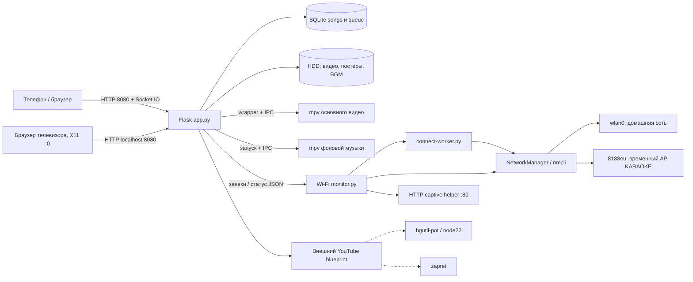
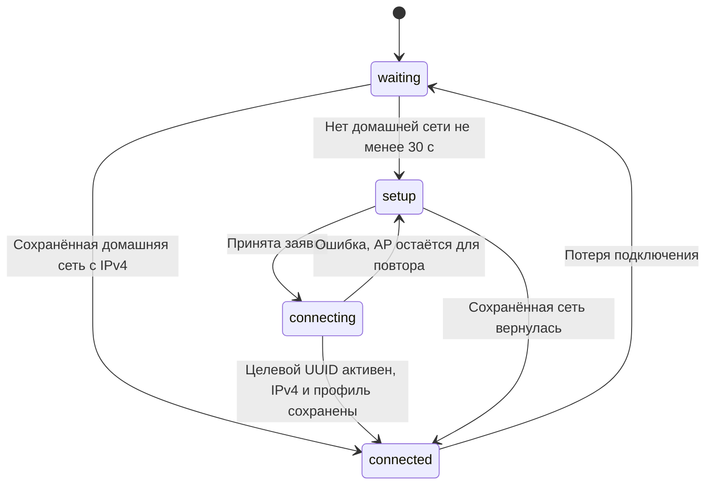

# KARAOKE — подробное руководство по проекту

Техническое описание без полных листингов кода. Исходники находятся в полном ZIP и едином документе «ПОЛНАЯ_ДОКУМЕНТАЦИЯ_И_ИСХОДНИКИ.md».


---

# Проект KARAOKE на X96Q: начало работы

Срез проекта: 15 октября 2026 года. Документация предназначена владельцу, разработчику и новому помощнику в другом аккаунте. Основание: доступные исходники, установщики, манифесты, журналы исследования и подтверждения пользователя. Онлайн-доступа к приставке при подготовке этого пакета нет.

## Что находится в комплекте

- `docs/`: руководства, схемы, алгоритмы, справочник HTTP, Python и JavaScript, описание хранения и восстановления.
- `sources/karaoke-wifi-integration/`: исходный снимок, последовательные обновления, установщики и тесты. Исходные исторические README сохранены, даже если в них остались устаревшие статусы.
- `sources/rtl8188eus-research/`: подготовка сборки USB-драйвера, привязка, постоянная установка, контрольные сведения.
- `sources/xradio-research/`: исследовательские патчи и модули встроенного Wi-Fi; это история эксперимента, не рекомендуемая установка.
- `versions/device-confirmed-v5/`: реконструированный набор известных файлов версии V5, которую пользователь подтвердил. Это не полный образ файловой системы приставки.
- `versions/prepared-media-audio-v1/`: известные файлы подготовленного следующего обновления. Его установка на приставке пока не подтверждена.
- `evidence/`: исходные текстовые вложения, конфигурация ядра, исходный архив пользователя и сводка переписки.
- `tools/`: проверка целостности, сбор дополнительных данных с приставки и извлечение исходников из единого документа.
- `MANIFEST.json`, `SHA256SUMS`: перечень и хэши всех файлов комплекта.
- `ПОЛНАЯ_ДОКУМЕНТАЦИЯ_И_ИСХОДНИКИ.md`: переносимый единый текст с руководствами и исходниками; его можно скопировать из боковой панели через «Копировать содержимое файла». Двоичные модули и изображения находятся в ZIP и не воспроизводятся текстом.

## Самое важное о состоянии

| Возможность | Состояние | Основание |
|---|---|---|
| Караоке с локального HDD, основная веб-страница | Работало на приставке | Многократные ответы HTTP 200 и проверки пользователя |
| USB RTL8188EUS на драйвере 8188eu, режим AP | Установлено, проверено после перезагрузки | Пользователь сообщил «Работает всё», показал драйвер и адреса |
| Встроенный wlan0 как клиент домашней сети | Работало | Профиль ZZZZ, адрес 192.168.1.102 в последнем подтверждённом выводе |
| Автоматическая точка настройки и левый QR V4 | Подтверждено пользователем | После обновления страницы ТВ сценарий работал |
| Правый QR для управления в домашней сети V5 | Подтверждено пользователем, задача закрыта | «Все работает с этим вопросом закончили» |
| Проверка/исправление медиатеки | Подготовлено и проверено в облаке | Код и установщик выданы, результата установки на приставку нет |
| Отключение HDMI с выводом на аналог | Подготовлено и проверено программно | Карты определены; реальное звучание не проверено |
| Полный загрузочный образ eMMC | Отсутствует среди доступных материалов | Были файловые резервные копии, не полный образ |

Порядок чтения: `01` → `02` → `03` → нужная подсистема → `09` для эксплуатации → `10` для развёртывания → `12` для передачи проекта. Справочники `13`–`16` созданы статическим анализом, без запуска приложения.

## Пределы полноты

Документация подробно описывает всё доступное. Отдельные действующие файлы приставки — YouTube-менеджер, модуль карантина, часть HTML, фактические базы и медиа — не были загружены в эту среду. Они перечислены в разделе о недостающих материалах. Их поведение нельзя полностью восстановить по одному импорту. Для завершения инвентаризации предоставлен скрипт сбора снимка. Сам пакет не меняет приставку и ничего на ней не устанавливает.


---

# Архитектура и оборудование

## Устройство

X96Q v5.1 TV Box, Allwinner H616, ARM64, около 2 ГБ RAM. Armbian unofficial 24.11.0-trunk, Debian Bookworm, ядро `6.6.44-current-sunxi64`. Образ собран из sicXnull/armbian-build, BOARD=x96q-v5-1, LINUXFAMILY=sunxi64. Совместимость DT: hechuang,x96-q; allwinner,sun50i-h616. Конфигурация ядра и DT относятся к нестандартному образу; общая инструкция Armbian не гарантирует загрузку этой платы.

Корень `/` находился на `/dev/mmcblk2p1` ext4, eMMC около 14,7 GiB. Это встроенная память: сценарий «вынуть системную SD-карту» к показанной конфигурации неприменим. HDD WDC WD2500BEVS около 232,9 GiB, раздел `/dev/sda1` ext4, основной mount `/mnt/usb_disk`. Его содержимое также было доступно через bind mount `/root/karaoke/karaoke_media`.

Встроенный Wi-Fi wlan0: xradio_wlan, SDIO 0020:2281. Он используется для домашней сети. USB Wi-Fi: RTL8188EUS 0bda:8179, известное имя wlxf0b040f7f699; custom driver 8188eu. Он используется только для временной точки настройки. Ethernet end0 существовал, но был unavailable. На месте нет второго USB Wi-Fi.

## Состав работающей системы



Пунктир означает зависимость общего проекта, точный внутренний вызов из отсутствующего YouTube-модуля не установлен. Установка документации не останавливает эти службы.

## Процессы и границы

Основной сервер — `karaoke-server.service`, рабочий каталог `/root/karaoke`, запуск `/usr/bin/python3 app.py`, TCP 8080 на всех IPv4-адресах. Flask-SocketIO работает в режиме threading. HTML основной страницы встроен в строку `HTML` в app.py; CSS и JavaScript находятся в той же строке. Нет отдельного npm-проекта для этой страницы.

Контроллер Wi-Fi — отдельная служба `karaoke-wifi-monitor.service`. Она запускает worker для одной операции. Таким образом перезапуск веб-приложения не должен уничтожать текущую настройку Wi-Fi. Контроллер владеет политикой включения AP; старый auto-manager отключён, два независимых владельца AP одновременно недопустимы.

`rtl8188eu-bind.service` — oneshot. После успешного выхода он может отображаться inactive/dead: проверяйте Result=success и ExecMainStatus=0, а не только is-active.

Основной mpv получает команды через `/tmp/mpvsocket`, BGM — `/tmp/bgm_mpvsocket`. `/usr/local/bin/play_karaoke.sh` управляет окном видео и возвратом браузера в X11, DISPLAY=:0. Из исторического снимка нельзя утверждать, какой именно браузер сейчас открыт на ТВ: сохранённый karaoke-browser.service с NetSurf был disabled, wrapper ищет окно через wmctrl.

## Сеть и порты

| Назначение | Адрес/порт | Условие |
|---|---|---|
| SSH | TCP 22 | По актуальному адресу приставки |
| Основной веб-интерфейс | TCP 8080 | Локальная и домашняя сеть, AP при активности |
| Временная точка | 192.168.100.1/24 | Только при сценарии настройки |
| Captive HTTP | 192.168.100.1:80 | Только пока AP активна |
| DHCP/DNS AP | NetworkManager shared/dnsmasq | Управляется NetworkManager |
| bgutil-pot | 127.0.0.1:4416 | По выведенному ExecStart |
| Сторонний Python listener | 127.0.0.1:9090 | Ранее наблюдался; назначение не установлено |

192.168.1.102 — зафиксированный адрес домашнего подключения, а не обещанный постоянный адрес. Правый QR строится из текущего адреса и не зашивает его навсегда. HTTP нужен для локального устройства; проект не настроен как публичный интернет-сервис.


---

# Версии, изменения и источники истины

## Слои кода

| Путь в комплекте | Что это | Как использовать |
|---|---|---|
| sources/karaoke-wifi-integration/current | Присланный исходный снимок до новых сценариев | Сравнение с историей, не актуальная установка |
| deploy/kit, deploy/paste-part-*.sh | Замороженное базовое обновление Wi-Fi V2 | Только если исходная версия соответствует манифесту |
| ui-v3 | Карточка с видимым QR вместо одной кнопки | Исторический шаг |
| ui-v4 | Ручное подключение к AP, затем URL QR | Подтверждённый сценарий настройки |
| ui-v5 | Правый QR домашнего управления | Последняя подтверждённая UI-версия |
| media-audio-v1 | Добавление проверки видео и аналогового звука | Подготовлено, установка не подтверждена |
| updated | Рабочая подготовленная версия со всеми новыми изменениями | Не считать дословной копией сейчас работающей приставки |

Относительные пути таблицы после первой строки указаны внутри sources/karaoke-wifi-integration.

## Идентификация app.py

| Версия | SHA256 |
|---|---|
| V4 | e168e929236a770953bac8e15aef6288662dccbb5bf6935f237c3b4ab13af642 |
| V5 | 8731353016f544c7f46cbf96e0d45dce7f6c52c1239d5777f92ff7f2abf441ba |
| Подготовленная media-audio-v1 | 54fb907fd6eb0ed108863ce747c61e496bbb198850ac65bc140ff54eaaaea29d |

На приставке выполните `sha256sum /root/karaoke/app.py`. Совпадение показывает точную известную версию файла. Несовпадение не означает повреждение: могли быть последующие изменения. В этом случае сначала сравнение, затем новый целевой патч; подменять ожидаемый хэш в установщике нельзя.

## USB-драйвер

Нативная сборка пользователя: `/root/rtl8188eus-build-xs4977k0/8188eu-test.ko`, SHA256 d1c545d580901e3bd85504d7c970a729383aaf75b3217724a4940c3b4e353bc3. Постоянное расположение — `/lib/modules/6.6.44-current-sunxi64/updates/drivers/net/wireless/8188eu.ko`.

В комплекте есть облачные GCC11/GCC12 модули как исследовательские артефакты. Они не являются тем самым нативно собранным файлом с указанным хэшем. Сам файл нативной сборки остался на приставке и в текущей облачной среде отсутствует. Перед переносом его надо отдельно сохранить.

## Приоритет подтверждений

1. Новый фактический вывод с приставки и подтверждение пользователя.
2. Проверенные хэши и манифесты версии.
3. Код соответствующего снимка.
4. Старые README и промежуточные записи исследования.

`build-evidence.json` обновлялся по этапам: вложенный home_control_qr_revision подтверждает V5; некоторые более старые поля overall_wifi_goal ещё говорят «V5 pending». Новая документация разрешает это расхождение по последнему подтверждению пользователя. Архивные README не переписаны, чтобы сохранить историю.

## Что не переносится автоматически

Смена аккаунта ChatGPT не меняет приставку. Непушенные файлы облачной среды Codex не появятся в новом аккаунте от одного подключения GitHub. Репозиторий /workspace/- в доступной среде не содержит рабочие файлы проекта: фактическая разработка находится в отдельных каталогах, которые и включены в этот комплект. Документы и снимки не следует принимать за готовый полный Git-репозиторий или образ ОС.


---

# Карта файлов и хранения

## Рабочие пути приставки

| Путь | Назначение | Жизненный цикл |
|---|---|---|
| /root/karaoke/app.py | Flask, встроенный интерфейс, очередь, плееры, HTTP | Меняется проверенным установщиком |
| /root/karaoke/wifi/network.py | API заявок и обёртка nmcli | Общий код сервера и контроллера |
| /root/karaoke/wifi/monitor.py | Единственный владелец политики AP | Постоянная служба, цикл 2 с |
| /root/karaoke/wifi/connect-worker.py | Одно подключение/сброс | Дочерний процесс контроллера |
| /root/karaoke/wifi/captive.py | Вспомогательный HTTP redirect | Работает только при активной AP |
| /root/karaoke/wifi/setup.html | Мобильная форма Wi-Fi | Отдельная страница |
| /root/karaoke/wifi/setup-qr.png | Статический QR URL настройки | Постоянный адрес AP |
| /root/karaoke/wifi/control_qr.py | Проверка IP, локальное создание PNG | Динамический домашний QR |
| /root/karaoke/wifi/vendor/qrcode | Матрица QR и лицензия | Вендоренная библиотека без Pillow |
| /root/karaoke/karaoke_media_optimizer.py | Сканирование и выбранные исправления | Только подготовленная версия |
| /root/karaoke/karaoke_audio_output.py | Выбор ALSA и проверка двух mpv | Только подготовленная версия |
| /root/karaoke/media_optimizer.html | Отчёт, выбор, просмотр, подтверждение | Только подготовленная версия |
| /root/karaoke/.bgm_settings.json | Громкость BGM/видео, enabled | Настройки пользователя |
| /root/karaoke/.audio_output.json | mode=hdmi или analog | Создаётся новой функцией |
| /data/karaoke/db/karaoke.db | Фактическая SQLite приложения | Не путать со старой копией в /root/karaoke |
| /mnt/usb_disk/karaoke_media | Плоский каталог видео | Основное содержимое HDD |
| /mnt/usb_disk/posters | Постеры исполнителей | Изображения jpg/jpeg/png/webp |
| /mnt/usb_disk/fonsound | Фоновая музыка | MP3 |
| /mnt/usb_disk/.karaoke-optimization | Журналы, отчёты, оригиналы | Исключён из индексируемой медиатеки |
| /usr/local/bin/play_karaoke.sh | Запуск mpv и X11 | Системный wrapper вне приложения |
| /usr/local/libexec/rtl8188eu-bind.py | Привязка конкретного USB устройства | Вызывается systemd/udev |
| /etc/NetworkManager/system-connections | Сохранённые сети и пароли | Частные файлы NetworkManager |
| /var/lib/karaoke-wifi | Статус и приватные задания | Каталоги 0700, JSON 0600 |
| /var/log/karaoke/server.log, error.log | Журналы сервера | Настроено в unit |
| /boot/armbianEnv.txt, overlay-user | Параметры загрузки и overlay | Не менять ради UI-функций |

`wifi/auto-manager.py` и `wifi/restore-wifi.sh` сохранены для истории. Старую автоматическую службу не включают параллельно с новым monitor.py. Наличие файла не означает, что он выполняется.

## SQLite

Схема из init_db() основного приложения:

```sql
CREATE TABLE IF NOT EXISTS songs (
  id INTEGER PRIMARY KEY AUTOINCREMENT,
  artist TEXT NOT NULL,
  title TEXT NOT NULL,
  file TEXT NOT NULL UNIQUE,
  plays INTEGER DEFAULT 0
);
CREATE TABLE IF NOT EXISTS queue (
  id INTEGER PRIMARY KEY AUTOINCREMENT,
  song_id INTEGER NOT NULL,
  added_at TIMESTAMP DEFAULT CURRENT_TIMESTAMP,
  FOREIGN KEY (song_id) REFERENCES songs(id)
);
```

queue.song_id ссылается на songs.id. Порядок — added_at ASC, id ASC. В показанном get_db() нет PRAGMA foreign_keys=ON, поэтому нельзя полагаться на автоматическое каскадирование: приложение вручную изменяет зависимые записи. Оптимизатор сохраняет ID при переименовании, переносит plays и ссылки очереди при архивировании точной копии. Возможные таблицы внешних модулей здесь не описаны: их исходников нет.

## Индексация

refresh_database() перечисляет видео с расширениями mp4/avi/mkv/mov, разбирает исполнителя и название, добавляет отсутствующие записи, обновляет метаданные, удаляет записи отсутствующих файлов и связанные элементы очереди. Он не должен запускаться при отсутствующем HDD: иначе можно принять временное отсутствие диска за удаление всех песен. В подготовленной версии это защищено проверкой mount и блокировкой MediaOptimizer.

Фоновый watcher смотрит снимок (имя, размер, mtime_ns) каждые 8 с; после стабилизации ещё около 8 с обновляет базу и уведомляет интерфейс. Сканирование плоское: рекурсивная библиотека каталогов не реализована.

## Служебное состояние Wi-Fi

status.json — последняя опубликованная картина, version=2; jobs/<job_id>.json — публичные статусы; requests/<job_id>.json — временные данные с паролем; active-job.json — указатель текущей операции. admission.lock защищает приём заявки; /run/karaoke-wifi-connect.lock защищает сетевую операцию. Пароль удаляется из request-файла перед nmcli и не включается в публичный job JSON.

Часы wall-clock используются для updated_at и устаревания записи, monotonic — для локальных задержек; boot_id предотвращает трактовку monotonic-значений прошлого запуска как актуальных.


---

# Wi-Fi и два QR-кода

## Пользовательский сценарий

Домашняя сеть доступна: встроенный wlan0 подключается к сохранённому профилю, получает IPv4, AP не нужна. Справа сверху на телевизоре под Wi-Fi и шестерёнкой показывается QR главной страницы с текущим адресом. Телефон для управления находится в той же домашней сети.

Домашняя сеть отсутствует: примерно через 30 секунд контроллер включает USB AP KARAOKE. Слева сверху показываются два шага: найти KARAOKE и ввести 12345678; после подключения навести камеру на QR и открыть настройку домашнего Wi-Fi. QR содержит URL, а не Wi-Fi credentials. Само сканирование этого QR не подключает телефон к сети.

Пользователь выбирает SSID, вводит пароль, получает статус операции. После подтверждённого сохранённого подключения с IPv4 точка остаётся на 10 секунд для ответа, затем выключается. Телефон переключают на домашнюю сеть и сканируют правый QR для управления.

## Критерий подключения

NetworkManager.station(): GENERAL.STATE=100, профиль wifi/infrastructure, интерфейс wlan0 либо незаданный, это не AP UUID и не SSID KARAOKE, есть пригодный IPv4, профиль сохранён на диске. Доступность интернета не проверяется: отсутствие WAN не должно убирать работающую домашнюю LAN и мешать офлайн-караоке.

## Политика контроллера



Реальный status.mode — waiting/setup/connecting/connected; status.error может присутствовать независимо. `setup_needed` вычисляется как AP активна и домашняя сеть отсутствует. AP может быть кратковременно активна при connected в период grace; это нормально.

Policy.decide(): при подключении сбрасывает missing_since и запоминает home_since. Для остановки AP требует домашнее подключение минимум 2 секунды, отсутствие busy и завершённый grace_until. При отсутствии подключения сбрасывает home_since и запускает AP после 30 секунд. Цикл tick() раз в 2 с означает, что точный момент включения зависит от продолжительности команд и границы цикла.

## Приём и выполнение заявки

1. HTTP проверяет фактический request.remote_addr. Разрешены loopback, собственный домашний IP для TV и клиенты 192.168.100.0/24 при активной AP. Заголовки X-Forwarded-For для этого не принимаются.
2. Проверяются SSID (1–32 UTF-8 байта), запрет CR/LF/NUL, пароль WPA (8–63 байта либо 64 HEX) или пустой пароль открытой сети. SSID KARAOKE не выбирают как домашнюю сеть.
3. Контроллер должен быть здоров: version=2, без ошибки, updated_at не старше 12 секунд. Вторая параллельная заявка отвергается.
4. Записываются private request, job status=queued и active-job. Возвращается HTTP 202 с job_id. Заявки не выполняются в Flask-потоке.
5. Контроллер сначала обеспечивает AP, затем запускает connect-worker.py с конкретным job_id; собственный deadline около 180 с.
6. Worker берёт operation lock, читает и удаляет файл с паролем. Создаёт временный save=no профиль KARAOKE_HOME_<job_id> с детерминированным UUID, ifname wlan0, infrastructure, autoconnect=no.
7. Активирует только этот профиль (`nmcli --wait 40`, таймаут процесса 50 с), проверяет именно его UUID и IPv4.
8. Делает профиль постоянным: autoconnect=yes, priority=50; проверяет наличие на диске и повторно активный UUID.
9. success → grace 10 с. failed → AP доступна; при возврате старой сети grace 60 с для повтора. Неуспешный временный кандидат удаляется только при совпадении его UUID и полного имени.

После перезапуска контроллер сверяет boot_id, deadline, lock и конкретный argv worker. Он не посылает сигнал произвольному повторно использованному PID. Прерванная операция становится failed либо признаётся завершённой, если именно её сохранённый профиль с IPv4 активен. Слишком старая queued-заявка (>120 с) не запускается заново.

## Сброс

POST reset требует настоящий JSON boolean confirmed=true. Сначала USB AP, потом удаление только подходящих домашних station-профилей, затем возврат device autoconnect. USB/AP-профили исключаются. Это намеренное удаление настроек, а не инструмент безобидного теста.

## Сканирование

Только wlan0, с `--rescan yes`; USB AP не сканируют. operation lock не допускает rescan одновременно с подключением. split_nmcli() корректно разбирает экранированные двоеточия и слеши SSID. Одинаковые SSID объединяются, преимущество у in-use и более сильного сигнала. Сеть KARAOKE скрыта из списка домашних.

## QR настройки

Статический PNG /wifi/setup-qr.png, payload `http://192.168.100.1:8080/wifi/setup`, SHA256 5f7a2c3b9f4281fbba4560da80d737bed5f4a7bb94abc1f424b171d834978671. Изменять IP AP надо согласованно в профиле NetworkManager, network.py, captive.py, dnsmasq и PNG; одной замены текста недостаточно.

## QR управления

control_qr.control_url() принимает только свежее controller_ok=true, connected=true и корректный IPv4. Не разрешены unspecified/loopback/link-local/multicast/reserved и 0.x. URL — http://<ip>:8080/. Кэш хранит только последний URL/PNG, защищён threading.Lock. При потере здоровья/сети кэш инвалидируется.

QR version=3, correction M, border=4, матрица вместе с полями 37×37, масштаб 6 → PNG 222×222. PNG строится stdlib struct/zlib без Pillow. Компактное отображение 185 px соответствует 5 px на модуль, без дробного масштабирования. Отдельный endpoint проверяет ожидаемый ip, чтобы не показать картинку от устаревшего адреса; Cache-Control=no-store и X-Control-URL возвращают актуальную цель. На узких экранах <=820 px домашняя карточка скрывается.

Встроенный JS проверяет статус примерно каждые 3 с, скрывает устаревшую карточку, защищает обновление изображения от гонки ответов. Основной старый интерфейс переопределяет fetch: новый код использует независимый XMLHttpRequest, где это необходимо. После обновления app.py надо перезагрузить страницу ТВ, иначе старый DOM останется на экране.

## Captive portal

NetworkManager shared dnsmasq получает address=/#/192.168.100.1 и local=/#/ для офлайн DNS. CaptivePortal слушает только 192.168.100.1:80, отвечает GET/HEAD HTTP 302 на страницу настройки. Порт 8080 не перехватывается. Неудачный bind не убивает другой процесс: публикуется ошибка helper, ручной URL остаётся запасным путём. Всплывающее окно зависит от Android/iOS/Windows и не гарантируется. HTTPS-перехвата нет.


---

# Драйверы Wi-Fi и загрузка

## Почему выбран USB

XRadio позволял ассоциацию и DHCP после экспериментального исправления, но стабильной передачи данных AP добиться не удалось. Windows и Samsung имели проблемы ARP и TCP при хорошем сигнале. Локальный сервер отвечал быстро. Это достаточное основание сменить рабочую архитектуру, но не доказательство одной окончательной внутренней причины всех сбоев.

В исследовании найдено опасное опубликование vif до инициализации vif_lock и последующая повторная инициализация. Исходный .text модуля сопоставили с реконструированным baseline. Также обнаружена неинициализированная переменная arg в suspend/resume indication. Эти находки различаются по степени проверки: часть патча использовалась в эксперименте, дальнейший source candidate не установлен; подтверждённого полного исправления XRadio AP нет. Подробности и ограничения сохранены в sources/xradio-research/README.md.

## RTL8188EUS

Исходный rtl8xxxu показывал managed/monitor без AP для этого чипа. Использован aircrack-ng/rtl8188eus, commit af3bf004458f76b7aec33e9ba552cd382ed1f5c3, module 8188eu, поддержка USB 0bda:8179 и AP. Репозиторий legacy/deprecated; это осознанный выбор под существующее устройство и ядро, не универсальная рекомендация для новых адаптеров.

build_for_x96q.py только собирает. Не устанавливает модуль, не меняет blacklist/сеть/ядро. Он проверяет aarch64, точный kernel release, SHA256 конфигурации, инструменты и минимум 2,8 GB свободного места, скачивает три закреплённых архива, проверяет хэши и пути, применяет 424 патча Armbian sunxi-6.6, делает modules_prepare. После olddefconfig сравнивает критические ABI-настройки и отказывается продолжать при изменении. Используется сохранённый проверенный набор export symbols, strict modpost остаётся обязательным.

Исходные архивы Linux/Armbian/driver больших размеров в этом пакете не находятся. Скрипт содержит URLs и ожидаемые SHA256, поддерживает --cache. Нужна сеть или заранее сохранённый кеш. Таблица точных входов и констант автоматически добавлена в справочник констант.

Конфигурация ядра: SHA256 ebc09f1d3dba1ebc61323b0c91cbb95e1ec34f3000a0fbf88bffb724f2083123. CONFIG_MODVERSIONS=n, CONFIG_MODULE_SIG=n, SMP=y; совпадение vermagic необходимо, но само по себе недостаточно для ABI-совместимости. Запрещено обходить проверки force loading.

## Постоянная привязка

rtl8188eu-bind.py ищет конкретное USB vendor/product, не полагается на сканируемый MAC. Проверяет kernel и ровно одно устройство, lock сериализует запуски. Если уже 8188eu — не перепривязывает. Если rtl8xxxu либо устройство свободно — проверяет установленный модуль и его SHA, загружает новым modprobe, отвязывает только это USB interface и привязывает новый драйвер. Неудача пытается вернуть rtl8xxxu. Встроенный SDIO wlan0 не затрагивается.

Unit идёт после NetworkManager, oneshot без RemainAfterExit. Udev rule может повторно вызвать службу при подключении USB. Правило запускает systemd, а не долгую работу внутри udev worker. Power config отключает rtw_power_mgnt, rtw_ips_mode, rtw_enusbss.

Проверка без изменений:

```bash
uname -r
modinfo -n 8188eu
modinfo -F vermagic 8188eu
readlink -f /sys/class/net/wlxf0b040f7f699/device/driver
systemctl show rtl8188eu-bind.service -p Result -p ExecMainStatus
journalctl -b -u rtl8188eu-bind.service --no-pager -n 60
```

UUID AP 67e9bd92-5f2a-4bab-9645-4afe89fcfc97 принадлежит конкретной установке. При создании профиля на другой приставке он может отличаться; код/профиль должны согласовываться. Имя сетевого интерфейса тоже может измениться: runtime-контроллер ищет USB динамически по ID, хотя диагностические примеры используют известное имя.

## Обновление ядра

Новый kernel не обслуживается автоматически собранным 8188eu. Binder намеренно остановится при несовпадении release. Нужны новое соответствующее дерево сборки, модуль, проверка ABI/экспорта и отдельный аппаратный тест. Обновление общего пакета linux-image на custom TV box без плана возврата может затронуть загрузку, DT, HDMI и Wi-Fi. Данный комплект не обновляет ядро и не содержит универсальный установщик ОС.


---

# Медиатека, воспроизведение и оптимизация

Статус оптимизатора: подготовлен; аппаратная установка не подтверждена. Описание ниже соответствует версии media-audio-v1.

## Обычное воспроизведение

Поиск /search?q= фильтрует title/artist и исключает карантин. /play получает имя, проверяет basename и существование, затем play_video_file() использует живой mpv по IPC либо запускает wrapper. Сохранённая громкость передаётся плееру. Поколение запуска предотвращает обработку устаревшего завершения как конца новой песни. После естественного завершения публикуется song_ended и продвигается очередь; ручной stop учитывается отдельно. Socket.IO синхронизирует состояние экранов.

BGM — отдельный mpv с MP3 playlist и собственным IPC. Нельзя завершать все mpv ради остановки одного видео. Регулировки громкости разделены, а файл .bgm_settings.json хранит volume, enabled и video_volume.

## Требования пользователя

Все видео привести к 1920×1080, включая исходники меньшего размера; fps не выше 24; пропорции сохранить, изображение не обрезать. Перед исправлением показать конкретные недостатки и дать выбор. Название должно содержать исполнителя и песню. Дубли нельзя определять только по похожему названию.

## Сканирование

start_scan() убеждается в корректном mount, отсутствии активной операции и наличии ffprobe. Создаёт UUID задания, папку отчёта и поток. Сканируется плоское содержимое медиа. Symlink не обрабатывается как обычный безопасный файл; ошибка видна в отчёте. Контроль identity=(dev, inode, size, mtime_ns) обнаруживает изменения во время чтения.

Для каждого файла проверяются имя, ffprobe streams/format, разрешение, rotation, sample aspect ratio, field_order, fps по avg_frame_rate/r_frame_rate. Если заголовки дают <=24, дополнительно анализируются packet PTS: средняя частота может скрывать VFR-всплески. Неизвестная cadence помечается как причина предложить фиксированные 24 FPS. Автоматический probe не равнозначен полному декодированию всего видео: глубокую порчу каждого кадра он гарантированно не выявляет.

Название — «Исполнитель - Название.ext», допускаются разделители с пробелами '-'/'–'/'—'; внутренний дефис исполнителя сохраняется. safe_name запрещает скрытые имена, управляющие символы, пути и недопустимые символы, ограничивает имя 240 байтами. Текущий scan показывает строки даже для неизвестных расширений, чтобы предложить MKV, если ffprobe обнаружил поддерживаемое видео.

Файлы группируются по размеру; только группы кандидатов хэшируются целиком SHA256. Совпадение полного хэша означает точную копию. Нормализованные похожие artist/title отмечаются как возможные версии, не удаляются. Хэши чувствительны к любому изменению контейнера: одинаковое видео с другими метаданными не будет считаться точным побайтовым дублем.

## Пользовательские действия и API

Ничего не выбрано по умолчанию. Отчёт позволяет отметить переименование, transcode либо duplicate_keep. Затем отдельный просмотр списка и финальное подтверждение. apply требует тот же актуальный job_id, state=ready и confirmed=true. Пример структуры (это пример, не команда для отправки):

```json
{"job_id":"<из завершённого отчёта>","confirmed":true,"actions":[
  {"file_id":"f0","rename_to":"Исполнитель - Песня.mp4"},
  {"file_id":"f1","transcode":true},
  {"file_id":"f3","duplicate_keep":"f2"}
]}
```

Оставляемую копию нельзя одновременно изменять/удалять в том же запуске. Новые имена не перезаписывают существующие. Расширение нельзя менять простым rename, только преобразованием. Исправления требуют остановленного основного видео, но не очистки очереди. Во время repair блокируются старт видео, загрузка/удаление медиа, опасные операции библиотеки и изменение очереди; read/status, звук и BGM остаются доступны. Внешние blueprint mutations также проходят guard.

## Преобразование

```text
источник → коррекция SAR → пропорциональный scale → pad до 1920×1080
         → setsar=1 → fps=24 → H.264/yuv420p, CRF20, preset veryfast
```

При interlaced добавляется yadif. Контейнер выхода MKV. Используется libx264, 2 потока, nice=10 при наличии. Возможность h264_v4l2m2m наблюдалась в системе, но подготовленный код не обещает и не включает аппаратное кодирование. Звуковые дорожки копируются; map=0, metadata и chapters сохраняются. MP4 mov_text конвертируется в ASS, о чём сказано в отчёте. Допускается один видеопоток и только известные video/audio/subtitle/attachment типы. Сложный неподдерживаемый набор отмечается для ручной обработки.

Код проверяет свободное место не меньше max(256 MiB, 2×size источника), затем во время работы минимум 64 MiB. Это эвристика, не гарантия размера результата: маленькое видео после upscale может вырасти. На файл установлен предел 12 часов. Отмена останавливает текущий ffmpeg; вывод и журнал лежат на HDD, а не на eMMC. Процент рассчитывается по out_time_us и duration, не является точным временем до конца.

Готовый файл повторно проверяется: 1920×1080, h264, fps <=24.001 с допуском представления, совпадение количества audio/subtitle/attachment, отличие duration не больше 1 с. Проверки не доказывают идентичное звучание/оформление всех сторонних кодеков; сложные случаи требуют просмотра пользователем.

## Транзакция одного исправления

До изменения проверяются mount, identity и полный SHA256; создаётся независимая копия оригинала на HDD и снимок затрагиваемых строк songs/queue. В journal.json записывается phase=prepared. Новый результат размещается, выполняются fsync файлов и каталогов, изменение SQLite, commit; затем durable phase=committed и finalize, после чего phase=done. При отказе undo восстанавливает исходные файлы и метаданные. Если файлы изменил внешний процесс, автоматический откат останавливается, чтобы не перезаписать чужое содержимое.

При rename сохраняются songs.id и plays. При архивировании дубля plays суммируется в оставляемую запись, queue.song_id перенаправляются на неё, позиции очереди сохраняются. Оригинал дубля остаётся в резерве, а не уничтожается навсегда.

При старте MediaOptimizer.load() читает current.json и восстанавливает журналы до refresh_database: prepared → undo; committed → finalize. Незавершённое задание становится failed с понятным сообщением, требуется новая проверка. Уже завершённые исправления отменой или рестартом не откатываются.

Состояния задания: scanning → ready → repairing → done; также failed и cancelled. Отмена не восстанавливает все ранее завершённые действия. Нет автоматической кнопки массового удаления старых оригиналов: их хранение и внешний бэкап надо контролировать отдельно.


---

# Звук: HDMI и аналог

Статус переключателя: подготовлен, слышимый результат на приставке ещё не проверен.

## Установленная диагностика

ALSA card audiocodec, PCM0 — аналог, LINEOUT включён; LINEOUT volume 31/31, digital volume 60/63. Card HDMI, PCM0 — HDMI. В /etc/asound.conf по умолчанию card 1, device 0; wrapper явно использовал alsa/plughw:1,0. Поэтому по показанной конфигурации плеер направлял звук на HDMI. Микшер HDMI показывал только loopback debug, не обычный аппаратный переключатель mute.

Новая кнопка не пытается управлять телевизором и не меняет глобальную конфигурацию ALSA. Она выбирает выход mpv:

| Режим | Устройство |
|---|---|
| hdmi | alsa/dmix:CARD=HDMI,DEV=0 |
| analog | alsa/dmix:CARD=audiocodec,DEV=0 |

Стабильные ID карты лучше числового индекса, который может поменяться при загрузке. dmix позволяет основному видео и BGM делить одну карту. Переключатель выбирает один выход для обоих плееров; режим одновременного HDMI+аналог не реализован. Это важно: надпись «отключить HDMI» здесь означает маршрутизацию на аналог, а не отдельный аппаратный mute поверх существующего двойного выхода.

## Алгоритм

1. API принимает только объект с единственным полем analog_only и настоящим boolean.
2. Под threading.RLock проверяется наличие целевой карты в /proc/asound/card*/id.
3. Для каждого существующего IPC socket читается предыдущий audio-device и idle-active.
4. set_property audio-device, затем readback. Для активного плеера дополнительно current-ao=alsa и audio-out-params, чтобы изменение свойства без реального открытия ALSA не считалось успехом.
5. Если любой шаг не удался, ранее переключённые плееры возвращаются в прежний режим. Ошибка возврата сообщается отдельно.
6. Только после успешных переключений атомарно сохраняется .audio_output.json с fsync.
7. player_args() и wrapper --device используют сохранённый выбор для будущих запусков. wait_ready() сериализует появление IPC с изменением выхода.

Если плееры не запущены, сохраняется выбор будущего запуска. status.verified в этом случае не означает, что пользователь уже слышал звук. По умолчанию при отсутствующей/невалидной настройке выбирается HDMI.

## Проверка после установки

Остановить текущую песню перед установкой. После обновления открыть настройки, включить «только аналог», запустить знакомое видео и BGM по отдельности, проверить аналоговый усилитель и отсутствие HDMI-звука. Вернуть HDMI и проверить обратное переключение, затем новый запуск и перезагрузку. Не повышать громкость до максимума только для диагностики. Проект не устанавливает наличие правильного AV-кабеля/распиновки/усилителя: это проверяется на месте.

Чтение статуса:

```bash
curl --noproxy '*' --max-time 5 -fsS http://127.0.0.1:8080/api/audio/output
cat /proc/asound/cards
aplay -l
```

До установки нового пакета endpoint /api/audio/output может возвращать 404: это не ошибка старой версии.


---

# HTTP API и события

Полный перечень маршрутов с исходными строками приведён в автосправочнике 14. Здесь описаны основные контракты. Маршруты YouTube и карантина неполны, потому что файлы внешних blueprint отсутствуют. Страница основного приложения содержит старые и новые участки JavaScript; название функции в UI не гарантирует, что существует отдельная одноимённая Flask route.

## Wi-Fi

| Метод / URL | Вход | Выход / назначение |
|---|---|---|
| GET /api/karaoke-wifi-monitor | Нет | Полный status, controller_ok, busy, setup_url |
| GET /api/network_status | Нет | status, ip, ssid для старого UI |
| GET /api/wifi/status | Нет | connection, ip, connected, ap_active |
| GET /api/wifi/scan | Нет | networks: ssid, signal, security, in_use |
| POST /api/wifi/connect | JSON ssid,password | 202 ok,job_id; 400/403/409/503 при отказе |
| POST /api/wifi/portal-connect | Тот же JSON | Дополнительно требует активную AP |
| GET /api/wifi/job/<job_id> | 32 HEX job_id | type,status,message,ssid,ip,updated_at без пароля |
| POST /api/wifi/reset | {"confirmed":true} | 202 job_id либо отказ |
| GET /wifi/setup | Нет | Страница настройки |
| GET /wifi/setup-qr.png | Нет | PNG статического URL |
| GET /wifi/control-qr.png?ip=<ожидаемый ip> | query ip необязателен | PNG и X-Control-URL; 409 если адрес/статус устарел |

Статусы Wi-Fi job: queued, connecting, success, failed. У job status — состояние операции, а у monitor mode — состояние контроллера: это разные поля.

## Караоке и очередь

/play POST {file}; /search GET ?q=; /top_artists GET; /increment GET ?file=; /queue/add POST {song_id}; /queue/list GET; /queue/next GET; /queue/remove/<queue_id> DELETE; /queue/move POST {queue_id,direction:-1|1}; /queue/clear POST. /api/stop, /api/pause, /api/next — старые управляющие GET endpoints.

/queue/next извлекает элемент из очереди и возвращает song; /api/next — отдельная команда управления плеером. Их нельзя считать двумя названиями одной операции. Некоторые старые endpoints при ошибках возвращают JSON с error и HTTP 200; клиент должен проверять тело, а не только статус.

Файлы: /upload POST multipart file, /refresh_after_upload POST, /upload_poster POST, /upload_bgm POST, /api/files/list GET, /api/files/delete POST, /settings/refresh_db POST. /api/format_hdd POST — существующая разрушительная операция очистки; не использовать как проверку исправности. Точные поля файлового API смотрите в функции по ссылке справочника, прежде чем писать клиент.

Звук/BGM: /api/bgm/start, stop, volume, toggle, status; /api/video/volume. Здесь старые GET изменяют состояние; это не образец REST для нового внешнего сервиса.

## Новые endpoints подготовленного пакета

| Метод / URL | Вход | Выход |
|---|---|---|
| GET /video-optimization | Нет | HTML интерфейс |
| GET /api/media-optimizer/status | Нет | ok, job или null |
| POST /api/media-optimizer/scan | Нет | 202 ok,job_id |
| POST /api/media-optimizer/apply | job_id,actions,confirmed:true | 202 ok,job_id |
| POST /api/media-optimizer/cancel | Нет | ok; запрос остановки текущей работы |
| GET /api/audio/output | Нет | ok,mode,analog_only,available,players,verified,error |
| POST /api/audio/output | {"analog_only":true|false} | Тот же status либо 400/409 |

Примеры status row для оптимизации: id, name, size, issues[{kind,message}], proposed_name, video{width,height,fps,codec}, duplicates[file_id], possible_duplicates[names], can_transcode. Внутренние поля с префиксом '_' из публичного статуса исключаются. status.job содержит id,state,stage,current,total,processed,message,rows,results,error,cancel_requested.

## Socket.IO

Сервер принимает connect/disconnect и search_sync, рассылает обновления состояния/очереди, plays_update, song_started, song_ended и db_update. Автосправочник содержит все строковые события emit/on, найденные статически. UI может обновляться по Socket.IO и отдельным периодическим HTTP; устаревший браузер после обновления надо перезагрузить.

## Граница доступа

Wi-Fi mutations имеют проверку peer address. Это не общая аутентификация всего приложения: в основном Flask-коде нет единой авторизации пользователей для всех действий. Flask-SocketIO настроен с cors_allowed_origins='*'. Документация не утверждает, что приложение безопасно публиковать в интернете. Развёртывание в доверенной локальной сети и сетевую доступность надо рассматривать отдельно от наличия QR.


---

# Эксплуатация и диагностика

## Обычное включение

Приставка загружается, binder выбирает USB-драйвер, NetworkManager пробует сохранённую домашнюю сеть. При успехе справа появляется QR управления. Если сохранённая сеть недоступна, через задержку появляется KARAOKE и левый QR настройки. Интернет не обязателен для локальной медиатеки.

Если QR «старый», сначала обновите страницу ТВ (F5) и проверьте отдаваемый HTML, а не переустанавливайте драйвер. Эта проблема уже возникала: файл и API были верные, но телевизор держал старую страницу.

## Куда вставлять команды

В Windows PowerShell выполняют ssh/scp, Get-FileHash, Get-Clipboard, пути C:\\Users\\.... Внутри SSH на приставке — bash/nmcli/systemctl и пути /root/.... Строки приглашения `PS C:\\...>` и `root@x96q-v5-1:~#` не являются частью команды. Они не должны попадать в копируемый блок. Не копируйте поясняющий текст вместе с командами.

## Чтение состояния без изменения системы

На приставке:

```bash
printf 'SSH: %s\n' "$SSH_CONNECTION"
uname -r
uptime
nmcli device status
ip -br -4 addr
ip route
findmnt -no SOURCE,FSTYPE /
findmnt /mnt/usb_disk
lsblk -o NAME,SIZE,TYPE,FSTYPE,MOUNTPOINTS,MODEL
df -h / /mnt/usb_disk
systemctl is-active karaoke-server.service karaoke-wifi-monitor.service bgutil-pot.service zapret.service
systemctl show rtl8188eu-bind.service -p Result -p ExecMainStatus
sha256sum /root/karaoke/app.py
curl --noproxy '*' --connect-timeout 3 --max-time 8 -sS http://127.0.0.1:8080/api/karaoke-wifi-monitor
```

С клиента в PowerShell (сначала убедиться, что подключён к нужной сети):

```powershell
ipconfig
netsh wlan show interfaces
Find-NetRoute -RemoteIPAddress 192.168.100.1
curl.exe --noproxy "*" --connect-timeout 3 --max-time 8 -v http://192.168.100.1:8080/api/karaoke-wifi-monitor
```

Если телефон уже в домашней сети, используйте адрес правого QR вместо 192.168.100.1. `--noproxy` исключает HTTP proxy, но не обязательно системный VPN/TUN; маршрут проверяется отдельно.

## Быстрая таблица неисправностей

| Симптом | Что проверить | Как понимать |
|---|---|---|
| Нет KARAOKE при работающей домашней сети | connected=true, ap_active=false | Нормальная работа |
| Нет KARAOKE при отсутствии домашней сети | controller_ok, binder, USB ID, journal | Отличить ошибку контроллера от отсутствия адаптера |
| Телефон получил IP, но страница не открывается | Локальный curl, route клиента, ARP, station dump | DHCP не доказывает исправную двустороннюю передачу |
| Локальный curl быстрый, клиент зависает | Канал, драйвер, соседняя запись, VPN, packets | Не обвинять Flask без данных |
| QR ведёт на старый IP | controller status, control-qr?ip, обновление ТВ | Домашний адрес мог измениться |
| Статус controller_ok=false | timestamp <=12 с, error, служба | UI не должен показывать QR по устаревшему состоянию |
| Binder inactive/dead | Result и ExecMainStatus | oneshot может быть успешно завершён |
| Оптимизатор возвращает 404 | SHA app.py и версия | Пакет мог ещё не быть установлен |
| Медиатека пуста | HDD mount до refresh | Не обновлять базу на отсутствующем диске |
| Внутренний диск заполнен | df и крупные архивы в /root | Не удалять медиа/базу наугад |
| Аналог молчит | Выбранный режим, ALSA card, физический кабель | status.verified не заменяет прослушивание |

## Журналы

```bash
journalctl -b -u karaoke-wifi-monitor.service --no-pager -n 100
journalctl -b -u rtl8188eu-bind.service --no-pager -n 60
journalctl -b -u karaoke-server.service --no-pager -n 60
tail -n 80 /var/log/karaoke/error.log
journalctl -b -k --no-pager | grep -Ei '8188|xradio|mmc|timeout|oops|stall|usb' | tail -n 100
```

Unit приложения направляет stdout/stderr в файлы append; поэтому journalctl сервера может показывать только сообщения systemd. Для сетевого захвата используйте ограниченный timeout и правильный USB interface. Не захватывайте весь трафик без нужды и не публикуйте файлы профилей с паролями.

## Правила изменений

Перед перезапуском серверного кода остановить песню. До любых сетевых изменений проверить SSH_CONNECTION и путь до клиента: выключение интерфейса, несущего SSH, может оборвать доступ. Таймер возврата полезен, но не гарантирует восстановление при зависании ядра, сбое питания или невозможности загрузки. Не останавливать NetworkManager целиком для замены одного USB-драйвера. Не применять pkill ко всем плеерам. Для UI-обновления не требуется трогать zapret, bgutil или ядро.

Старые экспериментальные таймеры могли вернуть wlan0 к домашней сети и убрать AP. Посмотреть их можно через `systemctl list-timers --all --no-pager`; запускать исторические rescue/test scripts повторно без понимания версии нельзя.


---

# Развёртывание, откат и резервные копии

## Перед обновлением

1. Определить фактическую версию app.py по SHA256 и наличие нужных зависимостей.
2. Сохранить текущие код, wrapper, конфигурацию, согласованную рабочую SQLite-базу; важные видео копировать отдельно.
3. Убедиться в HDD mount и свободном месте.
4. Проверить `systemctl show karaoke-server.service -p ExecStartPre --value`: эффективное поле должно быть пустым. Drop-in 20-disable-init.conf очищает старый init_karaoke.sh, который мог скачивать и перезаписывать приложение/менять медиа-ссылки.
5. Остановить текущую песню. Сверить, что нет незавершённой операции Wi-Fi/repair.
6. Использовать установщик под точный baseline, не копировать весь updated поверх вслепую.

Старые установщики V2/V3/V4/V5 не следует последовательно запускать на уже работающей V5. Они сохранены для истории и воспроизведения соответствующего этапа. Для нового изменения нужен новый целевой пакет.

## Подготовленный media-audio-v1

Полная передаваемая команда лежит `sources/karaoke-wifi-integration/media-audio-v1/paste-update.sh`. Внутри сжатый набор исходников, SHA256, проверка распаковки и запуск install.py в независимой systemd-задаче. Блок предназначен для SSH на приставке, не для PowerShell. Сохранённые аргументы установщика содержат привязку к конкретной базе и версии.

Он проверяет V5, неизменность файлов Wi-Fi, остановку плеера, доступность ffmpeg/кодировщика, отключённый ExecStartPre. Создаёт частный backup app.py, wrapper и SQLite backup API. Под marker .media-audio-installing (защита новых mutations до 300 с) ставит новые helpers, wrapper и app.py атомарными заменами. Перезапускает только karaoke-server и проверяет главную, страницу оптимизации, API, наличие звуковых карт и controller_ok, сверяет неизменные Wi-Fi hashes.

Ожидаемая строка успеха: MEDIA AUDIO INSTALLED. Затем F5 на ТВ. Установка не запускает сканирование/исправление видео автоматически. В актуальной истории подтверждение этой строки пользователем отсутствует.

При ошибке health установщик восстанавливает код. Путь частной резервной папки печатается при запуске; он случайный, заранее подставить фиктивный XXXXXX нельзя. Standalone rollback.py принимает --rollback <эта_же_папка>. Откат кода не заменяет живую базу старой копией и не отменяет ранее подтверждённые исправления видео. Их оригиналы и journals хранятся отдельно на HDD.

## Известные реальные пути возврата

USB-драйвер:

```bash
bash /root/karaoke-usb-install-gtz30b4s/rollback.sh
```

Базовый сценарий Wi-Fi:

```bash
python3 /root/karaoke-wifi-backup-9t4n98fz/rollback.py --rollback /root/karaoke-wifi-backup-9t4n98fz
```

Обновление URL QR V4:

```bash
python3 /root/karaoke-qr-link-backup-wtq_7b8_/rollback.py --rollback /root/karaoke-qr-link-backup-wtq_7b8_
```

Это команды изменения системы, не диагностические команды. Они относятся к разным слоям и не являются универсальной «кнопкой восстановить всё». Для V5 и нового пакета фактический путь резервной папки в доступном выводе не показан. Сначала надо найти именно напечатанный установщиком путь и проверить его содержимое. При откате сети выполнять работу через сохранённый независимый доступ.

## Что уже было сохранено

| Архив/файл | SHA256 | Подтверждение |
|---|---|---|
| karaoke-app-backup-1wqPpb.tar.gz | 9a69e10a21bb404592ec787b20e99f45c222da8e11cf16c1554057feb4f49797 | Создание; скачивание было в приложенном выводе |
| x96q-settings-QyViuT.tar.gz | 37cb6d7beaf4867ab2787b5f70021cb440d449ce0ca3e2c53a1be0cea1b16e61 | Windows хэш совпал |
| x96q-tools-rCVNGs.tar.gz | b2a317cee19d8f04551da99112ffca48727f0497dedcaa65a685517b7e1e2cf7 | Windows хэш совпал |
| karaoke-db-backup-7q2jdett.db | 1884c9ef1cdf531b0fc83cae3fd386716d6e4b5bd48be0d9a2e35c2b413a6f7d | integrity_check ok, Windows хэш совпал |
| исходный xradio_wlan.ko | 87f8bb37c1e4509a761477bfa701a0733a0caa894a3160acf0a192680da403e3 | Сохранён вместе с config и NM profiles |

Старая 20 KiB база /root/karaoke/karaoke.db не является установленной из кода рабочей базой /data/karaoke/db/karaoke.db. Нужна свежая отдельная согласованная копия фактического DB_NAME. Размер файла и совпавший хэш не доказывают, что скопирован правильный путь.

Инструменты архива: /opt/zapret около 3,9 MB, /opt/bgutil-pot-2.0.2 около 254 MB, /opt/node22 около 201 MB. Архив получился около 124 MB. Эти установленные каталоги и Windows-бэкапы не находятся в облачном пакете документации — здесь только их описание и контрольные значения.

## Как делать новые файловые копии

В tools/collect_device_snapshot.sh дан проверяемый скрипт. Он создаёт снимок на смонтированном HDD, копирует приложение без медиа, системные файлы по явному списку, согласованную SQLite-копию и доступные модули Wi-Fi, сохраняет версии/журналы. Он не перезапускает службы и не меняет сеть. Запустить его надо отдельно на приставке; автоматического запуска при чтении документа нет.

Он помогает собрать недостающие исходники, но не копирует всю видеотеку и не создаёт загрузочный образ eMMC. Профили NetworkManager могут содержать домашние пароли; полный снимок держать в частном хранилище. Для копирования на Windows выполнить scp из PowerShell с фактическим путём напечатанного архива и проверить Get-FileHash.

## Восстановление на аналогичной приставке

Нужна загружающаяся совместимая ОС/ядро/DT, mount HDD, соответствующие пакеты Python/Flask/SocketIO/mpv/ffmpeg/X11 и внешние службы. Затем вернуть приложение и настоящую DB, настроить unit/drop-ins, проверить mount до индексации, отдельно поставить подходящий USB-драйвер и NM profiles, запустить и пройти функциональную проверку. Имена карт, USB interface, IP, UUID и kernel release на другой плате проверяются заново. Нельзя обещать восстановление одной распаковкой в / поверх другой ОС.

Если ОС не загружается, файлы app.py и backup.sh не помогут запустить ядро. Если ОС загружается и работает консоль, ТВ+клавиатура могут дать локальный доступ, но это зависит от исправности видео/ввода/ОС. Для отказа загрузки нужен независимый проверенный загрузочный носитель/образ и способ восстановления именно этой платы; в материалах такой комплект не подтверждён.


---

# Разработка, проверки и сопровождение

## Что необходимо

Для статической проверки — Python 3.11+; для изолированных route tests — Flask, для интерфейса Node.js; для реальных media tests — ffmpeg/ffprobe с libx264; для браузерных — Playwright и Chromium. Вендоренный QR production-код не требует Pillow/pypng. Приложению на устройстве нужны также Flask-SocketIO, mpv, nmcli/NetworkManager, X11-инструменты и недостающие внешние модули.

Нет единого lockfile всех зависимостей устройства. Версии установленных пакетов сохранены только в пользовательских архивах/диагностике, которые не заменяют актуальную инвентаризацию. Временная облачная папка /tmp/karaoke-wifi-flask-test не переносится в другой аккаунт; перед повторными тестами установить зависимости в отдельное окружение. Не записывать случайные версии в требования как проверенные.

## Почему нельзя просто import app

app.py создаёт каталоги, регистрирует внешние модули и содержит запуск медиа; некоторые инициализации происходят при импорте. В облаке нет HDD, ALSA, X11 и полного окружения приставки. Запуск Python app.py не является безопасной проверкой документации. Тесты используют AST-извлечение отдельных функций, временную файловую систему, подмену system calls или локальный helper; настоящие ffmpeg тесты работают с временными тестовыми видео.

## Сохранённые проверки

| Подсистема | Проверки и известный результат |
|---|---|
| Wi-Fi backend | 18 safety tests на момент базового обновления |
| HTTP маршруты Wi-Fi | 12 изолированных Flask tests |
| Captive HTTP / DNS | 7 HTTP и 2 DNS теста |
| V5 QR | 19 helper/route, 18 installer/rollback, JS race/state; Chromium и независимое декодирование |
| Media/audio | 32 feature/integration/installer; real ffmpeg, 2 audio, ASS+font attachment, crash/cancel/collision/mount/audio rollback |
| Регрессии интерфейса | 3 JS harness для Wi-Fi/QR и Chromium выбора/review/apply/error/cancel/mobile/audio |

Это результаты предыдущего этапа разработки. При сборке документации они не выдаются за новый полный прогон на приставке. Проверка целостности пакета отдельно описана в отчёте tools/verify_package.py.

## Команды повторного запуска после подготовки окружения

Из sources/karaoke-wifi-integration:

```bash
python3 -m unittest discover -s updated/wifi -p 'test_network.py' -v
python3 -m unittest discover -s frontend-tests -p 'test_routes.py' -v
node frontend-tests/test_setup_jobs.js
node frontend-tests/test_indicator.js
node control-qr-tests/test_control_card.js
python3 -m unittest discover -s control-qr-tests -p 'test_*.py' -v
python3 -m unittest discover -s media-audio-tests -p 'test_*.py' -v
python3 media-audio-tests/check_browser.py
```

Реальный браузерный скрипт в сохранённой версии указывает executable_path=/usr/bin/chromium и требует Python Playwright. При другой ОС адаптировать путь осознанно. DNS-тест использовал отдельный извлечённый dnsmasq binary; без него полноценный DNS-тест не считается выполненным. Некоторые тесты установщика используют временные пути и mocks: это не аппаратный reboot test.

package.py пересоздаёт архивы; это mutation артефактов, не обычная проверка чтения. После изменения источников пересобрать пакет и проверить новые манифесты. Старый ожидаемый app_before относится к устройству, его нельзя механически заменить на текущий source hash без анализа совместимости патча.

## Порядок изменения кода

Прочитать docs/02 и сравнить фактическую версию. Сохранить baseline. Изменять минимальный затронутый модуль, писать проверки реального поведения, а не дублировать код тестом. Для Wi-Fi проверить сохранение AP до окончательного success; для QR — актуальность адреса и refresh; для media — identity/hash/queue/count/recovery; для audio — оба mpv и возврат при частичном отказе. Составить новый установщик с частной копией и понятной командой отката. Не включать исследовательские kernel patches в UI-релиз.

## Лицензии

sources/.../updated/wifi/vendor/qrcode/LICENSE и VENDORING.md относятся к адаптированному python-qrcode 8.2 (BSD-3-Clause с сохранёнными upstream attribution). Не удалять их при копировании. Скрипт сборки драйвера скачивает закреплённые upstream источники; условия лицензии драйвера/ядра сохраняются в соответствующих upstream архивах. Пакет документации не объявляет все исходники своей новой единой лицензией.


---

# Передача проекта в другой аккаунт или разработчику

## Как открыть комплект

Если ZIP скачивается, распаковать в отдельный каталог, открыть docs/00 и выполнить `python3 tools/verify_package.py .` из корня распаковки (в Windows обычно `py -3 tools/verify_package.py .`). Исходники не запускаются этой проверкой.

Если ссылки открывают боковую панель, а Download отсутствует, открыть единый Markdown и выбрать «⋯ → Копировать содержимое файла». Сохранить через Блокнот UTF-8 как KARAOKE_DOCUMENTATION.md. Это текстовый вариант с кодами; он полезен для нового чата даже без распаковки. В комплекте есть extract_sources.py, который умеет извлекать помеченные текстовые исходники из единого документа в новый каталог, сверяя SHA256. Двоичные файлы, не встроенные текстом, он не восстанавливает.

Из PowerShell можно сохранить уже скопированное содержимое одной командой:

```powershell
$karaokeDocsDir = Join-Path $env:USERPROFILE 'OneDrive\Документы\KARAOKE SERVER\DOCUMENTATION'
New-Item -ItemType Directory -Force -Path $karaokeDocsDir | Out-Null
$karaokeDocsPath = Join-Path $karaokeDocsDir 'KARAOKE_DOCUMENTATION.md'
[System.IO.File]::WriteAllText($karaokeDocsPath, (Get-Clipboard -Raw), [System.Text.UTF8Encoding]::new($false))
Get-Item $karaokeDocsPath | Select-Object FullName, Length
```

Эта команда выполняется на Windows, не в SSH. Перед ней действительно скопировать содержимое документа, а не URL или путь. Файл начинается заголовком «KARAOKE — полный комплект документации и исходников».

## Стартовый запрос для нового помощника

> Изучи docs/00 и docs/12, затем карту файлов и версии. Это KARAOKE на X96Q v5.1, kernel 6.6.44-current-sunxi64. USB RTL8188EUS/8188eu и два QR-сценария пользователь подтвердил. Media/audio пакет только подготовлен, установка не подтверждена. Не импортируй app.py в облаке и не считай updated точной копией устройства. Сначала сравни фактические hashes. Не затрагивай zapret, bgutil, HDD, рабочую сеть и ExecStartPre override ради UI-изменений. Объясняй, какие команды вводятся в PowerShell, какие в SSH. Разбирайся по исходникам, а отсутствующие модули запроси/собери отдельным снимком.

Документация сохраняет технический контекст, но не переносит чат как живую историю, аккаунтные права GitHub и облачную среду автоматически.

## Чего сейчас нет в облачной копии

| Материал | Почему нужен | Где искать |
|---|---|---|
| karaoke_youtube_manager.py | Реализация YouTube blueprint | /root/karaoke на приставке |
| karaoke_quarantine.py | Карантин и его hooks | /root/karaoke |
| youtube_manager.html, youtube_search.html и другие внешние страницы | Полный UI загрузок/поиска | /root/karaoke, проверить фактически |
| poster_manager.html и внешние poster helpers | Полная реализация постеров | /root/karaoke, импорты внутри routes |
| socket.io.min.js | Клиентский runtime Socket.IO | /root/karaoke |
| Фактический play_karaoke.sh | Текущий wrapper, возможно изменён | /usr/local/bin |
| Рабочая /data/karaoke/db/karaoke.db | Настоящие песни/plays/queue | Согласованная свежая SQLite-копия |
| Нативный 8188eu.ko с d1c545... | Точный установленный модуль | /lib/modules/.../updates/... или /root/rtl8188eus-build-xs4977k0 |
| Действующие unit/drop-ins и NM profiles | Фактическая конфигурация | /etc/systemd/system, /etc/NetworkManager |
| /opt/zapret, bgutil, node22 | Зависимости YouTube | Приставка или Windows tools backup |
| Постеры, BGM, видео | Пользовательские данные | Внешний HDD |
| Полный загрузочный образ и recovery носитель | Восстановление отказа ОС | Не подтверждены |
| Исходные Linux/Armbian/driver tarballs сборки | Полностью офлайн повторная сборка | Сохранённые URLs/hashes, кеш приставки |

Конкретные недостающие Python imports также перечислены в автосправочнике. Этот список не означает, что файлы отсутствуют на самой приставке: их нет именно в переданном облачном снимке.

## Что сделать первым после переноса

1. Сверить целостность комплекта.
2. Прочитать подтверждённый V5 и prepared media/audio как разные версии.
3. Получить свежий read-only diagnostic и snapshot, если нужна точная копия устройства.
4. Уточнить факт установки последнего пакета по SHA app.py и журналу, без повторного запуска установки вслепую.
5. Только после этого продолжать новые изменения.

## Что пакет не обещает

Он не содержит полный дословный чат, загрузочный образ eMMC, все медиа, секреты из недоступных архивов, доступ к домашней LAN или автоматическое восстановление аккаунтов. Подробная документация объясняет эти границы, чтобы следующий разработчик не принял исторический снимок за актуальную установленную систему.

